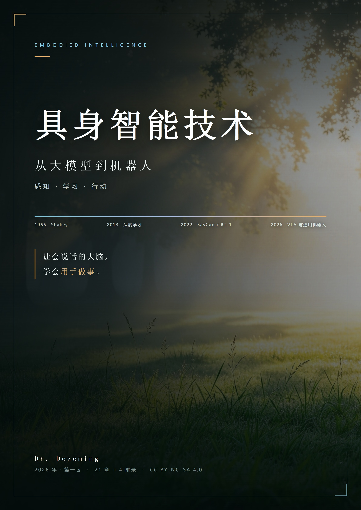

# 具身智能技术

> 从大模型到机器人：感知、学习与行动

语言模型把符号玩得很熟，机器人却仍要在毫米与毫秒里讨生活。这本书从一台机械臂的自由度讲起，经过相机几何、位姿与抓取、强化学习与模仿学习、运动规划，一直讲到视觉-语言-动作模型、世界模型、腿足与灵巧手，最后落到系统集成与评测。

作者：**Dr. Dezeming**　·　2026 年 · 第一版

> 📖 **在线阅读**：<https://ai-crystal.github.io/Embodied-AI/>
>
> 每章一个独立链接，例如 `https://ai-crystal.github.io/Embodied-AI/#/book/chapters/ch07`

[开始阅读](book/chapters/ch01.md)　·　<a href="output/embodied-ai.pdf" target="_blank" rel="noopener">下载 PDF</a>

## 这本书写给谁

- 做过语言模型或多模态模型，想理解"模型怎么输出动作"的算法工程师。
- 用 Agent 工具搭过工作流，想搞清楚"为什么 Agent 在屏幕上很聪明，一进物理世界就不行"的产品与研究人员。
- 刚进实验室、被分配去做抓取、导航或 VLA 的学生，论文之间的空白没人给你补。
- 做具身智能周边（仿真、数据、评测、硬件）的工程师，想建立全局视野。

不要求会机器人学，不要求会强化学习。要求你懂张量、反向传播和 Transformer 的注意力，这些本书不再重复。

## 全书结构

| 篇 | 内容 | 章 |
|---|---|---|
| 第一篇 身体的意义 | 莫拉维克悖论、关节与位姿、六十年的路线之争 | 1–3 |
| 第二篇 看懂世界 | 相机几何、6D 位姿与抓取、视觉表征、场景图与地图 | 4–7 |
| 第三篇 学会行动 | 强化学习、模仿学习与扩散策略、仿真与 sim2real、运动规划 | 8–11 |
| 第四篇 大模型进入身体 | LLM 任务分解、VLA、机器人数据、世界模型 | 12–15 |
| 第五篇 身体与控制 | PID 与阻抗控制、腿足与人形、灵巧手与触觉 | 16–18 |
| 第六篇 落地与远方 | 系统集成与时延、评测基准、仍未解决的问题 | 19–21 |

附录：数学与工具速查、术语中英对照、参考文献与延伸阅读、工具链速查。

## 阅读方式

- **在线**：左侧目录按篇分组，每章一个独立链接，可以直接分享 `#/book/chapters/ch13` 这样的地址。
- **下载**：整本 PDF 见 <a href="output/embodied-ai.pdf" target="_blank" rel="noopener">output/embodied-ai.pdf</a>。
- **插图**：全部由代码绘制，源图在 `book/images/`，绘图脚本在 `book/code/`，可以改参数重画。

## 约定

- 向量写粗体小写，矩阵写粗体大写，标量写斜体；公式里角度用弧度，参数表里用度。
- 编号形如"图 4-2""表 9-1"，指第 4 章第 2 张图、第 9 章第 1 张表。
- 涉及产品的参数取公开资料的典型值，用于建立数量级概念，不作为选型依据。

## 许可

本书文字与插图采用 **CC BY-NC-SA 4.0**（署名—非商业性使用—相同方式共享）许可发布。书中提及的论文版权归原作者与出版方所有。

发现错漏欢迎提交 Issue。
