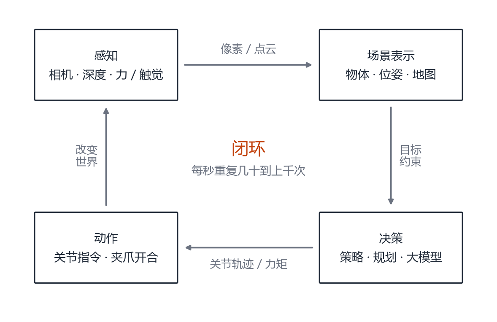
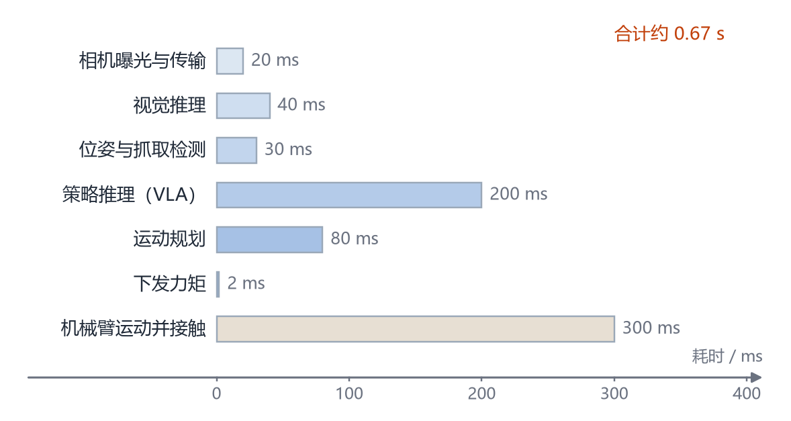

# 第 1 章　从一个动作说起

> **本章导读**：语言模型能写诗、能讲笑话、能通过司法考试，却拧不开一瓶矿泉水。这一章从这个反差出发，说清"身体"对智能意味着什么，具身智能和相邻领域的分界线在哪里，以及把一只苹果从桌上放进盘子里，究竟要经过多少个环节。读完这一章，你会知道后面二十章各自在补哪一块。

## 1.1 会写诗的手，拧不开瓶盖

2023 年之后，几乎所有人都见过这样的演示。一个模型读完一份 PDF，总结要点，写出可运行的代码，还能用自然语言解释它为什么这么写。它的输出在符号世界里几乎无所不能。

同一时期，如果你想买一台能把矿泉水瓶盖拧开的机器人，会发现选择少得可怜，价格却不便宜。更麻烦的是，它拧开的成功率往往取决于瓶子摆得正不正、盖子紧不紧、桌面滑不滑。换一个品牌的瓶子，成功率可能从九成掉到五成。

这个反差在机器人领域有个名字，叫莫拉维克悖论（Moravec's paradox）。它在 1980 年代就被提出来，意思是：让计算机做成人觉得困难的事（下棋、证明定理、诊断疾病）相对容易，让计算机做小孩都会的事（看、走、抓、听）却极难。当时的解释是，后者经过了几亿年的进化打磨，已经变成不需要意识参与的底层能力，而逻辑推理反而是人类历史上很晚才发展出来的技能。

到了大模型时代，这个悖论换了一副面孔，但依然成立。语言模型之所以强，是因为它的训练数据是人类的文字，文字已经把世界的复杂性压缩过一遍：一张桌子在文字里就是"桌子"，不需要知道它有多重、边缘是否锋利、能不能推动。机器人面对的恰恰是被压缩掉的那部分。桌子的高度决定了机械臂要用哪个姿态去够，桌面的摩擦系数决定了推的时候用多大力，桌沿的圆角决定了碰撞检测该用哪个模型。

所以具身智能要解决的问题，不是"再训一个更大的模型"，而是"让模型的输出落到物理世界里还能成立"。这两件事之间的距离，比想象中远。

## 1.2 智能为什么需要一个身体

"具身"这个词在中文里有点别扭，英文 embodiment 更直白一些，意思是"拥有一个身体"。但身体在这里不只是硬件，它有三层含义，一层比一层深。

**第一层，身体提供了物理载体。** 有质量、有体积、有关节限位、有电机功率上限。这些约束看起来是负担，实际上是让"智能"有意义的前提。一个不受任何约束的存在，不需要做选择，也就不需要智能。

**第二层，身体带来了感知与行动的闭环。** 相机不是"看一眼世界"，而是"在某个位置、某个时刻、用某个视角看一眼世界"，看到的东西取决于身体刚才做了什么。伸手去拿杯子，手会挡住视线；转动头部，视野会变；走近一步，原本模糊的物体变大变清楚。这种"动作改变观测、观测修正动作"的循环，是纯文本模型永远遇不到的。

**第三层，身体决定了智能的形状。** 一只蝙蝠用回声定位理解空间，一条蛇用热感受器感知猎物，人类用手指的触觉判断布料。它们对世界的"理解"并不相同，因为身体不同，可获取的信息不同，能采取的行动也不同。这也是为什么人形机器人在家庭场景里有天然优势，它的身体和人类的房子、工具、门把手是同一套尺寸体系长出来的。

<figure class="fig">

<figcaption><b>图 1-1</b>　感知、表示、决策、动作构成的闭环。动作改变世界，世界的变化又被下一次感知捕捉，闭环每秒重复几十到上千次。</figcaption>
</figure>

与身体相关的一个老问题是符号接地（symbol grounding）。模型在语料里学到"杯子"这个词与一堆上下文共现，但它没有拿过杯子，不知道装满水的杯子和空杯子在手腕上的差别，不知道陶瓷杯掉在瓷砖上会碎、塑料杯不会。词与物之间那根线，是靠身体系上的。这也是为什么纯文本训练的模型在物理常识题上经常给出听起来合理、实际荒谬的答案。

身体的形式还会改变问题本身。固定在工作台上的机械臂，世界坐标系可以认为永远不动，标定一次能用几个月；装在移动底盘上的机械臂，每走一步基座都在动，定位误差被直接带进抓取，所以它必须一边走一边修正自己的位置；人形机器人更难，它的支撑面在两条腿之间来回切换，平衡本身就是一项持续的任务，手上的动作还要与身体的晃动解耦。同一句"把杯子拿起来"，在三种身体上对应三套完全不同的技术栈，这也是本书按身体形态分章的原因之一。

这三层含义合起来，指向一个比"感知 + 决策 + 执行"更准确的说法：智能是在与环境的持续交互中涌现出来的，而不是先想清楚再动手。图 1-1 画的就是这个循环。它的四个环节在软件系统里都能找到对应物，差别在于这里的每一环都有物理代价：感知要等曝光，决策要等推理，动作要等电机响应，而世界在你等待的时候还在变化。

闭环带来一个纯软件没有的问题，就是**误差会累积**。语言模型生成长文本，某一句话写得不好，后面的内容还可以纠正过来。机器人抓杯子，手的位置偏了 2 毫米，下一步的视觉观测就建立在这 2 毫米的偏差上，再下一步可能偏 5 毫米。误差像滚雪球，直到某一步彻底失败。这就是为什么后面会反复出现"闭环校正""反馈控制""在线适应"这些词，它们都是为了把雪球按住。

还有一个相关概念值得在这里说清楚，就是**可供性**（affordance）。这个词由心理学家吉布森提出，指的是环境相对于某个行动者"能提供什么"。同一个杯子，对成年人来说是可以握住把手提起来的物体，对婴儿来说只是一个可以用手掌拍打的圆柱。可供性不是物体的固有属性，而是物体形状与行动者能力之间的关系。机器人做抓取检测，本质上就是在估计可供性：这个位置、这个方向、这个开度，能不能形成一个稳定的握持。

## 1.3 边界在哪里

具身智能这个词现在被用得很宽，宽到有时失去了意义。为了后面讨论方便，先把几条边界划清楚。

**与传统机器人学的关系。** 传统机器人学有一套非常成熟的方法：建模、标定、规划、控制。工业焊接机器人可以在固定工位上重复同一个动作十年，误差不超过零点几毫米，靠的就是这套方法。具身智能不是要推翻它，而是要在"环境不固定、任务不固定、物体不固定"的场合补上传统方法难处理的部分，比如"这是什么物体""该从哪里抓""失败了怎么办"。

**与强化学习的关系。** 强化学习是让智能体在试错中学习决策的一类方法，它既可以用于机器人，也可以用于玩游戏、做推荐。机器人只是强化学习的一个应用场景，而且是其中样本成本最高的那种，因为每一次试错都要占用真实的时间与设备。所以书里讲强化学习时，会花不少篇幅讲仿真和 sim2real，那是让这条路在工程上可行的关键。

**与 LLM Agent 的关系。** 一个在电脑上工作的 Agent，能读文件、发请求、点按钮，它的动作空间是离散的、可撤销的、几乎零成本的。机器人 Agent 的动作空间是连续的、不可撤销的、有物理代价的。点错一个按钮可以撤回，抓错一个杯子可能打碎。这个差别决定了机器人系统必须在动作前做更多检查，在动作中保持更高频率的反馈，在动作后做更多确认。

**与自动驾驶的关系。** 自动驾驶是具身智能里最成熟的一条分支，它同样要处理感知、预测、规划、控制。区别在于它的动作空间被极大简化了（转向、油门、刹车），环境被结构化（车道、交通规则），而且有海量的行驶数据。机械臂面对的是完全非结构化的桌面，物体千奇百怪，所以它更难，也更依赖通用模型。

这四条边界画完，可以给一个工作定义：**具身智能研究的是这样一类系统，它通过身体与物理世界交互，在交互中获取信息、做出决策、完成任务，并且能从交互中变得更好。** 定义里的三个动词（交互、决策、学习）对应本书的三个技术主干。

## 1.4 一只苹果要走多少步

抽象讨论容易飘，具体化一下。任务很简单，桌上有一个苹果，一个盘子，把苹果放进盘子。

拆开看，这件事至少包含下面这些环节。

**看到。** 相机曝光，图像传回来。工业相机加传输大约 10 到 30 毫秒，普通 USB 摄像头可能到 60 毫秒。这一步决定了后面所有计算的时间基准。

**认出。** 图像里哪个区域是苹果，哪个是盘子，哪个是桌面。检测与分割模型在 GPU 上大概 20 到 50 毫秒。

**定位。** 知道像素位置还不够，需要知道苹果在机器人坐标系里的三维位置和姿态。如果只有 RGB 图像，得靠单目深度估计或者已知物体尺寸反推；如果有深度相机，直接反投影成点云。这一步通常 10 到 50 毫秒，但精度决定了后面抓不抓得准。

**决定抓哪。** 苹果是圆的，从正上方抓还是从侧面抓？夹爪张开多大？接近方向会不会撞到盘子？这一步是抓取检测或者策略网络的任务，20 到 200 毫秒不等，取决于用的是什么模型。

**规划路径。** 从当前位姿移动到抓取位姿，中间不能碰到桌上的其他东西。采样规划器在简单场景里几十毫秒，复杂场景可能要几百毫秒甚至失败重试。

**闭环抓取。** 机械臂运动到目标位姿，这一段物理运动通常 0.3 到 1 秒，比所有计算加起来都长。接近物体时切换到力控或者视觉伺服，靠触觉和电流反馈判断有没有夹住。

**搬运与放下。** 抬起、移动、在盘子上方松开。松开的时机和高度也有讲究，太高会弹跳，太低会碰盘。

**检查。** 再看一眼，苹果确实在盘子里。这一步经常被忽略，但它是系统能自我纠错的前提。

<figure class="fig">

<figcaption><b>图 1-2</b>　一次抓放任务的耗时分解。数值是各类系统常见的量级，用来说明"算得快不如动得快"，并非某台具体设备的实测数据。</figcaption>
</figure>

图 1-2 把这些环节按耗时画了出来。有两点值得注意。第一，物理运动（最后一条）占了总时间的一半左右，这说明在很多场景里，优化模型推理的收益有限，机构速度和路径质量才是瓶颈。第二，策略推理如果用的是几十亿参数的视觉-语言-动作模型，单次就要 100 到 300 毫秒，比整个感知链路还长，这就是后面要讲"动作块"和"异步推理"的原因。

这张图还有一层隐含信息，每个环节都有失败概率。检测可能漏掉被遮挡的苹果，位姿估计可能因为反光偏几厘米，规划可能找不到可行路径，抓取可能夹滑。假设每步成功率 95%，八步串起来就只剩 66%。工程上把这个叫串联可靠性问题，它解释了为什么实验室里能跑的系统，搬到真实场景后成功率会掉得那么厉害。

失败也不是等价的，按代价可以分三类。第一类只损失时间，比如抓空了，退回去重抓，多花两秒。第二类损失物体，比如把杯子碰倒摔碎，任务直接终止，还可能弄脏现场。第三类伤到人，比如机械臂在人身旁快速挥动，或者夹爪夹到手指。三类失败的应对方式完全不同：第一类靠重试逻辑，第二类靠动作前的风险评估与柔性控制，第三类靠硬件限力、速度监控与安全区域，这些必须在设计阶段就定下来，不能等出事再补。

还有一件容易被忽略的事，任务的成功判据往往比想象中模糊。"把苹果放进盘子"算成功，那么苹果滚到盘子边缘一半悬空算不算，苹果放进去但把盘子碰歪了算不算。实验室里通常由人肉眼判断，规模化评测时必须把判据写成可执行的检查，否则不同人给出的成功率根本不可比。第 20 章会专门讨论这个问题。

## 1.5 五个层次与本书的地图

把上面这些环节按抽象程度摞起来，会得到一个五层的结构，如图 1-3。

<figure class="fig">

<figcaption><b>图 1-3</b>　具身智能的能力栈。越往上越抽象、越接近任务语义，越往下越接近物理约束，每层右侧标出本书对应的章节。</figcaption>
</figure>

最底下是**身体层**，包括机构、关节、传感器、执行器。这一层决定了系统的能力上限，一台负载 3 公斤的机械臂永远搬不动 10 公斤的箱子，无论算法多好。第 2 章讲这一层的数学描述，第 16 到 18 章讲怎么让它听话。

往上是**感知层**，把传感器数据变成对世界的描述：物体在哪、是什么、场景的几何结构如何。第 4 到 7 章讲这一层，从相机几何一直讲到场景图。

再往上是**学习层**，解决"怎么从数据里得到策略"的问题。强化学习靠试错，模仿学习靠示范，规划则靠搜索与优化。第 8 到 11 章讲这一层。

再往上是**基础模型层**，把大规模预训练的视觉语言模型接到动作输出上，形成视觉-语言-动作模型，或者用世界模型预测行动的后果。第 12 到 15 章讲这一层，也是这几年变化最快的部分。

最上面是**应用层**，把上面四层组装成一个能连续运行、能被人使用、能在出错时恢复的系统。第 19 到 21 章讲这一层，包括系统集成、评测和仍未解决的问题。

这个分层有一个容易误解的地方，它不是流水线，不是上层处理完交给下层。真实系统里，上层给出目标，下层以高频率闭环执行，执行结果再反馈给上层。分层描述的是抽象级别，不是执行顺序。

另一个常见误解是把层数当成能力等级。层数高的模块并不比层数低的"更聪明"，它们解决的问题不同。一个 70 亿参数的视觉-语言-动作模型可能认得出"把可乐罐放进回收箱"，却未必知道这台机械臂的第六轴往哪边转是正方向；而一段二十行的逆解代码永远不知道可乐罐是什么，却能把末端精确地送到毫米级的位置。好的系统把这两类知识放在它们各自擅长的地方，接口定得干净，出错时能追到是哪一层出的问题。此外，越往下的层对实时性要求越高：应用层几秒钟做一次决定，感知层几十毫秒，控制层一毫秒，这个数量级的差异贯穿全书。

## 1.6 怎么读这本书

三种读法，按你的目的选。

如果你时间充裕，从第 2 章顺序读到第 21 章。前三章建立问题意识和身体的概念，第二篇讲感知，第三篇讲学习与规划，第四篇讲大模型怎么进入身体，第五篇讲控制与硬件，第六篇讲工程与评测。这条路径的每一章都依赖前面几章的概念，顺序读最省力。

如果你想尽快搞懂视觉-语言-动作模型，先读第 1 章和第 3 章建立背景，然后直接跳到第 13 章。读的时候如果对"动作头为什么用扩散模型"没感觉，回第 9 章补模仿学习；如果对"为什么大家都在讲数据"没概念，回第 14 章。这条路会跳过不少细节，但能最快形成判断力。

如果你想动手做一个抓取系统，路线是第 2 章（位姿与自由度）、第 4 章（相机几何）、第 5 章（位姿估计与抓取）、第 11 章（运动规划）、第 16 章（力控）。这五章读完，你至少知道每个模块的输入输出是什么，以及它会在哪里出错。

开始读之前，先提醒三个常见的走偏方式。第一种是只看模型结构不看失败率，读论文时盯着网络图，跳过实验部分的失败分析，结果自己复现时才发现九成的坑都在数据与工程里。第二种是只学算法不学系统，把策略当成一个函数，忽略了它上面还有任务分解、下面还有控制器，中间还有一层层的延迟与坐标变换。第三种是跳过几何直接做端到端，觉得既然模型能直接从像素输出动作，位姿、标定、运动学都可以不学，等到真机上手抖、抓偏、撞桌子时，才发现没有这些概念连问题出在哪都说不清。

不管走哪条路，有一件事建议尽早建立：对数量级的敏感。1 毫米、1 厘米、10 厘米分别意味着什么，1 毫秒、10 毫秒、100 毫秒分别能做完什么，1 公斤、10 公斤的负载对应什么级别的机构。具身智能里的很多判断，靠的不是公式推得多漂亮，而是对"这个数字合不合理"的直觉。
