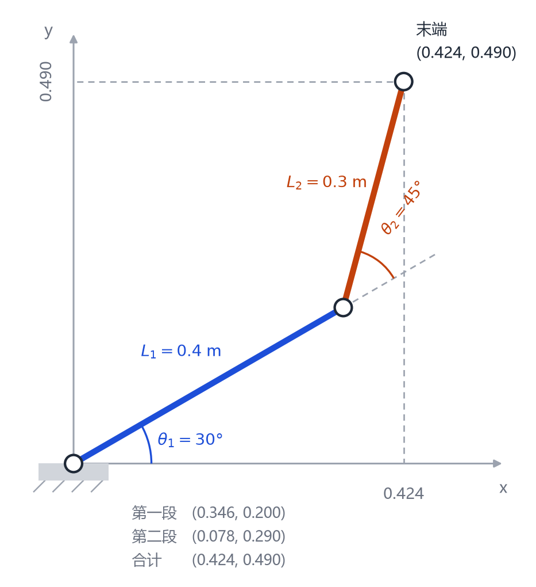
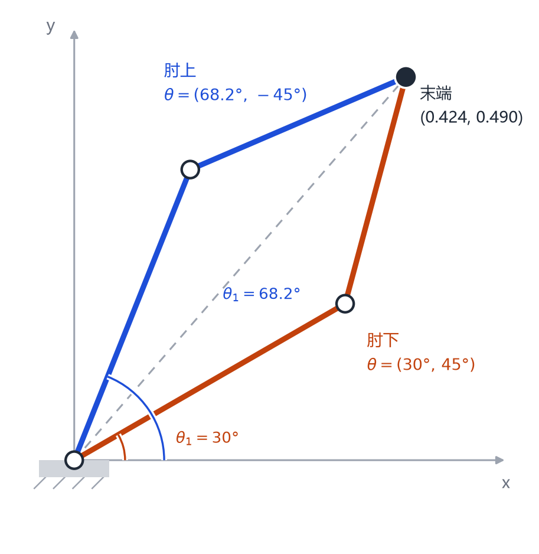
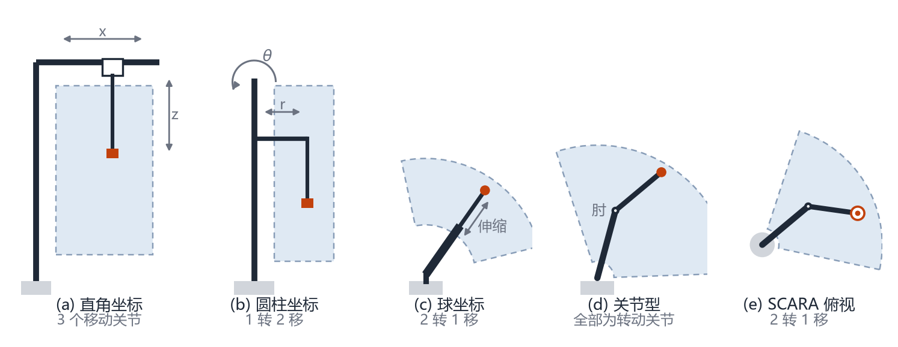
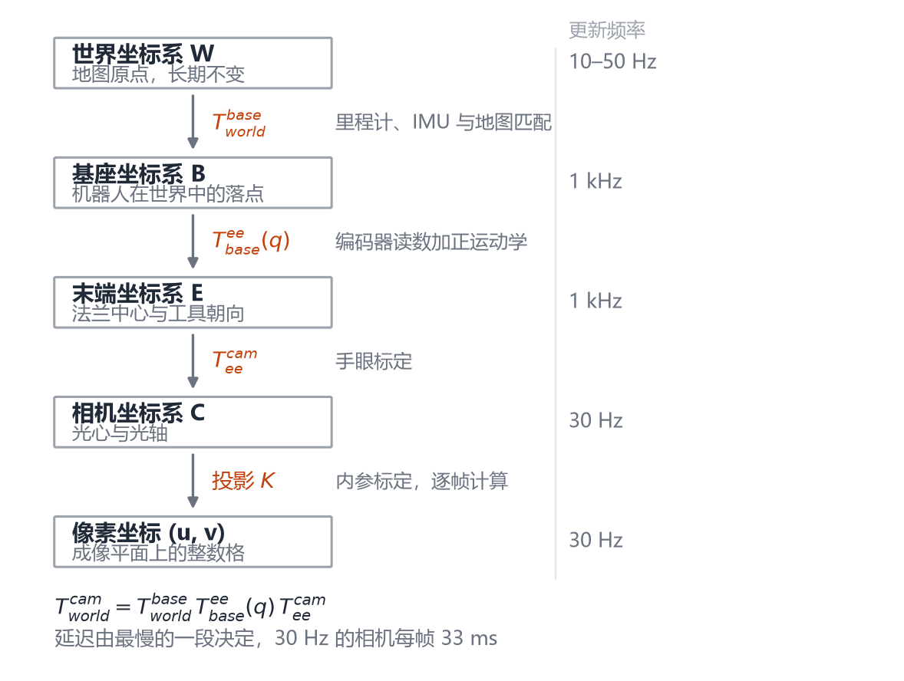

# 第 2 章　机器的身体与它的自由度

> **本章导读**：上一章把一只苹果从桌上搬到盘子里，拆成了八个环节。这一章退到最底层，看执行这些环节的机器本身长什么样。关节怎么转，六个自由度意味着什么，为什么七轴臂更灵活，位置和姿态用什么数学对象描述，从关节角怎么算出末端在哪，反过来又怎么解。读完这一章，你手上会有一张身体的能力清单，也就能判断一段演示里的动作，是机构的极限还是算法的失误。

## 2.1 关节与自由度

机械臂是一串连杆和关节。连杆是刚体，长度固定，不会弯；关节是允许两个连杆相对运动的那一小块结构，里面通常藏着电机、减速器和编码器。工业上见到的关节绝大多数只有两种。转动关节（revolute joint）像一个合页，两个连杆绕一根轴相对转动，关节变量是一个角度。移动关节（prismatic joint）像抽屉的滑轨，关节变量是一段位移。无论哪一种，一个关节只贡献一个自由度。

自由度（DoF，Degree of Freedom）就是这台机器能独立改变的运动量。数它有一个偷懒但可靠的办法，数关节。六个单自由度关节串起来，就是六自由度机械臂，写成 6-DoF。

人的手臂可以给一个参照。肩是球关节，能前举、侧举、旋转，算三个自由度；肘只能弯曲，一个；腕又是三个。合起来七个，再加上前臂的旋前旋后，是第八个。六轴机械臂基本照抄了这个布局，前三个关节负责把手腕送到空间中的某个位置（腰转、肩抬、肘弯），后三个关节负责把手腕转到某个朝向，三个轴交于一点，像万向节一样工作。这种设计叫球形腕，位置和姿态解耦，逆运动学能拆成两个小问题。

为什么偏偏是 6 这个数字。空间里一个刚体，位置三个数，姿态三个数，合起来六个。想让末端到达任意位置、任意朝向，至少需要六个独立关节。少于六个，末端就只能到达六维空间里的一个低维子集。五个自由度的机械臂能把手伸到指定位置，但手的朝向被锁在一个面上，拧螺丝、插插头这类需要绕任意轴转的动作就做不了。

多于六个会怎样。七个自由度的机械臂，给定末端位姿之后还剩一个自由度没用完，这份多出来的能力叫冗余（redundancy）。人每天都在用冗余，去够桌上的杯子，手掌的位置定了，肘可以抬高也可以放低，选哪种取决于中间有没有障碍。

冗余的用处很实际。肘抬起来可以绕过显示器，可以躲开关节限位，可以让力矩落在更结实的关节上，也可以在接近奇异位形时用多余的自由度换一点余量。代价是逆运动学不再唯一，同一个末端位姿对应无穷多组关节角，控制器必须额外定一条准则来挑一个。数学上，给定末端位姿后仍然能自由变化的那些方向组成零空间（null space），七轴臂的零空间是一维的，末端不动而整条臂缓慢蠕动，这叫自运动。KUKA 的 iiwa、Franka 的 Panda、Kinova 的 Gen3 都是七轴，它们在做狭窄空间作业时优势明显。

把这些关节角排成一个向量 $q=(\theta_1,\dots,\theta_n)$，这个向量就是构型空间（configuration space）里的一个点。二连杆机械臂的构型空间是 $(\theta_1,\theta_2)$ 平面，因为角度每 360 度重复一次，这个平面首尾相接，实际是一个环面。六轴臂的构型空间是六维的。

之所以要专门给它起个名字，是因为后面几乎所有几何问题都能在这个空间里统一表述。机械臂撞到桌子，等价于构型空间里的点进入了某块禁区；关节限位，等价于点被关在一个盒子里；两个构型之间能不能连一条不碰障碍的曲线，就是运动规划要回答的问题。代价是维数。六维空间每维切 36 份，10 度一格，一共 $36^6$，约 22 亿个格子，每个格子还要做一次碰撞检测。网格法在高维空间里直接失效，这就是第 11 章要讲采样规划的原因。

## 2.2 描述位姿

位姿（pose）是位置加姿态。位置好办，三个数，$(x,y,z)$。姿态难，因为它不是三个可以随便取的数，任意三个角度拼起来不一定是一个合法的朝向。工程上有四套表示法，各有各的麻烦。

旋转矩阵（rotation matrix）是一个 $3\times 3$ 的矩阵 $R$，每一列是机体坐标轴在参考系下的方向。它有两个约束，$R^{\top}R=I$ 要求三列互相正交且长度为一，$\det R=1$ 要求是右手系、不含镜像。九个数字减掉六个约束，剩下三个自由度。举个具体的，绕 $z$ 轴转 90 度的矩阵第一列是 $(0,1,0)$，意思是机体的 $x$ 轴现在指向参考系的 $y$ 轴。

旋转矩阵的好处是能直接作用在向量上，$v'=Rv$，连续旋转就是矩阵连乘，求逆就是转置。坏处是九个数只装三个自由度，数值上稍微一扰动就不再正交。用神经网络回归旋转矩阵，输出必须再做一次正交化（SVD 或者 Gram-Schmidt），否则误差会随着层数累积。

欧拉角（Euler angles）是三个角，依次绕三个轴转。它有两个坑。一个是约定，绕轴的顺序有十二种组合，不同软件默认不同，接口对接时因为顺序不一致而抓错方向的 bug 极其常见。另一个是万向锁（gimbal lock）。第二个角转到正负 90 度时，第一个轴和第三个轴重合，两个角控制同一个旋转，三个自由度退化成两个。

万向锁的直觉可以这样建立。飞机机头垂直朝天的时候，机身绕自身竖轴的滚转，和绕地面竖直方向的偏航，是同一个动作。此时姿态只要再变化一点点，欧拉角的数值就可能从 $(90°,89.9°,0°)$ 跳到 $(90°,90.1°,180°)$，两个角同时突变 180 度。如果策略网络直接输出欧拉角，这种跳变会原样变成关节的猛转，这是很多早期视觉伺服系统抖动的来源。

四元数（quaternion）用四个数 $(w,x,y,z)$ 表示旋转，约束是长度为一。它没有奇异，只有四个数，两次旋转的复合是十六次乘加，比 $3\times 3$ 矩阵的二十七次少，插值可以用 slerp 走最短弧。这三个优点让它在工程里几乎成了默认选择，ROS 的位姿消息、IMU 的姿态融合、手眼标定的输出，用的都是四元数。它有两个别扭的地方。一是不直观，看到 $(0.707,0,0.707,0)$ 很难立刻反应出这是绕 $y$ 轴 90 度。二是双覆盖，$q$ 和 $-q$ 表示同一个旋转，所以两个四元数之间的欧氏距离没有物理意义，比较姿态要用点积的绝对值。

学习领域还流行一种六维表示，取旋转矩阵的前两列，共六个数，网络回归之后再做正交化补出第三列。它连续、无奇异、也没有双覆盖问题，代价是多了两个冗余维度。

把旋转和平移打包进一个 $4\times 4$ 矩阵，就是齐次变换（homogeneous transform）：

$$
T=\begin{bmatrix} R & t \\ 0 & 1 \end{bmatrix}
$$

其中 $R$ 是 $3\times 3$ 旋转，$t$ 是 $3\times 1$ 平移，最后一行是 $(0,0,0,1)$。作用在一个点上时先旋转再平移。它的价值在于连乘。世界到相机的变换可以写成

$$
T_{world}^{cam}=T_{world}^{base}\,T_{base}^{ee}\,T_{ee}^{cam}
$$

三个坐标系一次串起来，不用手写三角函数的复合。逆变换也不用真的求逆，利用正交性可以直接写出来，$T^{-1}=\begin{bmatrix}R^{\top} & -R^{\top}t\\ 0 & 1\end{bmatrix}$。

一个具体例子。基座在世界原点，末端在基座前方 0.5 m、高 0.3 m，相机装在末端下方 0.1 m、镜头朝下。那么相机光心在世界坐标里就是 $(0.5,\,0,\,0.2)$。

## 2.3 正运动学

正运动学（forward kinematics）回答的问题是，给定所有关节角，末端在哪、朝向如何。它是从里往外算，给定 $q$ 一定得到唯一的 $T$，不会有歧义，也不会有多解。

先用最简单的平面二连杆把公式推一遍。两根连杆都在水平面内，两个关节都是转动关节。基座在原点，第一根连杆长 $L_1$，与 $x$ 轴夹角 $\theta_1$；第二根长 $L_2$，相对第一根的夹角是 $\theta_2$。注意 $\theta_2$ 是相对角，不是它自己的绝对朝向，这一点在写代码时最容易错。末端位置是两段向量首尾相接。

$$
x=L_1\cos\theta_1+L_2\cos(\theta_1+\theta_2),\qquad
y=L_1\sin\theta_1+L_2\sin(\theta_1+\theta_2)
$$

括号里的 $\theta_1+\theta_2$ 就是第二根连杆的绝对角度。

代入一组具体数字，$L_1=0.4$ m，$L_2=0.3$ m，$\theta_1=30°$，$\theta_2=45°$。

第一段，$\cos 30°=0.8660$，$\sin 30°=0.5$，得到 $(0.3464,\,0.2000)$。

第二段的绝对角是 $75°$，$\cos 75°=0.2588$，$\sin 75°=0.9659$，乘上 0.3 得到 $(0.0776,\,0.2898)$。

两段相加，$x=0.4241$ m，$y=0.4898$ m。末端到原点的距离是 $0.6478$ m。

这个结果可以用余弦定理独立校验。三角形的三条边是 $L_1$、$L_2$ 和 $r$，夹角 $\theta_2$ 对着 $r$，所以 $r^2=L_1^2+L_2^2+2L_1L_2\cos\theta_2=0.16+0.09+0.24\times0.7071=0.4197$，开方得 $0.6478$，与坐标算出来的一致。

<figure class="fig">

<figcaption><b>图 2-1</b>　平面二连杆的正运动学。$\theta_1=30°$、$\theta_2=45°$ 时末端落在 $(0.424,\,0.490)$，两段位移首尾相接。</figcaption>
</figure>

六轴臂的公式不是手推的，而是按 Denavit-Hartenberg 参数表连乘六个 $4\times 4$ 矩阵。每个关节四个参数，描述它的转轴方向、两轴之间的公垂线长度和偏置。实际工程里都是用库，但有两件事必须知道。第一，连杆长度和关节零位的标定误差会一比一地进入末端位置。第二，正运动学极其便宜，一次几十次浮点运算，1 kHz 的控制环里每个周期都算一遍也毫无压力。所以正运动学从来不是瓶颈，误差和标定才是。

误差的量级可以估一下。0.5 m 臂展处，连杆长度标定差 1 mm，末端就差 1 mm；关节零位差 0.1 度，末端差 $0.5\times0.00175=0.87$ mm。两项叠加就是毫米级，而协作臂标称的重复精度是 0.03 mm，中间差了一个数量级。这个差距来自标定和热变形，不是制造精度。

## 2.4 逆运动学

逆运动学（inverse kinematics，IK）把问题反过来，给末端位姿，求关节角。它难在三点，非线性、多解、可能无解。

还是二连杆，解析解可以直接写出来。已知末端 $(x,y)$，先算它到原点的距离 $r$，然后用余弦定理求 $\theta_2$。

$$
\cos\theta_2=\frac{x^2+y^2-L_1^2-L_2^2}{2L_1L_2}
$$

把上一节的数代回去，$(0.4197-0.25)/0.24=0.7071$，$\theta_2=\pm45°$。两个解，一个是我们出发时的 $+45°$，另一个是 $-45°$。$\theta_1$ 由几何关系给出，$\theta_1=\operatorname{atan2}(y,x)-\operatorname{atan2}(L_2\sin\theta_2,\;L_1+L_2\cos\theta_2)$。取 $+45°$ 得 $49.11°-19.11°=30.0°$，回到原构型；取 $-45°$ 得 $49.11°+19.11°=68.2°$。

这两组解在几何上就是肘上（elbow-up）和肘下（elbow-down）。同一个末端点，肘可以朝上弯也可以朝下弯。图 2-2 把它们画在同一张图上，一眼就能看出为什么"逆运动学有解"这句话本身不完整，还得说清是哪一组解。

<figure class="fig">

<figcaption><b>图 2-2</b>　同一末端点的两组逆解。橙色为肘下构型 $(30°,45°)$，蓝色为肘上构型 $(68.2°,-45°)$，两条臂末端重合。</figcaption>
</figure>

六轴臂的解更多。除了肘的两解，腕部三个轴交于一点时还有翻腕的两解，肩部还有前伸与后摆的两解，最多能凑出八组。工程上要在这八组里挑一组执行，挑法通常是打分，离当前构型最近（关节空间欧氏距离最小）、不撞障碍、不超限位、离奇异位形最远，四项加权。这条打分规则看起来琐碎，实际决定了机械臂换目标点时是优雅地小幅度调整，还是突然整条臂翻过去。

无解的情况也很具体。$r \gt L_1+L_2=0.7$ m 时够不到，$r \lt |L_1-L_2|=0.1$ m 时折不起来。我们的 $0.6478$ m 离上限只剩 5 cm，虽然可解，但雅可比的条件数已经很差，关节速度需求会被放大，后面会看到具体数字。

一般构型没有闭式解，只能用数值迭代。思路是牛顿法，当前关节角 $q_k$ 算出末端位姿，与目标比较得到六维误差 $e$，用雅可比把误差映射回关节修正量，走一小步，重复：

$$
q_{k+1}=q_k+J^{+}(q_k)\,e
$$

$J^{+}$ 是伪逆。实践中几乎都会加阻尼，变成阻尼最小二乘，避免在奇异位形附近步长爆炸。收敛通常要 5 到 20 次迭代，每次一个 $6\times 6$ 求逆，微秒量级，放进 100 Hz 的规划环里完全够用。它的好处是通用，七轴臂、偏置腕、带移动底盘的整机，都可以用同一套代码解。

雅可比矩阵（Jacobian）是正运动学对关节角的导数，物理意义是关节速度到末端速度的线性映射，$v=J\dot{q}$。它不是一个抽象的数学对象，每一列都有直白的解释。二连杆的雅可比是 $2\times 2$：

$$
J=\begin{bmatrix}
-L_1 s_1-L_2 s_{12} & -L_2 s_{12}\\
L_1 c_1+L_2 c_{12} & L_2 c_{12}
\end{bmatrix}
$$

$s_1=\sin\theta_1$，$c_1=\cos\theta_1$，$s_{12}=\sin(\theta_1+\theta_2)$。第一列是"只让第一个关节以单位角速度转动时，末端的速度向量"，第二列同理。

在算例点代入，$J=\begin{bmatrix}-0.4898 & -0.2898\\ 0.4241 & 0.0776\end{bmatrix}$。第一列的长度是 $\sqrt{0.4898^2+0.4241^2}=0.6478$，正好等于末端到基座的距离，因为第一个关节一转，末端就绕着基座画圆，线速度等于半径乘角速度。第二列的长度是 0.3，正好等于 $L_2$。两个数都对上，说明矩阵没写错，这种自洽性检查比逐项核对公式快得多。

行列式 $\det J=L_1L_2\sin\theta_2$，在算例点等于 $0.0849$。行列式为零的地方，矩阵不可逆，这些位形叫奇异位形（singularity）。二连杆的奇异位形只有两种，$\theta_2=0$ 时完全伸直，$\theta_2=180°$ 时完全折回。

奇异附近会发生什么，用数字说最清楚。假设要把末端沿手臂方向以 0.1 m/s 往外推，基座关节固定在 0 度，肘角从 30 度慢慢收到 5 度。30 度时解出的关节速度是 $(0.43,\,-1.10)$ rad/s，肘关节约 63 度每秒，很正常。5 度时解出 $(2.86,\,-6.68)$ rad/s，肘关节要 383 度每秒。同一个末端速度，关节速度需求涨了六倍，而协作臂的关节速度上限通常在 120 到 180 度每秒之间。也就是说在 5 度这个位形附近，末端根本推不出 0.1 m/s。控制器要么报"不可达"，要么让关节以极限速度冲过去，表现出来就是突然猛转、抖动，严重时触发保护停机。

这也解释了为什么"把手臂伸直去够远处的东西"是个危险动作。越接近伸直，越接近奇异，关节速度的放大倍数越高。工程上的做法是留 5 到 10 cm 的余量，让机械臂永远工作在肘部弯曲 15 度以上的区域；或者在算法上用阻尼让解在奇异附近变软，代价是末端跟踪出现偏差。

## 2.5 工作空间 精度 负载 速度

工作空间（workspace）是末端能到达的所有位置的集合，要分两种。可达工作空间指至少存在一个姿态能到达的点，灵巧工作空间指任意姿态都能到达的点。后者小得多。一台臂展 850 mm 的六轴臂，可达空间是一个前向 0.85 m 的苹果形壳，灵巧空间往往只有正前方 0.4 到 0.6 m 的一个球。

工作空间的形状由关节类型决定。图 2-3 把五种常见构型画在一起，每种都配了工作空间的剖面。

<figure class="fig">

<figcaption><b>图 2-3</b>　五种常见构型与其工作空间剖面。(a) 直角坐标 (b) 圆柱坐标 (c) 球坐标 (d) 关节型 (e) SCARA，阴影为可达区域示意。</figcaption>
</figure>

直角坐标（gantry）三个移动关节，工作空间是一个长方体。控制最简单，刚度最高，但占地方，导轨越长越贵，加速度上不去。圆柱坐标一个转动加两个移动，工作空间是圆柱壳。球坐标两个转动加一个移动，工作空间是球壳。关节型（articulated）全是转动关节，工作空间是一块球壳状的区域，结构最紧凑，能缩回来贴近机身，这是六轴臂成为主流的原因。SCARA 两个水平转动加一个垂直移动，工作空间是扇形柱，水平面内刚性极好，垂直方向能"压"，装配时把销钉压进孔里全靠这个，所以 3C 产线上到处是它。

精度要分两个词。重复定位精度（repeatability）是回到同一个点的能力，绝对精度（accuracy）是到达指令点的能力。协作臂的重复精度典型是正负 0.03 mm，绝对精度常在 0.1 到 1 mm，差一个数量级。原因不神秘，连杆长度、关节零位、减速器背隙、热变形，每一项都贡献零点几毫米，而重复精度只受最后一段传动和编码器影响，所以能做得很好。

两种精度的区别决定了编程方式。示教编程是手把手把机械臂拖到位置，记下关节角，以后重复播放，它只依赖重复精度，0.03 mm 够用，工业焊接能这么做几十年。视觉抓取依赖绝对精度，因为目标位置是相机算出来的，在基座坐标系里，走的是绝对坐标，标定误差会全额体现。手眼标定（第 4 章）存在的意义，就是把绝对误差从几毫米压到 1 mm 以内。

负载是另一个容易被误读的参数。标称 3 kg 指的是末端法兰能挂的总质量，包含夹爪、相机、线缆。装上 1.5 kg 的夹爪和相机，只剩 1.5 kg 给物体。重心距离也有限制，产品手册里的负载曲线通常画成质量与重心偏移的阶梯，重心离法兰越远，允许的质量越小。忽视这一条，机械臂会在高速段抖动，因为惯量超出了减速器的承受范围。

速度按末端线速度算，协作臂 1 到 2 m/s，工业臂 2 到 3 m/s，Delta 并联能到 5 m/s 以上。一次 0.5 m 的移动，1 m/s 匀速要 0.5 s，加上加减速大约 0.7 s。这个数字与第 1 章那张时序图对得上，物理运动确实占了任务时间的大头，算法再快也压不下去。

**表 2-1**　常见机器人形态对比。

| 形态 | 典型自由度 | 负载 | 末端速度 | 典型场景 |
|---|---|---|---|---|
| 六轴工业臂 | 6 | 5–300 kg | 2–3 m/s | 焊接、码垛、机床上下料 |
| 协作臂 | 6–7 | 3–16 kg | 1–2 m/s | 上下料、检测、实验室 |
| SCARA | 3–4 | 1–20 kg | 3–8 m/s | 3C 装配、高速分拣 |
| Delta 并联 | 3–4 | 0.5–10 kg | 5–10 m/s | 食品、药品分拣 |
| 差速移动底盘 | 3（平面） | 50–500 kg | 1–2 m/s | 仓储搬运、巡检 |
| 四足 | 12 | 10–50 kg | 1–3 m/s | 巡检、救援、野外运输 |
| 人形 | 19–50 | 5–20 kg | 1–1.5 m/s | 工厂工位、家庭服务 |

表里的数字是当前公开产品的区间，不是某一台的具体参数。看这张表要抓的是量级关系。负载从 3 kg 到 300 kg 跨两个数量级，速度却只跨一个，这说明重载和高速在机构上是矛盾的，加大负载必然加大惯量，惯量一大加速度就上不去。协作臂与工业臂的差别不在这些数字上，而在安全设计，协作臂限制了力和功率，允许人站在旁边，代价是速度和刚度都低一档。

## 2.6 移动底盘与腿足

机械臂固定在工位上，移动平台要把身体送到工位。差速底盘是最常见的一种，两个驱动轮各转各的，前面一两个万向轮只做支撑。设左右轮速度 $v_l$、$v_r$，轮距 $d$，车身速度 $v=(v_l+v_r)/2$，角速度 $\omega=(v_r-v_l)/d$，转弯半径

$$
R=\frac{v}{\omega}=\frac{d}{2}\cdot\frac{v_l+v_r}{v_r-v_l}
$$

轮距 0.5 m，平均速度 1 m/s，左右轮差 0.2 m/s，代入得 $R=2.5$ m。想让 $R$ 变小，就得拉大轮速差；左右轮反向等速时 $R$ 为零，原地转。

差速底盘只有两个可控自由度，前进和转向，侧向不能动。这叫非完整约束（nonholonomic constraint）。后果是路径规划不能走直线斜插，必须先转再走，倒车入库那套几何问题在移动机器人上一样存在。全向底盘没有这个限制。

麦克纳姆轮（mecanum wheel）在轮缘装了 45 度的被动辊子，四个轮子的转速组合可以合成任意方向的车身速度，包括横移和边走边转。它的代价是效率，辊子与地面的摩擦有一部分在做无用功，实测效率大约七到八成，过接缝时还会颠。

四轮和六轮底盘解决的是越障。摇臂转向架（rocker-bogie）让六个轮子通过被动铰接保持同时着地，火星车用的就是这套结构，一个轮子抬起时车身只倾斜一点。

四足有 12 个自由度，每条腿 3 个。这里出现了本章最重要的一个区分，静态稳定与动态稳定。静态稳定指不动也能站住，条件是重心投影落在支撑多边形内。四足站立时四个足构成一个四边形，面积不小，随便怎么站都稳。走起来就变了，对角小跑（trot）时只有对角的两只脚着地，支撑多边形退化成一条线，重心必然在这条线上或者线外，想不摔倒只能靠惯性持续调整。这就是动态稳定，稳定不是来自几何，而是来自控制。

人形更极端。双足站立时支撑多边形是两只脚掌的凸包，一只脚掌大约 0.25 m 长、0.1 m 宽，两脚并拢时横向只有 0.2 m。重心高度约 0.9 m，侧向倾斜 $\arctan(0.1/0.9)\approx6.3°$ 就出界。走路时有一半时间处于单脚支撑，支撑多边形只剩一只脚掌，余量更小。所以人形走路本质上是可控地摔倒，每一步都是先让身体向前倾，再把脚放到即将倒下的位置接住自己。

静态稳定的机器可以停下来想，动态稳定的机器必须一直动。这个区别直接决定控制频率。差速底盘 10 Hz 的环路就能跑得很稳，四足要 500 Hz 到 1 kHz，人形也是这个量级，因为失衡的时间常数只有几百毫秒。

## 2.7 末端执行器与传感器

末端执行器（end effector）是机器人真正接触世界的那部分，它决定了"能抓什么"这个最实际的问题。

平行夹爪（parallel jaw gripper）两个指头平行开合，一个自由度，行程 50 到 100 mm，夹持力 20 到 100 N。它适合箱体、圆柱、片状物，便宜、可靠、刚性好，工业抓取里占绝大多数。局限是要求两个指面大致平行于物体表面，形状复杂就没办法。

吸盘靠负压吸附，适合平整、光滑、不透气的表面，纸箱、玻璃、金属板都行。单个吸盘直径 20 到 80 mm，负压 -40 到 -80 kPa。它的优势是不需要物体两侧有空间，可以从正上方直接抓，仓储拣选里用得最多。对曲面、织物、多孔材料几乎无效，因为建立不起压差。

多指手有 6 到 20 个自由度，腱驱或者连杆驱动，能做手内操作，转笔、翻面、拧瓶盖。它的瓶颈不在机构而在传感，人手每平方厘米有上百个触觉感受器，机械手指尖只能放几个，抓握时不知道接触点在哪、滑没滑。这一块是第 18 章的主题。

传感器决定机器人知道自己处在什么状态。每种传感器给出的量在不同的坐标系里，频率也差得很远。

**表 2-2**　常用传感器对比。

| 传感器 | 输出 | 频率量级 | 典型误差或分辨率 |
|---|---|---|---|
| RGB 相机 | 图像 $H\times W\times3$ | 30–60 Hz | 重投影误差 0.2–1 像素 |
| 深度相机 | 每像素距离 | 10–30 Hz | 1 m 处 5–20 mm |
| IMU | 加速度、角速度 | 100–1000 Hz | 零偏 0.1–1 °/s |
| 力/力矩传感器 | 六维力与力矩 | 100–1000 Hz | 分辨率 0.01–0.1 N |
| 关节编码器 | 关节角度 | 1–10 kHz | 19–24 位，约 0.001° |
| 触觉阵列 | 接触压力分布 | 30–100 Hz | 力分辨率 0.01–0.1 N |

这些传感器分别挂在坐标链的不同位置，图 2-4 把它们串起来。世界到基座的变换来自定位或者里程计，基座到末端的变换来自编码器读数加正运动学，末端到相机的变换来自手眼标定，相机到像素的变换来自内参矩阵加透视投影。

<figure class="fig">

<figcaption><b>图 2-4</b>　从世界到像素的坐标链。每一段变换都有各自的来源与更新频率，编码器最快，相机最慢，整条链的延迟由最慢的一段决定。</figcaption>
</figure>

这条链有一个容易忽视的性质，误差会按旋转放大。角度误差 $\delta$ 在距离 $L$ 处变成位置误差 $L\delta$。1 度的角度误差，在 1 m 处就是 17 mm，比机械臂的重复精度大五百倍。所以手眼标定的角度误差必须压到 0.1 度以内，否则前面算得再准也没用。

频率的差异带来一个架构上的硬约束。编码器 1 kHz 直接进控制环，力传感器也是 1 kHz，IMU 200 到 1000 Hz，相机只有 30 Hz，触觉阵列 30 到 100 Hz。慢的传感器不能进快环，只能异步喂数据。所以视觉永远在"延迟 50 到 70 ms 的过去"上做决策，这个延迟包括曝光、传输、推理。一个以 1 m/s 移动的物体，70 ms 内走了 7 cm，比机械臂的重复精度大三个数量级。视觉伺服能跟多快的东西，上限就卡在这里，第 16 章和第 19 章会反复用到这个数。

到这里，一台机器的身体可以被写成一组数字，关节角 $q$、位姿 $T$、雅可比 $J$、工作空间、精度、负载、速度、传感器频率。这组数字既是能力清单，也是约束清单。六十年来这个领域的所有路线之争，争的其实是同一件事，在这样一副身体上，智能应该放在哪一层。有人把它放进模型，有人放进反射，有人放进数据，那场争论值得单独讲一章。
