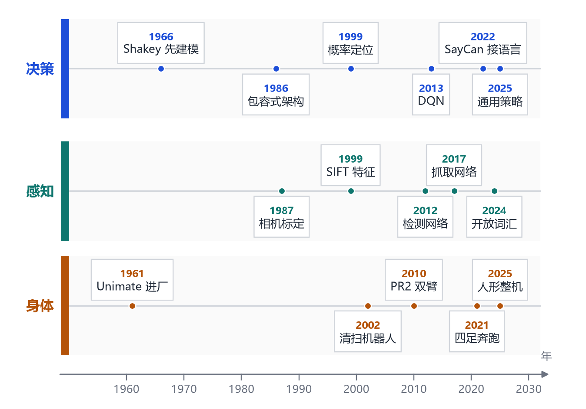
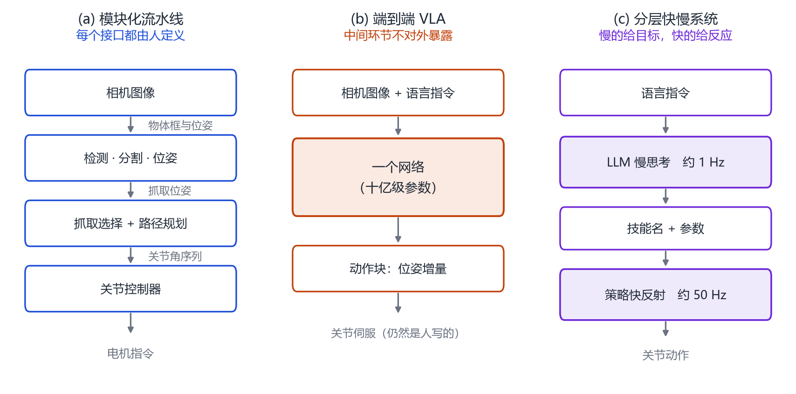
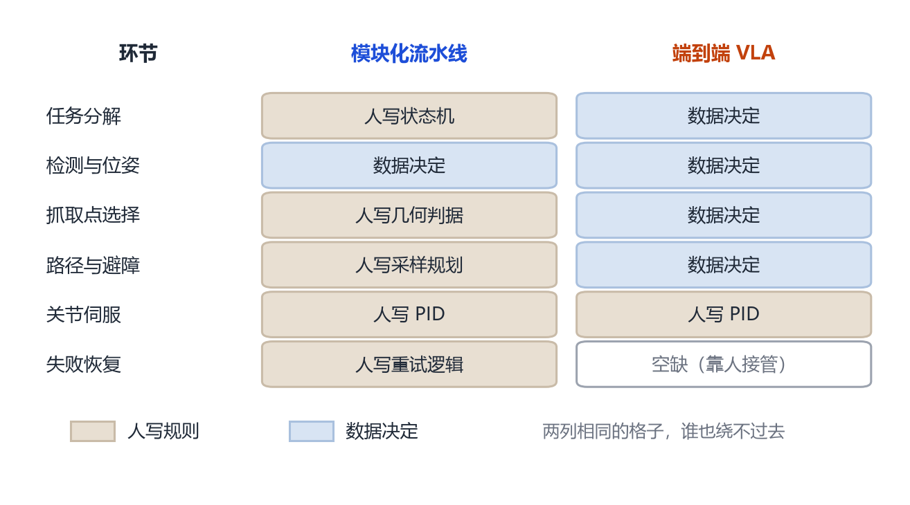

# 第 3 章　六十年的路线之争

> **本章导读**：同一台机械臂，1966 年的做法是先建世界模型再搜索，1986 年有人主张干脆不要模型、看到就动，2015 年之后又变成喂数据。六十年里没有哪条路线被彻底推翻，它们各自在某个角落里还活着，甚至同时出现在一台机器上。这一章把这条线理清楚，说明每一代到底解决了上一代的什么问题，再给出一套判断演示视频可信度的办法。

## 3.1 从符号模型到概率状态

1966 年，斯坦福研究院的 Shakey 第一次把"推理"装到了轮子上。它能自己走到房间另一头，途中绕开椅子，把箱子推到指定位置。每挪动一小段，它就要停下来在符号世界里重算一遍，早期一次完整规划要花上几分钟甚至几小时。慢得可笑，但它确立了一件事，机器人可以先想再做。

Shakey 的做法在 1971 年被整理成一个规划器，叫 STRIPS。它的核心想法朴素到可以手算。把一个动作写成三张表，执行前必须成立的条件叫前提，执行后新增的事实叫添加表，执行后失效的事实叫删除表。搬箱子的动作就是，前提是我手空、箱子在 A、A 到 B 有通路，添加表是箱子在 B，删除表是箱子在 A。有了这种写法，规划就变成在一张符号图上找一条路径，每一步挑一个前提已满足的动作，把状态推到目标。

这种设计在当时的条件下几乎是唯一选择。1966 年没有 GPU，视觉只能识别白墙前面摆得整整齐齐的积木，感知给出的答案是"红色方块在坐标 (3, 2)"这样的符号，而不是像素。把世界写成符号还有一层学术上的吸引力，只要模型是对的，推理结论一定是对的，整个系统可以被证明。

真正卡住的地方是模型从哪来。换一个房间，家具变了，抽屉的把手变了，模型就得重写。一瓶半透明的矿泉水、一块软布、一堆叠起来的盘子，在符号层里找不到合适的位置。工程上把这叫知识获取瓶颈，哲学上的版本叫符号接地问题。符号"杯子"和真杯子之间没有必然联系，联系是人手工搭上去的。

1986 年，Brooks 给出了相反的答案。他做的机器人没有世界模型，也没有搜索，只有几层各自独立的行为模块，一层负责"别撞墙"，一层负责"往前走"，一层负责"看到远处的东西就过去看看"。每层直接从传感器读到执行器写，层与层之间用抑制信号争夺控制权，高层想接管时把低层压住。这个结构叫包容式架构（subsumption architecture）。

它的反应速度是另一个量级。从红外传感器读到障碍到轮子转向，几十毫秒就完成，因为中间没有"更新世界模型再规划"这一步。Brooks 在 1990 年写过一句流传很广的话，世界就是它自己最好的模型，意思是不必在机器里复制一份世界，直接看就行。那几年 MIT 的机器人能在拥挤的走廊里穿行，速度明显快过当时"先建模再规划"的系统。

代价是它记不住事。做"先拉开抽屉，再把东西拿出来"这种任务，第一步做完的状态没有被记录在任何地方，第二步就无从谈起。反应式系统擅长在一个瞬间做对，不擅长把十个瞬间串成一个计划。

1995 年之后，第三批人换了个角度。他们承认传感器从来不准，轮子会打滑，地图会偏，于是不再维护"我在 (3.2, 1.7)"这样一个点，而是维护一个概率分布，说"我大概在这些位置，权重如下"。这就是概率机器人。

最常用的工具叫粒子滤波。想象在整张地图上撒一千个粒子，每个粒子代表一句猜测"我在某个位置、朝向某个角度"。机器人每走一步，所有粒子按运动模型往前推；每看到一次激光扫描，每个粒子按"在这个位置上应该看到什么"和"实际看到什么"的差打分；权重低的粒子被淘汰，权重高的被复制。几百毫秒之后，粒子会聚到真实位置附近。

有了这层概率语言，同时定位与建图（SLAM，Simultaneous Localization and Mapping）才有可能被认真处理。建图需要知道自己在哪，定位需要一张已有的地图，这是一个鸡生蛋的循环。概率方法把两边都写成分布，用同一组观测交替更新，循环就松动了。2005 年 Thrun 等人的《概率机器人》把这一整套系统化，此后十年，激光雷达加上粒子滤波加上图优化，成了移动机器人的标准配置。

这一代解决的问题很具体。符号主义假设感知是准的，行为主义放弃了记忆，概率方法把不确定性写进状态，并且保留了记忆。它的边界同样具体，状态是几何的，只有位姿、栅格、路标，没有语义，不知道前面那个东西是杯子还是花瓶，更不知道怎么去抓。

<figure class="fig">

<figcaption><b>图 3-1</b>　三条泳道把六十年的进展分开看。感知的转折在 2012 年，决策的转折在 2022 年，身体这一条线变化最慢，三条线很少同步推进。</figcaption>
</figure>

把三段历史并排放在时间轴上（图 3-1），会看到一个容易被忽略的事实，三条线并不同步。决策这条线在 1966 年就有了完整的方法论，感知这条线要等到 2012 年才被深度学习整体替换，身体这条线几乎没变，今天的六轴机械臂和二十年前的结构没有本质区别。后来所有的路线之争，根子都在这个不同步上。

## 3.2 感知先被换掉

2012 年的 ImageNet 竞赛是一个清晰的分界。卷积网络把 top-5 错误率（模型给出五个答案、正确答案不在其中的比例）从上一年的 26% 压到 15%，领先第二名十个百分点以上。这个差距不是渐进改良，它意味着"从像素直接学类别"这条路走得通，而且数据越多越好。

接下来三五年，感知的每个子任务都被重做了一遍。检测从手工设计的特征加分类器，换成区域提议加卷积网络；分割从像素聚类换成了端到端预测掩码；位姿估计从模板匹配换成回归。2017 年的 PoseCNN 就是典型，输入一张彩色图，网络直接回归物体中心在图像上的位置、到相机的距离、以及一个表示旋转的四元数。

抓取这一块的变化最有意思，因为它原本是纯几何问题。经典做法是给物体一个 CAD 模型，算出所有满足力闭合的夹爪位姿，再用摩擦锥判断会不会滑。这套方法在理论上是干净的，实际中两个输入都不靠谱，很多物体没有 CAD 模型，摩擦系数更是随表面粗糙度和湿度变化。

Dex-Net 2.0（2017）换了一条路。它先用解析方法在仿真里给 670 万个点云样本算出抓取质量，把这些质量当标签，训练一个卷积网络，输入是深度图加一个候选抓取，输出是这个抓取能成功的概率。真机上使用时，采样一批候选，让网络排序，取最好的那个。几何判据没有被丢掉，它变成了训练标签的生成器。

为什么这一轮只有感知被换掉，答案在数据形态上。感知任务的输入输出都是可以离线标注的，一张图配一个框，一张图配一个掩码，标注完就能算准确率，模型好坏当场可见。决策和动作没有这种待遇，一个动作好不好，要等它在真机上执行完才知道，中间还掺着感知误差和控制误差。

这带来一个持续的错觉。假设检测的平均精度从 60% 涨到 85%，看上去进步巨大，但任务成功率可能只从五成涨到六成。原因在误差的传递方式上，按 640 像素宽、60 度视场估算，检测框偏两个像素，在 1 米外就是 1.8 毫米的位置误差，经过位姿估计放大到 5 毫米，再经过抓取和执行放大到 1 厘米，夹爪于是从杯壁边缘滑过去。感知指标是链条上的一环，不是终点。

## 3.3 在仿真里练

2013 年之后，强化学习也开始从像素学控制。DQN（Deep Q-Network）在 Atari 上的结果让人相信，只要给足交互次数，策略可以自己长出来。问题是次数。一个中等难度的操作任务，训练常常需要百万级甚至千万级的环境步。真机按 10 Hz 跑，一百万步就是二十八个小时不停机，其间还要换电池、复位场景、处理撞坏的东西。

仿真把这个成本压下去几个数量级。同一台服务器上可以同时跑几千个环境，物理计算和网络更新都放在 GPU 上，2021 年的 Isaac Gym 报告说，相比"CPU 仿真加 GPU 训练"的传统做法，速度快了两到三个数量级。原本要跑几周的训练，缩到几小时。

新的问题立刻出现。仿真里的图像太干净，光照太稳定，摩擦系数是一个写死的常数，电机响应是一条理想曲线。在这样的环境里训出来的策略，搬到真机上会因为画面里多了一道反光而全线崩溃。

2017 年提出的域随机化（domain randomization）是这个问题最实用的一种解法。思路是不去追求仿真像真的，而是让仿真在每个维度上都随机得足够厉害，纹理、光照方向、相机位置、物体质量、表面摩擦、关节阻尼、控制延迟，全部在训练时随机取值。这样真机在模型眼里只是又一个随机样本。那篇论文报告的结论是，只用仿真渲染的图像训练，真机上的定位精度可以做到 1.5 厘米。

OpenAI 在 2018 年把手内操作搬上了这条路径。一只多指灵巧手要在手指之间把方块翻转、旋转到指定朝向，这个任务的接触状态一直在变，人手写控制器几乎不可能。他们的做法是在仿真里大规模并行训练，把物理参数随机化，再让策略零样本搬到真手上。真手转起来的那段视频在当时震动很大，因为它第一次说明"仿真里练、真机上用"可以处理接触这么密集的任务。

腿足走的是同一条路，但需求更极端。RMA（Rapid Motor Adaptation，2021）把控制拆成两个模块，一个基础策略负责走，一个自适应模块从最近几百毫秒的观测里反推当前的地面摩擦与负载，再把估计喂给基础策略。这套结构让四足机器人在背负不同重量、踩上不同地面时，半秒内完成适应，而不需要重新训练。四足跑酷（2023）把视觉也接了进来，一个策略配一个深度相机，能爬高台、跨过沟、从低矮的横杆下面钻过去，全程没有为人写的步态。

这一段解决了动作从哪来的问题。人不再需要写出每一步的关节角度，只需要写出"什么算好"，剩下的交给试错。sim2real 也从一句口号变成了有章可循的工程流程，随机化、并行、蒸馏、在线自适应，四步走。

局限同样清楚。一个策略只干一件事，换个任务要重新设计奖励函数重新训练。奖励设计本身是手艺活，写歪了策略会钻空子，比如学会了用身体撞桌子来让物体滑动。接触最丰富的场景，精密装配、拧瓶盖、折衣服，仿真依然不真，因为软体、摩擦、间隙这些东西物理引擎算不准。

## 3.4 大模型进入控制回路

2022 年之后的变化不再来自新算法，而来自模型规模和预训练数据。同样是模仿学习，网络从几千万参数长到几十亿，数据从单机器人几万条长到多机构上百万条，能力就跨过了一道门槛。

语言先被接进了控制回路。语言模型知道"我洒了饮料"之后应该先拿海绵再擦桌子，但它不知道眼前这台机器人能不能弯腰、能不能抓起海绵。SayCan（2022）的做法给两边各打一个分，语言模型给"在当前指令下，下一步做这个技能有多合理"一个似然，每个技能的 value function 给"在当前状态下，这个技能能成功有多大概率"一个分数，两者相乘再取最大。这套打分让一个 540B 的 PaLM 在真实厨房里执行了 101 条长指令，横跨 7 类任务。局限是技能本身还是人写的，机器人会做什么，取决于你事先教了它哪些技能。

接下来是一个网络干多个任务。RT-1（2022）用 13 台机器人花了 17 个月收集 13 万条演示，覆盖 700 多个任务，训练一个 3500 万参数的 Transformer，输入是连续几帧图像加一句指令，输出是离散化的末端位姿增量和夹爪开合，控制频率 3 Hz。它证明了多任务共享一个网络是可行的，而且数据越杂，泛化越好。

语义则是从视觉语言模型借来的。RT-2（2023）注意到一件巧事，机器人动作本来就是几个连续数，如果把每一维均匀切成 256 个格子，一个动作就变成 8 个整数，而整数在语言模型里就是 token。于是动作可以和"这张图里发生了什么"这类问答数据混在一起，做联合微调。他们训到 55B 参数，在真机上做了 6000 次试验，最直接的收益是模型能处理训练集里没出现过的物体，比如让它"拿起快掉下去的那个袋子"，它能靠语义找到目标。这类把视觉、语言和动作塞进同一个序列的模型，后来被统一叫作视觉-语言-动作模型（VLA）。

数据规模靠跨机构拼接解决。Open X-Embodiment（2023）由 21 家机构把各自的数据集拼在一起，得到 22 种本体、60 个数据集、527 种技能、超过 100 万条轨迹。在这份数据上训练的模型出现了一个此前没有的现象，在 A 机器人上学到的技能能提升 B 机器人的表现，跨本体的正迁移成立。

动作表示也是被换掉的一环。离散成 256 个格子意味着精度被格子宽度锁死，而且一次只能出一个动作，频率上不去。π0（2024）用 flow matching 生成连续动作，做法是让网络把一段随机噪声一步步推成一条动作序列，和图像生成里的扩散模型同源，模型是 3B 的 PaliGemma 加 300M 的动作专家，一次推理输出一段动作块，在端上设备的推理耗时 73 毫秒，控制频率可以到 50 Hz。这个频率对折衣服这类需要连续微调的任务是硬指标。

GR00T N1（2025）把快慢两个系统拆开，慢的是一个视觉语言模型，10 Hz 处理图像和指令，理解"现在该干什么"；快的是一个扩散 Transformer，120 Hz 输出关节动作，负责"怎么动得顺"。这种双系统结构面向人形机器人，因为人形的自由度多、平衡要求高，单一频率的模型很难同时兼顾理解与稳定。

把这几步放在一起看，每一步都在补上一步的缺口。SayCan 让语言落到了具体技能上，但技能是人写的，覆盖面窄。RT-1 用一个网络覆盖了七百个任务，但没有语义先验，遇到没见过的物体就退化成模式匹配。RT-2 把视觉语言模型的语义借了过来，代价是动作被切成 256 个格子，精度和频率都受限。π0 用连续动作头解决了精度和频率，GR00T 再把时间尺度拆成两级，让理解与反应各跑各的节奏。

## 3.5 三条路线的信号流与失败方式

上面这几步是时间顺序，但它们并没有互相取代。今天在实验室和工厂里能同时看到三种系统，它们的区别不在新旧，在信号怎么流。图 3-2 把三者画成三个面板，箭头旁边的文字就是接口。

<figure class="fig">

<figcaption><b>图 3-2</b>　同一句指令在三条路线里的信号流。模块化的每个箭头都是人定义的接口，端到端把中间环节收进一个网络，分层把慢思考与快反射拆成两级。</figcaption>
</figure>

模块化流水线是最老也最稳的一种。相机出图，检测和位姿模块给出物体的框和六自由度位姿，抓取模块给出夹爪的接近方向和开度，规划模块给出一条无碰撞的路径，控制器把它变成关节指令。每一段都有自己的输入输出格式，每一段都能单独测。它的失败模式是可定位的，抓空了就去看位姿，撞到了就去看规划，工程师可以逐段打印中间结果。

它的代价在接口上。接口是人定的，人一决定"传一个六自由度位姿下去"，就等于宣布后面所有环节都不再关心这个物体的颜色、材质、透明度。信息在接口处被压掉了，而这些被压掉的信息恰恰是失败的原因。加一个新任务也要写新代码，第七个任务和第七十个任务的工程量差不多。

端到端 VLA 把这些接口全拆了。图像和指令进，动作出，中间没有人为定义的变量。梯度从动作误差一路回传到像素，所以网络能自己决定"为了抓稳这个杯子，我需要关注杯壁的反光"。泛化能力来自预训练的视觉语言主干网络，这也是它能认出训练集外物体的原因。

调试就变成了另一回事。输出错了，你分不清是看错了、理解错了、还是动作头把正确的意图编码错了。能看的只有输入图像、输出动作、以及注意力图，而注意力图看起来合理、动作却失败的例子非常常见。数据需求也水涨船高，RT-1 用了 13 万条，Open X-Embodiment 是 100 万条量级，自己采的话，一条演示按一分钟算，一万条就是一百六十多个小时的人力。

分层快慢系统是折中方案。上层是一个语言模型或者视觉语言模型，几秒一次，输出"去把抽屉拉开"这样的子目标或者一次技能调用；下层是一个学出来的策略，几十赫兹，负责把子目标变成关节动作。它同时拿到了两样东西，语言模型的长程常识，和策略的实时反应。

它的失败有三种典型形态。慢层给了一个快层做不到的目标，比如让它"把杯子递给我"，而技能库里只有"抓取"和"放下"，系统会在中间卡住或者乱试。快层失败了慢层不知道，抓空了但它报告"完成"，后面的步骤全建立在错误状态上。还有一种更隐蔽，接口语义错位，慢层说的"左边"是图像左边，快层理解成机器人左边，两个坐标系差 90 度。

<figure class="fig">

<figcaption><b>图 3-3</b>　把一次抓放任务拆成六个环节，看每个环节由谁决定。关节伺服一行两列相同，说明端到端并没有取消底层控制。</figcaption>
</figure>

把三条路线按环节拆开（图 3-3），会看到一件常被忽略的事。关节伺服这一行，模块化和端到端两列的内容完全一样，都是人写的比例-积分-微分控制器（PID）。端到端取消的是人定义的中间表示，不是底层控制。无论上层多智能，最终都要有人把"末端走 2 厘米"翻译成六个关节的力矩，而这个翻译器从来都是经典控制。

**表 3-1**　三条技术路线的对比。

| 维度 | 模块化流水线 | 端到端 VLA | 分层快慢系统 |
|---|---|---|---|
| 泛化到新物体 | 弱，受检测器类别限制 | 强，靠预训练语义 | 中，受技能库覆盖限制 |
| 可解释性 | 高，每段可单独检查 | 低，只能看输入与输出 | 中，可查子目标序列 |
| 数据需求 | 低，各模块分别调 | 高，十万到百万条演示 | 中，每个技能各训一份 |
| 调试难度 | 低，失败能定位到模块 | 高，分不清感知错还是决策错 | 中，多卡在接口语义 |
| 典型代表 | 检测器加规划器加控制器 | RT-2、OpenVLA、π0 | SayCan、Code as Policies、GR00T N1 |

选哪条路线取决于任务，不取决于潮流。工位上永远抓同一种零件，模块化最省事，出了问题十分钟能定位。仓库里每天来新包装、新形状，端到端的泛化更值钱。要做"把厨房收拾干净"这种一小时的活，只能靠分层，因为没有任何单一策略能覆盖那么多子任务。工业界现在常见的做法是把三者缝起来，用分层做骨架，每个技能内部是一个端到端策略，安全相关的环节保留模块化的检查。

## 3.6 一个演示视频值多少信任

每年都会有几段视频流传，机器人在厨房里煎蛋、叠衣服、收拾桌面，动作流畅，字幕写着通用。这些视频多数是真的，只是"真"的含义需要拆开看。

一段演示视频的最小生产流程是这样的，研究者准备好场景，让系统跑几十次，挑出成功的那几次，剪辑掉失败和人工干预，把播放速度调到 1.5 倍，配上音乐。有时候干预不是剪辑掉的，而是发生在镜头外，一个人拿着手柄随时准备接管，接管了就把这一段剪掉。这不是造假，学术界的惯例本来如此，问题在于观众看不到这些。

下面这份清单可以用来快速估一个演示的可信度。

- 是不是一条连续长镜头，中途有没有切镜。切镜处经常换了物体或者重摆了场景。
- 有没有报试验次数和成功率，还是只有"我们成功完成了"。
- 有没有换物体、换背景、换位置。只在一个桌布上成功的系统，多半记住了桌布。
- 人工干预算不算失败。有些论文把"人工扶了一下"记为成功，这个口径差别很大。
- 播放速度是不是 1 倍。加速到 2 倍的动作，在真机上意味着控制频率和响应都跟不上。
- 有没有放出失败片段。愿意放失败的团队，通常数字也更可信。

还有一个纯统计的问题。二十次试验里成功十八次，成功率是 90%，但这个数字的不确定度比多数人想的大。成功率的二项标准误是 $\sqrt{p(1-p)/n}$，代入 $p=0.9$、$n=20$ 得到 6.7 个百分点，95% 置信区间大约是 77% 到 100%。换句话说，二十次试验测出的 90%，和另一个系统的 75% 在统计上分不开。这也是为什么机器人论文里的成功率必须配试验次数一起看，二十次以下基本只能当定性结论。

自己搭系统时，这条经验同样适用。第一次跑通不要急着说"能跑"，先固定场景跑二十次，把失败的那几次逐帧看一遍，你会发现问题几乎都集中在同一两个环节，而不是均匀分布。找到那一两个环节，比换一个更大的模型有用得多。

路线之争走到今天，有一件事已经不再有争议。不管上层用符号、用网络还是用语言模型，动作最终都要落到关节、力矩和接触上，落到一台有质量、有摩擦、会磨损的机器上。而要让这台机器真正动手，它得先看清面前的东西在哪、是什么、离自己多远。这是第二篇要处理的事。
