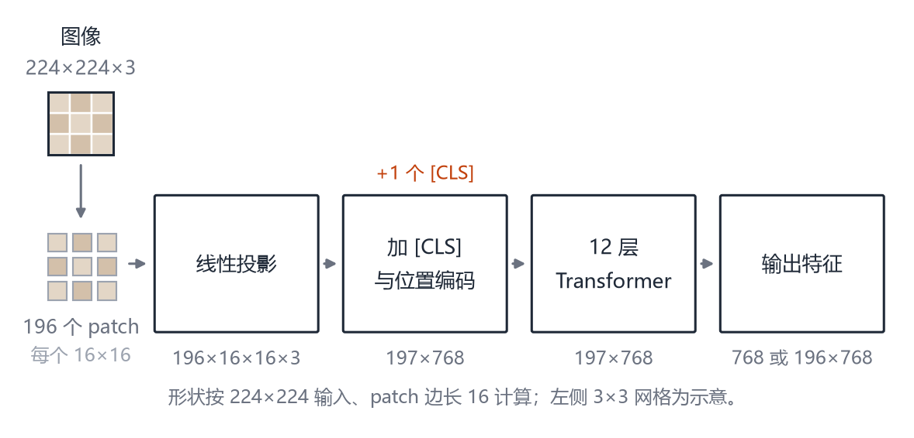
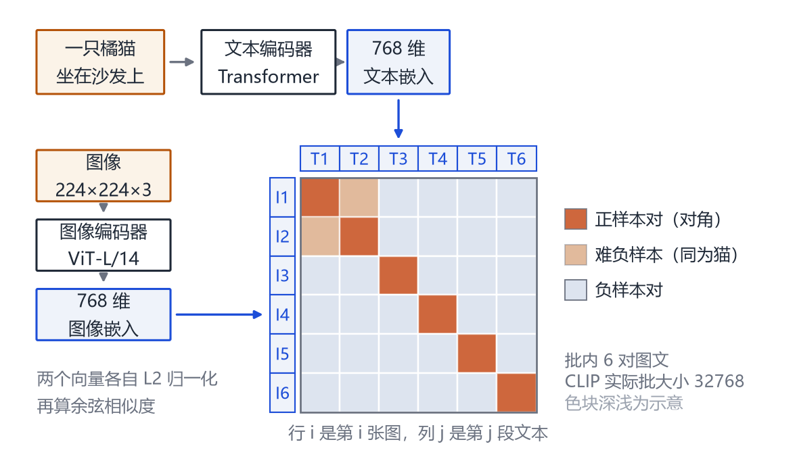
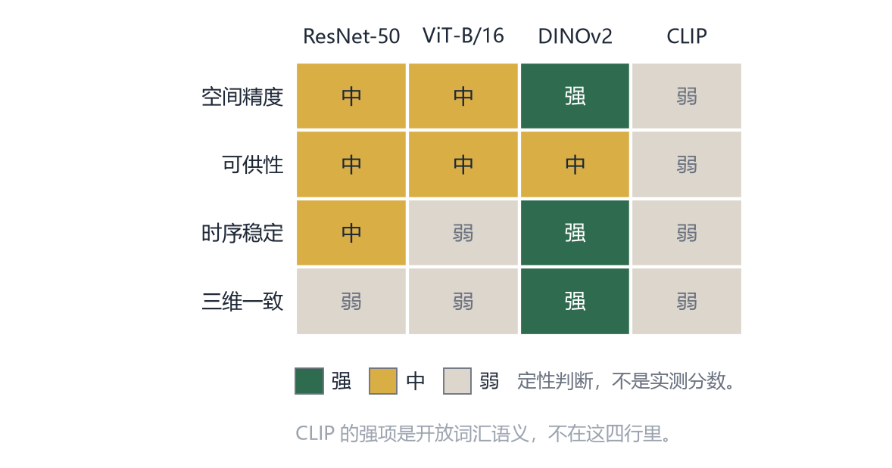

# 第 6 章　视觉特征与语义

> **本章导读**：上一章把像素变成了三维点和位姿，而位姿估计的第一步是先知道画面里那块区域是什么东西。这一章讲图像特征是怎么学出来的，从卷积网络到 ViT，从自监督到图文对齐，然后回答一个更实际的问题，这些在分类和检索上表现很好的特征，直接拿去驱动机器人为什么还不够。读完这一章，你能判断一个视觉骨干适合承担哪一类感知任务，以及它会在哪一步拖垮整条链路。

## 6.1 从卷积到 Transformer

第 5 章的位姿估计有一个隐含前提，得先知道画面里哪块区域是目标物体。分割模型给出掩码，位姿网络在掩码里拟合几何，而这两步的底层是同一件事，把像素变成向量。这个向量叫特征（feature）。分类网络输出的特征决定这是什么，分割网络输出的特征决定这块像素属于谁。特征的质量，直接决定了后面所有几何计算有没有正确的输入。

卷积的出发点很朴素。一个 3×3 的小窗口在图像上滑动，每滑到一个位置就做一次加权求和，权重就是这个卷积核的参数。一个训练好的卷积核相当于一个局部模式探测器，有的对竖边响应强，有的对某种纹理响应强。窗口在整张图上共用同一套权重，于是有了平移等变，图像里的杯子往右挪 10 个像素，响应图也往右挪 10 个像素。这条性质对机器人很有用，物体在桌上被推动了几厘米，特征的形状不变，只是位置变了。

深度是第二个关键。卷积核只能看到 3×3 的邻域，要看到更大的范围只能堆层。ResNet（2015）用残差连接解决了深层网络的训练问题，让 152 层的网络也能收敛。它的做法是在每两三层之间加一条恒等通路，让网络学"在原有表示上补什么"，而不是"从头算出什么"。ResNet-50 有 2560 万个参数，在 ImageNet 上 top-1 准确率约 76%，这个数字此后被当作视觉骨干的基准线。

问题出在最后几层。分类任务的输出是这张图属于哪一类，物体在画面中央还是角落，对答案没有影响。所以网络末端会做全局平均池化，把一个 7×7×2048 的特征图压成一个 2048 维向量。这一步对分类是对的，对机器人是灾难性的，因为位置信息在池化那一步被平均掉了。这个向量相当于"图里有一个杯子"的数值版本，它不告诉你杯子在哪。

第二个错位是感受野。3×3 卷积堆 10 层，理论感受野只有 21×21 像素，有效感受野还要更小。要建立"把手在杯身左侧"这种跨 100 像素的空间关系，需要几十层，而中间任何一次池化都会让位置精度再降一半。

2020 年的 ViT 换了个思路，不做卷积，把图像当成一句话。224×224 的图切成 16×16 的小块，得到 196 个 patch。每个 patch 展平成 16×16×3 = 768 维的向量，正好等于 ViT-B 的隐藏维度，所以第一个线性层的权重矩阵是 768×768 的方阵。196 个向量过线性投影变成 196 个 token，再拼上一个可学习的 [CLS] token 变成 197 个，加上位置编码，送进 12 层 Transformer。

关键的差别在第一层。self-attention 让每个 patch 和所有 patch 直接交互，左上角的 patch 在第一层就能看到右下角。卷积要达到同样的效果需要堆叠很多层，而且信息在传递过程中会被不断池化和混合。对机器人来说这不是细节，指令"把左边那个红色积木放到右边"需要模型把语言里的"左"和图像里的具体区域关联起来，全局注意力提供了这条通路。图 6-1 把这条流水线画了出来，注意每一步的张量形状都在变。

<figure class="fig">

<figcaption><b>图 6-1</b>　ViT 的前向流程。图像被切成 patch 后线性投影成 token 序列，加上 [CLS] 与位置编码送入编码器，最后一层可取出全局向量或每个 patch 的特征。</figcaption>
</figure>

位置编码值得多说两句。ViT 用的是一组可学习的一维向量，每个位置一个，它只编码"这是第几个 token"，不编码"这个 patch 在第几行第几列"。二维结构要靠数据自己学出来。这带来一个工程问题，换了输入分辨率，patch 网格变了，位置编码就得插值重采样，空间对应关系会轻微漂移。同一个相机换一个分辨率，特征图上的位置和实际像素的映射就不再是严格的线性关系。

代价是计算量。attention 的复杂度是 token 数的平方，196 个 token 时注意力矩阵有 3.8 万项，不算什么。DINOv2 推理时把分辨率提到 518，patch 边长 14，得到 37×37 共 1369 个 token，注意力矩阵涨到 187 万项，是原来的 49 倍。这也是为什么高分辨率视觉骨干的推理成本会突然变高。

ViT 还有一条反直觉的结论。在 ImageNet-1k 的 128 万张图上从头训练，ViT 不如同规模的 ResNet，因为卷积自带局部性和平移等变这两个先验，而 Transformer 没有，只能从数据里学。换成 JFT-3 亿张图预训练再迁移，ViT 就反超了。论文的结论是归纳偏置弱要用数据补。这条结论解释了为什么视觉骨干的演进和大规模预训练是同一件事，也解释了机器人领域为什么能直接受益，CLIP 和 DINOv2 已经把权重训好了。

机器人策略偏爱 ViT，有四个具体原因。

接口统一。图像 patch 是 token，语言是 token，动作也可以被切成 token，RT-2（2023）就是把每个动作维度离散成 256 个 bin，当成文本 token 输出。一条序列里混着三种模态，不需要为每种模态单独设计适配器。

语言指代要靠注意力。指令里的"那个""左边""靠近盘子的"都要落到具体 patch 上，attention 天然做这件事。

预训练权重可以直接用。冻结 CLIP 或 DINOv2 的 ViT，只训后面的策略头，这是很多视觉-语言-动作模型（VLA）的默认做法。

多相机好拼。两路相机的 patch 拼成一个序列，靠相机编号区分位置编码，比两路 CNN 特征图做对齐简单得多。

这些好处都在语义层面。patch 化本身给空间精度设了一个上限，14 像素的 patch 在 224 输入下等于十六分之一图宽。这个上限在 6.4 节会变成一个具体的毫米数。

## 6.2 不用标签也能学

ImageNet 的 1000 个类别是人定的。机器人需要区分的东西大多不在这个体系里，比如这个抽屉的把手、这个盖子能不能拧、这个盒子是不是已经被打开过。给这些概念标注数据的成本很高，一张图几分钱到几毛钱，一个场景几千张，几十个场景就是几十万张。

自监督的思路是把标签从数据本身造出来。图像里天然含有大量监督信号，同一张图的两个裁剪应该表示同一个物体，被遮住的部分可以从周围补出来，视频里相邻两帧的内容几乎一样。用这些约束训练出来的特征，不需要任何人工标签。

对比学习是最直接的一条。取一张图，做两次随机增广，随机裁剪、颜色抖动、水平翻转，得到两个视图，它们互为正样本。同一个 batch 里其他图的所有视图都是负样本。训练目标是把正样本在嵌入空间里拉近，把负样本推远。

InfoNCE 是这件事的标准写法，一句话版就是在一个 batch 的 N 个候选里做 softmax 分类，正确答案是那个正样本。

$$\mathcal{L} = -\log \frac{\exp(\mathrm{sim}(z_i,\, t_i)/\tau)}{\sum_{j=1}^{N}\exp(\mathrm{sim}(z_i,\, t_j)/\tau)}$$

式中的 $z_i$ 是第 i 张图的嵌入，$t_j$ 是第 j 段文本或第 j 个视图的嵌入，$\mathrm{sim}$ 是余弦相似度，$\tau$ 是温度，控制分布的尖锐程度，取值在 0.07 量级。分母里的 N 就是负样本数量，N 越大，任务越难，学到的特征越判别。

这解释了一个工程现象，对比学习对 batch 大小极其敏感。SimCLR 用 4096 到 8192，CLIP 用到 32768。batch 小的时候负样本太少，模型很容易靠颜色这种浅层线索把正负样本分开，学不到语义。MoCo 的办法是用一个动量编码器维护特征队列，把历史 batch 的负样本存下来，小显存也能有大量负样本。

还有一个坑叫表示崩塌。如果模型把所有图像都映射到空间里的同一个点，正样本之间的距离是 0，损失也接近 0，但特征完全没有信息。负样本、停梯度、中心化这些技巧，本质上都是在阻止模型走这条捷径。

掩码重建是另一条路，代表工作是 MAE（2022）。随机遮住 75% 的 patch，只把可见的 25% 送进编码器，解码器根据可见部分重建被遮住的像素，损失只在被遮的 patch 上计算。遮得这么狠是有原因的，图像的空间冗余很大，遮 15% 的话邻域插值就能猜个大概，模型学不到东西。

MAE 的特征有个特点，微调之后很强，直接拿来做线性探测不如对比学习。像素重建逼模型记住纹理、颜色和边缘，而语义需要的是抽象。这个差别对机器人有直接影响，如果只想冻结特征接一个轻量策略头，MAE 不是好选择。

DINOv2（2023）把自监督做成了一个可以直接用的产品。它用的是自蒸馏，同一个架构有两个副本，student 和 teacher。student 看局部裁剪，teacher 看全局视图，student 要预测 teacher 输出的分布。teacher 的参数不是梯度更新的，而是 student 参数的指数滑动平均，所以不需要负样本也不会崩塌。防崩塌靠两个操作，中心化把每个原型向量的长期均值减掉，避免某一个原型独占所有样本；锐化用低温 softmax，避免输出过于均匀。在此之上再叠加 iBOT 式的掩码 patch 损失，让 patch 级特征也有监督，而不只是整图一个向量。

数据是 LVD-142M，1.42 亿张无标签图像。做法是从公开数据池里检索出与若干精选数据集相似的图，再去重，整个过程用 20 个节点、每节点 8 张 V100 跑了不到两天。最大的模型是 ViT-g/14，11 亿参数，1536 维，40 层，训练末段把分辨率提到 518。

DINOv2 常被叫作通用视觉词典，这个说法有具体所指。冻结权重，把每个 patch 的特征当成一个词，做语义分割、深度估计、物体对应都不需要训练新网络，只要在这个特征空间里做最近邻或者线性分类。论文里把特征做 PCA，前三个主成分直接能分出物体和背景，说明特征保留了空间结构，没有把整张图压成一个语义标签。这一点是 CLIP 做不到的，原因在下一节。

## 6.3 把图像和文字放进同一个空间

分类的标签体系是封闭的，训练时定好 1000 类，部署时遇到第 1001 类就没办法。机器人面对的世界是开放的，今天要拿杯子，明天要拿一个没见过的玩具。如果杯子这个概念能从自然语言里来，就不需要预先定义类别。

CLIP（2021）的做法是训练两个编码器，一个吃图像，一个吃文本，各自输出一个向量，经过线性投影到同一个 d 维空间，再各自做 L2 归一化。ViT-L/14 这一版的嵌入维度是 768。图像塔可以是 ResNet 也可以是 ViT，文本塔是一个 12 层的 Transformer。

训练时一个 batch 里有 N 对配对的图文，算一个 N×N 的余弦相似度矩阵。对角线是真正的配对，其余 N²-N 个格子都是负样本。损失是两个方向的交叉熵之和，图像去找对应的文本算一次，文本去找对应的图像再算一次。数据是 4 亿对从互联网收集的图文，batch 32768，温度初始化为 0.07 并且参与训练。图 6-2 画的就是这个矩阵，对角线上一格是正样本，其余全是负样本。

<figure class="fig">

<figcaption><b>图 6-2</b>　CLIP 的双塔与批内相似度矩阵。图像与文本各自编码成 768 维向量，对角线是配对的正样本，其余格子是负样本。色块深浅为示意，不对应实测相似度。</figcaption>
</figure>

训练完之后，文本塔可以当分类器的生成器用。把类别名套进模板 "a photo of a {class}"，文本塔输出一个向量，这个向量就是该类别的分类权重。推理时图像向量和所有类别向量算余弦相似度，取最大。ViT-L/14@336 在 ImageNet 上零样本 top-1 是 76.2%，和全监督训练的 ResNet-50 打平，而它没有用过 ImageNet 的 128 万张标注图。这个结果在 2021 年震动了整个视觉领域，因为它说明监督信号可以从自然语言里来。

检测和分割也顺着这条路打开了。老式检测器要先定义类别，再设计 anchor，最后做非极大值抑制。DETR（2020）把检测变成集合预测，用一组可学习的 query 去问图像，一次输出固定数量的框，不需要 anchor 也不需要后处理。把 query 换成文本嵌入，检测器就能检任意类别，这就是开放词汇检测。分割的做法类似，先用 SAM 一类模型给出与类别无关的掩码，再把每个掩码区域的特征和文本嵌入比对，贴上标签。

CLIP 的短板藏在训练目标里。它对齐的是整张图和整句话，图像塔最后做全局池化，一个 patch 的特征从来没有被任何文本监督过。所以 CLIP 的相似度是全局语义的相似度，不携带在哪里这个信息。让它判断图里有猫很准，让它回答猫的左耳在图像第几列就不行。要在 CLIP 之上做像素级任务，必须再训一个解码器，MaskCLIP 和 CLIPSeg 都是这么做的。

第二个短板是尺度。图像进网络之前会被 resize 到 224，绝对尺寸信息在归一化那一步就丢了。同一个杯子在 0.3 米和 1 米处拍下来，嵌入几乎一样。这种不变性在分类里是优点，在抓取里是灾难，因为策略必须知道还有多远、多大。

SpatialVLM（2024）专门为这件事造了带三维标注的空间问答数据。论文里有个例子，问沙发和桌子之间的通道有多宽，GPT-4V 回答看起来不够 1 米宽的机器人通过，而实际测量是 1.56 米。这类错误不是语言能力问题，是视觉特征里没有尺度这个量。

## 6.4 机器人需要什么特征

上面三种模型都是在图像级任务上评测的，分类、检索、图文匹配，评价指标是整张图判断对了吗。机器人策略的输入输出完全不同，它每一帧都要输出一组关节目标，误差会累积到下一步。把需求拆开，至少有四条，每一条都能落到具体的数字上。

### 6.4.1 空间精度

先算一个数。640×480 的相机，水平视场 60 度，焦距 $f = 320/\tan(30°) \approx 554$ 像素。0.5 米处，一个像素对应的实际长度是 $0.5/554 \approx 0.9$ 毫米。这是相机的理论分辨率，也是深度图和 RGB 图共同的精度基准。

ViT-L/14 的输入是 224，一个 patch 是 14/224 即十六分之一图宽，对应原图 640/16 = 40 像素。0.5 米处，一个 patch 覆盖 36 毫米。36 毫米和 0.9 毫米差 40 倍。特征图上采样能把它画得更细，但插值不产生信息。

后果很具体。USB-C 插头的对准公差在 0.5 毫米量级，靠 patch 级特征做视觉伺服，误差比公差大两个数量级。所以精细操作里，语义特征只用来选目标，最后的对准靠深度图、力控和视觉伺服。这也是为什么 VLA 的输出通常是末端位姿的增量，而不是像素坐标。

有一类做法能缓解这个矛盾，把高分辨率特征图和低分辨率语义特征拼起来用，前者管对准，后者管认东西。检测网络里的特征金字塔就是这个思路，浅层分辨率高语义弱，深层反过来，横向连接后各取所长。

### 6.4.2 可供性

可供性不是一个语义标签。一个杯子的语义是杯子，它的可供性是把手在内侧，可以从上方用两指夹住，夹持宽度 6 厘米，重心离把手 4 厘米。后面这些量决定抓取能不能成功，而 CLIP 的图文对里几乎不描述这些。互联网上的 caption 写一只猫坐在沙发上，不写沙发的扶手宽 12 厘米、可以支撑 3 公斤。

所以可供性特征要么来自几何，局部法向、曲率、开口宽度、支撑面，这些从深度图直接算比从 RGB 特征猜更可靠；要么来自专门的标注数据，让人在仿真里点这里推一下会动，收集几万个像素、动作、结果的三元组，训一个可供性头。这两类信息都不在 CLIP 的预训练目标里。

还有一层更隐蔽的问题。可供性是相对于夹爪定义的，同一个物体，二指平行夹爪能从上面夹，五指手可能要从侧面扣。换一个末端执行器，可供性的标注就全部作废。这也是为什么跨本体的策略迁移比跨物体难得多。

### 6.4.3 时序稳定

控制频率在 10 到 50 Hz，相邻两帧间隔 20 到 100 毫秒。机械臂以 0.1 米每秒移动，一帧走 2 到 10 毫米。

ViT 的 patch 网格是固定的。物体跨过 patch 边界时，一个 patch 里前景和背景的比例会突变，特征跟着跳一下。0.5 米处 patch 边长 36 毫米，0.1 米每秒时每 0.36 秒跨一次边界，也就是接近 3 Hz 的一次跳变。

后果是策略的输入带 3 Hz 的抖动，输出跟着抖，关节电流出现周期性波动，夹爪在接触瞬间容易打滑。第 9 章讲的时间集成就是为了压这个抖动，但那属于事后补救。更彻底的做法是让特征本身平滑，对相邻帧做指数滑动平均，或者用带时序的编码器，或者在训练时把相邻帧当正样本做对比学习。

### 6.4.4 三维一致

三维一致这一条最容易被忽略。同一个物体从正面看和从侧面看，特征应该相近，这是视角不变性；但同一个物体的把手和杯身，特征应该不同，这是空间特异性。这两条要求方向相反，模型必须找到一个平衡点。分类任务只关心前一条，所以它训练出来的特征往往过度不变，把把手和杯身也揉到了一起。

多相机系统里这条更关键。头部相机和腕部相机同时看一个杯子，两路图像的 patch 特征如果差很多，融合模块就会以为看到了两个物体，抓取点算出来在两者中间，谁也没抓住。

DINOv2 在这一条上表现最好，论文里用 patch 特征的最近邻做跨视角对应，能对上物体的同一部位。但它仍然是在单图上学出来的，没有显式的三维监督，视角变化超过 90 度之后对应关系就开始出错。

把上面这些模型的基本参数摆在一起，差别就更清楚了。

**表 6-1**　视觉骨干对比。

| 模型 | 参数量 | 预训练数据 | 输出维度 | 机器人里的典型用法 |
|---|---|---|---|---|
| ResNet-50 | 25.6M | ImageNet-1k，128 万张带标签 | 2048 维全局向量 | 抓取检测、轻量策略的视觉塔 |
| ViT-B/16 | 86M | ImageNet-21k，1400 万张；论文最佳结果用 JFT-3 亿 | 768 维，196 个 token | 策略视觉塔，与语言 token 拼接 |
| ViT-L/14 | 304M | ImageNet-21k，或 CLIP 的 4 亿图文对 | 1024 维，224 输入下 256 个 token | VLA 视觉塔的常见尺寸 |
| DINOv2 ViT-g/14 | 1.1B | LVD-142M，1.42 亿张无标签图 | 1536 维，518 输入下 1369 个 token | 冻结特征做对应、深度、抓取 |
| CLIP ViT-L/14 | 428M | WIT，4 亿图文对 | 768 维（投影后） | 开放词汇检测、语义地图、语言接地 |

表里的参数量按各模型的公开配置计算，输出维度按各自默认输入分辨率给出。需要注意的是这一列的差别不只是数字大小，分类模型只暴露一个全局向量，密集预测模型暴露每个 patch 的向量，两者在机器人里的用法完全不同。拿 ResNet-50 做密集预测要额外接 FPN 或者空洞卷积，拿 ViT 做分类则只要取 [CLS] 那一个 token。

这四条需求没有一条能靠换个更大的模型解决，因为它们指向的是训练目标，不是模型容量。分类目标不奖励像素精度，图文对齐目标不奖励尺度，单图预训练不奖励时序稳定。要解决只能改目标，或者在目标之上加一层专门的模块。

把这四条需求和四个骨干摆在一起，得到图 6-3。

<figure class="fig">

<figcaption><b>图 6-3</b>　四类特征需求与四个骨干的定性对照。深绿表示强、土黄表示中、浅灰表示弱，依据是各模型公开报告的行为，不是统一基准上的实测分数。</figcaption>
</figure>

图 6-3 把上面的判断压缩成一张表格式的图。DINOv2 在空间精度、时序稳定、三维一致三行都是强，只有可供性给中，原因是它的训练目标同时约束了整图和 patch，特征既有语义又有空间结构；CLIP 四行全弱，但它的强项是开放词汇语义，这一项不在四行之内。这张图不该被读成排行榜，它想说明的是没有哪个骨干在四条上全部拿到强，实际系统都是两三个模型拼起来的。

## 6.5 特征可视化与失败案例

调试视觉特征最常用的手段是把注意力权重画成热力图叠在原图上。图上模型盯着杯子，看起来很合理，于是判断特征没问题，问题在策略。这个判断经常是错的。

第一个原因是注意力权重不等于因果重要性。softmax 把总量归一化到 1，权重高的位置可能只是相对没那么无关，而不是决定了输出。真正该看的是遮挡敏感度，把某个区域涂黑，看输出变化多少。这两张图经常不一致，注意力集中在一小块，遮挡它却没有影响，说明模型其实在用别处的信息。

第二个原因是语义显著性和任务相关性错位。杯身面积大、纹理多、占了十几个 token，注意力自然集中在杯身；把手细、颜色暗、只有两三个 token。抓杯身会滑，抓把手才稳。模型的看法和任务需要的用法不在同一个位置。这类失败在注意力图上完全看不出来，因为注意力图确实指着杯子，看上去无懈可击。

第三个原因是背景。CLIP 特征在背景相似时会误匹配。两张图里都有白盘子、木桌面、相似的阴影，特征余弦相似度能到 0.95 以上，策略把 A 桌上的碗当成 B 桌上的。换一块纯色桌布，同样的物体相似度掉到 0.7，策略反而正常了。这说明特征里混进了大量场景信息，物体本身的权重不够。

第四个原因是可视化只看单帧。相邻帧特征的余弦相似度如果从 0.98 掉到 0.85，热力图上看不出任何区别，但策略的输出会明显抖动。时序问题必须用时序指标看，热力图再漂亮也没用。

把这四条落成可执行的检查，大概是这样几件事。

1. 用遮挡敏感度图代替注意力图，滑一个 32×32 的遮挡块，记录策略输出的变化幅度，变化大的区域才是模型真正依赖的区域。
2. 做换背景、换光照的对照实验，同一物体、同一动作、只改背景，看成功率掉多少。掉超过 20 个百分点，说明特征对场景过拟合。
3. 画相邻帧特征的余弦相似度曲线，直接量化抖动，比看图可靠。曲线在 0.9 以下反复震荡，就要考虑加平滑。
4. 对失败帧做最近邻检索，把它在训练集里最像的十帧调出来。如果最像的是另一个物体，问题在特征；如果最像的是同一物体的另一个姿态，问题在策略。

这套检查做下来，多数"特征看起来没问题"的结论会被推翻。可视化和实际作用之间隔着两层，一层是注意力归一化，一层是任务定义，跨过这两层才能把失败归到正确的位置。

特征回答的问题是这块像素像什么。它不回答这块像素在空间的哪个位置，不回答它和旁边的物体是什么关系，也不回答上一次看到它是什么时候。这三个问题需要另一种表示，把特征按空间位置组织起来，跨时间累积，并且允许查询。这正是地图要干的事。
