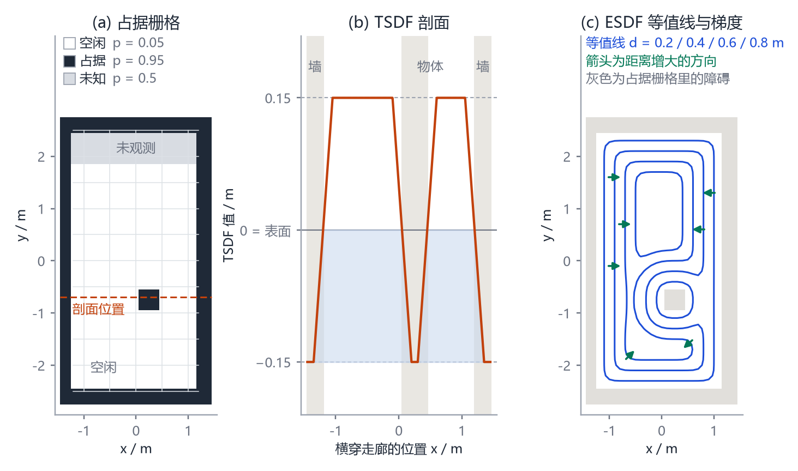
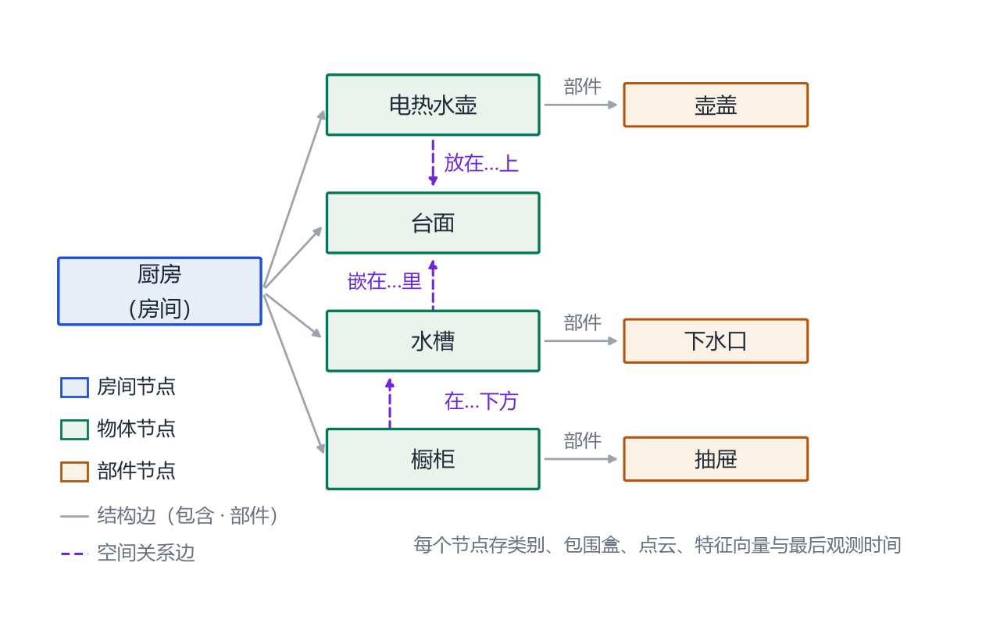
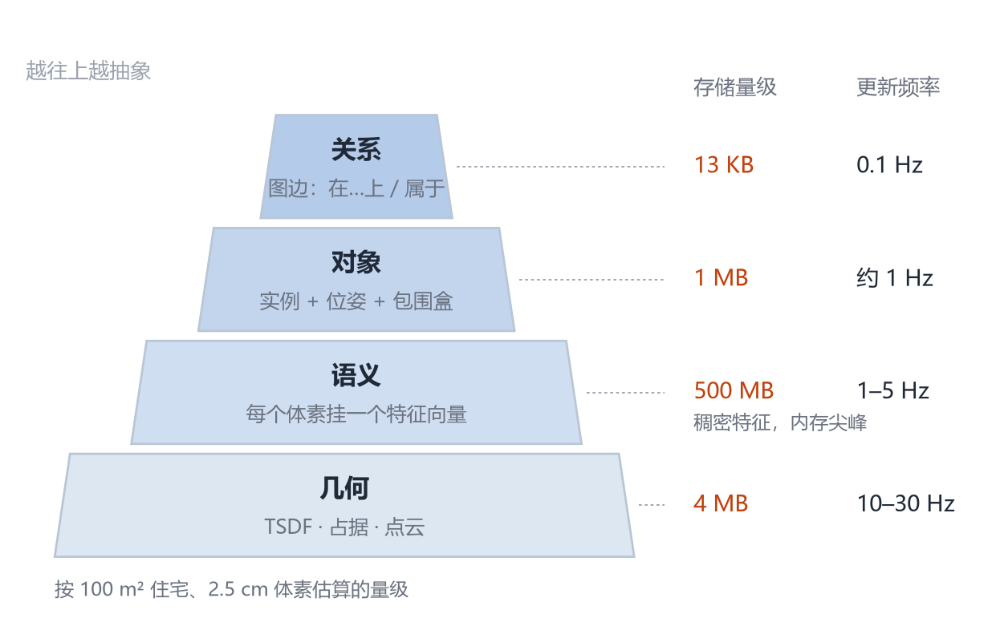

# 第 7 章　地图与场景图

> **本章导读**：机器人早上把药盒从客厅送到卧室，下午还要回到同一个床头柜，中间它转过几十次身，客厅早就离开了视野。相机只记得眼前这一帧，能让它记住"东西在哪、房间怎么连"的只有地图。这一章从一张 5 厘米的方格讲起，走到距离场、物体列表、三维场景图和神经场，最后说清怎么把地图压成两千个词交给大模型，以及怎么让它知道"这块我还没看过"。

## 7.1 为什么需要一张地图

早上八点，一台移动机械臂接到一句话，把茶几上的药盒送到卧室床头柜。它的相机水平视野大约 60 度，超过 3 米就开始模糊。转身去拿药盒，床头柜离开了画面；穿过走廊进了卧室，茶几也不在视野里。整个任务里，没有任何一帧图像同时包含起点和终点。

人做这件事不觉得难，因为脑子里有一张房子的图。这张图不需要精确到毫米，只需要回答四个问题。东西大概在哪。房间怎么连。哪里能走。床头柜这个词指的是哪一个。

**跨时间的记忆。** 相机是"现在"，地图是"曾经"。一帧 640×480 的 RGB-D 图像大约 30 万个点，只覆盖两三个平方米。一间 100 平方米的房子扫一遍，墙面地面加起来的表面积约 300 平方米，按 2.5 厘米体素算，表面体素接近 50 万个，只相当于一帧半的点数。总量并不比一帧多多少，难的地方在组织方式，这些点必须能按坐标随手取出来，而不是每次从头重算。

**长程任务的中间状态。** 走出去 20 米再回来，视觉里程计的位姿漂移常有几厘米到十几厘米。地图是唯一能把"我去过哪、那里有什么"固定下来的东西，位姿估计算得再准，也需要一个不随帧消失的参照。

**导航与避障。** 走廊净宽 1.2 米，机器人本体 0.6 米，两边各剩 30 厘米。桌腿直径 4 厘米，深度相机在 2 米处能分辨，但只在视野内。没有地图，避障只能在看见的那一刻起作用，转个身就失效。

**语言指代的落地。** "把药盒拿过来"里的药盒在语言中是一个名词短语，在地图里必须是一个带三维位姿的实体，否则规划器无从下手。从"药盒"这两个字到一个可以伸手的坐标，中间那一步就是地图。

同一个世界，有三类消费者，要的东西完全不同。规划器要"到最近障碍多远"以及这个距离的梯度，每秒查几千次。策略网络要一个固定形状的张量，好拼进神经网络。大模型要能读的文本，最好是几百个词。这三类需求拉扯出本章要讲的几种表示，它们不是互相替代的关系，而是在不同层上各管一段。

位姿从哪来，第 4 章的 SLAM（Simultaneous Localization and Mapping）已经讲过前端、后端和回环检测。这一章假设位姿已知，或者由 SLAM 模块并行给出，只讨论"世界长什么样"这一半。

## 7.2 占据栅格与距离场

最朴素的表示把地面切成方格。每格 5 厘米见方，存一个数，表示这一格有障碍的概率。Moravec 和 Elfes 在 1985 年就是这么做的，四十年过去，扫地机器人底盘里跑的还是这个结构。

概率不能直接相乘更新。看一次是 0.6，看十次就逼近 1，浮点数很快下溢，而且一条错误观测会把格子永久钉死。工程上改用对数几率

$$l_t = l_{t-1} + \log\frac{p(z_t \mid x)}{1 - p(z_t \mid x)}$$

其中 $l = \log\frac{p}{1-p}$ 是对数几率，$z_t$ 是第 $t$ 次观测，$x$ 是这一格的状态。概率相乘变成了对数相加，一次加法就完成更新，还能顺便裁剪。

裁剪是这套办法能用的关键。传感器模型告诉系统，射线穿过的地方是空的，末端命中的地方是障碍，中间没打到的什么也不说。教材里常用的增量是命中和穿过分别取 $+0.85$ 和 $-0.4$，把 $l$ 限制在 $-2$ 到 $3.5$ 之间，等价于概率不低于 0.12、不高于 0.97。玻璃、镜面、走动的人都会让同一格反复翻转，允许"改主意"比追求一次定死重要得多。

算一遍更直观。初始 $l=0$，一次命中加 0.85，一次穿过减 0.4。连看三次都命中，$l=2.55$，概率 0.93；之后两次视线穿过，$l=1.75$，概率掉回 0.85。这就是玻璃门前的地图会反复变色、而不是干脆变空的原因。

三维有两条路。体素就是三维的格子。KinectFusion 用 $512^3$ 个 5 毫米体素，覆盖 2.56 米见方的体积，每个体素存一个距离和一个权重共 8 字节，合计 1 GB，正好占满当年一张显卡。代价很直接，机器人走出这个立方体，地图就没了。八叉树把空间按八分递归切下去，只在表面附近细分到 5 厘米，一个房间的图通常几 MB。存储跟着表面积走而不跟着体积走，这是它成为移动机器人标配的原因。

截断符号距离场（TSDF，Truncated Signed Distance Field）换了问题。每个体素存的不是"有没有障碍"，而是"到最近表面的带符号距离"。距离在自由空间为正，在物体内部为负，在表面处为零。截断到 $\pm\tau$ 之后写成

$$\mathrm{tsdf}(\mathbf{x}) = \mathrm{clip}\big(d(\mathbf{x}), -\tau, \tau\big)$$

$\tau$ 一般取体素边长的 3 倍，1 厘米体素配 3 厘米截断。图 7-1 中间那一幅画的就是这条曲线，它在墙和箱子附近各有一段斜坡，其余部分压在 $\pm\tau$ 上。

截断有三个理由。远处的精确距离用不上，抓取和避障只关心表面附近几厘米。截断后每个值有界，多帧加权平均时不会被一次错误观测拉爆。饱和值本身还传达了"远"这个信息，负饱和则说明"在实体里面"，这两种情况都不需要精确数值。

融合是一次加权平均

$$D_t = \frac{W_{t-1}D_{t-1} + w_t d_t}{W_{t-1} + w_t},\qquad W_t = W_{t-1} + w_t$$

权重 $w_t$ 通常与深度测量入射角的余弦成正比，斜着看的面不可信。这是 KinectFusion 的核心循环，一次乘加，GPU 上每帧几毫秒。

欧氏符号距离场（ESDF，Euclidean Signed Distance Field）回答另一个问题。TSDF 只在表面附近的薄壳里有值，规划器要问的是"从这一点出发，到最近障碍有多少米"，定义为

$$d_{\mathrm{esdf}}(\mathbf{x}) = \min_{\mathbf{y}\in\mathcal{O}} \lVert \mathbf{x} - \mathbf{y}\rVert$$

$\mathcal{O}$ 是障碍点集。自由空间里处处有值，梯度模长几乎处处为 1，方向指向远离障碍的一侧，图 7-1 右边的箭头就是这个方向。

这两个性质让避障变得很便宜。判断一个位姿是否安全，原本要把机器人模型和几千个三角形做距离计算，耗时以毫秒计；有 ESDF 之后查一次表拿到一个数，和 0.3 米比一下就行，快到可以做每秒上千次的轨迹检查。梯度更直接，把候选轨迹往梯度方向推，就是在远离障碍。

<figure class="fig">

<figcaption><b>图 7-1</b>　同一段走廊的三种表示。左为占据栅格，中为沿虚线的 TSDF 剖面，右为 ESDF 的等值线与梯度。栅格取 10 厘米、截断距离取 0.15 米，墙体与箱子的位置为设定值。</figcaption>
</figure>

代价落在更新上。TSDF 只在新观测的视锥里写，别处不动。ESDF 一旦障碍变了，周围一片都要重算，增量算法能把一次更新压到几十毫秒，但它仍然是建图链路里最贵的一步。常见做法是把 TSDF 放在快线程里跑 30 Hz，ESDF 放在慢线程里跑 1 到 10 Hz，规划器读上一份。

## 7.3 对象级地图与三维场景图

体素回答"这里有没有东西"，不回答"这是什么"。一间房里五十万个表面体素，九成以上属于墙、地板和天花，真正算物体的不到十万。更要命的是，同一个杯子在二十帧里是二十片点云，没有任何标记告诉系统它们是一回事。

对象级地图做的就是把点云聚成实例。流程是分割、反投影、关联三步。类无关分割（SAM，Segment Anything Model）给出掩码，不需要知道类别；掩码内的像素配合深度反投影成一小片点云；这片点云再和已有物体比相似度，决定归入旧节点还是新建节点。

相似度由两部分加和。几何部分用包围盒的交并比（IoU），或者点到点的最近距离；语义部分用特征向量的余弦。ConceptGraphs 用 2.5 厘米体素对点云下采样，两项加权求和后做贪心匹配，相似度超过阈值就合并，否则新建一个节点。贪心比匈牙利算法快，效果差别很小。

每个物体存六样东西。类别或一句描述、三维包围盒与位姿、下采样后的点云、一个特征向量、被观测到的次数、第一次和最后一次看到的时间。最后两项经常被忽略，而它们恰恰是判断"这条信息还新不新"的唯一依据。

融合按观测次数走。特征用滑动平均 $f \leftarrow (n f + f')/(n+1)$，点云取并集后重新下采样。一个物体被看三十次之后，特征里混了三十个视角的信息，比任何单帧都稳。

房间这一层通常靠几何划分。墙和门构成天然隔断，把自由空间做连通域分析，再看两个连通域之间有没有 0.7 到 1 米宽的门洞，就能切出房间。切完给每个房间算中心点，名字可以来自里面的物体，有灶台和水槽的那间大概叫厨房。

把物体按空间关系连起来，就得到三维场景图。节点分三层，房间、物体、部件；边就是关系，在…上、在…里、属于、可以通行。完整的层次通常是建筑、楼层、房间、物体、部件五级，Armeni 等人在 2019 年给出这套结构，Hydra 在 2022 年把它做到实时增量更新。

<figure class="fig">

<figcaption><b>图 7-2</b>　厨房的三维场景图。房间节点通过结构边连到物体，物体之间是带方向的空间关系，部件挂在所属物体下。关系标签可由语言模型从两个节点的描述中推断。</figcaption>
</figure>

层次不是为了好看。查询"厨房里能装水的容器"，如果只有一张平铺的物体列表，就要跟全场几万个节点比一遍。有了层次，先定位厨房这个子图，只在里面二十几个节点里找。组合爆炸被层次压住了，这是场景图在导航和任务规划里被反复采用的实际原因。

维护才是对象级表示最值钱的地方。桌上的杯子被拿走，只需要改一个节点的位姿，或者删掉它和台面之间的那条边。体素地图做不到这一点，旧观测留在原地，形成"幽灵障碍"，规划器会绕着一个已经不存在的东西走。任何打算连续运行几天的系统，最后都会从体素走到对象。

代价是分割会错。一个杯子被切成两半，地图里就有两个杯子，各自带着半份语义；两个挨着的盒子被合成一个，之后无论怎么问都只能拿到一个。ConceptGraphs 在办公室场景里检出 24 到 59 个物体，重复检测 0 到 5 个；节点描述的正确率约 70%，关系边的正确率 91%。两个数字的差距说明，判断"两个东西什么关系"比判断"这是什么东西"容易，因为关系只需要方位的相对比较。

## 7.4 开放词汇地图

封闭词表是第一个坎。COCO 的 80 类里没有"能装水的容器"，也没有"可以用来撬开罐子的东西"，而真实任务里的名词几乎总在词表之外。

对比语言-图像预训练（CLIP，Contrastive Language-Image Pretraining）给了一个出口。图像和文本被映到同一个向量空间，一张马克杯的照片和"a mug"这句话的向量挨得很近。于是地图可以不给物体贴类别，而是挂一个 512 维向量；查询时把描述编码成向量，算余弦相似度。词表这件事被绕开了。

ConceptGraphs 把这条路走成了一套完整系统，分三步。第一步用 SAM 做类无关分割，得到候选区域，跨视角关联成三维节点。第二步给每个节点挑出贡献点最多的 10 个视角，裁出图像块，让视觉语言模型写一句描述，再让语言模型把十句汇总成一句。第三步用包围盒 IoU 建稠密图，剪成一棵最小生成树，把每对相邻节点的描述和位置交给语言模型，让它判断是"a 在 b 上"还是"b 在 a 里"。

这样就能回答"厨房里能装水的容器在哪"。CLIP 对"容器"这类外观词很好用，对"能装水"这种功能描述很差，因为水壶、水槽、玻璃杯长得完全不像。但每个节点上都挂着一句自然语言描述，把节点列表连同描述交给大模型，它能靠常识给出答案，水槽、水壶、杯子都可以装水，水槽在厨房。词表的边界被换成了语言模型的常识边界，这个替换是开放词汇地图真正的贡献。

否定的查询也能处理。"除了可乐以外能喝的东西"这类问题，CLIP 只看整体相似度，答得很差；换成让语言模型读节点描述逐条排除，反而更准。ConceptGraphs 专门评了描述性、可供性、否定三类查询，第三类几乎全靠语言模型的推理。

省下的内存也很可观。给每个表面体素挂 512 维半精度特征，一间房要 500 MB 左右；五十九个节点各挂一个向量，不到 100 KB，差几千倍。稠密特征是内存尖峰，对象级表示把它压回 MB 量级，这个落差在图 7-3 里标得很清楚。

局限同样清晰。描述质量决定检索上限，70% 的正确率意味着每三个节点就有一个描述不准，而检索恰恰是在描述上做的。关系只建在最小生成树上，稀疏得回答不了"这两个物体之间有没有东西挡着"。分割一旦出错，节点和边会被同时污染，而且是静默的污染，下游只看到结果不对。

## 7.5 神经场地图

神经场是另一条路。神经辐射场（NeRF，Neural Radiance Fields）把场景表示成一个函数 $F_\Theta(\mathbf{x}, \theta, \phi) \to (\mathbf{c}, \sigma)$，输入一个点的位置和观察方向，输出颜色和体密度。训练时沿相机射线采样几十个点，把密度积分成像素颜色，和真实图像比对，反传梯度优化网络参数。整个过程不需要体素，也不需要网格。

代价写在论文里。原始实现要十万到三十万次迭代，单张 V100 上跑 1 到 2 天，渲染一帧 800×800 要 30 秒。这个速度做不了闭环控制，但做离线重建和渲染完全够用。

3D 高斯泼溅（3D Gaussian Splatting，3DGS）换了载体。隐式函数变成一堆显式椭球，每个高斯存位置、缩放、旋转、不透明度加球谐系数，大约 60 个浮点数。一个场景 100 万到 500 万个高斯，训练 6 到 51 分钟，1080p 下渲染 93 到 135 帧每秒。渲染速度从秒级掉到毫秒级，这是它两年内铺开的原因。

语义版本的做法很直接。在辐射场上加一个语义头，或者给每个高斯挂一个特征向量，查询"哪里是杯子"就变成渲染一张语义图再阈值化。需要"从新视角看一眼"的任务特别适合这类表示，视觉伺服、把重建场景当仿真背景、用渲染图做数据增广，都是这个路子。

代价有三条。更新不是增量的，新来的几十帧要么整体重训，要么做增量蒸馏，都是分钟级，而地图需要的更新周期是几十毫秒。内存大，300 万个高斯乘 60 个浮点，约 700 MB，还没算特征。编辑难，把桌上的杯子从地图里删掉，没有对应的操作，只能重新训练或者手工裁剪高斯。

神经场和对象地图的成本差得很远。重建一个房间的 NeRF 要几百张带位姿的图，训练集本身就有几百 MB，训完的模型再占几十到几百 MB；同样的图过一遍分割与编码，存下来的场景图只有几十 KB。重建质量与存储成本怎么换，在这里看得最清楚。

判断标准很朴素。场景静态、需要照片级渲染、需要任意视角查询，用神经场。桌面级、物体频繁移动、要 30 Hz 更新，用体素或对象地图。两者也可以在同一个系统里分工，神经场管背景和外观，对象层管可动的东西。

几种表示放在一起看，各自的定位更清楚。

**表 7-1**　地图表示对比。分辨率与规模按室内移动机器人的常见配置估计。

| 表示 | 每个单元存什么 | 典型分辨率与规模 | 一次查询返回什么 | 主要代价 |
|---|---|---|---|---|
| 2D 占据栅格 | 占据概率的对数几率 | 5 cm，一层楼约 8 万格 | 该格有障碍的概率 | 只有一层，丢失高度与悬空物 |
| 3D 体素 | 占据概率或截断距离 | 1 到 5 cm，房间级数百万格 | 该体素的占据状态或距离 | 内存随体积增长，出界即丢 |
| 八叉树 | 节点占据状态，叶节点细分 | 叶节点 5 cm，房间级几 MB | 同体素，但需遍历树 | 查询慢，指针开销大 |
| TSDF | 带符号距离与融合权重 | 1 到 2 cm，表面薄壳 | 到最近表面的距离 | 只在表面附近有效，更新限于视锥 |
| ESDF | 到最近障碍的欧氏距离 | 2 到 5 cm，自由空间全填 | 距离与梯度，可直接判定安全 | 更新要局部重算，内存翻倍 |
| 对象与场景图 | 位姿、包围盒、特征、时间 | 每场景几十到几百个节点 | 该物体的属性与关系 | 依赖分割，错误会分裂或合并 |
| 语义神经场 | 网络权重或高斯参数 | 百万级高斯，数百 MB | 任意视角的颜色与语义 | 训练分钟级，几乎不能增量编辑 |

## 7.6 把地图交给大模型

地图最后要交到大模型手里，通常有三种交法。

整份序列化最省事。把场景图写成一段文本或 JSON，每个物体一行，包含描述、包围盒中心、尺寸、置信度、最后观测时间。五十个物体、每个三十个词，一共一千五百个词上下，占 128k 上下文的百分之一多一点，可以整份塞进去。而五十万个体素没法这样交，每体素写十个字符就是近 5 MB 文本，折成词有五百万上下，任何上下文都装不下。

按需检索适合大场景。把地图包成几个函数，find 按描述返回候选节点的编号与位姿，near 按编号返回邻居，path 按房间返回路线。模型只看到它问过的那一部分，上下文永远是几十个词。代价是模型得学会问对问题，问错了就什么也拿不到。

渲染成图是第三条路。把地图投成一张俯视图，标上房间名和物体框，直接当图像喂给视觉语言模型。一张 512×512 的图信息密度高，模型对空间的直觉也更好，代价是丢了高度和遮挡关系，堆叠的物体会变成一团。

这三条路对应地图的不同层。几何层给不出文本，只能渲染成图；对象层最适合序列化；关系层最省词，也最适合让模型做推理。图 7-3 把四层的存储量与更新频率摆在一起，量级差了三四个数量级，接口怎么选基本被这两个数决定。

<figure class="fig">

<figcaption><b>图 7-3</b>　地图的四层抽象。几何层更新最快、语义层最占内存、对象与关系层最省空间，也最容易被序列化成文本。右侧两列按 100 平方米住宅、2.5 厘米体素估算。</figcaption>
</figure>

不确定性必须一起交出去。占据概率、TSDF 的权重、物体的观测次数、最后观测时间、位姿协方差，这些数在地图内部本来就有，序列化时最容易被丢掉，丢掉之后模型就会把"三分钟前看到"和"现在还在"当成一回事。

最要紧的一条区分是"空"和"没看过"。占据栅格里概率接近 0 是确认空，等于 0.5 是没有信息，这两种格子在图上看起来都是"没有障碍"，但规划器对它们的态度必须不同。机器人从没扫过床底下，和它确认过床底下是空的，走法完全不一样。

地图还需要主动维护。放在角落的椅子三天没被看到，节点的时间戳越来越旧，系统要么安排一次重访，要么在序列化时把它的置信度降下来。没人管的长期地图会慢慢变成一堆过时的断言，越用越糟，而错误往往在真正用到它的那一次才暴露。

坐标系和时间戳也得写清楚。"杯子在 (1.2, -0.4, 0.75)"这句话没有意义，除非说明这是机器人基座坐标系、单位是米、三分钟前观测。大模型没有身体，对 1.2 米没有直觉，所有坐标都必须自带参照系。

一个实用的做法是不让模型输出坐标。让它输出"去厨房，找水槽左边的台面"，由几何层把这句解析成一个位姿。模型的强项是常识和指代，弱项是数值精度，分工按这个来，出错的地方才好定位。

地图这一层到此为止。它能回答"世界现在长什么样"，回答不了"我推一下会怎样"。而动作恰恰建立在对后果的预测上，这是下一篇要处理的问题。
