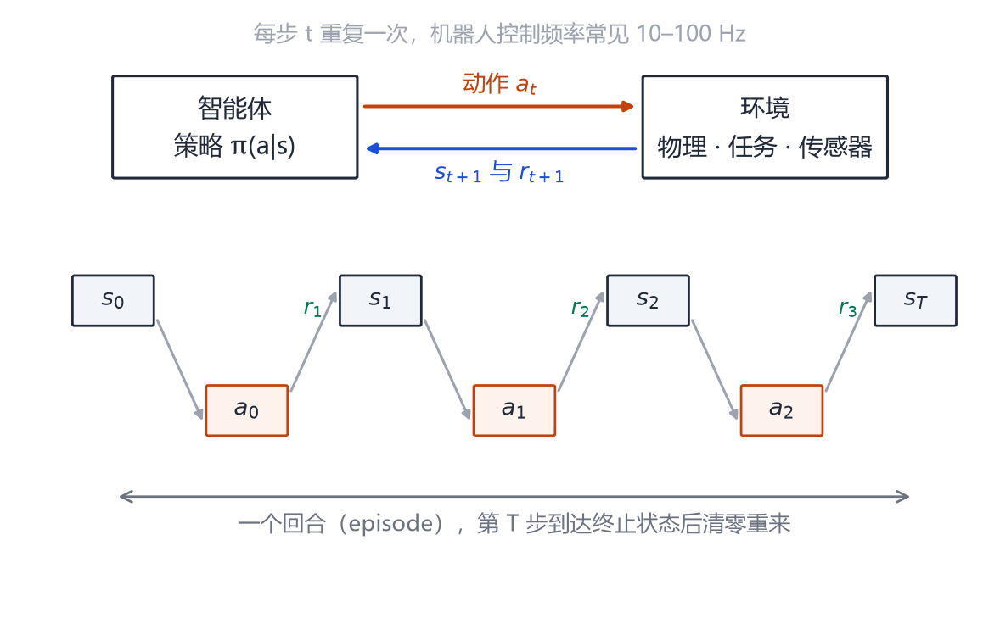
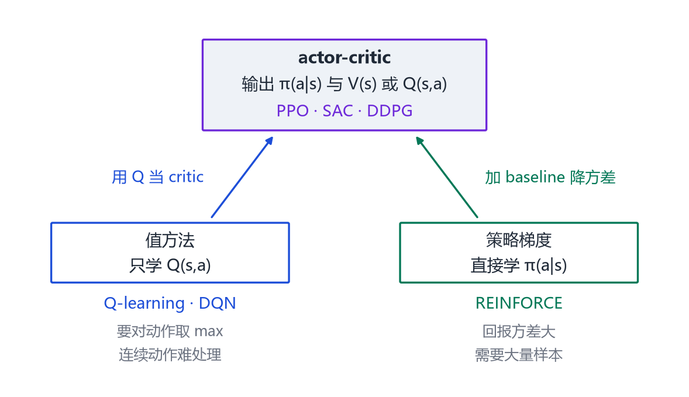
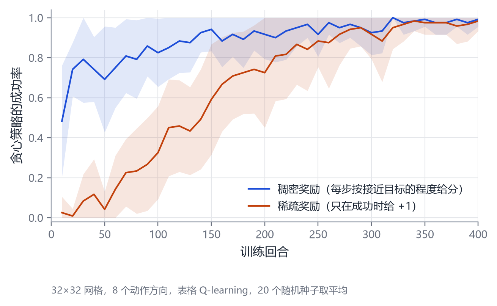

# 第 8 章　在试错中学习

> **本章导读**：强化学习不给标准答案，只给一个分数。这一章从"机器人怎么知道刚才那一手好不好"讲起，把试错学习拆成状态、动作、奖励、回报四件事，再讲值函数与策略梯度这两条技术路线，以及 PPO 和 SAC 这两个工程上真正在用的算法。读完这一章，你能看懂一篇机器人强化学习论文的实验配置，也能判断一个任务该不该用强化学习来做。

## 8.1 一个分数能教会什么

监督学习的套路是把输入和标准答案配对，模型学的是"看到这个就该输出那个"。这套办法在机器人身上很快就撞墙。你没法给"这一帧画面下六个关节该转到哪个角度"标一个标准答案，因为同一个任务有无数种正确做法，人也写不出每个时刻的正确动作。抓杯子可以从上往下、从侧面、斜着进，每一种都能成功。

能拿到的往往只是一个分数。方块推进目标区，得分；没推进，不得分；把方块推到桌子下面，扣分。强化学习处理的就是这种只有分数、没有答案的问题。

把它写成数学，需要五个东西，通常叫马尔可夫决策过程（Markov Decision Process，MDP）。

- **状态** $s$，机器人此刻能拿到的全部信息，关节角、末端位姿、方块位置。
- **动作** $a$，能发出的指令，六个关节的目标角，或者末端的速度增量。
- **转移** $P(s'\mid s,a)$，做完动作之后世界变成什么样。推一下方块，它移动多少取决于摩擦和质量，同样的动作两次结果不会完全一样。
- **奖励** $r$，环境给出的分数，一个标量。
- **折扣** $\gamma$，把未来的分数折算到今天的系数。

第五个要素值得多说两句。γ 取 0.99，意思是 100 步之后的 1 分在今天只值 $0.99^{100}\approx 0.37$ 分；取 0.9 时，20 步之后的一分就只剩 0.12 分。所以 γ 实际决定了智能体看多远。0.99 对应的有效视野大约 100 步，在 10 Hz 的控制频率下就是 10 秒。想让机器人为了 30 秒后的成功牺牲眼前的收益，γ 得设到 0.995 以上。而 γ 越接近 1，值函数的估计越容易发散，这个矛盾后面还会反复出现。

一次从开始到结束的尝试叫一个回合（episode）。抓取任务的回合从机械臂回到初始位姿开始，到抓住或者超时结束。图 8-1 上半部分是智能体与环境的循环，下半部分把同一个回合摊开成时间轴。

<figure class="fig">

<figcaption><b>图 8-1</b>　智能体与环境每一步交换一次动作、状态和奖励，若干步组成一个回合。回合结束时环境清零，状态回到初始分布。</figcaption>
</figure>

回合这个概念在机器人上有实际后果。回合太长，一次失败要等几十秒才知道结果；回合太短，任务没做完就被截断，截断处的价值估计会偏。不少实现会把"超时"和"真失败"分开处理，超时那一步不做终止标记，只把回报截断，否则智能体会学到"快到时间就赶紧结束"这种投机行为。

有了这五元组，学习目标就能写清楚。策略 $\pi(a\mid s)$ 是一个从状态到动作分布的映射。按一条策略走完一个回合，得到轨迹 $s_0,a_0,r_1,s_1,\dots$，把沿途的奖励按折扣累加就是回报

$$G_t = r_{t+1} + \gamma r_{t+2} + \gamma^2 r_{t+3} + \cdots$$

强化学习要找的，就是让期望回报最大的那条策略。整章剩下的部分都在回答同一个问题，在不知道转移和奖励的具体形式、只能通过采样看到结果的情况下，怎么把这个期望往上推。

这个设定比监督学习弱很多，也比监督学习强很多。弱的地方在于每个样本只提供一个标量，信息量极低；强的地方在于不需要人来标注，机器人可以自己跑一整天生成几十万条样本。后面所有的困难，本质上都是这两件事的后果。

## 8.2 值函数与 Q-learning

先评估再改进，是最自然的思路。给每个状态打一个分，表示"从这里出发、按当前策略走下去、平均能拿多少回报"，这个分就是状态值函数

$$V^\pi(s) = \mathbb{E}_\pi\left[G_t \mid s_t = s\right]$$

如果还关心"在这个状态下做某个具体动作值多少"，就把动作也放进下标，得到动作价值函数 $Q^\pi(s,a)$。

值函数之间存在一个递推关系，这是整个领域的支点。从 $s$ 出发的回报，等于这一步拿到的奖励，加上打折后从下一个状态继续的回报

$$Q^\pi(s,a) = \mathbb{E}\left[r_{t+1} + \gamma\, \mathbb{E}_{a'\sim\pi} Q^\pi(s_{t+1},a')\right]$$

这就是贝尔曼方程。它的用处在于把一个无限长的求和压缩成相邻两步之间的关系。有了它，就可以用自举（bootstrap）的方式迭代，拿当前的估计去修正当前的估计，不必等到回合结束。

Q-learning 是这套想法最直接的实现。它不评估某个固定策略，而是直接逼近最优动作价值，更新式是

$$Q(s,a) \leftarrow Q(s,a) + \alpha\left[r + \gamma \max_{a'} Q(s',a') - Q(s,a)\right]$$

方括号里那一项叫时序差分误差（TD error），衡量"刚才这一步的结果"和"原来的预期"差多少。差值为正说明这一步比想象的好，把 Q 往上调；为负就往下调。α 是学习率，控制每次调多少。注意式子里没有转移概率，机器人不需要知道方块的质量和摩擦，只要真的推一下、看结果。

一个具体算例。设 γ 为 0.9，α 为 0.1，某个状态动作对的 Q 现在是 2.0。执行后拿到奖励 1，进入的下一个状态里最大的 Q 是 4.0。目标值就是 $1+0.9\times 4.0=4.6$，误差 2.6，更新后 Q 变成 $2.0+0.1\times 2.6=2.26$。整个计算只用了一次真实交互。

表格法就是给每个状态动作对存一个数。它在小游戏上很好用，在机器人上立刻崩掉。一台 7 自由度机械臂，每个关节角离散成 100 个格子，状态空间是 $100^7=10^{14}$ 个格子。每个格子存一个 4 字节浮点数，需要 400 TB 内存，而这还没算上方块的位置和视觉观测。更要命的是离散化本身有害，关节角被切成一格一格的，相邻格子的动作差 0.01 弧度，控制会抖。

所以 Q 必须换成一个参数化函数，输入状态或状态动作对，输出数值，用神经网络来拟合。DQN（2013）做的就是这件事，它用一个卷积网络吃 Atari 的原始像素，输出每个动作的 Q 值。直接这么干会失败，原因有两个。

第一个是样本之间的相关性。监督学习假设样本独立同分布，而强化学习采到的连续帧几乎是同一张画面，网络会在最近几百帧上反复过拟合，刚学会的东西转头就忘。DQN 的解法是经验回放（experience replay），把 $(s,a,r,s')$ 存进缓冲区，训练时随机抽小批量。原始论文用的缓冲区是最近 100 万帧。随机抽样把时间上的相关性打散，同一条经验也能被重复利用多次，一举两得。

第二个是目标在动。更新式里的目标 $r+\gamma\max_{a'}Q(s',a')$ 本身含有正在被训练的网络，网络一更新，目标跟着变，像在追一个自己也在跑的东西。DQN 后来的版本用目标网络（target network）冻结一份旧参数，隔一段时间才同步一次，常见的设置是每 10000 步同步一次。也有实现改用软更新，每一步只把旧参数往新参数挪千分之几。

这两个技巧听着像工程细节，实际是深度强化学习能工作的前提。后面几乎所有算法都保留了某种形式的回放缓冲或目标网络。DQN 论文里还有一组数值可以参考，ε 从 1 线性降到 0.1 用了 100 万帧，总共训练 1000 万帧。也就是说，为了在几个 Atari 游戏上达到人类水平，它看了相当于连续玩几十个小时的画面。

DQN 只在离散动作上成立，因为要对动作取 max。机械臂的关节角是连续的，取值有无穷多个，max 没法枚举。这个限制直接催生了下一节。

## 8.3 直接对策略下手

换个思路。既然最终要的是策略，为什么不把策略参数化之后直接优化它。让网络输出一个动作分布的参数，比如高斯分布的均值和标准差，然后调整参数，让拿到高回报的动作出现得更频繁。

问题在于回报不是参数的可微函数。奖励来自环境，中间隔着一整个物理世界，梯度传不回来。log-derivative 技巧绕过了这一点，把对策略参数的梯度写成可以用采样估计的形式

$$\nabla_\theta J(\theta) = \mathbb{E}_{\tau\sim\pi_\theta}\left[\sum_t \nabla_\theta \log \pi_\theta(a_t\mid s_t)\, G_t\right]$$

推导只用到一个恒等式 $\nabla_\theta \pi = \pi\,\nabla_\theta \log \pi$。式子的含义可以这样读：$G_t$ 大，说明这条轨迹整体不错，就把沿途每个动作的对数概率往上推；$G_t$ 小就往下压。梯度不用穿过环境，只用穿过策略网络。这类方法统称策略梯度，最朴素的实现叫 REINFORCE。

但这条式子在实践里方差极大。同一条策略跑两次，一次回报 10，一次回报 3，梯度方向可能完全相反。方差大的直接后果是样本效率低，要跑很多回合才能平均出一个可靠的方向。方差从哪来，一部分来自环境本身的随机性，一部分来自动作采样的随机性，还有一部分来自"用一条轨迹的总回报去评价其中每一个动作"这个粗糙做法。

降方差的标准手段是减一个 baseline。把 $G_t$ 换成 $G_t - b(s_t)$，只要 $b$ 不依赖动作，梯度的期望就不变，因为 $\mathbb{E}_{a}\left[\nabla_\theta \log \pi(a\mid s)\right]=0$，方差却会小很多。最常用的 baseline 就是状态值函数 $V(s)$。此时 $G_t - V(s_t)$ 有了一个名字，叫优势（advantage），记作 $A_t$，它回答的是"这个动作比这个状态下的平均水平好多少"。

好多少这个说法很关键。一个状态本身就很难，回报只有 2，但动作选得不错，那它仍然值得鼓励；另一个状态很容易，回报有 8，但本来能拿 10，那这个动作该被压制。用绝对回报分不出这两种情况，用优势可以。

这就是 actor-critic 的来历。actor 是策略网络，负责出动作；critic 是值网络，负责提供 baseline。两者一起训练，actor 用 critic 算出的优势更新，critic 用 TD 误差更新。图 8-2 把三条路线的关系画在一起。

<figure class="fig">

<figcaption><b>图 8-2</b>　值方法、策略梯度与 actor-critic 的关系。左边只会评估、右边方差太大，上面那条路用值函数当 critic 补上了策略梯度缺的那一半。</figcaption>
</figure>

这个结构也有代价。两个网络要同时训，actor 的梯度依赖 critic 的准确度，critic 又依赖 actor 采到的数据分布。训练初期 critic 很不准，actor 会跟着学歪，两边互相拖累。调节这两个网络的学习速度，是调 actor-critic 类算法时最花时间的部分。

## 8.4 两个工程主力

策略梯度的想法很干净，落地时有个致命问题，步长。策略更新一步，采样分布就变了，旧数据立刻作废，所以这类方法天然是 on-policy 的，采完一批数据只能用一次。用一次就扔，样本效率低得离谱。步长太大又会让策略崩掉，崩了之后很难恢复，因为它已经采不到好的轨迹，也就没有好数据来纠正自己。

PPO（Proximal Policy Optimization，2017）解决的就是"一次能走多远"。它用新旧策略的概率比

$$r_t(\theta) = \frac{\pi_\theta(a_t\mid s_t)}{\pi_{\theta_{\text{old}}}(a_t\mid s_t)}$$

衡量这一步改了多少，再优化一个截断过的目标

$$L = \mathbb{E}\left[\min\left(r_t \hat{A}_t,\ \text{clip}(r_t,\,1-\epsilon,\,1+\epsilon)\,\hat{A}_t\right)\right]$$

clip 里的 ε 通常取 0.2，意思是这个动作的概率最多改成原来的 1.2 倍或 0.8 倍，再往外走就不给梯度。为什么这样就稳，直觉是这样的。若一个动作的优势为正，目标鼓励提高它的概率，但比值一旦超过 1.2，min 取到的是截断项，梯度归零，继续提高没有好处。优势为负时对称地把概率压到 0.8 倍为止。于是同一批数据可以安全地反复用几个 epoch，样本效率比朴素策略梯度高一个量级，实现又比信赖域方法简单得多。

PPO 论文里 MuJoCo 基准的配置可以当作起点。学习率 $3\times10^{-4}$，每轮采 2048 步，训练 10 个 epoch，小批量 64，折扣 0.99，GAE 的 λ 取 0.95。GAE（generalized advantage estimation）是优势估计的一个折中，λ 控制偏差与方差的权衡，0.95 意味着优势里混进了大约 20 步的回报。这三个数（$3\times10^{-4}$、0.99、0.95）在绝大多数机器人任务上都能直接用，改动的收益通常不如改奖励函数大。

SAC（Soft Actor-Critic，2018）走另一条路。它是 off-policy 的，有回放缓冲，数据可以反复用。它的目标函数里多加了一项熵

$$J(\pi) = \mathbb{E}\left[\sum_t r_t + \alpha\,\mathcal{H}\big(\pi(\cdot\mid s_t)\big)\right]$$

熵是策略随机性的度量。这一项让智能体在能完成任务的前提下尽量保持随机。听起来反直觉，效果却很好，因为随机性带来更广的探索，也让策略在遇到扰动时有多种应对，不容易卡在一个脆弱的解上。α 可以固定，也可以自动调节，让熵维持在一个目标值附近。

SAC 在连续控制上还有两个细节。一是双 Q，同时训两个 Q 网络，取小的那个算目标，抑制 Q 值被高估，这个问题在函数逼近下几乎必然出现。二是输出用 tanh 压缩的高斯，保证动作落在关节限位之内。论文里的通用配置是学习率 $3\times10^{-4}$，批量 256，折扣 0.99，目标网络软更新系数 τ 取 0.005，两个隐层各 256 个单元，回放缓冲 $10^6$。

表 8-1 把三者放在一起。

**表 8-1**　DQN、PPO、SAC 的对比。

| 维度 | DQN | PPO | SAC |
|---|---|---|---|
| 数据来源 | off-policy，回放缓冲 | on-policy，采完即用 | off-policy，回放缓冲 |
| 动作空间 | 离散 | 连续或离散 | 连续 |
| 数据复用 | 反复抽样 | 每批训 10 个 epoch | 反复抽样 |
| 稳定性 | 依赖目标网络 | 好调，社区默认首选 | 对奖励尺度敏感 |
| 典型场景 | 游戏、组合决策 | 运动控制、操作任务 | 精细操作、真机微调 |

PPO 在机器人领域的地位，与其说来自性能，不如说来自可靠。它的超参在几十个任务上表现一致，失败了也容易看出是奖励写错了还是网络太小。SAC 的样本效率更高，但训练曲线常常前几百轮毫无动静，然后突然上去，排查起来更费劲。做工程项目时，先用 PPO 把流程跑通，再考虑换 SAC 省样本，是更常见的顺序。

## 8.5 机器人为什么更难

同样的算法在 MuJoCo 里跑得欢，搬到真机上就废，原因可以归成三条。

**稀疏奖励。** RLBench（2019）的 100 个操作任务，奖励是完成给 +1、其余全 0。这是最诚实的奖励写法，也是最难学的写法。一个 7 自由度机械臂在十几维的连续空间里随机试，碰到"抓住杯子"这个事件的概率近乎为零。类比一下，蒙着眼在房间里找开关，只有按对了灯才亮，其余时间没有任何反馈。人还能靠记忆和推理缩小范围，Q 表里没有这种能力。

三种对策都在用。示范引导，先用几十条人的示教把智能体放到任务附近，或者把示范做成辅助损失。课程学习，把任务拆成难度递增的序列，从靠近学到抓，再学到搬。奖励塑形，加中间奖励把信号变密，代价是可能改掉任务目标，8.6 节会专门讲这件事的坑。

**样本效率。** PPO 在 MuJoCo 上一个任务要 100 万步起步，复杂的操作任务到千万步。真机以 10 Hz 跑，100 万步等于 27.8 小时不停机，而且每一步都在磨损减速器和夹爪。Isaac Gym（2021）把物理仿真搬上 GPU，单卡可以同时跑几千到上万个环境，论文里 Ant 任务用 8192 个并行环境最快，端到端训练比 CPU 仿真加 GPU 训练快两到三个数量级。这就是为什么现在的机器人强化学习几乎都在仿真里做，真机只负责收尾的微调。

**真机安全。** 强化学习的探索本质是故意犯错，真机上犯错可能撞坏东西或者伤人。工程手段有急停按钮、力矩上限、工作空间盒约束、速度限制，这些都是硬约束，写在控制器里而不是策略里。算法手段有安全过滤器，把策略输出的动作投影到安全集合内；也有仿真预训练加真机残差微调，让真机上的探索幅度只有几个百分点。人形机器人（2023）的做法是在数千个随机化环境里训练，然后零样本部署到真机，训练阶段完全不碰硬件。

图 8-3 用一个网格世界的实测结果说明稀疏奖励与稠密奖励的差距。

<figure class="fig">

<figcaption><b>图 8-3</b>　32×32 网格上表格 Q-learning 的实测曲线，20 个随机种子平均，阴影为一倍标准差。稠密奖励第 20 回合成功率过半，稀疏奖励到第 150 回合才过半。</figcaption>
</figure>

这条曲线值得读细一点。稀疏奖励不是学不会，末期成功率也到了 0.97，只是慢了七倍多。而且这还是一个二维网格，动作只有 8 个方向，状态只有 1024 个。换成 7 自由度机械臂，差距会从倍数变成"能不能学会"。另一件事是阴影的宽度，稀疏奖励在前 150 回合的方差极大，意味着同样的代码换个随机种子，可能这次学会、下次学不会，这类不可复现性在论文里经常被隐藏掉。

顺带说一个容易忽略的点。网格实验里稠密奖励用的是势能塑形，不是随手写的距离项。把每步惩罚直接写成到目标的距离，同一套参数下成功率会一直停在 0.1 附近，原因是每步的惩罚累加起来量级远超成功奖励，值函数被拉到负几十的区间，学习率的步长相对这个量级太小，动作之间的那点差别学不出来。奖励的绝对尺度对训练的影响，比大多数人以为的大。

## 8.6 推方块的奖励怎么写

把上面这些落到一个具体任务上。桌上一个方块，机械臂把它推到桌面上的目标点，误差 2 厘米以内算成功。动作是末端的三维速度增量，控制频率 10 Hz，一个回合最长 10 秒。

最直觉的奖励是"离目标越近越好"

$$r_t = -\|p_{\text{block}} - p_{\text{goal}}\|$$

跑起来会发现一堆坏行为，而且每一个都能从奖励函数里读出原因。

**顶着方块不动。** 不动的话距离不变，扣分是个常数；乱动可能把方块推远，扣得更多。在折扣下保持现状比冒险划算。这不是机器人懒，是奖励在说"别动"。

**手贴在方块上磨蹭。** 如果奖励里还加了末端到方块的距离项，两个距离同时变小就能拿高分，于是机器人学会把手停在方块旁边，一个动作都不做，分数还挺好看。

**把方块推向自己。** 这一条最隐蔽。当目标恰好在机器人这一侧时，"接近目标"和"接近自己"在不少状态里可以同时满足，策略会找到一个既省力又能刷分的姿势，看起来像在推，其实方向是错的。

**沿等距线绕圈。** 距离是个标量，不含方向信息。机器人可以沿着以目标为圆心的弧线来回移动，距离不变，奖励不变，但它在动，视频里看着很努力。

修的办法是把奖励拆成三项，各有各的职责

$$r_t = -\alpha\, d_t + \beta\,\mathbb{1}\left[\text{success}\right] - \eta\,\|a_t\|^2$$

第一项是距离项，提供稠密的学习信号。第二项是成功项，只在成功那一步给一个大的正数，保证最优策略是"真的把方块推到目标"，而不是"停在附近刷距离分"。第三项是动作惩罚，压制抖动和大幅动作，也让顶着不动变得不划算。

权重给个量级。α 取 1.0（距离以米计，取值在 0 到 1 之间），β 取 10 到 100，η 取 0.01 到 0.1。β 太小，智能体学会停在 3 厘米处刷分，成功率上不去；β 太大，距离项被淹没，又退回稀疏奖励，学习曲线变成图 8-3 里那条慢的。η 太大会把探索压死，机器人学会"最小动作"这个安全策略，任务永远做不完。

还有一个更干净的写法，叫基于势能的奖励塑形（potential-based reward shaping）。不加任意形状的距离项，而是加一个势能差

$$r'_t = r_t + \gamma\,\Phi(s_{t+1}) - \Phi(s_t)$$

只要 Φ 只依赖状态、不依赖动作，这个改动就不会改变最优策略，只是把学习信号变密。取 $\Phi(s) = -\|p_{\text{block}}-p_{\text{goal}}\|$，就得到"靠近给正分、远离给负分"，而且理论上保证最优解不变。这个性质来自一个关于策略不变性的结论，实践中非常好用，因为可以放心加引导项，而不用担心把任务目标改掉。

塑形也有陷阱。Φ 里塞进不该用的信息，或者势能形状和任务目标不一致，智能体就会找到漏洞。上面那个"把方块推向自己"的行为，本质就是势能写错了，它奖励的是"方块靠近目标"，但机器人用了一个让方块靠近自己的方式去满足它，而目标点恰好在自己这一侧。判断标准很朴素，把学到的策略录下来看，如果人看着觉得它在作弊，那它确实在作弊，奖励写错了。

这就是强化学习在机器人上的真实处境。算法本身已经相当成熟，PPO 和 SAC 的开源实现都在，接口也不复杂，真正难的是把一个物理任务翻译成一个不会教出坏行为的奖励函数。这件事目前主要靠人，靠反复看视频、改奖励、再训一遍，一轮下来常常是几天。

还有一个数字值得记住。一次训练动辄几百万步、几小时到几天，而人学推方块只需要看两次示范。差距不在算法优劣，在信息渠道。试错只用到"结果好不好"这一个比特，示范用的是"每一步该怎么动"这一整条轨迹。下一章走另一条路，把这条轨迹直接用起来。
