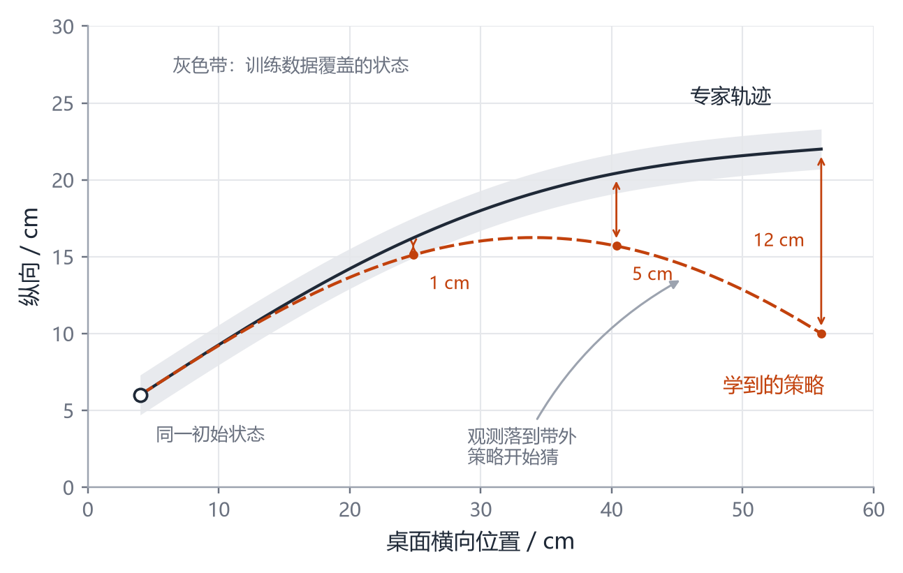
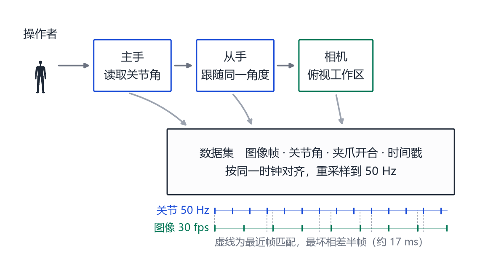
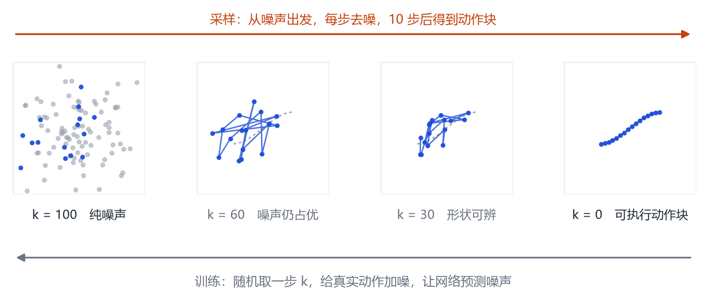

# 第 9 章　跟着人学动作

> **本章导读**：上一章的强化学习靠试错，一次试错在真机上要几秒，还得有人盯着别把东西撞坏。更省事的办法是让会做的人做几遍，机器人照着学。这一章讲这条路走起来为什么会失败、怎么补救、数据从哪来、动作用什么形式表达，以及扩散策略和 ACT 这两个把成功率从一成推到八成的关键设计。读完你能量出一个示教系统的成本上限在哪。

## 9.1 把示教录成一个数据集

人学一门手艺的方式很朴素。站在旁边看师傅做几遍，然后自己上手，做砸了再被纠正。机器人领域把这套流程拆成了数据问题，人做动作的时候把看到的和做的同时录下来，训练一个网络从看到的直接输出做的。

录一条示教是什么样子，可以用 ALOHA 双臂平台的具体数字感受一下。操作者双手各握一个主手，带着两个从手在桌面上完成任务，整个过程 8 到 14 秒，控制频率 50 Hz，一条示教就是 400 到 700 个时刻。每个时刻存四路相机的图像和两条臂共 14 个关节的角度。这样一个任务录 50 条，有效数据 10 到 20 分钟，算上复位和操作失误，墙上时间要 30 到 60 分钟。

于是行为克隆（behavior cloning）在这份数据上就是一个标准的监督学习问题。记观测为 $o_t$，包含图像和关节角；动作为 $a_t$，即下一时刻的目标关节角。策略是一个带参数的函数 $\pi_\theta$，训练目标是最小化

$$\mathcal{L}(\theta)=\frac{1}{N}\sum_{i=1}^{N}\left\|\pi_\theta(o_i)-a_i\right\|^2$$

其中 $N$ 是样本总数，$o_i$ 与 $a_i$ 是第 $i$ 个时刻的观测与标签。这和微调一个图像分类器没有本质区别，只是标签从离散类别换成了连续向量，损失从交叉熵换成了均方误差。

差别在数据规模上。一个 7B 的语言模型微调动辄几十万条样本，每条几百个 token，总量在亿级。50 条机器人示教只有两万个样本，而且是同一个任务、同一个操作者、同一张桌子。用两万个高度相关的样本去拟合从像素到 14 维连续动作的映射，容量和多样性都不匹配。

失败的原因分三个层次，越往后越难修。

第一层是数据太窄。相机位置偏 10 厘米、桌面换一种颜色、杯子换一个品牌，输入分布就变了，网络没有见过这些变化，输出会莫名其妙。

第二层是状态分布由策略自己决定。这一点是机器人独有的。分类器错了只是错了，机器人错了会走到新的状态上，而新状态又决定了下一步的输入。这是 9.2 的主题。

第三层是多峰的动作被平均掉。同一个观测下，绕过杯子的左边和右边都是对的，两条示教各写了一半的概率。均方误差的最优解是两者的平均，也就是正对杯子推过去。这不是网络没学好，是损失函数把答案定义错了。

这一层可以当场算出来。假设两条示教在某个横向位置上分别向左偏 8 厘米和向右偏 8 厘米，回归出来的动作偏 0 厘米，正好落在中间的障碍上。9.6 讲的扩散策略就是为了绕开这件事。

## 9.2 走偏一步之后

学车的人都有体会，在空旷停车场练得再熟，第一次上高速还是会紧张。动作没忘，是眼前的画面从来没有出现过，每一帧都在做没有把握的决定。

机器人面对的是同一件事，只是它不紧张，直接出错。把专家策略记作 $\pi^{*}$，它执行时访问到的状态分布记作 $d_{\pi^{*}}$，训练数据就是从这里采的。学到的策略 $\pi$ 执行时会访问另一个分布 $d_\pi$。两者一开始重合，因为初始状态相同；随着动作有偏差，$\pi$ 走到的状态逐渐离开 $d_{\pi^{*}}$，落到训练集没有覆盖的地方。

偏离的量级可以用一个经典结论估计。假设在专家分布上单步出错概率是 $\epsilon$，任务长度 $T$ 步，那么在策略自己诱导的分布上，期望出错步数最坏是 $T^2\epsilon$ 量级。代入上一节的数字，$T=400$，$\epsilon=0.01$，得到 1600 步，比整条轨迹还长。含义很直接，1% 的单步错误率不足以让 400 步的任务活下来。

<figure class="fig">

<figcaption><b>图 9-1</b>　专家轨迹与学到的策略轨迹。灰带是训练数据覆盖的状态范围，三个箭头标出偏差从 1 厘米放大到 12 厘米的位置，数值为示意。</figcaption>
</figure>

图 9-1 把这个过程画成两条轨迹。灰色的带子是训练数据覆盖的状态范围，专家轨迹一直在带子里。学到的策略在开头几十厘米内几乎重合，偏差 1 厘米左右，还在带子内；到中段偏差 5 厘米，视觉观测里的物体位置已经和训练时不同；末段偏差 12 厘米，抓取点落在杯子外面。

放大机制值得说清楚，因为它解释了为什么这类失败看起来是突变的。偏差 1 厘米时，图像几乎没变，网络输出还是对的，但偏差没有消失。偏差 5 厘米时，夹爪在图像里的位置变了，背景的透视也变了，网络开始把它当成另一个场景。偏差 12 厘米时，观测完全在训练集外，输出和随机没有区别。曲线看起来是三步跳，实际是连续累积，只是在跨越分布边界时突然表现出来。

直觉上最自然的补救是多录数据，把带子加宽。这条路的天花板比想象中低。状态空间是连续的，要让带子覆盖所有可能的偏移，所需样本数随维度指数增长，而机械臂的状态维度在 14 以上。2024 年的一项系统实验（Data Scaling Laws in Imitation Learning）把这个直觉量化了。作者采集 4 万条示教、跑了 1.5 万次真机测试，结论是泛化能力与环境数、物体数呈近似幂律关系，而单个环境里的示教条数超过某个阈值之后收益迅速变小。把同一条轨迹录一百遍，不如在十个不同的厨房里各录十遍。

这也是后面所有方法共享的前提。问题的根源不是样本总量，而是策略会主动走到训练集之外，而这个边界是策略自己造出来的。

## 9.3 让专家在你走错的地方标注

既然失败发生在学生自己走到的状态上，那就去那些状态上补标签。DAgger（Dataset Aggregation，2011）的全部想法就这一句。

比喻是学车时教练坐在副驾。学员握方向盘，教练只在要出事的时候伸手纠正，并且把“这个位置应该这么打方向”记下来。学员开过的路都是他自己会开到的路，纠正也就发生在真正需要的地方。

形式化一点。第 $i$ 轮用一个混合策略 $\pi_i$ 跑轨迹，在它访问到的每个状态 $s$ 上问专家要一个动作 $\pi^{*}(s)$，把 $(s,\pi^{*}(s))$ 加进数据集，然后在整个数据集上重训。混合策略的写法是 $\pi_i=\beta_i\pi^{*}+(1-\beta_i)\hat\pi_i$，$\beta_i$ 是这一轮让专家接管的比例。理论结果是当轮数 $N$ 达到 $\tilde O(T)$ 时，最终策略的代价满足 $J(\pi)\le J(\pi^{*})+uT\epsilon$，误差对任务长度 $T$ 是线性的，而不是平方。

从 $T^2$ 到 $T$ 是很大的改进，代价写在算法里。专家必须在线可用，每一轮都要人坐在那里，机器人跑多久人就陪多久。按上一节的规模，一个任务 50 条示教、每条 10 秒，采一轮是 8 分钟，跑 10 轮就是 80 分钟，而且这 80 分钟里人不能走神，因为要随时接管。真机上还有安全问题，接管意味着手要伸到运动的机械臂附近，或者至少要在界面上快速切换。

精细任务上还有一层困难。ALOHA 那种任务里，人的动作是通过主手映射到从手关节角的，让一个看着屏幕的人对“当前这个状态应该给哪 14 个关节角”给出精确答案，比让他自己动手难得多。人擅长做，不擅长报数。

所以 DAgger 在实践中通常以两种变体出现。一是在仿真里用脚本专家，脚本随时可查、不累、不出错，人力成本降为零，这也是它在仿真基准里出现频率远高于真机的原因。二是在真机上做干预式采集，人只在机器人要失败时接管，接管那一段被标成纠正数据，其余部分仍旧是人的示教。RoboCat（2023）更进一步，让不同机器人的成功轨迹互相补充，用自采数据滚雪球。

什么时候值得用 DAgger，判断标准是任务长度和失败代价。抓一个杯子这种 3 秒内结束的任务，行为克隆配上动作块基本够用，DAgger 的边际收益抵不上人力。装配、折叠、插接这类几十秒、失败一次要重来并且可能损坏东西的任务，误差累积是主要瓶颈，DAgger 的线性界才值钱。

## 9.4 数据从哪来

方法是清楚的，瓶颈在数据。一条 10 秒的示教看起来不多，要采 50 条、还要覆盖几十个任务，人力就变成了主要成本。下面按采集方式过一遍，成本、精度、可扩展性三个维度，数字来自各自论文。

**主从遥操作。** 一台主手、一台从手，人握着主手，从手按同样的关节角运动。ALOHA（2023）把这条路做到了低价，整套双臂系统不到 2 万美元（四条臂，主从各两条），用的是舵机而不是工业伺服。人的动作直接变成关节角，映射是一比一的，没有逆运动学，也没有坐标系变换，精度只取决于编码器分辨率和下层的 PID。代价是必须具备实体设备，一台设备同时只能一个人用，采数据要占着机器人。

**VR 手柄。** 操作者戴头显，看到的是机器人相机的画面，手上握一个六自由度手柄，手柄位姿映射成末端位姿，机器人做逆解跟随。设备便宜，千元到万元级，场地要求低，一间空屋子就能采。问题在于没有力反馈，夹多紧全靠看；手柄的跟踪精度在厘米级，姿态抖动明显，插接类任务会很吃力；长时间举着手臂操作也累。

**光学动捕。** 在天花板上装十几台红外相机，跟踪贴在人身上的反光球，位置精度能到亚毫米，姿态到零点几度。它适合给人形机器人采全身数据，因为关节角可以直接从骨骼解出来，不受本体结构限制。缺点是场地固定、要标定、遮挡会丢点，一套系统几万到几十万美元，采数据前得先花半天搭场子。

**手持夹爪。** UMI（2024）把夹爪做成一个手持工具，上面装一台 GoPro 和两个侧向反光镜。人握着它做任务，相机拍到的是夹爪视角，和部署时机器人腕部相机看到的一致。位姿靠视觉惯性里程计估计，不需要外部基站，所以可以在真实的厨房、咖啡店里边走边采。硬件是 73 美元的物料加 298 美元的相机。精度上，单夹爪的绝对轨迹误差 6.1 毫米、3.5 度，双夹爪之间的相对误差 10.1 毫米、0.8 度，够抓取用，不够插销钉。采集效率是 SpaceMouse 遥操作的 3 倍以上，达到人手速度的 48%。

<figure class="fig">

<figcaption><b>图 9-2</b>　主从遥操作的数据采集链路。主手读关节角、从手跟随、相机同步拍摄，三路数据按同一时钟对齐后写入数据集，底部为 50 Hz 与 30 fps 的重采样关系。</figcaption>
</figure>

图 9-2 是一条主从遥操作的完整链路。人带动主手，主手读出 14 个关节角，从手在舵机内部的 PID 控制下以 50 Hz 跟随，相机在同一时刻拍下画面，三路数据按时间戳写进同一个文件。看起来简单，工程上最容易出错的是最后一环。

相机通常跑 30 fps，关节角跑 50 Hz，两者的时间戳来源不同。训练时如果把图像和关节角错配 30 毫秒，网络学到的就是“看到动作之前的画面，输出动作之后的角度”，学出来的策略会系统性提前或者滞后。对齐的做法是把所有流重采样到统一时间轴，每个 20 毫秒的格子填一行，图像取时间上最近的一帧，最坏相差半帧，约 17 毫秒。UMI 还多做了一件事，它在推理时人为地给观测加延迟，让训练时的延迟和部署时的延迟匹配，因为部署时相机曝光、图像传输、网络推理各自都有几十毫秒的滞后。

**表 9-1**　五种示教方式的成本、精度与可扩展性。

| 方式 | 硬件成本 | 位姿精度 | 可扩展性 | 单任务数据量 |
| --- | --- | --- | --- | --- |
| 单臂主从遥操作 | 约 1 万美元（两条臂） | 关节直传，受舵机分辨率限制 | 中，需固定工位 | 50 至 200 条 |
| 双臂主从（ALOHA） | 整套约 2 万美元 | 同左，两手需同步 | 中低，设备被独占 | 50 条 |
| VR 手柄 | 千元至万元级 | 厘米级，姿态易抖 | 高，随处可用 | 数百条 |
| 光学动捕 | 数万至数十万美元 | 亚毫米 | 低，受场地与遮挡限制 | 数百条 |
| 手持夹爪（UMI） | 约 400 美元 | 6 毫米、3.5 度 | 很高，真实环境边走边采 | 300 条 |

表里的成本是论文给出的量级，精度与数据量是各自报告的典型值。读这张表要抓住一个权衡，精度和可扩展性基本反向。动捕最准，但只能在装了相机的房间里用；UMI 最自由，但精度只到毫米级。选哪一种，取决于任务需要多准、需要多少数据。

数据量的量级也值得记住。单任务 50 条是 2023 年前后的常见配置，ACT 和 Mobile ALOHA 都用这个规模。跨场景泛化要两个数量级以上，Data Scaling Laws 那项工作用了 4 万条。全集级别的数据集是另一个量级，Open X-Embodiment（2023）汇集 22 种机器人、100 万条以上轨迹，RoboMIND（2024）用遥操作采了 10.7 万条轨迹、305.5 小时，覆盖 96 类物体。

## 9.5 动作用什么形式表达

同一个动作可以写成不同的数，这个选择对能不能学会的影响，比大多数超参都大。

**关节位置。** 直接输出 7 个或 14 个关节的目标角度。好处是和学习目标一致，人的示教录下来就是这个，误差不会被逆解放大。坏处是与本体绑定，换一台臂长不同的机器人，数据就废了。ALOHA 用的是这种，绝对关节角，外层再套一个高频 PID 去跟踪。

**末端位姿。** 输出夹爪在基座坐标系里的位置和姿态，7 维，三个位置加四个四元数，或者三个欧拉角。好处是跨本体，同一条示教可以喂给不同的臂。坏处是要解逆运动学，遇到奇异点、关节限位、自碰撞时会没有解，而且示教里的末端轨迹经过逆解之后，关节角可能跳变。

**速度或者增量。** 输出相对上一时刻的变化量。好处是对绝对标定误差不敏感，坏处是积分会漂移，长时间执行会慢慢偏出去。

**动作块。** 一次输出未来 $k$ 步的整段动作，记作 $\pi_\theta(a_{t:t+k}\mid o_t)$，执行完这 $k$ 步再看一眼观测。

最后一种值得单独说，因为它是 2023 年之后几乎所有高性能系统的默认选择。ACT 的消融实验给了一组很干净的对照，$k=1$ 时成功率 1%，$k=100$ 时 44%，$k$ 继续加到 200、400 反而下降。四个任务的均值，同一套网络，只改输出长度。

为什么差这么多。第一，预测一段动作相当于把有效视野缩短了 $k$ 倍，400 步的任务在 $k=100$ 时只有 4 个决策点，误差累积的机会从 400 次降到 4 次。第二，人类示教里有停顿和犹豫，同一个人做同一个任务，每次在哪个位置停一下都不一样，单步策略看到“手停在半空”这个观测，无法判断是该继续还是该等，动作块把这个时间上下文一起预测出来，歧义就消失了。第三，推理速度和控制频率解耦，一个要 100 毫秒才能算完的模型，在 $k=1$ 时只能跑 10 Hz，在 $k=100$、50 Hz 执行时一次推理覆盖 2 秒，控制频率仍然是 50 Hz。

代价是反应变慢。块内的 $k$ 步是开环的，中间撞到东西也不会改主意。所以实际系统不会把 $k$ 设到任务长度，而是在少决策和能反应之间取中间值。扩散策略用预测 16 步、执行 8 步的配置，就是这类权衡的结果。

## 9.6 把动作生成当成去噪

回到 9.1 留下的第三个问题，多峰动作被均方误差平均掉。要修它，得换掉“输出一个数”这个假设，改成输出一个分布、再从里面采样。

扩散模型正好是这个形状。训练时给真实动作加噪声，让网络学会预测加进去的噪声；采样时反过来，从一团标准高斯噪声出发，一步步减掉预测出来的噪声，最后落到数据的分布上。条件版本把观测 $o_t$ 作为额外输入，学的是 $p(a_{t:t+k}\mid o_t)$，也就是给定当前画面，未来这段动作的分布。

训练目标写出来是一行

$$\mathcal{L}=\mathbb{E}_{k,\epsilon}\left\|\epsilon-\epsilon_\theta\left(\sqrt{\bar\alpha_k}\,a^{0}+\sqrt{1-\bar\alpha_k}\,\epsilon,\;k,\;o\right)\right\|^2$$

$a^0$ 是示教里的真实动作块，$\epsilon$ 是采样得到的高斯噪声，$\bar\alpha_k$ 是第 $k$ 步的累计保留系数（越接近 1 表示越接近原信号），$\epsilon_\theta$ 是噪声预测网络。整句话的意思是让网络看着加过噪的动作和噪声等级，把噪声认出来。

<figure class="fig">

<figcaption><b>图 9-3</b>　一条 16 步动作块在四个噪声等级下的形态。左端接近纯噪声，右端为可执行的动作块；上方箭头是采样的去噪方向，下方是训练时的加噪方向。</figcaption>
</figure>

图 9-3 是一条 16 步动作块在四个噪声等级下的样子。最右是干净的动作块，一条从左下到右上的弧线；往左噪声加大，$k=30$ 时形状还能认出，$k=60$ 时只剩大致趋势，$k=100$ 时是一团没有结构的点。采样时方向相反，从最左那团噪声开始，每次减掉一点预测的噪声，十步之后落到最右。

三个性质让它适合机器人。多峰分布天然能表达，绕左边和绕右边是两个峰，采样时随机落进其中一个，不会平均到中间。高维序列也能处理，一次输出 16 步、每步 14 维就是 224 维，扩散模型不需要对这个分布做任何分解假设。训练稳定，因为损失是纯粹的回归，不需要估计配分函数，这一点比能量模型省心很多，后者在训练集上的损失降得很漂亮，成功率却在震荡。

代价是推理贵。原始的 DDPM 采样要 100 步网络前向，一次动作约 1 秒，控制频率掉到 1 Hz，没法用。Diffusion Policy（2023）用 DDIM 采样，训练仍是 100 步加噪，推理只走 10 步，在 3080 显卡上单次 0.1 秒。这个时间刚好配上动作块，一次推理出 16 步、执行 8 步，在 10 Hz 的重规划频率下运行，中间靠低层控制器插值补齐到 125 Hz。

步数和精度是直接的取舍。10 步比 100 步快十倍，动作细节略糙；再压到 5 步，高频抖动开始出现。论文还测了延迟鲁棒性，用位置控制加动作块，系统能容忍最多 4 步（约 0.4 秒）的观测到执行延迟而不掉成功率，这一点在真机上很关键，因为相机曝光加推理总有几十毫秒的滞后。整体上，Diffusion Policy 在 15 个任务上相对此前方法的平均提升是 46.9%，提升最大的是那些需要绕行、需要在两个方案里选一个的多峰任务。

## 9.7 一次预测一百步

ACT（Action Chunking with Transformers，2023）是同一时期的另一条路线，要解决的问题不完全一样。它面对的是双臂精细操作，插电池、撕魔术贴、开透明调料杯，这些任务对位置精度的要求到毫米，而硬件是便宜的舵机臂，示教是人手遥操作录的，噪声很大。

它先要处理示教的随机性。同一个任务人做五十遍，每一遍的路径都不一样，而且在不需要精度的地方（比如手在空中移动）差异更大，在需要精度的地方（比如对准电池槽）反而一致。如果直接回归，网络会把力气平摊到所有时刻。ACT 的做法是引入一个隐变量 $z$ 表示这一遍的风格，训练时用编码器从动作序列里推断 $z$，解码器在给定 $z$ 和观测的条件下重建动作。这是条件变分自编码器（CVAE）的标准结构，损失是重建误差加上对 $z$ 的正则项，正则项的权重 $\beta$ 控制 $z$ 携带多少信息。推理时把 $z$ 设为零，取分布的均值，得到一个确定的策略。

网络结构是 transformer。编码器把四路相机的特征和 14 个关节角融合成一个序列，解码器输出 100 步动作。四路相机是因为双臂任务里遮挡严重，一只手臂经常挡住另一只，单视角看不全。

时间集成是第三个部件，也是最容易被忽略的一个。动作块有个副作用，如果每 100 步才查询一次策略，机器人会在每 2 秒的边界上突然换一套动作，中间出现明显的顿挫。ACT 的做法是每个时刻都查询，这样同一个时刻会被预测很多次，来自不同起点的块在时间上重叠。对这些预测做加权平均，权重按预测的陈旧程度指数衰减，$w_i=\exp(-m\cdot i)$，$i$ 表示这个预测距当前时刻多少步，$m$ 越大越偏向新预测。

这里有个容易搞错的地方。常见的平滑是对相邻时刻的动作做低通滤波，那会引入滞后，让机器人跟不上。时间集成平均的是“对同一个时刻的不同预测”，不跨越时间，所以不会引入滞后，只是把不同起点的估计融合在一起。这个操作不增加训练成本，只在推理时多做几次前向。

三个部件合起来的效果，是在 50 条示教、10 分钟数据的规模上，把插电池、开调料杯这类任务做到 80% 到 90% 的成功率。消融实验里，去掉时间集成掉 3.3 个百分点，去掉动作块掉得更多（$k=1$ 时只剩 1%），去掉 CVAE 之后精细任务的成功率明显下降，因为网络开始输出平均手型，在需要对准的地方偏移几毫米。

ACT 的局限也清楚。它的有效视野是十秒量级，任务再长就要靠外部的任务分解。它对相机位置敏感，腕部相机挪两厘米，成功率会掉一大截，因为网络把相机的固定视角当成了世界坐标系的一部分。换一台机器人要重新采数据，关节空间的动作表示不跨本体。

走到这里，模仿学习的轮廓已经完整。它便宜、稳定、见效快，50 条示教能解决一个任务，这是它比强化学习受欢迎的原因。它的天花板也很明确，数据的成本决定了能力的边界，而数据只能从人身上来，人就那么几个小时。绕开这个瓶颈的尝试有两个方向。一是把训练搬到仿真里，用算力换人力；二是让模型在部署之后自己继续攒数据。前者是下一章的内容，后者要等到基础模型那一篇才有条件讨论。
