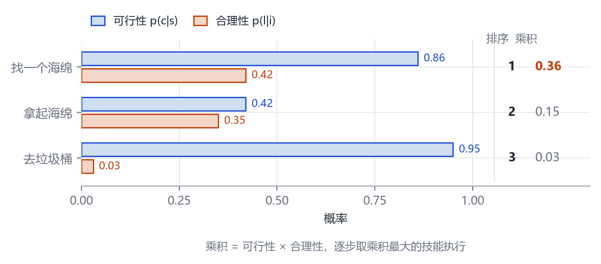
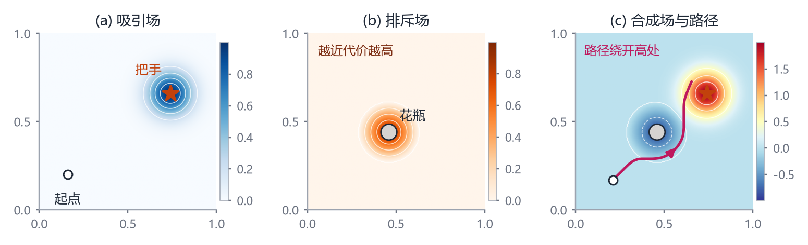
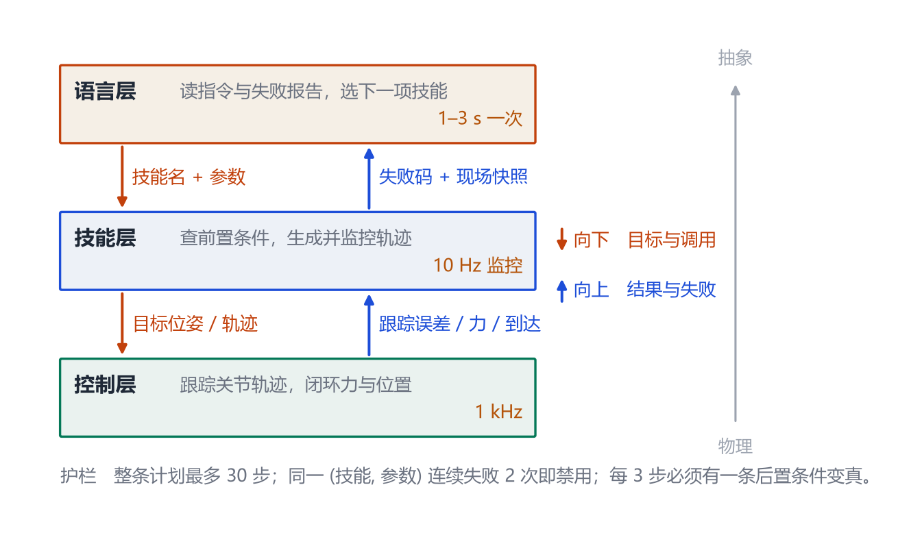

# 第 12 章　语言模型当大脑

> **本章导读**：上一章把长程顺序交给了符号层，可符号层里的规则是人写的，写不全也改不快。这一章换一条路，让语言模型读指令、读失败原因，再决定下一步做什么。读完你能分清哪些决策可以交给它、哪些必须留在毫秒级的回路里，能亲手算一遍 SayCan 的双重打分，也能判断代码策略和三维价值场各自会在什么地方出错。

## 12.1 三秒的思考和一毫秒的反射

"把桌上的杯子拿过来"这句话发给一个语言模型，它回一句"先向右伸 30 厘米，再向下 10 厘米"。听起来对，可它不知道夹爪离桌面只剩 2 厘米，也不知道这 0.4 秒里机械臂会先把杯壁撞翻。模型手上是一句描述，机器人身上是一千个时刻在变的数。

这就是分层的物理理由，跟聪明程度无关，只跟时间尺度有关。

一组数字把差距摆开。控制环 1 kHz，每毫秒算一次力矩；视觉伺服 30 到 60 Hz，每 20 毫秒用掉一帧图像；视觉-语言-动作模型 5 到 10 Hz；语言模型一次调用 0.3 到 3 秒。上下差三个数量级。一次 LLM 调用走完的时间，够控制环跑三千次。

再看多快的事情必须多快反应。夹爪刚碰到杯壁那 20 毫秒，接触力从 0 涨到 20 牛，要在这段时间里判断是滑了还是顶住了，只能靠力传感器加 1 kHz 的回路。把这件事交给一个一秒才回一次话的模型，等于闭着眼睛拧瓶盖，等它想明白，瓶子已经落地。

反过来，有五件事语言模型做得比手写状态机好。

- 常识检索。洒了可乐要找能吸水的东西，这条知识不在代码里，在语料里。
- 开放词汇。技能是"拿起 X"，X 可以是公司名，可以是"那个长得像鸭子的杯子"，不用为每个物体训分类器。
- 长程顺序。二十步的任务，条件依赖写成文字塞进提示词，比维护一张状态转移表便宜得多。
- 模糊指令的解释。"收拾一下桌子"没有唯一定义，模型能给一个说得过去的拆法。
- 可读的中间产物。计划是一串中文，人能在执行前审一遍，也能中途改主意。

有正面清单就有反面清单，下面这些不该交给它。

- 力矩与阻抗。力控的参考值是牛顿，采样在毫秒级，任何延迟都表现为抖动或过冲。
- 毫米级伺服。收尾那几毫米靠图像误差的连续反馈，语言给不出这个量。
- 安全限幅。急停、关节限位、碰撞检测必须在硬件和实时核里，不能依赖一个会幻觉的进程。
- 任何需要在 100 毫秒内做出的选择。

这里可以给一条粗糙但好用的判据。问一句，这个决策做错了，多久能发现，多久能挽回。语言模型错了，几秒内看得出来，重来一次多花十秒。力控错了，杯子已经碎了。

于是系统长成三层。语言层每秒想一次下一步做什么，技能层每 100 毫秒检查一次做到哪了，控制层每毫秒算一次该出多大力。三层的失败代价不同，谨慎程度也就不同。第 11 章末尾把符号层和几何层分开，理由相同，划分的位置更低一些。

剩下一个绕不开的问题。语言模型怎么知道机器人此刻能不能做成这件事。

## 12.2 把能不能乘进该不该

如果直接问模型"可乐洒了怎么清理"，它会给出找海绵、拿海绵、擦桌子。这套计划在纸上无可挑剔，落到机器人上第一步就断，因为这台机器人的技能库里没有"擦桌子"。

SayCan（2022）的出发点是承认这件事。它不指望模型凭空造出新技能，而是把输出限制在技能库的语言描述里。技能库有 551 个技能，覆盖 7 类动作、17 种物体，每个技能配一句描述，比如 find a sponge、open the top drawer、go to the trash can。模型只能在 551 句里挑。

限制输出解决了编造，没解决选错。模型会认为"去垃圾桶"很合理，清理垃圾确实要去垃圾桶，可此刻机器人手上是空的，去那边对任务没有推进。它还可能在夹爪已经抓着海绵时又选一次"找一个海绵"。

补法很直接。给每个技能配一个数，表示它在当前状态下能成功的概率，再把两个数乘起来。

$$
\text{score}(\pi \mid i, s) = p(c_\pi \mid s, \ell_\pi)\cdot p(\ell_\pi \mid i)
$$

$\pi$ 是候选技能，$i$ 是人的指令，$s$ 是当前状态，$\ell_\pi$ 是这个技能的语言描述。右边第一项叫可行性，问的是"让它做这件事，它做得成吗"，用价值函数实现，取奖励为成功 1 失败 0 时的期望，可以用演示数据训一个判别器，也可以直接统计这个技能最近的执行成功率。第二项叫合理性，问的是"这一步对完成指令有帮助吗"，把 $\ell_\pi$ 当作指令的续写去打分，取语言模型的 token 对数似然。实际实现里对两个对数相加，比连乘稳。

举个能算的例子。指令是我把可乐洒了，能拿点东西来擦一下吗，三个候选技能摆在一起。

找一个海绵，合理性 0.42，可行性 0.86，乘积 0.36。拿起海绵，合理性 0.35，可行性 0.42，乘积 0.15。去垃圾桶，合理性 0.03，可行性 0.95，乘积 0.03。第一项胜出，机器人去找海绵。

<figure class="fig">

<figcaption><b>图 12-1</b>　SayCan 的三条候选技能。浅蓝柱是可行性 p(c|s)，橙柱是合理性 p(l|i)，乘积决定执行顺序。数值为讲解用的示例，场景取自论文的厨房任务。</figcaption>
</figure>

三项里最值得看的是第三项。它的可行性最高，0.95，因为走到垃圾桶这条导航几乎不会失败。只按可行性排序，机器人会一路走到桶边站着。乘法把这个错误挡住了，0.03 的合理性把 0.95 的可行性压成 0.03。

反过来也成立。假设状态变成夹爪已经抓着海绵，"找一个海绵"的可行性掉到 0.05，乘积 0.02，而"拿起海绵"的可行性升到 0.9，乘积 0.32，排序翻转。乘法在这里起的作用不是加权，是否决。任何一个因子接近零，整项就出局，这比加法严格，加法下 0.05 加 0.42 还是一个像样的候选。

结果数字。101 条指令分 7 类，模拟厨房里规划成功率 84%，执行成功率 74%，整条任务 61%。搬到真厨房，规划 70%，执行 61%。按类型拆，长程任务退得最多，规划 73%，执行 47%。

这组数字给了两条信息。规划和执行差十个点，说明瓶颈在技能的物理执行，不在语言理解，模型再聪明也救不了本体。长程那类掉到 47%，说明误差在串联里放大，这件事 12.6 节还要算一次。

可行性这一项的来源值得多说两句。原论文的价值函数是在真机上跑的，每个技能采集几百次成败，用 0 与 1 的稀疏奖励训一个判别器。这部分工程量远超语言模型那一侧，551 个技能就是 551 组数据采集与训练。后来的实现常图省事，直接拿技能最近十次的成功率当可行性，代价是它对状态变化不敏感，桌面从空的变成堆满杂物，估计值还停在旧数字上。

局限要说清。

- 逐步贪心。每一步重规划，不回退，走错了只能在错的状态上继续选。
- 粒度人定。551 个技能是人挑的，粗了表达不了细节，细了模型选不准。
- 两项不可比。可行性来自经验统计，合理性来自语言模型似然，量纲不同，这个乘积只在排序上有意义，不能读成成功率。
- 否定句。模型对"不要拿那个杯子"处理得差，论文自己也承认，靠思维链提示缓解。
- 成本。每个技能都要一个价值函数，551 个技能就是 551 份数据。

## 12.3 把策略写成程序

SayCan 的输出是一串技能名，本质还是做什么的列表。有一类任务要的是怎么算，比如把三个积木按颜色分进两个盒子，或者把一排杯子按高度排序。这类任务用文本计划会写成"拿红的，放左边，拿蓝的，放右边"，二十个物体就是四十句。

Code as Policies（2022）换了个输出模态。既然模型写代码比写散文精确，就让策略本身是一段 Python，里面调用感知和控制 API。

一句话形式化。策略是一个程序 $\pi$，输入当前观测 $o_t$，输出动作 $a_t$，程序里每个原子操作对应机器人的一个原语。模型不直接给关节角，它给的是调用原语的代码。

```python
blocks = detect("block")
for b in blocks:
    box = "red_box" if b.color == "red" else "blue_box"
    top = get_center(box) + np.array([0.0, 0.0, 0.12])
    goto(grasp_pose(b))
    set_gripper(0.04)
    goto(top)
    set_gripper(0.08)
```

八行代码干了四件文本计划干不了的事。循环让三个积木不用写三遍。条件让颜色到盒子的映射写成一个表达式。算术让"盒子上方 12 厘米"是算出来的，不是估出来的。第三方库让几何判断直接调现成实现，点是否在多边形内、两条线段是否相交、两个位姿差多少。

第三方库这条最容易被低估。模型不知道 shapely 的内部实现，但它在语料里见过太多次，知道 polygon.contains(point) 在问什么。于是"把杯子放到盘子左边 5 厘米"可以写成 get_center("plate") 加一个 [-0.05, 0, 0] 的偏移，一个空间关系变成一次向量加法。

论文里还有个技巧叫层级代码生成。先让模型写出所有需要的函数名和签名，再逐个补实现。看起来只是排版，实际把 HumanEval 的一次通过率推到 39.8%，因为模型在写具体数值之前先定了接口，后面不容易写串。

然后说风险，三条。

幻觉 API。模型会调用不存在的函数，比如 get_object_mass()、robot.move_arm_to(x, y, z, w)，也会把参数顺序写反，把角度当弧度传。前者运行时抛 AttributeError，能捕获，好改。难的是能跑但语义错的，比如把 approach_pose(obj, 0.1) 里的 0.1 当成"距离 10 厘米"，而这个 API 定义的是"沿法向偏移 1 毫米"。代码顺利执行，抓取位置差两个数量级，不报错，只表现为成功率莫名下降。

无反馈。程序假设世界按它写的走。detect 返回空列表，blocks[0] 直接崩；抓取滑了，后面的 goto 照样把空气搬到盒子上；循环里一次碰撞检查都没有。代码里没有"确认"这个动作，检查必须显式写进程序，而模型不会主动写，除非提示词里明确要求。

不可验证。代码是图灵完备的，while not done 能写出死循环，递归能写出栈溢出。沙箱执行、超时、步数上限都是护栏，不是可选项。

三条风险指向同一个结论，代码的表达力和可控性成反比，越自由越难兜住。有的系统因此把输出收紧成一段固定格式的计划，或者收紧成只许调用 DSL 的几行语句，牺牲循环和递归，换一层类型检查。取舍看任务，几何推理重的值得放开，安全阀门的场景宁可写死。

工程上的补法已经比较有共识。API 的签名和一句说明全放进提示词，只开放白名单里的函数，模型能拿到的观测从原始像素换成已经结构化的位姿，执行之后再把结果变成文字回灌。Inner Monologue（2022）把这套反馈做成了闭环，成功检测、场景描述、人的口头纠正都写成文字塞回上下文，让模型基于事实重写代码，而不是基于想象。

## 12.4 从一句话到一张三维的场

代码策略能说"去把手的位姿"，说不出"从左边绕过去，离花瓶保持 8 厘米"。这类约束是几何的、连续的，离散符号装不下。把绕和保持距离翻译成函数也难，翻译出来的函数需要知道场景里所有物体的位置，而这些位置由感知给出，随时在变。

VoxPoser（2023）的做法是把语言落到一个和观测同尺寸的三维网格上，让约束变成场。

第一步是接地。模型写代码调用视觉模型，CLIP 给语义相似度，开放词汇检测器给包围盒，SAM 给掩码，于是"把手"落到点云上的一片点，"花瓶"落到另一片。这一步和代码策略是同一个机制，只是调用的 API 换成了视觉的。

第二步是铺值。在这片三维网格上，目标部件附近给高值，叫吸引场；易碎品周围给负值，叫排斥场；再按指令加上朝向约束、速度约束。合成方式是相加，归一化之后吸引取 2、排斥取 1。

$$
V(x) = w_a V_{\text{att}}(x) - w_r V_{\text{rep}}(x),\qquad w_a = 2,\ w_r = 1
$$

$x$ 是网格里一个体素的中心，$V_{\text{att}}$ 是到目标部件的距离衰减函数，$V_{\text{rep}}$ 是到障碍的距离衰减函数。运动规划器拿到的代价图取 $-V$，也就是往值高的地方走。

<figure class="fig">

<figcaption><b>图 12-2</b>　价值场的三层叠加。吸引场把末端拉向把手，排斥场把末端推离花瓶，合成场上的路径自己绕出弧线。体素尺寸与衰减核宽为示意值。</figcaption>
</figure>

图 12-2 把这件事拆开看。只看吸引场，最陡的上升方向是一条直线，正好穿过花瓶。只看排斥场，它只说别靠近哪里，不说到哪里去。合成之后，方向从起点出发朝花瓶走，靠近时被推开，绕出一个弧，再从侧面接近把手。这条弧不是人画的，是场自己长出来的。

执行环节交给 MPC（Model Predictive Control，模型预测控制）。每 200 毫秒拿最新一帧 RGB-D 重算一次值场与轨迹，只执行轨迹的第一个路点，然后重算。相机 20 Hz，重规划 5 Hz，底层伺服 1 kHz。三个频率对应三种不确定性，感知的不确定靠新的一帧消解，规划的不确定靠滚动重算消解，执行的不确定靠伺服消解。人把抽屉拉回去、把杯子挪开，这类扰动在 200 毫秒内被下一次重规划吸收。

值场还有个附带好处，失败可以看。抓空了就去读那一刻的场，是吸引场没落在把手上，还是排斥场把目标自己盖住了，还是两个权重不匹配。这种可诊断性在端到端策略里几乎没有，那边只有一段视频和一句失败了。

真机结果是这套思路最有说服力的部分。五类日常任务各 10 次，无扰动下成功 88%，用固定运动原语拼接的基线 24%；加入人为扰动后 70% 对 0%。仿真里 13 个任务、2766 条指令、每任务 20 次，测的是对未见属性与未见指令的泛化，不是记忆。

局限集中在四处。值场是启发式，核宽和权重靠手调，换个场景要重调。感知错一点值场就歪，分割漏掉半个把手，吸引场的重心就偏。接触丰富的任务力不在场里，拧瓶盖、插销这类动作得另外学一个动力学模型补进来。5 Hz 的重规划对抛接、动态抓取这类毫秒级变化不够快。

## 12.5 它们其实看不准空间

上面三套方法有一个共同地基，感知能把物体放到正确的位置上。这个地基在最要紧的地方不稳。

BLINK（2024）把人一眨眼就能做的视觉判断做成 3807 道选择题，共 14 类。人类平均 95.70%，GPT-4V 51.26%，Gemini 45.72%，四选一的随机水平是 38.09%。最好的模型只比瞎猜高 13 个百分点。题目包括两点哪个更近、这块拼图放哪、相机往哪边移动、浴缸前有几根手指、哪个点在左边。

论文标题说得很直接，能看，不能感知。识别这一层没问题，模型能准确叫出花瓶、把手、红色的积木，坏在把二维像素对应到三维关系这一步。它知道画面里有几个物体，说不出它们之间的几何。

三类错误在机器人任务里都致命。

**数不清。** 五个以上密集小物体，准确率接近随机，同一个问题换个提问顺序答案会变。抓取任务里"拿第三个杯子"这种指令直接失效。

**左右混淆。** 参照系不稳定，按图像中心判断还是按观察者视角判断，模型自己也不一致，换个机位同一句话的答案可能翻转。工程后果是"把左边那个杯子拿过来"抓错。

**距离估计差。** 没有度量，只有近一点远一点的相对判断。抓取要的是往前 8 厘米，不是再近一些。

SpatialVLM（2024）从数据这一侧补。它用 1000 万张真实图像，借深度和相机位姿把像素反投影成三维点，自动生成 20 亿条空间问答，问的是这条边多长、这两个物体相距多远、这个缝隙能不能过。用这批数据微调 PaLM-E（12B）之后，模型开始给带单位的距离。同一个例子里问手指到三个罐子有多远，它答 0.21 米、0.5 米、0.59 米，GPT-4V 给的是 110、262、233 这种没有单位的相对量。

两个结论。定量空间能力可以靠合成数据补上，不必等真实标注堆够。尺度来自几何管线，不来自模型规模，模型再大也不会自己长出一把尺子。

这类短板在评测里容易漏。多选题只比瞎猜高十几个点，人容易当成模型只是不擅长考试，换到抓取任务上，同一个错误表现为抓偏 5 厘米，成功率掉一半。空间能力得用带单位、带坐标的判据去测，图文问答的分数代替不了。

工程含义很短。别在提示词里写"左边 5 厘米"，这类要求模型答不对，也检不出来。要么让模型只回答哪个物体，把度量交给标定好的感知和几何模块；要么让它输出坐标，再用点云校验一遍，冲突时以几何为准。

## 12.6 接口比模型更要紧

到这一节，前面三套方法的共同依赖露出来了，它们都把语言模型接到一组技能上，接法就是接口。

一个技能在接口上要写清六件事。

**名字与描述。** pick_up("red_block") 是名字，拿起红色积木是描述。名字给代码调用，描述给模型理解，两者必须指同一件事。

**参数。** 结构化，尽量少，能由状态推出来的不要人传。单位写进名字或模式里，米和弧度分开，不要靠注释提醒。

**前置条件。** 可执行的布尔检查，目标在视野内、位姿置信度高于 0.7、夹爪是空的、逆解有解。检查不过就立刻返回，不要让技能硬跑，因为硬跑失败会改变世界状态，把局面搞得更难收拾。

**后置条件。** 可检验的成功判据。夹爪闭合到 3.2 厘米且电流超过阈值，比一句"完成了"有用得多。

**失败返回。** 错误码分三类，不可行、执行失败、超时。再附一句人能读的原因和一份现场快照，物体还在不在原位、夹爪开度多少。

**副作用声明。** 这个技能动没动物体、动的是哪个，让上层知道哪些事实已经失效，该重新观测。

技能库的规模是个两难。技能越多，模型的选择空间越大，似然打分越容易被无关项稀释，一次决策要在几百个候选里排序，误选概率上升；技能越少，能表达的任务越窄。经验做法是按任务族分层，先选族再选技能，把一次几百选一拆成两次十几选一。

失败怎么回传是接口的关键。回一句话就够，pick_up(red_block) 失败，原因 grasp_slipped，夹爪闭合到 1.8 厘米，物体仍在地面。模型读到这句会换方向，从侧面再抓一次，或者先把旁边的盒子挪开。回一句 failed，模型只会重试同一件事。

这就引到死循环。语言模型在困惑时倾向于重复上一步的输出，失败信息越少，重复得越狠。三道护栏能把它挡住。

全局预算，整条计划最多 30 步，超了交给人。记忆禁用，同一组技能和参数连续失败两次，从候选列表里删掉，模型看不到就不会再选。单调进展，每三步必须有一条后置条件从假变真，否则判定卡住，升级到人。

<figure class="fig">

<figcaption><b>图 12-3</b>　三层之间的接口。向下传技能名、参数与目标位姿，向上传跟踪误差与失败码，频率相差三个数量级，所以接口是稀疏下发、密集回传。</figcaption>
</figure>

图 12-3 画的就是这三层。向下的箭头带目标与参数，向上的箭头带结果与失败，两侧的频率差了三个数量级。这个差距决定了接口形状，上层不可能每毫秒下一条指令，下层也不可能每次都等上层想清楚。

护栏的价值可以算。单步成功率 0.95，20 步串联是 $0.95^{20} \approx 0.36$。给每步加一次自动重试，有效单步成功率变成 $1-0.05^2 = 0.9975$，20 步变成 $0.9975^{20} \approx 0.95$。重试本身没有任何智能，它只是把一次失败整条完蛋改成了两次失败才完蛋。接口设计在这一步的收益，比换一个更大的模型直接得多。

表 12-1 把四类做法的接口、长处和失败模式并排放。

**表 12-1**　LLM 规划方法对比。

| 方法 | 接口（模型输出到执行） | 长处 | 典型失败 |
|---|---|---|---|
| SayCan | 从技能描述里选一句 | 不编造技能，可解释，能读当前状态 | 贪心不回溯，粒度靠人定 |
| Code as Policies | 一段调用 API 的 Python | 循环、条件、算术，表达力强 | 幻觉 API，无反馈，可死循环 |
| VoxPoser | 三维值场加 MPC 跟随 | 约束变成几何，抗扰动，可零样本 | 感知误差直接变成场误差，缺力反馈 |
| 纯 VLM 端到端 | 直接出动作或动作块 | 不需要技能库，一条网络到底 | 空间数字不准，长程易漂移 |

四行看下来，一个规律很清楚。接口越结构化，失败越容易定位，表达力越窄；接口越自由，能做的事越多，出错时越难查。工程上通常先站窄的那一端，把任务跑通，再逐步放开。

## 12.7 这一层留下的洞

三套方法的共同点是都在组合已经会的事。SayCan 的技能是人训的，Code as Policies 的 API 是人写的，VoxPoser 的感知是人接的。技能库里没有的能力，语言模型再聪明也变不出来。551 个技能对应 551 段演示和 551 个价值函数，换一台机器人，这套东西要重做一遍。

第二个洞是中间表示。技能粒度多粗、值场核宽多大、重规划多快，这些数都是人拍的，任务一换就得重调，而调参的经验很难写成文档。

第三个洞在语言和几何之间。语言模型给的是符号，机器人要的是米和弧度，中间那层翻译目前靠人写的薄薄一段代码。这段代码写得好系统就灵，写得糙模型再强也没用。

真正的下一步是把这个翻译层也变成学出来的东西，让视觉语言模型的输出直接是动作，技能不再由人定义。这条路从 RT-1 开始，到 RT-2 把动作变成文本 token，再到后面一批开源模型，第四篇剩下的部分讲的正是它们。
