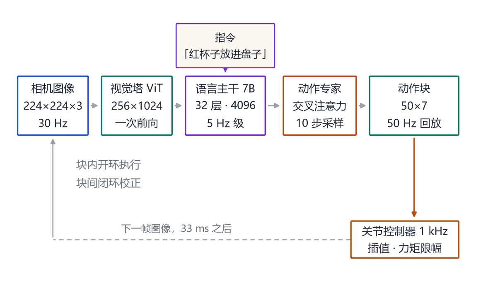
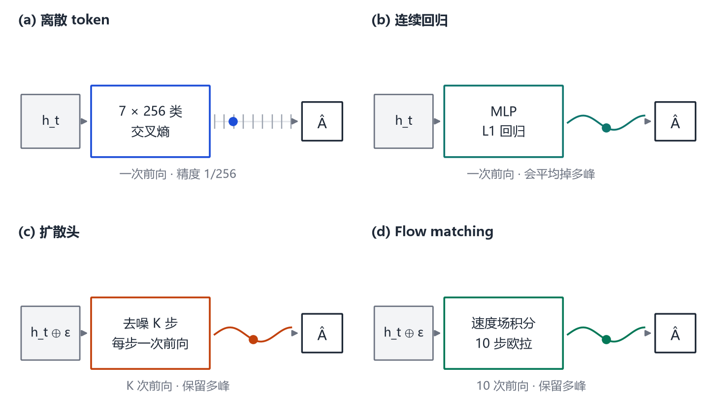
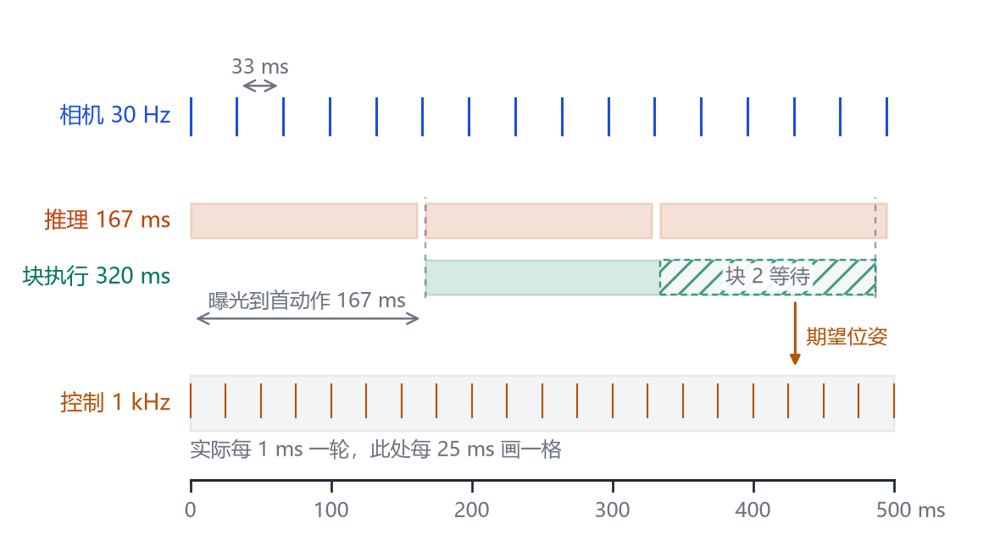

# 第 13 章　视觉-语言-动作模型

> **本章导读**：上一章的模型只会说要做什么，手往哪里动还得另找模块。这一章讲一类把两步并成一步的模型，输入几帧画面和一句人话，直接输出未来一秒的关节增量。读完你会知道连续动作怎么被塞进语言模型的词表，四种动作头各付什么代价，几个开源模型之间的差别在哪里，以及两百毫秒的推理延迟为什么逼出了动作块与异步执行。

## 13.1 一句话到一串关节增量

上一章的规划器输出符号。它说"抓起红色杯子"，技能库把这句话翻译成一个抓取位姿，规划器算出轨迹，控制器跟着轨迹走。每一段都成立，每一段都要人写接口，每一段都在丢信息。规划器不知道杯壁是湿的，控制器不知道杯里有半杯水，夹起来一晃就洒。

视觉-语言-动作模型（VLA，Vision-Language-Action）把中间这几层拿掉。一个网络吃进相机图像和一句指令，直接吐出机械臂下一时刻该动多少。

"动多少"要先说清楚。机械臂有 6 个关节，也叫自由度（DoF，Degree of Freedom），每个关节一个角度，6 个数就完全确定它的姿态。也可以绕开关节，直接描述末端执行器（装在最后一个关节上的手爪或吸盘）在空间里往哪移、绕哪个轴转多少。后一种说法更接近人的语言，"往前 3 厘米、向下 4 厘米、手腕转 15 度"，一共 6 个数，再加一个夹爪开合，凑成 7 维。绝大多数 VLA 输出的就是这 7 维里的一小步。

维度不是固定的。单臂 7 维，双臂 14 维，加个可移动底盘再添 3 维，人形机器人全身 40 维往上。同一个模型要能吃下这些不同的机器人，后面 13.5 节会讲怎么处理。

把语言模型和动作接起来，有三处对不上。

**离散与连续。** 语言模型的输出是词表上的概率分布，动作是实数，还带精度要求。

**定长与变长。** 词表三万个 token，什么输入都够用；动作维度由连杆数量决定，换台机器就变。

**慢与快。** 7B 模型一次前向一两百毫秒，伺服环一毫秒跑一轮。

后面几节都在回答这三条。13.2 和 13.3 处理前两条，13.6 处理第三条，中间的 13.4 与 13.5 讲这条路在工程上怎么落地，13.7 说它在哪里失效。

有人会问，让语言模型直接输出一串数字不就行了。实践里这么做效果很差。语言模型对数值没有分辨率概念，会一本正经地写出 0.30000000000000004；输出 100 步动作要七百多个 token，自回归解码比一次前向慢两个数量级；更根本的是训练信号，机器人抓没抓住这件事，没法干净地反传到"第 37 个数字写得好不好"上。所以真正可行的做法必须让动作在结构上贴近语言模型的习惯，而不是在文本里硬凑。

## 13.2 把动作写成词

2022 年底的 RT-1 给出了第一个能跑的答案，把连续量变成分类。

输入是 6 帧历史图像加一句指令。为什么要历史，单帧看不出运动方向，两帧才能判断杯子是在往左滑还是往右滑。图像先经卷积网络得到 81 个 token，TokenLearner 再把它压到 8 个，然后送进一个 8 层、19M 参数的 Transformer。压这一步很关键，历史越长，不压的话序列长度会拖垮推理。

输出 11 维，手臂 7 维、底盘 3 维、模式 1 维（终止或继续）。每一维都被切成 256 个区间，用分类头预测落在哪一格。整个模型 35M 参数，控制频率 3 Hz。

这套设计的数据规模值得记一下。13 台机器人、17 个月、约 13 万条演示、700 多种任务指令。在这些训练指令上成功率 97%，换成没见过的指令还有 76%。35M 参数能做到这个程度，说明数据质量和任务多样性比模型大小更关键。

离散化是这里最关键的一步。分类是 Transformer 的原生任务，交叉熵稳定，不需要给动作假设一个分布形状，也不用担心回归输出跑到物理上不可能的区间。代价是分辨率被格宽锁死。关节范围按正负 2 弧度算，4 弧度分 256 格，每格约 0.016 弧度，不到 1 度。放在 0.5 米臂展上，末端对应 8 毫米。抓杯子够用，插销钉就不够。

七个月后的 RT-2 把这个思路推到底，干脆不动结构，只借词表。

动作取 8 维，3 个平移、3 个旋转、1 个夹爪、1 个终止，每维同样 256 格。然后从词表里挑出最不常用的 256 个 token，一一对应到格子的编号上。挑最不常用的，是因为这些 token 本来就几乎不出现，改掉它们对语言能力的损伤最小。

改完之后，"输出动作"就变成了"输出 8 个 token 的一段文本"，损失函数和视觉语言模型预训练时完全一样。这一点比看起来重要。它意味着任何一个现成的视觉语言模型都能被改造成 VLA，不需要重新设计架构，也不需要发明新的训练目标。

真正让 RT-2 出圈的是 co-fine-tuning，也就是把机器人数据和原始的网络数据混在一起训，而不是只用机器人数据。只用机器人数据微调会忘掉语义，模型记得怎么抓，但不再认识抓的是什么。混着训能保住原来的知识。RT-2 的两套主干里，PaLI-X 版的机器人数据占训练混合的 50%，PaLM-E 版占 66%。

结果是 6000 次真机试验。在没见过的物体和指令上，表现最好的一版成功率约为 RT-1 的三倍，而它没有见过这些指令的任何一条示教。更引人注意的是几种没人专门训练过的能力。让它"把可乐罐放到 Taylor Swift 的照片上"，它得先认出照片里的人；让它"捡起和可乐罐一样大的东西"，它得先估计大小再比较；让它"把草莓放进正确的碗里"，它得知道草莓属于水果。这些判断都不是从机器人数据里学来的。

原因不难推。网络图文对里，"可乐罐"这个概念已经和它的外观、语境、用途绑在一起了。机器人数据要教的只剩一件事，看到这样一个可抓的物体时，手往哪去、夹爪开多大。两件事在同一个 Transformer 里被拼起来，组合泛化就出现了。这也是"用网络知识迁移到动作"这句话的实际含义，迁移的不是动作，是动作之前的那一层理解。

代价写在频率上。55B 的版本只能跑 1 到 3 Hz，8 个动作 token 要自回归解码，每多一个 token 就多一次前向。5B 版本快一些，但仍然离伺服环差着两个数量级。这个矛盾在 13.6 节会正面处理。

<figure class="fig">

<figcaption><b>图 13-1</b>　VLA 的典型数据通路。图像与指令进视觉语言主干，动作专家在主干特征上生成一整块动作，再由控制器按毫秒级周期回放。</figcaption>
</figure>

图 13-1 画的是这条通路的现在形态。左侧的相机以 30 Hz 出图，中间的主干远慢于这个频率，所以真正的接口不是"一个观测进、一个动作出"，而是一段观测进、一块动作出。这一块的长度是整章的关键参数。

## 13.3 四种动作头

主干给出的是每个 token 的隐向量，需要一个动作头把它变成动作。四种做法各有明确的取舍，选型时基本是在延迟和表达力之间挑一个点，结构上的差别见图 13-2，代价对比见表 13-1。

**表 13-1**　四种动作头的取舍。

| 做法 | 一次推理的开销 | 擅长 | 短板 |
|---|---|---|---|
| 离散 token | 每维一次分类，7 维可并行 | 与现有词表和权重完全兼容 | 分辨率被格宽锁死，格与格无序关系 |
| 连续回归 | 一个 MLP，一次前向 | 最快，输出连续无跳变 | 多峰分布被平均成一条 |
| 扩散头 | 10 至 100 次前向 | 表达多峰，精度高 | 延迟随步数线性增长 |
| Flow matching | 10 步左右的前向 | 步数少而精度接近扩散 | 训练目标与调度需要调 |

**离散 token 头**沿用 13.2 的做法，每维 256 类分类。这里有个容易忽略的细节，RT-2 是自回归出一个 8 token 的序列，OpenVLA 则是一次并行吐出 7 个 token。并行可行的原因是 7 个动作维度之间的相关性没那么强，一次前向就能定下来，而自回归要多跑 7 次。同样是把动作当词，解码方式不同，频率能差好几倍。离散头的另一个性质常被当成优点，格与格之间没有距离概念，所以它不需要假设分布是单峰的。示教里"从左绕"和"从右绕"两种做法会分别占据两组格子，模型学得会，不会平均到中间撞上去。

**连续回归头**最简单，一个两层 MLP，输出连续的 7 维或 H 乘 7 维，损失用 L1 或 L2。一次前向就够，延迟最低。问题是回归到均值。如果示教数据里同一个场景有两种合理做法，一个从左边绕、一个从右边绕，L2 损失会把它们平均成一条穿过中间障碍的轨迹，L1 损失收敛到条件中位数，也只会挑一条。Diffusion Policy（2023）把这个现象讲得很清楚，它也是扩散头进入策略学习的主要理由。回归头并没有被淘汰，在单峰、要求精细连续的任务里，它不会在格子边界上跳，反而更稳。

**扩散头**从一团高斯噪声出发，迭代若干步去噪，每一步都以主干特征为条件。10 到 100 步不等，每步一次前向，所以延迟和步数成正比。它能表达任意多峰的分布，动作也平滑。Octo 就用了这个头，配上很小的主干，把总延迟压在可接受范围。

**Flow matching** 是扩散的一个变体，学的是速度场，把噪声沿一条尽量直的路径搬到动作分布上。训练目标因此变得很朴素，给定噪声和真值动作，让网络预测两者的差。采样时从噪声出发，用十步左右的欧拉积分走完。直线路径意味着同样的精度需要更少的步数，π0 用的就是 10 步。这是 2024 年之后新模型几乎都选它的原因，它把扩散的表达力和接近回归头的速度凑到了一起。

这四种头还有一个共同点，它们都输出动作块而非单步。H 步一起出，H 常见 16、50、100。这个设计最初是为了解决示教数据里的时间相关性，一步一预测会让动作抖，一次预测一段则天然平滑。等到 13.6 节算延迟时，块长还会再出现一次，因为它是把推理时间藏起来的唯一空间。

<figure class="fig">

<figcaption><b>图 13-2</b>　四种动作头的结构对比。上方是主干给出的观测特征，下方是输出的动作块，中间标出各自要跑多少次前向，步数直接决定延迟量级。</figcaption>
</figure>

## 13.4 开源谱系

RT-2 没有开源，参数也大到普通实验室跑不动。2024 年之后出现的几个开放模型把这条路线拆成了不同的工程取舍。

**OpenVLA（2024）** 7B，视觉塔融合了 DINOv2 的空间特征和 SigLIP 的语义特征，主干是 Llama 2 7B。训练数据是从 Open X-Embodiment 里筛出的 97 万条真实机器人轨迹。动作仍用 256 格离散 token。它在单张 RTX 4090 上跑到 6 Hz，bfloat16 精度占 15 GB 显存，这个数字决定了它能不能进实验室。微调成本也降下来了，全量微调要 8 张 A100 跑 5 到 15 小时，LoRA 之后单张 A100 十来个小时就能在新任务上收敛。

**Octo（2024）** 走的是相反方向，Octo-Small 只有 27M，Octo-Base 93M。主干是 Transformer，动作头用扩散，训练数据是 Open X-Embodiment 里 25 个数据集、80 万条轨迹。它读入时按本体把不存在的相机和关节 mask 掉，所以一套权重能吃下好几种机器人。论文里报的动作预测频率是 15 Hz。它的目标不是刷榜，是做一个好微调的起点，官方给的对照是 100 条左右的目标域数据就能调出可用的策略。

**π0（2024）** 3.3B，由 PaliGemma 3B 加一个 300M 的动作专家组成。预训练数据超过 1 万小时，覆盖 7 种机器人构型、68 个任务。动作头是 flow matching，10 步，动作块 50 步，最高控制频率 50 Hz。50 Hz 意味着每 20 毫秒一个动作点，这个频率已经能做一些需要连续接触的活，比如叠衣服、收拾餐桌。

**GR00T N1（2025）** 2.2B，面向人形。它把"慢思考快执行"写进了结构，System 2 是一个视觉语言模型，在 L40 上以 10 Hz 跑，负责理解场景和指令；System 1 是一个扩散 Transformer，以 120 Hz 出动作，中间靠交叉注意力接上。不同机器人的状态和动作先经过各自的本体专用投影，投到共享维度再进 DiT。预训练花了约 5 万 H100 小时。

**表 13-2**　主流 VLA 对比。

| 模型 | 参数量 | 动作表示 | 控制频率 | 是否开源 |
|---|---|---|---|---|
| RT-1 | 35M | 离散 token，256 格 | 3 Hz | 否 |
| RT-2 | 5B 至 55B | 离散 token，256 格 | 1 至 3 Hz | 否 |
| OpenVLA | 7B | 离散 token，256 格 | 6 Hz（单张 4090） | 是 |
| Octo | 27M 与 93M | 扩散头 | 15 Hz 预测 | 是 |
| π0 | 3.3B | Flow matching，10 步 | 最高 50 Hz | 是 |
| GR00T N1 | 2.2B | Flow matching（DiT） | 120 Hz 出动作 | 是 |

表 13-2 的最后一列值得单独看。三年里参数规模先冲到 55B，又落回 2 到 7B。回落不是精度不需要大模型，而是实时性和数据量把上限压住了。55B 的模型在演示视频里很好看，但装不到机器人身上，也等不起。另一条趋势是动作表示的收敛，2024 年下半年之后发布的新模型几乎都选了 flow matching 或扩散，离散 token 退回到"要复用现成视觉语言模型权重"的场景。第三条是双系统，把频率差直接做成两个模块，慢的那个负责想，快的那个负责动，这个思路在 2025 年的人形项目里变成了标配。

## 13.5 训练配方

模型结构只是骨架，能不能用取决于配方。有五个旋钮，每个都能让成功率掉十几个点。

**数据混合。** Open X-Embodiment 有 60 个数据集、22 种本体、100 万条以上轨迹，规模差三四个数量级。等权混合会让两三个大数据集主导梯度，小数据集（往往是某个特定任务的高质量示教）被淹没。常见做法是给每个数据集一个采样权重，对小而精的数据上采样。Octo 的做法更直接，给每个数据集固定的训练步数预算，谁也别想多吃。

**冻结视觉塔。** 机器人数据百万条量级，图文对十亿条量级，差三个数量级。在这个比例下全量微调视觉塔，通用视觉特征会被拉向机器人场景的偏置，跨场景泛化反而变差。通行做法是冻结视觉塔，只训投影层，主干用 LoRA 动一小部分。OpenVLA 用 LoRA 微调时只训 1.4% 的参数，就能追上全量微调的成功率。

**本体标记。** 不同机器人的动作维度、量纲、坐标系都不同。两种处理方式，一种是把所有本体补齐到统一维度再用 mask 屏蔽掉不存在的部分，Octo 走这条；另一种是给每个本体一个可学习的嵌入和一组专用投影，GR00T N1 走这条。少了这个标记，7 维单臂和 14 维双臂的动作会被混在同一个输出空间里，模型学出一个谁都用不了的平均体。

**动作归一化。** 每一维按训练数据里的 1% 和 99% 分位数缩放到负一到一之间。这一步看着琐碎，不做就是灾难。夹爪维度取值是 0 和 1，关节维度是正负 3 弧度，量纲差六倍，梯度会被大的那维吃掉。RT-1 用的是最小最大值，OpenVLA 改成分位数，为的是忽略少量离群值。

**语言标注。** 标注粒度直接决定能力上限。"把杯子拿起来"和"把红色马克杯放到水槽左边"，后者能教会模型区分颜色、材质、空间关系，但也更容易标错、标漏。RT-1 的标注模板是动词加若干名词，简单但覆盖面窄；后来的数据集开始用自由形式的自然语言，代价是噪声变大。

这五个旋钮之间还有耦合。冻结视觉塔之后，投影层的容量就成了瓶颈，LoRA 的秩太小会欠拟合；本体标记做得越细，跨本体迁移越难，因为每个本体分到的数据变少了。调这些参数没有通用解，只能拿目标机器人的一小批数据做验证。

## 13.6 实时性这条链

前面所有数字最后都要落到时间上。三条时间轴的量级差得很远，图 13-3 把它们画在同一根时间尺上。

<figure class="fig">

<figcaption><b>图 13-3</b>　三条时间轴的对齐关系。相机 33 毫秒一帧，策略几百毫秒一次，控制 1 毫秒一轮，中间两个数量级的缺口只能靠动作块和异步执行填。</figcaption>
</figure>

相机常见 30 Hz，33 毫秒一帧，工业相机可以到 60 Hz 以上。7B 级模型单次前向在 100 到 300 毫秒，OpenVLA 在 4090 上是 6 Hz，换算 167 毫秒；RT-2 的 55B 版本是 1 到 3 Hz，最慢要 1 秒。伺服环是另一个世界，位置控制在 100 到 1000 Hz，力矩控制通常 1 kHz，一轮 1 毫秒。

缺口有多大，算一笔账就清楚。假设机械臂末端速度 0.5 米每秒，这在抓取接近段很常见。167 毫秒里它已经走了 8 厘米。如果每步都等推理完再动，实际控制频率就是 5 Hz 左右，动作是一串台阶，接触任务会在台阶之间失手。

三层办法把这个缺口填上。

**动作块。** 一次前向输出 H 步。ACT（2023）用的是 100 步，在 50 Hz 的控制下等于 2 秒。块内开环执行，块与块之间闭环校正。块长是个权衡，太长则对环境变化的响应慢，太短则推理开销占比高。OpenVLA 在 5 Hz 控制器上用 8 步的块、在 15 Hz 控制器上用 16 步。

**异步执行。** 推理线程和执行线程分开，GPU 在算下一块的时候，机器人正在放上一块。要求很明确，推理时间必须短于块的回放时长。167 毫秒的推理配 320 毫秒的块（16 步乘 20 毫秒）刚好够用，还能留出余量。这个约束解释了为什么模型大小和块长要一起定，只调一个没有意义。

**时间集成。** 相邻两块在时间上重叠，同一个时刻会有好几个预测。ACT 的做法是按指数权重平均，权重写成 $w_i = \exp(-m i)$，$i$ 是这块比当前时刻早了多少步，$m$ 取 0.01。越新的预测权重越高。这样做的效果是抖动明显变小，代价是动作略微滞后，因为平均值被旧预测往回拽了一点。

三层叠起来，端到端的观测到动作延迟大约是相机 33 毫秒加推理 167 毫秒，两百毫秒左右。这个数字意味着什么要想清楚。人对机器人推一把，模型要两百毫秒才知道，这期间机器人还在按旧计划走。抓静止的杯子无所谓，接抛过来的球不可能。

所以实际系统里 VLA 上面还压着一层毫秒级的控制器。VLA 输出的是期望位姿或期望速度，底下的阻抗控制或力控以 1 kHz 跟踪它，遇到超力就退让，遇到碰撞就停。这一层不聪明，但它快，而且它的行为是可预测的、可验证的。第 16 章会讲这一层怎么做。

还有一条容易被忽略的延迟，网络。如果模型不在机器人身上，图像要传出去、动作要传回来，局域网往返 5 到 20 毫秒，跨地域 50 到 200 毫秒。云端推理的方案必须把这笔账算进预算，否则本地测出来的 6 Hz 到了现场只剩 3 Hz。

## 13.7 能力边界与评测

VLA 在演示视频里显得很通用，换一个房间往往就不行了。把这几个失效维度分开看，能判断一个模型到底强在哪。

**换背景。** 光照变化、桌面纹理变化、多放几个干扰物，通常还能撑住，因为预训练数据里的场景够杂。相机外参一变就崩，位置挪了 5 厘米、角度偏了 10 度，成功率会掉一大截。原因是模型学到的映射里，像素坐标和机械臂坐标是绑死的，它没有显式的三维几何，只能靠视角的统计规律去猜。这也是为什么数据采集时相机支架要做成固定的，以及为什么很多团队在 VLA 前面加一层手眼标定和点云。

**换物体。** 语义层面的新物体是强项，RT-2 那类模型能靠视觉语言先验认出没见过的东西，并且知道该往哪抓。几何精度要求高的活是弱项，插 USB、拧瓶盖、把衣架挂进杆子，这些需要毫米级对准和接触反馈，而 256 格离散化在末端就对应 8 毫米误差，根本不够。

**换机械臂。** 动作维度、连杆长度、相机安装位置全变。跨本体训练能缓解，Open X-Embodiment 的意义就在这儿，但缓解不等于消除。经验做法是换本体之后仍需几百条遥操作数据做微调，冷启动直接用几乎必然失败。

**长程任务。** VLA 的输入只有几帧图像，没有跨分钟的记忆。让它做"收拾餐桌"，它会重复擦同一个位置，因为上一分钟擦过哪里不在它的输入里。现在的解法是在外面套一层，用语言模型做子任务切换，VLA 只负责执行当前子任务。把子任务预测和动作生成放进同一个模型是近期的方向，但两者频率差两个数量级，塞在一起要用双系统的结构。

最后说评测，这是这一章最该被记住的部分。

机器人论文里的成功率通常是 20 次试验的统计。20 次里成功 18 次，报出来是 90%，看起来不错。但这个数字的 95% 置信区间是 70% 到 97%，宽得几乎没用。20 次全成功也一样，置信下界只有 84%。两组各做 20 次，一组 90%、一组 80%，这个差距完全可能是随机波动，要在统计上分辨它，每组大约需要 200 次试验。

比次数更麻烦的是初始条件。如果 20 次试验都在同一张桌子上、物体摆在大致相同的位置、光照不变，那这 20 次实际上是同一次试验重复了 20 遍，置信区间根本不成立。规范的评测要随机化物体的初始位姿、朝向、遮挡关系，并且把随机化的分布写出来。

还有失败模式。成功率 80% 的模型，剩下 20% 是抓空了、把杯子碰倒了、还是机械臂撞到桌子，工程价值完全不同。前者加个重试逻辑就行，后者可能要重新设计安全策略。只报一个总数，读的人没法判断这套系统能不能上现场。

这些问题在 VLA 上格外突出，因为模型大、试验贵、场景搭一次要半天。一个团队一年能做的真机试验可能就是几千次，分到十个任务、五个模型变体上，每组就剩几十次。所以这个领域里"某模型超过某模型 10 个点"的说法，很多站不住。

回到这一章开头那三处不匹配。离散与连续的问题被 token 化和四种动作头消化掉了，慢与快的问题被动作块和异步执行绕过去了，定长与变长的问题被本体标记和 mask 遮过去了。三处都是工程上的补丁，不是原理上的解决。真正卡住这条路线的是第四件事，数据。模型结构在过去两年基本收敛，能拉开差距的是谁的示教更多、更干净、覆盖的本体更广。这也是下一章要摊开算的账。
