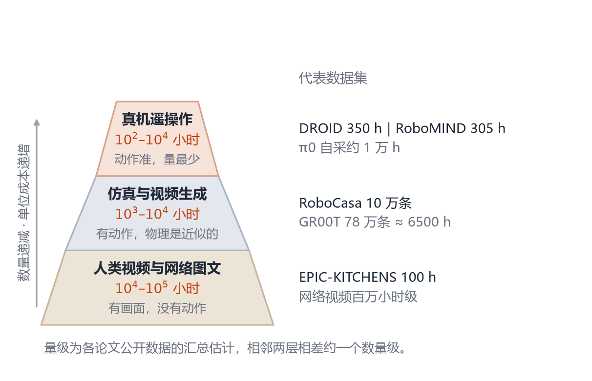
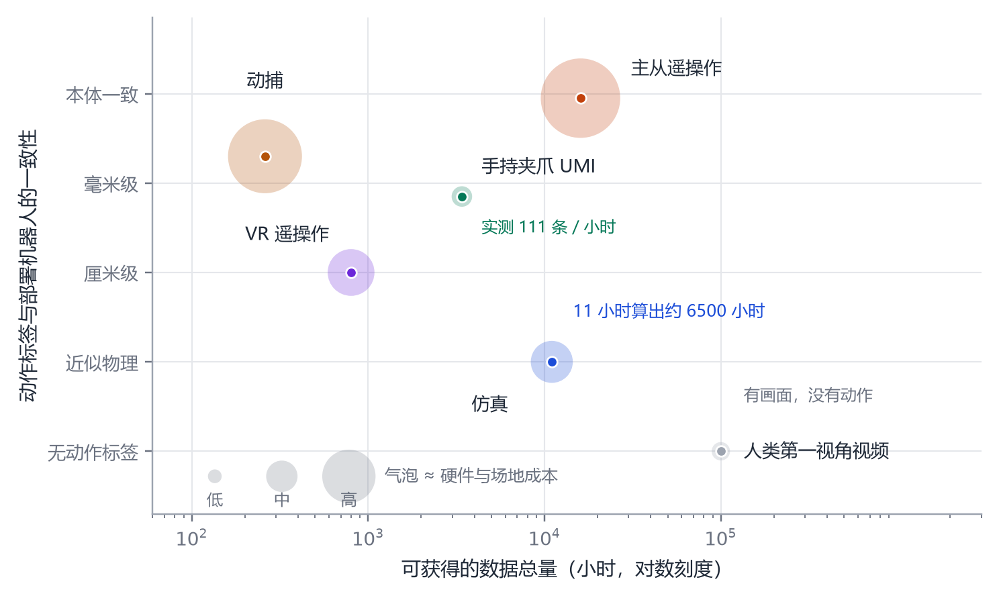
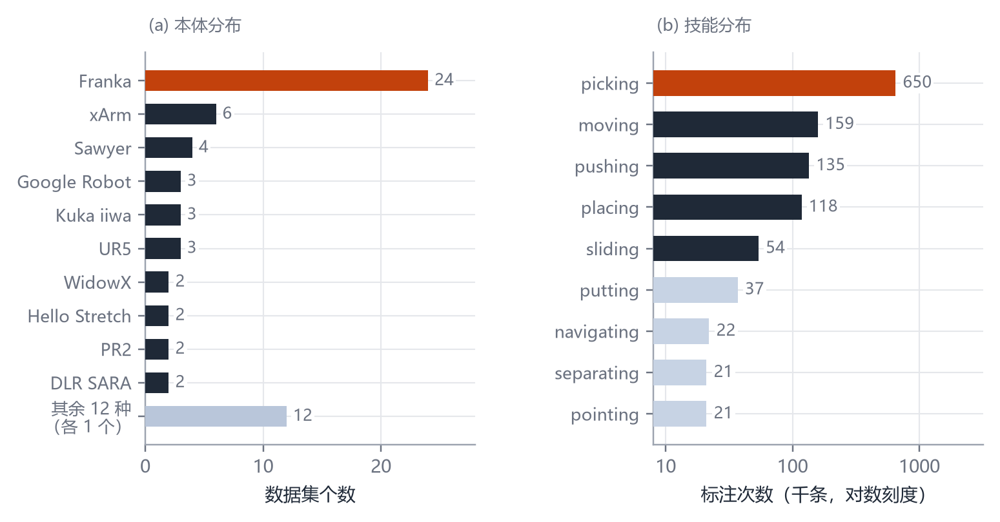

# 第 14 章　数据从哪里来

> **本章导读**：上一章那些视觉-语言-动作模型，参数量、动作头、推理频率被反复比较，但它们共享同一个上游，一批带动作标签的轨迹。这一章算清这批数据为什么贵，五种采集方式各自买到什么、又丢掉什么，几个公开数据集里究竟有多少条轨迹，以及清洗、混合、评测这三个环节里那些不写进摘要却能决定成败的细节。读完这一章，再看到“我们用了 100 万条数据”这句话，你会先问它是什么机器人、什么场景、怎么标出来的。

## 14.1 一条演示的价格

语言模型的训练数据是白送的。网页、书籍、代码，人在上网和写程序的时候顺手留下了它们，收集成本接近于零。机器人数据没有这个便利，每一条轨迹都要有人对着真机做一遍，动作做对了才算数。

先算一笔最简单的账。假设一个任务要 50 条演示，每条有效动作 15 秒，那么净录制时间是 12.5 分钟。没人能在这个时间里交出 50 条合格的演示，因为物体要复位、相机要重新对准、手滑了要重录、操作员要喝水。按三倍算，四十分钟。做 100 个任务，就是六十多个小时，还不含搭场景和标注。

这不是估算出来的悲观结论，公开数据集里就摆着这个比例。DROID（2024）把采集任务分发到 18 个实验室，动用了 50 名采集者，前后做了 12 个月，最后拿到 7.6 万条成功轨迹，合计 350 小时交互数据。把这两个数字放在一起看很刺眼，350 小时除以 50 人再除以 12 个月，平均每人每年贡献的可用交互数据只有 7 小时。剩下的时间去了哪里，去过现场的人都知道，拆箱、装台、标定相机、找插头、把柜子搬进办公室、把数据传上服务器、发现某个相机帧率不对再重录一遍。

RT-1（2022）的账更直白。13 台机器人在真实办公室里跑了 17 个月，采到 13 万条演示、744 个任务，平均每台机器人每月五百多条。这个数字看起来比 DROID 高，原因是 RT-1 的采集固定在少数几个工位上，场景不用搬，标定一次能用很久。代价是场景多样性差，17 个月只覆盖了 Google 的几个办公区。

大模型时代把这条曲线又拉高了一截。π0（2024）为了做灵巧操作，自采了约 1 万小时的机器人数据，其中双臂机器人贡献了 7.97 亿个时间步。论文里有一句很实在的话，最简单的任务后训练只要 5 小时数据，最复杂的任务需要 100 小时以上。100 小时意味着什么，按 10 Hz 控制频率算，是 360 万个动作标签；按 30 fps 相机算，是 1000 多万帧图像。而这只覆盖一个任务。

成本可以拆成三块。

**设备。** ALOHA 那套双臂主从系统用两条低成本的 6 自由度机械臂互相带动，整套硬件控制在 2 万美元以内；加了移动底盘的 Mobile ALOHA 是 3.2 万美元。这个价格在机器人圈算便宜，但一台设备同一时间只能被一个人用，采集时不能干别的。相比之下 UMI 的手持夹爪只要 73 美元的打印件加 298 美元的 GoPro，相差五十多倍。

**人的时间。** 一个采集者一天能专注操作的时间大约四到五小时，超过这个时长，动作质量会明显下降，抖动变多、复位变慢。所以团队规模直接换算成数据量，DROID 才要铺到 18 个实验室。

**磨损与场地。** 机械臂连续跑八小时，减速器和线缆都在发热，夹爪的硅胶指垫是耗材，几百小时就要换。相机的外参会在搬运中漂移，隔一段时间必须重新标定，否则视觉和动作对不上，数据看起来正常，训出来的策略却总是偏几厘米。场地也有隐性成本，一个像样的厨房场景要真的买橱柜、装水槽、接通上下水。

还有一个容易被忽略的换算。一条 15 秒的演示，在 10 Hz 的控制频率下是 150 个动作标签，在 30 fps 的相机下是 450 帧图像。一小时的交互数据大约 3.6 万个动作标签、10.8 万帧图像。所以机器人数据的单位不是 GB，是工时。一个 10 TB 的硬盘能装下几十万条轨迹，但没有人能用几十万小时的劳动把它们做出来。

把可用的数据源按数量和成本摞起来，会看到一个三层结构，如图 14-1。底层是人类视频和网络图文，量最大、最便宜，但没有动作标签；中层是仿真与视频生成，有动作、可控，但物理是近似的；顶层是真机遥操作，动作最准，量与成本都最贵。这个结构不是巧合，它反映了一个交换关系，越接近目标机器人的数据越难拿到。

<figure class="fig">

<figcaption><b>图 14-1</b>　机器人数据的三层结构。自下而上数量递减约一个数量级，与目标本体的一致性递增，单位数据的成本也递增。量级取自各论文公开数据的汇总估计。</figcaption>
</figure>

## 14.2 五种采集方式

图 14-1 的中层和顶层里其实混着好几种手段，它们的成本、精度、产出速度差别很大。下面按“人怎么把动作教给机器”来分，逐个数。

**主从遥操作。** 操作员握住一台小型的“主手”，另一台“从手”在几米外跟着做同样的动作。主手上装了编码器，读出的关节角直接作为从手的目标，所以从手的动作和真人操作一模一样，包括手腕的细微转动和接近物体时的减速。ALOHA 把这条路线做成了双臂版本，两条主手、两条从手，操作员两只手同时动，能打开调料杯盖、把电池插进槽、封好自封袋。它的优点是动作与机器人完全一致，不需要任何映射或重定向；缺点是设备被独占，一个操作员同一时刻只能带一台机器人，而且主从之间的延迟和力反馈会让人很快疲劳。

**VR 遥操作。** 操作员戴头显、拿手柄，手柄的位姿映射成末端执行器的目标位姿，画面从机器人头上的相机实时回传。它的好处是便宜、便携，一套头显加手柄几千块就能开始，而且视角是第一人称，操作员看到的和机器人看到的一致。代价是精度，手柄的追踪有厘米级抖动，手腕的旋转被简化成三个欧拉角，抓取薄片、插拔接头这类需要毫米级对准的任务很难做干净。

**动捕与外骨骼。** 光学动捕在房间四周架十几台红外相机，跟踪人身上的反光标记点，位置精度可以到亚毫米、姿态精度到零点几度。数据质量是几种方式里最好的，问题是场地，标记点被身体遮挡就丢帧，相机不能移动，一套系统几万到几十万美元。拿到的人体骨架还要经过重定向（retargeting）才能驱动机械手，人的手掌 20 多个自由度，二指夹爪只有 1 个，中间这一步会丢掉大量信息。外骨骼是另一种思路，把编码器直接绑在操作员的关节上，省掉了视觉追踪，但穿戴和校准很花时间。

**手持夹爪。** UMI（2024）的做法是把夹爪本身做成采集设备。一个 3D 打印的二指夹爪，上面装一台 GoPro，夹爪的开合由手指直接控制，相机拍到的就是“手腕视角”。GoPro 的 155 度鱼眼能看到夹爪两侧，再加上夹爪两侧的物理小镜子，视野被补到了接近全向，镜子里的画面还能提供物体与夹爪的相对位置。位姿靠 GoPro 自带的 IMU 加视觉 SLAM 恢复，论文报告的绝对轨迹误差是 6.1 毫米、3.5 度，双臂之间的相对误差 10.1 毫米、0.8 度。这套东西的意义在于把“采数据”从实验室搬到了任何地方，论文里三个演示者在 12 个人时内采了 1400 条倒杯子的演示，跑了 30 个地点，包括家里、办公室、餐厅和户外。吞吐也很说明问题。论文让同一个人在 15 分钟内用三种方式采同一条倒杯子任务，折算成每小时，UMI 是 111 条，SpaceMouse 遥操作是 35 条，空手做是 231 条。

**仿真与人类视频。** 这两类放在一起，因为它们都不需要真机在场。仿真里物理引擎算出接触力和运动，RoboCasa 用 100 个厨房任务配上 10 万条自动生成的轨迹，GR00T N1（2025）在仿真里生成了 78 万条人形操作轨迹，合计约 6500 小时，相当于九个月不间断的人类演示，而生成只花了 11 小时。人类视频是另一个极端，EPIC-KITCHENS 这类数据集记录了 100 小时的第一视角厨房操作，画质和多样性都好，但没有任何动作标签，模型只能看到“手做了什么”，不知道关节转了多少度。

<figure class="fig">

<figcaption><b>图 14-2</b>　六种采集来源在数据量、动作精度与硬件成本上的相对位置。纵轴与气泡大小为定性刻度，横轴按论文公开数据的量级放置，用于比较相对关系而非精确数值。</figcaption>
</figure>

图 14-2 把这些方式摆在同一个平面上。横轴是能拿到的总量，纵轴是动作标签与部署机器人的一致程度，气泡大小约等于硬件与场地成本。三个方向没有一种方式同时占优，动捕在纵轴上很高，横轴和成本都吃亏；UMI 气泡最小、位置不差，但它记录的是夹爪而不是机械臂，力控和关节级的信息拿不到；主从遥操作在纵轴顶端，代价是一整套设备和被独占的人。

这张图还藏着一个常被忽略的事实，同一套硬件在不同任务上的吞吐差别很大。UMI 在倒杯子任务上每小时 111 条，换到动态抛接是每小时 149 条，而 SpaceMouse 遥操作在 15 分钟里一条都没成功，因为手柄的反应速度跟不上物体下落和人手翻转的节奏。选采集方式时，任务的动态性往往比精度更先决定可行性。

## 14.3 把几十个实验室的数据拼起来

单打独斗采不到规模，于是有了汇总这条路。它的难点不在搬运文件，而在把二十几种机器人的动作空间塞进同一个张量。

Open X-Embodiment（2023）是规模最大的一次汇总。21 家机构、34 个实验室把 60 个已有数据集捐出来，统一成 RLDS 格式，得到 22 种本体、100 万条以上轨迹。论文自己的说法是“100 万条以上”，DROID 的对比表把它记成 140 万条，两个数字都对，差别在统计口径。语言标注里抽出的技能有 527 种，任务 16 万个。

统一的代价不小。为了能放进同一个 batch，每个数据集只能贡献一个规范相机视角，原始的多视角、深度图、点云大多被丢掉；动作统一成 7 维末端增量，三个位置、三个姿态加一个夹爪开合，关节角信息被抹掉了。OXE 确实让模型见过 22 种机器人，但每种机器人只剩下最粗的一条信息通道。后来 Octo 和 OpenVLA 都在这个基础上做重采样与筛选，OpenVLA 最终用了 97 万条，RT-2-X 只用了 35 万条，两家对“哪些数据该留”的判断并不一致。

异质性也不均匀，如图 14-3。本体维度上 Franka 一家占了 24 个数据集，另有 12 种本体各自只有 1 个。轨迹数是另一种分布，xArm 与 Google Robot 靠少数几个大数据集占了大头。技能维度是典型的长尾，picking 出现 65 万次，moving、pushing、placing 各十几万次，再往后的 navigating、separating、pointing 只剩两万次上下。抓取放置这一族占了绝对多数，擦拭、装配、柔性物体操作缩在长尾里，样本量少到几乎学不会。数据集的总量再大，也补不上分布上的这个缺口。

<figure class="fig">

<figcaption><b>图 14-3</b>　Open X-Embodiment 的本体分布与技能分布。左图为每种本体对应的数据集个数，右图为语言标注中各行为词的出现次数，对数刻度。数据取自该论文图 2 的 (a)(d) 两栏。</figcaption>
</figure>

DROID 走的是另一条路，不做汇总，改为定一套采集协议，让 18 个实验室用同一款 Franka、同样的三相机布局、同样的标定流程，在三个大洲的真实办公室、厨房、卧室里采。12 个月、50 名采集者，得到 7.6 万条成功轨迹、350 小时、564 个场景、52 栋建筑、86 个任务，以 CC BY 4.0 发布。它的一致性远好于 OXE，代价是只有一种本体，人形和双臂的数据一条也没有。

RoboMIND（2024）把重点放在本体多样性上。10.7 万条轨迹、305.5 小时、479 个任务、96 类物体，覆盖 4 种本体，包括单臂、双臂和人形灵巧手，全部由遥操作采集，按统一标准整理。它还公开了 5 千条失败轨迹，这个选择在 14.5 节还会提到。

**表 14-1**　主流机器人数据集的规模、覆盖与许可。

| 数据集 | 规模 | 本体数 | 场景与任务 | 许可 |
| --- | --- | --- | --- | --- |
| Open X-Embodiment（2023） | 100 万条以上轨迹 | 22 | 60 个数据集汇总，527 种技能 | 各子集沿用原许可 |
| DROID（2024） | 7.6 万条，350 小时 | 1 | 564 个场景、52 栋建筑、86 个任务 | CC BY 4.0 |
| RoboMIND（2024） | 10.7 万条，305.5 小时 | 4 | 479 个任务、96 类物体 | 公开下载 |
| RT-1 数据（2022） | 13 万条 | 1 | 744 个任务，13 台机器人 | 未公开 |
| RoboCasa（2024） | 10 万条仿真生成 | 多种仿真本体 | 100 个厨房任务 | 开源 |
| UMI 采集（2024） | 单任务数百至千余条 | 手持夹爪，可迁移多机 | 30 个真实地点 | 开源 |

表里的规模、本体数、场景三个数字很难同时做大。OXE 把本体数推到 22，就得接受每台机器人只剩一路相机、统一成 7 维末端动作；DROID 把场景推到 564 个、把标定统一到一套流程，就只能锁定一款机械臂；RoboMIND 补上了双臂与人形，规模又回落到十万条量级。想同时要异质性、一致性和规模，需要的是钱和时间，而不是一个更聪明的格式。

还有一个容易被忽略的细节，许可并不统一。OXE 是汇总，每个子数据集保留自己的协议，商用限制、署名要求各不相同，实际用之前要逐个核对。这也是不少团队宁可自己采、或者只用其中几个子集的原因。

## 14.4 三层数据怎么配

拿到三层数据之后，下一个问题是比例。最常见的错法是按原始帧数混合，谁的文件大谁说了算。这样做的结果是几个大而重复的数据集占掉九成采样预算，剩下的多样本数据几乎被淹没，训出来的模型在本体、背景、物体上都只认得那几个大数据集里的样子。

实际配方都是人工调过的权重。OpenVLA（2024）公开了自己的混合表，二十多个数据集里，Fractal 占 12.7%、Kuka 占 12.7%、Bridge 占 13.3%、DROID 占 10.0%，这四家合计已经接近一半；而 UCSD Kitchen、DLR EDAN 这类数据集的权重不到 0.1%，在 batch 里可能几千步才出现一次。权重与数据量并不成正比，Bridge 的轨迹数并不比 Fractal 多，拿到的权重反而更高，因为它的场景与物体更杂，对泛化更有用。

这套权重背后是一个朴素的判断，单位样本的信息量不一样。一千条在同一个厨房里抓同一个杯子的轨迹，对模型的价值远低于一百条在十个厨房里抓十种杯子的轨迹。所以混合比例做的事情，是把“多样性”折算成“等效样本数”，再按这个数分配采样概率。至于怎么折算，目前没有公认公式，各家靠消融实验试出来。

更激进的做法是不在真实数据上凑比例，而是把金字塔的下两层“造”出来。GR00T N1（2025）的真机遥操作只有 88 小时，它用视频生成模型把这 88 小时扩成 827 小时的新轨迹，动作与语言提示都重新配过；再用仿真生成 78 万条人形操作轨迹，约 6500 小时；底座是公开的人类第一视角视频。这些数据大多没有动作标签，论文用一个 VQ-VAE 从前后的两帧中抽出隐动作（latent action），把人类视频也当成一种“本体”混进训练。π0 的做法类似但更保守，自采约 1 万小时真机数据，配上整个 OXE。

三个数字放在一起看，真机 88 小时、生成 827 小时、仿真 6500 小时，比例大约是 1 比 9 比 74。这不是行业标准，只是一个团队在成本约束下的取舍。

那么能不能靠单纯堆真机数据解决问题，Data Scaling Laws（2024）那项工作给了否定的回答。作者采了 4 万多条演示，跑了 1.5 万次真机 rollout，发现策略在新环境、新物体上的成功率与环境数、物体数呈近似幂律关系，而与每个环境里的演示条数关系很弱。具体到数字，每个环境或物体超过 50 条演示之后，再加演示几乎不涨点。他们的高效配方是 32 个环境，每个环境一个独特物体、50 条演示，四个采集者干一个下午，两个任务在新环境新物体上就能到九成左右。

这笔账很好算。同样 500 条演示的预算，全投在一个场景里，策略只学会那个场景；摊成 10 个场景乘 50 条，就能把环境维度的指数抬上去。前提是任务本身不变，物体类别也不变。这条规律管的是单任务策略的泛化，不能直接外推到通用视觉-语言-动作模型，后者仍然需要海量的跨本体数据来学“不同身体怎么动”。但它解释了一件事，为什么 DROID 愿意花 12 个月跑 564 个场景，而不把同样的时间用来在一个实验室里多采十倍。

## 14.5 清洗那些让模型卡住的细节

数据拿到手只是开始，进训练之前还有几道工序。这些工序不上头条，但一个常量就能让几十亿参数的模型学坏。

**失败数据要不要留。** DROID 收了 1.6 万条被标为“未成功”的轨迹，放在发布包里但不计入 7.6 万的规模；RoboMIND 公开了 5 千条失败轨迹。留的理由很硬，策略需要知道什么时候会失败，价值函数、成功判别器、失败恢复都要靠这些样本；不留的理由也很硬，失败片段与成功片段在像素上几乎一样，差别在于“中途停住”还是“继续到底”，纯行为克隆会把两者混在一起学，结果是模型偶尔做到一半就不动了，而且这种毛病很难从 loss 上看出来。折中的做法是保留但打上标签，训练时按用途分开用，行为克隆只用成功片段，价值估计和错误分析用全部。

**一个常被引用的教训。** OpenVLA 的附录里记了一件小事，BridgeData V2 的每条演示，第一个时间步的动作都被记成全零。直接拿这份数据训一个表达能力很强的模型，结果是策略在评测里频繁输出全零动作，机械臂原地不动。解决办法只是把每条演示的第一帧删掉。同期无法重训的 RT-2-X 只能在推理时绕过，第一次采样如果是全零就取第二可能的动作。一个格式上的常量，胜过了很多结构上的改进。

**语言标注的粒度。** DROID 给每条轨迹配了最多 3 条独立众包指令，来自不同的标注员。这个设计有讲究，同一段视频配三种说法，“把杯子放进水槽”和“把左边的蓝色杯子放到水槽里”，模型就不容易把某一句具体的话背下来，只能去抓画面与语言共有的部分。粒度也要拿捏，太粗的指令学不到细节，太细的指令（连颜色、位置、先后顺序全写上）会让模型依赖文本而忽略视觉，换一个说法就失效。经验区间是七到十五个词，包含物体、动作、目标位置三样东西。

**时间对齐。** 相机跑 30 fps，关节跑 50 Hz，两路时间戳来源不同。配错 30 毫秒，模型学到的是“看到动作之前的画面，输出动作之后的角度”，部署时会系统性地提前或滞后。做法是把所有流重采样到统一时间轴，图像取最近的一帧，最坏相差半帧，约 17 毫秒。UMI 多做了一步，它在推理时人为给观测加延迟，让训练时的延迟与部署时的延迟对上，因为部署时相机曝光、传输、推理各有一段滞后。

**重复与长尾。** 连续录制的数据里，大量帧是“手停在半空”“物体已经放好”这类静止片段，按帧均匀采样会让模型严重偏向静止。常见的处理是按 episode 均衡采样，或者按末端位移幅值过滤掉几乎不动的片段。长尾是另一个方向，稀有物体、稀有光照、稀有失败模式在帧级采样里出现的概率极低，靠随机采样永远学不到，只能刻意补采，或者给这些片段加权。

这些工序的共同点是收益不在 loss 曲线上。删掉第一帧、调对时间戳、改一版指令，训练曲线几乎不动，差别要到真机 rollout 上才看得见。这也是机器人数据工作难被认可的原因，它的大部分价值体现在“本来会失败的地方没有失败”。

## 14.6 评测集污染

讨论数据，绕不开一个尴尬的现状：最常被引用的那几个评测集，同时也是最常用的训练集。

BridgeData V2 是 Open X-Embodiment 的组成部分，占 OpenVLA 训练混合的 13.3%，而 OpenVLA、Octo、RT-1-X 都在 BridgeData V2 的 WidowX 任务上报告成功率。Google Robot 那套评测也是同理，RT-1 的数据本来就在 OXE 里。这些数字衡量的是“在已经见过的场景和物体上还稳不稳定”，不是泛化。论文对自己的设定通常是诚实的，但读表格的人很容易把 70% 当成“在新厨房里也能做到七成”。

更隐蔽的一层是任务级过拟合。仿真基准里的 LIBERO 常被压到十个任务的子集上报分，SimplerEnv 把真机场景复刻成几个固定布局，团队在这上面调参调到九十几分，搬到真机上掉到一半，两边排名的相关性并不高。做基准的人知道这一点，所以 SimplerEnv 特意强调“用真机视频对齐过”，但对读者来说，跨基准比较分数仍然意义有限。

实用的做法有三条。留出一部分场景完全不进训练，按建筑或房间划分，而不是随机划分，因为相邻场景的视觉相似度太高；按物体和背景做 held-out 划分，训练时没见过那个杯子，评测时只换杯子；报告 rollout 次数与置信区间，20 次里成功 14 次，95% 置信区间大约从 47% 到 87%，把它写成 70% 会让人误以为精度到个位数百分点。

回到开头那个问题，数据为什么是瓶颈。真机的每一小时都对应着一个人的一小时，场景、标注、清洗、评测又各自要人。这条路的尽头不是“再采十倍”，而是想办法让数据从别处来。下一章讲的世界模型，做的就是这件事。
