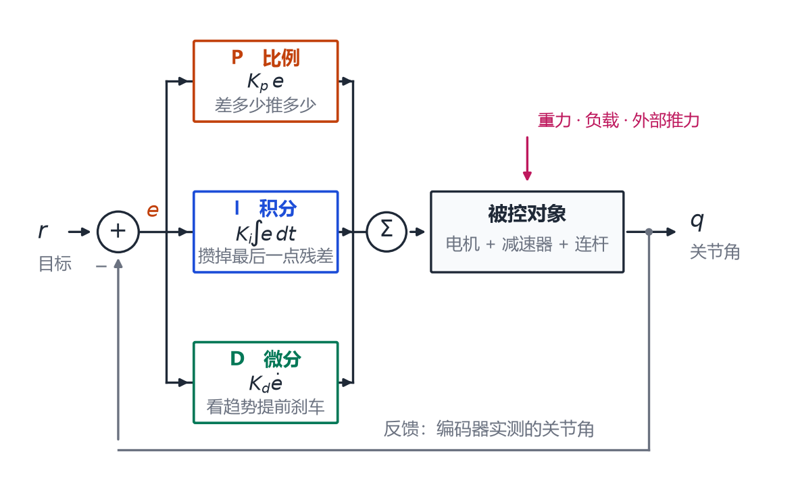
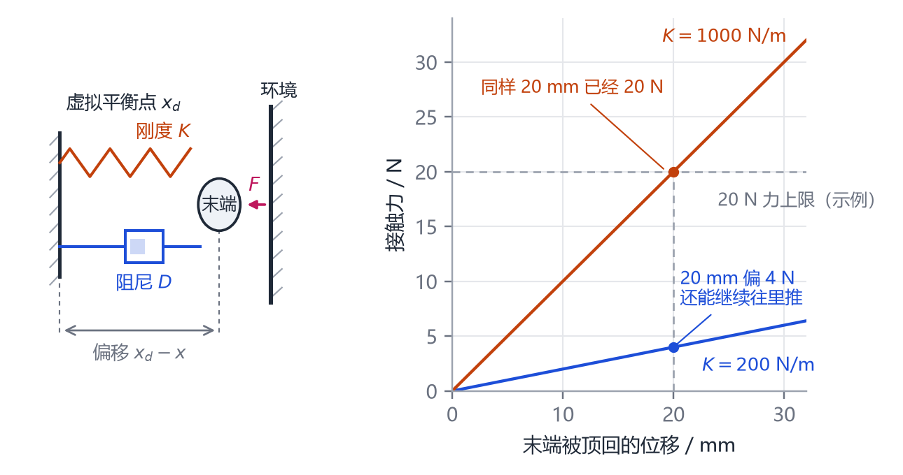
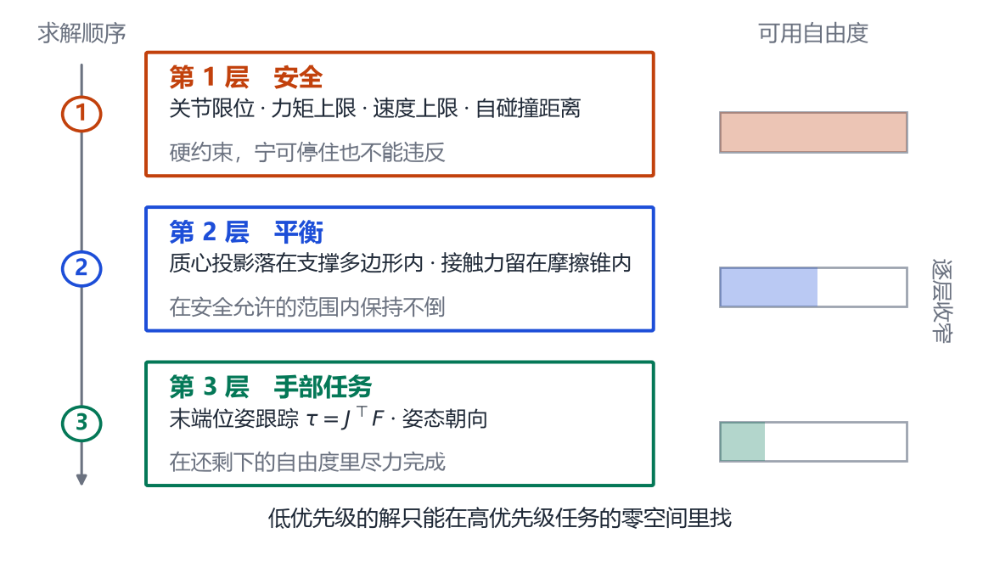

# 第 16 章　让关节听话

> **本章导读**：视觉-语言-动作模型给出的是每秒几次的位姿目标，电机需要的却是每秒一千次的力矩指令，中间这段距离由控制补上。要回答的问题包括反馈为什么不可省、PID 三个参数各自管什么、状态估计怎么把噪声很大的传感器拼成可用的状态、阻抗控制为什么能让机械臂软下来、全身控制在互相冲突的任务之间怎么排优先级，以及一毫秒的循环周期里究竟压着多少工程约束。读完能判断一组控制参数是否合理，也能看出演示视频里哪些动作是靠控制兜住的。

## 16.1 不算不知道，一算全是误差

先做一个假想实验。让六轴机械臂的末端走到桌面上方 20 厘米的某个点，不看传感器，只把目标位姿送进逆运动学，算出六个关节角，让电机转过去。它会到吗？

大概会，但差几毫米。

第一类误差来自几何参数。连杆长度、关节零位、相邻轴的平行度都是标定出来的，标定本身有误差。臂长 0.5 米、误差 0.1%，末端就差 0.5 毫米，六根连杆的误差还会叠加。

第二类来自传动。谐波减速器不是刚体，它的扭转刚度大概在每弧度一万牛米这个量级，意思是施加 10 牛米的力矩，输出端会相对输入端扭转 0.001 弧度。这个扭转在空载时看不出来，一挂上负载就出现。减速器还有几十角秒的背隙和随速度变化的摩擦，两者都会让电机转了多少和关节转了多少对不上。

第三类来自重力。末端挂 3 公斤负载，重心离关节 0.5 米，那个关节要承受 15 牛米的力矩。这个力矩让关节扭转 0.0015 弧度，末端下沉 0.75 毫米。手里的物体比估计的重一倍，下沉量也翻倍。机械臂伸得越直，力臂越长，下沉越多，同一个负载在不同姿态下的误差并不相同。

第四类更琐碎。电机发热后连杆伸长、齿轮磨损改变零位、拖链在某个姿态下多拉一下、地面不平让底座轻微倾斜，这些误差单看都很小，加起来在 1 到 3 毫米之间。

3 毫米在空气里移动时无所谓，接触的瞬间就变成大问题。末端和环境之间的等效刚度如果是每米两万牛，3 毫米的位置误差就是 60 牛的接触力。这个力足以把鸡蛋压碎。误差本身不可怕，误差乘以刚度才可怕。

所以闭环不是可选项。既然算不准，就只能在动的同时不断测量、不断修正，后面所有复杂的东西都是这个朴素想法的展开。

反馈也有代价。要装传感器，要多花时间，还可能把系统搞不稳定。控制周期 1 毫秒、总线延迟 1 毫秒、电机响应 2 毫秒，环路纯延迟就是 4 毫秒。延迟让修正总是慢半拍，增益越高越致命，系统从修正误差变成放大误差，随后振荡。这条限制决定闭环带宽，也决定后面所有频率数字的量级。

## 16.2 三个旋钮，各管一件事

PID 是工业界用得最多的控制器，九成以上的控制回路里都有它，想法可以用拧水龙头解释。

你在洗澡，水太凉。手搭上龙头，感觉差多少就拧多少，这是比例项。水变热了，你发现升温太快，快到手能承受的上限时提前松一点，这是微分项，它在看变化的速度。还有一种情况，龙头拧到底了水温还是差一点点，你只能一点点微调，直到刚好，这是积分项，它记住历史。

写成公式是

$$u(t) = K_p e(t) + K_i \int_0^t e(\tau)\,d\tau + K_d \frac{de(t)}{dt}$$

其中 $u$ 是输出（对关节就是力矩），$e = q_d - q$ 是目标与实测之差，三个 $K$ 是要调的系数。

比例项单独工作会留下残差。用上一节的数字，关节要 15 牛米才能把负载举住，若 $K_p = 100$ 牛米每弧度，稳态误差就是 0.15 弧度，接近 9 度。加大 $K_p$ 能压残差，加到 1000 时只剩 0.9 度，但系统开始叫、开始抖，延迟的存在让高增益必然振荡。

这就引出工程上最有用的一条经验。**好的控制大部分靠模型前馈，反馈只补模型错的那部分。** 与其把 $K_p$ 加到振荡，不如先用模型算出举住这个姿态需要多少力矩，把它直接加上去，让 PID 只处理剩下那点误差。工业机械臂的控制器里，重力补偿、惯量前馈、摩擦补偿占的代码量远大于 PID 本身。难的不是那个公式，是公式外面那些补偿项。

积分项负责消掉残差，代价是相位滞后。它累积历史误差，等于在系统里塞了一个延迟，容易引起低频振荡。更麻烦的是积分饱和。机械臂被桌子挡住，误差一直存在，积分项涨到限幅，电机满力矩顶着桌子。等桌子移开，积分项还留着那一大坨，机械臂会突然冲出去撞到别的东西。常用对策有三种，积分限幅在误差过大时停止累积，条件积分在输出饱和时冻结，回算法按饱和深度往回扣。三种做法在代码里都只有几行，不写就会出事故。

微分项抑制超调，代价是对噪声敏感。编码器每格大约 0.0028 度，1 毫秒内跳一格，差分出来的速度就是每秒 2.8 度，这是纯粹的量化噪声。这个噪声乘上 $K_d$ 直接进力矩，电机会发出高频啸叫，线圈发热。实际系统里微分项前面一定有一个低通滤波器，截止频率放在 20 到 50 赫兹；而且是对测量值微分而不是对误差微分，否则目标阶跃时会打出一个巨大的脉冲。

教科书里 Ziegler-Nichols 能给初值，现场的人更多靠手感。只开 P，加到阶跃响应开始超调或等幅振荡，退到那个值的六成；加 D 把超调压下去；再加一点点 I 消残差。顺序之所以有效，是因为三个参数管不同频段，P 管整体刚度，D 管高频阻尼，I 管低频精度，从粗到细调不容易互相干扰。

采样频率必须远高于闭环带宽，经验值是十倍以上。1 千赫兹的循环，带宽上限大概 100 赫兹。想让关节跟上 200 赫兹的振动，光调参数没用，得先提高采样率。

<figure class="fig">

<figcaption><b>图 16-1</b>　PID 控制框图。误差同时送进三条并联支路，比例项给出与偏差成正比的推力，积分项累积历史偏差，微分项按变化速度提前阻尼，三者相加后驱动电机，编码器把实测角度送回求和点。</figcaption>
</figure>

## 16.3 传感器给的都不是你想要的量

闭环需要知道现在在哪，但机器人身上没有一个传感器直接给出这个答案。

关节角看起来最直接。每个关节都有编码器，17 位绝对值编码器每转 13 万格，配 100 比 1 减速器之后关节侧分辨率不到 1 微弧度，比机械精度高两个数量级。问题是它装在电机侧，电机转到位了，关节可能还没到，中间隔着一个会扭的减速器。高精度场合因此用双编码器，两者之差就是减速器形变，乘刚度得到关节力矩，很多协作臂靠这一手不用力传感器也能测力。

速度更麻烦，没有传感器直接输出干净的关节速度，只能对角度差分。前面算过，1 毫秒差分会把 0.0028 度的量化误差放大成每秒 2.8 度的噪声，所以速度一般来自观测器或滤波后的差分，代价是几十毫秒的滞后。

惯性测量单元（IMU）由陀螺和加速度计组成，陀螺测角速度，加速度计测比力，共同特点是高频准、低频差。陀螺 0.01 度每秒的零偏积分一分钟就是 0.6 度姿态漂移；加速度计把重力也算进读数，静止时能反推姿态，一动起来就分不清重力和运动，二次积分求位置更是灾难，0.02 米每二次方秒的零偏积分 1 秒差 1 厘米，10 秒差 1 米。

一个高频准、一个低频准，正好互补，按频率加权融合就是卡尔曼滤波做的事。

它的经典类比是 GPS 加车速推算。GPS 一秒给一次位置，误差 3 米；车速表 100 赫兹更新，误差 0.1 米每秒。两次 GPS 之间用车速积分推算，1 秒后位置误差大概 10 厘米。GPS 到来时不能直接跳到读数上，那会出现 3 米的跳变；也不能完全不信，误差会一直累积。合理做法是按可信度加权，推算误差 10 厘米、GPS 误差 3 米，就几乎全信 GPS；推算已经漂了 5 米，GPS 的权重反而更大。

这个可信度在数学上就是协方差。滤波分两步，预测步用模型把上一时刻的状态推到现在，同时放大不确定性

$$\hat{x}^- = A\hat{x} + Bu,\qquad P^- = APA^{\top} + Q$$

更新步用测量修正预测，按不确定性分配权重

$$K = P^-H^{\top}(HP^-H^{\top} + R)^{-1},\qquad \hat{x} = \hat{x}^- + K(z - H\hat{x}^-)$$

$A$ 是状态转移，$Q$ 是过程噪声，$R$ 是测量噪声，$H$ 把状态映射到测量空间，$z$ 是读数。$K$ 就是那个权重，$R$ 小（传感器准）时 $K$ 接近 1，几乎照抄测量；$R$ 大时 $K$ 接近 0，几乎不信测量。

机器人里更常用它的非线性版本，扩展卡尔曼滤波（EKF），在当前估计点把模型线性化。腿足机器人还会加一层接触检测，脚落地时把脚的位置当成零速测量喂进滤波器，这一条比任何 IMU 都强。

系统真正需要的量几乎都没有传感器。质心位置要靠各连杆质量和关节角算，质量参数标定误差 5% 就够让质心偏 1 厘米；末端速度靠雅可比和关节速度算；地面反作用力靠动力学方程反解；关节力矩靠电流乘力矩常数估，摩擦和惯量补偿的误差常在 10% 到 20%。估计的质量直接决定控制的质量。控制器不怕噪声，怕有偏的估计，因为反馈只能修正随机误差，修不了系统性偏差。

## 16.4 硬一点还是软一点

同样是让末端到达某个位置，实现方式有好几种，差别在于遇到阻碍时怎么办。

位置控制最常见。控制器内部是位置环套速度环再套电流环的三层结构，最外层每毫秒比较目标角度和实测角度，输出速度指令，速度环再输出电流。它的行为像一个很硬的弹簧，等效刚度由增益决定，每米两万牛就是这个量级。碰到东西时 5 毫米的位置误差就是 100 牛，机械臂不会退让，只会顶住，直到电流超限报警。

工业上这么做有道理。焊接、喷涂、搬运不需要接触的柔顺性，需要的是绝对准确、绝对不退缩。硬控制配合刚性机构，重复定位精度能做到 0.02 毫米，软控制做不到。

力矩控制走另一条路。它不管位置，直接把想要的力矩换算成电流，$\tau = K_t i$，$K_t$ 是力矩常数。好处是力可以直接指定，也能从电流里反推外力。坏处是它没有位置刚度，重力补偿差一点机械臂就会往下掉，摩擦和齿槽力矩要单独补，负载惯量变化时还容易失稳。纯力矩控制在关节上很少单独使用，通常和位置或阻抗结合。

阻抗控制是这两者之间的连续过渡。它不指定必须到这里，而是指定偏离这里时用多大力拉回来，行为像一个虚拟的弹簧加减震器

$$F = K(x_d - x) + D(\dot{x}_d - \dot{x})$$

$x_d$ 是虚拟平衡点，$x$ 是实际位置，$K$ 是刚度（牛每米），$D$ 是阻尼（牛秒每米）。刚度设大，它接近位置控制；刚度设小，它接近随波逐流。

图 16-2 右边那两条线说明了一切。同样被顶回 20 毫米，刚度 200 牛每米的机械臂只感受到 4 牛的力，还能继续往里推；刚度 1000 牛每米的已经 20 牛，接近易碎物件的上限。**柔顺不是力气小，是把位置误差换算成力的比例调小。**

<figure class="fig">

<figcaption><b>图 16-2</b>　阻抗控制的弹簧阻尼模型与接触力。左图末端通过虚拟弹簧和阻尼连到平衡点 $x_d$，被环境顶回时产生回复力；右图两条直线是不同刚度下偏移量与接触力的关系，示意两种典型取值。</figcaption>
</figure>

需要柔顺的场景，几乎都跟接触的不确定性有关。

插孔是最经典的。轴和孔的单边间隙往往只有 0.1 毫米，而视觉定位的误差是 1 毫米量级。用位置控制硬插，销子顶在孔沿上，摩擦力把销子压得更紧，越推越卡，最后刮伤工件。用低刚度阻抗，销子碰到孔沿时侧向力把它推向孔中心，机械臂顺着这个力偏一点，几毫米的误差被自动吸收，这就是被动柔顺的现代版本。装配线上的远中心柔顺装置（RCC）用纯机械结构做同一件事，原理一模一样。

擦桌子是另一种。抹布要压在桌面上，法向力保持 20 牛左右。桌面不平、抹布会压缩、手臂姿态在变，位置控制给不出稳定的法向力，力会随高度变化几倍。力控或者法向低刚度阻抗能把这个力稳住，高度自己浮动。

人机接触是第三种，也最严肃。1 公斤的前臂以 0.5 米每秒撞到人，动能 0.125 焦耳。如果控制让它在 5 毫米内停住，平均接触力是 25 牛；如果机构很硬、只让出 1 毫米，同样的能量会变成 125 牛。差别不在电机功率，在于让不让。

导纳控制是阻抗的镜像。它测量外力，用同一个方程算出应该偏移多少，再把偏移后的位置送给位置环。名字来自导纳这个物理量，即力到运动的映射。工业臂加腕部力传感器时常这么做，因为位置环本来又硬又准，改内环代价大，外挂一层省事。代价是带宽受位置环限制，遇到金属对金属这种特别硬的环境，力反馈容易和位置环打架，出现接触振荡。

选择哪一种，取决于硬件内环是什么。准直驱关节、串联弹性执行器这类天生能控力矩的硬件适合阻抗控制，力矩指令直接下发；传统工业臂适合导纳控制，用力传感器外挂。腕部六维力传感器能做到 0.1 牛的分辨率、1 千赫兹采样，但它读到的是工具重力与接触力的合力，必须先减掉工具重力，而工具姿态在变，补偿做不干净时残留几牛偏置很常见。

**表 16-1**　四种控制方式的对比。

| 控制方式 | 输入 | 适用场景 | 典型频率 | 典型失效 |
|---|---|---|---|---|
| 位置控制 | 目标关节角或位姿 | 焊接、喷涂、搬运、点位运动 | 1 kHz 内环 | 接触时力失控，顶坏工件 |
| 速度控制 | 目标关节速度 | 传送带跟踪、匀速扫描 | 1 kHz 内环 | 位置漂移，无法保持位姿 |
| 力矩控制 | 目标关节力矩 | 动力学补偿、碰撞响应、研究平台 | 1 到 10 kHz 电流环 | 重力补偿误差导致下沉或抖动 |
| 阻抗控制 | 平衡点、刚度、阻尼 | 装配、擦拭、人机协作、抓取 | 1 kHz 外环 | 刚度与阻尼配比不当引起接触振荡 |

## 16.5 一个身体，好几个任务

前面讨论的都是单个关节。真实任务几乎都在末端描述，把杯子举到嘴边是一个位姿，不是六个角度。任务空间控制就是直接把误差定义在末端，再换算回关节。

换算靠雅可比矩阵，它描述关节速度到末端速度的线性映射，$\dot{x} = J\dot{q}$。七自由度臂的 $J$ 是 6×7 的矩阵，因为要同时表达三个方向的线速度和三个方向的角速度。映射只在当前位姿附近成立，位姿一变 $J$ 就变，所以每毫秒都要重算。

反过来的映射更巧妙。末端受到的力怎么变成关节力矩？答案是转置，$\tau = J^{\top}F$。这个关系来自功率守恒，末端做功的功率 $F^{\top}\dot{x}$ 必须等于关节做功的功率 $\tau^{\top}\dot{q}$，代入 $\dot{x} = J\dot{q}$ 就得到 $\tau = J^{\top}F$。它不需要求逆，所以不会因为奇异位形而爆掉。奇异位形是雅可比降秩的姿态，比如手臂完全伸直时末端在某个方向上动不了，此时 $J^{-1}$ 无解，$J^{\top}$ 仍然有定义。

七自由度做六维任务，多出来的一个自由度叫冗余。它可以在不改变末端位姿的前提下做别的事，比如让肘部远离障碍、让关节远离限位。数学上这叫零空间，把次级任务的力矩投影到不影响主任务的子空间里

$$\tau = J^{\top}F + (I - J^{\top}J^{\top+})\tau_0$$

$\tau_0$ 是次级任务想出的力矩，$J^{\top+}$ 是 $J^{\top}$ 的伪逆。意思很直白，主任务先拿走它需要的，剩下的自由度随便次级任务用。

人形机器人把这件事推到极限。三十多个自由度，同时要满足不摔倒、手到目标、躯干朝向、双脚踩稳、不撞自己、不超限位、不超电机力矩。这些目标会互相冲突。手想往远处伸，身体就得前倾，前倾太多质心出支撑多边形，就摔了。

解决办法是分层二次规划。每一层是一个优化问题，形式都是让某个误差在满足约束的前提下最小

$$\min_{\ddot{q},\,f} \ \lVert J\ddot{q} - a_{\text{des}}\rVert^2 \quad \text{s.t.} \ \ A\ddot{q} + Bf \le b$$

$\ddot{q}$ 是关节加速度，$f$ 是接触力，约束 $A\ddot{q} + Bf \le b$ 一次性写进了动力学方程、摩擦锥、力矩上下限和关节限位。分层的意思是先解第一层，把它得到的最优解空间传给第二层，第二层只能在这个空间里找，依此类推。

层级的顺序反映什么绝对不能违反。安全在最上面，关节限位、力矩上限、自碰撞距离，这些是硬约束，宁可任务失败也不能越界。平衡在中间，质心要留在支撑多边形里，接触力要留在摩擦锥里，违反了就是摔倒，代价远大于任务失败。手部任务在最下面，它决定做得漂不漂亮，做不完可以重试。

<figure class="fig">

<figcaption><b>图 16-3</b>　全身控制的三层任务栈。每一层给出自己的约束与目标，求解从上到下进行，右侧的可用自由度逐层收窄，低优先级任务只能在高优先级任务的零空间里寻找解。</figcaption>
</figure>

这个结构的好处是可解释。机器人没够到目标，可以查是哪一层把解挤掉了。坏处是可能不可行。安全约束太紧、平衡约束太严，低层任务就永远没解，此时 QP 会报无解，工程上必须准备降级策略，比如放松手部任务的目标、改成尽量靠近，或者干脆停下来等人。

求解速度是硬指标。三十多个自由度、几十个决策变量的 QP 要在 1 毫秒内解完，留给求解器的只有几百微秒。OSQP、qpOASES 在这个规模上能跑到几十到几百微秒，前提是结构规整、热启动做好、内存不动态分配。接触点数量一变矩阵规模就变，求解时间会跳一下，这一跳在 1 千赫兹的循环里就是一次抖动。

## 16.6 一毫秒里能做的事

1 千赫兹意味着每 1 毫秒完成一次读传感器、算、写指令。这个数字来自机械系统的谐振频率。一台中型机械臂的一阶谐振常在 20 到 60 赫兹，要让控制环路不去激励它，采样率得高出一个数量级以上。Franka 这类协作臂的控制接口就固定跑在 1 千赫兹，调用者必须在这个节奏里返回。

1 毫秒里能做的事很有限。读七个关节的编码器和力矩，走 EtherCAT 总线大概 100 到 200 微秒；正运动学、雅可比、动力学补偿几十微秒；QP 或者阻抗计算几十到几百微秒；写指令再 100 微秒。加起来七八百微秒，余量不多。底层控制代码里因此看不到动态内存分配、异常处理和锁。

总线的时间特性比平均延迟更重要。EtherCAT 周期通常是 1 毫秒，分布式时钟的同步抖动在 1 微秒量级，可以接受。普通以太网或 USB 完全不同，延迟可能只有几百微秒，偶尔却跳到几毫秒，力矩指令出现台阶，机械结构被激励出听得到的咔一声。

分层是必然的，策略网络跑不快，就不让它跑快。Humanoid Transformer 是策略 50 赫兹、关节 PD 1 千赫兹，策略给目标关节角，PD 在两次策略之间平滑地追上去。跑酷那项工作同样 50 赫兹策略，PD 跑到约 1000 赫兹。RMA 把策略拆成两层，基础策略 100 赫兹、适应模块 10 赫兹。视觉-语言-动作模型更慢，OpenVLA 在真机上用 5 赫兹和 15 赫兹的非阻塞控制器，$\pi_0$ 最高 50 赫兹，而它训练数据里的机器人大多只跑 2 到 10 赫兹。

频率低到什么程度会明显变差，ALOHA 给了一个难得的对照实验。同一套硬件、同一个操作者，把遥操作频率从 50 赫兹降到 5 赫兹，穿扎带的平均时间从 20 秒涨到 33 秒，整体任务时间增加 62%。5 赫兹就是每 200 毫秒才修正一次，人的手已经在等机器人了。这个数字对做视觉-语言-动作模型的人有直接含义，推理延迟 200 毫秒时，操作者的策略会退化成开环拨动。

Python 做不了这一层，原因不在算力。一次矩阵乘法在 numpy 里可能只要 20 微秒，问题在确定性。解释器有垃圾回收，一次 full GC 可能几毫秒；全局解释器锁让多线程时序不可预测；系统调度会把进程挪到别的核上，缓存全失效。1 千赫兹要求每次都在 1 毫秒内完成，而不是平均 0.5 毫秒，前者是实时性，后者是吞吐量。通行做法是 C++ 或 Rust 写实时循环，Python 在上层做策略，两者用共享内存或 ROS 2 通信，接口只传最新目标值，丢了就丢，绝不排队。

控制层还有一件别人替不了的事，安全。它是离伤害最近的一层，防线有几道是固定的。

限位分软硬两层。软限位在控制器里，接近极限时提前减速；硬限位是机械挡块加限位开关，软限位失效时兜底。力矩上限靠电流限制实现，它也是最初的碰撞检测手段，电流冲到限幅通常意味着撞上了什么。速度监控用独立的安全级编码器，超速就触发安全级停止。急停按钮接驱动器的安全转矩关断（STO），按下后切断使能，停止类别 0 立即断电，类别 1 先减速再断电。安全区域靠安全级位置监控，机械臂一出围栏就停。

标准层面有两份文件要认识。ISO 10218 分成两部分，一部分管机器人本体，一部分管集成后的系统，定义了协作操作的四种模式，安全级监控停止、手动引导、速度与分离监控、功率与力限制。ISO/TS 15066 是它的补充，为功率与力限制模式提供数值，按身体部位给出准静态接触的允许值，手与手指大约 140 牛，面部大约 110 牛，瞬态接触允许更高，因为冲击时间短。

这些功能必须由通过认证的安全控制器实现，不能靠上层软件。软件里写一句力超过 50 牛就停，从检测到执行要经过一两个控制周期，加上滤波延迟，实际响应在 10 毫秒以后，这 10 毫秒里机械臂还在往前走。软件层的力监控只是第二道防线，第一道永远是硬件限力、机械柔顺和物理隔离。

控制层把想去哪翻译成每个关节出多大力，它假设自己知道在哪、接触会是什么样、参数已经调好。换一个本体、加一个负载、地面软一点，这些假设就都要重调。下一章要讲的腿足与人形，把这个难度再抬一级，那里的接触每秒切换两次，支撑面从一个平面缩到一个点，而控制周期还是 1 毫秒。
