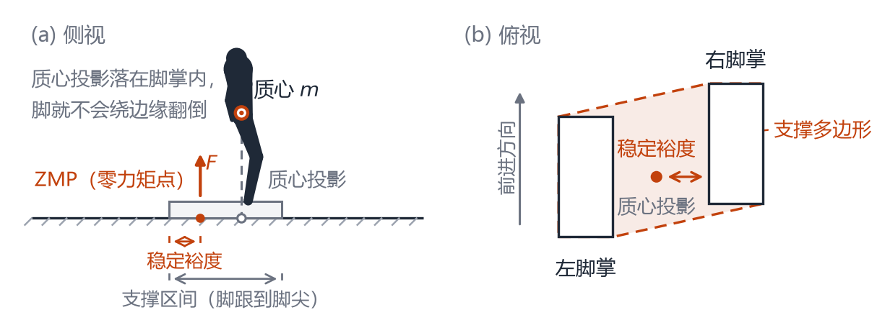
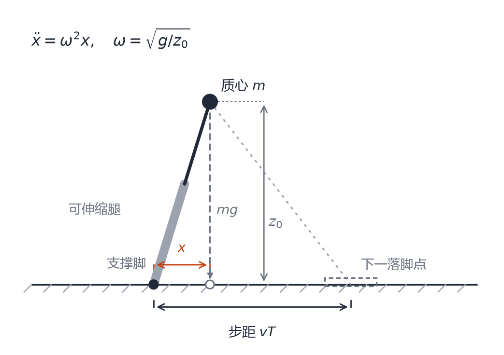
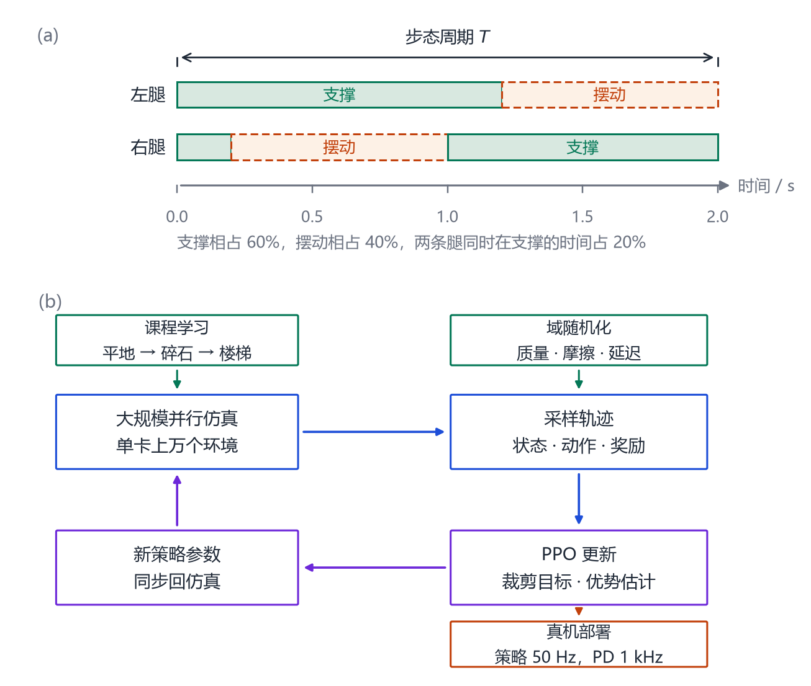

# 第 17 章　腿足与人形机器人

> **本章导读**：上一章把单个关节的力矩环调通了，这一章面对的是整台机器。两条腿撑起几十公斤的机身，靠一只脚掌大的接触面走、跑、上楼梯，难度远超轮子。下面从双足行走的本质困难讲起，经过 ZMP 与线性倒立摆这两块经典基石，再到在并行仿真里练出来的运动策略，接着落到人形全身控制、遥操作与电机电池这些硬件现实，末尾给出一个现状的校准。读完这一章，你能分辨一段人形演示里哪些动作真的难，哪些只是剪辑帮了忙。

## 17.1 走路是一直在倒下，只是每次都被接住

把一台 45 公斤的人形机器人放在平地，松手，它站着不动。这个稳是有条件的。质心必须落在两只脚掌围成的区域里，双脚并拢时这个区域只有 20 厘米宽、25 厘米长。人站着时脚踝在不停地小幅调整，压力中心在脚掌上漂移几毫米；机器人做同一件事，靠踝关节扭矩加惯性测量单元（Inertial Measurement Unit，IMU），一个 100 Hz 的平衡环就够。

抬脚那一刻条件就变了。支撑区域从两只脚缩成一只脚，横向余量从 10 厘米掉到 5 厘米。腿一抬，身体还必须往前倾，否则重心不会前移。真实行走的姿势是质心始终在支撑脚前方几十厘米，机身以每秒几度的角速度持续前倾，靠下一步落脚把它接住。走路不是保持平衡，是有控制地失衡，这句话可以算。

把身体看成一个高 $z_0$ 的倒立摆，绕接触点转动，小角度下的方程是

$$
\ddot{\theta} = \frac{g}{z_0}\theta
$$

$g$ 是重力加速度，$z_0$ 是质心高度，$\theta$ 是机身偏离竖直的角度。解的一半是 $e^{\omega t}$，一半是 $e^{-\omega t}$，其中 $\omega=\sqrt{g/z_0}$。取 $z_0=0.9$ 米，$\omega \approx 3.3$ 每秒，衰减项在零点几秒内消失，剩下的是指数发散项。偏离 1 厘米，1 秒后变成 27 厘米（$e^{3.3}\approx 27$），2 秒后是 7 米。人形机器人每秒必须有一次落脚来把这个指数重置，走路的节奏就是这么被定出来的。

上面还只是刚体绕定点的转动，真实行走有两层麻烦叠在上面。

第一层是欠驱动。一条腿通常有 6 个关节，髋 3 个、膝 1 个、踝 2 个，两条腿 12 个，加上腰、颈、双臂，整机 20 到 40 个自由度。地面接触不是一个能任意施力的关节，它只能推不能拉，法向力非负，切向力受摩擦锥限制。机器人在空中时那 6 个浮动基座自由度没有任何执行器能直接控制，落地后只能靠接触力间接影响。控制输入永远少于自由度数，这类系统叫欠驱动系统。后果很具体，脚掌完全贴地时你没法让踝关节产生任意大的扭矩，扭矩上限由脚掌尺寸和压力中心位置共同决定，压力中心最多移到脚尖，再往前脚就绕脚尖翻转。

第二层是接触切换。走路是支撑相与摆动相以 1 到 2 赫兹的频率交替，每一次触地都是一次带速度的碰撞。走路时垂直地面反力的峰值大约是体重的 1.2 倍，跑起来到 2.5 到 3 倍，跳跃落地更高。冲击通过脚、踝、膝一路传到机身，减速器与连杆都要按峰值而不是平均值设计。触地时刻还是状态估计最糟糕的时刻，IMU 会看到一个大尖峰，编码器会因为结构弹性抖一下，策略如果把这个尖峰当成真实速度，就会做出错误反应。

四足为什么容易得多，对比一下就看出来了。四条腿慢走时可以三条着地，支撑多边形是一个三角形，质心投影稳稳落在里面，这叫静态稳定，不需要任何动态平衡技巧就能站住。双足做不到，因为只有两个接触点，走起来只剩一个。所以四足在 2010 年代就进了工地与变电站，双足要到 2020 年代才敢在户外无人看护地走。

## 17.2 ZMP 与支撑多边形

1970 年代，Vukobratović 提出零力矩点（Zero Moment Point，ZMP），给双足行走找到了第一个能工程化的判据。

地面上所有接触力的合力作用在某个点上，如果这个点使得合力关于它的水平力矩为零，这个点就是 ZMP。判断翻不翻倒只需要一句话，ZMP 落在支撑多边形内，脚就不会绕边缘翻转；落到外面，等效合力必须由别的接触点提供，而那个点不存在，机器人就倒。

支撑多边形是所有接触点的凸包。双脚着地时是六边形，单脚着地时就是一只长 25 厘米、宽 10 厘米的脚掌，横向只有正负 5 厘米的余地。稳定裕度定义为 ZMP 到多边形边界的最短距离，走路时这个数常在 2 到 3 厘米量级，留给控制的余量只有指甲盖那么宽的一条。

ZMP 可以从质心运动算出来，因为它把脚会不会翻变成了质心该怎么动。忽略角动量时，矢状面内的关系是

$$
x_{\mathrm{zmp}} = x_{\mathrm{com}} - \frac{z_{\mathrm{com}}}{g}\ddot{x}_{\mathrm{com}}
$$

$x_{\mathrm{com}}$ 是质心的水平位置，$z_{\mathrm{com}}$ 是质心高度，$\ddot{x}_{\mathrm{com}}$ 是水平加速度。身体向前加速，ZMP 就往后退；身体向后加速，ZMP 就往前移。人起步时先把压力中心压到脚跟，身体自然向前倒，机器人做同一件事就是把踝关节扭矩反向给一下。

<figure class="fig">

<figcaption><b>图 17-1</b>　ZMP 与支撑多边形。侧视是质心投影、ZMP 与脚掌支撑区间的关系，俯视是双支撑时两只脚掌凸包成的六边形与稳定裕度（比例示意）。</figcaption>
</figure>

图 17-1 画了两个视图。侧视里 ZMP 落在脚掌内，与质心投影之间隔着一段距离，这段距离乘以体重就是地面需要额外提供的力矩。俯视里支撑多边形是两只脚掌的凸包，质心投影到最近边的距离就是稳定裕度。真实行走时 ZMP 在两只脚之间来回移动，轨迹是一个横向的之字形，人走路时躯干左右摆几厘米，正是为了让 ZMP 别越出那只 10 厘米宽的脚掌。

ZMP 好用，边界也很清楚。它只保证不翻倒，不保证不打滑，摩擦不够时脚会整体平移出去，ZMP 判据对此一无所知。它隐含脚掌整个贴地，对点足机器人支撑多边形退化成一个点，横向裕度为零。它还假设地面平整且刚性，踩在碎石或地毯上，实际接触点与模型能差出好几厘米。它也不管姿态好不好看、能耗高不高，这两件事要靠别的机制。

## 17.3 线性倒立摆与滚动优化

2000 年前后，Kajita 把上一节那个倒立摆方程做了一次简化，得到的模型叫线性倒立摆（Linear Inverted Pendulum Model，LIPM），它成了此后二十年人形步态生成的主力工具。

三条假设。整机质量全部集中在质心，腿没有质量。腿可以瞬间伸缩，质心高度恒为 $z_0$。脚与地面点接触，踝关节不提供扭矩。第三条把 ZMP 直接等同于接触点，方程立刻变干净

$$
\ddot{x} = \omega^2 (x - p), \qquad \omega = \sqrt{\frac{g}{z_0}}
$$

$x$ 是质心的水平位置，$p$ 是落脚点，$\omega$ 是倒立摆的固有频率。这个方程对 $x$ 是线性的，落点 $p$ 是输入，既能解析求解，也能塞进优化器。

线性带来一个好用的量，捕获点 $\xi = x + \dot{x}/\omega$。它的含义是，如果把脚放到 $\xi$ 上，质心恰好能在那里停住，速度归零。反过来说，$\xi$ 就是必须踩到的位置。以 1.2 米每秒行走，$\xi$ 在质心前方 $1.2/3.3 \approx 0.36$ 米，正好是人的半步长度。人腿的长度和步频不是随便长的，是被 $\sqrt{g/z_0}$ 定住的。

有了捕获点，步态生成可以写成一个滚动优化问题。每 30 到 50 毫秒算一次，向前看 0.5 到 1 秒，决策变量是这段时间内质心的加速度序列和未来两三步的落脚点，约束是 ZMP 落在支撑多边形内、落脚点在腿的工作空间内、切向力不越出摩擦锥，代价函数让 ZMP 跟随参考轨迹、落脚点跟随期望速度、控制量尽量平滑。因为动力学是线性的，这是一个二次规划（Quadratic Programming，QP），变量几十个，求解器几毫秒返回。模型预测控制（Model Predictive Control，MPC）这个名字指的就是算一小段、执行一小段、再重算。

MPC 的妙处在于同时调整两件事。只调质心轨迹、落点不动，遇到持续外力会越走越偏；只调落点、质心不动，动作会一顿一顿。两者一起优化，扰动被分摊到这一步迈大一点和这一步身体让一让上，走起来才像人。步频通常在 1.5 到 2 步每秒，步长 0.5 到 0.8 米，双支撑时间 0.1 到 0.2 秒，这几个数字凑起来正好是 1 到 1.5 米每秒的行走速度。

<figure class="fig">

<figcaption><b>图 17-2</b>　线性倒立摆模型。全部质量集中在质心，腿是一条可伸缩的无质量连杆，接触点不提供踝扭矩，两个落点之间的水平距离就是步距。</figcaption>
</figure>

图 17-2 是这套模型的全部家当，一个质点、一条能伸缩的腿、一个点接触。东西少到这个程度还能指导一台真机走路，靠的就是它对质心运动的描述足够准，而质心运动恰好是决定翻不翻倒的主因。

这套方法在 MIT 的 Cheetah 系列、IHMC 的 Atlas 控制器、本田的 ASIMO 上都跑出过很好的结果，更早的 ASIMO 也靠同一路思路上下楼梯。局限也在同一个地方。LIPM 假设腿没有质量，可一条人腿占整机质量的三分之一以上，快速摆动时腿的惯性相当可观；它假设脚不产生扭矩，真实脚掌的踝扭矩恰恰是平衡的主要手段之一，丢掉它等于把最有效的执行器扔了；它忽略上身与摆臂的角动量，而人走路时摆臂正是用来抵消腿部角动量的。工程上的补法是加踝扭矩项、加角动量项、把腿的质量折进质心，模型越补越复杂，参数标定越来越难。换一双鞋、换一种地面、机器人背上一台笔记本，模型就不准了，而 MPC 对模型误差没有学习能力。

## 17.4 在并行仿真里练出来的策略

强化学习换了一个思路。不去精确建模，直接让策略在仿真里试，试到能走为止。这条路在 2020 年之后变得可行，原因不是算法有突破，是仿真变快了。

NVIDIA 的 Isaac Gym（2021）把物理仿真整体搬上 GPU，一个进程里并行上万个环境，状态与动作全程留在显存里。论文给出的数字是，单张 A100 上 Humanoid 任务每秒能跑二十万步，Ant 任务七十万步，比 CPU 上的传统仿真快两到三个数量级。原来要跑一天的数据量，现在几分钟。PPO 这类同策略算法本来就吃样本，样本便宜了它立刻好用。

2023 年 Berkeley 的团队给 Digit 人形机器人做了一套纯学习的行走控制器。策略是一个因果 Transformer，输入 16 步的本体感觉历史（关节角、关节速度、IMU 读数、上一步动作），输出下一步的关节目标位置，参数量 140 万。训练在 4 张 A100 上并行几千个随机化环境，部署时策略跑 50 Hz，下层 PD 环跑 1 kHz。整机 1.6 米、45 公斤，在户外广场、人行道、草地、跑道上连续走了一周，没有摔。这套策略完全没有用外部感知，机器人看不见地面，全靠本体感觉的历史去推断脚下是什么。

<figure class="fig">

<figcaption><b>图 17-3</b>　(a) 支撑相与摆动相在两条腿上的时序，一个周期走两步；(b) 训练环路，课程学习与域随机化从旁注入，策略最终以 50 Hz 部署到真机。</figcaption>
</figure>

图 17-3 把两件事并排放。上半部是步态相位的时间轴，支撑相与摆动相以约 1 秒的周期交替，左右腿错开半个周期，两条腿同时踩地的时间只占 20%，那几段双支撑就是质心换脚的窗口。下半部是训练环路，仿真、采样、更新、同步四步反复转，课程学习与域随机化从旁注入，练出来的策略以 50 Hz 下发到真机，由 1 kHz 的关节环兜底。

奖励函数是这套方法的核心工程，它是十几个数的加权和，每一项都在给策略塑造性格。

$$
r = w_1 r_{\mathrm{vel}} + w_2 r_{\mathrm{pose}} + w_3 r_{\mathrm{energy}} + w_4 r_{\mathrm{slip}} + w_5 r_{\mathrm{smooth}} + \cdots
$$

速度跟踪项让实际速度贴近指令，常用形式是 $r_{\mathrm{vel}}=\exp(-\|v-v^*\|^2/\sigma)$，误差超过 $\sigma$ 之后奖励迅速饱和，逼策略先把速度做对。姿态项约束躯干 roll 与 pitch 接近零、机身高度接近 0.9 米，少了这一项，策略会学出一种蹲着挪的姿势，速度达标但难看且费电。能耗项惩罚关节功率，常取 $\sum_j |\tau_j \dot{q}_j|$ 或它的平方，平方会更狠地压制瞬时大功率。足端滑动惩罚在支撑相检测足端速度，非零就扣分，这一项直接决定机器人踩在冰面上会不会劈叉。平滑项惩罚相邻两步动作的差，保护减速器。此外还有足端离地高度、步态周期相位、关节限位越界等一堆小项。

权重怎么定，没有公式可循。一个能走的人形策略通常有 8 到 15 项奖励，权重靠反复试，试的过程比训练本身还慢。这些经验很难写进论文，但它决定了策略的性格。姿态项重了走得僵，能耗项重了走得慢，滑动项重了不敢迈大步。

课程学习解决一上来太难学不会的问题。地形从平地开始，成功率上来之后加小台阶，再加碎石、斜坡、楼梯，难度提升的判据是最近若干回合的平均回报或前进距离。Digit 的训练地形包含最多 8.7% 的坡度，部署后能上更陡的坡，因为策略学到的是怎么应对倾斜，而不是 8.7% 的坡长什么样。与课程配套的是域随机化，机身质量、质心位置、关节摩擦、电机强度、观测噪声、控制延迟都在每个环境里随机，策略被迫学会对这些差异不敏感。这套组合是仿真到真实（sim2real）能成的关键。

带感知与不带感知是两条不同的技术路线。Digit 那条是盲走，靠本体感觉推断地形，延迟小、算力省，缺点是遇到台阶这类离散障碍只能踢到才知道。另一条路线加深度相机。2023 年的机器人跑酷工作给一台小型四足装了 48×64 的深度图，刷新率 10 Hz，策略 50 Hz 异步取最新的视觉特征，靠这套配置它爬上了 0.4 米高的障碍（1.53 倍身高）、跃过同样宽的缺口、从 0.4 米高的横杆下钻过。视觉的代价是延迟，同一篇论文算得很清楚，1 米每秒行走时 0.2 秒的延迟对应 0.2 米的位置偏差，超过半个脚掌。所以视觉在这类系统里通常只用来选往哪走、迈多大，不用来决定这一毫秒抬多高，后者交给 50 Hz 的本体感觉策略。

学习式方法的局限要说清。策略是黑箱，出了问题很难定位。对训练分布之外的地形没有保证，Digit 的策略没在台阶上训练过，第一次遇到台阶靠的是踢到之后把脚抽出来这种涌现行为，能救回来但不好看。策略也没有显式的平衡判据，你没法像 ZMP 那样算出还有 2 厘米余量。可解释性与安全性是这条路线目前最薄弱的地方。

## 17.5 人形全身控制的分层

腿能走了，手还要干活。人形机器人的难点在这里翻倍，因为手臂一动，质心与角动量就变，腿的平衡策略必须把这件事算进去。

工程上的做法是分层。最底下是行走策略，50 到 100 Hz，输出两条腿的关节目标，同时接受一个躯干速度与姿态的指令。中间是操作层，10 到 30 Hz，输出手臂末端位姿或者上肢关节目标，指令可能来自遥操作，也可能来自视觉-语言-动作模型。最上面是任务层，几秒一次，决定先开门还是先搬箱子。层间接口是速度、位姿这类低维量，不是原始动作。

分层的麻烦在于耦合。搬一个 10 公斤的箱子，手臂前伸 0.5 米，质心前移大约 $10\times 0.5/45 \approx 0.11$ 米，远超那 2 到 3 厘米的稳定裕度。三种补偿方式各有取舍。把上身关节状态塞进行走策略的观测里，让策略自己学会补偿，实现简单，但策略会对负载敏感，训练分布里没见过的重量就会失灵。用腰部和手臂做配重，手臂前伸时腰部后仰，这是人的自然做法，代价是手臂的工作空间被压缩。用全身控制（Whole-Body Control，WBC）的 QP 分层，把平衡写成硬约束、手部任务写成软目标，理论上最干净，实际需要精确的动力学模型与高频求解，1 kHz 下算一个带几十个约束的 QP 对机载算力是不小的负担。

遥操作（teleoperation）是目前人形机器人干活的主要方式。设备有动捕服、VR 头显加手柄、外骨骼主从臂几种，映射方式通常是手臂一比一跟随、手指用数据手套、腿部动作转成速度指令，因为操作员站着不动。延迟在 50 到 100 毫秒内操作员几乎无感，超过 200 毫秒就会出现推过头再回拉的振荡。遥操作还有一层价值，它是采集演示数据的主要手段，第 14 章讲的数据金字塔里，真机那一层大半是这么来的。

人形这个形态值不值得，答案取决于环境是不是为人设计的。门把手高度 90 到 100 厘米，台阶 15 到 18 厘米，楼梯踏步 28 到 30 厘米，桌面 75 厘米，扶手 90 厘米，货架最高层 1.8 米。这些数字不是随机长的，是一百多年建筑规范沉淀下来的。轮式底盘上不了 18 厘米的台阶，履带能上但转弯半径大、在室内会刮地板，四足能上台阶但没有手。人形是唯一一个现有环境零改造就能用的形态，这个优势很难用别的方式替代。代价是能效，双足行走的运输成本（每公斤体重移动一米所消耗的能量）比轮式高 5 到 10 倍，这个差距在电池时代就是续航差距。

## 17.6 电机、减速器与那块电池

人形机器人能做什么，一半取决于关节。目前主流方案是准直驱（quasi-direct-drive）电机，也叫本体感知执行器。做法是用一个大直径多极对的无框力矩电机，配 6 到 10 的减速比，再靠电流估计或者装在输出端的力矩传感器测力。低减速比的好处是反驱性好，人推一下机器人，电机能感觉到，还能顺势让开；带宽也高，做阻抗控制时不像高减速比那样软绵绵。代价是电机要做得很大才出得起扭矩，一个膝关节模组重量常在 1 到 2 公斤。

谐波减速器走的是另一条路。减速比 30 到 160，同样体积下输出扭矩大得多，回差小，精度高，工业机械臂上用了几十年。问题是效率只有七成到八成半，反驱差，过载或冲击时柔轮容易坏。人形机器人上的常见搭配是混合的，髋、膝这类要承受冲击的大关节用准直驱，腕、手、颈这类要精度不要力气的关节用小谐波。

扭矩需求可以粗算。45 公斤整机单腿支撑，质心在膝关节前方 5 厘米，静态膝关节力矩是 $45\times 9.8\times 0.05 \approx 22$ 牛·米。走路峰值是静态的三到五倍，60 到 110 牛·米，跳跃落地再翻一倍。所以主流人形的髋、膝关节峰值扭矩标称在 100 到 200 牛·米，这不是厂商在堆参数，是算出来的下限。

功率与散热是更隐蔽的约束。一台 45 公斤的人形以 1 米每秒行走，整机电气功率（含计算）在 300 到 500 瓦量级。这些功率多变成热，而机器人身上没有风扇，只能靠外壳自然对流散热。关节温度超过 80 摄氏度通常就要降额，连续爬坡或者搬重物十分钟，电机就烫手。标称的峰值扭矩只能维持几秒，持续扭矩往往只有峰值的三分之一。

续航由此被定住。一块 1 千瓦时的电池，按 500 瓦平均功耗算，撑两小时。公开整机的标称续航多在 1 到 2 小时之间，与这个估算吻合。想延长只有三条路，提高电池能量密度（受化学体系限制，每年进步几个百分点）、减重（减一公斤省不了多少）、提高效率（行走策略里的能耗项就是干这个的）。

成本是另一道坎。2024 年之后国产小型人形整机出现了十万元级的型号，把门槛拉低了一个数量级，研究级或进口整机仍在几十万美元。拆开看，二十多个关节模组按每个 1500 到 3000 元算就是几万元，谐波减速器单个 2000 到 8000 元，六维力传感器一到三万元一只，激光雷达几千元，再加机加工结构件与电池。可靠性是隐性成本，摔一次可能损失一台，Digit 的论文特意提到户外测试一周没有用安全吊架。

**表 17-1**　腿足机器人形态对比。

| 形态 | 自由度（典型） | 速度量级 | 续航量级 | 典型场景 |
|---|---|---|---|---|
| 双足人形 | 20 到 40 | 行走 0.5 到 1.5 米每秒，跑动 3 到 6 | 1 到 2 小时 | 家庭与工厂人机共场、上下楼梯、使用人的工具 |
| 四足 | 12，每腿 3 个 | 1 到 3 米每秒，快跑 4 到 5 | 2 到 4 小时 | 电力与管廊巡检、户外复杂地形、科研平台 |
| 轮足 | 6 到 16 | 巡航 3 到 6 米每秒 | 4 到 8 小时 | 平坦仓储、园区配送、室内巡检 |

三类形态的差别不只是轮子换腿。双足的自由度最多、控制最难、能效最差，换来的是对为人设计的环境的完全适配。四足在稳定性与通过性之间取了一个很好的平衡，所以它最先落地。轮足在平坦地面上效率最高，遇到台阶就退回轮式，可以看成带越障能力的轮式平台。表里数字是公开整机参数的典型区间，不同型号差异很大。

## 17.7 现在能做什么，还不能做什么

已经做到的包括，平地与缓坡上的稳定行走，速度 1 米每秒量级，被推一把能恢复；上下标准楼梯，有的需要扶手有的不需要；搬 5 到 15 公斤的箱子走几十米；跑步、跳跃、后空翻这类高动态动作，靠大功率关节与离线优化出来的轨迹；遥操作完成精细任务，比如插插头、拧阀门；用视觉-语言-动作模型做短程任务，GR00T N1（2025）这类人形基础模型已经能接受语言指令抓放物体。

还做不到的包括，连续八小时工作，续航两小时是硬约束，换电需要人；非结构化的家庭环境，地上有一只袜子、一道门槛、一只猫，现有人形的策略都会犯难，因为它没在训练分布里见过这类组合；精细的手内操作，拧瓶盖、系鞋带这类事，第 18 章会讲为什么难；跌倒后自主起身，部分型号可以，多数还需要人扶；成本与可靠性达到工业标准，工业机械臂的平均无故障时间以万小时计，人形机器人现在还差得远。

一个校准的量级。人走路 1.4 米每秒，代谢功率约 3 到 4 瓦每公斤，一天走八小时不吃力。现有人形行走的电气功率折算下来在 10 瓦每公斤以上，是人的三倍到十倍，而这还只是移动，不含干活。这个差距不是算法能补的，它同时压在电机效率、减速器效率、步态效率三处。

一个校准关于演示视频。一次成功的后空翻要拍几十次，剪出来一分钟，观众看到的是成功率的分子。这在任何新兴硬件领域都一样，人形上尤其明显，因为失败很难看，成功极具传播力。判断一台人形真实水平的方法，是看它在没有剪辑的连续镜头里能工作多久，失败后能不能自己恢复。

腿解决了移动，手还没有解决接触。下一章要处理的是更细的一层，二十多个自由度的手指怎么在一平方厘米的接触面上感知滑移、控制力度，把抓住变成用好。
