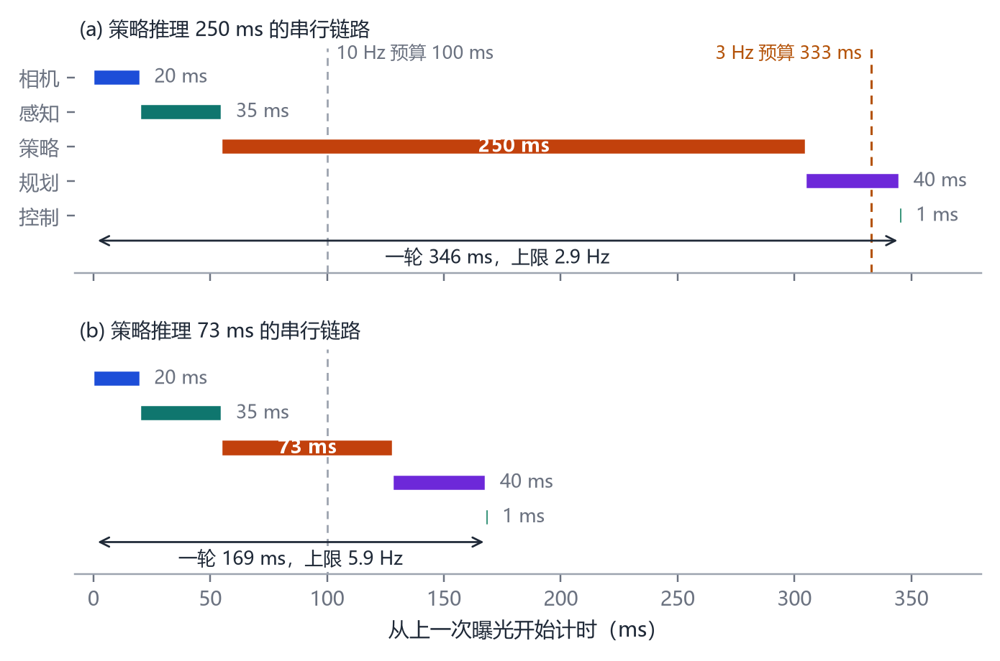
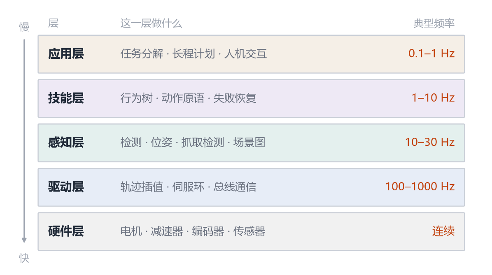
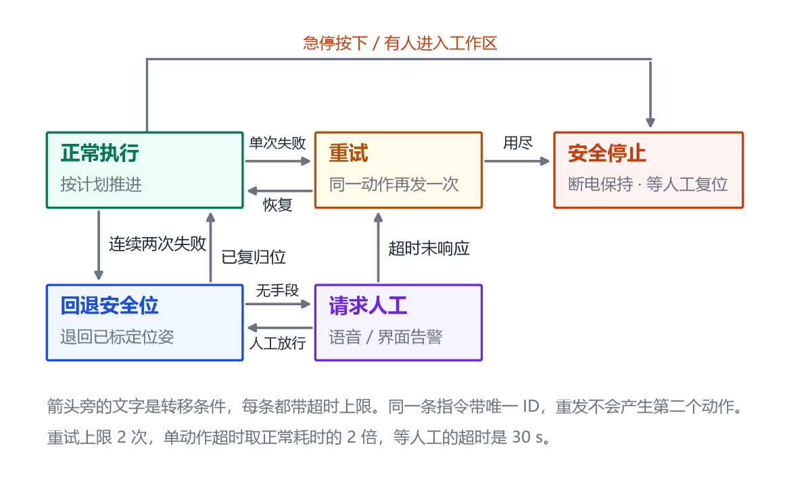

# 第 19 章　从演示到能跑的系统

> **本章导读**：一段能跑通一次抓取的脚本，离一台能连续工作八小时的机器，中间隔着软件栈、时延预算、失败恢复、算力部署、安全设计五道关。这一章讲这五道关各自卡在哪里，工程上又用什么办法把它们一关一关过掉。读完你能判断一段演示视频背后的系统成色，能估算一台机器人的反应速度上限，也能明白为什么“实验室里已经跑通”这句话几乎不构成承诺。

## 19.1 一个动作要穿过多少个进程

实验室里的抓取脚本通常长这样。读一帧图像，调用模型，把七个数字发给机械臂。两百行 Python，一个文件，跑起来就能抓。

搬到真机上，同一件事要穿过七八个进程、两三种语言、两块计算板、一条现场总线。相机驱动在一个进程里出图，检测模型在另一个进程里跑在 GPU 上，位姿估计可能又在第三块板子上，策略服务通过 HTTP 或 gRPC 拿请求，轨迹生成器把笛卡尔目标转成关节序列，伺服桥以 1 kHz 往总线写指令。任何一个环节卡住，机械臂就停在原地等，而世界不会等它。

把这些进程连起来的东西叫中间件。机器人领域用得最多的是 ROS 2（Robot Operating System 2），它本身不是操作系统，而是一套通信框架加一堆工具。它把一个系统拆成若干节点，节点之间用三种方式通信。理解这四样东西，就能读懂大部分机器人代码的组织方式。

**节点**是一个进程，只干一件事。相机节点、检测节点、规划节点、伺服节点，各管一段。这样切分的好处是某个模块崩了不影响别人，坏处是模块之间的每一句话都要序列化、走网络或共享内存。

**话题**是发布订阅，单向，多对多，发出去就不管谁收到了。它适合连续的数据流。相机以 30 Hz 往 `/camera/image` 上发图，关节状态以 100 到 1000 Hz 往 `/joint_states` 上发。发布者不知道有几个订阅者，也不需要知道。

**服务**是请求响应，一问一答，调用方会阻塞到对方返回。它适合有明确结果、耗时不长的操作，比如查询夹爪当前开度，或者让标定流程重新算一次外参。

**动作**是为长任务准备的。它比服务多三样东西，一个目标（goal）、一路中间反馈（feedback）、一个最终结果（result），并且可以被取消。抓取一个物体要两三秒，中间你想知道机械臂走到哪了，失败了你不想等到超时，这时就该用动作而不是服务。一个典型配置是目标发出后每 100 ms 回一次进度，3 s 没完成算超时，取消时机械臂减速停止而不是急停。

四种方式里最容易出错的是服务质量配置，也就是 QoS。它决定了消息丢了怎么办。可靠性有两档，`RELIABLE` 会重传直到送达，`BEST_EFFORT` 丢了就丢。听起来当然要可靠，但图像话题用 `RELIABLE` 会出大问题。网络抖一下丢了一帧，中间件开始重传，后面的帧在队列里排队，等你拿到那帧旧图时，机械臂已经走到了新位置。实践中的做法是传感器数据用 `BEST_EFFORT` 加队列深度 1，永远只取最新一帧，控制指令才用 `RELIABLE`，因为丢一条关节指令会让轨迹跳变。

数据量值得算一遍。640×480 的彩色图是 0.88 MB 一帧，30 Hz 就是 26 MB/s，折合 210 Mbps，已经吃掉千兆网的两成。深度图按 16 位算又是 0.6 MB。如果中间件在传递路上做三次序列化拷贝，接收端的 CPU 有一个核基本就交代了。ROS 2 里最常见的性能改造就是打开共享内存的零拷贝传输，让同一块板子上的进程直接传指针。

由此可以理解机器人中间件为什么难。它要同时承载 0.1 Hz 的任务指令和 1 kHz 的伺服回路，两者的实时性要求差四个数量级。Linux 默认调度不提供任何时延保证，1 kHz 的回路要求抖动控制在一百微秒以内，需要实时内核、绑核、锁内存一起上，而普通用户态的通信抖动常在几百微秒到几毫秒之间。服务发现靠多播，企业 Wi-Fi 往往屏蔽多播，两个节点互相看不见，排查半天才发现要手工配单播地址。跨设备的时间戳还要同步，两路传感器融合时必须知道这两帧到底差几毫秒，否则融合出来的位姿是错的。

这些问题在演示里都不会出现，它们在你连续跑三个小时之后出现。

## 19.2 时延预算决定你能跑多快

新手常以为控制频率是想定多高就定多高，定 10 Hz 机器人就灵活，定 3 Hz 就笨。真实约束来自链路总延迟。一次闭环要等五段耗时走完。

相机曝光加传输 10 到 30 ms。工业相机快一些，普通 USB 摄像头可能到 60 ms，卷帘快门还会让运动物体产生形变。感知 20 到 50 ms，检测、分割、位姿估计都算在里面。策略推理 100 到 300 ms，取决于模型多大。运动规划 10 到 100 ms，场景简单时几十毫秒，复杂场景要重试。控制 1 ms，也就是 1 kHz 的伺服周期。

把五段加起来，就是一轮的最短时间。

$$T = t_{\text{cam}} + t_{\text{perc}} + t_{\text{pol}} + t_{\text{plan}} + t_{\text{ctrl}}, \qquad f_{\max} = \frac{1}{T}$$

$T$ 是一轮的总时延，$f_{\max}$ 是这个链路能支撑的最高频率。这条式子说的是，只要有一环慢，整条链路都快不起来，而且各段的延迟是相加的，不是取最大值。

代入一组常见数字。相机 20 ms，感知 35 ms，策略 250 ms，规划 40 ms，控制 1 ms，合计 346 ms。3 Hz 对应 333 ms，差 13 ms，刚好卡在门槛外面。这就是很多系统"标称 3 Hz、实测 2.8 Hz"的来源。

更要命的是抖动。平均值 250 ms 的策略，尾巴上可能是 375 ms，一轮变成 471 ms，频率掉到 2.1 Hz。工程上看的是分位数而不是均值，p99 撑不住的频率，不能写进规格书。

反过来看已经跑起来的系统是怎么处理这件事的。RT-1（2022）把控制频率定在 3 Hz，理由是它测过人类完成同类指令需要 2 到 4 秒，机器只要不显著慢于人就够。为了让 3 Hz 成立，它给单次推理留的预算是 100 ms 以内，为此把模型压到 3500 万参数，并用 TokenLearner 把 81 个视觉 token 压成 8 个，两处优化分别带来 2.4 倍和 1.7 倍加速。RT-2（2023）的 550 亿参数版本只能跑到 1 到 3 Hz，50 亿参数版本约 5 Hz，前者只能放在云端的多 TPU 服务里。

π0（2024）给了另一组可核对的分项。在 RTX 4090 上，图像编码 14 ms，观测前向 32 ms，十步动作前向 27 ms，合计 73 ms，走网络再加 13 ms。它每 0.5 s 推理一次，中间 25 步由控制器以 50 Hz 执行。这就是"动作块"的思路，策略频率和执行频率解耦，慢的负责想，快的负责做。

<figure class="fig">

<figcaption><b>图 19-1</b>　一次控制循环的时延瀑布。上排策略耗时 250 ms 时一轮 346 ms，超出 3 Hz 的 333 ms 预算；下排换成 73 ms 的策略后一轮 169 ms。各段取常见量级。</figcaption>
</figure>

延迟的物理含义比数字更直观。传送带以 0.25 m/s 运行，346 ms 里物体移动 87 mm，而夹爪开度也就 80 mm 上下，容差不超过 ±20 mm，照着一帧旧图去抓必然抓空。人走路是 1.2 m/s，同样的延迟意味着位置差出 415 mm。所以延迟不是"手感问题"，它直接决定了系统能不能在动态场景里工作。三条出路摆在面前，降速、把延迟补偿进目标位姿、或者用动作块让执行段不依赖新推理。

延迟还能被部分抵消。既然系统知道自己在用多久以前的观测，就可以按末端速度把目标点往前推一格，$x_{\text{aim}} = x_{\text{obs}} + v\,\Delta t$。末端以 0.2 m/s 移动、延迟 346 ms，外推量是 69 mm，正好补掉大半偏差。代价是外推本身有误差，速度估计不准或者物体在加速时，补过头比不补更糟。工程上的折中是只补一半，让闭环的下一轮去纠正剩下的部分。

10 Hz 是另一道线。100 ms 的预算要装下曝光、感知和推理，目前只有小模型或者蒸馏过的模型做得到，几十亿参数的视觉-语言-动作模型（VLA）想都别想。所以高频操作（插孔、拧螺丝、手内转动）几乎都走专用小模型加高频视觉伺服，通用大模型负责决定"做什么"，不负责"怎么做准"。

<figure class="fig">

<figcaption><b>图 19-2</b>　软件栈五层与各自的典型频率。相邻层差一到两个数量级，跨层数据流靠队列与降采样衔接，频率为常见取值区间而非某一台机器的实测。</figcaption>
</figure>

图 19-2 把五层摆在一起，能看到一个容易被忽略的落差。应用层几秒钟才做一次决定，感知层 30 Hz，驱动层 1 kHz，三者差三个数量级。跨层传递时必须有缓冲，而缓冲区就是延迟的来源。队列积压到深度 5，感知层就在用 170 ms 前的图做判断。对策是只保留最新、按需降采样、用时间戳对齐而不是用到达顺序对齐。

把这几层的节奏分开看，一个结论就清楚了。决策延迟 100 到 300 ms 决定了系统多"迟钝"，执行平滑由 1 kHz 的伺服保证，两者不是一回事。流畅的视频演示和高频的控制回路可以同时存在，因为视频是 30 fps，控制是 1 kHz，中间隔着动作块。

## 19.3 失败了怎么办

真实系统的成功率从来不是 100%，工程上真正决定能不能上产线的是失败之后的那三秒。按后果可以把失败分成四类。抓空了，物体还在原地，重来一次就行。位姿估计丢了，得先退回一个已知构型再重新看。物体被挡在视野外，需要人挪一下。夹到人或者撞到墙，必须立刻停。

这四类对应四种处理，而"当前处于哪种处理"这件事必须有显式的记录，否则系统不知道自己走到哪一步了。这就是状态机存在的理由。大模型生成的任务计划通常只写"先拿杯子再倒水"，它没有"我现在正在第二次尝试拿杯子"这个概念，而这个概念恰恰是恢复逻辑的入口。

<figure class="fig">

<figcaption><b>图 19-3</b>　失败恢复状态机。五个状态与九条转移，箭头上的文字就是转移条件，安全停止只能由人工复位。</figcaption>
</figure>

图 19-3 是一个能用的最小版本。正常执行失败一次进重试，重试成功回来继续，重试用尽进安全停止。连续两次失败说明不是运气问题，退回标定位姿重新建立观测，能恢复就继续，找不到自动手段就叫人。人三十秒没响应，进安全停止。任何时刻按下急停或有人进入工作区，直接跳到安全停止。

写成代码时有两件事最容易漏。一件是幂等。抓取指令重发的后果不是"再抓一次"，而是夹爪二次闭合把已经抓到的物体挤飞。做法是给每条指令一个唯一 ID，执行端记住最近处理过的一百个 ID，重复到达的直接返回上次结果。另一件是超时。每个动作都要有上限，超时算失败，不算"再等等"。等待是最危险的状态，因为系统看起来在工作，实际上已经失去控制。

状态机之外还有一种组织方式叫行为树。它把逻辑写成树，序列节点要求所有子节点成功，选择节点只要一个子节点成功，并行节点同时跑，装饰节点给子节点加超时、重试、取反。相比状态机，行为树的转移不用穷举，加一个"抓取"子树就能被多处复用，改一处不影响别处。ROS 2 的导航栈 Nav2 就用行为树编排"规划、跟随、恢复"这一整套流程。代价是执行语义不如状态机直白，调试时要看树而不是看转移表。

举个具体的例子。机器人要抓桌上的杯子，第一次接近时夹爪合上却抓空，因为杯子被上一轮动作推歪了 3 cm。状态机记下"抓取失败一次"，退回抓取前 10 cm 的预抓取位姿，重新拍一帧，重新估位姿，第二次抓到了。整个过程多花 1.8 s，人几乎察觉不到。如果第二次还是空的，就不该再试第三次，因为连续两次同样的失败通常意味着假设错了（杯子其实是满的、被胶带粘住、或者深度相机在这个角度有盲区），这时退回安全位并请求人工，比继续消耗时间更合理。

恢复逻辑的收益可以算。单步成功率 95%，八步串联只剩 66%。如果每步失败后允许重试一次且重试成功率 80%，单步等效成功率变成 $0.95 + 0.05 \times 0.8 = 0.99$，八步串联回到 92%。这比把模型精度再提两个点容易得多。

还有一条路是换策略，也就是把失败的那个技能整体换掉。从上往下抓不稳，就改成从侧面斜着接近；自由路径规划老失败，就退回到预先示教好的直线轨迹。换策略比调参数粗，但它换掉的是假设本身，碰上“这类物体就是抓不住”的场合，比在同一个策略上重试到超时更有用。

但重试有物理代价。抓空之后原地重抓，物体可能已经被推走；插孔失败之后原地再插，可能把工件顶歪。所以重试之前要先回到可重复的初始条件，这正好是"回退安全位"的作用。回退位姿要提前标定好，并且保证从任何可达位姿都能安全到达，这两条在部署阶段就要验证，不能等出事再补。

## 19.4 把模型塞进机器里

端侧算力这两年涨得快。一块 Jetson AGX Orin 标称 275 TOPS 的 INT8 算力，功耗 15 到 60 W，已经能装进人形机器人的躯干。但标称值和可用值差得远，INT8 峰值要乘一个利用率，常见系统落在两三成，剩下的被内存带宽、算子不支持、调度开销吃掉。

真正卡脖子的往往是带宽而不是算力。一个 70 亿参数的模型做 INT8 量化后是 7 GB 权重，自回归解码时每生成一个 token 都要把全部权重读一遍。Orin 64GB 版本的内存带宽是 204.8 GB/s，除一下得到每秒最多读 29 次，理论上限就是 29 token/s。一个七维动作要 7 个 token，于是单次推理最快 4 Hz，还没算视觉编码器的开销。这也解释了为什么 OpenVLA（2024）这个 7B 模型在 RTX 4090 上只有 6 Hz，桌面卡的带宽是前者的五倍。

表 19-1 列了几个常见平台的规格。选型的经验是留一倍余量，标称能跑 6 Hz 的系统，实际工况下按 3 Hz 设计。

**表 19-1**　常见边缘推理平台的算力与功耗（厂商标称值，INT8）。

| 平台 | 算力 | 功耗 | 典型用途 |
|---|---|---|---|
| Jetson AGX Orin 64GB | 275 TOPS | 15–60 W | 人形或双臂整机的端侧推理，多路相机输入 |
| Jetson Orin NX 16GB | 100 TOPS | 10–25 W | 移动底盘加单臂，跑中小规模 VLA |
| Jetson Orin Nano 8GB | 40 TOPS（Super 模式 67 TOPS） | 7–25 W | 桌面级设备与教学机，跑小策略 |
| Hailo-8 | 26 TOPS | 约 2.5 W | 纯推理加速卡，需配宿主 CPU，做视觉前端 |
| 瑞芯微 RK3588 | 6 TOPS | 整板 5–10 W | 低成本底盘、视觉伺服、传感器汇聚 |

量化是最直接的手段，但它不是单调的。FP16 是默认的推理精度，每个参数占两字节，显存和带宽都按这个算，再往下压到 8 位才有明显收益。OpenVLA 的实测给出一个反直觉的结果：bfloat16 精度下成功率 71.3%，显存 16.8 GB；朴素 INT8 量化后掉到 58.1%，显存 10.2 GB；INT4 量化反而回到 71.9%，显存 7.0 GB。差别来自量化方案怎么处理激活值。权重量化、激活保持较高精度时损失很小，把视觉 token 也一起压到 8 位，动态范围不够，掉点就明显。结论是量化必须逐层验证，不能假设位数越低越差或者越高越好。

蒸馏走另一条路。让大模型在大量场景上生成动作，当作标签训练一个小模型，小模型学的是"大模型会怎么动"而不是"人怎么动"。RT-2 的 50 亿参数版本比 550 亿版本小十倍，频率从 1 到 3 Hz 提到 5 Hz，成功率只掉几个点。Octo（2024）证明不到一亿参数的多任务策略也能用。参数量不是唯一变量，输入分辨率和动作块长度同样影响速度。

云端推理是第三条路。好处是能用最大的模型，坏处是延迟和可用性都不由你控制。同城专线的往返在 10 到 50 ms，公网可能 100 ms 以上，排队时更糟。断网就是停机，而工厂和仓库的网络并不比办公室可靠。RT-2 的 550 亿版本就是这么部署的，用多 TPU 服务同时供多台机器人查询，代价是每次动作都要一次网络往返。较稳的做法是混合，云端以 0.2 到 1 Hz 的频率做慢思考，端侧以 3 到 20 Hz 做快反射，网断了系统降级但不瘫。

量化还有一个容易被忽略的前提，校准集。INT8 需要一批真实输入来统计每层的动态范围，这批数据必须和部署现场的图像分布一致。用实验室的白光桌面做校准，装到黄光灯下的车间，激活值分布偏了，精度掉得比预期多得多。稳妥的做法是从目标场景采几百张图，覆盖不同光照和物体，再去做校准。

输入分辨率是另一个杠杆。同一个模型把 224 的输入换成 320，算力开销涨一倍，延迟跟着涨，但小物体的抓取成功率明显改善。这个取舍没有通用答案，只能在目标场景上实测。

还有几个不上台面的约束。60 W 的模块塞进密封腔体，必须有主动风冷，风扇进灰之后会降频，夏天下午的算力比冬天早上低。7B 模型加视觉编码器加点云缓冲，16 GB 内存是底线，低于这个数就只能换小模型。从断电到能跑的启动时间常在 30 到 60 s，现场运维会因此抱怨，因为重启一次要等一分钟。

## 19.5 和人待在一起

工业和协作机器人的安全框架写在 ISO 10218 与 ISO/TS 15066 里，前者管机器人本体与集成，后者专门讲功率与力限制。这套框架给了四种人机协作方式，安全监控停止、手动引导、速度与分离监控、功率与力限制。名字听起来抽象，落到工程上都是具体的距离和牛顿。

速度与分离监控最常用。逻辑是，人在附近就减速，人太近就停。多近算太近，有一个可以算的保护距离。

$$S = v_h (t_r + t_b) + S_{\text{brake}} + S_{\text{margin}}$$

$v_h$ 是人的接近速度，标准里常用 1.6 m/s。$t_r$ 是系统反应时间，从传感器看到人到判断出要减速，0.1 s 是做得比较好的水平。$t_b$ 是减速指令走完通信、传进伺服的时间，取 0.1 s。$S_{\text{brake}}$ 是机器人自身的刹车距离，一台 1.5 m 臂展的协作臂在满载高速下大约 0.15 m。$S_{\text{margin}}$ 是余量，取 0.1 m 应付传感器误差。

代入这些数字得到 0.57 m。也就是说，人离机器人半米以内就必须减速，这个距离比多数人想象的大。用 2D 激光雷达做安全扫描时，扫描平面之外的东西（比如伸过来的手臂、掉下来的箱子）看不见，所以要加立体视觉或者安全地毯做补充。

举个现场的例子。一台协作臂在流水线旁上料，人在 3 m 外经过时保持全速，进入 1.5 m 降到三成速度，进入 0.6 m 完全停止。这三档要在调试时用测距仪实测标定，而不是照公式拍脑袋，因为传感器的安装角度决定了它实际看到的距离，图纸上的 1.5 m 和检测到的 1.5 m 常常不是一回事。

功率与力限制走另一条路，不去管距离，而是保证接触时的力不会伤人。ISO/TS 15066 的附录按身体部位给出了准静态接触力与压强的参考阈值，手指和手掌在百牛量级，腹部和颈部低得多。协作臂要在碰撞发生的十毫秒内把力矩卸掉，靠的是关节电流的突变检测，而不是外部传感器。这个时间常数决定了接触力的峰值，检测慢了，力就上去了。

冗余和看门狗是软件层面的保险。急停按钮走双通道常闭回路，一路断开就断电，不依赖任何软件。心跳每 10 ms 发一次，50 ms 收不到就让机械臂减速停。关节指令在下发前过一道独立的限制器，检查速度和位置是否越界，这道限制器不能和被控代码写在一起，否则一个 bug 会同时破坏两者。断电时抱闸锁住，通信中断时默认停而不是保持最后一条指令，这叫失效导向安全。

有一条原则值得单独说。安全层不能用学习模型。学习模型没有可证明的界，遇到分布外输入的行为不可预测，也没法通过认证。它可以在安全包络内决定"抓哪个杯子"，但不能决定"能不能继续动"。这两件事必须由两套代码、两种语言、甚至两块芯片分别负责。

## 19.6 成本、可靠性与标定漂移

可靠性有一个残酷的算术。系统由串联的部件组成，任何一个坏了整机就停。平均无故障时间（MTBF）在串联下是倒数相加。

$$\frac{1}{\text{MTBF}_{\text{sys}}} = \sum_i \frac{1}{\text{MTBF}_i}$$

十个部件各 10 万小时，整机就是 1 万小时，连续运行大约 14 个月停一次。这还没算软件崩溃、网络中断、操作失误。厂商给的 MTBF 通常是元件级、在实验室条件下的数字，装到现场往往要打对折。运维预算按"每月一次故障"准备，比按厂商数字准备要现实。

标定漂移是另一个慢性病。机械臂的重复定位精度 0.02 到 0.05 mm，指的是回到同一个点的一致性；绝对精度 0.5 到 1 mm，指的是到指定点的准确度，两者差一个数量级。手眼标定给出的外参误差 0.5 度，在 1 m 工作距离上就是 8.7 mm 的位置误差。温度变化十度、一次碰撞、换个相机支架、紧固件松动，都会让这个外参变掉。

对策不是"标一次管一辈子"，而是定期复标加在线校验。每次搬动设备后重标；每天开机时看一眼已知位置的标定板，偏差超过 2 mm 就报警；抓取失败率突然上升时，先怀疑标定再怀疑模型。现场经验是，超过一半的"模型退化"最后查出来是标定或者相机曝光的问题。

备件策略也影响总账。易损件按三个月的用量备货，包括夹爪指、吸盘、相机线缆；贵重件靠厂商响应，减速器和驱动器走 48 小时换件。停机损失大的产线会要求热备，一台备用机的价格换掉一年的停机风险，这笔账要在采购前算，而不是等第一次停线再算。

可维护性设计能压低这些成本，但要在设计阶段就做。夹爪做成快换接口，换指头三十秒完成；相机支架带定位销，拆装后不用重标；线缆走拖链而不是扎带绑死，换一根不用拆半台机器；控制柜留出可以盲插的航插。这些细节在样机上看起来多余，在客户现场决定了平均修复时间是一小时还是一天。

把这些摊开，一台机器人真正上线的隐性成本大致是这些。

- 现场调试，每个工位一到两周，包括标定、光照调整、异常场景录制
- 备件与停机损失，夹爪指、相机、线缆是消耗品
- 数据采集与标注，新场景要采几十到几百条示范，标注工时按条算
- 安全改造与认证，围栏、光幕、风险评估报告
- 运维培训与文档，现场人员要会复位、会换件、会看日志

这些成本加起来常常超过硬件本身，也解释了为什么"演示很惊艳、落地很缓慢"。第 20 章要处理的问题正好接在这里，一台能跑的系统，怎么证明它跑得对。
