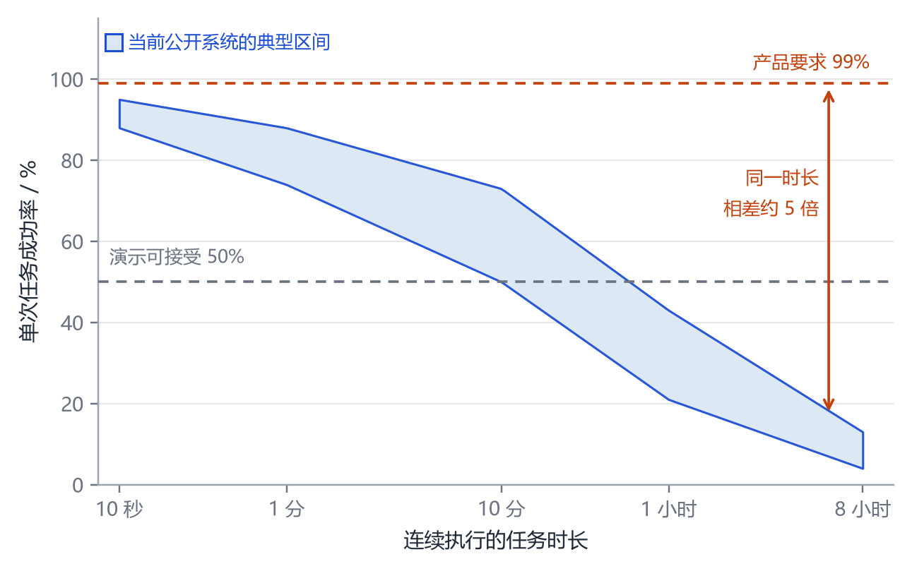
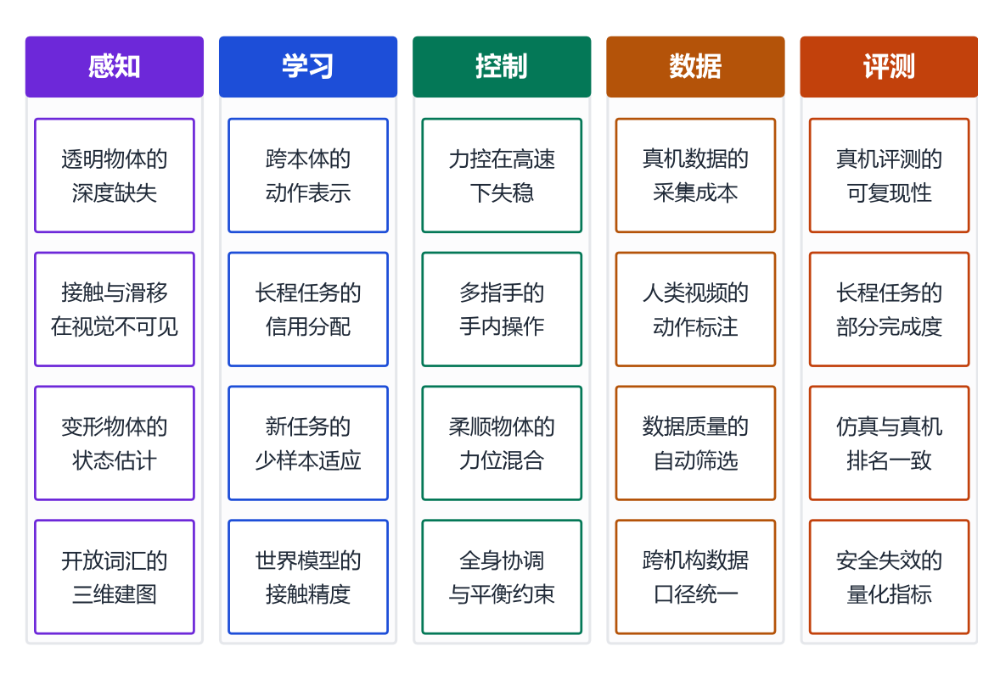

# 第 21 章　仍未解决的问题

> **本章导读**：前面二十章讲的大多是已经能做的事，这一章讲做不到的部分。数据能不能像语料那样堆出规模效应，换一个房间换一台机器还灵不灵，一小时的连续家务差在哪里，为什么视频里看得懂的物理手上做不出来，出了事故由谁负责，这一轮人形机器人的热闹里哪些是真的。读完这一章，你应该能对一条机器人演示视频做出自己的判断，而不是跟着标题走。

## 21.1 数据不是免费的

前面二十章每隔几页就会撞上一次"数据不够"。这一节把它拆开，看看到底缺多少、缺在哪一维。

语言模型的语料是互联网的副产品，网页本来就是给人看的。机器人的数据没有这个来源，一条可用的示范要求一个人、一台机器、一段真实时间同时在场，采完还要标定、对齐、筛掉失败的。

公开数据里最大的一份是 Open X-Embodiment，34 家实验室把 60 个数据集拼在一起，凑出 100 万条以上的真机轨迹，覆盖 22 种机器人本体、527 种技能、16 万个任务。这个数字在机器人圈算里程碑，放到语言模型尺度上不值一提。一个 7B 模型预训练要吃掉万亿级 token，100 万条轨迹按每条 10 秒、10 Hz 折算只有 1 亿个控制步，差四到五个数量级。这 1 亿步里绝大部分是"手在空中移动"这种低信息片段，真正决定成败的接触前后 0.3 秒占比不到百分之几。

问题不在多采一点，在多采哪一维。2024 年清华大学与上海期智研究院的一篇工作第一次把它做成了可测量的曲线。做法不复杂，用 UMI 手持夹爪让普通人在几十个真实环境里演示同一个任务，采 4 万条示范，在真机上跑 1.5 万次评测。变量只有三个，训练环境数 $M$、物体数 $N$、每个物体的示范数 $K$。衡量的不是成功率本身，而是"最优性差距" $1-S$，即距离满分还差多少。

结果有三条。泛化能力随环境数、物体数、环境与物体的配对数量呈幂律，拟合出的指数落在 0.47 到 0.84 之间，把多样性翻一倍，差距乘以 $2^{-\alpha}$，即乘 0.56 到 0.72，每翻一倍缩小三到四成。多样性的作用远大于数量，每个物体的示范数超过 50 条之后曲线基本走平，总量到 800 条就饱和，数据用 50% 和用 100% 的两条曲线直接重合。32 个环境各放一个物体、每个采 50 条，训出来的策略在没见过的环境配没见过的物体上能到 90%。四个采集员干一个下午，就够给一个新任务凑出这个量。

这三条结论容易被读成"机器人也有 scaling law 了"，边界比这个窄得多。实验测的是单任务、单一物体类别（水瓶、鼠标）、准静态、低力的抓放，任务之间不共享，换一个任务要从头采。指数是在 6 个数据点上拟合的两参数模型，没有留不可约误差项，外推到三十倍以外没有依据。作者自己算过一个外推，Mouse Arrangement 要做到 0.99，需要 1191 对。按每对 50 条、每条连摆放带复位 30 秒粗算，是 5.96 万条示范、500 小时人力，一个人做 60 个工作日，换来的只是一个任务在一个物体类别上的高可靠。本体也是固定的，换一台臂、换一个夹爪，整条曲线要重画。

机器人确实有数据定律，但它是一条多样性定律，不是规模定律。语言模型里同一批语料训几个 epoch 仍然涨点，机器人里把同一个场景的示范从 50 条加到 500 条几乎不动。这也解释了这几年为什么大家在做采集硬件，手持夹爪、低成本双臂、遥操作手套，而不是去买更多 GPU。

## 21.2 泛化的三级台阶

泛化在机器人语境里要拆成三级，每级失效机制不同，难度差得很远。

**新物体。** 同一类别里换一个实例，形状、颜色、材质、透明度都变。机制是视觉特征加抓取几何，模型要能把"这个圆柱可以拦腰夹住"从训练过的杯子迁移到没见过的保温杯。这一级已经量化过，物体泛化的幂律指数在 0.70 附近，属于投数据就能改善的一级。在 32 个物体的训练集下，同一类别的新物体能做到 90%，这就是上一节的实验结论。

**新场景。** 背景、光照、桌面高度、相机位姿、干扰物全变。难在策略会把场景里的偶然相关当成因果。相机装高一点，物体在图像里的位置整体下移，模型可能把"像素偏下"和"该伸手"绑在一起；训练集里桌布都是浅色的，换深色的分割就崩。论文里的对比很直接，同样数量下环境泛化的曲线比物体泛化更平，多加一个环境的收益小于多加一个物体。

**新本体。** 关节数、关节顺序、控制频率、相机安装位置、连杆长度、动力学参数全变。严格说这一级不是泛化，是翻译。同一个"把杯子拿起来"，在七轴臂上是七个关节角的序列，在双臂系统上是十四个，在人形上是手臂加腰加腿，动作空间的语义都对不上，谈不上迁移一个策略。

跨本体的现状可以概括成一句话，共享看和想，动作按本体特化。Open X-Embodiment 上训练出来的 RT-1-X 平均成功率比各机构自己的方法高 50%（相对提升），RT-2-X 比只在目标本体上训练的模型高约 3 倍。但同一张结果表里有个反例要记住，Bridge 数据集上原版 RT-1 是 40%，混进其他机器人数据的 RT-1-X 掉到 27%。数据混在一起不自动带来正迁移，本体之间的冲突是真实的。

工程上的折中是分层特化。π0 用同一个动作专家，但按本体把动作维度补齐或截断；GR00T N1 给不同本体接不同的输入输出适配层，中间共享视觉语言主干。完全没见过这台机器的 zero-shot 换本体，目前只在同一家族、同一夹爪、同一相机布置下成立，换夹爪宽度就要重采。

最实用的一类跨本体是人手到机器手。UMI 把夹爪装在人手上采集，人做一遍，夹爪记下末端位姿，再重定向到机器人。它绕开了遥操作硬件的成本和场地限制，代价是力反馈缺失、手腕姿态靠 SLAM 反推，纹理不足时约 10% 的示范失效。人类视频是更便宜的一端，但视频里没有动作标签，学到的只是"看起来像人"，不是"关节角对"。

三级台阶的难度差得很远，新物体是工程问题，新场景是数据问题，新本体是研究问题。

## 21.3 一小时的活

把任务换成"把厨房擦一遍"，问题的性质就变了。这不是一个任务，是几十个子任务，顺序还不固定。台面上的东西要先收进柜子，水池里的碗要先冲再放进洗碗机，垃圾桶满了要换袋。中间任何一步失败，都要先回答"现在做到哪了"。

先算一笔账。一小时按 10 Hz 跑，是 3.6 万个控制步。按每 10 秒一个子任务切，是 360 个子任务。若每个子任务独立成功率为 $p$，整条链的成功率是 $p^{n}$，$n$ 是子任务数。代入具体数字，$0.99^{100}=0.37$，$0.99^{360}=0.03$。单步 99% 的系统去做一小时家务，整条链成功的概率只有百分之三。

反过来推需求。一小时任务要做到 90% 的整体成功率，在 360 个子任务的假设下，单个子任务要 0.9997，因为 $0.9997^{360}\approx 0.90$。这等于把单步失败率压到万分之三，比现在公开系统的水平低一到两个数量级。长程任务真正的难点在这里，它不是更难的任务，是几百个简单任务的串联。

<figure class="fig">

<figcaption><b>图 21-1</b>　成功率随任务时长衰减，两条横线是演示与产品各自的隐含门槛。阴影区间按公开报告归纳，仅表示量级，为示意图。</figcaption>
</figure>

图 21-1 把这个差距摊在一张图上，横轴是任务时长，纵轴是单次成功率。阴影是当前公开系统大致落在的区间，随任务变长而下降。两条横线对应两类要求的隐含门槛，演示只要能成功几次就够剪视频，产品要求一个工位连续跑八小时不出错。两条线之间的距离不是靠调参能消掉的，它对应的是还要再采多少数据、再加多少层检查。

减少串联环节是最直接的办法。分层结构把一小时拆成三十个两分钟的子任务，高层决定做什么，低层负责做完，同样的单步可靠性下整体成功率能从 3% 抬到 70% 以上。π0.5（2025）用的就是这个结构，视觉语言模型输出子任务指令，动作专家执行，在训练时没见过的真实家庭里整理厨房和卧室，单个任务持续 10 到 15 分钟。这是公开演示里最长的时间尺度，距离一小时还差四到六倍，而难度不是线性增长的。

仿真侧给了另一把标尺。BEHAVIOR-1K 从一项 1461 人参与的问卷调查出发，定义了 1000 项日常活动，每项最少 6 个基本动作，多的要 16 个以上，串起来就是几分钟一条。现有基线在三个代表性活动上只到 40% 左右。

比串联更隐蔽的问题是记忆。擦厨房需要三类记忆，哪里擦过、抽屉关没关、上一次为什么失败。视觉观测是混叠的，机器人盯着垃圾桶看，画面里没有任何信息告诉它哪些地面已经清理过。BEHAVIOR-1K 的 CollectTrash 就是为暴露这个问题设计的，同一个策略加上三步历史观测之后成功率明显上升。现有做法有三种，把状态写成文本喂给大模型、把历史帧拼进输入、维护一张显式的场景图。文本最省事，代价是压缩时丢掉细节。

还有一件事被低估，自我纠错需要"检查"这个动作。人擦完一块台面会瞟一眼，机器人不会，除非策略里显式包含检查环节，而端到端策略的动作空间里通常没有"停下来看看"这个原语。

## 21.4 看得懂与做得对

"看得懂"和"做得对"是两件不同的事，混在一起谈会得出错误结论。前者是预测下一步会发生什么，被动、可观、可以用视频训练；后者是施加恰当的力让某件事发生，主动、闭环、带力和触觉。

用状态把这个区别写清楚。机器人面对的状态可以记成 $s=(q,\dot q,f_c,\theta)$，$q$ 是关节角，$f_c$ 是接触力，$\theta$ 是物体的内部状态，包括形变、液面高度、绳结拓扑。相机看到的是这个状态在图像平面上的投影，$q$ 大致能推出来，$f_c$ 和 $\theta$ 大部分看不见。视频模型学的是 $p(o_{t+1}\mid o_{\le t})$，操作需要的是 $p(a_t\mid o_{\le t},f_{\le t})$。输入都不一样，指望视频预训练直接给出操作能力，缺的正是中间那一层。

四类物理现象能把差距说得更具体。

**接触。** 抓一个 200 克的杯子，摩擦系数按 0.5 算，两个手指，最小夹持力是 $f\ge mg/(2\mu)=1.96$ 牛。低于 2 牛会滑，高于杯子能承受的力会瘪。窗口有多宽取决于物体本身，纸杯 5 牛就变形，金属罐扛得住上百牛，同一个"抓杯子"的动作，力窗口差二十倍。视觉分辨不出这个差别，画面上都是圆柱。人靠指尖触觉在几十毫秒内调完，机器人要靠力传感器或视触觉传感器，这类数据在公开数据集里比视觉少三个数量级。

**形变。** 布料、面团、海绵。一块布的构型要几千个顶点描述，动力学由材料本构决定，杨氏模量、泊松比、阻尼都测不准。视频预测在这里特别容易"看起来对"，布料流动缓慢，人眼对细节不敏感，生成的视频里布能铺平，真机上抓取点偏两厘米就抓不起来。

**液体。** 液面在杯里是自由表面，流量由倾角、粘度、杯口形状共同决定，倒到八分满停手要靠视觉判断液面加重量变化，两个信号都有延迟。BEHAVIOR-1K 的仿真器专门支持流体求解，因为刚体引擎算不了这个，而液体又是家务里绕不开的一项。

**绳索。** 一米长的绳子有上百个自接触点，拓扑随时会变，打结和缠绕是两种完全不同的状态。弯曲刚度极小，一点摩擦误差就改变结果。抓绳子和抓杯子在视觉上都是"伸手过去"，手感的差别是数量级的。

数据缺口在这里闭环了。互联网视频里没有力，人手用了多大力完全不可见。触觉数据要靠专门硬件采，成本高、标定麻烦、跨传感器不可比。所以"看得懂"可以靠海量视频预训练，"做得对"没有等价的替代品。

## 21.5 出事之后

软件出错可以回滚，机器人出错不能。打碎的杯子、夹伤的手指、撞翻的货架，物理世界没有撤销键。这个不对称决定了机器人的安全设计必须比软件严格得多，也决定了"先上线再修 bug"这套做法在物理系统上不成立。

风险按对象分三类。

**伤人。** 这一类的防线全部在策略之外。硬件限力（驱动器电流限幅）、速度与分离监控（人靠近就降速或停）、安全区域（雷达划出的减速区与停止区）、急停按钮与看门狗。功能安全标准按身体部位给出不同的允许接触力，面部最严，手部最宽，这些数字来自疼痛耐受的实验，不是工程约定。关键点是这些机制不能依赖学习出来的策略，策略可以错，限力不能失效。

**损坏物品与环境。** 碰倒花瓶、把锅烧干、误触燃气灶。这类风险要靠任务级评估，一个实用的做法是给动作做可逆性分级，推一下、挪一下是可逆的，倒热水、启动电器、松手让东西掉下去是不可逆的。不可逆动作要求人类确认，或者在动作前做一次额外的几何检查。

**隐私。** 家庭机器人的摄像头持续录像，视频回传用于训练，屋里的人不知情。这不是技术问题，是产品与法律问题，目前没有共识。

对齐这个词从语言模型搬过来要小心。语言模型的对齐靠人类偏好数据，几千个标注员对两个回答排序，成本可控。机器人要采"这个动作好不好"的偏好，代价是真实的物理执行，而且坏结果不能真让它发生，不能让机器人真去夹一次人手来学习"这很疼"。可行的替代是仿真里的代价模型加上真机上的否决记录，人在机器人即将做出危险动作时按下停止，这次否决成为负样本。样本量因此很小，一条负面样本的采集成本是正面样本的几十倍。

指令歧义是另一个层面。"把桌子清理干净"里，桌上的报纸算不算垃圾，昨天的快递盒要不要留。人能靠常识和上下文猜，机器人猜错的代价是扔掉了不该扔的东西。让机器人停下来问一句是正确做法，但每问一次都在降低可用性，产品上通常退回到保守默认（只归位不丢弃）加事后可追溯（记录每个物体被移到哪）。

责任归属是目前最没有技术解的部分。产品责任法以缺陷为核心，缺陷分设计缺陷、制造缺陷、警示不足三类。一个学习出来的策略出了事，归到哪一类都别扭。训练数据里没有这个场景，算不算设计缺陷？模型通过 OTA 更新之后行为变了，责任在更新前的版本还是更新后的？现实中的分配是四方共担，整机厂管设计与安全功能，集成商管现场风险评估，运营方管培训与流程，使用者管是否违规进入工作区。签字的是人，行为的概率由模型决定，这个错配短期内不会有干净的答案。

## 21.6 谁先买单

成本先看结构。一台人形机器人有 20 到 40 个自由度，一条七轴机械臂有 7 个。每个关节背后是一套无框电机、减速器、双编码器、驱动器，关节数量差 3 到 6 倍，成本自然也差这个量级。人形机器人的价格下降因此主要不靠算法，靠关节模组的国产化与批量。

公开定价给了几个参照。宇树 2024 年的 G1 报 9.9 万元人民币，2025 年的 R1 报到 3.99 万元；特斯拉对 Optimus 的口径是量产目标 2 万美元级，这个数字到今天还没有对应的量产产品。价格下降的斜率可以参照制造业的学习曲线，累计产量每翻一倍，单位成本降 15% 到 20%，光伏组件和锂电池都落在这个区间。

先工厂后家庭，背后是三条能算清的账。

环境结构化。工位固定、来料姿态受控、光照稳定，21.2 里的三级泛化直接被砍掉两级，剩下新物体一级，而工厂的来料批次本来就单一。

利用率。两班制工厂一年可用 4000 小时以上，家庭一天用两小时。同样的折旧摊到十倍的工时上，单小时成本差一个量级。

判据清楚。一个工位一年的人工成本按 15 万元算，机器人 20 万元按三年折旧是 6.7 万元，加 2 万元运维，一年摊 8.7 万元；节拍只有人的 0.7 倍，一台机器顶 0.7 个人，一年省 10.5 万元，两年半回本。家庭里没有这个算式，家务没有计价，用户拿"一台车的钱"做比较。

泡沫信号有四条，都可以查。演示视频与交付台数，视频能剪，台数要发票。通用的宣称与工位数，真正部署的机器人通常只在一个工位做一件事。订单公告与验收付款，框架协议和预付款差得很远。融资额与收入，这个比值在人形赛道高得离谱。

按这四条看 2026 年，真实进展在工厂和物流的固定工位，上下料、拣选、质检、搬运，共同点是环境受控、任务单一、有人兜底。家庭场景仍然是演示多于产品，卡在三件事上，安全没有标准答案，价格超过一台车，可靠性撑不住每天几百次的使用。人形这个形态在家庭里有天然优势，房子和工具都是按人的尺寸造的，但形态优势不等于产品成立。

成本还有另一面，维护。一台机器人一年标定几次、换几次易损件、无故障时间多长，决定总拥有成本，数据却极少公开。工业机器人的平均无故障时间在几万小时量级，人形没有可比数据，这恰恰是采购方最关心却最难拿到的信息。

## 21.7 三条路

前面六节的问题看着分散，按技术栈摞起来大致五块，图 21-2 把它们摆在一起。

<figure class="fig">

<figcaption><b>图 21-2</b>　研究前沿按五个技术分区摊开，每区四个具体问题。分区之间没有先后，大量问题互相牵连，边界只是便于定位。</figcaption>
</figure>

图 21-2 的作用是定位，你卡住的问题大概率能在某一格认出自己，格子之间的边界本来就是模糊的。

**表 21-1**　当前开放问题清单。

| 问题 | 现状 | 难点 | 可能方向 |
|---|---|---|---|
| 数据规模 | 公开轨迹 100 万条、22 种本体 | 采集占人、占机、占场地 | 手持夹爪、人类视频、仿真增广 |
| 跨本体迁移 | 视觉语言先验可共享 | 动作空间、频率、相机位置全不同 | 统一动作表示、本体条件化、重定向 |
| 长程任务 | 公开演示 10 到 15 分钟 | 误差串联、状态记忆、失败恢复 | 分层策略、显式记忆、子任务自检 |
| 接触与形变 | 准静态抓取可用 | 视觉看不到力，触觉数据少 | 触觉预训练、可微接触模型 |
| 评测 | 仿真基准成熟 | 硬件与场景不统一，样本少 | 分布式真机评测、统一采集硬件 |
| 安全与责任 | 硬件限力成熟 | 学习策略的行为无法事前证明 | 运行时监控、可逆性约束 |
| 商业化 | 工厂固定工位有真实部署 | 家庭的安全、价格、可靠性 | 先专用后通用、按工位计价 |

真正的门槛在"难点"那一列。跨本体就是例子，任何一家公司都能声称模型支持多本体，代价往往是给每个本体单独训一个适配层，那不叫迁移，叫并行维护。能上手的位置有三个。

**做模型。** 顺序是先复现，再改结构，大模型排在末位。第一步用公开代码在公开数据上把两千万参数级的策略跑到论文水平，弄清动作块长度、观测历史长度、控制频率这三个超参为什么这么定，定错了后面所有对比都不可信。第二步动动作头，把离散 token、扩散、flow matching 三种做法放在同一份数据上比收敛速度和推理延迟。第三步才是微调视觉语言动作模型。

可复现的项目有三个。用 LeRobot 配一套 SO-101 低成本臂，采 50 条示范，复现 ACT 的抓放；在 LIBERO 上微调 OpenVLA，跑通官方评测脚本，看它在几个任务套件上的差距；把 π0 的 flow matching 动作头用两百行代码重写一遍，你会立刻明白它为什么比直接回归动作稳。走对的信号是，你能说清模型在哪类样本上失败，并能用一次消融证明这个判断。

**做数据与评测。** 顺序是先评测、再统计、后采集。评测先行，因为不会评测的人采出来的数据一定有问题。在 SimplerEnv、RoboCasa、LIBERO 上各跑通一个基线，学会把成功判据写成可执行检查。统计这一步最容易被跳过，20 次试验的成功率标准误最大约 11 个百分点，这个数字意味着论文里 5 个百分点的领先很可能什么都不是，学会这一点，读论文的方式会变。采集摆在末位，用 UMI 手持夹爪，注意 SLAM 过滤（纹理不足的环境会丢一成左右），注意每条示范的初始条件要有变化，否则采的是一份数据的一百个副本。

可复现的项目有两个。复现 32 个场景配 50 条示范的曲线，哪怕只做 8、16、32 三个点；设计一份自己的评测协议，把部分完成度和人工干预次数记进去。走对的信号是，你能指出一篇论文的评测里哪一条让它显得比实际好。

**做系统与硬件。** 顺序是一个关节、一条臂、一台整机。先做一个关节的力矩闭环，电机、编码器、电流环，1 kHz 跑稳，把 PID 调稳。再做一条臂的手眼标定和端到端时延测量，这两个数决定了系统能跑多快。再做整机的安全，限力、看门狗、急停、失效导向安全。整机集成排在末位。

可复现的项目有三个。用 ros2_control 驱动一条六轴臂，测出从相机曝光到力矩生效的延迟；给低成本臂加力矩限制和碰撞检测，故意用手挡一下，看它多快停；把一次完整抓放拆成时间预算表，和第 19 章那张甘特图对一遍。走对的信号是，你能在三秒内判断一次失败是感知、决策、控制还是机械的问题。

三条路有一个共同点，都要碰真机。这一行的判断力没法只从论文里获得，论文里的数字都建立在一套没写出来的现场条件上，相机的安装角度、桌面高度、操作员习惯、重试策略。

如果只能留一条建议，是先把一件事做到 99%，再去做十件事做到 90%。现在的具身智能不缺能演示的能力，缺的是能重复的能力，而重复恰恰是产品唯一认的东西。
