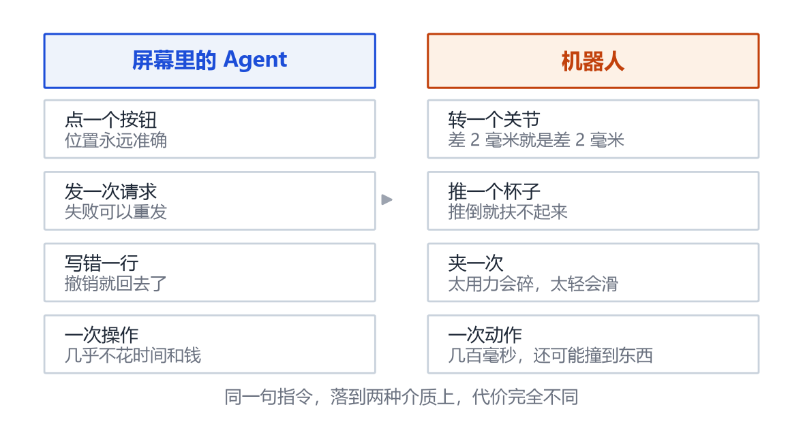
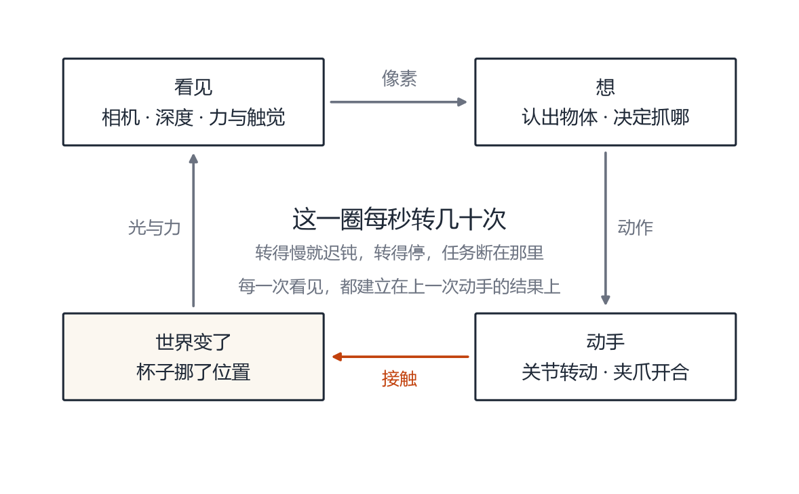

# 第 1 章　拧不开的瓶盖

> **本章导读**：语言模型能写诗、能改代码、能陪你聊一下午，却拧不开一瓶矿泉水。这一章从这个反差讲起，说清楚"有身体"到底改变了什么，机器人与聊天机器人、自动化脚本、自动驾驶之间是什么关系，以及一个动作从"看见"到"碰到"要经过哪几步。读完这一章，你会知道后面十七章各自在补哪一块。

## 1.1 会写诗的模型，拧不开的瓶盖

这一节要回答一个问题。一个能读几万字文档、能写代码、能陪你聊一下午的模型，为什么在厨房里连一瓶水都拧不开。答案不在模型的大小，而在它处理的东西和你手边的东西不是同一类。

2023 年以后，几乎所有人都试过这样的场景。把一份几十页的文档丢给模型，几十秒后拿到一份条理清楚的摘要，外加几行能直接运行的代码。它读得懂表格，能改语法错误，还能解释自己为什么这么改。你要是追问一句"第三段那个结论有什么前提"，它会顺着上下文列出三条，还把不确定的地方单独标出来。

同年，如果你想买一台能拧开矿泉水瓶盖的机器人，会发现选择很少，价格不低，而且说明书上一定会写"请在固定工位、固定姿态下使用"。换一个牌子的瓶子、换一种摆放角度，成功率就会掉。它不知道瓶盖有多紧，不知道该用多大力，拧滑了也不知道是继续拧还是松手重来。

拧一个盖到底难在哪，可以算一笔账。标准矿泉水瓶盖的直径大约 30 毫米，出厂时拧紧的扭矩在 1 到 2 牛·米之间。这个扭矩作用在半径 15 毫米的盖沿上，等于要在盖子边缘持续使上 70 到 140 牛的切向力，差不多是一桶 7 到 14 公斤的水压在手心的分量。

人的手指能做成这件事，靠的是三件东西配合。指腹随着瓶盖的齿纹压出形状，接触面积大，摩擦力够。皮肤里的感受器能察觉"快滑了"的那一下，提前加力。手腕还能一边拧一边调整。换成两片硬塑料的平行夹爪，接触只剩两条窄线，力一大就打滑，力一小就转不动。

打滑之后发生什么，才是真正的麻烦。夹爪一带，瓶身跟着转，重心偏出底座，瓶子倒在桌面上，水流进桌缝。这件事没有"重来一次"的按钮，得有人先把桌子擦干、把瓶子扶正，再重新开始。一次失败牵出的清理工作，比失败本身长得多。

计算机做人类觉得难的事很容易，做小孩都会的事却极难，这个现象在机器人领域有个名字，叫莫拉维克悖论。名字听着吓人，说的其实是一个排序上的反转。对人越难的事，机器往往越容易；对人越容易的事，机器往往越难。提出它的年代还没有深度学习，但解释放到今天依然成立。

下棋、证明定理、写文章，这些事处理的是符号。符号可以复制、可以回退、可以慢慢想。一盘棋想三个小时也没人催你，走错一步还能悔棋重摆。机器在这些事上超过人，是因为它一秒能试几百万种走法，而且从不出手抖。

看、走、抓、听，处理的是物理世界。物理世界不能复制，改了就改不回来，而且必须在几十毫秒内给出反应。你伸手接住一个从桌沿滑落的杯子，从眼睛看到杯子开始下落，到手指合拢，中间大约 100 毫秒。这 100 毫秒里没有"想一想"的余地，全靠身体提前算好。

三岁小孩系鞋带、把钥匙插进锁孔、端一碗汤走过客厅不洒，这些动作大人从不觉得难。让机器人做，每一件都要单独攻关好几年。叠一件 T 恤，机器到现在还做不利索，因为布料的形状每一步都在变。

语言模型的训练数据是人类写下的文字，文字已经把世界压缩过一遍。一段文字里的"杯子"就是三个字，不重、不滑、不会碎。语料里有几百万句提到杯子的话。没有一句告诉你这只杯子此刻离桌沿 3 厘米，杯壁上凝着一层水膜，杯底还压着桌布的一角。

机器人面对的恰恰是被文字丢掉的那部分。这个杯子有多重，杯壁多滑，桌沿到杯子有多远，夹爪该从哪个角度靠近，靠近时会不会把桌布带起来。这些东西没法从语料里读出来，只能靠身体去碰。

所以具身智能要解决的问题，不是"再训练一个更大的模型"，而是"让模型的判断落到物理世界之后还站得住"。这两件事之间的距离，比大多数人想的要远。

这段距离可以拆成三段。看见的东西带噪声，反光的瓶身测不出深度；想出来的结论带偏差，同一个杯子的位置每次估计都不一样；动手的动作带代价，力大一分瓶子倒，力小一分盖子滑。三件事还要在每秒几十个来回里同时成立。

## 1.2 身体带来的三个变化

"具身"这个词听着抽象，换成一句话就是"有一个身体"。身体带来的变化可以分三层，一层比一层深。这一节把这三层说清楚，你就会明白为什么"给模型加个接口"这条路走不通。

**第一层，动作有代价。** 屏幕上的操作几乎零成本。点错一个按钮，撤销；发错一次请求，重发；把一段代码删了，版本控制里还能找回来。机器人的动作不是这样。转动一个关节，差 2 毫米就是差 2 毫米，没有"稍微差一点"这回事；推倒一个杯子，它不会自己站起来；夹一次，太用力会碎，太轻会滑，中间的可接受区间只有几十牛。图 1-1 把这两种情况摆在一起，左边每一行都可以反悔，右边每一行都不行。

<figure class="fig">

<figcaption><b>图 1-1</b>　同样一句"把杯子拿起来"，落在屏幕上和落在桌面上，代价完全不同。左边可以撤销、可以重试，右边一次做错就是一次真实的损失。</figcaption>
</figure>

同一次夹取，力的窗口有多窄，可以再算一笔账。一个空纸杯大约 10 克，捏扁它需要 5 牛左右的力；一个装满水的玻璃杯接近 500 克，要提起来至少需要 5 牛，还得留出加速时的余量。也就是说，夹爪的力必须落在 5 到 30 牛这个区间里，低于下限会滑，高于上限会把纸杯捏扁。人做这件事从不计算，靠的是指尖上那些感受器一点点试出来。机器没有这套感受器，就得靠力传感器、靠电流反馈、靠反复标定。

**第二层，动作改变观测。** 相机不是"看一眼世界"，而是"站在某个位置、用某个角度看一眼世界"，看到什么取决于机器刚才做了什么。伸手去够杯子，手会挡住视线；身体前倾，原本被桌沿挡住的杯底露出来了；抓空一次，杯子被碰歪了，下一次看到的画面已经和上一次不一样。这种"动作改变观测、观测修正动作"的循环，纯文本模型一辈子遇不到。

这一层有个直接后果。机器训练时见过的都是"杯子好好摆在桌上"的画面，一旦它自己把杯子碰歪，接下来的画面就落到了训练集之外，输出没有保证。人会停下来重新打量，机器会照着最近的模式硬做下去。

**第三层，身体决定问题长什么样。** 固定在工作台上的机械臂，底座不动，世界坐标系可以认为永远不变，标定一次能用几个月。装在移动底盘上的机械臂，每走一步底座都在动，定位误差直接带进抓取。人形机器人更难，它的支撑面在两只脚之间来回切换，站稳本身就是一件要持续花力气的事。同一句"把杯子拿起来"，在三种身体上是三套不同的技术。

家居环境里到处是按人的身材定的尺寸，人一抬脚就过去的地方，机器要专门对付。门槛高 2 厘米，扫地机器人的轮子直径 6 厘米，理论上过得去，实际常常卡住。它身上的碰撞传感器只报告"前面有东西"，分不清那是墙、是拖鞋、还是一道能越过的坎。它可能在那儿原地打转十分钟，最后卡在门框边上等你去救。

形态的差别可以具体到厘米。住宅门把手离地 90 到 100 厘米，台阶高 15 到 18 厘米，厨房台面 85 厘米，这些都是按人的身高和步幅定的。一台按这个尺寸做的机器人，可以直接用现成的门、现成的楼梯、现成的工具；换成轮式底盘，就得给每道门槛装坡道。反过来说，场景若是为机器设计的，比如仓储货架、分拣线，专用设备永远比人形更便宜也更快。人形不是目的，只是在"人的环境里干人的活"这个前提下，省掉了改造环境的钱。

还有一件常被忽略的事，叫符号接地，说的是词和物之间那根线怎么系上。模型在语料里学到"杯子"这个词和一堆上下文一起出现，但它没端过杯子，不知道空杯子和满杯子的手感差别。它知道"易碎"常和"陶瓷"一起出现，却不知道易碎意味着什么后果。这根线得靠身体系上，这也是纯文本模型回答物理常识问题时经常一动手就翻车的原因。

三层变化叠在一起，指向同一个结论。身体不是给模型加的外设，它改变了问题的形状、误差的来源和判断的标准。下一节把这条线往外画一点。

## 1.3 四条容易混的边界

具身智能这个词现在用得比较宽，宽到有时看不出它和别的领域差在哪。先把四条边界画清楚，后面的讨论才有落点。每一条边界都配一个具体场合。

**与传统机器人学。** 工厂里的焊接机器人可以十年如一日地重复同一个动作，位置误差不超过零点几毫米，靠的是建模、标定、规划、控制这一套成熟方法。具身智能不是要推翻它，而是要在"物体不固定、位置不固定、任务不固定"的场合补上传统方法不好处理的部分，比如这是什么东西、该从哪下爪、失败了怎么办。

一个自然的疑问是，工厂里的焊接机器人那么准，为什么不算具身智能。原因是它的世界被改造过了。工件固定在夹具上，位置误差不超过 0.1 毫米，焊接路径提前示教好，光线、温度、来料都在控制之内。这样的系统不需要理解世界，它只需要把验证过的动作重复一千万次。具身智能面对的是相反的情形，物体位置随机、形状不统一、光照每天不一样，系统必须每次重新判断。难度差别不在硬件精度，而在不确定性。

把同一套程序搬到一个"工件随便放"的工位，第一个工件就会出问题。工件偏了 3 厘米，焊枪照着原路径过去，焊在空气上，顺手把夹具烫出一个坑。要让它适应，就得加视觉、加搜索、加失败恢复。精度可以买，应变买不到。

**与强化学习。** 强化学习是让智能体在试错中学习决策的一类方法，可以用在游戏、推荐系统，也可以用在机器人。机器人只是它的一个应用场景，而且是样本成本最高的那种，因为每一次试错都要占用真实的时间和设备。所以讲强化学习时，总要连着讲仿真，那是让这条路在工程上可行的前提。

成本差多少，可以粗算一笔。在仿真里跑一次抓取，一秒能跑几百次，攒够十万次样本只要几个小时的电费和一点显卡时间。在真机上跑一次抓取，取放、复位、检查，平均 5 秒，十万次要 139 个小时，也就是连续不停跑将近六天。

更麻烦的是奖励。仿真里可以精确知道物体被抬起了几厘米，真机上这个数字要靠视觉估，估错了奖励就错了。奖励一错，学出来的策略会绕开真正的要求，去刷那个被估错的指标。这类行为在文献里有个名字，叫奖励黑客，它比样本贵更难对付。

**与屏幕上的 Agent。** 一个在电脑上干活的 Agent，动作空间是离散的、可撤销的、几乎零成本的。机器人 Agent 的动作空间是连续的、不可撤销的、有物理代价的。这个差别决定了机器人系统必须在动手前多检查几遍，动手时保持高频反馈，动完手再确认一次结果。

举个例子。屏幕上的 Agent 要填一张表，点错了下拉框，重新点开再选一次，损失 2 秒。机器人要把一支笔插进笔筒，第一次插偏 1 厘米，笔尖撞在筒壁上，笔弹到桌下。它没有撤销键，只能先去捡，而捡的动作本身又会失败。一次小失误会衍生出一串新任务，这些新任务在原始指令里根本没写。

所以机器人系统的检查密度比屏幕 Agent 高一个量级，每一步之内都要检查几十次。这个区别决定了很多工程取舍，比如能不能省掉力传感器。

**与自动驾驶。** 自动驾驶是具身智能里最成熟的一条分支，同样有感知、预测、规划、控制。但它的动作被简化成了转向、油门、刹车三个量，环境被结构化成了车道和交通规则，还有海量行驶数据可用。机械臂面对的是一张完全非结构化的桌面，物体千奇百怪，所以更难，也更依赖通用模型。

数据量差得很远。一辆测试车一年跑 2 万公里，按每秒 10 帧存图，一年就是几亿帧。一台桌面机械臂一天跑 8 小时，每次抓取 5 秒，一天不到 6000 次，一年不到 200 万次，还得人工复位。前者的数据能靠车队规模摊薄，后者只能一台一台攒。

动作的自由度也差得远。车在路上的决策能压成"快一点、慢一点、往左一点"，机械臂要把"拧开瓶盖"变成手腕转 720 度、指尖施加 20 牛的力、瓶身不许跟着转，三个量还得在同一条轨迹上同时满足。

四条边界画完，可以给一个工作定义。具身智能研究的是这样一类系统，它通过身体与物理世界交互，在交互中获取信息、做出决策、完成任务，并且能从交互中变得更好。定义里三个动词对应三条主线。

看见是获取信息，行动是改变世界，学习是从改变的结果里提炼经验。三条串成一条链，任何一环变差，产出都会跟着变差。

## 1.4 为什么这几年才动起来

这一节回答一个问题。抓取研究做了三十多年，为什么偏偏是这几年才开始热闹。答案不是某个算法突然突破了，而是三样东西同时便宜下来，少一样都不会有今天的热闹。

**看得见的传感器便宜了。** 十年前一台结构光深度相机要几万元人民币，只有大实验室买得起；现在消费级的深度模组几百元就能买到，分辨率、帧率、有效距离都够用。相机便宜，才谈得上在几十个工位上同时采数据。

价格差多少，可以给一个参照。2014 年前后，一台 640×480 的深度相机报价 3 万元上下，一台桌面机械臂 15 万元，一个实验室配两套就掏空了当年的设备费。现在同样的深度模组 500 元以内，精度还更高，手机背面就装着一颗。

便宜的代价在鲁棒性。太阳底下，红外光被日光淹没，深度图会大面积空洞；透明的玻璃杯、黑色的绒布，同样测不出深度。几百元的模组让"多装几台"变成可能，没让"看得准"变免费。

**算力够跑大模型了。** 一个 70 亿参数的视觉语言模型，在消费级显卡上就能推理，速度虽然不快，但足以支撑每秒几次的决策。而在 2015 年，同样规模的网络连训练都困难。

具体到数字，一张 24 GB 显存的消费级显卡跑 70 亿参数的模型，一次前向大约 50 到 100 毫秒，量化之后还能再快一倍。
卡点在功耗。机器人身上通常只有一块 60 瓦左右的电池组供计算单元使用，桌面级显卡一开就是 300 瓦，续航立刻掉一半。所以真机上常见的是边缘芯片，算力只有显卡的五分之一，模型还得剪枝和量化，精度要掉几个点。

**基础模型把"认得东西"这件事解决了。** 以前每换一类物体就要重新训练检测器，现在给 CLIP 或 SAM 一句话、一个点，就能把没见过的杯子分出来。机器人领域缺的从来不是"看见"，而是"看见之后怎么办"，基础模型把前半段的门槛降到了几乎为零。

门槛降了多少，可以对比。2016 年做一个"识别马克杯"的检测器，要标 5000 张图，训练一整晚，换一个牌子的杯子准确率掉 20 个点。现在用 SAM 在杯身上点一下，掩码直接出来，零样本，换什么杯子都行。

它给出的是"这块像素属于一个物体"，不是"这里能抓"。透明杯子的掩码边界会飘到背景上，叠在一起的三个杯子会被连成一片。所以后面还得接一个专门判断"从哪下爪"的模块，这一段基础模型帮不上忙。

三件事合起来，行业的重心从"怎么让机器看见"移到了"怎么让机器做得对"。这也是为什么最近几年的论文，题目里越来越多地出现动作、策略、操作这些词，而不再是检测、分割、位姿。

不过要提醒一句，便宜下来的只是前半段。真机数据依然要一条一条采，一次失败的抓取依然要人去看、去复位、去重录。硬件成本降了一个数量级，人力成本几乎没降。这个不对称，是后面很多工程选择的根因。

一条真机示范数据的综合成本，算上设备折旧、人工、场地，大约 2 到 5 元。想攒十万条，就是几十万元和几个月的工期。仿真能把单条成本压到几分钱，搬回真机又要掉点。

## 1.5 一次看见与一次动手之间

把上面这些收拢到一张图上，就是图 1-2。

<figure class="fig">

<figcaption><b>图 1-2</b>　感知与行动的闭环。看见、想、动手、世界被改变，四个环节首尾相接，每秒转几十次，每一次看见都建立在上一次动手的结果上。</figcaption>
</figure>

四个环节各有各的麻烦。这一节把四个环节一个个拆开，看每一环在哪里坏、坏了长什么样。

**看见**要把光变成数字。相机曝光需要时间，图像传回来需要时间，深度相机还要多算一步。这一环的麻烦是噪声和缺失。反光的杯壁测不出深度，不锈钢水壶、封了塑封的盒子、装了半杯水的玻璃杯都这样，红外光打上去一半被镜面反射走，一半穿过去，返回来的点寥寥无几。背光的物体在图像里是一团黑。

时间可以拆开看。曝光 8 毫秒，传输 5 毫秒，去噪和深度计算 20 毫秒，一次完整的"看见"至少 33 毫秒，也就是 30 帧每秒。曝光减半画面变暗，噪声上来，深度反而不稳。

**想**要把数字变成判断。哪块像素是杯子，杯子在三维空间的哪个位置，从哪个方向下爪不会被杯沿挡住。这一环的麻烦是不确定性，同一张图，模型的判断可能每次略有不同。

判断其实是一串小决定，分出物体、估出位姿、找一块能下爪的区域、算一条不撞桌面的接近路径，每一步的小误差都会累加到下一步。

不确定性最直观的表现是抖。同一张静止的图连送十次，模型给出的抓取角度可能落在正负 5 度之内。夹爪张开只有 8 厘米，5 度偏到指尖就是 3 毫米。放在薄壁杯子上，3 毫米够把杯子推翻。

**动手**要把判断变成关节角。机械臂从当前位置移动到抓取位置，中间不能碰到别的东西，接近物体时还要减速，因为撞上去的力与速度的平方成正比。

平方两个字很关键。速度从 5 厘米每秒提到 10 厘米每秒，动能变成四倍，撞上去的冲击也接近四倍。所以最后 2 厘米通常要降到 2 厘米每秒以下，用时间换安全。

这一段最常见的坏法是"到位了但姿态不对"。位置差 2 毫米，夹爪还夹得住；姿态差 10 度，两片指就有一片压在杯沿上，另一片悬空，一合拢杯子被顶出去。

**世界被改变**之后，一切重来。夹爪合上，杯子被提起或者滑落，画面变了，下一次看见的是新的局面。输入不再是别人给的图片，而是自己上一次动作造成的后果。

举个具体例子，看误差是怎么滚起来的。假设机械臂要去抓一个杯子，第一次因为标定偏了 3 毫米，夹爪擦着杯壁滑过去，杯子被碰得转了 15 度。第二次看见的画面里，杯子已经没有把手朝向相机，抓取检测给出的下爪方向随之改变，夹爪又偏了一点。第三次也许抓住了，但重心偏在一侧，抬起来时杯子倾斜，水洒了出来。整个过程里没有任何一步"错得离谱"，错的是每一步都建立在上一步的偏差上。

这个循环有个硬指标，转速。控制环每秒转几百到上千次，视觉环每秒十几到几十次，策略环每秒几次到十几次。三档速度差了三个数量级，系统集成时最麻烦的事就是让它们对齐。循环还有另一个硬指标，误差会不会越滚越大。位置偏 2 毫米，下一次观测就建立在这 2 毫米的偏差上，再下一次可能偏 5 毫米，直到某一刻彻底失败。所以书里会反复出现"闭环校正""反馈""在线适应"这些词，它们都是为了把这个雪球按住。

闭环这个词后面会反复出现，先给一句人话。闭环就是干完看一眼，根据看到的结果改下一步；开环就是不看不改，照着事先写好的剧本走。洗衣机的定时程序是开环；你伸手试水温是闭环，手觉得烫就往回调。

### 三档频率为什么要对齐

三档各管什么，并排看最清楚。

**表 1-1**　三个环路的速度、时间预算与跟不上的后果。

| 环路 | 每秒转几次 | 一次能用多久 | 跟不上会怎样 |
|---|---|---|---|
| 控制环 | 500 到 1000 | 1 到 2 毫秒 | 关节发抖，末端轨迹起毛刺 |
| 视觉环 | 15 到 30 | 33 到 66 毫秒 | 追不上移动的物体，抓空 |
| 策略环 | 1 到 15 | 70 到 1000 毫秒 | 反应慢半拍，失败了不会补救 |

对齐难在三件事。三档的时间尺度差着两三个数量级，慢的等不了快的；快的环需要最新的观测，而观测本身就慢；慢的环一旦改主意，快的环必须平滑地跟过去，不能跳。

举一个能算的例子。策略环跑 2 Hz，也就是每 500 毫秒做一次决定。一个杯子以 10 厘米每秒滑向桌沿，两次决定之间它已经走了 5 厘米。第一次决定时杯子离桌沿还有 8 厘米，看着来得及；等第二个决定下来，只剩 3 厘米，剩下的时间不够机械臂走完这段路。

另一头也会出问题。控制环跑 1000 Hz，每个周期只有 1 毫秒，想读一次相机读不到，因为相机 33 毫秒才出一帧。它只能拿"上一次观测加模型预测"来凑，预测错了，手臂就朝着一个不存在的位置走。

这就是为什么整条链路的难点不在某一环，而在接口。每一环单独拿出来都有成熟做法，接在一起就开始互相等、互相猜、互相拖慢。后面十七章，基本都在补接口上的窟窿。

## 1.6 这本书带你走一遍

六篇，十八章，顺序就是一条任务链，从身体一直走到产业。每一章的问题，都是上一章解决完之后剩下的那个问题。

第一篇先把问题摆清楚。第 2 章讲机器的身体，关节怎么转、六个自由度是什么意思、末端位姿用什么描述。第 3 章把"把杯子放进盘子"这件事拆成八步，每一步给一个耗时量级和几个失败场景，顺便给出一份判断演示视频可信度的清单。

第二篇讲看见。第 4 章从针孔相机讲到深度从哪来，解释为什么 1 米处误差几毫米、3 米处就变成几厘米。第 5 章讲怎么知道物体在哪、从哪下爪，以及透明物体、堆叠、细长物体为什么老是失败。第 6 章讲地图，机器怎么记住"药盒在客厅茶几上"。第 7 章讲重建，为什么现在都在用神经辐射场和高斯泼溅把整个场景建出来，它们各自能做什么、代价是什么。

第三篇讲动作怎么学。第 8 章讲跟着人学，行为克隆为什么一上手就偏、动作块和扩散策略在解决什么。第 9 章讲强化学习的最小必要知识，一个奖励函数能教出什么坏习惯。第 10 章讲仿真，为什么要在假世界里练、练完搬到真机为什么会掉点。第 11 章讲规划，从 A 点到 B 点怎么在关节空间里绕开障碍，采样式规划、轨迹优化和模型预测控制各管什么。

第四篇讲大模型。第 12 章讲语言模型怎么当大脑，它擅长拆任务、不擅长算距离。第 13 章讲视觉-语言-动作模型，动作怎么变成 token、为什么必须一段一段地出。第 14 章讲世界模型，让机器先在脑子里预演一遍再动手，以及现在的大模型到底懂不懂空间。第 15 章讲数据、评测和工程，包括那个不太好听的事实，二十次试验测出来的九成成功率，置信区间宽得吓人。

第五篇讲身体。第 16 章讲腿足与人形，为什么走路本质上是可控地摔倒。第 17 章讲灵巧手与触觉，多指手难在哪、触觉能补上什么。

第六篇收尾。第 18 章给一张产业地图，谁在做本体、谁在做模型、钱从哪里来，以及这个领域还没解决的那些问题。

这条链的形状，回到瓶盖上看最清楚。第 2 章告诉你夹爪要摆成什么位姿才叫对准了瓶盖，第 3 章把"拧开"拆成八步。第 4、5 章回答瓶盖在图像里的哪个像素、在三维空间的哪个位置。第 8 到 11 章解决这个动作怎么学会、怎么在仿真里练。第 12 到 15 章把语言模型接进来，让它听懂"帮我把那瓶水拧开"，也要能判断自己做得对不对。

这条链上任何一环掉链子，瓶盖就拧不开。看见错了，抓空；想错了，抓偏；动手错了，瓶子倒。这些错误还会互相伪装，抓空看起来像想错了，其实可能是标定偏了。定位问题出在哪一环，是这一行最费时间的活。

### 三种读法

三种读法可以按需选。时间宽裕就顺着读，六篇十八章大约七八个小时，读到第三篇能自己把一条抓取链路画出来。只想尽快跟上论文，读完第一篇直接跳第 12、13、14 章，缺的感知细节回第 4、5 章补。准备动手做东西的，重点看第 3 章（链路）、第 15 章（最小系统清单），中间按需要翻。

每一章都会尽量回答三个问题：这一步在干什么，大概怎么做，最容易在哪里坏。公式能不给就不给，必须给的时候会先解释它在说什么。想往深处走，附录 B 列了每一块该读哪几篇论文。

读这本书的时候，建议顺手养一个习惯，对数字保持敏感。1 毫米、1 厘米、10 厘米分别意味着什么，1 毫秒、10 毫秒、100 毫秒各自能做完什么，5 牛和 30 牛的力在手上是什么感觉。具身智能里的很多判断，靠的不是公式推得多漂亮，而是看到"这个数合不合理"时的那一下直觉。比如有人说他的策略能跑 30 Hz，你可以立刻问一句，感知加推理一共多少毫秒，如果加起来超过 33 毫秒，那 30 Hz 就只是个标称值。

如果只记一句话，记这句：具身智能的难点不在某一个模型，而在把看见、想、动手、再看见这四件事，用同一个时间尺度串起来，并且允许它出错、发现出错、再纠正。
