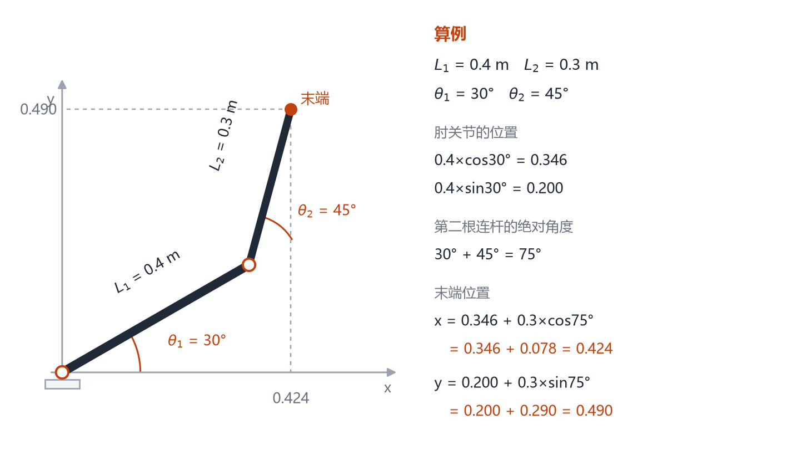
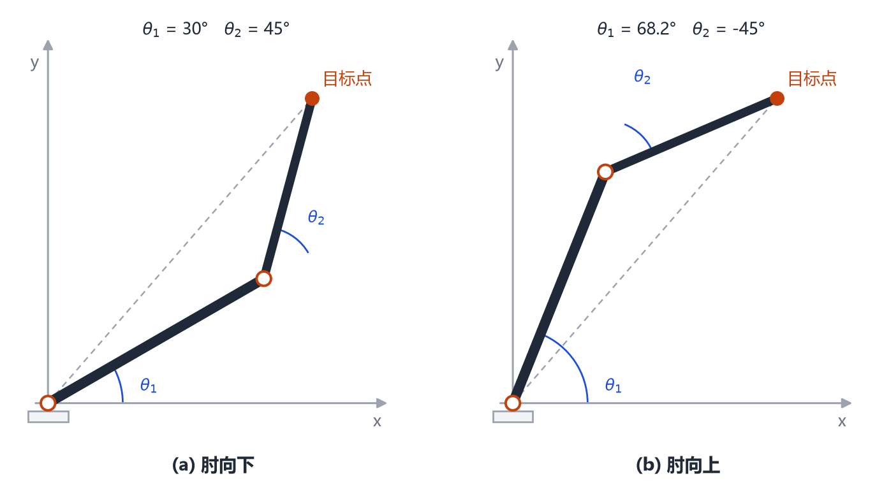
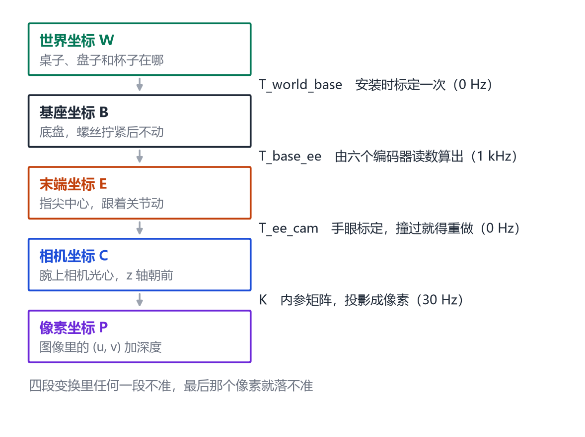

# 第 2 章　机器的身体

> **本章导读**：一台桌面机械臂在你面前，你怎么用一句话描述它此刻的样子？说六个关节角各是多少，还是说夹爪停在桌子上方 20 厘米、爪口朝下？这两种说法其实是同一件事的两面，中间隔着一套叫运动学的东西。这一章讲机器的身体怎么被数字化，关节怎么转、六个自由度是什么意思、末端位姿用什么描述、从关节角怎么算出夹爪的位置、反过来又为什么会算出好几组答案，末尾给一张常见形态与传感器的清单。

## 2.1 关节与自由度

这一节要回答一个问题，一台机器身上那些会转的地方，到底给了它多少种互相独立的动作？

把你的右手平放在桌面上，手指伸直。现在只许动手腕，不许抬胳膊，你能让手掌做出哪些不同的姿势？可以左右摆，可以上下弯，还能让小臂带动手掌转半圈。三个动作，互相独立，改其中一个不影响另外两个。手腕就有 3 个自由度。

自由度（degree of freedom，缩写 DoF）是这台机器能独立改变的运动量的个数。这句话里"独立"两个字是关键。手掌左右摆的时候上下弯的角度可以不变，两者互不牵连，所以是两个自由度；如果某个动作必须连带另一个动作一起发生，那它只算一个。

"独立"这两个字值得再强调一次，因为关节多不等于自由度高。剪式升降台有两根交叉的连杆、四个关节，可它只能升降，所以只有 1 个自由度，剩下三个被几何关系锁住。数关节只是数零件，数自由度才是数真正能做出的选择。

关节是产生这些运动的地方，常见两种。转动关节像一个合页，两根连杆绕一根轴相对转，你的肘、门轴、机械臂的肩都是这一类。移动关节像抽屉，两部分沿一条直线相对滑，升降台属于这一类。工业臂上绝大多数关节是转动关节，电机转起来最自然，配减速器就能输出大力矩。

减速器的作用值得算一遍。一台 3 千瓦的伺服电机转速约 3000 转每分，直接接到关节上连一杯水都端不稳。中间插一个 100 比 1 的谐波减速器，转速降到 30 转每分。力矩放大到 70 倍上下（效率按 0.7 折算），同一个电机就能托住 5 公斤的负载。

把一个物体放在桌面上，它能怎么动？前后、左右、原地转个角度，三个自由度。放到空中就不一样了，除了前后左右上下，还能绕三个方向翻，一共 6 个。这个 6 不是巧合，它就是空间中一个刚体最多能有的独立运动数，三个管位置，三个管朝向。

所以一台 6 轴机械臂刚好能把夹爪摆成"在这个位置、朝这个方向"的任意组合。少一个轴就不行。5 轴的机器能把夹爪送到很多地方，但朝向只能取一部分，想让它从杯口正上方垂直往下伸，可能做不到。

这类失败在调试时最容易被误判。位置完全正确，夹爪悬在杯口上方两厘米，可爪口是斜的，一闭爪就把杯子推倒。原因在机构本身，第五个轴转不出那个朝向。

多一个轴呢？7 轴臂的末端位姿和 6 轴臂能到达的一样，区别在于同一个位姿它有无穷多种关节角组合。多出来的那一维叫冗余，用处很实在，可以绕开桌上的纸巾盒、可以让某个关节离限位远一点、可以避开后面要讲的奇异位形。人的手臂就是 7 个自由度，肩 3 个、肘 1 个、腕 3 个，所以你才能在拧瓶盖的同时把手肘往外撇。

夹爪的开合通常不算在这 6 个里，它改变的是爪口宽度，不改变夹爪自身的位姿，所以规格表上写"6 轴加 1 个夹爪"。

这里有个说法值得先建立起来，叫构型空间。把 6 个关节角当成 6 个坐标，机械臂的每一个姿态就是 6 维空间里的一个点。机器人的一次运动，就是这个点在空间里划出的一条曲线。关节能转的范围是每个坐标上的一段区间，合起来是空间里的一个盒子，点不能跑出盒子。桌子上摆着杯子和纸巾盒，它们在关节角空间里对应一片被"撑大"的禁区，因为手臂的任何一段都不能碰到它们。规划器真正干活的场地就是这个空间，它要在盒子里找一条从起点到终点、不穿禁区的曲线。这件事比在三维空间里画线麻烦得多，第 3 章会讲它为什么麻烦。

还有一个细节容易被略过。电机和关节之间通常隔着减速比 100 比 1 的减速器，编码器装在电机侧还是关节侧，读数含义完全不同。装在电机侧，读到的是电机转角，乘 100 才是关节角。中间那圈齿轮的间隙没被量到，典型回差一到两个角分，折算到 0.5 米臂展上是 0.1 到 0.3 毫米。装在关节侧，读到的是关节角本身，精度高但编码器更贵。到了要求 0.1 毫米精度的场合，这就是第一道坎。

## 2.2 位姿：位置好说，姿态麻烦

这一节要回答两个问题。夹爪在哪，它朝哪个方向。前一个三个数就说清了，后一个得先挑一种表示方法。

描述夹爪此刻在哪儿，需要两组数。位置 3 个数，就是它在世界坐标里的 x、y、z。姿态 3 个数，说的是它朝着哪个方向。两组合起来叫位姿（pose），就是位置加朝向，回答"在哪、朝哪边"。

位置没什么可说的，一把米尺就能量。桌面高 0.8 米，杯口中心在 (0.4, 0.1, 0.8) 米。桌面臂重复定位精度通常在 0.03 毫米上下，大约是头发丝直径的三分之一。

姿态就麻烦了，"三个数怎么表示朝向"有很多种答案，每种都有坑。

位置对了、朝向错了同样是失败。夹爪停在杯口正上方，爪口却横着，一闭爪把杯子夹飞，而位置数据在日志里看着毫无问题。

### 三种姿态表示

第一种叫旋转矩阵（rotation matrix）。想象夹爪自己带一套坐标轴，一根指向爪口张开的方向，一根指向爪背，第三根按右手定则垂直于前两根。把这三根轴在世界坐标里的方向写成三列，就是一个 3×3 的矩阵。

举个能对上的例子。夹爪爪口朝下，并且绕竖直轴转了 90 度，它的矩阵是

$$
R=\begin{bmatrix} 0 & -1 & 0 \\ 1 & 0 & 0 \\ 0 & 0 & 1 \end{bmatrix}
$$

怎么读这个矩阵？第一列 (0, 1, 0) 说夹爪自己的 x 轴指向世界的 y 方向，第二列 (-1, 0, 0) 说它的 y 轴指向世界的负 x 方向，第三列 (0, 0, 1) 说它的 z 轴和世界同向。它的好处是能直接作用在向量上，连续转两次就是两个矩阵相乘。

它的坏处是浪费，9 个数只表示 3 个自由度，因为三列必须两两垂直且长度都是 1，行列式必须是 1。要让网络输出姿态、或者在两个姿态之间插值，9 个数带 6 个约束就没法直接用。

具体会坏成什么样？网络吐出 9 个数，你直接拿去用，第三列的长度可能是 1.03 而不是 1。这 3% 的误差落到 0.5 米的臂展上就是 15 毫米，夹爪从杯子上方擦过去，指尖磕在杯沿。补救办法是做一次正交化，把矩阵拉回最近的合法旋转。

第二种叫欧拉角（Euler angles），用三个角按固定顺序旋转。比如先绕竖直轴转一个偏航角，再绕横轴转一个俯仰角，再绕自身轴转一个滚转角，航空领域习惯这么叫。三个角人能读，俯仰 30 度能想象出机头抬起来的样子。坑有两个。一是顺序不统一，三个轴有 12 种排法，论文之间数字对不上是常事。二是万向锁。

万向锁值得说清楚。第二个角转到 90 度时，第一和第三个旋转轴重合。调这两个角是同一个效果，等于少了一个自由度，表现是姿态会跳。假设俯仰角停在 89.9 度附近，滚转角从 0 变到 0.1 度，为了保持同一个朝向，偏航角会猛地跳到 180 度附近。手腕相机垂直朝下看桌面时正好接近这种姿态，图像里"哪边算上方"就退化了，抓取角度会差 180 度，夹爪转过去背对杯柄。

第三种叫四元数（quaternion），四个数，习惯写成 w、x、y、z，并约束它的长度是 1。它的含义是"绕某一根轴转某个角度"，前三个数带着轴的方向，第四个数带着转角的一半。

看两个具体值就明白怎么用。完全没有旋转时它是 (1, 0, 0, 0)，因为转角是 0，半角的余弦是 1。绕竖直轴转 90 度时它是 (0.707, 0, 0, 0.707)。它没有万向锁，两个姿态之间可以做球面线性插值，转起来平滑不断裂。所以深度学习输出姿态、状态估计做滤波基本都用它。

代价是不直观，看四个数想不出朝向，而且 q 和负 q 表示同一个旋转。两个姿态其实只差 0.1 度，它们的四元数点积却是负的，程序按"最短路径"插值，夹爪反向走了 359.9 度，把纸巾盒扫到地上。稳妥的写法是先看点积，是负的就把其中一个取反。比较两个四元数是否相同时，也要取绝对值。

真正在工程里串起这些的是齐次变换（homogeneous transform）。它是一个 4×4 矩阵，把旋转和平移打包在一起：

$$
T=\begin{bmatrix} R & p \\ 0 & 1 \end{bmatrix}
$$

R 是 3×3 的旋转矩阵，p 是 3×1 的位置向量，左下角那行是三个 0 和一个 1，专门用来补位。好处是"变换一个点"和"叠加两次变换"都变成矩阵乘法，四个坐标系串起来就是四个矩阵连乘。代价是冗余，16 个数里一半是常数，但多几个数换来的清爽更值。

代一组数字试试。夹爪在基座坐标系里的位置是 (0.5, 0, 0.3) 米，姿态与基座一致。基座摆在世界坐标的 (1, 2, 0) 米处，也没有转向。两个矩阵一乘，夹爪在世界里的位置就是 (1.5, 2, 0.3) 米，也就是把两段平移加起来。

顺序错了会怎样？基座如果转了 90 度，"先转再移"和"先移再转"得到的位置差了整整 0.5 米，足以让机械臂一头撞在桌沿上。两种乘法的结果都是正经的 4×4 矩阵，程序不会报错，动作只是整体偏掉。

到这里，一台机器"长什么样"就可以用一串数字写下来了。接下来的问题是，这些数字里哪些是关节直接给的，哪些得靠算。

## 2.3 从关节角算出末端在哪

这一节要回答一个很实际的问题，手上有六个关节角，夹爪会停在哪里？往这个方向算叫正运动学（forward kinematics，缩写 FK），它是整条链路里最没有争议的一步，唯一答案、算得飞快。

拿最简单的平面二连杆练手。两根连杆 L1 长 0.4 米、L2 长 0.3 米，都在桌面这个平面里转。第一个关节装在原点，读数是 30 度，第二个关节的相对转角是 45 度，注意这个 45 度是相对第一根连杆量的，不是相对桌面。夹爪装在哪，见图 2-1。

<figure class="fig">

<figcaption><b>图 2-1</b>　平面二连杆的正运动学算例。两根连杆长度 0.4 米与 0.3 米，关节角 30 度与 45 度，末端落在 (0.424, 0.490)，右手边是逐步的算式。</figcaption>
</figure>

### 二连杆的三步

第一步先算肘的位置。第一根连杆从原点到肘，和桌面成 30 度，所以肘在 x 方向的投影是 0.4 乘 cos30 度等于 0.346，y 方向是 0.4 乘 sin30 度等于 0.200。三角函数在这里就是"把斜边拆成两条直角边"，没有别的含义。

为什么用这两个函数。角度顶在原点，连杆是斜边，贴着桌面的那条边用余弦，立起来的那条边用正弦，这是定义。乘 0.4 是因为斜边就是连杆长度，两条直角边按比例伸缩。

第二步要算第二根连杆的方向。它的 45 度是相对第一根连杆的，而第一根已经在 30 度上了，所以它相对桌面的绝对角度是 30 加 45 等于 75 度。这一步错了，后面全错，是初学者最常见的错。

这里可以用一个比方。你在一条匀速前进的船上量方向，量角器的零刻度跟着船头一起转，你读到的 45 度是相对船头的角，不是相对码头的角。要让这个数和码头对齐，得把船头自己的方向加进去。第一根连杆就是那个船头，它的方向是 30 度。

第三步从肘出发再走 0.3 米，方向 75 度。x 方向多走 0.3 乘 cos75 度等于 0.078，y 方向多走 0.3 乘 sin75 度等于 0.290。加上肘的坐标得到末端位置，x 是 0.424，y 是 0.490，单位是米。

算完可以核一下。两个数平方求和再开根号，得 0.648 米，正是末端到原点的距离，小于两杆之和 0.7 米，说明没算出圈。

写成一行就是

$$
p_x=L_1\cos\theta_1+L_2\cos(\theta_1+\theta_2),\qquad
p_y=L_1\sin\theta_1+L_2\sin(\theta_1+\theta_2)
$$

L1、L2 是两根连杆的长度，θ1 是第一个关节相对桌面的角，θ2 是第二个关节相对第一根连杆的角。两个式子的结构完全一样，都是"每段长度乘以它的方向，再把各段加起来"，区别只在于 x 取余弦、y 取正弦。

第二步那个错法值得看一眼后果。如果忘了加 30 度，直接拿 45 度去算第二段，末端会落在 (0.558, 0.412)。两个点相距 15.5 厘米，看起来都是"手伸到杯子附近"，实际差了半个杯子的宽度。真机上这一下会把杯子推倒，而日志里一切正常，因为公式没错，只是角度用错了参照。

六轴臂无非是把这件事做六遍。每段连杆写一个 4×4 的齐次变换，六个矩阵连乘得到总变换。再乘上夹爪在末端坐标里的位置，就是它在世界坐标里的位置。纸面上看着吓人，计算机里就是几百次乘加，一次约几微秒，1 千赫兹的控制环每毫秒跑一遍毫无压力，只占零点几个百分点的预算。

麻烦在于把那六个矩阵写对，工程上不手写，用厂商给的运动学参数或者 Denavit 与 Hartenberg 那套四参数约定，一个关节四个数，六行表格描述一整台臂。为什么是四个数，因为相邻两个关节的轴线在空间里是两条异面直线，它们之间的相对关系由四个量定死，两条轴线公垂线的长度、两轴的夹角、沿轴的偏移量、绕轴的转角。四个数一行，六行就是一台完整的臂。

正运动学也不是永远不会错，它错在参数上。一根标称 0.4 米的铝连杆，加工公差 0.2 毫米，车间温度比标定时高 10 度，铝的线膨胀系数是每度 23 乘 10 的负 6 次方，长度再多出 0.09 毫米。单看都不起眼，六段叠起来就有 1 到 2 毫米的偏差。所以正经的产线会做一次运动学标定，用激光跟踪仪测几十个已知位姿，把真实的连杆参数反解出来，写进控制器。

正运动学好用，但控制时问题反过来，我想要夹爪到杯子那里，六个关节角该是多少。

## 2.4 反过来求关节角

这一节要回答的方向和上一节相反。我知道夹爪要去哪里、朝哪边，问六个电机各自该转到什么角度。这件事叫逆运动学（inverse kinematics，缩写 IK），它比正运动学难，难在多解、无解、以及在某些姿态附近极端敏感。

仍用那台二连杆。已知末端要落在 (0.424, 0.490)，问关节角该是多少。先算这个点到原点的距离，用勾股定理，r 等于 0.648 米。两根连杆和这条连线构成一个三角形，三边长度都已知，用余弦定理就能解出肘的夹角。代入 L1 等于 0.4、L2 等于 0.3、r 等于 0.648，得到 cosθ2 等于 0.707，θ2 是正负 45 度。正负两个值都合法，因为肘可以往上弯也可以往下弯。三条边定死之后夹角只有一个值，剩下的正负两种只是镜像摆法。

θ2 取正 45 度时，解出来的 θ1 是 30 度，正是我们出发的那组。θ2 取负 45 度时，θ1 变成 68.2 度。两组完全不同的关节角，末端落在同一个点上，见图 2-2。工程上把这两种叫肘向下和肘向上，选哪个通常看哪边不撞东西、哪边离关节限位远。

<figure class="fig">

<figcaption><b>图 2-2</b>　同一个目标点对应两组关节角。左边肘向下，θ1 为 30 度、θ2 为 45 度；右边肘向上，θ1 为 68.2 度、θ2 为负 45 度。虚线是原点到目标点的连线。</figcaption>
</figure>

两个解只是开始。6 轴臂的解通常有 8 组，因为肩可以左右翻、肘可以上下弯、腕可以正反装，每一种组合都合法。这就是逆运动学的第一个麻烦，多解。它带来的实际问题不是算不出来，而是"该选哪一个"。选错了，机械臂会从一个看起来正常的姿态出发，绕一大圈去抓杯子，中途把盘子扫到地上。

第二个麻烦是无解。二连杆的最大伸展距离是 0.7 米，末端要求 0.75 米，怎么摆都够不到，方程没有实数解。太近也不行，收到 0.1 米以内，两根连杆折不起来。工程上这不是崩溃，而是把"够不到"报给上层，让它决定挪底盘、换只手还是拒绝任务。真实系统里最常见的失败恰恰是这个，任务规划器按自己的想象下了一道旨，逆解算不出来，机械臂停在原地，上层却以为动作已经执行了。

第三个麻烦最阴险。有些姿态附近，末端位置只要变一点点，关节角就得变很多，这叫奇异位形。

要靠一个矩阵才能说清，它叫雅可比（Jacobian）。一句人话，它是一张汇率表，告诉你关节角动一点，末端跟着动多少，单位是米每弧度。

把二连杆在 30 度和 45 度这个位置上的雅可比算出来，是四个数

$$
J=\begin{bmatrix} -0.490 & -0.290 \\ 0.424 & 0.078 \end{bmatrix}
$$

第一列说的是只动第一个关节。它转 1 弧度，末端走 (-0.490, 0.424) 米，长度 0.648 米，正是末端到原点的距离。第二列说的是只动第二个关节。它转 1 弧度，末端走 (-0.290, 0.078) 米，长度 0.300 米，正是第二根连杆。

雅可比反过来用，就能从末端速度算出关节速度。这条路到了奇异位形就崩。

二连杆完全伸直就是这样一个位置。此时末端距离正好 0.7 米，往回缩 0.1 毫米，肘要弯 2.0 度，往回缩 1 毫米，肘要弯 6.2 度。角度对距离的导数在这一点上趋于无穷，反过来就是关节速度会被放大到无穷。

矩阵那边看得更直接。这个雅可比的行列式等于 L1 乘 L2 乘 sinθ2，在 45 度时是 0.085，到 5 度时掉到 0.010，小了 8 倍。行列式趋于零，求逆就要除以一个越来越小的数，关节速度指令被放大同样的倍数。末端要求 0.1 米每秒靠过去，关节却被命令转到 8 弧度每秒以上，控制器只能急停。

真机上的表现是手臂在接近伸直时猛地抽一下，或者控制器报关节速度超限、干脆停住，末端停在离目标还有几毫米的地方。6 轴臂上还有腕部奇异，第 4 轴和第 6 轴的轴线重合时同样会退化，那通常发生在夹爪垂直朝下的时候。所以有经验的示教操作员从不把臂拉到完全伸直。

实际系统很少用解析解。6 轴臂的解析式又长又分情况，写出来容易错，改一个连杆参数就得重推。更常见的是数值解，从当前关节角出发，用雅可比迭代逼近目标，一次迭代几百微秒，通常几毫秒内收敛。

数值解依赖初值，初值给得不好会收敛到另一组解，姿态突然翻过去，所以商用控制器都从当前姿态出发做局部求解。

近两年还多了一条路，用神经网络直接回归关节角。这里有个已知的坑，逆解是多值的，网络被训练去拟合两组互不相干的答案，输出往往落在两者中间，而中间那个姿态根本到不了目标点。这也是扩散策略那类方法受重视的原因之一，它能表达"多个都对的答案"，而不是把答案平均掉。第 8 章会细讲。

## 2.5 机器的几种形态

前面讲的都是关节和连杆，真实机器人的差别主要在整体怎么摆、怎么站稳。这一节把这几种形态摆在一起比一比。

站稳这件事有两种办法。静态稳定指不用动就能站住，判据是重心在地面的投影落在支撑区域里。桌子四条腿、固定在工作台上的机械臂都属于这一类，断电了也不倒。动态稳定指必须持续调整才能维持，倒立摆是最典型的例子，扫帚立在手上，手一停它就倒。四足机器人走起来任意时刻可能只有两只脚着地，重心早跑到支撑点外面去了，靠的是不断迈步把支撑点挪到重心下面。人形更极端，跑步过程中有一段两只脚都离地，那段时间它就是一个自由飞行的物体，只靠落脚的时机和位置保证接下来不倒。

这两种稳定方式对应不同的难点。静态稳定的机器，控制只管运动精度。动态稳定的机器，控制先要管活下来，一次落脚偏 3 厘米可能就摔了。你在人形演示视频里看到的轻微晃动，多半是平衡控制器在实时纠偏。

**表 2-1**　常见机器人形态对比。

| 形态 | 典型自由度 | 负载 | 移动速度 | 怎么站稳 | 典型场景 |
|---|---|---|---|---|---|
| 固定 6 轴臂 | 6 | 5 kg 上下 | 底座不动 | 不用管，底座拧在台面上 | 桌面抓放、装配、拧螺丝 |
| 冗余 7 轴臂 | 7 | 3 kg 上下 | 底座不动 | 同上 | 研究、需要绕开障碍的抓取 |
| 移动底盘加双臂 | 15（底座 3 加双臂 12） | 双臂合计几公斤 | 1 m/s 量级 | 轮子着地，靠里程计与激光定位 | 家务、巡检、仓储搬运 |
| 四足 | 12 | 10 kg 量级 | 1.5 m/s 量级 | 动态平衡，不必四脚同时着地 | 楼梯、草地、设备巡检 |
| 人形 | 20 上下 | 双臂几公斤 | 1 m/s 到 3 m/s | 动态平衡，落脚点要提前规划 | 通用操作、演示、上下楼梯 |

表中自由度与负载按厂商公开规格圆整，固定臂一栏取自 UR5e 与 Franka Research 3 的规格表，四足取自 Spot 的 12 个关节与 14 公斤负载，人形一栏对应 Unitree H1 的 19 个自由度。

固定臂之所以在工厂里占绝对多数，是因为它把最难的问题删掉了。底座不动，世界坐标和基座坐标之间的变换就永远是同一个，标定一次能用几个月，位置精度可以做到零点零几毫米。桌面上的抓放任务用它最省事，缺点是工作空间就是一个球壳，出了这个范围什么也干不了。

移动底盘把工作空间扩大了，代价是带进了新的不确定性。底盘靠轮子走，走一米可能偏几厘米，这个误差原封不动地传给夹爪，而夹爪需要的定位精度是毫米级。解决办法通常是走两步停一步，停下来用相机重新看一眼，把底盘误差"看"掉，再动手。Mobile ALOHA（2024）就是这条路线的代表，两条 6 轴臂装在移动底座上，靠人遥操作采集数据做家务。

<figure class="fig">

<figcaption><b>图 2-3</b>　坐标从房间一路串到像素，四段变换各有各的更新频率。固定臂的第一段是常数，换成移动底盘，这一段就开始随时间变，整条链的误差也就跟着活了起来。</figcaption>
</figure>

图 2-3 把这条链摆开了。链上每一层都不是算出来的，而是有人在量。世界到基座这一段，固定臂上靠一次标定定下来，台面上放几个反光球，用激光跟踪仪测一遍，频率写 0 赫兹；换成移动底盘，就得靠里程计和激光定位持续更新，变成每秒几十次。基座到末端这一段由六个编码器的读数算出，控制环里每秒算一千次。末端到相机这一段来自手眼标定，让臂带着相机看一块标定板，从十几个姿态里反解出相机装在手上的偏移，平时不动，撞一下就得重做。相机到像素这一段是内参和投影，每来一帧算一次。

四段变换里任何一段不准，末端那个像素坐标就落在错误的位置上，误差会沿链累加。相机被撞了一下，相对夹爪歪了 2 度，没人发现。在 0.5 米的距离上，这 2 度就是 17 毫米的偏移，抓取点从杯口中心滑到杯沿外面，夹爪闭合时什么也没夹住。这类故障最难查，因为每一段单看都正常，四段乘起来才错。

## 2.6 末端与传感器

机械臂贴近物体的那一下由末端执行器完成，英文 end effector。这一节回答机器靠什么知道自己碰到了东西，这些数据又是多快一次送回来的。

桌面场景里用得最多的是平行夹爪，两个指头平行开合，行程几厘米到十几厘米，夹持力几十牛。选它不是因为先进，而是因为可靠，结构简单、不易坏、接触面好建模。吸盘适合平面、光滑、不太重的物体，对曲面和透气材料无能为力。多指灵巧手能捏、能握、能捻，自由度多、控制难、贵，目前更多出现在研究里。

夹爪往下是传感器。它们给出数据的种类和频率差得很远，下面这张清单值得记一下。

编码器装在每个关节上，给出关节角。它是所有位置控制的基础，读取频率跟控制环一样，1 千赫兹以上，分辨率能到零点零几度。没有它，机械臂连自己在哪里都不知道。

惯性测量单元给出三轴加速度和三轴角速度，频率 100 到 1000 赫兹。它擅长感知快速的姿态变化和冲击，价格便宜，缺点是有漂移，积分几秒钟位置就跑偏了。四足和人形靠它判断自己有没有歪。

RGB 相机给出图像，每秒 30 帧，是识别物体、判断场景的主要来源。深度相机在同样频率上多给一路距离，误差随距离平方增长，1 米处几毫米，3 米处几厘米，第 4 章会解释这个规律从哪来。

力力矩传感器装在腕部，测三个方向的力和三个方向的力矩，六个数，频率 1 千赫兹。它的用处是感知接触，插孔、擦桌子、拧瓶盖这类需要"手上感觉"的任务离不开它。没有力传感器的机械臂做接触任务，基本靠位置硬怼。

触觉传感器贴在夹爪指面上，给出接触位置和压力分布，频率 100 赫兹量级。它的价值在于判断有没有抓滑，装满水的杯子开始下滑那一刻，指面上压力分布会变。

还有一路免费的信号，电机电流。电流大致正比于输出力矩，不加硬件就能读，噪声大但够用来判断"撞上了"。

**表 2-2**　桌面抓放系统里常见传感器的频率与量级。

| 传感器 | 报什么 | 频率 | 典型精度或量程 | 主要误差来源 |
|---|---|---|---|---|
| 关节编码器 | 关节角 | 1 kHz 以上 | 0.02 度 | 减速器回差、栅格分辨率 |
| 腕部六维力传感器 | 三轴力与三轴力矩 | 1 kHz | 0.1 N 量级 | 温漂、零点漂移 |
| 惯性测量单元 | 三轴加速度与角速度 | 100 到 1000 Hz | 加速度 0.01 g 量级 | 积分漂移 |
| RGB 相机 | 彩色图像 | 30 Hz | 1080p | 运动模糊、曝光不足 |
| 深度相机 | 每像素距离 | 30 Hz | 1 米处几毫米 | 随距离平方增长 |
| 触觉传感器 | 接触位置与压力 | 100 Hz | 0.1 N 量级 | 迟滞、磨损 |
| 电机电流 | 大致力矩 | 1 kHz 以上 | 满量程的 5% | 摩擦、温升 |

这些读数摆在一起，频率差了两三个数量级。系统集成时最麻烦的事就是让它们对齐，慢的那一档不能拖死快的那一档，快的那一档也不能因为慢的那一档没回话就空转。第 3 章会把这件事摊开算。

控制环的频率由机械本身的振动定。桌面臂的铝连杆和减速器组成一个弹性系统，共振频率通常在 20 到 50 赫兹。要让振动被压下去，采样率得取到共振频率的 20 倍以上，于是落到 1 千赫兹。带宽不够时，环路慢半拍，修正方向和振动同相，抖动越纠越大。

相机做不到这么快，原因在物理层面。室内光线下，快门要开 10 到 30 毫秒才能收够光，机械臂以 1 米每秒移动时，这段时间就是一帧里的拖影。数据量也是硬指标，1080p 的彩色帧约 6 MB，30 帧就是每秒 180 MB，两路相机就把一条 USB 3 总线的余量吃掉大半。图像处理也追不上，一张图跑一遍检测网络要 10 到 30 毫秒。

两档频率就这样分工。相机每 33 毫秒给出一个目标点，控制器把它按 1 毫秒一步插成平滑轨迹，中间靠编码器反馈纠偏。

把频率搞错会出两种事故。一种是把每帧相机结果直接当目标下给控制器，检测器本身有 3 到 5 毫米的抖动，目标点每 33 毫秒跳一次，关节就以 30 赫兹的频率抖 5 毫米，桌面跟着发颤。另一种是时戳对不齐，相机出图加传输延迟 43 毫秒，机械臂在这段时间走了 4 厘米，抓取点就系统性偏 4 厘米。

最小的实用组合通常是腕部相机加关节编码器。相机负责"东西在哪"，编码器负责"我在哪"。很多开源桌面平台就是一台 6 轴臂加一个腕上相机加一个平行夹爪，几百到几千美元就能把整条链跑通。
