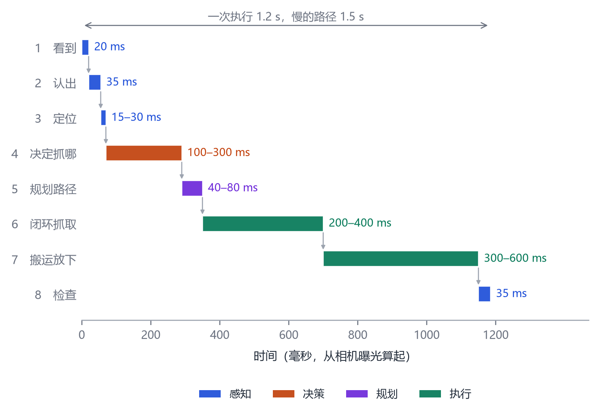
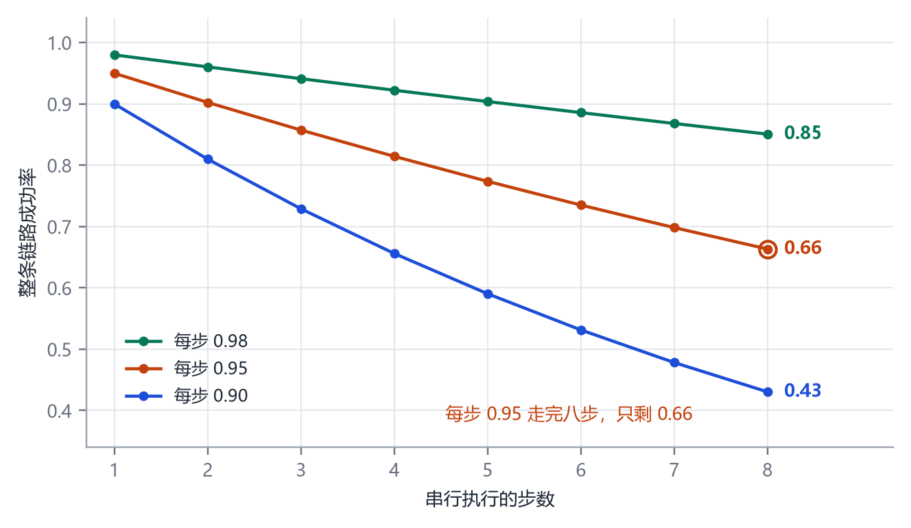
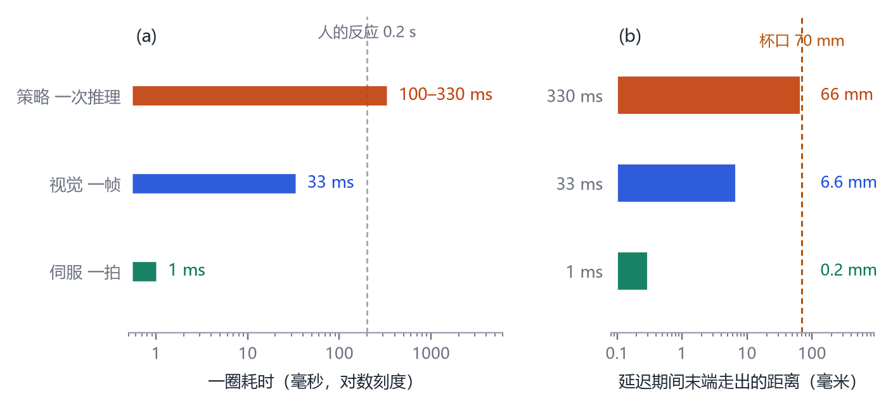

# 第 3 章　一次抓放任务的八步

> **本章导读**：把一只马克杯放进盘子里，人做这件事大约一秒，中间不会觉得有任何难点。这一章把这句指令拆成八步，逐步说清它吃什么数据、吐出什么结果、花多少时间、最容易在哪里坏，然后把八步接起来算一笔账，每步都有九成五的把握，走完只剩三分之二。看清这笔账，你会明白机器人系统的难处为什么不在某一步，而在步与步之间。

## 3.1 桌上有一只杯子

先把场景固定下来。桌子高 0.8 米，桌面上摆着一只直径 7 厘米的陶瓷马克杯，杯里没有水。杯子左边是一只盘子，右边是一个纸巾盒。机械臂是 6 自由度桌面臂，末端装着平行夹爪，最大开度 8 厘米，相机装在腕部，跟着手一起动。

人对这个场景的判断几乎是瞬时的。你看一眼就知道杯子在哪、能不能直接抓、盘子够不够大。要是有人问刚才那一下花了多久，答案是大概一秒，其中大部分时间用在抬手和移动上，思考几乎不占时间。

机器人做同一件事，一秒里要塞进八件不同的事。每件事由不同的程序负责，用不同的数据，跑在不同的硬件上。

1 **看到**，相机曝光一次，得到一帧彩色图和一张深度图。
2 **认出**，在图像里把杯子的像素圈出来。
3 **定位**，把圈出来的像素变成杯子在三维空间里的位置和朝向。
4 **决定抓哪**，选一个夹爪能合上、杯子不会掉、手不会撞桌面的抓取位姿。
5 **规划路径**，算一条从当前位置到抓取位置、中途不碰任何东西的关节轨迹。
6 **闭环抓取**，一边走一边看，快碰到时减速，夹爪合上，抬起来。
7 **搬运放下**，把杯子移到盘子上方，下降，松开。
8 **检查**，再看一眼，确认杯子立在盘子里。

图 3-1 把这八步按顺序摊在时间轴上。横轴是毫秒，八条色块首尾相接，长度就是每一步的耗时。前三步加起来不到 0.1 秒，短得几乎看不见；第四步一次推理就能占掉五分之一；第六、第七步是真正的物理运动，占掉整条时间轴的一大半。八块加起来，一次成功抓放大约 1.2 秒，慢一点的路径到 1.5 秒，和人手差不多。

<figure class="fig">

<figcaption><b>图 3-1</b>　八步在时间轴上的顺序与占位。色块长度是耗时量级，前五步都不让杯子动，第六、第七步才是真正让杯子移动的部分，占总时长的大半。</figcaption>
</figure>

但"差不多"只在总时间上成立。人做这件事的时候，八件事是混在一起的，看的时候已经在动，动的时候还在看。机器把它们排成队列，一件做完才做下一件，队列里任何一环卡住，后面全部等着。这个结构决定了后面所有的麻烦，也决定了这一章为什么要一步一步讲。

**表 3-1**　八步的输入输出、耗时量级与典型失败。

| 步骤 | 输入 → 输出 | 耗时量级 | 典型失败 |
|---|---|---|---|
| 1 看到 | 场景光 → 一帧彩色图与深度图 | 20 ms | 杯壁高光测不出深度，运动时拖影 4 mm |
| 2 认出 | 图像 → 杯子掩码 | 35 ms | 白杯贴白桌，手臂挡住三分之一 |
| 3 定位 | 掩码 + 点云 → 位置与朝向 | 15–30 ms | 对称杯转 180 度仍像对的，差 3 cm 就夹空 |
| 4 决定抓哪 | 位姿 + 指令 → 抓取位姿 | 100–300 ms | 抓在杯口重心外，抓杯柄太细，手挡住相机 |
| 5 规划路径 | 起点 + 终点 → 关节轨迹 | 40–80 ms | 无解，擦着纸巾盒过，奇异位形触发限速 |
| 6 闭环抓取 | 轨迹 + 图像与电流 → 关节指令 | 1 ms 一拍，累计 200–400 ms | 差 1 cm 夹空，夹太浅滑脱，撞翻杯子 |
| 7 搬运放下 | 目标点 → 关节指令 | 300–600 ms | 加速度太大泼出来，放太高摔，放太低压手 |
| 8 检查 | 一帧图 → 成功与否 | 35 ms | 看着像成功，其实是倒着的 |

表里的时间是量级，不是精确值。换一台机器、换一个模型，数字会变，但数量级关系基本稳定，而架构是由数量级关系决定的。读表时可以注意一个反差，最贵的一步在中间，最便宜的一步也在中间，两者相差三百倍，却必须串在一起跑。

## 3.2 前三步，把像素变成位姿

**看到**这一步的耗时基本由硬件决定。一台 30 fps 的相机，一帧 33 ms，全局快门曝光 5 ms 到 20 ms，剩下的时间花在读出和传输上。想快就换 60 fps 的型号，代价是分辨率和带宽。

这一步的失败几乎都写在物理里。杯壁是上釉的，正对光源会出现一块高光，深度相机在那块区域给不出数，形成空洞。杯子在动的时候，20 ms 的曝光会把运动模糊摊开，0.2 米每秒的速度对应 4 毫米的拖影，杯沿的亚像素边缘就不那么准了。背光时杯子的轮廓还在，颜色信息基本废掉，白的杯子变成一团剪影。

**认出**是第一次真正的模型推理。检测或分割模型吃进一帧图，吐出杯子的掩码，量级在 35 ms 左右，同一类任务里 SAM（2023）报告过掩码解码器在浏览器里 50 ms 的水平。麻烦在于训练分布和现场的差距。白杯子放在白瓷砖上，边界只能靠阴影分出来；手伸过去抓的时候，手臂挡住杯子的三分之一；透明玻璃杯在图像里几乎是桌面的颜色。这几种情况下模型不是完全不认，而是认出一个缺了一块的形状，误差顺着往下传。

**定位**把二维掩码变成六个数字。做法是用掩码挑出杯子的点云，再和杯子模型对齐。FoundationPose（2023）给过一个有代表性的速度，对一个新物体做完整位姿估计要 1.3 秒，切成跟踪模式后跑到 32 Hz。这个差别值得记住，第一次看见要慢慢算，之后每一帧只需微调，工程系统基本都是"初始化一次、跟踪到底"的结构。

定位误差要放到夹爪尺度上看。夹爪开度 8 厘米，杯子直径 7 厘米，两侧各剩 5 毫米余量。位置差 5 毫米还能夹住，差 2 厘米会夹到杯壁外沿，差 3 厘米就夹空了。姿态误差更麻烦，杯子绕竖直轴转 30 度，平行夹爪的两个指面就不再平行于杯壁，接触从一条线缩成一个点，一抬就滑。

这三步加起来 70 ms 到 85 ms，比后面一次策略推理还便宜。这也解释了一个常被误解的现象。很多人以为机器人慢在"看"，实际上看得很快，慢在想和动。

## 3.3 第四第五步，决定抓哪与怎么过去

**决定抓哪**是整条链路上最贵的一步，也是最像"智能"的一步。输入是杯子的位姿、桌面点云和任务指令，输出是一个抓取位姿，包含夹爪中心放哪、从哪个方向接近、张开多大、合上时用多大力。

这一步的耗时跨度最大。RT-1（2022）是一个 3500 万参数的模型，跑在机器人本体的推理芯片上，控制频率 3 Hz，论文里明确写了推理时间预算要压在 100 ms 以内，还提到整条管线里最慢的组件延迟是 280 ms。OpenVLA（2024）是 70 亿参数的视觉-语言-动作模型，在单张 RTX 4090 上 6 Hz。pi0（2024）用动作块加流匹配，报出的控制频率最高到 50 Hz。三个数字放在一起能看出这条路的取舍，模型越大越通用，一次推理越慢，想快就得少算，或者一次算一段。

失败来源集中在这几处。抓在杯口，杯沿的圆环不在重心正上方，抬起来杯子会转；抓得太低，指面先碰到桌面，夹爪合不上；抓杯柄，柄只有 1 厘米宽，接触面积小，一走就滑；接近方向选错，手从杯子正上方下来，腕部相机被自己的手挡住，第六步就没有图像可用了。

**规划路径**把抓取位姿变成关节轨迹。这一步用采样类规划器，在关节空间里随机撒点、连边、查碰撞，直到找到一条通路。桌面场景的搜索空间不大，通常在 40 ms 到 80 ms 内给出一条解。

失败有三种。第一种是无解，杯子紧贴纸巾盒，夹爪没有进入角度，规划器跑满时间预算也只能报失败。第二种是有解但不好，路径擦着纸巾盒过去，差 3 毫米就碰，执行时任何一点跟踪误差都会变成碰撞。第三种是奇异位形，机械臂伸得太直，某个关节需要瞬间转过很大角度，实际执行时会触发限速，轨迹被拉长，原本 300 ms 的动作拖成 800 ms。

工程上有个便宜的办法，规划不只看一条解，而是先算若干候选，按路径长度、离障碍的距离、关节转动量打分，挑一个分高的。多花 20 ms 的搜索，换回来的余量通常值得。

## 3.4 后三步，碰上、搬走、确认

**闭环抓取**是八步里唯一真正碰到东西的一段，也是唯一必须高频的一段。机械臂沿轨迹走，控制环每 1 ms 出一次关节指令，视觉每 33 ms 给一次修正，两者差了三十倍。

具体动作分三段。远段按规划轨迹快速移动，末端速度 0.2 米每秒到 0.3 米每秒。近段减速到 0.05 米每秒，同时用腕部相机做视觉伺服，把夹爪中心往杯子中心拉，允许的偏差从 1 厘米收到 2 毫米。接触段夹爪闭合，电流升到设定值就停，然后手臂上抬 10 厘米。

失败在这三段里长得不一样。远段怕碰撞，路径余量不足时手会蹭到纸巾盒或者桌沿。近段怕视觉失效，手挡住杯子、高光糊住杯沿，伺服就会往错误方向拉。接触段怕力控不好，夹太轻，杯子在抬起的瞬间滑下去；夹太重，陶瓷杯壁会裂，纸杯直接瘪掉。

**搬运放下**看着最简单，要求其实最细。手持杯子移动时，杯里的东西会晃。空杯无所谓，加速度可以给到 2 米每二次方秒；半杯水就得压低，加速度一大，水面会倾斜，倾到杯口就洒出来。人做这个动作时会本能地放慢，机器不会，它只会按写好的加速度走。

放下有个容易忽略的细节，松爪之前手臂要下降到一个确定的高度。高 2 厘米，杯子落下有冲击，陶瓷可能崩口；低 2 厘米，指面压到盘子，松爪瞬间杯子被顶歪。正确的高度由杯底和盘面的几何决定，通常留 5 毫米到 10 毫米。

**检查**是收尾的一眼。松爪之后手臂要退回一个不挡视线的位置，再拍一帧，判断杯子是不是立在盘子里。这一步的失败方式很讨厌，叫看起来成功。杯子确实在盘子上，但是倒着的；杯子立着，但是压在盘沿上，一碰就掉。检查用的是同一套视觉模型，它在第八步的准确率不会比第三步更高。

检查不通过就得重试。重试的成本不是一次抓取，而是回到初始观测位姿、重新拍摄、重新推理，把八步再走一遍。所以真实系统里，检查往往只做一次，失败了直接交给人。这也是一条朴素但实用的分界线，能自己从失败里恢复的系统，和只能在成功路径上跑的系统，是两种产品。

## 3.5 每步九成五，八步剩三分之二

把八步串起来算一笔账。假设每一步的成功率都是 0.95，八步全对的概率就是八个数相乘。

$$
P = 0.95^8 = 0.663
$$

式中的 $P$ 是八步全部成功的概率，0.95 是假定的单步成功率，指数 8 是串联的步数。0.663 就是 66%，每步只差 5 个点，走完八步，三分之一的机会已经丢掉了。图 3-2 把这条曲线画出来，横轴是步数，纵轴是整条链路的成功率，三条线分别对应单步 0.98、0.95、0.90。

<figure class="fig">

<figcaption><b>图 3-2</b>　串行链路的成功率随步数指数下降，曲线按 $0.98^n$、$0.95^n$、$0.90^n$ 计算，是公式值而不是实测数据，用于说明量级关系。</figcaption>
</figure>

曲线的形状比具体数值更重要，它是一条指数衰减。单步 0.98 走八步还有 0.85，单步 0.95 剩 0.66，单步 0.90 只剩 0.43。前几步掉得慢，越往后越陡，因为每一步都在前面已经打折的基础上再打折。

这笔账解释了很多反直觉的现象。一个团队把某一步从 90% 提到 95%，单看这一步是 5 个点，放进八步的链路里，整条链路从 0.43 提到 0.66，涨了 23 个点。反过来，一个每步 99% 的系统听起来很好，八步之后是 0.92，每十次失败一次，这个水平在实验室够用，在厨房不够。

真正把成功率做上去的办法不是把每步都磨到 99%，而是减少串联的步数，或者让失败能被发现、被撤销。端到端策略走的是第一条路，把第 1 步到第 6 步压进一次网络推理，中间不再有接口，也就不再有接口处的信息损失。代价是黑盒，坏了不知道坏在哪一步，调也只能整体调。

再说失败代价。同样是一次失败，后果差得很远，可以分三类。

**损失时间。** 夹空了，重试一次，多花 3 秒。这类最轻，只要系统能自己发现并且重试，用户几乎感觉不到。绝大多数抓空、放偏都属于这一类。

**损失物体。** 杯子掉了，碎了，水洒了。清理要几分钟，还可能赔一只杯子。夹太用力、搬运太快、放得太高，都会走到这一类。

**伤人。** 手伸过去的时候机械臂正好在动，夹到手指。这一类的概率最低，代价不可接受，所以工业上不靠成功率来管，而靠硬约束，包括末端速度上限、关节力矩上限、碰撞即停和急停按钮。协作机器人有一份专门的技术规范 ISO/TS 15066，规定人体不同部位能承受的接触压强和力，机械臂的限速值就是从这类文件推出来的。

三类代价决定了系统的设计取向。第一类可以容忍，所以要配检测和重试。第二类要尽量避免，所以搬运段的加速度和夹持力必须保守。第三类不允许发生，所以它不进入概率计算，而是变成写死的限制。

## 3.6 三档频率，谁等谁

八步跑在三种时钟上。伺服环 1 ms 一拍，一千赫兹；视觉 30 Hz，33 ms 一帧；策略 3 Hz 到 10 Hz，一次 100 ms 到 330 ms。最快与最慢差了三百多倍，图 3-3 的 (a) 把它们放在对数轴上，这个差距才看得出来。作为参照，人的简单视觉反应大约 0.2 秒，正好落在策略环那一段里。

<figure class="fig">

<figcaption><b>图 3-3</b>　(a) 三种时钟的周期，对数刻度，虚线是人的反应时间。(b) 末端以 0.2 米每秒运动时，不同延迟对应的位移，虚线标出 70 毫米的杯口宽度。(b) 中的数值按速度乘时间算得。</figcaption>
</figure>

频率不匹配本身不是问题，问题在于它们之间要传数据。控制环每 1 ms 要一个目标位置，策略每 300 ms 才给一个新的判断，中间那 299 ms 里控制环拿什么走。

图 3-3 的 (b) 算了这笔账。末端速度 0.2 米每秒时，1 ms 的延迟对应 0.2 毫米位移，33 ms 对应 6.6 毫米，330 ms 对应 66 毫米。66 毫米差不多就是这只杯子的杯口直径。也就是说，如果控制环一直按 330 ms 之前的判断走，杯子在这段时间里被碰歪半个身位，误差不是慢慢累积，而是直接越过可抓范围。

工程上的解法有三层。最底下是插值，策略给出的是稀疏路点，控制器在两个路点之间按时间插值，Diffusion Policy（2023）就是 10 Hz 出指令、线性插值到 125 Hz 执行，中层控制器跑在 1 kHz。中间一层是动作块，策略一次预测未来若干步的动作，ACT（2023）用这个办法把 50 Hz 的示教数据压成一次推理。最上面一层是时间对齐，RT-1 在附录里写了一个细节，它在状态被读进来之后固定等 280 ms 再执行动作，等的是整条管线里最慢的组件，目的不是快，而是让每一拍的节拍一致，避免抖动。

三档频率还互相制约。控制环太快、视觉太慢，手会按旧图像修偏，越修越歪；视觉太快、策略太慢，每帧都在算出新判断，判断之间互相打架，动作会抖；策略太快、控制太慢，指令堆在缓冲区里，实际执行的是几拍之前的计划，延迟反而更大。

配这三档有个粗糙的经验，相邻两档的频率比大致落在 10 到 30 倍之间，控制 1 kHz 配视觉 30 Hz 是 33 倍，已经贴到上沿，视觉 30 Hz 配策略 3 Hz 是 10 倍。超出这个范围，就得在中间加一层缓冲或者插值，否则一定出问题。

## 3.7 看一段演示视频，问五个问题

这一章的内容最直接的用处，是让你看到机器人演示视频时知道该看什么。视频剪得好，任何系统都能显得很聪明。五个问题能过滤掉大部分水分。

**第一，是不是一条连续长镜头。** 合格的演示要么一镜到底，要么在剪辑点标出时间戳和加速倍数。如果每个动作之间都切一刀，你看到的可能是十次尝试里成功的那一次，中间还夹着人工复位。

**第二，失败率的分母是多少。** "成功率 90%"这句话没有信息量，除非你知道分母。20 次试验成功 18 次，95% 置信区间大约是 68% 到 99%，宽得没有意义。分母小于 20 的数字基本只能当定性结论看，第 12 章会细讲这件事。

**第三，换物体、换位置、换背景还成吗。** 同一只杯子、同一个位置、同一种光照，反复成功，只能说明系统记住了这一个场景。真正的泛化测试会换杯子的颜色和大小，把杯子挪到桌子另一边，把背景从白墙换成窗景，并且分别报告成功率。视频里如果从没出现过第二种杯子，就默认它只对一种杯子有效。

**第四，人工干预了几次。** 有人扶着杯子、有人递过去、有人按复位、有人随时准备按急停，这些都是干预。好的演示会明确写"全程无人干预"，并且镜头里能看到完整桌面。注意画面边缘，很多"全自主"的视频里，操作员的手就搭在桌沿。

**第五，一共试了多少次。** 连续放十次成功，和从五十次里挑十次成功，是两件事。前者说明失败率低于 10%，后者什么也说明不了。愿意放连续片段的团队，通常也愿意公开试验次数。

五个问题问完，你会得到一个粗糙但可靠的判断，这个系统是在一个场景里反复调出来的，还是真的能换着场景用。这个判断比视频里任何一句"刷新了最好成绩"都更有用。

补一句关于数字的话。这一章的耗时都是量级，同一段程序跑在笔记本上和在机器人本体上，数字能差一倍；换一个模型，差得更多。记住数量级关系比记住具体数字有用，因为它决定架构，而具体数字只决定你买哪张显卡。
