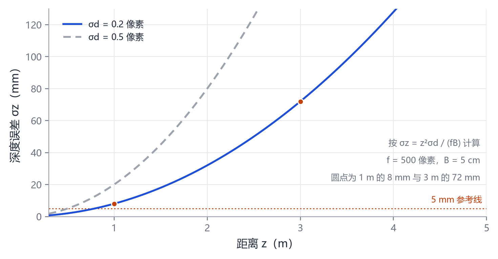

# 第 4 章　相机与三维空间

> **本章导读**：机械臂要从桌上拿起那只杯子，先得知道它在哪。相机给出的是一张 640×480 的彩色图，每个格子只有颜色，没有距离。这一章讲怎么把格子变成射线、把射线变成三维点，讲相机装在手臂的哪个位置、标定误差怎么传到指尖，也讲深度的四种来源各在什么场合失效。读完这一章，你能自己算出一个像素在那个距离上等于几毫米。

## 4.1 一个像素是一条射线

腕部相机拍下一帧，杯子在图像上落在第 412 列、第 305 行。这个数字告诉了你什么？只告诉一件事，杯子位于某条线上，这条线从镜头出发，穿过那一个像素，一直伸到无限远。真实位置在这条线上的哪一处，图像本身没有答案。

要看清这条线是怎么来的，画一个剖面就够了。镜头可以近似成一个点，叫光心。光线穿过光心，落在后面的感光元件上，形成一张像。感光元件所在的那块平面叫像平面，光心到像平面的垂直距离就是焦距。

<figure class="fig">

<figcaption><b>图 4-1</b>　左边是针孔几何的侧视，物体高度、成像高度、焦距与距离构成两个相似三角形；右边是同一台相机正对着看的样子，四个内参决定了像素与空间方向怎么对应。</figcaption>
</figure>

图 4-1(a) 画的是一个剖面。杯子高 H，站在离光心 Z 远的地方，顶端射出的光穿过光心，落在像平面上，成像高度是 h。由光心、杯顶、杯底围成的三角形，与由光心、像顶、像底围成的三角形相似，对应边的比例相同，于是 h 比 H 等于 f 比 Z。整件事只用一条直线和一个点就说完了，也顺带解释了远处的杯子为什么在画面里显得小。Z 变大，h 按反比缩小。

把长度换成像素数，就得到了相机内参，英文叫 intrinsics，指的是相机内部那组固定不变的几何参数。像平面上的尺寸用像素计量，一个像素对应像平面上多长，取决于感光元件的物理尺寸与分辨率。常见的 640×480 深度相机，彩色镜头的焦距落在 500 到 600 像素之间，这里取 525。

四个数就够描述一台相机。fx 与 fy 是水平、垂直方向上的焦距，单位是像素；cx 与 cy 是主点坐标，也就是光轴打在像平面上的那个位置。fx 与 fy 分开写，因为像素未必是正方形；主点通常也不在图像正中，装配总会差几个像素。图 4-1(b) 把这四个数画在一张 640×480 的图上，这一台取 fx = fy = 525，cx = 322，cy = 241。

有了内参，反投影就是一次乘法和一次除法。像素 (u, v) 落在相机坐标系里的哪个点，由下面两式给出。

$$X = \frac{u - c_x}{f_x}\,Z, \qquad Y = \frac{v - c_y}{f_y}\,Z$$

u 与 v 是像素坐标，Z 是这点到相机平面的距离，X 与 Y 是它在相机坐标系下的横纵坐标，单位与 Z 相同。式中最要紧的是那个 Z。知道 Z，得到的是一个点；不知道 Z，得到的只是一条射线。

在 1.5 米处，一个像素有多宽？把 Z 取 1500 毫米、fx 取 525，一像素对应的横向长度是 1500 除以 525，约 2.9 毫米。这个数字值得记住，它划定了整套视觉系统的精度天花板。杯子直径 7 厘米，在 1.5 米处只跨 24 个像素。分割网络把杯沿多算了一像素，抓取点就偏了 2.9 毫米。

同一个除法也解释了视野。640 个像素、焦距 525 像素，水平张角是 2 倍的 arctan(320/525)，约 63 度。想要更宽的视野，就把焦距调小，代价是同样距离上一个像素代表的长度变大，精度下降。广角与精度是一对反向的旋钮，拧哪一头都要付钱。

针孔模型还假设所有光线严格穿过同一个点，真实镜头做不到。镜片有厚度、有装配偏差，广角镜头的边缘会把直线拍成向外鼓的弧，这叫径向畸变，边缘像素的位置能偏出好几个像素。所以标定不光解那四个内参，还要同时解畸变系数，常见的写法是两个径向项配两个切向项。标定板存在的意义有一半就在这里，解完先把每帧图拉正，再谈反投影。

## 4.2 相机站在哪里

内参描述相机内部的几何，外参描述相机和谁站在一起，英文叫 extrinsics。外参是一组旋转加平移，把相机坐标系里的点搬到另一个坐标系里，通常是机械臂末端，也可以是基座。

这一步为什么省不掉？"杯子在相机前方 0.4 米"这句话对机械臂毫无用处。它需要的是"杯子在基座坐标系里 (0.32, −0.11, 0.06)"，才谈得上算六个关节该转多少。从像素到关节角，中间要串三次变换，像素到相机、相机到末端、末端到基座。第 2 章讲过坐标系可以串联，这里就是那条链在真实系统里的样子。

链条上每一环都有误差，最难缠的一环是相机与机械臂的关系。相机装在腕部，叫眼在手上；装在支架上固定不动，叫眼在手外。眼在手上的好处是相机跟着手走，近处细节看得清，坏处是每动一次相机位置就变一次，标定得跟着末端走。眼在手外的好处是相机不动，标定一次能用很久，坏处是手臂一动就挡住视线，远处的物体在画面里又小。

腕部相机的视野还有个具体的量级。相机离桌面 0.5 米，63 度的水平视野覆盖的宽度是 2 乘 0.5 乘 tan(31.5°)，约 0.61 米。桌子一米多长，一帧只能装下中间那一段，想看清哪里就得把手臂伸过去。眼在手上必然要配合运动，这不是设计上的选择，是几何上的限制。

这套流程叫手眼标定，英文 hand-eye calibration。做法很朴素。拿一块黑白棋盘格放在工作台上，让机械臂带着相机从十几个不同姿态去看它，每次都记下棋盘格角点在图像里的位置和当时的六个关节角。格距是已知的，角点在图像里的位置也是已知的，两个已知量凑在一起，就能解出相机相对末端的那组旋转平移。

求解的数学可以跳过，结论值得记住。标定的角度误差会随距离放大，而且放大得很直接。相机姿态差 0.5 度，在 1 米外就是 1000 乘 tan(0.5°)，约 8.7 毫米，2 米外翻倍成 17 毫米。0.5 度不算夸张，关节编码器的重复精度、棋盘格角点的检测偏差、拧螺丝时的微小位移，凑起来很容易到这个量级。

除了标定本身，还有两个隐形误差源。一个是关节角，六轴机械臂的绝对定位精度常在 1 毫米上下，臂展长的更差，而视觉算出的目标点最终要靠关节去够。另一个是时间，相机曝光的那一帧与读到的关节角并非同一时刻，手臂以 0.3 米每秒移动、两者差 30 毫秒，位置就差 9 毫米。抓桌上静止的杯子时这条不重要，抓传送带上的东西时它会变成主要误差。

标定完怎么知道准不准？一个实用的检查是碰点。在桌上贴一个标记，用视觉算出它的三维坐标，让机械臂用示教好的工具中心点去碰它，看差多少。差 2 毫米以内可以接受，超过 3 毫米就该重标。相机被碰过、换了夹爪、环境温度变了十几度，都要重新走一遍这个检查。

## 4.3 深度从哪来

4.1 里那个 Z 是绕不过去的。每个像素都缺一个 Z，补上它就有三维，补不上就只有一张画。补 Z 的办法有四种，原理不同，坏掉的方式也不同。

<figure class="fig">

<figcaption><b>图 4-2</b>　四种深度来源的原理示意，每格下方注一句最常见的失效场景。前三种都建立在三角测量或飞行时间上，第四种靠学习，只给相对远近。</figcaption>
</figure>

**结构光**用一个投影仪把已知图案打到物体上，再用一个相机看这个图案。图案落在平面上是规则的，落在有起伏的表面上会被推歪，歪多少与深浅相关。相机与投影仪之间隔着一段距离，叫基线，两者看同一个点的角度不同，用三角关系就能反算深度。早期 Kinect 用这个原理，手机的人脸解锁也用这个。它擅长近距离、室内、静止场景，精度能做到毫米级；怕强光，阳光里的红外成分会把投影图案淹掉，白墙与深色衣物也会让图案对比度掉下来。

**飞行时间**（Time of Flight，缩写 ToF）换了一条路，直接测时间。发出调制过的红外光，光打到物体上反射回来被接收，发出与接收之间的相位差对应一个往返时间，除以二再乘光速就是距离。光速约 30 厘米每纳秒，往返 1 米只要 6.7 纳秒，直接测这么短的间隔不现实，所以实际测的是调制波的相位差。代价是量程与精度互相牵制，调制频率越高，能分辨的细节越细，不模糊的最大距离也越短。它还有一类特有的错误叫多路径，光不一定走直线，可能先打到桌沿再弹到杯子上，绕了一圈才回来。传感器只认总时间，于是把这条回路也算成了深度，杯沿附近凭空冒出一圈斜面。

**双目**用两台相机，像人的两只眼睛。同一个物点在左右两张图里落在不同的列上，两列之差叫视差，视差越大说明物体越近。几何关系与结构光同源，都是三角测量，区别在于图案不是投出去的，而是物体表面自带的纹理。死穴因此很明确，白墙、纯色桌面、没有纹理的表面，左右图对不上，深度就出不来。

**单目估计**只用一张彩色图，靠学习。Depth Anything（2024）这类模型在 6200 万张无标注图像和 150 万张有标注图像上训练，能从一张照片里猜出相对的远近关系，近处深、远处浅，看上去很像深度图。但它给的是相对量，同一张图整体放大一倍，输出不变，所以它不知道那只杯子究竟在 1.2 米还是 1.5 米。要用它，得另外补一个尺度，比如拿杯子已知的 7 厘米直径去反推。

四种方案的差别可以压进一张表。

**表 4-1**　四种深度方案对比。

| 方案 | 靠什么测距 | 输出 | 典型量程 | 1 m 处误差量级 | 主要失效 |
|---|---|---|---|---|---|
| 结构光 | 投影图案加三角 | 稠密深度图 | 0.3–1.5 m | 1–3 mm | 阳光、白墙、深色吸光面 |
| 飞行时间 | 调制光的相位差 | 稠密深度图 | 0.3–5 m | 5–15 mm | 多机互扰、镜面、阳光 |
| 双目 | 左右相机的视差 | 稠密深度图 | 0.3–6 m | 5–20 mm | 无纹理、重复纹理 |
| 单目估计 | 单图回归 | 相对深度 | 无固定量程 | 尺度不确定 | 尺度、透明、反光 |

表里的量程与误差是常见产品的规格量级，具体型号差别很大，不能直接拿去当验收标准。

双目的误差有一个能算的式子，值得单独拿出来，因为它道破了所有三角测量方案的共同命运。

$$\sigma_z = \frac{z^2\,\sigma_d}{f\,B}$$

σz 是深度误差，z 是距离，σd 是视差的测量误差（单位像素），f 是焦距（单位像素），B 是基线长度。分子上的 z 平方是关键，它说明误差不是随距离线性变差，而是平方变差。直觉上也说得通。视差随距离按 1/z 缩小，距离翻倍视差减半，而视差自身的测量误差不变，于是相对误差翻倍，绝对误差再乘一个 z，就成了平方。

代一组常见数字进去。f 取 500 像素，B 取 5 厘米，视差误差 0.2 像素。1 米处是 1 乘 0.2 除以 25，等于 0.008 米，8 毫米。3 米处是 9 乘 0.2 除以 25，等于 0.072 米，72 毫米。同一台相机、同一套算法，距离从 1 米拉到 3 米，误差翻了九倍。这就是深度相机在桌面上好用、对着房间另一头就废掉的原因。

<figure class="fig">

<figcaption><b>图 4-3</b>　按 σz = z²σd/(fB) 算出的深度误差随距离变化，两根线只差视差误差一个参数。虚线是误差放大 2.5 倍的情况，5 毫米参考线标出平行夹爪能容忍的偏差量级。</figcaption>
</figure>

图 4-3 把这条曲线画了出来，同时标了一条 5 毫米的参考线。5 毫米大约是平行夹爪抓这只杯子时能容忍的偏差量级，曲线穿过这条线的位置在 0.8 米附近。换句话说，深度相机要真正发挥作用，物体得待在手臂够得着、相机又看得清的那一小段距离里。

## 4.4 点云与它的毛病

有了深度图，把每个像素按 4.1 的公式反投影一遍，就得到一团三维点，叫点云，英文 point cloud。640×480 的一帧是 30 万个点，每个点带三个坐标，多数还带颜色。

点云有两种组织方式。有序点云保留图像的行列结构，第 3 行第 5 列的点就是那个像素投出来的点，形状像一个 480×640×3 的张量，可以直接套卷积，也可以按邻域切小块。无序点云只存一列点，没有网格关系，灵活但处理起来麻烦。实际系统大多保持有序，需要的时候再摊平。

30 万个点对规划和控制来说太多了。常见的处理是体素下采样，体素的英文是 voxel，相当于三维空间里的像素，把空间切成一格一格的立方体，每格只留一个代表点。格子取 5 毫米，一张桌面的点云能从几十万降到几万，外形基本不变，后续算法快一个数量级。

另一个常用量是法向。平面上每个点的法向都朝上，杯壁上的点法向朝外，知道法向就知道表面朝哪边，抓取时该从哪个方向下爪、沿哪个方向接近，都要用它。算法是取每个点周围一小圈邻居，拟合一个平面，平面的垂线就是法向。邻居取多少有讲究，取少了被噪声带跑，取多了把拐角抹平。

点云的问题集中在两类，"测不到"与"测得偏"。

透明物体是头一个。玻璃杯、塑料瓶、保鲜膜，红外光直接穿过去打在后面的桌面上，于是深度图里杯子所在的位置出现了桌面的深度，看上去像杯子后面有个洞。彩色图能看出那里有东西，深度图看不出。

反光物体是第二个。不锈钢水壶、抛光零件，光被镜面反射到别的方向，传感器收不到回波，那片区域是空洞。空洞在点云里表现为一块没有点的黑区，下游算法要么把它当空气，要么当成障碍，两种都会出错。

黑色吸光材料是第三个。深色橡胶、黑色绒布，红外被吸收，回波太弱，同样测不到。

第四个不那么直观，叫边缘飞点。一个像素正好压在物体轮廓上，可能一半看到前景一半看到背景，算出来的深度是两者的混合，落在中间某个并不存在的位置。这些点飘在轮廓外面像毛刺，做碰撞检测时会凭空多出一层障碍。

抓取系统对这些问题的处理，没有哪一个是靠算法彻底解决的。常见的组合是换角度多拍几帧，把不同视角的点云拼起来，被挡住的部分换个角度就看到了；加一层近距离的结构光或者主动补光；实在不行的，靠接触。把几帧点云对齐到同一个坐标系叫配准，最常用的是迭代最近点，先找对应点再解变换，来回几轮。桌面这种结构丰富的场景配准很稳，对着白墙就不行，平面沿自身方向滑动不改变形状，解会漂。手指碰到杯壁的那一刻，力传感器给出的是真实接触，比任何视觉都可靠。第 2 章把力/力矩传感器与相机列在一起，它们补的是同一件事的不同侧面。

## 4.5 三段误差加起来

回到开头那个像素。假设杯子在相机前 1.2 米，把三段误差依次算一遍。

像素这一段，1.2 米处一个像素是 1200 除以 525，2.3 毫米。分割掩码的边缘误差按 1 像素算，就是 2.3 毫米。

标定这一段，0.5 度的姿态误差在 1.2 米处是 1200 乘 tan(0.5°)，10.5 毫米。这一段最大，也最容易被忽略，因为它不在图像里，肉眼看不见。

深度这一段，按 4.3 的式子，z 取 1.2 米，1.44 乘 0.008 得 0.0115 米，也就是 11.5 毫米。

三段互相独立，合成时平方相加再开方，得到 15.7 毫米。平行夹爪抓 7 厘米的杯子，两指之间的容差大约在正负 10 毫米，16 毫米的定位误差意味着开环一次抓中的概率并不高。

这个结论和不少人的直觉相反。大家常以为视觉系统的瓶颈在识别，实际识别早就够用了，瓶颈在几何，在那些听起来只是"标定一下"的环节上。0.5 度的姿态误差在 1 米处就是 8.7 毫米，比大多数分割算法的边缘误差大一个量级。

工程上的应对有三条。

一条是把标定做扎实。用高精度棋盘格、多姿态、留出验证姿态，标完必须碰点验证，残差超过 3 毫米就重来。相机装在腕部时，每次换夹爪、每次碰撞之后都要查。

一条是不指望一次到位，靠闭环。先按粗定位走过去，在离杯子 10 厘米处停下，重新看一眼，用近处的图像修正一次，再往下走。近处的 1 个像素只有 0.5 毫米，误差天然小一个数量级。第 3 章讲的闭环，在这里落到了具体的数字上。

还有一条是把不确定的部分交给力。夹爪合上之前的那几毫米，不必用视觉去赌，可以走一个小幅度的探索动作，碰到就停。力觉的量程与精度都更适合末端那一下。

第 5 章接着往下走。既然像素能变成三维点，下一个问题是这些点里哪些属于杯子、杯子的姿态是什么、夹爪该从哪个方向下爪。点云是原料，位姿与抓取是成品。
