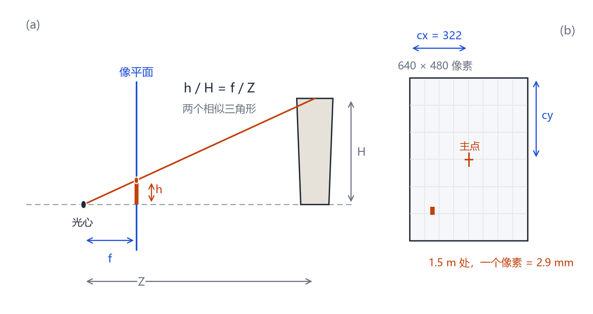
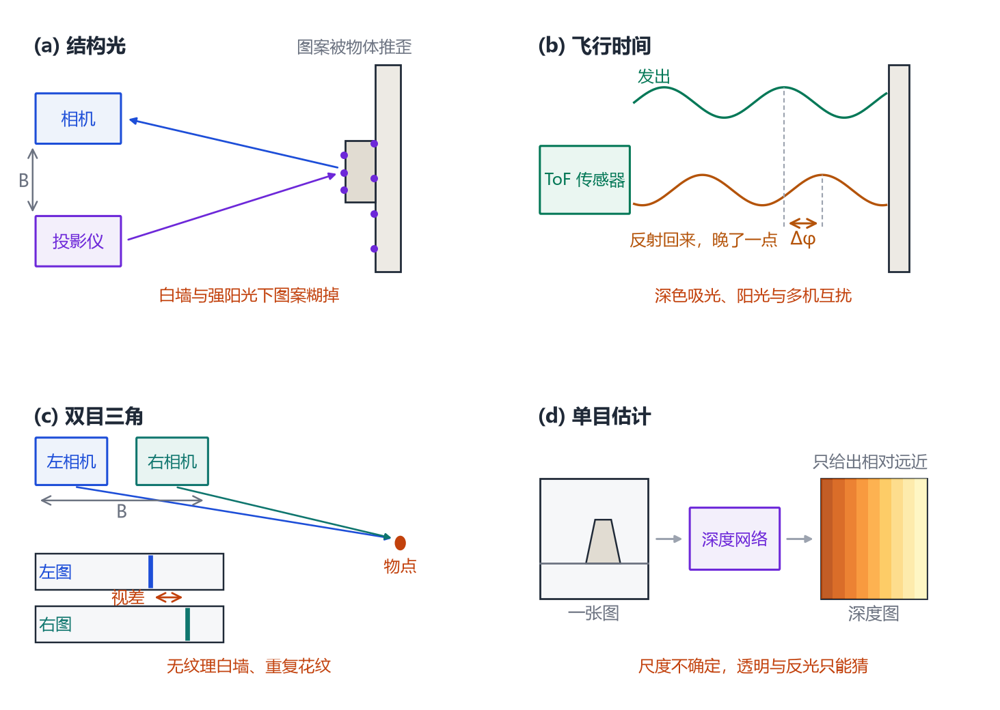

# 第 4 章　相机与三维空间

> **本章导读**：机械臂要从桌上拿起那只杯子，先得知道它在哪。相机给出的是一张 640×480 的彩色图，每个格子只有颜色，没有距离。这一章讲怎么把格子变成射线、把射线变成三维点，讲相机装在手臂的哪个位置、标定误差怎么传到指尖，也讲深度的四种来源各在什么场合失效。读完这一章，你能自己算出一个像素在那个距离上等于几毫米。

## 4.1 一个像素是一条射线

这一节回答一个问题。相机交上来一张 640×480 的彩色图，图上每个格子只有一个颜色，没有任何一个数字写着距离，怎么从这张图里读出空间中的方向。

腕部相机拍下一帧，杯子在图像上落在第 412 列、第 305 行。这个数字告诉你的只有一件事，杯子位于某条线上。这条线从镜头出发，穿过那一个像素，一直伸到无限远。真实位置在这条线上的哪一处，图像本身没有答案。

为什么是一条线而不是一个点，可以用手指验证。举起一根手指，闭上一只眼，让指尖盖住墙上的一个开关，再把手指朝自己挪近十厘米，指尖仍然盖住那个开关。手指动了，投影没动，因为手指一直待在同一条从眼睛出发的直线上。图像丢掉的正是沿这条线的远近，留下来的只是这条线的方向。

### 光线怎么落到感光片上

要看清这条线是怎么来的，画一个剖面就够了。镜头可以近似成一个点，叫光心。光线穿过光心，落在后面的感光元件上，形成一张像。感光元件所在的那块平面叫像平面，光心到像平面的垂直距离就是焦距。

这三样东西在真实相机里都很小。一台 640×480 的深度相机，彩色镜头焦距大约 2.4 毫米，感光元件宽 2.88 毫米，上面排着 640 个感光单元，每个占 4.5 微米。

<figure class="fig">

<figcaption><b>图 4-1</b>　左边是针孔几何的侧视，物体高度、成像高度、焦距与距离构成两个相似三角形；右边是同一台相机正对着看的样子，四个内参决定了像素与空间方向怎么对应。</figcaption>
</figure>

图 4-1(a) 画的是一个剖面。杯子高 H，站在离光心 Z 远的地方，顶端射出的光穿过光心，落在像平面上，成像高度是 h。由光心、杯顶、杯底围成的三角形，与由光心、像顶、像底围成的三角形相似，对应边的比例相同，于是 h 比 H 等于 f 比 Z。整件事只用一条直线和一个点就说完了，也顺带解释了远处的杯子为什么在画面里显得小。Z 变大，h 按反比缩小。

代一组数字进去。杯高 9 厘米，离相机 1.5 米，焦距 2.4 毫米，成像高度是 2.4 乘 90 除以 1500，等于 0.144 毫米。0.144 毫米落在 4.5 微米的感光单元上，占 32 个像素。把杯子挪到 3 米，成像高度减半，只剩 16 个像素。距离翻一倍，画面上的杯子小一半，这条规律从针孔时代到今天没有变过。

把长度换成像素数，就得到了相机内参，英文叫 intrinsics，指的是相机内部那组固定不变的几何参数。像平面上的尺寸用像素计量，一个像素对应像平面上多长，取决于感光元件的物理尺寸与分辨率。常见的 640×480 深度相机，彩色镜头的焦距落在 500 到 600 像素之间，这里取 525。525 这个数由焦距与像元尺寸相除得到，镜头实际焦距略短于标称值。

### 四个数各自管什么

四个数就够描述一台相机。图 4-1(b) 把这四个数画在一张 640×480 的图上，这一台取 fx = fy = 525，cx = 322，cy = 241。

fx 与 fy 是水平、垂直方向上的焦距，单位是像素。它们管的是缩放，把角度换成像素，或者把像素换成角度。fx 越大，同样的角度占的像素越多，画面越像长焦，视野越窄。fx 与 fy 要分开写，因为像素未必是正方形，两个方向上同样的角度可能落到不同个数的像素里。

cx 与 cy 是主点坐标，也就是光轴打在像平面上的那个位置。它们管的是平移，告诉算法图像的正中心偏了多少。理想情况下主点在 (320, 240)，图像正中。装配总会差几个像素，这一台是 (322, 241)。

主点偏了会怎样，值得单独说一句。反投影公式里用的是 u 减 cx，cx 记错 2 个像素，每个点的横坐标就整体多算 2 乘 Z 除以 fx。1.5 米处是 2 乘 2.9 毫米，5.7 毫米。整幅点云朝一个方向平移 5.7 毫米，形状没变，杯子还是圆的，深度关系也全对，所以从点云外观上完全看不出问题。抓取时才暴露，夹爪每次都偏 5.7 毫米，而且方向一致。这类误差最难查，因为它长得不像误差。

有了内参，反投影就是一次乘法和一次除法。像素 (u, v) 落在相机坐标系里的哪个点，由下面两式给出。

$$X = \frac{u - c_x}{f_x}\,Z, \qquad Y = \frac{v - c_y}{f_y}\,Z$$

u 与 v 是像素坐标，Z 是这点到相机平面的距离，X 与 Y 是它在相机坐标系下的横纵坐标，单位与 Z 相同。式中最要紧的是那个 Z。知道 Z，得到的是一个点；不知道 Z，得到的只是一条射线。

把开头那个像素代进去。u 取 412，v 取 305，cx 取 322，cy 取 241，Z 取 1500 毫米，fx 与 fy 都取 525。横坐标是 90 除以 525 再乘 1500，等于 257 毫米。纵坐标是 64 除以 525 再乘 1500，等于 183 毫米。所以杯子在相机正前方 1.5 米、右边 25.7 厘米、下方 18.3 厘米的位置。

在 1.5 米处，一个像素有多宽？把 Z 取 1500 毫米、fx 取 525，一像素对应的横向长度是 1500 除以 525，约 2.9 毫米。这个数字决定了整套系统的精度上限。杯子直径 7 厘米，在 1.5 米处只跨 24 个像素。分割网络把杯沿多算了一像素，抓取点就偏了 2.9 毫米。同一个除法在 0.5 米处给出 0.95 毫米，在 3 米处给出 5.7 毫米。

同一个除法也解释了视野。640 个像素、焦距 525 像素，水平张角是 2 倍的 arctan(320/525)，约 63 度。想要更宽的视野，就把焦距调小，代价是同样距离上一个像素代表的长度变大，精度下降。广角与精度是一对反向的旋钮，拧哪一头都要付钱。

针孔模型还假设所有光线严格穿过同一个点，真实镜头做不到。镜片有厚度、有装配偏差，广角镜头的边缘会把直线拍成向外鼓的弧，这叫径向畸变，边缘像素的位置能偏出好几个像素。一支 120 度的广角镜头，图像四角的偏移可以到 10 个像素以上，在 0.5 米处就是 1 厘米。所以标定不光解那四个内参，还要同时解畸变系数，常见的写法是两个径向项配两个切向项。标定板存在的意义有一半就在这里，解完先把每帧图拉正，再谈反投影。

## 4.2 相机站在哪里

这一节回答下一个问题。4.1 算出的是相机坐标系里的三个数，相机却钉在一个会动的东西上，怎么把这组数换成机械臂能听懂的位置。

内参描述相机内部的几何，外参描述相机和谁站在一起，英文叫 extrinsics。外参是一组旋转加平移，把相机坐标系里的点搬到另一个坐标系里，通常是机械臂末端，也可以是基座。

这一步为什么省不掉？"杯子在相机前方 0.4 米"这句话对机械臂毫无用处。它需要的是"杯子在基座坐标系里 (0.32, −0.11, 0.06)"，才谈得上算六个关节该转多少。从像素到关节角，中间要串三次变换，像素到相机、相机到末端、末端到基座。第 2 章讲过坐标系可以串联，这里就是那条链在真实系统里的样子。

链条上每一环都有误差，最难缠的一环是相机与机械臂的关系。相机装在腕部，叫眼在手上，装在支架上固定不动，叫眼在手外。眼在手上的好处是相机跟着手走，近处细节看得清，坏处是每动一次相机位置就变一次，标定得跟着末端走。眼在手外的好处是相机不动，标定一次能用很久，坏处是手臂一动就挡住视线，远处的物体在画面里又小。

两种安装的差别可以用数字摊开。腕部相机离桌面 0.5 米，63 度的水平视野覆盖的宽度是 2 乘 0.5 乘 tan(31.5°)，约 0.61 米。桌子一米多长，一帧只能装下中间那一段，想看清哪里就得把手臂伸过去。眼在手上必然要配合运动，这不是设计上的选择，是几何上的限制。同一台相机装在天花板支架上，离桌面 1.6 米，视野宽度变成 1.96 米，整张桌子一帧装下，代价是一个像素代表 3.0 毫米，精度掉了三倍。

遮挡的差别同样明显。眼在手外的相机从斜上方俯视，机械臂自己的小臂和前臂正好横在视线上，杯子被挡住的概率随手臂姿态变化。眼在手上没有这个问题，相机离物体 0.3 到 0.5 米，手臂在相机后方，视线基本畅通。

这套流程叫手眼标定，英文 hand-eye calibration。做法很朴素。拿一块黑白棋盘格放在工作台上，让机械臂带着相机从十几个不同姿态去看它，每次都记下棋盘格角点在图像里的位置和当时的六个关节角。格距是已知的，角点在图像里的位置也是已知的，两个已知量凑在一起，就能解出相机相对末端的那组旋转平移。

实操里有几个数字值得记住。棋盘格取 9 乘 6 个内角点，格距 25 毫米。姿态取 12 到 20 个，绕三个轴各转 20 度以上，让相邻两个姿态之间的旋转不集中在同一个方向上。姿态太少，方程会退化成欠定，解出来的旋转在某个方向上全靠猜，而求解器不会告诉你它在猜。

两种安装方式的求解思路相同，未知量不同。眼在手上求的是相机到末端的固定变换，眼在手外求的是相机到基座的固定变换，因为中间隔着的是一整条会动的臂。两次运动之间的相对变换，在末端那一侧由关节角算出，在相机那一侧由棋盘格算出，两者应当相等，未知的固定变换夹在中间。这也解释了为什么机械臂必须真的动起来，站着不动拍一百张，给出的独立方程数仍然是零。

求解的数学可以跳过，结论值得记住。标定的角度误差会随距离放大，而且放大得很直接。相机姿态差 0.5 度，在 1 米外就是 1000 乘 tan(0.5°)，约 8.7 毫米，2 米外翻倍成 17 毫米。0.5 度不算夸张，关节编码器的重复精度、棋盘格角点的检测偏差、拧螺丝时的微小位移，凑起来很容易到这个量级。

这个放大有一处容易误解的地方。被放大的是相机到目标的距离，不是相机到夹爪的距离。腕部相机离夹爪只有 6 厘米，于是有人以为误差只放大到 0.5 毫米。错在把误差用错了地方，被乘上角度的是目标点离相机的距离，目标在 1 米外，那 1 米就要乘上角度误差。这也解释了为什么眼在手上的系统抓远处物体时精度突然变差，手臂伸出去 0.8 米，误差就是 7 毫米。

平移误差的行为不一样，它不放大，直接相加。相机装在夹爪上方 6 厘米，这个 6 厘米量错了 2 毫米，最终结果就恒定偏 2 毫米，跟目标远近无关。

除了标定本身，还有两个隐形误差源。一个是关节角，六轴机械臂的绝对定位精度常在 1 毫米上下，臂展长的更差，而视觉算出的目标点最终要靠关节去够。另一个是时间，相机曝光的那一帧与读到的关节角并非同一时刻，手臂以 0.3 米每秒移动、两者差 30 毫秒，位置就差 9 毫米。抓桌上静止的杯子时这条不重要，抓传送带上的东西时它会变成主要误差。

标定完怎么知道准不准？一个实用的检查是碰点。在桌上贴一个标记，用视觉算出它的三维坐标，让机械臂用示教好的工具中心点去碰它，看差多少。差 2 毫米以内可以接受，超过 3 毫米就该重标。相机被碰过、换了夹爪、环境温度变了十几度，都要重新走一遍这个检查。

碰点要覆盖工作空间的不同位置。只在桌子中间碰一次，结果可能只有 1 毫米；换到 0.8 米外再碰，差 6 毫米。偏差随距离增长说明角度错了，各点偏差一样说明平移错了。

## 4.3 深度从哪来

这一节回答一个问题。前两节把方向说清楚了，这条方向线上的哪一点还没有答案。4.1 里那个 Z 是绕不过去的，每个像素都缺一个 Z，补上它就有三维，补不上就只有一张画。补 Z 的办法有四种，原理不同，坏掉的方式也不同。

<figure class="fig">

<figcaption><b>图 4-2</b>　四种深度来源的原理示意，每格下方注一句最常见的失效场景。前三种都建立在三角测量或飞行时间上，第四种靠学习，只给相对远近。</figcaption>
</figure>

**结构光**用一个投影仪把已知图案打到物体上，再用一个相机看这个图案。图案落在平面上是规则的，落在起伏的表面上会被推歪，歪多少与深浅相关。相机与投影仪之间隔着一段距离，叫基线，两者看同一个点的角度不同，用三角关系就能反算深度。早期 Kinect 用这个原理，手机的人脸解锁也用这个。

它能做到什么程度，有几个具体数字。投影仪与相机相距 7 到 10 厘米，投出去的是随机散斑或者一组条纹，物体越近，图案相对平面的位移越大。0.3 到 1.5 米内精度能到毫米级，白陶瓷杯、纸箱、木桌面都好用，抓桌上杯子这类场景里它几乎是首选。

它的失效场景很具体。强阳光是头号敌人，太阳在近红外的辐照比投影仪功率高出几个数量级，投出去的散斑被淹没，深度图整片变黑。白墙与深色衣物让图案对比度掉下来，位移算不准。透明的玻璃杯最糟，光直接穿过去，图案落在后面的桌面上，传感器把桌面的深度填在杯子那个位置。

**飞行时间**（Time of Flight，缩写 ToF）换了一条路，直接测时间。发出调制过的红外光，光打到物体上反射回来被接收，发出与接收之间的相位差对应一个往返时间，除以二再乘光速就是距离。光速约 30 厘米每纳秒，往返 1 米只要 6.7 纳秒，直接测这么短的间隔不现实，实际测的是调制波的相位差。

调制频率决定量程。20 兆赫的调制波，一个周期对应 15 米的往返距离，除以二得到 7.5 米的不模糊距离，超过这个距离深度会绕回零，看起来像近处凭空出现一个洞。把频率提到 100 兆赫，精度更细，不模糊距离缩到 1.5 米。

ToF 的适用场景是中等距离与快速移动。0.3 到 5 米整帧同时成像，不挑纹理，也跟得上运动的物体，代价是 1 米处误差常在 5 到 15 毫米。它还有一类特有的错误叫多路径，光先打到桌沿再弹到杯子上，绕了一圈才回来。传感器只认总时间，把这条回路也算成深度，杯沿附近凭空冒出一圈斜面。

**双目**用两台相机，像人的两只眼睛。同一个物点在左右两张图里落在不同的列上，两列之差叫视差，视差越大说明物体越近。几何关系与结构光同源，都是三角测量，区别在于图案是物体表面自带的纹理。死穴因此很明确，白墙、纯色桌面、没有纹理的表面，左右图对不上，深度就出不来。

双目的数字可以从 4.1 的公式推出来。基线取 5 厘米，焦距 500 像素，1 米处视差是 25 个像素，3 米处只剩 8 个像素。七八个像素的差距里藏着整个远近判断，所以双目对基线长度极其敏感。基线加到 10 厘米，视差翻倍，精度也翻倍，代价是最近可测距离从 4 厘米推到 8 厘米。

双目最大的长处是室外可用。它靠可见光工作，阳光反而是帮手，提供了充足的纹理和亮度。短处是无纹理、重复纹理与弱光。格子布会让算法把两个相同的格子错配，深度图上出现一片离谱的平面。

**单目估计**只用一张彩色图，靠学习。Depth Anything（2024）这类模型在 6200 万张无标注图像和 150 万张有标注图像上训练，能从一张照片里猜出相对的远近关系，近处深、远处浅，看上去很像深度图。但它给的是相对量，同一张图整体放大一倍，输出不变，所以它不知道那只杯子在 1.2 米还是 1.5 米。要用它，得另外补一个尺度，比如拿杯子已知的 7 厘米直径去反推。

单目的适用场景是只要顺序、不要绝对值。判断哪个杯子在前、桌面和背景谁更远，这些事它做得又快又便宜。它还能利用语义线索推断深度，透明玻璃杯后面的背景在它眼里仍然连续。短处是尺度、绝对精度和帧间一致性，连续两帧的深度图会有轻微抖动。

四种方案的差别可以压进一张表。

**表 4-1**　四种深度方案对比。

| 方案 | 靠什么测距 | 输出 | 典型量程 | 1 m 处误差量级 | 主要失效 |
|---|---|---|---|---|---|
| 结构光 | 投影图案加三角 | 稠密深度图 | 0.3–1.5 m | 1–3 mm | 阳光、白墙、深色吸光面 |
| 飞行时间 | 调制光的相位差 | 稠密深度图 | 0.3–5 m | 5–15 mm | 多机互扰、镜面、阳光 |
| 双目 | 左右相机的视差 | 稠密深度图 | 0.3–6 m | 5–20 mm | 无纹理、重复纹理 |
| 单目估计 | 单图回归 | 相对深度 | 无固定量程 | 尺度不确定 | 尺度、透明、反光 |

表里的量程与误差是常见产品的规格量级，具体型号差别很大，不能直接拿去当验收标准。

换成按材质和光照来问，四种方案的生死顺序会清楚得多。透明物体，玻璃杯、塑料瓶、保鲜膜，三种依赖反射或者三角的方案全都不行，只有单目能给个大概。反光的镜面，不锈钢水壶、抛光铝件，主动方案收不到回波，双目也找不到匹配点。黑色的吸光材料，深色橡胶、黑色绒布，红外被吸收，结构光与 ToF 都测不到，双目反而可用，只要边缘还能分辨。太阳光只对结构光致命，ToF 受影响但没那么严重，双目与单目用的是可见光，基本不怕。

### 误差为什么随距离平方长

双目的误差有一个能算的式子，它道破了所有三角测量方案的共同命运。

$$\sigma_z = \frac{z^2\,\sigma_d}{f\,B}$$

σz 是深度误差，z 是距离，σd 是视差的测量误差（单位像素），f 是焦距（单位像素），B 是基线长度。分子上的 z 平方是关键，它说明误差不是随距离线性变差，而是平方变差。视差随距离按 1/z 缩小，而视差自身的测量误差不变，于是相对误差翻倍，绝对误差再乘一个 z，就成了平方。

代一组常见数字进去。f 取 500 像素，B 取 5 厘米，视差误差 0.2 像素。1 米处是 1 乘 0.2 除以 25，等于 0.008 米，8 毫米。3 米处是 9 乘 0.2 除以 25，等于 0.072 米，72 毫米。同一台相机、同一套算法，距离从 1 米拉到 3 米，误差翻了九倍。这就是深度相机在桌面上好用、对着房间另一头就废掉的原因。

<figure class="fig">

<figcaption><b>图 4-3</b>　按 σz = z²σd/(fB) 算出的深度误差随距离变化，两根线只差视差误差一个参数。虚线是误差放大 2.5 倍的情况，5 毫米参考线标出平行夹爪能容忍的偏差量级。</figcaption>
</figure>

图 4-3 把这条曲线画了出来，同时标了一条 5 毫米的参考线。5 毫米大约是平行夹爪抓这只杯子时能容忍的偏差量级，曲线穿过这条线的位置在 0.8 米附近。物体得待在手臂够得着、相机又看得清的那一小段距离里。

## 4.4 点云与它的毛病

这一节回答两个问题。深度图怎么变成能参与计算的三维数据，以及这团数据为什么不能像彩色图那样直接塞进神经网络。

有了深度图，把每个像素按 4.1 的公式反投影一遍，就得到一团三维点，叫点云，英文 point cloud。640×480 的一帧是 30 万个点，每个点带三个坐标，多数还带颜色。

点云有两种组织方式。有序点云保留图像的行列结构，第 3 行第 5 列的点就是那个像素投出来的点，形状像一个 480×640×3 的张量，可以直接套卷积。无序点云只存一列点，没有网格关系。实际系统大多保持有序。

点云不能像图像那样直接进卷积网络。图像有格子，卷积核在图上滑动，每一步取左边一格、右边一格这样的固定邻居，这个规则在整张图上处处成立。点云没有这个规则，几个原因叠在一起。

一个原因是点的顺序没有意义。同一个杯子拍两次，一次按行扫描存，一次倒着存，点集完全一样，数组完全不同。同一批点换个存法，网络就给出不同答案，这在数学上叫不满足置换不变性。

另一个原因是点数不固定。相机离杯子 0.5 米时有 6 万个点，离 1.5 米只剩 7 千个，同一个物体在不同距离下点数差一个数量级。网络没法接受变长的输入，硬要做就得补零或者重采样，补进去的位置又带进了人为结构。

密度也不均匀。近处的点挤在一起，一平方厘米里有几十个点，远处的点稀疏，只有一两个。同样大小的卷积核在近处覆盖 2 厘米，在远处覆盖 20 厘米，感受野随位置变，这在图像里不会发生。

工程上有三条路。把点云投影回多张深度图或者压成三维网格，再套卷积网络，代价是丢信息或者吃内存。用 PointNet（2017）这类专门为点云设计的网络，它对每个点做多层感知机，再用最大池化合成一个向量，置换不变性就解决了。或者干脆不学，把点云送进几何算法，找平面、算位姿。

下采样省下的是计算时间，付出的是细节。30 万个点对规划和控制来说太多了。常见的处理是体素下采样，体素的英文是 voxel，相当于三维空间里的像素，把空间切成小立方体，每格只留一个代表点。格子取 5 毫米，一张桌面的点云能从几十万降到几万，外形基本不变，后续算法快一个数量级。格子放大到 10 毫米，点数降到几千，跑得飞快，可除了大轮廓什么都剩不下。

代价要一条一条算。杯柄的截面是 8 毫米见方，5 毫米的格子把它切成 1 到 2 个体素，形状基本没了，抓杯柄这件事在下采样之后很难做决定。杯壁厚 4 毫米，两侧的点落进同一格，取平均之后壁变成一张单面，厚度信息丢了。夹爪指厚 4 毫米，碰撞检测时只剩 1 个体素，判距精度掉到 5 毫米，只能给障碍物加一层膨胀来兜底。

另一个常用量是法向。平面上每个点的法向都朝上，杯壁上的点法向朝外，抓取时该从哪个方向下爪、沿哪个方向接近，都要用它。算法是取每个点周围一小圈邻居，拟合一个平面，平面的垂线就是法向。邻居取少了被噪声带跑，取多了把拐角抹平。取 30 个邻居时，5 毫米体素之后这些点大致落在半径 15 毫米的球里。杯沿的曲率半径只有 2 毫米，窗口一大就把内外两侧混在一起，算出的法向斜指向上方，夹爪跟着斜着夹，一抬就滑。

点云的问题集中在两类，"测不到"与"测得偏"。

透明物体是头一个。玻璃杯、塑料瓶、保鲜膜，红外光直接穿过去打在后面的桌面上，于是深度图里杯子所在的位置出现了桌面的深度，看上去像杯子后面有个洞。彩色图能看出那里有东西，深度图看不出。玻璃杯的杯壁在深度图里缺失的比例常超过一半。

反光物体是第二个。不锈钢水壶、抛光零件，光被镜面反射到别的方向，传感器收不到回波，那片区域是空洞。空洞在点云里表现为一块没有点的黑区，下游算法要么把它当空气，要么当成障碍，两种都会出错。

黑色吸光材料是第三个。深色橡胶、黑色绒布，红外被吸收，回波太弱，同样测不到。

第四个不那么直观，叫边缘飞点。一个像素正好压在物体轮廓上，可能一半看到前景一半看到背景，算出来的深度是两者的混合，落在中间某个并不存在的位置。这些点飘在轮廓外面像毛刺，做碰撞检测时会凭空多出一层障碍。

抓取系统对这些问题的处理，没有哪一个是靠算法彻底解决的。常见的组合是换角度多拍几帧，把不同视角的点云拼起来，被挡住的部分换个角度就看到了；加一层近距离的结构光或者主动补光；实在不行的，靠接触。把几帧点云对齐到同一个坐标系叫配准，最常用的是迭代最近点，先找对应点再解变换，来回几轮。桌面这种结构丰富的场景配准很稳，对着白墙就不行，平面沿自身方向滑动不改变形状，解会漂。手指碰到杯壁的那一刻，力传感器给出的是真实接触，比任何视觉都可靠。第 2 章把力/力矩传感器与相机列在一起，它们补的是同一件事的不同侧面。

## 4.5 三段误差加起来

这一节回答最初那个问题。前面几节各自都说了自己有误差，把三段加起来，指尖上到底差多少，够不够抓。

回到开头那个像素。假设杯子在相机前 1.2 米，把三段误差依次算一遍。

像素这一段，1.2 米处一个像素是 1200 除以 525，2.3 毫米。分割掩码的边缘误差按 1 像素算，就是 2.3 毫米。

标定这一段，0.5 度的姿态误差在 1.2 米处是 1200 乘 tan(0.5°)，10.5 毫米。它和深度那一段几乎一样大，也最容易被忽略，因为它不在图像里，肉眼看不见。

深度这一段，按 4.3 的式子，z 取 1.2 米，1.44 乘 0.008 得 0.0115 米，也就是 11.5 毫米。

**表 4-2**　1.2 米处三段误差的取值与随距离的变化。

| 环节 | 误差来源 | 1.2 m 处的值 | 随距离怎么变 |
|---|---|---|---|
| 像素 | 掩码边缘 1 像素 | 2.3 mm | 线性 |
| 标定 | 姿态 0.5 度 | 10.5 mm | 线性 |
| 深度 | 视差 0.2 像素 | 11.5 mm | 平方 |
| 合成 | 三者独立 | 15.7 mm | 介于线性与平方之间 |

三段互相独立，合成时平方相加再开方，得到 15.7 毫米。计算过程是 2.3 的平方 5.3，10.5 的平方 110，11.5 的平方 132，三个数加起来 248，开方 15.7。平行夹爪抓 7 厘米的杯子，两指之间的容差大约在正负 10 毫米，16 毫米的定位误差意味着开环一次抓中的概率并不高。

平方相加再开方这条规则值得解释一句。三段误差来自三个互不相关的原因，几件互不相关的事叠在一起，结果是大的那项占主导，小的那项几乎被淹没。2.3 毫米对 15.7 毫米的贡献不到 1 个百分点，把分割算法做得再准，总误差还是 15.6 毫米。

这个结论和不少人的直觉相反。大家常以为视觉系统的瓶颈在识别，实际识别早就够用了，瓶颈在几何，在那些听起来只是"标定一下"的环节上。

把物体拉近一点，账会变。挪到 0.9 米，像素变成 1.7 毫米，标定变成 7.9 毫米，深度按平方掉到 6.5 毫米，合成是 10.3 毫米，比 1.2 米处少了三分之一。再挪到 0.5 米，三段分别是 1.0、4.4、2.0 毫米，合成 5.0 毫米，已经在容差之内。这组数字解释了为什么凑近再看一眼是视觉抓取里最有效的招数。

工程上的应对有三条。

一条是把标定做扎实。用高精度棋盘格、多姿态、留出验证姿态，标完必须碰点验证，残差超过 3 毫米就重来。相机装在腕部时，每次换夹爪、每次碰撞之后都要查。

一条是不指望一次到位，靠闭环。先按粗定位走过去，在离杯子 10 厘米处停下，重新看一眼，用近处的图像修正一次，再往下走。近处的 1 个像素只有 0.5 毫米，误差天然小一个数量级。第 3 章讲的闭环，在这里落到了具体的数字上。走到 10 厘米处，一像素只有 0.19 毫米，标定误差剩 0.87 毫米，三段合成不到 1 毫米，抓取就从"大概"变成了"稳"。

还有一条是把不确定的部分交给力。夹爪合上之前的那几毫米，不必用视觉去赌，可以走一个小幅度的探索动作，碰到就停。力觉的量程与精度都更适合末端那一下。

第 5 章接着往下走。既然像素能变成三维点，下一个问题是这些点里哪些属于杯子、杯子的姿态是什么、夹爪该从哪个方向下爪。点云是原料，位姿与抓取是成品。
