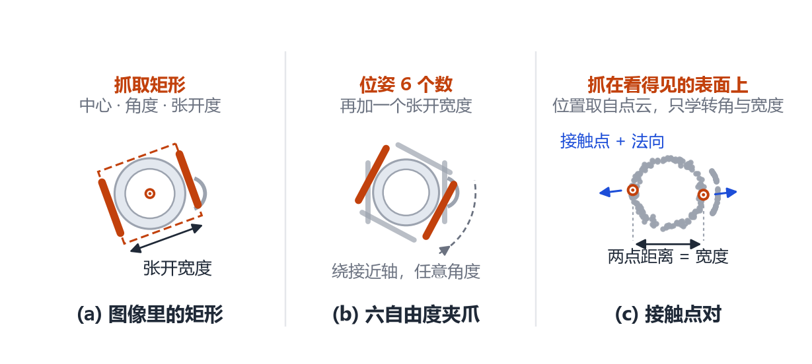
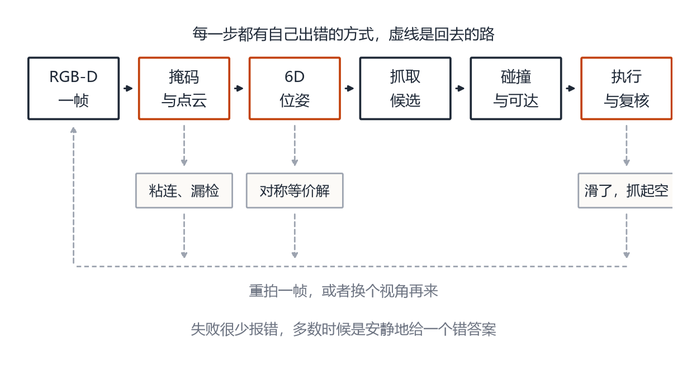
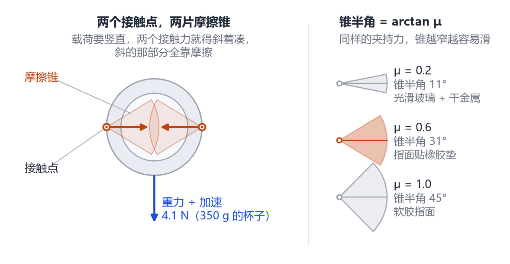

# 第 5 章　物体在哪里

> **本章导读**：第 4 章把像素变成了一条射线，这条射线打到桌上哪里、打到的是一块什么东西，还是没有答案。这一章回答两个问题，桌上这一堆东西里哪一块是杯子，杯子的六个位姿数字是多少，从哪个方向下爪才抓得住。中间会看到分割、位姿、抓取表示这三段各自的做法，以及透明杯子、叠在一起的碗、一根筷子为什么老是让整条链断在中间。

## 5.1 先把它切出来

假设相机拍到一张 0.8 m 高的桌面，桌上有一个白色马克杯、一个保温杯、半盒抽纸，还有两只叠在一起的碗。要抓那只马克杯，机器得先回答一个像素级的问题，画面里哪些像素属于它。

这件事在视觉里有三层问法。语义分割给每个像素贴一个类别，杯子、纸巾、桌子。实例分割再多给一个编号，桌上有两个杯子，编号 1 和 2，你得知道拧的是哪一个。部件分割再细一层，把杯子的把手和杯身分开。抓取这一步最需要的是第二种，因为夹爪只能夹一个具体的东西。

学出来的检测器（Mask R-CNN 那一类）在这件事上很成熟，代价是类别被钉死在训练集里。桌面上出现一个训练集里没有的东西，模型会给它贴上"背景"，或者贴成最像的那个类。换一条产品线就要重标一批数据，这是工业现场最常见的抱怨。

SAM（2023）把这件事换了个问法。它不问"这是什么"，只问"你要哪一块"，然后输出那一块的掩码。提示可以是前景上的一个点、一个框、一个粗略的掩码。训练数据是 SA-1B，1100 万张图、11 亿个掩码，是当时最大的分割数据集的 400 倍，全部由模型自己标注生成。模型本身并不知道杯子和碗的区别，但它对"物体边界"这件事有非常强的先验，换一个完全没见过的场景也能切得八九不离十。

代价在算力上。SAM 的图像编码器是一个 ViT-H，输入 1024×1024，是整个模型里最重的一段；提示解码轻得多，论文给出的数字是给定图像嵌入之后，约 50 ms 出一张掩码。工程上的用法因此是编码一次、反复提示，或者干脆换一个小一号的编码器。

它只给掩码，不给名字，所以还得和词对上。常见做法是用 CLIP（2021）这类图文对齐模型给每个掩码打分，把掩码区域裁出来和"一只红色马克杯"这句话比相似度；或者先用一个开放词汇检测器给出框，再用 SAM 把框细化成掩码。开放词汇的意思是，查询的词可以随时改，不需要重新训练。今天想找"没盖盖子的保鲜盒"，明天想找"蓝色的瓶盖"，改一句提示就行。SAM 2（2024）把视频也纳了进来，掩码跟着物体在帧间走，这一点对机械臂很实用，手伸过去挡住视线的那几帧，掩码不会突然消失。

掩码到三维只有一步，把掩码里的像素连同深度反投影成点，得到一小片点云。这片点的质心给位置，主轴给朝向，包围盒给尺寸。听起来直接，实际有两个坑。

第一，掩码边界不可信。第 4 章的算例里，1.5 m 处一个像素是 2.9 mm，边界抖两个像素就是 6 mm，而深度图在物体轮廓上经常是空的，混合像素和深度不连续会让轮廓变成一圈洞。所以边界上的点要丢掉，通常把掩码往里收两三个像素再用。

第二，深度缺失和掩码错误是两回事。玻璃杯的掩码可以非常准，颜色、纹理、轮廓都对，但掩码里每一个深度值都可能是洞，点云是空心的。这时候分割是对的，几何是错的，后面每一段都会跟着错。

## 5.2 六个数字一族解

一个刚体在空间里的摆放，可以拆成两件事，位置三个数，朝向三个数，合起来六个，工程上就叫 6D 位姿。为什么是六个而不是九个，因为旋转那三个数虽然常写成一个 3×3 矩阵，里面只有三个是独立的，剩下六个受正交约束。这六个数的含义要落到具体场景。杯子放在桌上，相机装在腕部，物体坐标系的原点定在杯子底面的圆心，x 轴指向把手。位姿就是两句话，把这个原点搬到相机坐标系里的哪个位置，再把这个坐标系转到哪个朝向。抓取要的是反过来的量，夹爪应该站在哪里、从哪个方向压下去。

单个数字的误差怎么放大，值得算一遍。姿态差 5°，对一个 0.3 m 长的物体，两端的位置就差了 0.3×sin 5°，约 26 mm。而平行夹爪的指面通常只有 20 mm 高，抓杯子的时候这 26 mm 意味着指面已经从杯壁滑到杯沿上。位置误差反而好办，偏了 3 mm 就整体偏 3 mm；姿态误差会随力臂放大，这是位姿估计比定位难的根本原因。

这里有一个反直觉的地方，对称物体没有唯一解。马克杯绕竖直轴转 180°，从正上方看几乎一模一样，把手换了个边，如果把手被挡住就完全一样。圆柱、圆盘、方盒（转 90°）、六角螺母（转 60°）都是这样。对求解器来说，这些角度上的误差曲面是平的，或者有几个一样深的坑，输出必然是其中随便一个。你让它给"那个位姿"，它给的是一族里的一员。

评测指标也因此分成两个。ADD 的做法是，把模型上的每个点按预测位姿变换一次，再按真值位姿变换一次，两两对应求平均距离，小于物体直径的 10% 就算对。对称物体在这里会吃亏，位姿完全正确但转了 180°，每个点都对到了"错误的那一个点"上，ADD 依然很大，对的被判成错的。ADD-S 把对应关系改成最近点，只问形状贴合不贴合，不问点的身份。直觉上的区别是，ADD 考"每个螺丝孔有没有对准"，ADD-S 考"轮廓有没有盖住"。

两个指标一起报，是有原因的。PoseCNN（2017）在 YCB-Video 上就是这么做的，那个数据集有 21 个物体、92 段视频、133827 帧，其中罐头、盒子这类对称物体的那一列，只有 ADD-S 能说明问题。反过来，只报 ADD-S 不报 ADD，在对称物体多的场景里会显得比实际好，这是看论文时该留意的一处细节。

工程上真正要紧的是，对称到什么程度算对称，取决于下游要干什么。抓一只杯子，转到哪个角度都一样，夹爪不在乎。但如果任务是倒水，把手在哪就决定了能不能倒，这时候"等价解"里只有一个能用。同一个位姿误差，对抓取无害，对操作致命。

## 5.3 三代做法

模板匹配的做法最朴素。把物体的 CAD 模型在虚拟相机下渲染成几百个视角的模板，每个模板记下边缘的梯度方向，再在实拍图上滑窗比对。这个方法在无纹理的工业件上曾经是主力，速度快，精度高，短板有三样，遮挡一半就匹配不上，同类物体堆在一起会互相干扰，每来一个新零件就要重新渲染一遍模板。合模线、反光、油污都会让梯度方向变。

关键点投票是第二代。先找物体上的几个特征点，再用几何关系解位姿。PVNet（2019）是这一代的代表，它让图像上属于物体的每个像素都回归一个指向 8 个关键点的单位向量，再用 RANSAC 把这些方向投出票来定关键点的位置，交给 PnP 解出位姿。这么绕一圈的好处是被挡住一半也能推，因为刚体的局部就能决定其他部分的方向，投票的分布还天然给出不确定性。它在 LINEMOD 上的 ADD 是 86.3%，在遮挡版上是 40.8%，GTX 1080 Ti 上跑到 25 fps。代价是关键点要人给，每个 CAD 都要标一遍，标注质量直接决定上限。

同一代还有一条更直接的路，用一个网络端到端回归位姿。PoseCNN（2017）用卷积网络回归平移和四元数，再针对对称物体改损失函数，精度靠后面的 ICP 精修补上。这条路简单，但几何精度依赖精修，精修又依赖一个好的初值。

基础模型是第三代，它把"每个物体训一个模型"这件事整个去掉了。FoundationPose（2023）的输入是一帧 RGB-D，加上物体的 CAD 模型，或者退一步，只要 16 张绕着物体拍的参考图。它先生成一批位姿假设，用渲染图和实拍图比对来打分，再用一个精修网络把最好的几个候选往真值上推。整个过程不需要针对新物体训练，因为网络只在合成数据上训过一次，用了大约一周、4 张 V100。速度上，单个物体的位姿估计在 RTX 3090 上约 1.3 s，其中初始化 4 ms、精修 0.88 s、候选选择 0.42 s；跟踪模式快得多，约 32 Hz，因为只有一个假设要精修。YCB-Video 上不给 CAD、只用 16 张参考图，ADD 91.5、ADD-S 97.4。

1.3 s 慢不慢，取决于放在哪。抓一个静止的物体，位姿算一次就够，之后的几百毫秒里物体没动，位姿不用重算。要跟着一个被人拿在手里的杯子走，就得靠跟踪模式，或者干脆用第 13 章那种端到端的策略，把位姿这一步隐式地学进网络里。

三代摆在一起，差别主要在"对每个新物体要付多少准备成本"，表 5-1 把它们排成一列。

**表 5-1**　位姿估计方法代际对比。

| 代际 | 代表 | 输入 | 需要什么先验 | 速度 | 典型失效 |
|---|---|---|---|---|---|
| 模板匹配 | 工业视觉的经典做法 | 彩色或深度 | 每个物体渲染一批模板 | 快，单帧内完成 | 遮挡、堆叠、反光 |
| 端到端回归 | PoseCNN（2017） | 彩色 | 每个物体训练一次，要 CAD | 快，精修另算 | 转角偏粗，靠 ICP 补 |
| 关键点投票 | PVNet（2019） | 彩色 | 每个物体标 8 个关键点 | 25 fps（GTX 1080 Ti） | 关键点被完全挡住 |
| 基础模型 | FoundationPose（2023） | RGB-D | CAD 或 16 张参考图，不用微调 | 1.3 s，跟踪 32 Hz | 透明、极薄、无纹理 |

表里带数字的格子来自论文原文，写"快"的只给量级判断，实现差别太大，统一的毫秒数没有意义。

## 5.4 抓取怎么表示

抓取也是一个位姿问题，只多两件事，夹爪的朝向和张开度，而夹爪的形状又限制了哪些位姿可行。表示方法常见的就三种，图 5-1 把它们摆在一起。

<figure class="fig">

<figcaption><b>图 5-1</b>　三种抓取表示。(a) 图像平面里的抓取矩形，中心、角度、张开宽度四个参数；(b) 六自由度夹爪，位姿六个数字再加一个张开宽度；(c) 接触点对，位置直接取自点云，网络只学转角与宽度。</figcaption>
</figure>

2D 抓取矩形是最省事的一种。在图像平面里画一个带角度的矩形，长边标出两根手指的位置，短边是张开度，中心是抓取点，角度是绕光轴的转角。深度图进来之后，这个矩形对应两组三维点，两组点之间的距离就是真实的张开度。它只有四个参数，好学，标注也便宜。DexNet 2.0（2017）走的就是这条路，在深度图里采样对跖点对（antipodal，两侧表面法线大致相反的一对点），用一个卷积网络给每个候选打分，训练数据是 670 万个合成点云，在 8 个刻意做难的已知物体上成功率 93%，一次规划 0.8 s。局限也清楚，接近方向基本固定朝下，杯子的把手长在侧面，这种抓法永远够不到把手。

6-DoF 平行夹爪把接近方向放开了。位姿六个数字加一个张开宽度，接近方向可以是任意方向。GraspNet（2019）从点云里生成候选再筛掉碰撞的，真实世界实验里盒、圆柱、碗、马克杯四类的平均成功率是 88%，同一批实验里另一个方法只有 47%。为什么值这个代价，因为从侧面抓把手比从上面抓杯口稳得多，而侧面抓法在 2D 矩形里根本表达不出来。

接触点表示是第三种，也是现在更流行的一种。Contact-GraspNet（2021）注意到一个统计事实，多数能抓成的两指抓取，至少有一个接触点在抓之前是看得见的，而两个接触点都看不见的抓取往往本身就有歧义。于是它把抓取投到点云上的接触点，位置直接从观测到的表面点里取，网络只负责预测三个旋转角和张开宽度，一共四个数。维度降下来，学起来容易得多，预测出来的抓取也天然贴在看得见的几何上，不会飘在空中。它用 1700 万个仿真抓取训练，在没见过的物体堆里成功率超过 90%，比当时最好的方法把失败率减半。

三种表示的关系不难看清，2D 矩形是 6-DoF 的特例，接近方向锁死朝下；接触点是 6-DoF 的重参数化，把位姿绑在看得见的表面上。选哪种取决于夹爪和任务。桌面上的平行夹爪，多数系统现在用后两种；吸盘用第一种就够了，因为吸盘本来只关心一个面和一条法线。

夹住之后算不算稳，还有一个物理条件，两个接触点加上摩擦锥能不能顶住外载。这件事留到 5.6 单独说。

## 5.5 一条管线，五个断点

把前面几段接起来，就是图 5-2 那条线。一帧 RGB-D 进来，分割给出掩码，掩码加深度变成点云，点云用来估物体位姿，位姿加物体模型生成抓取候选，候选要过碰撞和可达检查，然后执行，执行完再拍一帧复核。每一段都可能安静地给出错的结果，图上的虚线就是回头的路。

<figure class="fig">

<figcaption><b>图 5-2</b>　从一帧 RGB-D 到执行与复核的六段管线。虚线标出三个最常见的断点，以及它们共用的那条回头路，重拍一帧或者换个视角再来。示意。</figcaption>
</figure>

透明物体是第一个断点。玻璃杯、保鲜盒、塑料包装，深度相机测的是反射回来的光，透明物体把光透过去，结构光的条纹穿过去，飞行时间的回波太弱，结果是整块深度缺失。掩码可以很准，点云却是空心的，位姿无从谈起。工程上有几条路，换一种传感（偏振、超声、触觉），从掩码轮廓反推解析形状（杯子是圆柱、盒子是长方体，轮廓就够定那六个参数），或者在桌上放标记物。更多时候是承认失败，改抓杯口上沿这种有厚度的部位。

堆叠是第二个。两只碗叠在一起，分割很可能把它们切成一只，因为颜色一样、边界贴在一起，掩码在接触处连成一片。就算切开了，点云里上碗的下沿也连着下碗的上沿，位姿求解器会给出一个折中的答案，夹爪照这个位姿合上，指尖撞在下碗的碗沿上。应对办法是先抓最高的那块，或者先用一次推的动作把目标分离出来，再或者让抓取候选过一遍碰撞检查，用夹爪模型和场景点云做碰撞检测，把撞得上的候选提前删掉。

细长物体是第三个。筷子、笔、螺丝刀、数据线，麻烦有两层。几何上，它们在深度图里只有十几个像素宽，点云稀疏，主轴方向抖得厉害，而主轴恰恰是抓取最需要的量。任务上，重心在中间，横着抓要抓中点，竖着抓要换一个姿态，抓偏一点力矩就把物体甩出去。平行夹爪的张开度只有 8 cm，一根筷子的可行抓取位置其实很少。

软物体是第四个。面包、毛巾、塑料袋、装了半袋的米，问题不在算法，在定义。形状随抓取而变，位姿这个词本身变松了，同一个物体抓三次是三个形状。掩码的边界在受压处漂移，位姿误差和物体形变混在一起，分不开。这类任务通常绕开位姿，直接学"看起来该抓哪"，把几何推理换成从数据里学到的经验。

第五个是对称等价解。5.2 讲过，求解器给出的是等价解里的一员，这在抓取上通常无害。往杯子里倒水就不行了，把手必须朝一个特定方向；把杯子挂上架子，把手必须朝上。到了任务层面，"哪个等价解"必须由下游的动作来挑，位姿模块给不出这个信息。

五个断点有一个共同点，它们都不在论文的主实验里。论文报告的成功率通常在精选物体和固定光照下测，换一批物体、换一盏灯就掉点。这不是说论文造假，而是说真实桌面的长尾比任何数据集都长。看演示视频的时候，把物体换成透明杯子、把摆放换成堆叠、把光照换成侧逆光，这几件事能过滤掉大部分水分。

## 5.6 夹住意味着什么

5.4 留了一个问题，两个指面压住物体，什么情况下算夹稳了。答案在接触点上。

一个接触点能提供的力不是任意方向的。正压力沿法线往里，摩擦力沿切向，两者合成之后，合力的方向只能落在一个以法线为轴、半角为 arctan μ 的锥里，μ 是这一对接触面的摩擦系数。这个锥就叫摩擦锥。μ 大约 0.2 的时候锥半角只有 11°，μ 到 1.0 的时候是 45°。图 5-3 把几个典型值画在一起。

<figure class="fig">

<figcaption><b>图 5-3</b>　两个接触点各有一片摩擦锥，锥半角按 arctan μ 计算。竖直外载要由两个斜向的接触力凑出来，斜的那部分全靠摩擦。右侧是三种接触副的锥宽。示意。</figcaption>
</figure>

力闭合的直觉是这样的。外载是一个确定的力，重力，加上运动时的加速度带来的惯性力，方向大小大体知道。要顶住它，两个接触点各出一份力，两份力的合力必须和它等大反向。每一份力都被自己的锥限制住，所以两份力能凑出的合力方向是有限的。锥够宽，能凑出的方向就多，外载稍有偏差也顶得住；锥很窄，两份力几乎只能沿法线对顶，竖直方向的那部分载荷就没人管了，物体开始滑。判断一个两指抓取能不能成，做的就是这件事，够不够把外载分解成两个落在锥内的力。

算一个量级。350 g 的马克杯，竖直往上加速 2 m/s²，需要的竖直力是 0.35×(9.81+2)，约 4.1 N。两个接触点分担，每个 2.05 N，这 2.05 N 是切向分量，得靠摩擦提供，摩擦上限是 μN。μ 取 0.6，每个接触点需要的正压力至少要 2.05/0.6，约 3.4 N。夹爪给 10 N 很轻松，所以这个例子不会滑。真正会滑的是 μ 小、载荷大的组合，比如湿的玻璃杯、沾了油的餐具、一面没贴橡胶垫的旧夹爪。

还有三条与力闭合相关的常识，值得一起记住。

夹持力不是越大越好。力大，摩擦上限高，但杯子会碎、纸盒会塌、软物体会被挤出来，指面的橡胶垫压力过高也会打滑。真实系统会按几倍的安全系数放大，而不是把力开到最大。

接触面积会骗人。曲面上的指面只有一条线接触，标称面积用不上，摩擦上限仍然按那条线附近的有效正压力算。

力闭合不等于任务成功。长物体被夹住中间，两个指面能顶住重力，但物体绕夹持轴还是自由的，一转身就歪了。这种时候需要的是形封闭，用三个以上的接触点把自由度全锁死，多指手走的就是这条路。

回到本章开头那个问题。物体在哪里，这句话在三层意思上都有答案。像素层面是掩码。几何层面是六个数字，而且往往是一族数字。动作层面是一个带接触点和宽度的抓取位姿，以及它能不能顶住外载的判断。三层里最容易坏的是第二层，因为它的错误最安静，位姿错 5°，画面仍然好看，掩码仍然准确，只有夹爪合上那一下才知道不对。

下一章把镜头拉远。这些物体的位置要被记住，被跨时间地引用，被一句"把客厅茶几上的药盒拿来"指到。
