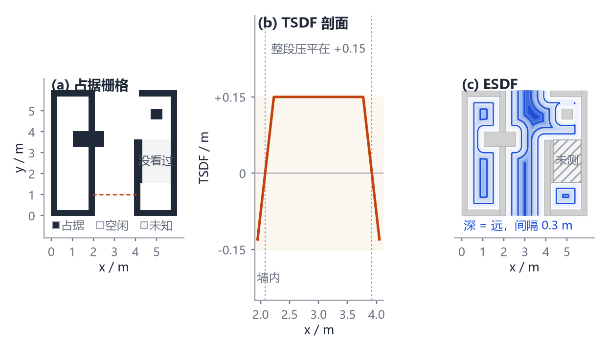
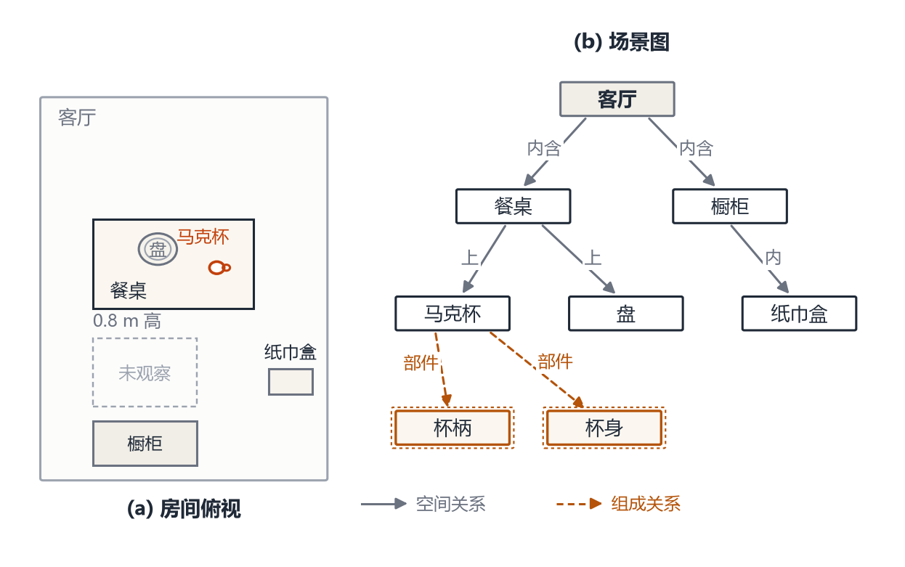
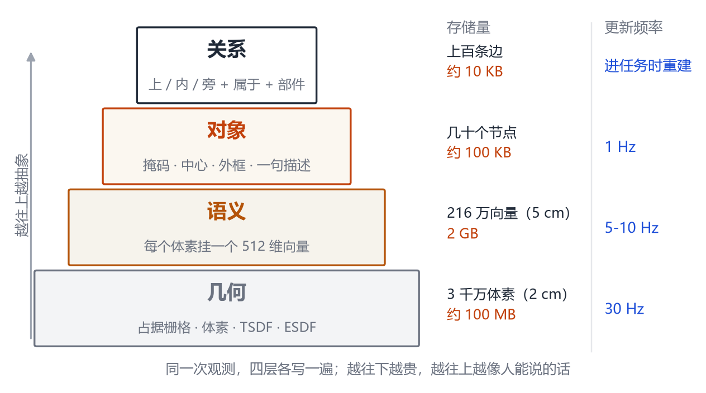

# 第 6 章　地图与记忆

> **本章导读**：第 5 章解决的是"这一帧里杯子在哪"。可机器一旦要在屋子里待上半小时，问题就变了。杯子十分钟前被放到架子上，现在让纸巾盒挡住了；指令说"去客厅把药盒拿来"，它得先知道客厅在哪、药盒长什么样。这一章讲机器怎么把看过的东西留下来，从几厘米一格的占据栅格讲到带关系的三维场景图，再把整张地图压成几百字，交给语言模型去用。

## 6.1 一只手够不到的地方就得记

桌面上的机械臂不太需要地图。它的世界就是眼前 1 m 见方的一块桌面，相机抬一下头就能看全，杯子在不在、盘子有没有被碰歪，一帧图像就够了。第 5 章讲的方法全都建立在"当前这一帧"上，帧一换，上一帧的判断就作废，这在这个尺度上没有代价。

移动底盘进了屋子，这个前提就塌了。它一次只能看见面前六十度的一条扇形，走到厨房门口时，客厅里发生过什么它一无所知；等它回到客厅，那张椅子可能已经被推到桌子底下了。没有地图的机器只有此刻，而有身体的机器必须在时间里连着活。

把"没有地图"的后果拆开看，会更容易看清地图在补什么。

**遮挡。** 你要的杯子在纸巾盒后面。相机绕不过去，图像里没有它，检测器也就不会输出它。地图里存着"这只杯子半小时前在桌上，坐标是这些"，机器可以据此把手伸过去，从侧面看它一眼。

**离开视野。** 机器转过身后，刚才看见的一切都消失了。人在这种时候靠记忆补上，机器没有记忆就只能重新找一遍。一间屋子来回走三趟找同一个东西，是早期服务机器人最典型的失败方式。

**多义。** 桌上两个白色的圆柱体，一个是马克杯，一个是保温杯。只看当前帧，模型可能给出两个一样的标签。地图可以帮忙，因为它在不同时刻、不同角度看过它们，还知道其中一个被人拿起来过。

时间一长，这三类问题会叠加。ALFRED 这个家庭任务基准把长程程度量化了出来，它包含 25,743 条英文指令，对应 8,055 条专家演示，平均每条演示 50 步，分布在 120 个室内场景里。任务长这样，"把热土豆放进冰箱，然后把柜台擦干净"。50 步里机器会在厨房和客厅之间来回走，如果每一步都从零开始认场景，它会在同一个杯子身上耗掉一半时间。

指令里的名词还有一层麻烦，它经常指着过去看见过、此刻看不见的东西。"把茶几上的药盒拿来"，机器站在卧室门口，视野里只有床和衣柜。它得先知道客厅是哪一片区域、茶几在客厅的哪个角落，才谈得上走过去看。SayCan 那套系统里有 551 个技能，覆盖 7 类动作和 17 个物体，其中很大一类是"走到某某旁边"，参数就是地图上的一个位置。语言给的是名字，执行要的是坐标，中间那一步由地图完成。

所以地图在机器人系统里同时扮演三个角色。定位回答"我在哪"，规划回答"哪里能过"，指代回答"你说的那个在哪里"。三个角色对精度的要求不一样。定位要厘米级，规划分米级就够用，指代只要落到某件东西上，差 20 cm 也不影响。

地图也会骗人，坏事的方式有三种。位置漂移，走得越远越歪；内容过期，杯子被拿走了图上还画着；边界之外，没去过的地方图上什么都没有，而模型很容易把"没有"当成"空着"。第三类最难缠，因为它不报错。

漂移有多大，可以给个参照。双目 ORB-SLAM2 在 EuRoC 数据集上跑几十米长的室内轨迹，绝对轨迹误差在 2 至 5 cm 之间（数据取自该论文表 II）。这个量级对"走到沙发旁边"够用，对"把杯子放到杯垫正中间"就不够了。这也解释了为什么抓取这类精细动作基本不依赖全局地图，而是靠腕部相机在末端 20 cm 内做闭环。

## 6.2 一张俯视图就够用的场合

最便宜的表示是一张俯视图，切成方格，每格记一个数，表示这里被占据的可能性。这个数通常存成对数几率，正值偏向"有东西"，负值偏向"空的"，0 表示没有意见。用对数几率而不是概率，是因为两次观测的证据可以直接相加，一行代码更新一格，不需要做除法。

再给每格一个初值 0，图上就有了三种状态，占据、空闲、未知。分辨率一般取 5 cm，一格代表地面上 5 cm 见方的一小块。一间 100 m² 的房子按 5 cm 铺满，是 4 万个格子；每格一个字节，整张图 40 KB，比一张手机照片小两个数量级。就算取 2 cm，格数涨到 25 万，也不过 250 KB。

这么点数据能撑起整个导航栈，原因是地面移动的规划问题本质上是二维的。轮子只在地面上跑，桌子底下要么能钻要么不能钻，凳子腿、门槛、地毯边缘都能压成一个"能不能过"的判断。工业仓库里的自动搬运车到今天还在用二维栅格加代价地图，这套做法几十年没换过。

<figure class="fig">

<figcaption><b>图 6-1</b>　同一片空间的三种画法。占据栅格只记三种状态，TSDF 把表面附近的距离压进体素，ESDF 把距离再算一遍，规划器靠它的梯度避开障碍。红色虚线是 (b) 的剖面位置。</figcaption>
</figure>

图 6-1(a) 是一段走廊加它尽头那间屋子的俯视图，5 cm 一格。黑色是墙和箱子，白色是走过的空地，浅灰是没看过的地方。灰块出现在隔断墙后面，那一片从走廊的任何位置都看不到。这张图里没有高度，桌子是一块实心障碍，桌面上放着什么完全看不出来。

栅格的更新跟着相机走。每来一帧深度图，把每个像素反投影成一条射线，射线穿过的格子记一笔"空"，射线打中的格子记一笔"占"。一帧 640 × 480 的深度图有 30 万个点，一秒 30 帧就是 900 万次写入，落在 4 万个格子上，平均每格每秒被写两百多次。这个量级用 CPU 单线程做得下来，这就是二维栅格好用的真正原因，它便宜到可以每秒重写一遍。

它的边界也很清楚。桌子在二维图里是一块障碍，机器人既不知道桌面在 0.8 m 高，也不知道桌上还站着杯子；悬空的横杆、低矮的门框、需要伸手去够的第二层架子，二维图都没法表达。要动手，就得往三维走。

## 6.3 三维体素与距离场

三维最直接的做法是把格子摞起来。同一间 100 m² 的房子，按 2.7 m 层高算体积 270 m³，5 cm 的体素是 216 万个，2 cm 是 3375 万个。每格一个字节，前者 2.2 MB，后者 34 MB。数字还算能接受，麻烦在更新，每帧要为几百万个体素算一遍，所以这类系统几乎都跑在 GPU 上，或者只维护表面附近那一薄层。

体素里存什么，决定了这张图能干什么。只存"占不占"是最粗的一种，边缘像锯齿。存得更多的是截断符号距离，也就是 TSDF。每个体素记一个数，它表示到最近表面的距离，表面这一侧为正，表面背后为负，超过 15 cm 就压平成 ±15 cm。

图 6-1(b) 是沿走廊横切一刀的剖面。走廊净宽 1.8 m，两侧是墙。中间那一段全部被压在 +0.15，因为对那几个位置来说最近的表面在 0.9 m 外，截断之后就没差别了。只有离墙 15 cm 以内的体素才保留真实梯度。

截断不是偷懒，它同时省内存和省噪声。远处的深度值本来就不准，第 4 章算过，3 m 外的深度误差能到几厘米，拿这种数去更新几十厘米外的距离没有意义。表面附近那一圈才是要用的，融合、提网格、算碰撞，关心的都是表面。

融合的方式是加权平均。同一块表面被看到很多次，每次给一个权重，越近的观测权重越大，累加之后取平均。一个体素如果从来没被任何一帧看到，它的权重就是 0。这是"没看过"在几何层面的表达方式，比二维图里那个灰色格子更严格，因为它连"看过但看得不清楚"都能区分开。

TSDF 给出的是到表面的距离，规划要的却是另一件事，"这里离障碍多远"以及"往哪个方向走会更远"。把 TSDF 再做一次欧氏距离变换，就得到 ESDF，每个体素存到最近障碍的距离。有了这张表，梯度就是远离障碍的方向，规划器可以像下山一样顺着它走，不必每走一步都去查一遍碰撞。

图 6-1(c) 是同一片空间的 ESDF，颜色越深表示离障碍越远，蓝线是间隔 0.3 m 的等值线。走廊中间是一条深色的脊，桌子四角的外面出现一圈圈同心弧，隔断墙后面是一片空洞，那里没测过，也就没有距离可算。移动底盘规划路径时，代价函数里最常出现的一项就是"离障碍别太近"，用的正是这张表。

代价是内存和更新量。2 cm 分辨率的 TSDF 存全屋，距离用半精度浮点、再带一个权重，量级在 100 MB 上下；同分辨率的 ESDF 用 4 字节浮点，130 MB 上下。这还只是一层表示。做操作时通常不需要全屋，只要工作台附近 1 m³，VoxPoser（2023）就是这么干的，它把操作空间切成 100 × 100 × 100 的体素值图，用大模型往里填"该靠近哪、该避开哪"，每 5 Hz 重新规划一次。范围一小，分辨率就上得去，这是操作类任务和导航类任务在表示上的分岔口。

## 6.4 从体素到对象与场景图

几何地图回答"哪里能走"，不回答"那是什么"。要在图上找药盒，两条路可走。一条是给每个体素挂一个语义标签，也就是逐点特征；另一条是把同一件东西的所有体素收成一个节点，也就是对象地图。

逐点特征在屋子里撑不住。一个 512 维的向量，半精度存，2 cm 体素下要 34 GB，5 cm 体素下也要 2 GB。更荒唐的是冗余，一张桌子的一百多万个体素，存着一百多万份几乎一样的向量。房间越大越离谱，这也是 ConceptGraphs 那篇论文开篇就批的那件事。

对象地图先做合并，再做存储。每件东西变成一个节点，节点里放掩码对应的点集、中心、三维外框、一句人话描述，外加一个用来检索的嵌入向量。几十件东西，每个节点一两 KB，整张图 100 KB 量级。查找变成在图上的检索，而不是在几千万个向量里做最近邻。

节点按三层组织，房间、物体、部件。图 6-2 里客厅是一个房间节点，餐桌是一个物体节点，杯身和杯柄是马克杯的部件。边有两种，空间关系（上面、里面、旁边）和组成关系（属于哪个房间、由哪些部件组成）。两种边分开存，因为它们变化的速度不一样，桌子挪一次，空间关系要重算，部件关系基本不动。

<figure class="fig">

<figcaption><b>图 6-2</b>　左边是房间俯视，右边是它对应的场景图。房间、物体、部件分三层，实线是空间关系，虚线是组成关系。图为示意，真实场景的节点数会多出几倍。</figcaption>
</figure>

ConceptGraphs（2023）把这条路线做完整了。它用 SAM 出类别无关的掩码，把掩码投到三维做融合，再用视觉语言模型给每个节点写描述，并让语言模型根据描述和位置推断节点之间的关系。在 Replica 数据集的七个场景上，每间房找出 24 到 59 个人能认出的物体，重复检测 0 到 5 个，节点标签的准确率平均 0.61，空间关系边的准确率 0.91（数据取自该论文表 I）。

边比节点准得多，原因并不神秘。判断"杯子在桌子上"只需要两个中心和大致高度，判断"这是一只马克杯"要认形状、材质、把手，后者难得多。这个差距提示了工程上的用法，拿边做推理，拿节点做候选，两者的可靠性不在一个档次上。

部件这一层常被低估。抓杯子要抓杯身，不能捏着把手；开门要抓门把手，不是门板；倒水要对准壶嘴。这些都不是"物体"级别的概念，而是物体上的一个区域。场景图把部件单独列出来，抓取检测才有落脚点，否则规划器只知道"杯子在那里"，不知道"手该落在哪一块"。

把这六种表示放在一起看，各自的边界就清楚了。表 6-1 右边一列写的是它们各自最容易坏的地方。

**表 6-1**　几种地图表示放在一起比。

| 表示 | 存什么 | 100 m² 房子量级 | 更新频率 | 最擅长 | 典型失效 |
|---|---|---|---|---|---|
| 二维占据栅格 | 每格占据的对数几率 | 4 万格，40 KB（5 cm） | 10 至 30 Hz | 地面能不能过 | 高度信息全丢 |
| 三维体素 | 每格占或空 | 216 万体素，2.2 MB（5 cm） | 5 至 10 Hz | 悬空障碍、手臂碰撞 | 边缘锯齿，内存随体积三次方涨 |
| TSDF | 到表面的截断距离与权重 | 3375 万体素，约 100 MB（2 cm） | 10 至 30 Hz | 多视角融合、提网格、算表面 | 只信表面附近，远处没有信息 |
| ESDF | 到最近障碍的距离 | 同上，约 130 MB | 1 至 10 Hz（增量） | 规划梯度、保持安全距离 | 更新贵，挪一件东西要重算一片 |
| 对象地图 | 掩码、中心、外框、描述、嵌入 | 几十个节点，约 100 KB | 约 1 Hz | 那是什么、在哪里 | 认错类别，重复计数 |
| 场景图 | 上面的节点加关系边 | 上百条边，约 10 KB | 进任务时重建 | 关系推理、语言指代 | 关系随物体移动而过期 |

对象地图的失败方式和几何地图不同。它错在认错了和分错了，把纸巾盒认成书，或者把同一只杯子从两个视角看成两个节点。前者靠多候选和置信度缓解，后者靠三维重叠度合并，两个节点的点集重叠超过一半，大概率是同一件东西。工业级的场景图系统还有一条兜底规则，节点数超过某个阈值就触发一次全局合并，宁可少认几个，也不要让模型面对三百个重复的"白色圆柱"。

## 6.5 用一句话把东西找出来

地图建好之后，最常用的接口是查询。用户的话落到图上有三种形态。指名道姓，"我的螺丝刀"；描述属性，"能装水的东西"；描述关系，"沙发左边那个"。三种在图上的走法不一样。

前两种靠嵌入检索。每个节点的描述先编码成向量，查询也编码成向量，取余弦相似度最高的几个。ConceptGraphs 就是这么查的，而且它发现用节点描述做检索比用三维点特征稳，因为描述里已经把"这是什么、什么颜色、大概多大"写在了一起，语义比裸特征集中。

关系查询要遍历图。"沙发左边"先定位沙发，再沿"旁边"这类边找邻居，按坐标筛方向。"我昨天放这儿的那个东西"就没有现成的边可走，得让语言模型把序列化的图读一遍，靠常识判断。

开放词汇的代价是标签不可靠。节点准确率 0.61，意味着每十个节点里有四个的名字有问题，可能是把台灯说成花瓶，也可能是把一面白墙当成物体。工程上的对策不是追求更高准确率，而是保留多个候选描述，把置信度一起往下传，让抓取或规划那一层自己挑。

还有一类错来自语言本身。用户说"杯子"，图里写的是"马克杯"；用户说"那个圆的"，图里写的是"白色陶瓷盘"。纯嵌入检索对同义词还算宽容，对"圆的"这种形状描述就不行了，得让视觉语言模型再看一眼原图。所以成熟的系统会在检索之后加一步重排，把候选区域的图重新裁出来，让模型逐张确认。

## 6.6 把地图压成几百字

第 10 章会讲怎么让语言模型做高层规划，这里先解决一个前置问题，地图怎么进模型的上下文。点云塞不进去，一帧 640 × 480 的深度图就是 30 万个点，序列化成文本是几十 MB。哪怕只有 100 KB 的场景图，逐字写出来也有几万字，超出多数模型舒服的长度。

可行的做法是写成几百字的清单，只留决策要用的东西。一个房间一行，列房间名、物体名、位置、一句关系。四十个物体的场景，每个一行二十字，加上房间和关系，八百字上下。模型读得动，也改得动。

比"有什么"更难写的是"没什么"。地图上的"没有"其实有三种，确认是空的、没看过、看不清。三种在对策上完全不同，确认是空的可以走，没看过的要先去探，看不清的要换个角度再看。

几何层区分前两种很干脆，占据栅格的未知格、TSDF 权重为零的体素，都是"没看过"。对象层没有这么干净的表示，通常写成一句带范围的话，比如阳台门后面没看过，大约 4 m²，冰箱顶上没扫到。把范围一起写进去，模型才知道这件事有多严重。

有了这句话，规划就能分层。模型看到"没看过"，可以先派一个探索动作，而不是硬规划一条穿过未知区域的路径。反过来，如果序列化时把未知区域悄悄抹掉，模型会以为那里是空的，规划出来的路线会直接撞墙。把地图交给大模型时最常见的坑就埋在这里，坑不在模型，在序列化。

更稳的做法是不把地图塞进上下文，而是给模型几个查询接口，查房间、查最近物体、查两点之间通不通、查某点附近有没有未知区域。模型决定查什么，地图回答。SayCan 那类系统就是这么分工的，语言模型只在技能名和参数上做选择，具体坐标由地图给。

<figure class="fig">

<figcaption><b>图 6-3</b>　四层抽象。越往下数据量越大、更新越快，越往上越接近人能说的话。存储量与频率是按 100 m² 房子估算的量级，具体实现差别很大。</figcaption>
</figure>

图 6-3 把这四层摊开看。同一次观测，四层各写一遍，越往下越贵、刷新越快，越往上越便宜、越像人能说的话。工程上的经验是让每一层只回答自己擅长的问题，别指望几何层给出语义，也别逼语义层记住每个体素的坐标。

回到这一章开头那个问题。机器记住的不是一张漂亮的图，而是一组能回答问题的结构，我在哪、这里能不能过、那件东西在哪、哪里还没看过。四件事都答得上来，地图就够了，精度再高都是加分项。
