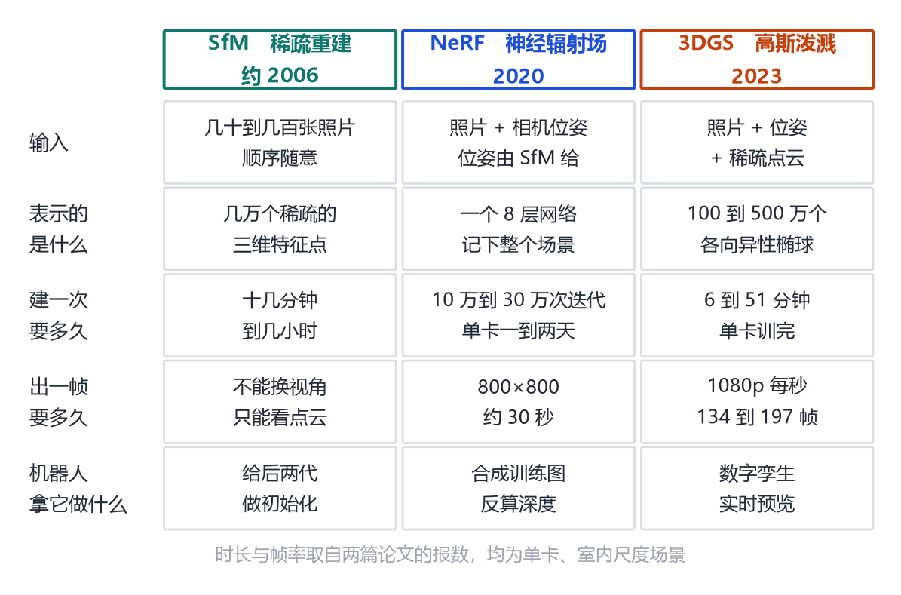
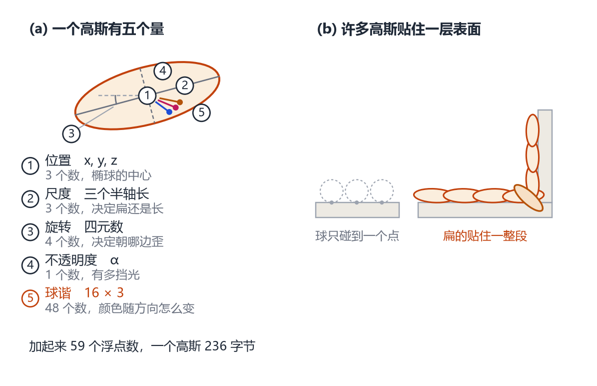
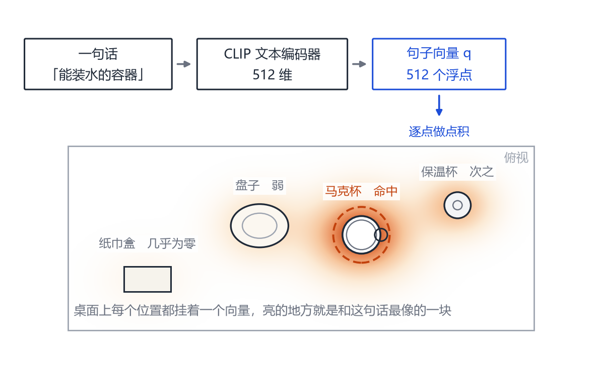

# 第 7 章　重建与三维表征

> **本章导读**：第 6 章的地图能回答"这一格是空的"、"药盒在茶几上"，回答不了"杯子长什么样"。这一章走另一条路，把整张桌子恢复成一个能任选视角去看、能挂上语义、能搬进仿真的表示。从摄影测量拼出的稀疏点云，到神经辐射场，再到 2023 年之后的高斯泼溅，三代方法各自给出什么、要多久、要多少显存，以及它们在动态、透明、反光面前怎么坏掉。

## 7.1 地图只回答有没有，不回答长什么样

桌上摆着一个白瓷盘、一只玻璃杯、一个不锈钢保温杯。第 6 章的占据栅格在这张桌上给出的是三块"有东西"，TSDF（截断符号距离场）在表面附近给出一层到表面的距离。规划器拿到这张图，知道手该往哪片空间伸、哪里会撞，够用了。

再往下问就不行了。杯子是透明的还是磨砂的，桌面的木纹朝哪个方向，杯壁上的高光有多硬，这些信息在栅格里一个字都没有。每一格只存了一个"占不占"，关于"看起来像什么"的那一半被整段丢掉了。

有四类需求会立刻撞上这堵墙。

第一类是换视角。腕部相机装在手上，手一动视角就变。地图只能告诉你"那里有个东西在 0.6 米外"，没法合成一张从新角度看的图。要合成，就得知道表面朝哪、颜色怎么随方向变、光从哪来。

第二类是判材质。不锈钢和纸盒在深度图上是一回事，都算"有东西"，也都能估出一个法向。抓法却完全不同，保温杯要避开那道圆弧面，纸盒可以直接从上面压下去。分不出材质的系统，只能靠一次次试把手感试出来。

第三类是把真实场景搬进仿真。第 10 章会讲仿真里练出来的策略怎么搬到真机，反过来也成立，把真实工作台扫一遍搬进仿真，就有了一个和现场长得一样的练手场。这件事要求重建结果能渲染，而且要渲得快，慢到一帧几十秒就只能当离线工具。

第四类是属性查询。"能装水的容器"这句话里没有出现杯子，靠类别标签查不出来，得让表示本身带上语义。

四件事的共同点是同一个要求，表示要能对空间里任意一点、任意一个观察方向回答"这里是什么颜色"。占据栅格答不了，TSDF 答不了，点云也答不了。

点云答不了这一点值得多说一句。一张 640×480 的深度图有 30 万个点，绕着桌子扫 20 个角度就是 600 万个点，按每个点三个单精度浮点算 72 MB。这个量不算小，可它仍然是表面上的一堆采样，两个采样之间是什么，点云没有意见。从点云渲染一个新视角，要么看到一片散点，要么看到一层靠猜补出来的面。把点变密不解决这个问题，密到极限也只是采样更细。

能回答这个问题的表示，文献里叫辐射场。这个词听着玄，落到操作上就一句话，空间里每一个点、每一个方向，都有一个颜色和一个"有多不透"的数。有这两个数，从任意视角渲一张图就是把沿路的点累加起来。

## 7.2 三代做法，一条越走越快的路

第一代是摄影测量，工程上叫 SfM（Structure from Motion，从运动中恢复结构）。做法是给同一处场景拍几十到几百张照片，在每张里找特征点，也就是角点、斑点、纹理密集的小块；把不同照片里长得像的特征点匹配起来；用三角测量算出每个点的三维位置；再做一次全局优化，同时修正相机位姿和点的位置。输出两份东西，每张照片的相机在哪朝哪，以及一片稀疏的三维点。

稀疏是它最大的特点，也是最大的限制。一张桌子拍 200 张照片，出来的点通常只有几万个，桌面上大片区域一个点都没有。要稠密表面还得再走一步多视角立体，把能对上的像素都三角化一遍。无论哪一步，都是离线的，跑完才用。

SfM 也有自己的坏天气。白墙、纯色桌面、磨砂塑料盒，上面没有可匹配的特征点，点云在那些地方是空的；铺满同一种花纹的瓷砖，匹配会连成一片错乱，把这块砖的缝对到那块砖上；旋转对称的杯子，绕一圈看都一样，位姿解会翻来覆去。纹理决定它能不能开工，这条规律从 SfM 一直贯到后面两代。

SfM 真正值钱的产物其实是相机位姿。后面两代都必须先知道"这张照片是从哪儿拍的"，而这件事只有它便宜地给得出来。今天跑任何一个重建系统，第一步几乎都是 SfM。

第二代是 NeRF（2020），也就是神经辐射场。它不再存点，改存一个函数。输入一个三维坐标和一个观察方向，输出这一点是什么颜色、有多不透。这个函数用一个八层全连接网络实现，参数几十万个。先记住三个数，单场景 10 万到 30 万次迭代，一块 V100 上跑一到两天，渲一张 800×800 的图约 30 秒。

第三代是 3D 高斯泼溅（2023），后面简称高斯泼溅。它把 NeRF 那个函数换成一堆散在空间里的椭球，每个椭球只管自己那一小块的颜色和不透明度。起点还是 SfM 的稀疏点，一个点长成一个椭球，训练中按需要分裂、克隆、删除，一路长到 100 万到 500 万个。训一个场景 6 到 51 分钟，渲 1080p 每秒 134 到 197 帧。

三代摆在一起，差别最刺眼的是渲染速度。NeRF 一帧 30 秒，高斯泼溅一帧 7 毫秒上下，差四千倍。图 7-1 把三代的输入、表示、时长和用途排成一张矩阵。

<figure class="fig">

<figcaption><b>图 7-1</b>　三代方法的对照。往右走，建一次从几小时降到几分钟，出一帧从几十秒降到几毫秒，代价是表示越来越重。数值取自两篇论文的报数。</figcaption>
</figure>

表 7-1 换一个角度，把三代和它们的邻居放在一起看，重点不在快慢，而在"能不能直接拿来用"。点云和网格是几何，NeRF 和高斯泼溅是外观，中间隔着一条能力的沟。

**表 7-1**　几种三维表示放在一起比。

| 表示 | 存什么 | 典型场景的量级 | 能渲新视角吗 | 能直接算碰撞吗 | 局部改一处容易吗 | 典型用途 |
|---|---|---|---|---|---|---|
| 点云 | 一堆三维坐标，可带颜色 | 一张桌面 600 万点，72 MB | 不能，只是一层采样 | 不能，没有面 | 删点容易，补洞难 | 配准初值、可视化 |
| 体素 | 每格占或空 | 100 m² 房子 216 万格，2.2 MB | 不能 | 能，逐格查 | 改一格就行 | 避障、占据判断 |
| TSDF | 到表面的截断距离 | 100 m² 房子 3375 万格，约 100 MB | 勉强，要先提面 | 能，靠等值面 | 能局部融合 | 多视角融合、提网格 |
| 网格 | 顶点与三角面片 | 一件家具 几十万面，几 MB | 要另配贴图和光照 | 能，最成熟 | 局部重划很麻烦 | 仿真碰撞体、实时渲染 |
| NeRF | 一个网络的权重 | 一个房间 不到 10 MB | 能，一帧几十秒 | 不能，得另提面 | 几乎不能局部改 | 合成数据、反算深度 |
| 3D 高斯泼溅 | 几百万个椭球的参数 | 一个房间 300 万个，约 700 MB | 能，1080p 上百帧 | 不能，得另提面 | 能增删单个椭球 | 数字孪生、实时预览 |

## 7.3 让渲染变成一道能求导的题

图形学的常规方向是给定场景算图像。重建是反的，给定图像算场景。反问题难在没人告诉你该往哪个方向改，只能先猜一个，看看差多少，再猜一次。

传统做法靠人工设计的匹配代价。两个相机同时看一个点，这个点在两张图里的颜色应该一样，不一样就是错。这个思路在多视角立体里用了几十年，效果全看纹理。一块白墙、一片金属反光、一只玻璃杯，颜色对应关系根本对不上，代价函数算出来是平的，优化原地打转。

NeRF 换了个问法。它不去设计"两个像素该不该一样"，而是把"渲染一张图"这件事本身写成可导的运算。既然渲染可导，那么"渲出来的图和拍到的照片差多少"这个数，就能一路反传到场景参数上。要优化的东西从人工定义的匹配代价，变成了一个更朴素的量，像不像。

可微渲染换掉的是代价怎么来，没换掉假设本身，仍然是同一个点在两个视角下看到同样的东西。这条假设在玻璃上不成立，7.6 节会回到这里。

具体到一条射线。从相机光心沿某个方向出发，在这条线上取一串点，每个点问一次网络，得到颜色和密度；把这些点按远近累加起来，就是这个像素的颜色。前面越密，后面的贡献越小。写成一行是下面这样。

$$C = \sum_i T_i\left(1 - e^{-\sigma_i \delta_i}\right) c_i$$

T 是透射率，表示光走到第 i 个点还剩多少没被挡住；σ 是这一点的密度，δ 是采样间隔，c 是颜色。式子的意思是，每一点贡献的颜色，要按"前面挡了多少"打折，再全部加起来。玻璃之所以看起来透明，是因为它的 σ 很小，T 几乎不掉。

30 秒一帧的账可以自己算一遍。一张 800×800 的图有 64 万条射线。每条射线先粗采 64 个点，再在密度高的地方补 128 个点，接近 200 次网络查询。乘起来是 1.2 亿次。论文里报的数字是每张图 1.5 亿到 2 亿次，比这个估算还高一些，因为实际采样点更多。一次查询要过八层全连接，每层 256 通道，合起来五十万次乘加。1.2 亿次查询乘上五十万，是六十万亿次乘加。一块 V100 每秒能做七八万亿次乘加，纯算力七八秒，加上访存和显存带宽的拖累，落到 30 秒。

训练为什么要一两天。每次迭代取 4096 条射线，每条近 200 个点，做一遍前向和一遍反向，10 万到 30 万次迭代。网络本身只有几十万个参数，时间几乎全花在查询次数上，不在参数规模上。这也是 NeRF 之后两年研究几乎都在做同一件事的原因，把这个查询次数降下来。有人把网络换成体素网格，有人换成哈希表，有人重写光线采样，方向都是少问几次网络。

训练完的 NeRF 是一个连续的场景。你可以在拍过的视角之间任意插值，往外推几十度也还像样，再往外就糊。这个性质对机器人有用，腕部相机挪了 20 厘米，原来的重建还能给出一个合理的画面，前提是别挪太远。

## 7.4 把场景拆成几百万个椭球

高斯泼溅保留了"渲染可导"这个核心，换掉了表示。它不问"这个函数长什么样"，改问"要多少个椭球才能拼出这一片表面"。

每个椭球有五个量，图 7-2 把它们摊开了。位置三个数，椭球的中心在哪。尺度三个数，三个半轴各多长。旋转四个数，用一个四元数表示朝哪边歪。不透明度一个数，有多挡光。球谐四十八个数，描述颜色怎么随观察方向变，三阶球谐每个颜色通道十六个系数，三个通道四十八个。

加起来五十九个数，按单精度存是 236 字节。300 万个椭球就是 700 MB 出头，论文在几个场景上报的是 411 MB 到 734 MB，和这个估算对得上。

<figure class="fig">

<figcaption><b>图 7-2</b>　一个高斯的五个量与各自的个数，右边是许多高斯贴住一层表面的剖面示意。球只碰到一个接触点，压扁转斜才贴得住一整段。椭球数量为示意。</figcaption>
</figure>

球谐那 48 个数值得单独说一句。同一块表面从不同方向看颜色不一样，这就是反光。一块不锈钢正对着看是灰的，斜着看有一条白亮条。球谐是一组定义在球面上的基函数，十六个系数能拼出一条相当复杂的"方向到颜色"的曲线，够把那条亮带记下来。少了它，所有表面看起来都像粉笔。

各向异性是另一半功劳。一张桌面是扁的，用球形高斯去铺，一层要几十个；用一个压扁的椭球，长度铺开、厚度压薄，三四个就够。桌沿是竖直的，换竖着的椭球；转角处换斜的。同样一片面积，形状对了，椭球就少。

训练过程分三段看。起点是 SfM 的稀疏点，一个点放一个椭球。之后反复做同一件事，取一个训练视角，把现有椭球渲成图，和真照片比，把误差传给每个椭球的每个参数。中间隔若干次迭代插一次密度控制，梯度大的地方说明这里表示不够，把椭球分裂成两个小的；覆盖过大的缩小；几乎透明的删掉。三段循环，椭球从几万个长到几百万个。

渲染是另一套完全不同的活。没有网络，没有查询。每个椭球按相机投影成一个二维椭圆，按深度从前到后排序，逐个做 α 混合。这是光栅化，显卡几十年来最擅长的事，所以 1080p 能跑到一百多帧。一亿多次网络查询和几百万个椭圆的光栅化，差的就是这个数量级。

显存是它的软肋。渲一个场景，模型 700 MB，光栅化器还要 30 到 500 MB。训练时要存每个参数的梯度，还要存 Adam 的两个动量，三倍起步，论文里说大场景峰值能超过 20 GB。机载显卡通常只有 8 到 16 GB，这条线卡得很死。

## 7.5 语义场、数字孪生、增量建图

三件事，按落地的难易排。

**给几何挂上语义。** 每个椭球或每个体素，除了颜色，再存一个向量。CLIP 把文字和图像映射进同一个空间，一句描述和一张图编码出来都是 512 维（ViT-B/32）或 768 维（ViT-L/14）的向量，意思相近的两句话、两张图，向量方向也相近。

查询时把句子编码成一个向量，和场景里每个位置的向量算相似度，得到一整张场。场里的局部峰值就是答案。图 7-3 是一次查询的全过程，"能装水的容器"落到桌面上，杯子那一块最亮，保温杯次之，盘子更弱，纸巾盒几乎没有。这句话里没有任何类别名，靠标签查不出来，靠向量可以。

<figure class="fig">

<figcaption><b>图 7-3</b>　语义场查询。一句话编码成向量，和桌面上每个位置的向量逐个比，得到一张相似度切片，亮的地方就是这句话最像的一块。颜色深浅为示意。</figcaption>
</figure>

存储是第一道坎。500 万个椭球，每个挂 512 维半精度向量，是 5 GB。工程上先降维，主成分分析压到 16 到 32 维，就落到 300 MB 上下，语义保住大半；或者不挂在椭球上，先分割成物体，一个物体一个向量，数量从几百万降到几十。

糊是另一道坎。向量在二维掩码上提，投到三维以后，轮廓附近两三厘米会混进邻居的特征，贴着杯底那一圈桌面既像杯子也像桌子。所以语义场给的是候选区域，不是精确轮廓，真要抓还得回到第 5 章的位姿估计。

**把工作台扫成练手场。** 这是数字孪生最实在的用法。拿腕部相机绕桌子拍一圈，五分钟，回来训二十分钟，得到一个 700 MB 的场景，能渲任意视角。之后可以在里面换光照、换相机位姿、换物体摆放，批量合成训练图；也可以让策略先在孪生里跑一遍，看它会不会撞上桌沿。

拍多少张有讲究。一张桌子绕一圈，200 到 400 张是常见量级，大约两三厘米一个视角。太少，椭球没长够，桌沿糊成一团；太多，训练时间线性涨，收益很快见顶。

和 CAD 建模比，省的是人工。画一张带木纹的桌子、一只带把手的杯子，建模师要几小时，渲出来还未必像。扫一遍十几分钟，像的程度直接由照片决定。代价是几何不干净，提不出规整的 CAD，碰撞体要从 TSDF 或者泊松重建里提网格，杯柄这种细结构经常断在中间，仿真里手一碰就穿过去。

**边看边建。** 前两件事都可以离线做，机器人在现场要的是在线。做法是按关键帧更新，新看到一片区域就插一批椭球，只优化这一片和它的邻居，不动全局。

难点在预算。离线训一个场景 6 分钟，在线的每帧预算是 33 毫秒，差四个数量级。现在能做的只是关键帧级更新，一个关键帧几百毫秒到几秒，前台渲染继续用旧模型，后台慢慢追。位姿一漂，新旧椭球就对不齐，接缝处出现双层表面，这是增量建图最典型的坏相。

## 7.6 代价与失效

坏的方式有四种，差别在于有的是假设错了，有的是资源不够。

**动态。** 所有辐射场方法都假设世界不动。人从桌前走过，二十张照片里他在二十个位置，训练会把他平均进场景，渲出来是一片半透明的鬼影，桌面上浮着一层灰。给时间轴也加一个输入的版本能处理，但数据量、训练时间、显存都翻几倍，还要求每个时刻有足够多的视角看到。抓取任务里物体本身就在动，这条路的现状是能用但不便宜。

**透明与反光。** 玻璃杯是重建方法的老对手。透过杯壁看到的是背后的桌布，相机挪 10 厘米，看到的是另一块桌布，多视角一致性这条假设直接崩掉。结果通常是一团糊在杯口的乱色，或者把背后的图案贴到杯壁正面。不锈钢好一些，表现是亮条位置错，看着像但量起来不对。这一块没有便宜的解，工程上还是靠深度相机加专门的透明物体方法绕过去。

**尺度。** 单目 SfM 恢复出来的场景，整体尺度是任意的。同一个场景放大两倍、相机距离也放大两倍，拍出来的照片完全一样。所以重建结果必须靠外部信息定标，一块标定板、一个已知直径的杯子、一条已知长度的桌沿都行。尺度差 10%，往前伸 30 厘米就变成 33 厘米，抓空。

**显存与实时。** 前面算过，700 MB 模型，20 GB 训练峰值。机载的嵌入式计算盒通常 8 到 16 GB，能渲不能训。想让机器人现场边扫边训，硬件这一关先过不去。

回过头看，这些方法补的是"看"，不是"量"。用 NeRF 反算出来的深度去抓杯子，误差可能到厘米级，因为它的优化目标是像素颜色像不像，不是几何准不准。要精度还得回到标定好的深度相机。地图回答"能不能过"，重建回答"看起来像什么"，两条路各管一段，谁也替代不了谁。
