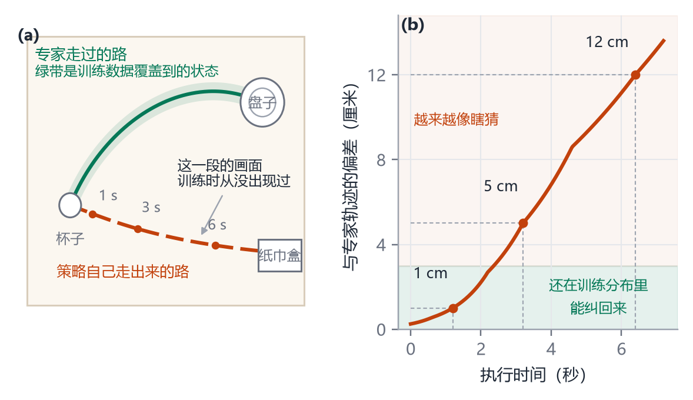
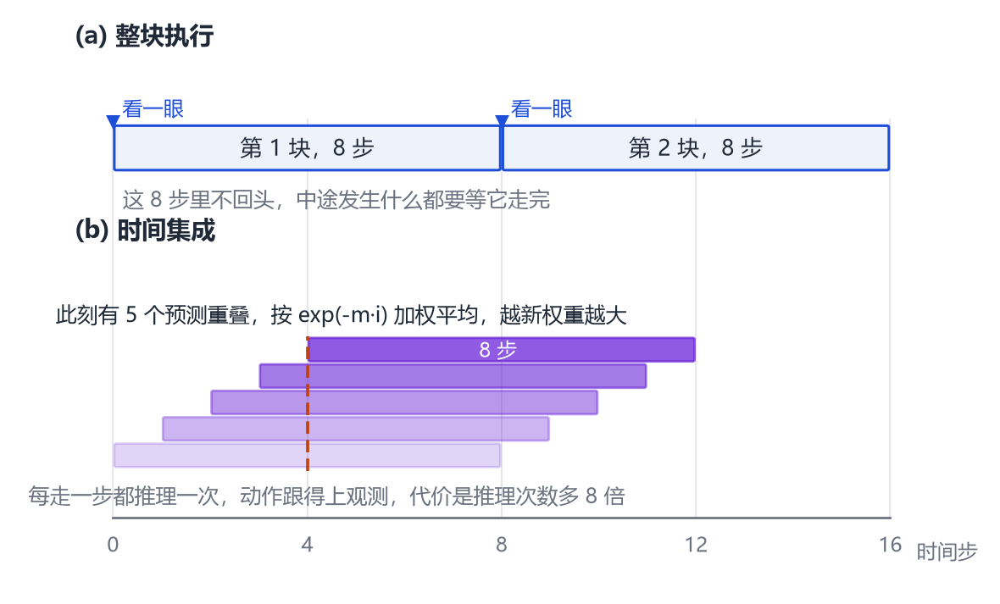
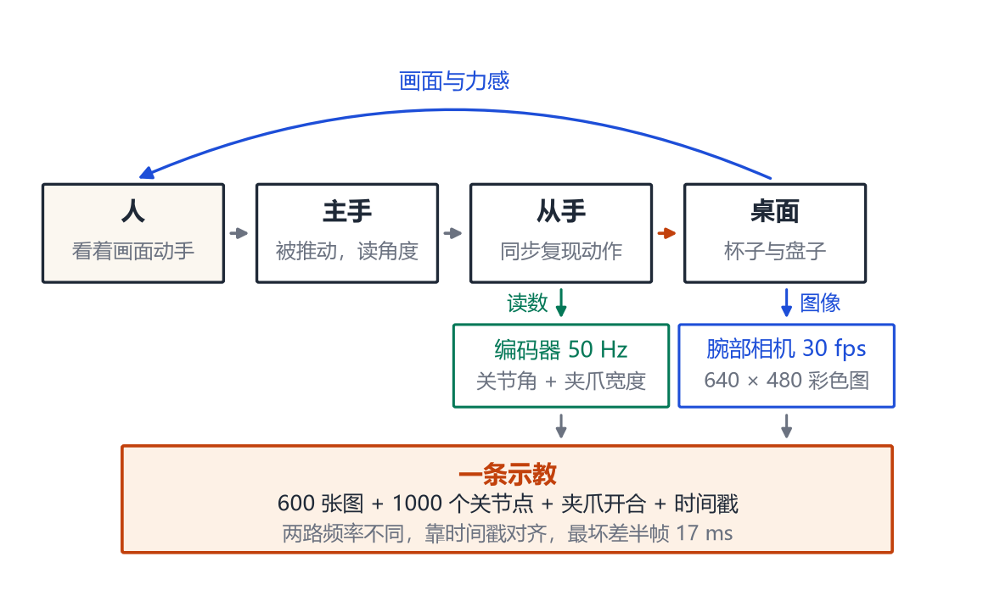

# 第 8 章　跟着人学动作

> **本章导读**：让机器学会一个动作，最省事的办法是有个人在它面前做一遍。这一章顺着这条路把链路走完。一条示教里录下了哪几路数据，频率不一致时误差藏在哪里，照着监督学习训出来的策略为什么上手几十秒就开始偏，DAgger 用什么代价换回纠偏能力，动作块和扩散策略各自在补哪个洞，以及为什么最近两年采数据的成本掉了一个数量级。

## 8.1 一条示教里录了什么

假设桌上的马克杯要放进盘子。你握住一台可以被推着走的机械臂，业内把它叫主手，把杯子端起来、平移、放下，用了 20 秒。旁边一台结构相同的臂叫从手，同步做同样的动作。这 20 秒被存成一个文件，就是一条示教。

这条示教里通常有四路数据。

- 图像，腕部相机每秒 30 帧，一帧间隔 33 毫秒，20 秒 600 张，每张 640×480。
- 关节角，从手的 6 个编码器每秒读 50 次，相邻两点隔 20 毫秒，20 秒 1000 个点。
- 夹爪开合，两指间距从 0 到 80 毫米，和关节角同频。
- 时间戳，每一路数据都记下采集的那一瞬。

动作侧一共是 1000 行、每行 7 个数，6 个关节角加 1 个夹爪宽度，存成 CSV 不到 100 KB。图像侧按原始像素算，一张 640×480 的彩色图是 640×480×3 字节，约 0.9 MB，600 张就接近 550 MB，所以实际存压缩视频。两条通道的体量差三个数量级，这件事会一路影响后面所有的工程选择，训练时数据加载往往卡在视频解码上，而不是卡在 GPU 上。

两路频率不一样，第一个麻烦就来了。30 和 50 不整除，一帧图像落在两个关节采样点之间是常态。假如粗暴地取最近的关节点配对，最坏情况下图像拍摄时刻和配给它的关节角差了半帧，也就是 16.7 毫秒，按 17 毫秒算。这 17 毫秒里手移动了多少，取决于手有多快。搬杯子时末端速度约 0.2 米每秒，17 毫秒是 3.4 毫米，可以接受。快速抓取时末端速度能到 1 米每秒，17 毫秒就是 17 毫米，比杯壁还厚。这种错位在数据里看不出来，模型却会把它当成规律学进去，表现是动作总慢半拍，抓取时永远差一点。

解决办法不是把相机帧率堆上去，而是让所有通道共用一个时钟，每路数据记下真实时间戳，训练前按时间戳插值到同一个时间网格。相机便宜，帧率上不去；编码器便宜，频率可以高；时间戳不要钱。缺了时间戳，后面只能靠猜。

采集频率为什么定在 50 Hz，ACT（2023）做过一个很干净的对照。同一批任务，把遥操作频率从 50 Hz 降到 5 Hz，人完成任务的时间多了 62%。频率低，人就得提前想好下一步，做出来的轨迹更粗，示教质量直接下降。这条数字说明采集频率不是够用就行，它决定人能不能把动作做细，而模型的上限由示教的细致程度决定。

## 8.2 行为克隆就是监督学习

把示教切成一对一对的样本，观测进去、动作出来，训练一个网络让输出尽量接近标签，这个做法叫行为克隆，英文 behavior cloning，简称 BC。损失函数通常是均方误差，和你在做一个回归任务时写的一模一样，差别只有两处，输入是图像加关节角，输出是 7 个连续数而不是一个类别。

所以它跑起来不奇怪，奇怪的是它能跑多久。答案通常很短，几十秒到一分钟就开始出岔子。

原因在于监督学习有一条前提，训练数据和测试数据来自同一个分布。图像分类里这条前提大致成立，猫的照片训练、猫的照片测试，光照角度有差别不影响。行为克隆里它从一开始就不成立。训练时的观测全部来自专家，专家把杯子端得很稳，画面里杯子的位置永远落在某个范围内；测试时的观测来自策略自己，策略一偏，画面就变了，而新画面不在训练集里。这个现象叫协变量偏移，图 8-1 把它画了出来。

<figure class="fig">

<figcaption><b>图 8-1</b>　协变量偏移的发生过程。左图绿带是训练数据覆盖到的状态范围，策略一旦离开这条带子，看到的画面就不再是它学过的样子。右图是偏差随执行时间的量级，三个点的数值为示意。</figcaption>
</figure>

偏一点点会怎样，可以按量级想。第一次执行，夹爪位置比专家偏了 1 厘米。1 厘米在 640×480 的画面里只有十几个像素，看起来和训练时几乎一样，网络输出的动作还在合理范围内，甚至能往回纠一点。偏到 5 厘米时，杯子在画面里的位置、透视角度、被手腕挡住的比例都变了，输入落到训练分布的边缘，输出开始不靠谱，纠偏的方向可能还是反的。偏到 12 厘米时，画面里杯子的位置在任何一条示教里都没出现过，输出基本等于瞎猜，这时候要么夹空，要么把杯子推下去。

这三步不是等距的，越往后越陡。DAgger（2011）给过一个最坏情况的结论，行为克隆的总误差随回合长度按平方增长，写成符号是 $T^2\epsilon$，$T$ 是回合里的步数，$\epsilon$ 是单步模仿误差。同样的单步误差，回合长一倍，总误差涨四倍。这是上界，真实系统没有那么惨，但它指出的方向是真的，回合越长、精度要求越高，纯行为克隆越吃力。

那为什么它还是主流做法。因为工程性质好，采完离线训练，过程稳定，不需要仿真器，不需要人在环，模型结构和损失函数都是现成的。ACT（2023）用 50 条示教、总共十分钟的数据，在 6 个接触密集的真机任务上做到 80% 到 90% 的成功率，靠的是一整套工程手段，动作块、时间集成、多相机，而不是换掉行为克隆这个框架。

失败场景也得说清楚。任务里有一个需要精确对位的动作，插电池、穿扎带、把插头插进插座，这类动作的有效区间只有一两毫米。这种任务上纯行为克隆掉得很快，因为任何一点偏差都会把状态推出分布，而出了分布之后没有把机器拉回来的机制。策略能学会怎么走对，学不会走错之后怎么回来。

## 8.3 在你走错的地方补标注

DAgger（2011）的想法一句话说完，让新手自己开，专家坐在副驾，随时告诉它这个状态下应该怎么做。

流程是一个循环。用现有数据训出策略 π1，让 π1 在真实环境里跑，把它经过的每一个观测记下来，请专家在这些观测上标出正确动作，把这些新样本加进数据集，训出 π2，再重复。要害在于新样本的观测来自 π1 而不是来自专家。跑几轮之后，数据集覆盖的就不只是专家会经过的状态，还包括新手容易走错到的状态，策略在这些状态上也有标签可学。

这个差别的分量可以从误差的量级看出来。纯行为克隆的总误差随回合长度按平方涨，DAgger 能把它压到按线性涨。同样的单步误差，回合拉长十倍，前者涨一百倍，后者只涨十倍。代价是数据集里必须出现那些走错的状态。

代价也很具体。专家必须在线，每训一版新策略就要重新标一遍，人工成本随迭代次数线性上涨。真机上还有安全问题，一个没训好的策略在桌上乱撞，人得随时准备按急停。所以真机上的 DAgger 通常做成小范围、有保护、人来接管的形态，机器人跑，人盯着，一旦要出事就接手，接手的这一段恰好就是最需要的标注。

几个变体值得知道名字。人在环的版本让人随时接管，接管段直接当标注用；只在策略不确定时才叫人的版本，把专家时间花在刀刃上；用人类干预数据做离线训练的版本，把在线过程压成一次采集。共同点是都承认一件事，光有专家轨迹不够，还需要策略自己走出来的轨迹。

工业上更常见的替代办法是扩大初始状态的覆盖。与其在线请教专家，不如把杯子摆在桌上 20 个不同位置，每个位置采 5 条，一次采完。这样策略见过的偏离状态是设计出来的，不是跑出来的，成本可控，缺点是覆盖不到策略自己发明的那些奇怪状态。数据缩放（2024）的实验支持这条路线，环境和物体的多样性比单场景的样本数量更有用。

## 8.4 动作怎么表示，为什么要预测一段

网络输出的 7 个数到底是什么，有几种选法，选哪种直接影响学习难度。

第一种是关节位置，直接给 6 个关节的目标角度加夹爪宽度。好处是不用做逆运动学，网络输出什么机械臂就去哪，不会出现目标位姿算得出来但关节解不出来的情况。坏处是和具体这台机器绑死，换一台臂，7 个数的含义全变，模型没法迁移。

第二种是末端位姿增量，给末端在笛卡尔空间走多远、转多少，加夹爪宽度。好处是跨本体，同一套数据可以喂给不同的臂，UMI 这类工作就是靠它做跨本体迁移的。坏处是执行前要解一次逆运动学，靠近奇异位形时会出问题，第 2 章讲过的那种猛转。

第三种是末端绝对位姿，位置加四元数。它比增量稳，不会累积漂移，但对相机标定误差更敏感，标定偏 1 厘米，动作就整体偏 1 厘米。

表示选完，还有一个更影响成败的问题，一次预测几步。

最笨的做法是每一步都只预测一步。看一帧，输出 7 个数，执行，再看下一帧。它在两处吃亏。一是抖动，相邻两次预测之间没有任何约束，输出会在正确值附近跳。二是人的示教里有停顿，人端着杯子等另一只手过来，这半秒里关节角几乎不动，单步策略会学到在这个位置应该停，于是它在别的位置也倾向于停，动作变得黏。

ACT 的做法是一次预测未来 k 步，这叫动作块，action chunk。策略建模的东西从给定观测输出一个动作，变成给定观测输出一段动作。ACT（2023）的消融实验里，关掉时间集成、只改动作块长度，k 等于 1 时成功率 1%，k 等于 100 时 44%。同一个模型、同一批数据，只改这一个超参，差出四十多个百分点。原因有三层，有效预测视野缩短了 k 倍，误差累积的机会少了；一段动作内部天然连贯，抖动没了；推理频率降低 k 倍，同样的算力可以换一个更大的模型。

预测出一段之后怎么执行，有两种做法，图 8-2 画了对比。

<figure class="fig">

<figcaption><b>图 8-2</b>　动作块的两种执行方式。上图每执行 8 步才重新观察一次，反应慢但推理最省；下图每走一步都推理，把重叠的多个预测按指数权重平均，平滑但推理次数翻倍。时间步数量为示意。</figcaption>
</figure>

整块执行最直接，预测 k 步，全部走完，再看一眼，再预测下一段。推理负担最轻，每 k 步才算一次。问题是反应慢，中途有人把杯子挪了、物体滑了，机器人要等这一段走完才知道。

时间集成是 ACT 用的办法。每一步都推理一次，得到一段新的 k 步预测，同时之前几次推理对当前这一步的预测还没过期，把这些预测按权重加起来，越新的权重越大，权重按指数衰减。这样每一步都用上了最新观测，动作又是多条预测的平均，所以平滑。代价是推理次数变成 k 倍，每一步都要跑一次网络，所以策略网络不能太大。ACT 用了 8000 万参数，在 50 Hz 的节奏下每一步只有 20 毫秒预算。

k 取多大也有讲究，太小解决不了抖动，太大又反应慢。Diffusion Policy（2023）的实验里最优点是 8 步，配合 10 Hz 的推理频率，每条命令在控制器里线性插值到 125 Hz 再执行。两个数字放在一起看很有意思，策略每秒只出 10 次主意，底层每秒执行 125 次，中间靠插值接上。想得慢、动得快，这就是第 3 章那张三档频率表在具体系统里的样子。

## 8.5 扩散策略

前面所有做法都有一个隐含假设，一个观测对应一个动作。真实情况经常不是这样。杯子在正前方偏左，从左边绕过去抓和从右边绕过去抓都对，两个动作差得很远，但都通向成功。

用均方误差训练的网络遇到这种情况会输出两者的平均，也就是正对杯子直着过去，撞上。这不是模型不够大，是损失函数要求的，平方误差的最优解就是条件均值。

扩散策略换了一个思路，把动作生成当成去噪。训练时给专家的一段动作加噪声，让网络学会从加噪的动作里把噪声减掉，条件是这个观测。推理时从纯高斯噪声出发，迭代若干次，每次减掉一点噪声，得到一条动作序列。这和图像生成里的扩散模型是同一个机制，只是生成的不是图，是一段 7 维的关节轨迹。

它处理多峰的办法很朴素。从不同的噪声出发会收敛到不同的模式，左绕和右绕各自是一个吸引域，网络不需要在两者之间做平均，它只需要知道往哪个方向去噪。Diffusion Policy（2023）在 4 个 benchmark 的 12 个任务上平均比之前最好的方法高 46.9%，论文列的第一条理由就是多峰分布的表达能力。

第二个好处是序列一致。一次生成一整段动作，段内的连贯性由生成过程保证，不需要额外加平滑。

代价是慢。去噪 10 次要跑 10 次网络前向，去噪 100 次要跑 100 次。Diffusion Policy 用 DDIM 把推理步数压到 10 步，在一张 RTX 3080 上单次推理 0.1 秒，正好把一个 10 Hz 的周期用完。这个速度放在抓放任务上够用，放在需要 50 Hz 反应的任务上不够。后续改进基本都在这条线上做减法，用更少的采样步数，用 flow matching 换掉扩散，或者把动作块叠上去，用一次生成一段来摊薄单次推理的成本。

一句话概括这一节的取舍。行为克隆学的是平均该怎么做，扩散策略学的是能做的方式有哪几种、各自多大概率，前者的输出是一条确定的轨迹，后者的输出是一个可以采样的分布。

## 8.6 采数据为什么突然便宜了

前面五节讲的都是算法，这一章真正卡住工程的是钱。一套能采数据的双臂系统，几年前要几十万人民币，只有大实验室买得起，数据量自然上不去。

ACT（2023）那套 ALOHA 把门槛拉下来了。它用 4 台现成的 6 自由度桌面臂，两台主手两台从手，加 3D 打印的夹爪和支架，整套成本 2 万美元以内。价格能压下来靠两件事，主手除了电机和编码器不要别的东西，人被推着动的时候它就是一个被动的手柄；夹爪是打印件，坏了换一个。这套系统采出来的数据训出的策略，能开调料盒、插电池。

Mobile ALOHA（2024）在同样的思路上加了移动底盘和全身遥操作，成本 3.2 万美元，含电源与机上算力，能做的事从桌面扩到开柜门、按电梯、擦桌子。

UMI（2024）走得更远，干脆不要机器人。一个手持夹爪，上面装鱼眼相机和几块标记，人拿着它在真实环境里做任务，末端位姿靠相机拍到的标记加 SLAM 反推，夹爪开合靠拍两指的间距测出来。3D 打印件的物料成本 73 美元，GoPro 相机和配件 298 美元，加起来不到 400 美元。回到工位把数据里的末端轨迹和真机接口对齐，策略就能部署。

<figure class="fig">

<figcaption><b>图 8-3</b>　遥操作采集链路。人推主手，从手复现，腕部相机与关节编码器分别记录图像和动作，汇成一条带时间戳的示教。成本从 2 万美元的双臂系统降到 UMI 的几百美元。</figcaption>
</figure>

效率的差距在数字上很直白。UMI 论文的吞吐对比里，同一组任务用 UMI 采集每小时 111 条示教，人手直接做（不带机器人，只记录人的手）每小时 231 条，用空间鼠标遥操作只有 35 条。空间鼠标那条还有一个限制，它做不了动态抛接，不是人不会，是接口的带宽把人的反应卡住了。UMI 用 12 人时、3 个采集者、30 个不同场景采了 1400 条，训出跨环境的倒杯子策略。

采集便宜之后，数据量和效果的关系才有条件问。数据缩放（2024）收了 4 万条示教，做了 1.5 万次真机测试，结论是泛化能力随环境数、物体数按幂律涨，而且多样性比单点数量重要得多。论文给的一个配置是 32 个环境各采 50 条，一共 1600 条，训出来的策略在没见过的环境、没见过的物体上到 90% 成功率。这个数字比要几十万条的直觉乐观，前提是那 32 个环境真的不一样，而不是同一个桌子换了块桌布。

表 8-1 把几种示教方式摆在一起看。

**表 8-1**　几种示教采集方式的对比。成本取自各自论文，采集速度取自 UMI 论文的吞吐对比，任务不同数值会变。

| 方式 | 硬件成本 | 位置精度 | 采集速度 | 能做的任务 | 主要毛病 |
|---|---|---|---|---|---|
| 主从同构遥操作（ALOHA 2023） | 整套 2 万美元以内 | 厘米级，靠人眼闭环 | 中等 | 接触密集的双臂精细活 | 一台机器只能采自己的数据 |
| 全身遥操作（Mobile ALOHA 2024） | 3.2 万美元 | 同上 | 慢 | 移动加双臂的长程任务 | 占场地，人很累 |
| 手持夹爪（UMI 2024） | 打印件 73 美元加相机 298 美元 | 毫米级，靠 SLAM 反推 | 111 条每小时 | 动态、野外、跨本体 | 没有力反馈，夹爪行程有限 |
| 空间鼠标遥操作 | 几百美元 | 低 | 35 条每小时 | 桌面简单任务 | 做不了动态动作，人很别扭 |
| 纯人视频 | 零硬件 | 没有动作标签 | 极高 | 预训练、表征学习 | 只能学到看得懂，学不到怎么做 |

从这张表能看出一个错位。精度最高的方式不便宜，最便宜的方式精度也不差，因为它干脆绕开了机器人。真正决定的不是传感器好坏，是数据采集时有没有一台机器跟着一起动。有机器，就要为它付钱、为它标定、为它的运动学负责；没有机器，只在部署时对齐一次接口，成本结构完全不同。

这也解释了一个现象，2023 年以后机器人论文里的数据量从几百条涨到几万条，模型参数从几百万涨到几十亿，而真机上的成功率并没有同步涨。多出来的数据大都用在覆盖多样性上，不是用在把单个动作做得更准上。想让一个动作准到毫米，还是得回到人的示教本身够不够细，回到 8.1 节那 17 毫秒的对齐误差有没有处理干净。

回到这一章开头那 20 秒的示教。它值多少钱，取决于你用什么设备录；它有多有用，取决于录完之后有没有人管策略走错的那几步。采集成本降下来解决的是前一半问题，后一半问题还没有便宜的解法。
