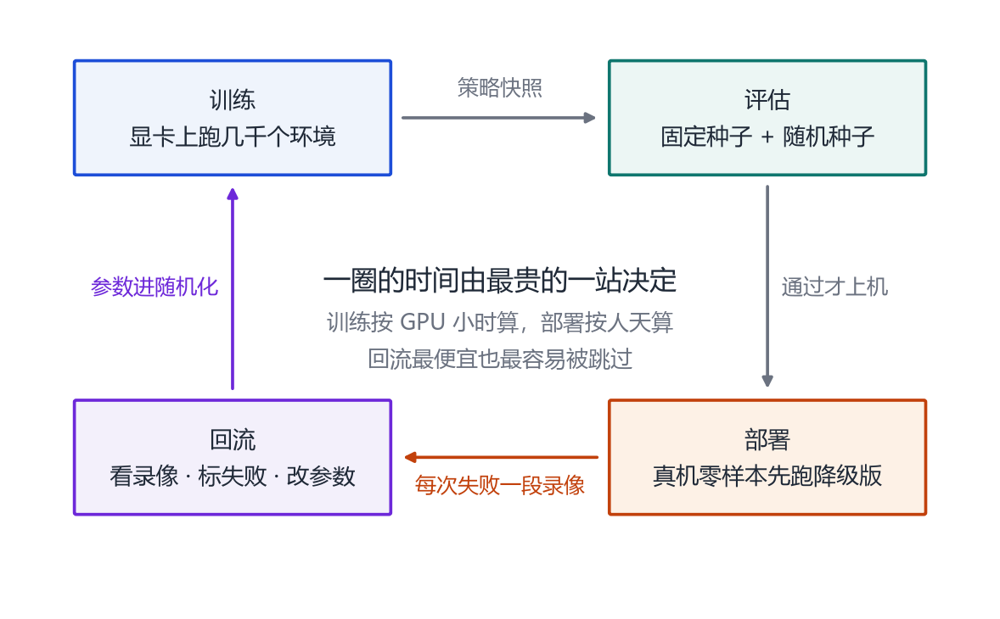
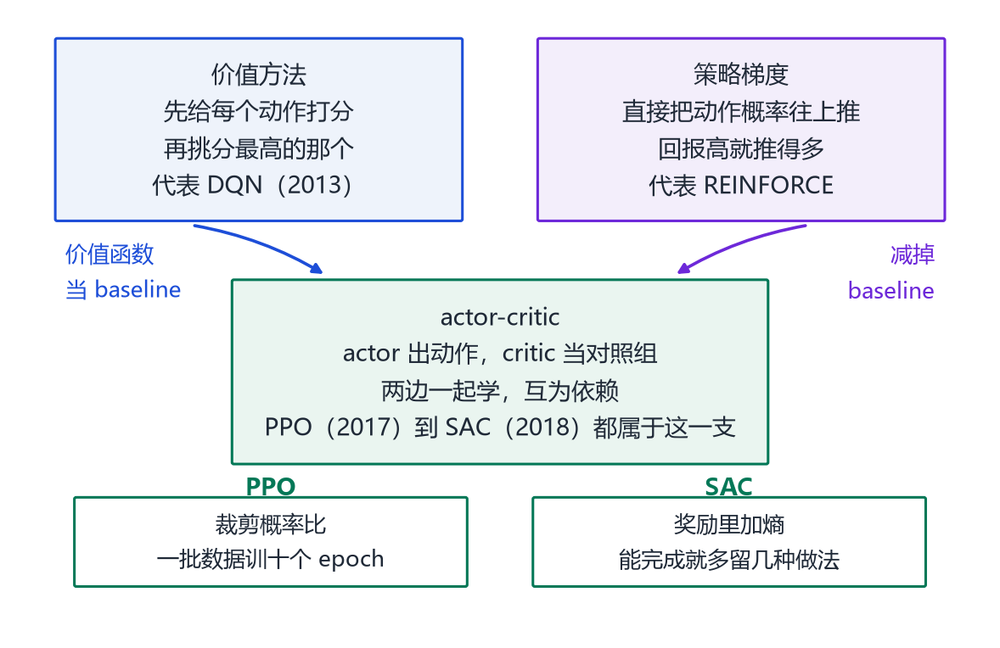
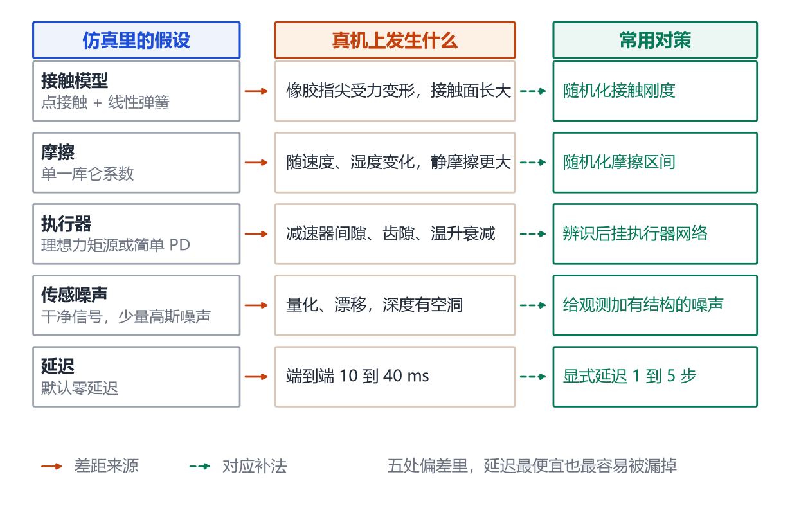

# 第 9 章　强化学习的最小必要知识

> **本章导读**：第 8 章的办法是找人做示范，把轨迹抄下来。没人示范的时候，剩下的只有一件事，试。试错学习只给一个分数，机器人得自己从分数里推出每一步该怎么动。这一章把这条路上的最小必要知识铺开，状态与动作怎么写成一组，值函数和策略梯度各在做什么，PPO 与 SAC 凭什么成为工程主力，以及为什么在机器人上写奖励比写算法难得多。

## 9.1 一个分数能教会什么

桌上摆一个 4 厘米见方的木块，旁边用胶带贴了个圈，任务是把它推进圈里。人看两眼就会，机器不行。你把手伸过去，眼睛盯着方块和目标，手腕自己就调整了角度，几乎不用想。机器人没有这只手，也没有这双眼睛，它手上只有一组数字和一个分数。

第 8 章的办法是找个人做两遍，把轨迹录下来，让模型照着学。要是没人示范，那就只剩一条路，自己试。这一节要回答的问题是，手上只有一个分数，机器人凭什么知道中间每一步该怎么动。

试错学习和监督学习最大的差别在标注。要让模型学会"这一帧该往哪个方向走 3 毫米"，得有人在每一帧上标一个答案，而同一帧画面下合理的动作有一大片，往上推、斜着推、先退一点再推，都能成功。人标不出来，也不该标。能拿到的只有一个分数，方块进圈得 1 分，掉下桌子扣 1 分，其余时间都是 0。

这个分数很吝啬。它只说结果好不好，不说哪一步做对了。把一个 120 步的回合摊开看，分数出现在第 120 步，前面 119 步全是 0，机器人得自己判断这 1 分该记在哪几步头上。记错了，它会把某个侥幸成功的动作当成经验，反复去用。

把这套设定写成数学，需要五个东西，合起来叫马尔可夫决策过程（Markov Decision Process，MDP）。这五样东西其实就是一张世界说明书，谁在动、能动什么、动了会怎样、怎么算好、未来值多少。下面逐个说。

**状态**是机器人此刻知道的全部信息。落到这台桌面臂上，是十来个数字，末端在基座坐标系里的三维位置、夹爪开合度、方块的三维位置、目标点的三维位置。如果改用腕部相机，还要多一帧图像。状态可以理解成打牌时手上的牌，牌越多出牌越有把握；牌少了，两个不同的局面会被看成同一个，动作就会犹豫。

**动作**是能发出的指令，这里是末端的三维速度增量，每 100 毫秒发一次。一次动作有三个数，每个数落在正负 0.05 米每秒之间，合起来是一个连续的立方体，里面有无限多个点。这一点很要紧，后面会看到有一类算法必须把动作一个个数出来，碰上这个立方体就没法用。

**转移**是做完动作之后世界变成什么样。同样推一下，方块滑 2 厘米还是 5 厘米，取决于摩擦、质量和接触点，两次不会完全一样。

**奖励**是环境给的分数，一个标量，可能是正数、负数，也可能是 0。奖励只评价刚才那一步，不指示下一步往哪走。把不该由它承担的任务压给它，会出什么事，9.5 节会用一整节讲。

**折扣**把未来的分折算到今天。γ 取 0.99 时，100 步之后的 1 分在今天只值 0.37 分。10 Hz 的控制下，0.99 相当于只认真看未来 10 秒；想让机器人为 30 秒后的成功放弃眼前那点便宜，γ 得设到 0.995 以上。而 γ 越接近 1，值估计越容易发散，这个矛盾后面还会冒出来。

### 把世界缩到一张方格纸上

要把这五个东西摸清楚，最好先在一个小到能算完的世界里动手。取一块 4×4 的方格，机器人站在某个格子里，每步只能上下左右走一格，走到右下角算成功。状态 16 个，动作 4 个，一张表就装得下全部答案。

想象你在方格纸上画 4 行 4 列，右下角那一格画个圈。机器人从左上角出发，每走一步花 0.1 秒，撞到边界就停在原地。这个世界的全部规则就是这几句话，没有摩擦，没有碰撞，也没有传感器噪声。正因为它简单，你可以在纸上把每一格的价值算出来，算完再回头看公式，公式就变成了记账的格式。

设每步得 0 分，进右下角得 1 分，γ 取 0.9，那么离目标一格的格子值 0.9 分，两格 0.81 分，三格 0.729 分。再远一格是 0.656 分，走到第六格只剩 0.531 分，第十格 0.349 分。折扣的全部含义就在这里，未来的分按距离打折，越远越不值钱。

同一个 1 分，隔 10 步只值 0.35，隔 40 步只剩 0.015。有一个粗算的公式可以记，1 除以 (1 减 γ) 就是机器人认真考虑的步数。γ 取 0.9 是 10 步，取 0.99 是 100 步，按 10 Hz 换算成时间就是 1 秒和 10 秒。设 γ 之前先想清楚，这个任务从开始到出结果要几秒。

一次从开始到结束的尝试叫回合（episode）。抓放任务的回合从机械臂回到初始位姿开始，到抓住、推到位或者超时结束。按 10 Hz 算，120 步就是 12 秒。一个回合就像一局牌，从发牌打到结算，中间不能重开。图 9-1 把这个循环和一条回合摆在一起。

<figure class="fig">

<figcaption><b>图 9-1</b>　上半是智能体与环境的循环，一步交换一次动作与奖励。下半把同一个回合摊成时间轴，成功和超时是两种不同的结束方式。</figcaption>
</figure>

回合的结束方式有两种，得分和超时，这两种要分开处理。超时不是失败，只是时间到了。如果把它当成"终止状态、后续回报为零"，策略会学到一个很坏的习惯，快到时间就赶紧把回合结束掉，因为继续下去可能把已经拿到的分弄丢。

这个坏习惯有个具体的样子。假设回合只剩 3 步，机器人已经攒了 0.5 分，前面还有一个可能把方块推出界的动作。如果超时按"后续为零"处理，它算出继续干下去期望只有 0.4 分，那不如立刻收手，把 0.5 分锁住。视频里会看到机械臂在快到时间时突然缩回去，什么都不做。工程上的做法是超时那一步不做终止标记，只把回报截断，让值函数仍然按"后面还有机会"来估。

还有一件事得在开头说清楚。状态里必须包含做决策需要的一切信息，这个假设叫马尔可夫性。腕部相机装在手上，只看得见局部，同一张图像可能对应两种完全不同的手臂姿态，这时状态是不完整的，学出来的策略会时好时坏。

举个具体的例子。相机只拍到桌沿、方块的一角和夹爪的两根指头，画面里看不出手臂是从左边伸过来还是从上面压下来。这两种姿态下，同样"往前推 2 厘米"的指令，一个会把方块推走，一个会把方块按在桌上。网络看到几乎一样的输入，学到两个相反的答案，成功率就卡在五成上不去。补法很土也很有效，把最近几帧图像叠起来，或者把关节角直接拼进状态向量。

## 9.2 先给每个状态打分

评估再改进，是最顺的思路。给每个状态打一个分，表示从这里出发往后平均能拿多少回报，这是状态价值函数 V(s)。再把动作放进下标，问"在这个状态下做这个动作值多少"，得到动作价值函数 Q(s,a)。这一节要解决的是，未来还没发生的时候，怎么给现在的局面定一个价，再让这个价一步步变准。

Q 比 V 好用，原因很实际。选动作时只需要在几个 Q 值里比大小，既不必知道转移概率，也不必知道方块有多重。V 只告诉你这个局面好不好，不告诉你该往哪走。

这个差别在网格里一眼能看出来。找一个贴着右墙、离目标三格的格子，它的 V 是 0.729。往右走是撞墙，撞完还在原地，Q 等于 0.9 乘 0.729，也就是 0.656。往上走是真走一步，Q 等于 0.9 乘 0.81，也就是 0.729。两个数一摆，方向就出来了，而 V 只有一个 0.729，看不出这个区别。

### 贝尔曼那句话

两个函数之间有一层递推关系，一句话能说完，此刻的值等于这一步拿到的分，加上打折后的下一刻的值。这句话是整个领域的支点，它把无限长的求和压成了相邻两步之间的关系，于是可以拿当前的估计去修正当前的估计，不必等回合结束。

写成符号是这样，$V(s) = r + \gamma V(s')$。逐个读，V(s) 是此刻这个状态的估值，r 是走这一步拿到的分，γ 还是折扣，V(s') 是走完之后那个状态的估值。这个式子叫贝尔曼方程，它没有直接告诉你 V 是多少，只告诉你相邻两个 V 之间必须满足什么关系。拿着这条关系反复迭代，值就会自己走到对的地方。

代数字看一遍。某个格子的 V 现在是 0.60，从它往右走一步得 0 分，右边那格的 V 是 0.729，γ 取 0.9。目标值就是 0 加 0.9 乘 0.729，等于 0.656。原来的估计 0.60 偏低，于是往 0.656 挪一点。学习率取 0.5 的话，新值就是 0.60 加 0.5 乘 0.056，等于 0.628。下一轮 0.642，再下一轮 0.649，几步之后贴着 0.656 不动了。这个"贴着不动"就是收敛的样子。

Q-learning 是最直接的实现。它不评估某条固定策略，直接逼近最优的那张 Q 表。更新式是

$$Q(s,a) \leftarrow Q(s,a) + \alpha\left[r + \gamma \max_{a'} Q(s',a') - Q(s,a)\right]$$

这个式子说的是，新的估计等于旧的估计加上一小步修正。箭头表示把右边的结果写回左边同一格。Q(s,a) 是表里"状态 s 做动作 a"那一格的数。α 叫学习率，控制每次改多少，取 0.5 就是每次只走一半路。r 是刚才那一步真实拿到的分，γ 还是折扣。s' 是动作做完之后落到的状态，max 那一项在这一行四个 Q 里挑最大的。方括号里的差叫时序差分误差（TD error），衡量刚才这一步比预期好多少。正了就往上调，负了就往下压。

拿网格世界的数算一遍。γ 取 0.9，α 取 0.5，某个状态动作对的 Q 现在是 0.40。执行这个动作，这一步没得分，进入的下一个状态里最好的 Q 是 0.90。目标值就是 0 加 0.9 乘 0.90，等于 0.81，误差 0.41，更新后 Q 变成 0.40 加 0.5 乘 0.41，等于 0.605。整个过程只用了一次真实交互和四个数。

把这四步拆开看更清楚。先算目标，0.9 乘 0.90 得 0.81。再算误差，0.81 减 0.40 得 0.41，说明这一格被低估了 0.41。然后打折，0.5 乘 0.41 得 0.205。加上去，0.40 加 0.205 得 0.605。

再算一个反方向的例子。同一格现在的 Q 是 0.605，这次动作把方块推出了桌子，拿到 -1 分，下一个状态是终止，后面的 Q 按 0 算。目标值是 -1，误差是 -1.605，更新后 Q 变成 0.605 加 0.5 乘 (-1.605)，等于 -0.197。一次掉到负数，这个动作下次就不会被优先选了。

用下一步的估计来修正这一步的估计，这个做法叫自举（bootstrap）。它省钱，不必等 120 步的回合跑完，一步交互就能改一次表。代价是一步估歪会往后传染。

传染的速度可以算。假设某个格子的 Q 被高估了 0.2，它左边那一格在下一次更新里会把这个错误学走 0.9 倍，也就是 0.18，再往左 0.162。传十步还剩 0.07，传二十步还剩 0.024。误差不会消失，只会缩，缩得快慢由 γ 决定。

TD 误差是这套机制的体温计，训练时盯着它，正常应该随回合数慢慢变小；一直很大或者在震荡，多半是奖励尺度不对，或者学习率太大。

表格法就是给每个状态动作对存一个数。它在网格世界里完美，在机械臂上立刻崩。6 个关节，每个关节角离散成 60 格，状态空间是 60 的 6 次方，约 4.7×10¹⁰ 个格子，每个格子存一个 4 字节浮点数要 187 GB，这还没算上方块位置和图像。一台 16 GB 内存的笔记本差着一个数量级以上。

更麻烦的是离散化本身有害。关节角被切成 1 度一格，相邻格子的动作差 1 度，控制会一顿一顿地抖。1 度听起来很小，可末端在 0.5 米外时，1 度对应 8.7 毫米的位移，比那个 4 厘米方块的两成还多。控制器在格子边界上来回切换，视频里能看到末端像卡住的秒针那样一顿一顿地走。

所以 Q 得换成一个函数，输入状态、输出数值，用神经网络拟合。DQN（Deep Q-Network，2013）干的就是这件事，一个卷积网络吃 84×84 的灰度图，输出每个动作的 Q 值。直接这么训会失败，原因有两个，都不难想象。

**不加回放会怎样。** 10 Hz 下连续 30 帧只有 3 秒，画面几乎一样，网络在这 30 条上训一轮，参数就被这 3 秒主导。等它转到下一个角落，前面学的东西被覆盖掉，这就是灾难性遗忘。更浪费的是每条经验只用一次就丢。DQN 的解法是经验回放（experience replay），把每一步的状态、动作、奖励、下一个状态塞进缓冲区，训练时从里面随机抽小批量。原论文的缓冲区是最近 100 万帧，批量 32 条。随机抽样把时间上的相关性打散，同一条经验也能被反复用上几次，一举两得。

**不加目标网络会怎样。** 更新式里的目标含有正在被训练的网络本身，网络一改，目标跟着跑，像在追一个自己也在跑的东西。目标里的 max 项也在涨，Q 就被推着往上爬，爬得越快目标越高。训练曲线上常见的样子是先慢慢涨，涨到某个点突然断崖，Q 冲到几百再变成负数。表 9-1 里"回报先涨后崩"说的就是这件事。DQN 后来的期刊版本加了一个目标网络，冻结一份旧参数，每隔 1 万步同步一次。工程上更常见的做法是软更新，每一步把旧参数往新参数挪千分之几。

这两个技巧听着像实现细节，实际是深度强化学习能跑起来的前提。原论文的配置里还有几个数可以参考，探索率从 1 线性降到 0.1 用了 100 万帧，总共训练 1000 万帧，7 个 Atari 游戏里有 6 个超过此前所有方法。1000 万帧按每秒 60 帧算是 46 小时，2013 年玩一个游戏要这么久。

DQN 有个硬限制，它只认离散动作。要对动作取 max，动作得能一个个枚举出来。机械臂的关节速度是连续的，取值有无穷多个，max 没法算。把连续空间切成 21 格也只是近似，切得越细动作越多，max 越贵。这个限制直接推着人换一条思路。

## 9.3 直接改策略

既然最终要的是策略，那就把策略参数化，直接优化它。让网络读入状态，输出高斯分布的均值和标准差，动作从这个分布里采样，然后调参数，让高回报的动作出现得更频繁。这一节要解决的问题是，动作连续、没法枚举的时候，怎么绕开那个 max。

高斯分布在这里的用法很朴素。网络输出 6 个数当均值，另外 6 个数当标准差，末端三个方向的位移和三个方向的转角各有一组。均值是"最想做的动作"，标准差是"有多不确定"。训练初期标准差很大，动作乱撒；学会之后标准差收得很小，动作基本贴着均值走。

难点在于回报不可微。奖励来自环境，中间隔着一整个物理世界，梯度传不回来。你不能问环境"刚才那个动作要是再大百分之一，分会高一点吗"，只能问"刚才那个动作拿了多少分"。梯度到这里断了。

绕过去的办法叫对数导数技巧，把梯度写成可以用采样估计的形式

$$\nabla_\theta J(\theta) = \mathbb{E}\left[\sum_t \nabla_\theta \log \pi_\theta(a_t\mid s_t)\, A_t\right]$$

其中 A 是优势函数。式子读起来很简单，A 为正说明这个动作比平均水平好，就把它的对数概率往上推；为负就往下压。梯度只穿过策略网络，不穿过环境。这类方法统称策略梯度，最朴素的实现叫 REINFORCE。

逐个符号看。θ 是策略网络的参数，几万个浮点数。J(θ) 是这批数据的平均回报，优化的目标是让它变大。π_θ(a|s) 是在状态 s 下选中动作 a 的概率，读作 pi of a given s。∇ 是求梯度，指向坡度最陡的方向。A_t 是第 t 步的优势，回答"这一步比平均水平好多少"。

这条式子在实践里方差大得吓人。同一条策略跑两次，一次回报 10，一次 3，同一个动作可能一次被推、一次被压。更根本的问题是信噪比，一个 120 步的回合里，成功与否只有一个比特的信息，把它平摊到 120 个动作上，每个动作分到的那点信号早被噪声淹没了。

降方差的标准手段是减一个 baseline。选一个只依赖状态、不依赖动作的数 b(s)，从回报里减掉它，梯度的期望不变，因为动作概率的梯度在动作上求和恰好为零。最常用的 baseline 就是状态价值函数 V(s)。减掉一个数为什么不影响结果，用打分的场景能看明白。给一批动作各打一个分，全体减 5 分，谁好谁坏的排序一点没变，但所有分数都靠近 0，梯度就不容易被个别大数带跑。

减完之后剩下的东西有了名字，叫优势函数（advantage function），平时简称优势，它回答的是"这个动作比这个状态下的平均水平好多少"。

好多少这个问法很关键。一个状态本身就难，平均只有 1 分，动作选得还行拿到 2 分，那它值得鼓励；另一个状态很容易，平均 10 分，这个动作只拿到 8 分，那它该被压制。用绝对回报分不出这两种情况，因为 8 比 2 大得多，可它的实际表现更差。

这就是 actor-critic 的来历。actor 是策略网络，负责出动作；critic 是价值网络，负责打分当对照组。actor 用 critic 算出的优势更新，critic 用 TD 误差更新。图 9-2 把三条路线摆在一起。

<figure class="fig">

<figcaption><b>图 9-2</b>　只学值、只学策略、两者都学，三条路线的分工与各自的短板。图下半是这一支的两个工程主力，分别用不同的办法抑制更新过猛。</figcaption>
</figure>

两条路各补了一半，代价是两个网络互相拖累。训练初期 critic 很不准，actor 会跟着学歪；actor 一变，critic 面对的数据分布也跟着变。调这两个网络的学习速度，是这类算法最花时间的部分。

PPO（Proximal Policy Optimization，2017）要解决的是步长。策略更新一步，采样分布就变了，旧数据立刻作废，所以朴素策略梯度采完一批只能用一次；步长太大又会把策略推到再也采不到好数据的地方。它的办法是给概率比加一道夹子，把新策略与旧策略对同一个动作的概率之比限制在 0.8 到 1.2 之间，超出去的部分不给梯度。这样同一批数据可以安全地反复训十个 epoch，实现又比信赖域方法简单得多。

夹子的作用可以用一组数看清。旧策略给某个动作的概率是 0.30，新策略训了一轮给到 0.45，比值 1.5，超出 1.2 的上限，这一条样本的梯度被截断。优势为负时夹子换到 0.8 那一侧，只允许把概率压到旧值的八成。比值落在区间内时，梯度原样通过。

常用配置是学习率 3×10⁻⁴、每轮采 2048 步、训练 10 个 epoch、小批量 64。折扣 0.99，广义优势估计（GAE）的 λ 取 0.95，λ 控制优势估计里偏差与方差的取舍，0.95 意味着优势里大约混进了 20 步的回报。

SAC（Soft Actor-Critic，2018）走另一条路，它在奖励后面加一项策略的熵，让智能体在能完成任务的前提下尽量保留随机性，随机性带来探索，也让策略遇到扰动时有几种备选做法。工程上还配了双 Q 取小值，防止 Q 被高估，以及 tanh 压缩的高斯，让动作不会冲出关节限位。论文里的通用配置是学习率 3×10⁻⁴、批量 256、折扣 0.99、目标网络软更新系数 0.005、两个隐层各 256 个单元、回放缓冲一百万条。

表 9-1 把三者摆在一起，写"未报"的格子是原论文没给这个数。

**表 9-1**　DQN、PPO、SAC 的对比。

| 项目 | DQN（2013） | PPO（2017） | SAC（2018） |
|---|---|---|---|
| 数据来源 | off-policy，存下来反复抽 | on-policy，采完即弃 | off-policy，存下来反复抽 |
| 动作空间 | 离散，要能枚举 | 连续或离散 | 连续 |
| 关键技巧 | 经验回放、目标网络 | 概率比裁到 0.8 至 1.2 | 最大熵、双 Q、tanh |
| 回放缓冲 | 100 万帧 | 无，采完即弃 | 100 万条 |
| 批量 | 32 | 64 | 256 |
| 学习率 | 未报 | 3×10⁻⁴ | 3×10⁻⁴ |
| 折扣与 λ | 未报 | γ 0.99，λ 0.95 | γ 0.99 |
| 常见场景 | 游戏、组合决策 | 运动控制、操作 | 精细操作、真机微调 |
| 出问题时的样子 | Q 值发散，回报先涨后崩 | 策略塌缩，动作方差归零 | 前几百轮毫无动静 |

工程上的顺序通常是先用 PPO 把流程跑通。它的超参在几十个任务上表现一致，失败了也比较容易判断是奖励写错还是网络太小。SAC 的样本效率更高，但训练曲线常常前几百轮一动不动，然后突然上去，排查起来更费劲。等流程通了，再考虑换 SAC 省样本。

## 9.4 机器人身上的三件麻烦

算法本身已经相当成熟，开源实现遍地都是，接口也不复杂。真到机器人身上，麻烦集中在三个地方。这一节要说明的是，这三件事都不在算法里，却决定一个项目能不能做完。

**奖励太稀。** 抓取任务的奖励常常写成"抓住给 1，其余给 0"。这是最诚实的写法，也是最难学的写法。7 个关节加上方块位置，十几维的连续空间，随机试到"抓住"这个事件的概率接近于零。

把这个概率估一遍。工作空间按 0.6 米见方算，夹爪要落在方块周围 5 厘米的范围里才有机会夹住。三个方向乘起来是 (0.05/0.6) 的三次方，约 0.0006，一千七百次里撞上一次。这还只算了位置，姿态和接触力都还没算。整件事就像蒙着眼在房间里找开关，按对了灯才亮，其余时间没有任何反馈。人还能靠记忆和推理缩小范围，Q 表里没有这种能力。

三种对策都在用。一种是示范引导，先用几十条人的示教把策略放到任务附近，或者把示教做成额外的辅助损失。一种是课程学习，把任务拆成难度递增的序列，从"手移到方块上方"学到"抓住"，再学到"搬走"。一种是奖励塑形，加中间项把信号变密，代价是有可能改掉任务目标，9.5 节讲这件事的坑。

**样本太贵。** PPO 在 MuJoCo 上一个普通运动任务要 100 万步起步，复杂的操作任务到千万步，也就是 278 小时，十一天半。10 Hz 的真机跑 100 万步是 27.8 小时不停机，这 27.8 小时里减速器在磨损，夹爪在开合，相机在发热。DreamerV3（2023）代表另一条思路，先学一个世界的模型，再在模型里想象未来、在想象里练策略，一套固定超参跨 150 多个任务，模型规模从 1200 万到 4 亿参数，还在 Minecraft 里从零学会了采钻石，奖励只有稀疏的完成信号。它的意义不在某个分数，而在于说明强化学习可以不必把真机当练习场。

**真机会坏，人也会伤。** 强化学习的探索，本质是故意犯错，而真机上犯错可能撞坏几万块的设备，也可能碰到站在旁边的人。硬的手段写在控制器里，急停按钮、力矩上限、工作空间盒子、速度限制，这些约束不交给策略去学。软的手段是安全过滤器，策略输出的动作先投影到安全集合里再发下去；还有仿真预训练加真机小幅微调，让真机上只做百分之几的探索。人形机器人（2023）的做法更彻底，在几千个随机化的仿真环境里训练，训练阶段完全不碰硬件，训练完直接零样本搬上真机。

<figure class="fig">

<figcaption><b>图 9-3</b>　36×36 网格上表格 Q-learning 的实测曲线，8 个随机种子。稠密奖励第 15 个回合就到 0.79，稀疏奖励第 170 个回合才过半，阴影为一倍标准差。</figcaption>
</figure>

读这张图能看出三件事。稠密奖励第 15 个回合贪心成功率就到了 0.79，稀疏奖励要到 170 个回合才过半，差了一个数量级还多。两条最终都上去了，稀疏那条到 600 回合追到 0.98，说明稀疏奖励不是学不会，是慢。阴影的宽度也不一样，稀疏那条前 200 回合的标准差一直在 0.1 上下，意味着同样的代码换个随机种子，这次学会下次可能学不会，这种不可复现性在论文里经常被平均值盖住。

还得提醒一句，这只是一个 36×36 的方格，1296 个状态、4 个动作，连障碍物都没有。真实机械臂的状态空间比它大十几个数量级，差距不会停在倍数上，而是变成"能不能学会"。

## 9.5 一个奖励能教出什么

把上面这些落到一个具体任务上，看一个奖励是怎么教出坏行为的。桌上一个方块，机械臂把它推到目标点，误差 2 厘米以内算成功。动作是末端三维速度增量，10 Hz，一个回合最长 10 秒。这一节要回答的是，一个看起来很合理的奖励，怎么会教出让人哭笑不得的动作。

最直觉的奖励是离目标越近越好，写成 $r = -\|p_b - p_g\|$，其中 $p_b$ 是方块位置，$p_g$ 是目标点。两个位置都是三维向量，减完取长度，单位是米，所以这个数永远小于等于 0，越接近 0 越好。跑起来会看到一堆坏行为，每一个都能从奖励函数里读出原因。

**顶着方块不动。** 不动的话距离不变，扣分是个常数；乱动可能把方块推远，扣得更多。在折扣下保持现状最划算，于是机器人学会了不动。视频里能看到末端贴着方块停住，十秒只挪两毫米，方块离目标还有 8 厘米，每步稳定扣 0.08 分。训练曲线很平，看起来收敛了，其实什么都没学会。

**手贴在方块旁边磨蹭。** 如果奖励里还加了一项"末端到方块的距离"，两个距离同时变小就能拿高分，机器人把手停在方块边上，一个动作都不做，分数还挺好看。它会先把手移到方块旁边停住，因为再往前推会让方块动，方块一动可能离目标更远。

**把方块往自己这边推。** 这条最隐蔽。目标恰好在机器人这一侧时，"接近目标"和"接近自己"在不少状态里能同时满足，策略会找到一个既省力又刷分的姿势，视频里像在推，方向是错的。具体一点，目标点离机器人 20 厘米，方块在 35 厘米处。机器人把手往回收，方块被带着走近 15 厘米，距离项一路变小，看上去在完成任务。

**沿等距线绕圈。** 距离是个标量，没有方向。沿着以目标为圆心的弧线来回移动，距离不变，奖励不变，但它在动，看起来还挺努力。机器人会在半径 12 厘米的圆上来回滑，一回合滑二十几个来回，成功率始终是 0。

修的办法是把奖励拆成三项，各有各的职责。第一项是距离，提供稠密的学习信号，权重 α 取 1.0，距离以米计，取值落在 0 到 1 之间。第二项是成功，只在成功那一步给一个大的正数，β 取 10 到 100，保证最优策略真的是"把方块推到目标"，而不是"停在附近刷距离分"。第三项是动作惩罚，压住抖动，也让顶着不动变得不划算，η 取 0.01 到 0.1。

三个权重各有一个失效方向。β 太小，机器人学会停在 3 厘米处刷分，成功率上不去；β 太大，距离项被淹没，又退回稀疏奖励；η 太大会把探索压死，机器人学会"最小动作"这个安全策略，任务永远做不完。

还有一个更干净的写法，叫基于势能的奖励塑形（potential-based reward shaping）。不随便加距离项，而是加一个势能差。势能 Φ 只依赖状态，每一步额外加上的量，是打折后的下一刻 Φ 减去此刻 Φ。取 Φ 为到目标距离的相反数，就得到靠近给正分、远离给负分。这个改法有个好性质，它不改变最优策略，只是把信号变密，所以可以放心加引导，不必担心把任务目标改掉。

塑形也有陷阱，陷阱通常在 Φ 里塞了不该塞的东西。"把方块推向自己"那个行为，其实就是势能写错了，它奖励的是方块靠近目标，而机器人用了一个让方块靠近自己的方式去满足它。判断标准很朴素，把学到的策略录下来看，如果人看着觉得它在作弊，那它确实在作弊，奖励写错了。

这一节的结论可以压成一句，强化学习在机器人上的难点不在算法，在把物理任务翻译成一个不会教出坏行为的奖励函数。这件事目前主要靠人，靠反复看视频、改奖励、再训一遍，一轮下来常常是几天。

还有一个数字值得记住。一次训练动辄几百万步、几小时到几天，而人学推方块只需要看两次示范。差距不在算法优劣，在信息渠道。试错只用到"结果好不好"这一个比特，示范用的是"每一步该怎么动"这一整条轨迹。这也是为什么真机上的强化学习几乎都从示教或者仿真起步，第 10 章讲仿真这条路。
