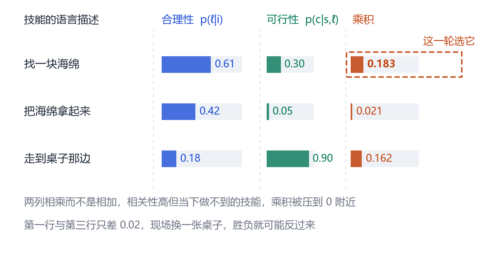
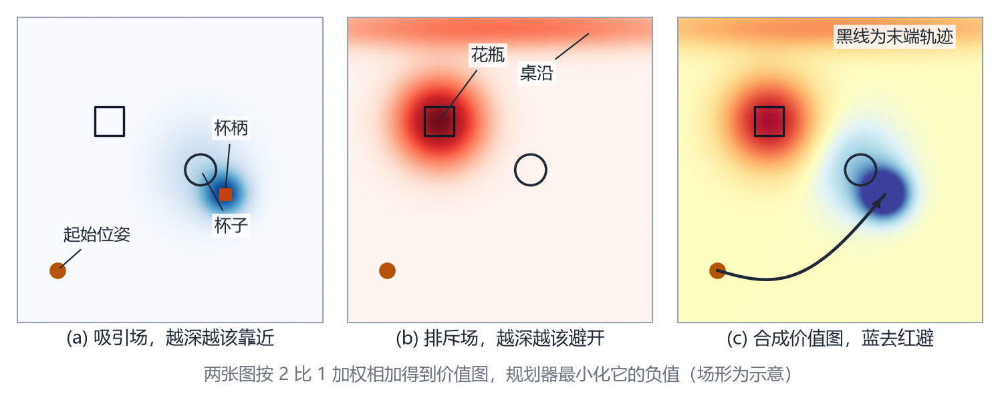
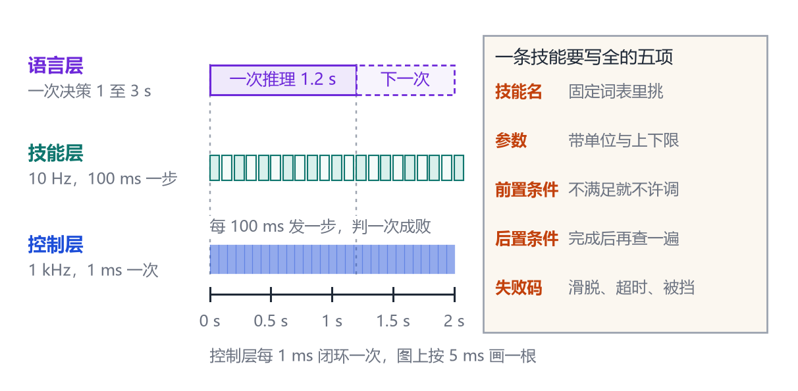

# 第 10 章　语言模型当大脑

> **本章导读**：让它把桌上收拾一下，腾个位置出来，它会自己想到湿抹布得先拧一把，也会想到盒子可以压扁了再塞进柜子。这类常识语言模型比任何控制算法都强，可它算不准 7 厘米和 8 厘米的差别，也不知道自己的建议落到第 3 个关节上是什么角度。这一章讲怎么用它擅长的那一半，把力矩和毫秒级闭环交给下面，中间那道接口怎么切才不出事。

## 10.1 该管的与不该管的

桌上堆着快递盒、两只杯子、一块抹布。你说“收拾一下，给我腾个地方放电脑”，人听着不费力，机器听着全是洞。“收拾”包含哪些动作，腾多大一块地方，抹布要不要收走，杯子里剩的水倒不倒。工程师可以把“抓取”写成一条精确的轨迹，却没法把“收拾”写成一个函数，因为它的边界是人现场判断的。

语言模型恰好长在这类模糊处。它读过大量写人怎么整理房间的文字，知道杯子要立着放、盒子可以压扁、湿的东西会滴水。它的本事可以拆成三样。常识让它把没写出来的步骤补上；开放词汇让它听懂“那个像夹子一样的东西”，不需要事先训练过这个类别；长程分解让它把一句话拆成十几步，并且按前一步的结果决定下一步。

它不该管的那一半，可以用数字划出来。控制环跑 1 kHz，1 ms 一次；要让整条链跑到 30 Hz，从相机曝光到关节出力全部加起来必须小于 33 ms。一个 540B 的模型单次前向在加速器上也要几百毫秒，再加一次网络往返就是 1 s 量级。把它塞进这个环，等于给自行车装一个每秒只转一次的车把。

还有一条更硬的理由，它不知道自己错在哪。力矩超了，电流会跳，关节会抖，这是物理反馈；模型吐出“再往下压一点”，没有一个通道告诉它已经压过头。物理闭环靠的是每毫秒一次的量，而语言模型的输出没有单位。

一个常见的误用例子很能说明问题。让模型看着腕部相机的图判断夹爪该合多紧，它会给一个“中等力度”。这个答案没法执行，因为驱动器要的是安培，力传感器要的是牛顿，而“中等”在这两个单位里都不是一个数。人手之所以能这么干，是因为指腹上每平方厘米有上百个感受器，每秒报几百次。模型没有皮肤。

PaLM-E（2023）把这条路走到过极端。562B 参数，把图像、机器人状态、文本都编码成 token 塞进同一个模型，端到端出计划，不再分“先说再做”。它证明了一件有价值的事，网络数据与机器人数据混着训，两边能力会互相抬高，论文把这叫正迁移。可它一次推理仍然要几百毫秒到几秒，只能停在“下一步做什么”这一层。这条线不是工程上偷懒，是物理决定的。

判断一件事该不该交给模型，有个简单问法，这件事需要每秒做几次。每秒几十次以上的，交给控制器；几秒一次的，交给模型。中间那一档正是 SayCan 站的位置。

## 10.2 把该做与能做乘起来

SayCan（2022）第一次把这条边界做成了能跑的系统。它的技能库定义了 551 个技能，分 7 类，覆盖 17 个物体，实验里只用其中一部分，每个技能配一句人话描述，比如“find a sponge”；每个技能还带一个价值函数（value function），回答“现在这个姿势执行它，能成的概率是多少”。测试集是 101 条指令，从“把可乐罐递给我”到“我做完运动了，帮我拿点东西补一下”。

两个分数各管一头。语言模型回答“这句话里下一步该干什么”，它给每个技能描述一个概率；价值函数回答“此刻这个技能能不能成”，也给一个概率。两者相乘，取最大的那个，执行一步，再算一遍。

$$p(c_i \mid i, s, \ell_\pi) \propto p(c_\pi \mid s, \ell_\pi)\, p(\ell_\pi \mid i)$$

这里 $i$ 是指令，$s$ 是当前状态，$\ell_\pi$ 是某个技能的语言描述。右边第一项是可行性，论文里叫 world-grounding，说的是世界允许什么；第二项是合理性，叫 task-grounding，说的是任务需要什么。写成一句话，一个技能要同时“该做”和“能做”，才会被选中。

拿图 10-1 的算例走一遍。指令是“我洒了水，帮我拿点能擦的东西”，三个候选技能摆在面前。找海绵，语言模型给 0.61，可行性 0.30，乘积 0.183；直接把海绵拿起来，语言模型给 0.42，可海绵还不在视野里，可行性只有 0.05，乘积掉到 0.021；走到桌子那边，语言模型只给 0.18，可行性高达 0.90，乘积 0.162。第一轮选“找海绵”。

<figure class="fig">

<figcaption><b>图 10-1</b>　SayCan 的双重打分。左列是语言模型给的合理性，中列是价值函数给的可行性，右列是两者的乘积。数值为算例，用于说明为什么两列要相乘。</figcaption>
</figure>

乘法而不是加法，是这套设计里最关键的一步。如果相加，“走去桌边”会因为可行性高而长期占优，机器人会在屋子里来回走，因为走路永远可行。乘法让“可行但不相关”和“相关但不可行”一起出局。图里第一行和第三行只差 0.02，说明这个选择并不稳，换一张桌子、换一个光照，顺序就可能翻过来。工程上的做法是把前两名都留着，执行一步之后重算一次。

结果在论文表 2 里。模拟厨房中规划成功率 84%，执行成功率 74%；搬到真实厨房是 81% 和 60%。执行掉的那十几个点掉在技能本身，抓滑了、导航撞了，跟语言模型没有关系。论文的说法是，接上可行性之后，整体表现比不接地的版本接近翻倍。

代价在技能库。551 个技能之外的事它做不了，也不会告诉你“我需要一个新技能”。技能名是英文短语，中文指令得先过一道翻译。换来的是可解释，每一步都能打印成一句人话，出错时能指出错在哪个技能、错在选还是错在做。

## 10.3 让模型直接写策略代码

SayCan 的接口是“从菜单里点一个”，粒度还是粗。Code as Policies（2022）把接口换成 Python。做法是少样本提示（few-shot），给几个例子，注释是用户说的话，下面是策略代码，模型照着格式写新的。

好处集中在三件事上。算术交给库，模型不用心算，`get_pos("apple")` 减 `get_pos("orange")` 再加一个偏移量，毫米级的数它算得比谁都准；循环和分支可以直接写，`while not detect("apple")` 这种边走边看的逻辑，用技能名序列表达不出来；带参数的语义也能落地，“快一点”被翻译成 `set_velocity(x=0.2)`，具体数值由模型按上下文给。

数字能说明问题。论文里有一组空间几何推理的对比，让模型在场景里挑出符合描述的物体，或者给出坐标。直接回答的准确率是 35%，思维链（chain of thought）是 58%，写成代码是 98%，其中对象选择 96%，位置选择 100%。同一个模型，换一种输出形式，精度上一个台阶。原因不神秘，心算二十个坐标的相对关系会错，写一行 `np.argmax` 不会错。

风险也集中。模型会编 API，你的控制接口里没有 `set_torque`，它照样能写出来，参数看着还挺像那么回事。代码跑完不会自查，`get_pos` 返回空，下一步就崩，或者更糟，崩之前先把东西推下桌子。论文自己也承认两条假设，所有指令都可行，以及它没法事先判断这段代码对不对。

兜底只能做在工程层。API 走白名单，调用前检查参数个数、类型、单位；执行前跑一遍干跑，把返回值打印出来看；关键调用后面加断言，比如夹爪开口必须大于 6 厘米；整段代码包在超时里，200 ms 不返回就中断。这些模型看不见，但没有它们，代码这条路不能上真机。

代码这条路还有一个别的好处，容易被忽略。生成出来的策略是一段文本，可以存进版本库，可以进代码评审，可以在仿真里回放，可以让另一个人读懂它打算干什么。技能名序列做不到这一点，一串“找海绵、拿海绵”看不出它为什么这么排。审计能力在实验室里不重要，在现场是能不能交付的分水岭。

## 10.4 一段话变成一张三维的场

VoxPoser（2023）换了输出形式。模型不出动作，也不出轨迹，出一张图。100×100×100 的体素（voxel）网格，每个格子一个数，正数表示该靠近，负数表示该避开。

流程分三段。模型写代码调用开放词汇检测器，找到“杯子”“花瓶”，拿到它们的点云和包围盒；然后在网格上刷值，杯柄附近刷正分，花瓶周围刷负分，桌沿刷一条负分带；再把这张图交给规划器。代码是模型写的，值也是模型定的，落到哪个坐标由检测器给，三件事各归各的。

合成与跟随都很朴素。两张图按 2 比 1 加权相加，再取负，就是规划器要最小化的代价，图 10-2 画的就是这三步。规划器是个普通的采样优化器，它不知道杯子是什么，只知道哪里代价低。解出一条 6 自由度的末端轨迹，执行第一个路点，然后每 5 Hz 重新观测、重新规划一次。

<figure class="fig">

<figcaption><b>图 10-2</b>　VoxPoser 的场。左边是吸引场，杯柄附近分数最高；中间是排斥场，花瓶与桌沿为负；右图是两者合成后的价值图，黑线是规划器跟上来的末端轨迹。场形为示意，实际由代码在体素网格上逐格赋值。</figcaption>
</figure>

这个接口切得好的地方，在于它只让模型回答它在文字里见过一万遍的问题。该靠近哪儿，该避开什么，这是语义；第 3 个关节转 0.7 度，这是几何。语义归模型，几何归优化器，后者算得又快又准，还不用训练。指令“打开上面的抽屉，小心那个花瓶”，模型贡献两句话，抽屉把手给正分，花瓶周围给负分，剩下的全是数值计算。

论文表 1 是真机上的五个任务。静态场景 88% 成功，有人为扰动（把抽屉推回去、挪动障碍物）时 70%；对照组用同一批原语串行执行，是 24% 和 0%。差距主要来自重规划，扰动之后场跟着更新，轨迹跟着改，而串行执行只会把失败的那一步重试一遍。

局限也很清楚。场的好坏等于点云的好坏，透明杯子、反光表面、堆叠遮挡，检测器一错，正分就刷在空气里。接触密集的任务它偏弱，推、拧、插这类要靠力反馈的事，光有位置场不够，论文另外学了一个动力学模型来补这一块。

## 10.5 它其实看不准距离

前面几节用的都是模型的语义能力，这一节讲它的短板，因为短板直接决定接口怎么切。

BLINK（2024）做了一件很朴素的事。把 14 类“人一眼就能看出”的视觉题做成 3807 道选择题，题目包括相对深度、视觉对应、多视角推理、拼图、伪造图像检测。人的平均正确率是 95.70%。GPT-4V 是 51.26%，随机猜是 38.09%。也就是说，当时最好的多模态模型只比瞎猜高 13 个百分点，离人差 44 个点。后面两代模型涨了一些，GPT-4 Turbo 53.89%，GPT-4o 59.03%，还是在半山腰。

具体到“这两个点哪个更近”，GPT-4V 拿到 58.87%，人是 99.19%，随机是 50%。八个点的差距意味着它大致在猜。原因不神秘，图像经过视觉编码器压成几百个 token，位置信息在这个过程里被抹平了；训练语料里的问答也很少需要精确到厘米，说“沙发在电视左边”就够了，没人会说“沙发离电视 2.2 米”。

SpatialVLM（2024）就是冲着这件事去的。它用三维重建自动生成带公制答案的问答对，1000 万张图、20 亿条问答、38 类空间问题，让模型学会输出“1.56 m”“20 cm”这种带单位的数。论文开篇的例子很说明问题，问 GPT-4V“沙发和桌子之间的通道能不能过一台 1 米宽的机器人”，它答“看起来挺窄，可能过不去”；SpatialVLM 先把通道量成 1.56 m，再答“能过”。同一段对话里，GPT-4V 还给出过“110 units”这种既不是米也不是厘米的答案。

想知道手里的模型到底行不行，有个简单测法。给它一张你自己的桌面照片，问三次同一个距离问题，看三次答案差多少。差得离谱说明它在编，三次一样也不代表对，只代表它对这张图有稳定的错觉。靠谱一点的做法是把同样的问题换成带标尺的图再问一遍，两次对不上，就说明它的数不能用来下指令。

对接口的启示很直接。让模型指认对象、排顺序、判断意图，这些它强；不要让它给距离、给角度、给时间。系统里应该有一个专门量尺寸的模块，点云、深度、标定都行，模型只说“放到苹果左边”，偏移量由那个模块算。这一条如果搞反，前面所有规划都会被 3 厘米的误差吃掉。

还有一层更细的陷阱，模型对“能不能”的判断会被措辞带偏。同一张图，问“通道够宽吗”和问“机器人过得去吗”，答案可能相反。所以可行性不要问模型，用价值函数算，或者干脆试一次。这也是 SayCan 把可行性交给价值函数、而不是交给语言模型的原因。

## 10.6 分层接口怎么定

三层，语言层、技能层、控制层，频率差三个数量级（图 10-3）。语言层 1 至 3 s 决策一次，技能层 10 Hz，控制层 1 kHz。这个比例不是设计出来的，是每一层各自能跑多快决定的。接口设计的全部工作，就是让快的层不要等慢的层，让慢的层不要直接改快的层。

<figure class="fig">

<figcaption><b>图 10-3</b>　三层的频率与一条技能的字段。同一条 2 s 的时间轴上，语言层只够推理一次，技能层走二十格，控制层走两千格。右侧五项缺一项，上层就没法判断该不该调用。</figcaption>
</figure>

技能描述要写全五个字段。技能名放进受控词表（controlled vocabulary），动宾结构，`pick(杯子)` 而不是 `handle_object`，名字一旦自由，模型就会开始发明新技能。参数带单位和上下限，坐标系写清楚是基座还是末端。前置条件写“手是空的”“目标在视野内”“夹爪开口大于物体宽度”，不满足就直接返回失败，不要抱着试一试的心态硬做。后置条件写“物体随夹爪移动”“夹爪电流在 2 至 8 A 之间”，做完检查一遍，比相信它成功重要得多。

失败返回要枚举，不要布尔。滑脱、超时、目标不存在、被挡住、力矩超限，这五种上层处理方式完全不同。滑脱可以重试一次并加一点力，目标不存在要重新搜索，被挡住要换一个接近方向。只返回 False，上层只能瞎猜，猜错的代价是一次撞机。

一条写好的技能读起来像这样。名字是“把物块放进容器”，参数是两个物体名加一个放置高度，前置条件是夹爪空、两个物体都可见、容器口比物块宽，后置条件是物块中心落在容器口内 3 厘米、夹爪已松开，失败码从上面五个里选。五句话，没写过代码的人也能判断它写得对不对，这正是接口该有的样子。

防死循环要四道闸。步数上限，一条指令最多 20 步；状态重复检测，每一步存一个位姿加场景的摘要，连续两步几乎一样就退出；同一技能连续失败两次就降级到备选方案；总预算超时，180 s 到了强制收尾。真机上还得有一个人工接管按钮，这不是保守，是必需。

异步这一层最容易被忽略。语言层在推理的那一两秒，技能层不能停，否则机械臂会在原地僵住。做法是技能层继续执行上一个技能，语言层的输出到达后作为“下一个”排队；同时留一条取消通道，语言层发现判断错了可以打断正在执行的技能。打断之后必须回到一个已知的安全位姿，这条在屏幕上的 Agent 里不需要，在机器人上是硬要求。

接口定完，再回头看表 10-1，四种做法的差别其实只有一件事，模型输出什么。

**表 10-1**　四种用大模型做规划的做法放在一起比。

| 做法 | 模型输出什么 | 事先要准备什么 | 时间粒度 | 公开结果 | 最容易坏在哪 |
|---|---|---|---|---|---|
| SayCan | 从固定技能里挑一个名字 | 技能库与每个技能的价值函数 | 一步 1 至 3 s | 101 条指令规划 84%、执行 74%（模拟厨房） | 技能库之外的事做不了 |
| Code as Policies | 一段 Python 策略代码 | 感知与控制 API、少量示例 | 一段 1 至 3 s | 几何推理 98%，其中对象 96%、位置 100% | 编出不存在的函数，跑完不自查 |
| VoxPoser | 100×100×100 的三维值图 | 开放词汇检测器、运动规划器 | 每 5 Hz 重规划 | 真机 88%（静态）、70%（有扰动） | 点云与分割一错，场就刷错地方 |
| 纯生成式规划 | 自然语言步骤 | 无 | 数秒 | SayCan 论文里不接地的对照，执行成功率 0% 至 9% | 说得漂亮，机器人做不到 |

输出技能名，可控但受限于技能库；输出代码，灵活但要防幻觉；输出三维场，几何最扎实但依赖感知质量；输出自然语言，只适合给人看。选哪一种，取决于你的技能库有多全、感知有多准、能不能接受模型说错话。

下次看一个“大模型驱动机器人”的演示，先找这三层的痕迹。有没有技能列表，技能失败怎么返回，语言层的输出多久一次，控制层是谁在跑。这几件事说得清楚，模型多大只是加分项；说不清楚，那段视频大概剪掉了失败的部分。
