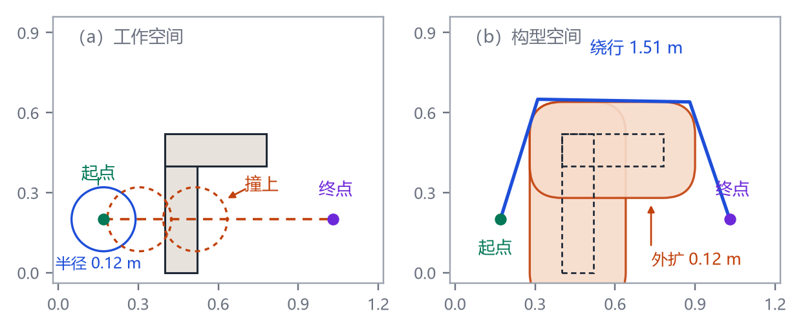
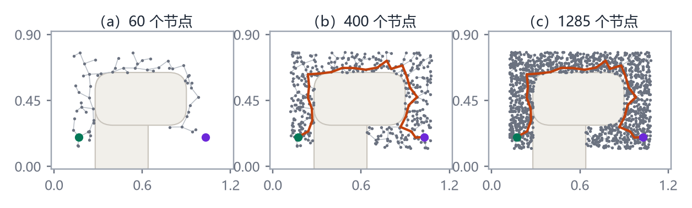
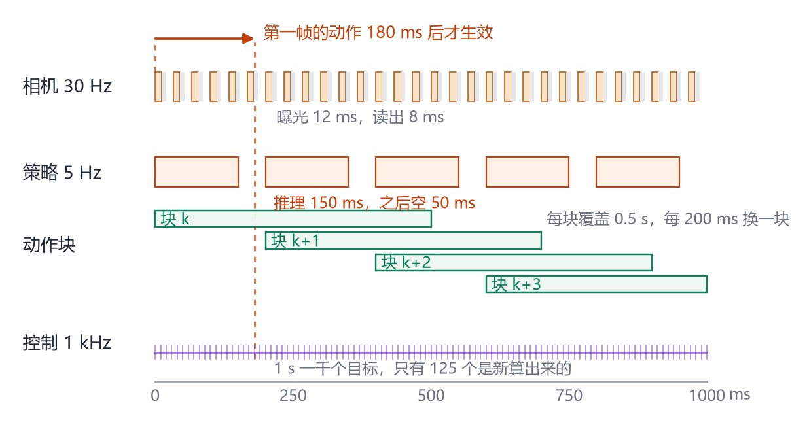

# 第 11 章　规划一条可行的路

> **本章导读**：机器要动，先得知道往哪动。这句话落到一只 7 关节的臂上，就变成在一个 7 维空间里找一条曲线，全程不许碰到任何东西。这一章讲这条曲线怎么找，从换坐标系那个巧妙的起点开始，过一遍切格子与撒点两条路，再讲折线怎么变成能执行的平滑轨迹、怎么边跑边改，再落到两层规划为什么必须来回问、接触丰富的操作为什么至今还是硬骨头。

## 11.1 会撞的不是手，是关节

这一节回答一个问题，机器要躲开的到底是什么东西，为什么换一个坐标系以后，躲这件事会变简单。

桌面 0.8 米高，马克杯在正前方，左前方摞着纸巾盒。任务是把夹爪移到杯子正上方 15 厘米处。人做这件事会抬一下手、绕过去，全程不关心自己的肩和肘各转了多少度。

机器不能这么想。它能直接控制的只有关节角度，末端位置是这组角度算出来的结果。所以"手往右挪 10 厘米"在机器那里是一句没有落点的话，它要解的是另一道题，找一组随时间变化的关节角，让末端走出想要的轨迹，同时不碰东西。

把手伸进装满杯子的柜子，这个动作你做过很多次。柜子里四个杯子挨着摆，缝只比手指宽一点，你会侧一下手、手腕压低几度，指尖擦着杯沿过去。整个过程你没有算过肩和肘各转多少度，你盯的是指尖和那道缝。眼睛给的是末端的位置，肩膀和肘自己配合，这套配合在你身上是免费的。

机器身上不免费。它没有一双能直接指挥指尖的眼睛，只有七个电机的角度指令。你让它"从缝里伸进去"，它得先把这句话翻译成七个数字怎么随时间变化。翻译的过程中，"缝"这个东西消失了，剩下的是一堆关节角组合，其中一部分能让手指落在缝里，另一部分会让前臂压到杯子上。

这两件事的差别，在末端走直线时最明显。让 6 轴臂的末端沿着桌面平移 30 厘米，腕部某个关节可能要转 40 度，肩部关节转 20 度。末端匀速，关节不匀速；末端走直线，关节画出来的是曲线。靠近"手臂伸得比较直"的姿态时更夸张，末端挪 1 厘米，某个关节要转好几度。这种姿态在控制上叫接近奇异位形，实际执行时会被限速卡住，原本 300 毫秒的动作拖成 800 毫秒。

Lozano-Pérez（1983）给了一个换坐标的做法，把问题变干净。不去问末端在哪，而是把每个关节的角度当成一根坐标轴，n 个关节就是 n 维空间里的一个点。这个空间叫构型空间（configuration space），简称 C 空间。7 个关节的臂，它的构型就是一个 7 维向量，关节限位把可行区裁成一个规则的长方体。

换到 C 空间以后，碰撞这件事换了一副面孔。障碍不再是一堵墙，而是空间里的一块点集，凡是有某一组关节角让某个连杆碰到东西，那个点就落在障碍里。这块集合写不出方程，只能问一个问题，这个点撞不撞。回答它的程序就是碰撞检测，凸体对凸体一次几微秒到几十微秒，三角网格慢一些，一秒查十万次是能做到的量级。

第 7 个关节值得单独说。6 个自由度已经能定末端位姿，第 7 个关节可以随便转，末端不动。这一维俗称冗余，实际意义是肘部能绕着"肩到腕"那条连线转圈。同一句"手停在杯子上方"，肘部在高处能做到，在低处也能做到，一个会撞到纸巾盒，一个不会。这一维是送给避障的礼物，也是规划器要多搜一维的原因。

<figure class="fig">

<figcaption><b>图 11-1</b>　同一张桌子的两种画法。左边机器有半径，走直线就撞上；右边把机器人缩成一个点，把障碍各向外扩 0.12 m，问题和答案都还在，只是形状简单了。数值由脚本实算。</figcaption>
</figure>

先把"绕开障碍"画在纸上，拿一个二维的例子。台面 1.2 米乘 0.9 米，中间摆一个 L 形的挡板，机器人是一个半径 0.12 米的圆盘，要从左下角走到右下角。图 11-1 左边是它真实的处境，圆盘有体积，直线走过去必然撞上。右边换了个画法，把圆盘缩成一个点，同时把挡板向外扩出 0.12 米，正好等于圆盘的半径。扩完以后，"圆盘不碰障碍"和"点不碰胖障碍"是同一件事。

这一步的收益可以量出来。挡板往外胖一圈以后，可行面积从 1.08 平方米掉到 0.21 平方米，不到台面的两成，顶上那条能过的走廊只剩 0.14 米高。起点到终点的直线距离 0.86 米，实际能走的路拉直以后 1.51 米，多绕了七成。膨胀不改变难度，它把难度从"机器人有形状"搬到了"障碍有形状"，后者更容易画，也更容易算。

膨胀这个词在三个地方的意思并不一样。图里的膨胀是几何上的。圆盘半径 0.12 米，就把挡板往外推 0.12 米，推出来的形状和圆盘贴着挡板滚一圈扫过的区域完全重合。柜子里的情形没有这么整齐。缝的净宽等于两个杯子的间距减掉杯壁厚度，再减掉手指的粗细。杯子间距 4 厘米，杯壁占掉 1 厘米，手指粗 1.6 厘米，能过的净宽只剩 1.4 厘米。

手指歪着进去的时候，等效粗细还会继续变大。手指长 10 厘米，整只手歪 5 度，指尖就偏出 0.87 厘米，等于手指凭空粗了一半多。这就是为什么伸进柜子的手总是先摆正，再往前送。

到了关节空间，膨胀换成第三种样子。那里的障碍厚度等于末端障碍的宽度除以这一方向的灵敏度。手臂伸得比较直的时候，关节转 1 度末端只挪 1 毫米，末端 2 厘米厚的障碍摊到关节轴上就变成 20 度厚。关节转 1 度这个动作，机器根本分辨不出来，于是这 20 度全都要当成禁区。这里的"胖"已经不是一个能算出来的偏移量，它随位置变，只能一点点试出来。

机械臂的 C 空间里没有这个几何操作。7 维空间里"往外胖一圈"没有意义，因为机器人在那里本来就是一个点。真实的做法是把 7 个关节角丢给碰撞检测，它回答是或否，规划器靠成千上万次是或否把障碍的形状一点点摸出来。这是采样类方法的全部立足点，也是它为什么在高维里还能工作的原因。

精确求解这条路有多难，Reif（1979）有个结论，把家具在房间里搬来搬去的那类问题，证明是 PSPACE 难的。意思是资源随规模指数增长，不存在既快又保证最优的算法。工程上没人求精确解，只求一条够用、够快、别撞的路。

## 11.2 切格子，还是撒点

这一节回答一个问题，在关节空间里找路，是把空间切成一格一格地搜，还是随手撒点让树自己长。

最容易想到的做法是把空间切成格子。A* 就是这么干的，它在图上搜一条从起点到终点的最小代价路径，代价是走过的距离，再加一个对剩余距离的估计来引导方向。这个估计只要不高估，搜出来的就是最短路。A*（1968）在 Dijkstra（1959）的版本上加的就是这根"指南针"，速度快了半个数量级。

在平面导航里，这套办法好用到没有对手。1 厘米的格子，1.2 米乘 0.9 米的台面切出 11011 个格子，纯 Python 写一遍，二三十毫秒就出结果，还带最优性保证。缺点是格子数随维度指数增长，这一点在机械臂上立刻变成灾难。每个关节切 36 格，也就是 10 度一格，6 个关节是 22 亿个格子，7 个关节是 783 亿个。

所以高维里换了一条路，不建图，撒点，开销只跟样本数走，不跟空间的体积走。RRT（1998）的规则短得可以背下来。在空间里随机撒一个点，在树上找离它最近的节点，朝那个方向走一小步，这一步不撞就把它接上去。重复。随机点落在一片空旷区域时，树上离它最近的那个节点几乎总是伸向那片区域的边界，于是树会自动往没探索过的地方长，这个性质让 RRT 铺开得很快。

<figure class="fig">

<figcaption><b>图 11-2</b>　RRT 在同一张地图上的三次快照，脚本实跑，同一个随机种子。(a) 60 个节点时树还是一小丛；(b) 400 个节点时已经连到终点；(c) 1285 个节点把自由空间铺满，那条红色的路从头到尾没变过。</figcaption>
</figure>

图 11-2 是脚本实跑的三帧，地图和起终点都跟图 11-1 一样。到 77 个节点时第一次有枝条摸到终点，那条路长 1.85 米，比图 11-1 里那条栅格路线（1.51 米，还留了 3.5 厘米余量）明显要绕。跑到 1285 个节点，自由空间被点铺满，红色那条路一动不动，还是 1.85 米。

这条路的质量为什么不变，不是实现得不好，是方法的性质。Karaman 与 Frazzoli（2011）证明了在相当宽松的条件下，RRT 返回的代价几乎必然收敛到一个非最优的值。原因很直白，先连上的那条枝就是最终答案，后面再多样本也不会去改它。RRT 的回答是"我找到了一条"，不是"我找到了最短的一条"。

他们的改进版叫 RRT*，加了两个动作。选父的时候不只看最近的那个节点，而是在一个邻域里挑一个让总代价最小的当父亲；接上之后做重连，把邻域里那些原来绕远的节点改挂到新节点下面，代价随之下降。邻域半径不是常数，节点越多半径越小，大致按节点数的对数除以节点数、再开维度的方根那样收缩。这么一改，代价就有了保证，样本趋于无穷时收敛到最优解，这个性质叫渐进最优。

代价也是实打实的。同一张图、同样 1285 个节点，RRT* 把 1.85 米压到 1.45 米，好了 22%，比那条带余量的栅格路线还短一点。换来的开销是每个节点都要做一次邻域搜索和一串重连，我这份教学脚本里慢了十三倍。收敛速度还跟维度挂钩，二维里几千个节点就能贴近最优，7 维里要让差距减半，节点数得往上翻好几倍。所以工程上常见的组合是 RRT 先给一条能跑的路，再用别的手段去修。

RRT* 能越跑越好，靠的就是这两步。选父那一步让新节点不必吊在最近的那根枝上，它可以跨过去找一个更省的父亲。重连那一步把已经长错的枝扯下来重挂，旧答案被允许改。RRT 的树一旦长成就固化了，RRT* 的树一直在自己身上改错，样本越多，改错的机会越多，代价就一点点往下走。

### 两条路各自的主场

适用场景分得很清楚。地图小、维度低、同一张地图要反复问几百次，用 A*。仓库里的搬运车在 200 米乘 100 米的厂房里跑，地图半年才换一次，把 A* 的搜索结果预先算成一张距离表存下来，每次查询只花几毫秒，给的还是最短路，绕远这件事不会发生。

地图天天变、维度高、只问一次，用 RRT。机械臂抓一只杯子，杯子每次都在新位置，桌上的纸巾盒随时会被挪走，规划器每次都得从头搜。这时候最优不重要，80 毫秒内给一条不撞的路才重要。

中间地带看预算。7 维机械臂上跑一次 RRT 大约 20 到 100 毫秒，跑一次 RRT* 通常要几百毫秒到一两秒。产线节拍 3 秒，等得起 RRT*，那就用；人站在旁边等机器动手，等不起，先让 RRT 把动作做出来。

A* 在 7 维里不是"慢"，是根本装不下。每个关节切 36 格，783 亿个格子，一个格子只存 1 个字节也要 78 GB 内存。这个数字超过大多数工控机的硬盘，搜索还没开始就已经失败了。

概率完备这个词要解释清楚，它是这类算法唯一敢承诺的东西。意思是只要解存在，样本数趋于无穷时找不到解的概率趋于零。它没说多久能找到，也没说找到的是哪一条。对照另外两个词，完备指有限时间内一定给出答案，分辨率完备指格子切得足够细就一定能找到。三个词的差别全在"要多细、要多久"上。

窄通道是采样方法的死穴。图 11-1 顶上那条走廊高 0.14 米，面积只占台面的 3.4%，随机撒一个点，三十分之一的概率落在里面。要穿过去，得有若干个点连续落在这条窄带里并且互相连得上，样本数按概率的倒数往上翻。所以同一套代码在空旷场景里几十毫秒给答案，遇到只有一条缝的货架能跑满五秒还报失败。

工程上的几条规矩就从这里来。给规划器一个时间预算，MoveIt 里默认是 5 秒，到点就返回；措辞要说"没找到"，不要说"无解"，后者是在撒谎；换几个随机种子再跑一遍，三次都失败才值得怀疑真的没路。

## 11.3 折线不能直接执行

这一节回答一个问题：规划器给了一条不撞的折线，为什么不能直接让电机照着走。

采样规划交出来的是一条折线，节点之间用直线连。这条折线证明了"存在一条不撞的路"，但它不能直接送到伺服上。折线的拐点处，关节速度从某个值瞬间跳到另一个值，物理上这是无穷大的加速度。伺服跟不上，会冲过头再拉回来，表现为机械臂到位时抖一下；减速器承受的冲击更实在，跑上几个月就能看出磨损。

中间还得加一层，把几何路径变成带时间的轨迹，这一步叫时间参数化。给定几何路径，给每个路点配一个速度，让速度连续、加速度有界。工程上常用梯形速度曲线，加速段、匀速段、减速段。约束写在关节上而不是末端上，因为电机限的是关节转速。

路径和轨迹的差别，用一句话说就是有没有表。路径只说经过哪些地方，是一条纯粹的曲线，纸上画一条线就是一个路径。轨迹在每个点上都贴着时间，什么时候到哪儿、当时多快、加速度多大，全都有数。同一条路径能配出无数条轨迹。慢慢挪过去是一条，冲过去再急停也是一条，两条的几何形状一模一样，执行起来是两件事。

举个能算的例子。一条 0.5 米长的路径，要求 1 秒走完，平均速度 0.5 米每秒。如果起步就用 0.2 秒匀加速到 0.5 米每秒，加速度是 2.5 米每二次方秒，末端要受 0.25 倍重力的惯性力，杯里的水面会倾斜 14 度。同样 1 秒，把加速段拉长到 0.4 秒，加速度降到 1.25，水面只斜 7 度。路径没变，轨迹变了。

拿数字感受这两个约束。桌面臂的关节最大速度约 90 度每秒，即 1.57 弧度每秒，加速度上限约 5 弧度每二次方秒。要转 0.3 弧度，大约 17 度，按梯形曲线的最短时间约 0.49 秒，峰值角速度 1.22 弧度每秒，离上限还有余量。想更快只有加大加速度，而加速度一大，杯子里的水就开始晃。这一步的取舍不在算法里，在任务里。

几何路径本身还能改。轨迹优化把一条离散化的轨迹当成优化变量，代价写成几项相加，离障碍越近代价越高，相邻路点之间的加速度越大代价越高，总时间越长方代价越高。CHOMP（2009）用梯度下降把一条粗糙的初始轨迹往外推、往里拉，TrajOpt（2014）把避障写成约束，用序列二次规划求解。这类方法只保证局部最优，初值不好就卡在一个奇怪的形状里，旁边有更短的路它看不见。

工程上把它当修形用。采样规划给一条撞不上但很绕的粗路，轨迹优化把它拉直、抹平，再交给时间参数化。三段各管一件事，前一段负责可行性，中段负责质量，后段负责可执行。跳过任何一段，问题都会在别处补课。

真机上执行是滚动的。模型预测控制（MPC）每 20 毫秒算一次，往前看 1 秒的窗口，在窗口里解一个带约束的最优控制问题，只执行最前面那一小段。约束包括关节速度、力矩上限、不撞桌面，代价函数是离目标近、动作小、别抖。规模不大，1 到 10 毫秒能解出来，50 Hz 跑得动。

重算的间隔不是随便定的，它要短于"扰动长成事故"的时间。有人从旁边推了杯子一下，杯子以 2 厘米每秒的速度滑。40 毫秒里它只滑了 0.8 毫米，预测的偏差还在容差内，这一拍改回来就行。如果 200 毫秒才重算一次，杯子已经滑出 4 毫米，夹爪可能已经夹偏了。

40 毫秒一拍就是 25 Hz，这个频率在不少工业控制器上是常用档位，算力小一点的平台就按这个节奏跑。一拍的时间预算要拆开用，解优化占 1 到 10 毫秒，剩下的留给传感器采样、通信和安全检查。算得越久，留给意外的时间越少，工程上宁可解一个粗糙的近似问题。

为什么不用一次算完的长计划。模型永远不准，摩擦、间隙、负载都没测全；扰动随时来，杯子被人碰一下，计划当场作废；目标本身会动，抓一个正在滑的物体，终点每秒都在变。滚动时域把这三件事都变成"下一拍重新算"，代价是每拍都要花算力，换回来的是错了一次还有机会改。

学习在这条链上有三个插口。策略当提议者，一次吐出一段动作；MPC 当验收者，把这段动作投影到约束集合里再发下去，超限的削掉，剩下的照走，这一层不改策略的意图，只保证它不越界。策略也可以学代价函数，把"杯子里的水不能晃"这种写不成公式的偏好交给优化器。第三种是拿策略输出当 MPC 的初值，热启动能省掉一半迭代。

一个具体的失败场景。仿真里桌面摩擦写成 0.5，真机上是 0.3，MPC 按 0.5 预测"再往前 8 厘米就会停住"，实际滑了 11 厘米，撞到了盘子。这类错误不会在仿真里暴露，因为仿真里的模型和它自己的预测是一致的。它只在跨过那道缝的时候出现，而且表现为"策略没问题，就是差 3 厘米"。

**表 11-1**　五种规划方法放在一起比。

| 方法 | 完备性 | 最优性 | 一次规划耗时 | 适用维度 | 典型失败 |
|---|---|---|---|---|---|
| 栅格 A* | 在栅格上完备 | 在栅格上最优 | 二维几十毫秒 | 2 至 3 维 | 维度一高格子数爆炸 |
| RRT | 概率完备 | 不最优，代价停在首次解 | 几十毫秒 | 中高维 | 路径绕、拐角抖 |
| RRT* | 概率完备 | 渐进最优 | 慢几倍到十几倍 | 中高维 | 高维收敛慢，窄通道仍在 |
| 轨迹优化 | 只在初值附近 | 局部最优 | 几十毫秒 | 高维 | 卡在局部极小，绕远不撞 |
| MPC | 无 | 每拍局部最优 | 1 至 10 毫秒 | 状态维中等 | 模型不准就偏，偏差随任务累积 |

最右一列比前三列更能决定选哪个。要"绝对别撞"，用轨迹优化加 MPC；要"先让场景动起来"，用 RRT；要"路要短"，用 RRT*。

## 11.4 两层规划必须来回问

这一节回答一个问题，一句"把杯子放进柜子"的命令，怎么变成一串关节角，中间要过几道手。

一只杯子要放进柜子，这句话里装着两类知识。一类是顺序，先开门，再抓杯，再移进去，再关门，顺序错了做不成。另一类是几何，手从哪个方向伸进去够得到、柜门开多大角度手才进得去、进去以后腕部会不会撞到隔板。前一类是符号的，后一类是几何的，两种知识在两种表示里，谁也装不下对方。

符号层通常写成一套规则，状态是一组谓词，动作用前提和效果描述。抓杯子的前提是手空着、杯子可见，效果是手里有杯子。最早用 PDDL 这门语言写，目的是让规划脱离具体机器人。好处是快，状态空间再大也是离散的。

几何层就是前三节讲的东西，给它起点、终点和障碍，它给一条轨迹。它不知道"为什么要去那儿"，也不知道这个动作排第几。

两层的盲区正好互补，也正好互相拆台。符号层给出"抓杯子、放进柜子"，几何层一算，柜门关着，手伸不进去，这条序列不可行。符号层不知道门是关的，除非有人告诉它。反过来，几何层发现按这个顺序每条路都要 40 秒，而先挪开挡路的盒子只要 12 秒，这个信息它没法自己变成"换一个顺序"。

所以正确的结构不是两层各干一段再对接，而是来回问。符号层给一条候选序列，几何层逐个动作验证，验证失败的样本记下来变成一条约束回传，符号层带着约束重新搜。Srivastava 等人（2014）把这套流程写成了能跑的算法，PDDLStream（2018）把它抽象成通用接口，允许符号层在搜索途中主动向几何层要一个新的采样结果。

### 先开门再拿杯子

把这条回路走一遍，看它具体长什么样。任务是"把杯子放进柜子"，柜门关着，门把手在门板右侧。

符号层先给一条序列，开柜门、抓杯子、移进柜内、松手、关门，五步。它不知道门有多重，也不知道门能开多大角度，它只知道关着的门要先开。

几何层逐条验证。第一步开柜门，手从正前方伸向把手，抓住后向右拉，门绕铰链转，转到 60 度时手背碰到柜体侧面，动作停住。这一步报失败。

失败的理由要带回来具体数字。一句"开门失败"对符号层没用，一句"门只开到 60 度，差 25 度"才有用。回到符号层，开门这个动作多出一个参数，门要开到 85 度以上。几何层在参数空间里再采一次，这次从侧面接近把手，绕开了柜体，门开到了 88 度。

第三步移进柜内仍然失败。手伸进去的时候，腕部在门框上方 3 厘米处擦到门框。回传的信息是"进入方向偏上 3 厘米"，几何层改从低 5 厘米处进入，或者把杯子先抬高 4 厘米再往里送。

第二轮五步全过，整条序列耗时 1.8 秒，其中开门占 0.9 秒。这个数字说明一件事，几何层的失败不是因为路找不到，是因为符号层给的动作太粗。开门的 60 度和 85 度在符号层是同一个动作，在几何层是两种完全不同的手部姿态。

另一个理由是组合爆炸。10 步任务，每步 5 个可选动作，符号层的搜索空间是 5 的 10 次方，976 万条序列。把几何验证留到末尾一次性做，等于要验 976 万次；交替做，每验一次就砍掉一大片，实际搜索的节点数能少几个数量级。"先想清楚再动手"在机器人身上不成立，想清楚的成本就是把所有分支都走一遍。

<figure class="fig">

<figcaption><b>图 11-3</b>　三层规划栈。往下是子目标，符号动作交给运动层，关节轨迹交给控制层；往上是失败回传，几何不可行换方案，跟踪超差重规划。右侧是每层多久跑一次。</figcaption>
</figure>

图 11-3 把这条栈竖起来看。三层的时间尺度差得很远，任务层几秒一次，运动层几十到几百毫秒一次，控制层一毫秒一次。中间那两条虚线是回传，一条是几何不可行，一条是跟踪超差。没有这两条回传，栈就是一条单向流水线，任何一层出错都要等人来救。

语言模型现在常被放在最上面那层。SayCan（2022）让它从 551 条技能的库里挑下一步，Code as Policies（2022）让它直接写调用感知与控制接口的代码。它们擅长常识顺序，"湿抹布要先拧一把"这种没人写进规则的事它们知道；不擅长可达性，"这个姿势够不够得到柜子第二层"它们算不出来。所以正确的用法是把它当候选生成器，不当决策者。它说"把杯子放进柜子"，几何层回"柜门关着，够不到"，它改成"先开门"。这个回路能转的前提是失败信息够具体，一句"失败了"没法让它改，一句"第 3 步在柜门前 20 厘米处被挡住"可以。

## 11.5 一碰就变天

这一节回答一个问题：当成功的标志是碰到东西而不是躲开东西，前面那套规划还够不够用。

前面所有讨论都默认手在空中飞，碰不到东西才叫成功。真实操作里最值钱的部分恰好相反，抓、插、拧、推、开抽屉，全靠接触传递力。这类任务叫接触丰富操作。

第一个变化是离散。两个物体接触，每个接触点有三种状态，分开、粘住、滑动。4 个接触点就有 81 种组合，每种组合下的动力学方程不一样，能做的事也不一样。抓一只杯子，两指粘住能提起来，两指滑动就掉，一个指粘一个指滑就会转。规划器要搜的不只是连续轨迹，还有这串离散模式的切换顺序，这类问题叫混合系统。

用抓杯子把这件事摊开。两根手指各一个接触点，一共 9 种组合，两个点都粘住才能提起来，也就是 9 种里只有 1 种能用。三指夹爪涨到 27 种，能提起来的还是只有 1 种。6 个接触点是 729 种，规划器要试的东西成倍往上翻。

开抽屉是另一串模式。手指接近把手时互不接触，抓住时粘住，往外拉时粘住但把手可能轻微滑动，拉到限位时又变回分开。这串顺序里每一步的动力学都不一样，规划器要搜的是"先粘住再滑动"这样的序列，不只是往哪儿动。

第二个变化是摩擦不确定。库仑模型把摩擦系数当成常数，真实值随湿度、灰尘、磨损变化，静摩擦明显大于动摩擦，开始滑动的一瞬间系数往下跳一下，力突然释放，于是有了那声"吱"。同一只杯子，昨天好抓，今天有油就滑。

摩擦角这个概念能把这件事量化。物体滑不滑，取决于接触面倾角与摩擦系数的关系。

$$
\tan\theta \lt \mu
$$

θ 是接触面与水平面的夹角，μ 是摩擦系数。μ 等于 0.5 时，θ 超过 26.6 度就会滑；μ 掉到 0.3，临界角变成 16.7 度。这两个数放在一只杯子上，就是"能不能斜着拎"的边界。容差只有十度，而真实的 μ 在上下两成的范围里浮动，这条边界就不牢靠了。

把摩擦代进抓取里算一遍，就知道它到底多要紧。杯子 0.3 千克，重力 2.9 牛，两侧各一个接触点，靠摩擦托住它，需要两倍的 μ 乘 N 不小于 2.9。μ 等于 0.5 时，每侧夹 2.9 牛就够；μ 掉到 0.3，每侧要夹 4.9 牛。差出来的这 2 牛落到杯壁上，就是"杯子会不会被捏瘪"的问题，纸杯的壁在 5 牛时就明显变形了。

于是规划在这类任务里的角色退了一步。它给出抓取点、接近方向、接触模式的一个初始猜测，真正把杯子提稳的是力控回路。阻抗控制让末端像一根弹簧，碰到硬的退让，碰到软的跟进；触觉传感器以 100 Hz 到 1 kHz 报接触位置与法向力，回路据此调整夹持力，让它落在第 1 章算过的那个 5 到 30 牛的窗口里。

这也解释了为什么接触丰富的任务上，示教加伺服经常打败纯规划。人示范一次"插进去的手感"，机器记住的是力的曲线而不是位置的点，位置差 2 毫米无关紧要，力大了就退。规划在这里提供边界，不提供动作。

插孔是这类任务里最经典的失败现场。轴和孔的间隙 0.2 毫米，大约两张打印纸的厚度。位置差 1 毫米就插不进去，力会从 5 牛一路涨到 50 牛，控制器触发保护停机。纯规划在这里给的是一条直线，力控回路要做的是歪了就松一点、正了就往下压，这个手感写不进路径里。同一台机器，同一套规划，间隙从 0.2 毫米放到 2 毫米，成功率能从五成跳到九成八。

判断一个规划系统好不好，问三件事。失败时它报什么，是"没找到"还是"第 3 步被柜门挡住"；它留了多少余量，贴着障碍 2 毫米和留 3 厘米是两回事；它多久重规划一次，端着杯子走过去时每 100 毫秒重算和只算一次，遇到有人经过就是两种结局。

为什么这类任务到今天还是硬骨头。前四节的方法都默认成功等于不碰，碰一下就算失败。接触丰富任务里成功偏偏等于碰对了力，判据反了过来，所有以避障为核心的算法都得重写。
