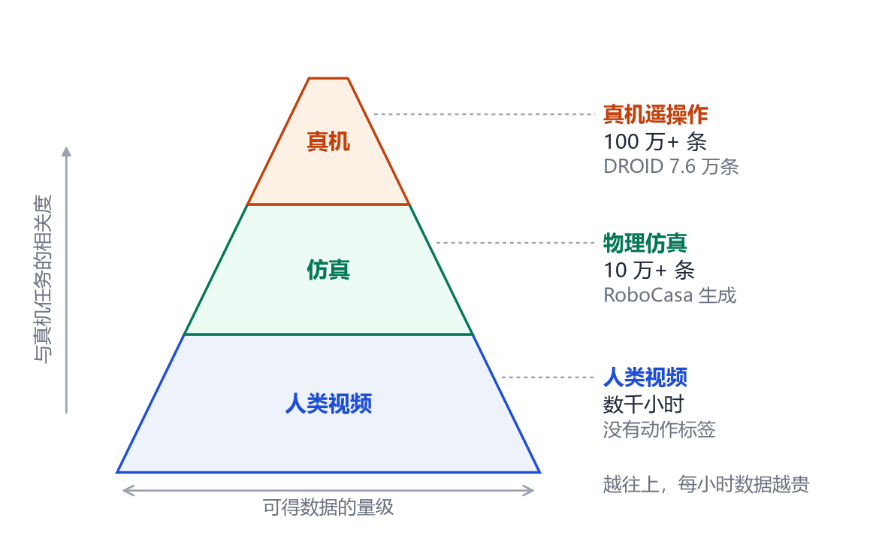

# 第 12 章　数据、评测与落地

> **本章导读**：前面十一章把一条链路拆开讲完，剩下的问题很实际。数据从哪来、贵在哪，一个 90% 的成功率到底意味着什么，为什么论文里的视频看着流畅而你的机器一顿一顿，以及一套能跑起来的最小系统需要哪几件东西。这一章给的是判断力，读完你该能算出一条轨迹的成本、看懂一篇论文的评测设置、估出一条链路的时延，也知道什么时候该让机器停下来。

## 12.1 数据为什么贵

DROID（2024）是这方面最诚实的一份账本。13 家机构、50 名采集员、12 个月，在 52 栋建筑的 564 个场景里做了 86 种任务，攒下 7.6 万条轨迹、350 小时交互数据，每条轨迹带三路同步相机（其中一路在腕部）、关节状态和一段语言标注。

350 小时摊到 50 个人头上，每人每年 7 小时，每月不到 40 分钟。这个数字第一次看会觉得不对劲，一群全职的人一年只录了 7 小时。想明白它，就明白这个行业为什么对数据那么吝啬。

一台机械臂在实验室里连续跑一天，随手就能录 8 小时。350 小时相当于 44 个这样的工作日。13 家机构、一整年，折算下来只等于一台机器连续跑一个半月。差的那部分不在机器人身上，在流程上。场景要预约，设备要装箱搬运，13 家机构的相机支架、场景陈设、房间尺寸都不一样，接口和数据格式得先对齐。一条 10 秒的有效轨迹，前后要复位、摆物体、调光、检查、重录。回头还要有人把失败的片段挑出去，不然训练集里一半是废数据。

按这个节奏算一笔细账。一条有效轨迹 10 秒，算上复位、重录和筛选，落到一个人头上大约 40 秒，一天干 6 小时也就 500 多条。设备按一台桌面臂加夹爪、相机 20 万元、三年折旧，一天摊 180 元；一个人一天的工钱按 500 元算，一条轨迹的边际成本一块多。看着不贵，可是 7.6 万条背后是 50 个人年。要把规模做到 100 万条，就得 660 个人年，这还没算场地和管理。

成本还有一段花在整理上。第 7 章说过，相机 30 fps、关节 50 Hz，两种频率要先对齐；13 家机构记录的位姿约定不同，有的记末端、有的记工具中心点；语言标注也要统一说法，同一个动作不能一处写"拿起"、一处写"抓住杯子"。这部分工作没有产出，但不做就没法训练，通常占掉项目开头的一两个月。

对照语言模型就更清楚了。一个 token 的采集成本是零，它是人写字、说话时顺手留下的副产品。机器人的数据没有副产品，只能专门生产，而且要有人守着。这个不对称解释了很多工程选择。为什么大家拼命做仿真、做视频预训练、做跨本体迁移，因为在真机上把数据量翻十倍，意味着把人和场地翻十倍。

还有一项隐性成本是不可复现。同一批数据，三个月后想重采同样的场景，桌子换了型号、光照换了季、夹爪的胶垫磨薄了 1 mm，数据分布就变了。跨机构采集之所以难，不光是距离，是每家的"同一件事"都不太一样。DROID 花了很大力气做标准化，这件事本身就是它最有价值的部分之一。

## 12.2 数据金字塔

数据按来源可以摞成三层，越往上越窄、越贵、越贴近真机任务，如图 12-1。

<figure class="fig">

<figcaption><b>图 12-1</b>　数据金字塔的三层。宽度是可得数据的量级，高度是与真机任务的相关度，越往上越贴近你这台机器人，也越贵。</figcaption>
</figure>

最底层是人类视频。第一视角数据集动辄数千小时，画面里有手、有物体、有先后顺序，但没有关节角、没有夹爪开合、没有力。这一层能教的是先验，比如这类任务大致按什么顺序做、手通常从哪一侧靠近、抓住之后往哪个方向提。要从视频里反推动作本身，至今还是个研究问题，这一层的产出是语义和常识，不是控制量。

中间一层是仿真。RoboCasa 一个框架就能生成 120 个厨房场景、2500 多个物体、100 个任务、10 万条以上的演示，成本是电费和工程时间。它的毛病第 9 章讲过，接触、摩擦、软物体都不太可信，练出来的策略搬到真机上会掉点。

最上面是真机。Open X-Embodiment（2023）把 60 个数据集、22 种本体汇成 100 万条以上的轨迹，数字很漂亮，可是摊到"你这台臂、你这张 0.8 m 的桌子、你这批杯子"，可能一条都不算数。真机数据的价值全在匹配度上，不在总量上。

金字塔的读法是两条边的方向相反。往左下走，数据量涨、单价跌、相关度跌；往右上走，一切都反过来。做系统时真正要回答的问题是"我缺的是哪一层"，而不是"我该采多少条"。

数据缩放（2024）给了一个具体坐标。他们用 32 个环境、每个环境一个独特物体、每个环境 50 条示教，训出来的策略在全新环境和全新物体上零样本成功率 90%；整个研究采了 4 万多条演示，跑了 1.5 万多次真机回合。两个结论值得记住。多样性比数量重要，同样的预算花在更多环境上，比在同一个环境里多录 200 条有用。每个环境 50 条之后曲线就平了，再往上加的边际收益接近零。

50 这个数不是巧合。50 条覆盖的是"这件事在这张桌子上有多少种做法"，不是"这件事有多少种变体"。第 51 条和第 50 条几乎是同一个分布，模型从中学不到新东西。想让它学新东西，得换桌子、换杯子、换光照。

于是有了一个常见的配比。预训练用大杂烩，视频、仿真、别人的真机数据混着来，目的是把"世界长什么样"和"动作大概怎么变"这两件事学进去；后训练用本场景 50 到 200 条，把本体偏差和工位几何补上；上线之后再收几十条失败样本做纠正。三层各管一段，谁也替代不了谁。

反面例子在论文里少见，在工程日志里到处都是。在一个场景里录 5000 条，成功率能到 95%，换个房间掉到 30%。这类系统的失败不是模型不够大，是数据把"这张桌子"当成了世界。

## 12.3 评测

仿真基准解决的是三件事，便宜、可复现、能跑上千次。四个常用的基准各管一段。

CALVIN（2021）有 4 个环境、34 个任务、24 小时遥操作数据、2 万条语言指令。它的评法是把 5 条语言指令连起来执行，统计平均完成几条，一共 1000 条指令链。这个指标比单任务成功率难得多，策略要在两个子目标之间自己切换状态。

LIBERO（2023）有 130 个任务，分 4 个套件。Spatial 换布局、Object 换物体、Goal 换目标，LIBERO-100 三样一起换。它测的是学新任务时会不会把旧的忘掉。

RoboCasa（2024）把场景放在厨房，120 个厨房、100 个任务、10 万条以上演示，测的是长程家务。

SimplerEnv（2024）不做新环境，它把真机场景搬进仿真，让同一个策略在两边各跑一遍再比排名。它用 Pearson 相关系数和排名违背（MMRV）两个指标，跨 Google Robot 与 WidowX 两种机型、约 1500 个回合，回答的问题是"仿真里的第一名，到了真机上还是不是第一"。

这四个加起来能过滤掉大部分不靠谱的工作，但都不能回答"在我的桌子上行不行"。那还是得测真机。

用基准时还要提防一件事，把测试集当训练集用。CALVIN 和 LIBERO 的任务是公开的，超参在测试任务上挑，报出来的数字就会偏乐观。看论文时留意两处，有没有留出一组没见过的任务，以及有没有在多个套件上分别报数。只报最好的那一个，通常意味着另外几个不好看。

真机评测的算术要自己算一遍。一个抓放任务，一次试验 20 秒，中间复位 30 秒，20 次试验 17 分钟。20 次里成功 18 次，报表上写 90%。看起来可以交付了。

二项分布的置信区间不这么看。18/20 的 95% 精确区间是 68% 到 99%，也就是说真实水平可能是 68%，也可能是 99%，20 次试验分不出来。做 100 次、成功 90 次，区间收到 82% 到 95%。图 12-2 把这条曲线画了出来。

<figure class="fig">

<figcaption><b>图 12-2</b>　同样报 90% 的成功率，20 次试验的区间宽到 30 个百分点，100 次才收到 13 个百分点。曲线由二项分布的精确区间实算，阴影是 95% 置信带。</figcaption>
</figure>

粗略估算可以用正态近似，p̂ ± 1.96√(p̂(1−p̂)/n)，其中 p̂ 是观测成功率、n 是试验次数。p̂=0.9、n=20 时是 ±13 个百分点，n=100 时是 ±6 个百分点。这就是为什么 20 次试验报 90% 在论文里够用、在交付上不够。想证明"比 80% 好"，20 次试验根本做不到。

报告里最少要写四件事，试验次数、初始条件怎么随机（物体位置、朝向、光照、背景）、失败怎么归类、有没有人工干预。少写一条，读者就没法判断这个数字能不能跟别人的比。

还有一条经验。同一个策略换一天测，成功率会浮动 5 到 10 个百分点，原因是胶垫磨损、相机轻微漂移、房间光照变了。所以比较两个策略要同一天交替测，别今天测 A、下周测 B，那样测出来的差距一半来自天气。

表 12-1 把这一节提到的数据集和基准放在一起，方便按问题找工具。

**表 12-1**　主流数据集与基准对比。

| 名称 | 年份 | 真机还是仿真 | 规模 | 指标 | 适合回答什么 |
|---|---|---|---|---|---|
| DROID | 2024 | 真机 | 7.6 万条、350 小时、564 个场景 | 任务成功率 | 跨场景的通用策略行不行 |
| Open X-Embodiment | 2023 | 真机汇总 | 100 万条以上、22 种本体、60 个数据集 | 成功率与泛化 | 预训练的数据量够不够 |
| RoboCasa | 2024 | 仿真 | 100 个任务、120 个厨房、10 万条以上 | 成功率 | 家庭长程任务 |
| LIBERO | 2023 | 仿真 | 130 个任务、4 个套件 | 成功率与遗忘 | 学新的会不会忘旧的 |
| CALVIN | 2021 | 仿真 | 34 个任务、2 万条指令、1000 条指令链 | 5 连指令平均完成数 | 语言条件的连续执行 |
| SimplerEnv | 2024 | 仿真对真机 | 2 种机型、约 1500 个回合 | Pearson 相关系数与 MMRV | 仿真排名可不可信 |

## 12.4 时延预算与失败恢复

时延要当预算管，不能等整套跑起来再优化。图 12-3 是一条按量级估出来的链路。

<figure class="fig">

<figcaption><b>图 12-3</b>　一次同步链路的时延预算。推理一项就占 170 ms，10 Hz 的预算被超出 94 ms；分块执行把每一步摊到 21 ms，才够跑 15 Hz。数值取 OpenVLA 的公开量级。</figcaption>
</figure>

感知 17 ms，30 fps 一帧的曝光与传输，加一次缩放与编码。推理 170 ms。动作解码、总线传输、伺服更新 7 ms。一轮 194 ms，约 5.2 Hz。

170 ms 这个数有出处。OpenVLA（2024）用 7B 参数、bfloat16、单张 RTX 4090，实测约 6 Hz，显存 15 GB。换更大的模型或者更小的卡，这一项就翻倍。它不是可以靠写代码省下来的开销，是矩阵乘法的物理成本。

10 Hz 的预算线是 100 ms，这条链路超了 94 ms。想压进去只有三条路。换小模型，代价是能力。少算几帧，降分辨率或者跳帧，代价是看不清。让推理和动作执行重叠起来，这是现在的主流做法。

第三条的具体形态就是动作块。一次出 16 步、只执行前 8 步就再问一次（第 11 章），摊到每一步是 170/8 ≈ 21 ms，15 Hz 的控制就跑得动，推理在后台一直追。这时"推理 170 ms"不再是每一步的时延，是每 8 步的时延。系统设计里最值钱的一类优化，就是把一个贵操作摊薄到多次便宜操作上。

3 Hz 和 10 Hz 差在哪，可以算。假设杯子在夹爪里以 0.2 m/s 缓慢滑移，这个速度大致对应"没夹紧但还没掉"的状态。3 Hz 下两次决策间隔 333 ms，滑移 6.7 cm，接近这个杯子直径 7 cm 的尺度，等你想清楚它已经到桌沿了。10 Hz 下间隔 100 ms，滑移 2 cm，还来得及补救。这个 0.2 m/s 是假设值，真实滑移速度取决于夹持力与摩擦系数，但结论的量级是稳的，慢一倍就是位移翻倍。

控制层不受这些影响。关节伺服还是 1 kHz，慢的只是"下一步做什么"这个决定。所以时延的代价不是抖动，是"发现异常太晚"。一个 5 Hz 的系统看起来也能动，问题出在出错的那几秒。

失败恢复要提前设计，不能临场发挥。分三级：重试、回退、请求人工。

重试是同一个技能换参数再来一次，抓取点平移 1 cm，夹持力加 2 N，接近速度减半。前提是重新看一次。用同一帧图像重算，会得到同样的动作，失败会一模一样地重演，这是新手最常踩的坑。

回退是退回上一个已知的好状态。通常是观察位，或者松手、退到安全距离、重新定位目标。回退的动作要可重入，也就是执行两次和执行一次结果一样，否则第二级恢复会变成新的故障源。

请求人工是发一条消息，附上最近三帧图和一句"卡在抓取"，然后停下来等。停住比乱试强，尤其旁边有人的时候。

每级都要配计数器与上限。同一技能重试 3 次、整任务回退 2 次，超过就升级。没有上限的重试是死循环，机器人会对着一面墙抓一下午，日志里全是同一行。

失败类型决定走哪一级。抓空，手指合拢没遇到阻力，适合重试。滑落，抓到过但中途丢了，要换抓取点。卡住，力矩超阈值而位置不动，要回退。看不明白，分割失败或者位姿估计发散，直接找人。这套分类不复杂，难的是把每一类都接到具体的判断条件上，而这需要在日志里真的见过几十次失败。

## 12.5 安全底线

安全是唯一不能靠"多跑几次"补回来的部分。一次事故的成本，抵得过前面所有优化。

限位有两层。软限位写在控制器里，每个关节一个角度范围，末端还有笛卡尔空间的盒子和工作空间围栏，防止手伸出桌面或者扫到人站的位置。硬限位是机械挡块和限位开关，软件写错了它还在。只有软限位不算安全，只有硬限位会撞得很突然。

力矩上限靠电流。伺服电机的电流可以换算成关节力矩，指令力矩与实测力矩之差就是碰撞信号，差值超过阈值就停。阈值按任务调，太小会误停（正常接触也会超），太大就形同虚设。桌面臂上 5 到 10 N 的等效力是个常见起点，抓 500 g 的杯子需要 5 N，能停住又不至于一碰就停。

速度监控是分区的。人离得远，TCP 可以跑 0.25 m/s；进入某个区域降到 0.1 m/s；人进了围栏直接停。这类区域判断要用安全型传感器做，不能靠视觉模型，模型会看错。

急停分三类。0 类是立即切断动力，1 类是受控减速后断电，2 类是受控停止但保持供电。桌面臂上还要想一件事，断电之后手臂会不会因为重力掉下来。所以抱闸和配重是安全的一部分，不是附件。停在半空的 6 轴臂断电，末端掉 20 cm 砸在桌沿上，照样能砸坏东西。

安全回路要和主控分离。急停按钮接安全继电器或安全 PLC，双通道、常闭触点，主控死机了它照样能断。把急停串在普通 IO 上，等于把命交给一个可能卡死的进程。

标准层面，工业机器人看 ISO 10218，协作机器人看 ISO/TS 15066。前者管限位、速度监控、急停、使能装置这些基本要求，后者管"人和机器在同一个空间里"这件事，按身体部位给出允许的接触力与压强，瞬态接触的允许值约为准静态的两倍。2025 年的修订把协作要求并进了 10218 正文。

落地之前还要走一遍风险评估，把"人可能出现在哪里、机器的哪个部位可能碰到人、碰上的速度是多少"逐条写下来，再给每个场景配一条措施。这一步在小批量部署时绕不过去，也是标准里唯一没法由供应商替你完成的部分。

入门阶段不必读标准原文，但要记住它背后的逻辑。安全靠的是限制能量，不是判断意图。机器人不知道你要干什么，它只能保证自己带的动能足够小、撞上就停、停了不掉。

## 12.6 最小系统清单

从零到能跑，需要的东西就六步。每一步给一个能自测的验收标准，达不到就别往下走。

1. **相机内参标定**。用棋盘格拍 20 个以上姿态，重投影误差压到 0.5 像素以内。超标通常是畸变没标够，后面所有三维坐标都会带着这个偏差。
2. **手眼标定**。让机械臂带相机走 15 个以上不同姿态，同时看同一块标定板，解出相机到末端的变换。验收标准是 1 m 处误差小于 5 mm，0.5° 的姿态误差在 1 m 处就是 8.7 mm。
3. **抓取检测**。把 6D 位姿转成"预抓取点加接近方向"，预抓取点沿接近方向退 8 到 10 cm。验收标准是 10 个随机摆放上，预抓取点都落在不碰撞的自由空间里。
4. **路径规划**。先用笛卡尔直线走到预抓取点，接近段速度压到 0.05 m/s，规划失败时退回关节空间插值。验收标准是 20 次里没有一次碰到桌上的纸巾盒。
5. **力控与夹持**。接近段用电流阈值或导纳控制，接触力上限 5 N；夹持力按物体分档，纸杯 5 N，玻璃杯 15 N。验收标准是连续 10 次抓取不滑、不瘪。
6. **日志与回放**。每帧存图、关节角、夹爪状态、时间戳，一条轨迹一个文件。验收标准是随便挑一次失败，能在离线环境里一帧一帧看完，并复现出同样的动作序列。

另外留一份环境清单，相机型号、镜头焦距、夹爪开口宽度、固件版本、标定日期各一行。三个月后出了问题，第一个要看的就是这张表。

顺序不能换。前一步的误差是后一步的输入，标定差 5 mm，规划再漂亮也是把夹爪稳稳地送到错的地方。工程上最常见的返工是把第 2 步省了，直接用手拖示教，结果每次换工位都要重调一遍，而且没人说得清误差从哪来。

这六步做完，你得到的是一个能跑的系统，不是一个能用的系统。差别在次数。能跑一次靠调参，能跑一千次靠的是每一步都有验收数字、每一次失败都有日志、每一类失败都有对应的恢复动作。

第 1 章说过，具身智能的难点不在某一个模型，而在把看见、想、动手、再看见这四件事用同一个时间尺度串起来。这一章补的是后半句，串起来之后还要算得出账、验得了收、停得下来。数据决定它能学会什么，评测决定你敢不敢信它，时延和恢复决定它能不能连续工作，安全决定它能放在谁旁边。这四件事都不在论文的摘要里，却决定了一个系统到底是不是真的在干活。
