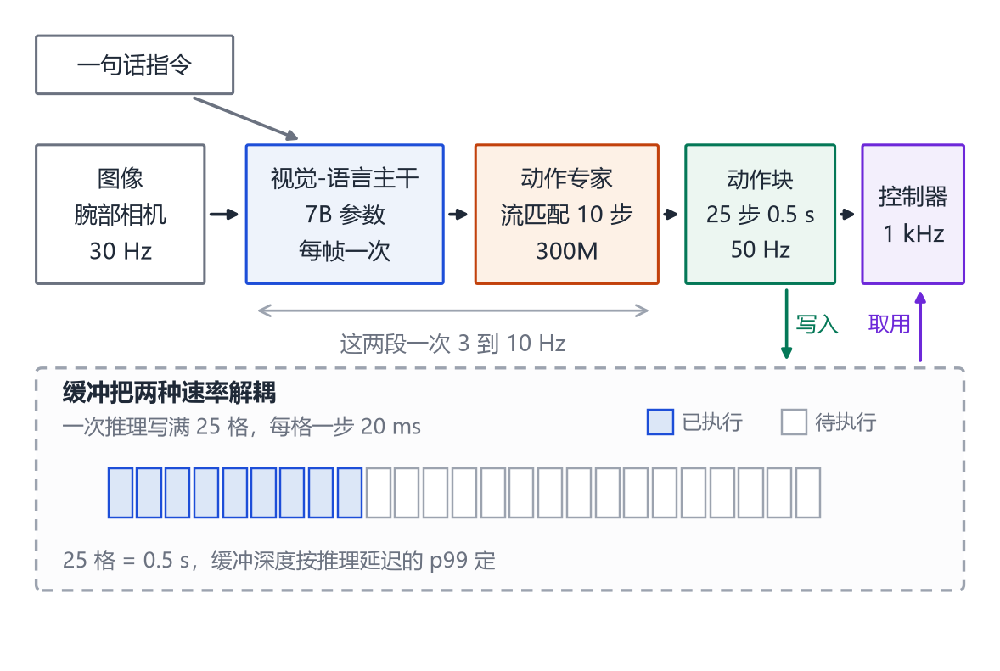
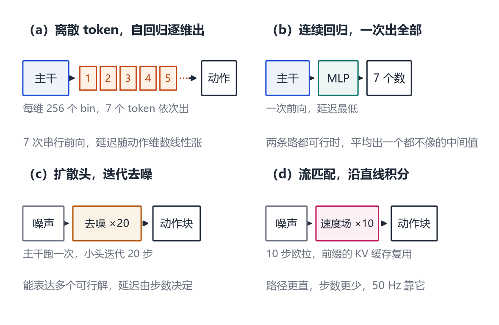
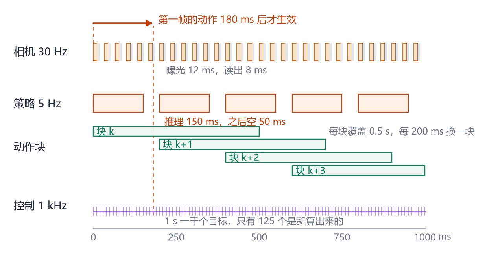

# 第 13 章　视觉-语言-动作模型

> **本章导读**：把一句话和一张图直接映射成关节指令，这条路线叫视觉-语言-动作模型，简称 VLA。这一章讲它怎么把动作塞进语言模型的词表，四种动作头各自的快慢与精度，开源谱系里几个真能上手的模型，以及一条绕不开的账，推理要一两百毫秒，控制要几十赫兹，中间那段空白靠什么填。读完你能看懂演示视频里的频率标注，也能判断它报的成功率是怎么来的。

## 13.1 从 RT-1 到 RT-2

桌上一个直径 7 cm 的马克杯，旁边一个盘子，相机的画面从腕部斜着看下去。前面几章把"把马克杯放进盘子"拆成了八步，每一步一个模块，分割、位姿、抓取检测、路径规划各管一段。VLA 的做法是把这八步压成一个网络。输入是腕部相机的图像加一句话，输出是接下来几百毫秒里的关节指令或末端增量。中间没有"杯子在哪"这个量，也没有"规划一条路径"这一步，全部隐式地长在权重里。

RT-1（2022）是这条路线上第一个把规模做出来的系统。骨干是一个 EfficientNet，配一个 TokenLearner 把 81 个视觉 token 压到 8 个，再接 8 层 Transformer，一共 3500 万参数。数据来自 13 台 Everyday Robots 移动机械臂，在办公室厨房里攒了 17 个月，13 万条演示，744 个任务。评测做了 3000 次真机试验，见过的任务上成功率 97%。

它最关键的设计是把动作变成 token。11 维动作（末端 xyz 三个位移、滚转俯仰偏航三个转角、夹爪开合、底盘三个量、一个终止标志），每一维在自己的取值范围内均匀切成 256 个 bin，取整成一个 0 到 255 的编号。于是"动作"变成一串整数，和"单词"共用同一个输出层和同一个交叉熵损失。模型不再回归实数，它做 11 次分类。

256 个 bin 够不够细，可以算一遍。假设末端增量限制在 ±5 cm，256 个 bin 每格 0.39 mm；滚转限制在 ±10°，每格 0.078°；夹爪开合 0 到 8 cm，每格 0.31 mm。桌面机械臂的重复定位精度通常在 0.1 到 0.5 mm，抓一个 70 mm 的杯子，姿态偏 5° 在杯沿上才差 6 mm。离散化损失的那零点几毫米，不是这条路的瓶颈。真正的瓶颈在别处，一次动作要吐 11 个 token，一个一个出。

RT-1 的推理预算写得很直白。论文里说人的示范速度是 2 到 4 秒完成一个动作段，所以单次前向必须控制在 100 ms 以内，为了这个把模型压到 3500 万参数。实际部署时它还加了一个固定等待，等 280 ms 再执行，理由是让输出频率稳定，避免抖动。这条工程细节很说明问题，模型快慢不是唯一的变量，稳不稳同样要紧。

RT-2（2023）换了出发点。它不再从零训一个机器人 Transformer，而是拿一个已经读过互联网的视觉语言模型来微调，5B 和 55B 的 PaLI-X，以及 12B 的 PaLM-E。动作依然离散，8 个数、每个 256 个 bin，依然用分类损失。变的只有一件事，模型在变成 VLA 之前已经知道狼头长什么样，也知道可口可乐那个红是什么红。

让 RT-2 站住的是 co-fine-tuning，中文常说联合微调。做法是把原始的网络数据（看图问答、图像描述）和机器人轨迹按比例混在一起继续训练，而不是只在机器人数据上微调。只在机器人数据上训，模型会很快忘掉和动作无关的概念，几万步之后它认得杯子却认不得杯子上印的商标；混着训，抽象的视觉概念和底层的动作 token 落在同一个批次里，网络知识才有机会迁移到"该往哪儿伸手"上。论文把这一条列为泛化的关键，消融里去掉它，泛化成绩明显掉。

结果可以量化。RT-2 在 6000 次真机评估里，泛化类别（新物体、新背景、新环境）的成功率大约是 RT-1 的两倍；在训练数据里完全没有的指令上，比如"把香蕉放到 2 上""把可乐罐挪到有狗的那张卡片旁边"，成功率是 RT-1 的 2 到 3 倍。这类指令考的不是抓取，是符号和常识，正好是互联网预训练带来的那部分。

代价写在同一篇论文里。55B 的模型没法在机器人的显卡上跑，只能放在云端多 TPU 上，通过网络查询，控制频率 1 到 3 Hz；5B 的版本大约 5 Hz。这是 VLA 的第一个硬约束，参数量、精度、频率三者只能挑两个，而机器人这条链对频率最不宽容。

把这些拼成一张，就是图 13-1。左边是一帧图和一句话，中间是主干加动作专家，右边是一段动作，最下面那条虚线框是后半段要反复用到的零件，一个存动作的缓冲。图上每一块都标了自己跑的频率，从相机的 30 Hz 到控制器的 1 kHz，中间那两段 3 到 10 Hz 的推理是整条链上最慢的一环，13.4 节整节都在讲怎么让它不拖后腿。

<figure class="fig">

<figcaption><b>图 13-1</b>　一条 VLA 推理链。图像和指令进主干，动作专家出动作块，控制器按 1 kHz 消费。下方虚线框是两种速率的解耦点，一格按 50 Hz 的一步画。</figcaption>
</figure>

## 13.2 四种动作头

VLA 的骨架可以分成两段，一段把图和话变成一串向量，叫主干，一段把向量变成动作，叫动作头。主干大多是现成的视觉语言模型，动作头是各家真正分歧的地方。图 13-2 把四种摆在一起。

<figure class="fig">

<figcaption><b>图 13-2</b>　四种动作头的结构差别。(a) 每维一个 token 自回归；(b) 一次回归全部维度；(c) 小头迭代去噪；(d) 沿速度场积分。方块只表示结构，不代表真实层数。</figcaption>
</figure>

离散 token 是最早的一种，RT-1、RT-2、OpenVLA 都用它。每个动作维一个 token，7 维动作就是 7 个 token，自回归地一个一个出。好处是整套语言模型的工具都能直接用，KV 缓存、并行训练、现成的分词器。坏处是串行，7 个 token 就是 7 次前向，每次都要等上一次出结果，动作维度一涨，代价线性涨。双臂 14 维加两只灵巧手 12 维是 26 个 token，26 次串行前向塞不进 100 ms 的预算。还有一个隐蔽的毛病，输出时只能取概率最高的那一格，模型没法说"左边绕和右边绕都行"，也没法把两个候选平均一下。

连续回归最直接，主干后面接一个 MLP，一次前向出 7 个实数，损失用 L1 或 MSE。它最快也最精确，ACT（2023）用 8000 万参数的策略，一次推理 10 ms。问题出在分布上。抓一个杯子，从左边绕和从右边绕都是对的，两条轨迹在数据里各占一半，MSE 的最优解是两条的均值，而均值那条路正对着杯子撞过去。这不是训练不充分，是损失函数的性质。Octo 的论文里明说，同样的主干换成 MSE 头，成绩不如扩散头。

扩散头把动作生成当成去噪。主干跑一次出条件向量，一个小 MLP 从这个条件出发，把纯噪声一步步擦成一条动作序列。Octo 的头是 3 层 MLP、隐层 256、20 步去噪，整段迭代都发生在小头里，主干只跑一次。好处是成本可控，20 次小 MLP 的前向远小于 20 次主干前向；坏处是步数固定，延迟可预测但比回归高一个量级。它真正解决的是多峰问题，两个模态都能采样出来，采到哪一个由噪声决定。

流匹配是扩散的变体，学的不再是"这一步该去掉多少噪声"，而是"从噪声到动作这个方向上速度是多少"，然后沿这个速度场积分。π0（2024）用 10 步欧拉积分，前缀的 KV 缓存复用，只重算动作那一段。相比扩散绕来绕去的路径，流匹配学到的路径更直，所以步数更少，同样的算力能跑到更高频率。π0 靠这个把控制频率推到 50 Hz，叠衣服这种需要连续微调的任务才做得下来。

动作头还决定了动作块怎么编码，这一层耦合很少被提到。离散 token 的头要出一段 25 步的块，就得吐 7 乘 25 共 175 个 token，串行解码 175 次，一秒都出不来；所以 RT-1 这类模型天生只能单步，靠高频查询补上连续性。回归、扩散、流匹配的头天然输出一个矩阵，25 步乘 7 维一次性给出，块的代价和单步差不多。这就是为什么"一次出一段"和"连续动作头"在工程上总是绑在一起出现。

四种放在一起，取舍只有一条线。表达能力要够，能把"两条路都行"表示出来；延迟要低，能塞进控制周期。离散 token 表达能力够（多峰它天然支持，那就是一个分布），延迟最差；回归延迟最好，表达能力最差；扩散和流匹配在中间偏表达的那一侧，靠小头迭代把成本压住。所以最近两年的模型基本往扩散和流匹配走，离散 token 留在需要"一段文字加一个动作"的场合，π0.5 的预训练阶段就是用它混异构数据，后训练再换成流匹配。

## 13.3 开源谱系

模型能不能上手，取决于权重和数据管线给不给。表 13-1 把几个能跑的排在一起。

**表 13-1**　主流 VLA 对比。

| 模型 | 参数量 | 动作表示 | 频率 | 开源情况 | 训练数据 |
|---|---|---|---|---|---|
| RT-1（2022） | 35M | 离散 token，256 bin | 3 Hz | 代码开源，权重未放出 | 13 万条，13 台机器人 |
| RT-2（2023） | 5B / 12B / 55B | 离散 token，256 bin | 1 到 3 Hz（55B） | 未开源 | 同 RT-1，另加网络数据 |
| Octo（2024） | 27M / 93M | 扩散头加动作块 | 5 Hz | 权重、代码、数据管线全开 | 80 万条 |
| OpenVLA（2024） | 7B | 离散 token，256 bin | 6 Hz（单张 4090） | 全开源 | 97 万条 |
| π0（2024） | 3.3B | 流匹配 10 步 | 最高 50 Hz | 论文未放出，后经 openpi | 1 万小时 |
| π0.5（2025） | 3.3B 级 | 流匹配加子任务预测 | 未公开 | 同上 | 400 小时移动数据加异构数据 |
| GR00T N1（2025） | 2.2B | 流匹配 DiT，双系统 | 10 Hz / 120 Hz | 开放权重 | 真机加人类视频加仿真 |

Octo（2024）是最早把"通用策略"整套开源出来的一个。两个尺寸，2700 万和 9300 万参数，Transformer 主干加扩散头，在 Open X-Embodiment 的 80 万条轨迹上预训练。它的目标是"换一台机器人不用改网络"，观测和动作空间都做成可配置的，换机器人只换输入输出的投影层，预训练那部分参数不动。工程上很实用的一条是微调成本，100 条左右的演示，一张 A5000 上 5 小时以内能训完。

OpenVLA（2024）把参数量拉到 70 亿，视觉端用 SigLIP 加 DINOv2 双编码器，语言端是 Llama 2。训练数据是 Open X-Embodiment 的 97 万条轨迹，花了 21500 个 A100 小时。它的意义在于证明了两件事。一件是开源模型能打赢闭源的大家伙，在 29 个任务上比 55B 的 RT-2-X 高 16.5 个百分点，参数少 7 倍。另一件是 7B 这个尺寸刚好能塞进一张卡，bf16 权重占 15 GB，单张 4090 上每秒 6 次推理，LoRA 微调在消费级显卡上就能做。6 Hz 对抓放够用，对叠衣服不够。

π0（2024）走的是另一条路，把动作头做小、把数据做大。主干是 30 亿参数的 PaliGemma，动作专家只有 3 亿参数，总共 33 亿。数据是自采的 10000 小时，7 种机器人构型、68 个任务，再并上 Open X-Embodiment。流匹配 10 步，最高 50 Hz。它演示的叠衣服、装纸箱、清桌面，动作的连续性是前面几个模型没有的，原因一半在动作头，一半在数据里那些"手一直在动"的片段。

π0.5（2025）解决的是"换个房子就不行"。训练分两段，预训练用 FAST 这类动作分词器把动作压成离散 token，好处是能和网页问答、子任务标签、人类口头指令混在同一个批次里训；后训练换成流匹配，专攻移动操作的低层动作。它还多输出一样东西，下一个子任务是什么。推理时先出"把砧板拿起来"，再出接下来一秒的动作。数据里约 400 小时是移动机械臂在 100 来个真实家庭里采的，评测是在没见过的房子里做 10 到 15 分钟的多段任务。

GR00T N1（2025）的结构最像人身上的两套系统。System 2 是一个 13.4 亿参数的视觉语言模型，10 Hz 看图和话，理解现在该干什么；System 1 是一个扩散 Transformer，用流匹配出动作，120 Hz，一次出 16 步。整个模型 22 亿参数，在 L40 上出 16 步动作 63.9 ms。它面向人形，跨本体靠每个本体一个 MLP 编解码。训练数据里除了真机，还混了人类视频和 78 万条仿真轨迹，相当于 6500 小时，生成用了 11 小时。

把这几个排在一起看，谱系的方向很清楚。参数从 55B 降到 7B 再降到 2.2B，动作头从离散转向连续生成，频率从 3 Hz 提到 50 到 120 Hz，数据从单一机器人转向异构混合。四条线指向同一件事，模型不需要那么大，需要的是把动作表示和训练数据的成分调对。

## 13.4 实时性这条链

到这里可以算账了。VLA 的推理是 100 到 300 ms 一次，机械臂的伺服是 1 kHz，中间差了两三个数量级。图 13-3 把三条时间轴画在同一段时间里。

<figure class="fig">

<figcaption><b>图 13-3</b>　同一秒里的三条时间轴。相机每 33 ms 一帧，策略每 200 ms 一次推理，动作块互相重叠，控制器每 1 ms 取一个目标。橙色箭头跨过的就是 180 ms 的端到端延迟。</figcaption>
</figure>

先算一次端到端的延迟。用前面那台 6 轴桌面臂，末端速度按 0.15 m/s 算，这是一个不快不慢的抓放速度。相机曝光 8 ms，读出和传输 8 ms，预处理缩放与归一化 10 ms，模型推理 150 ms，指令下发到控制器 4 ms，加起来 180 ms。这 180 ms 里机械臂一直按上一次的指令走，走了 27 mm。而抓一个 70 mm 的杯子，夹爪两指的对准容差大约是 ±10 mm。从"看到"到"动起来"这段盲走距离，是容差的三倍。

这不是模型不准。把模型换成能完美预测的先知，只要它还是 180 ms 后才给结果，手照样会走出去 27 mm。问题在时序，不在精度。

三个补丁，缺一不可。

**动作块。** 不要一次只出一个动作，一次出一段，比如 25 步。50 Hz 下这是 0.5 秒的轨迹，模型算一次，控制器慢慢消费。块长有讲究，太短等于没有，太长就变成开环，中途杯子被碰歪了它还在按老计划走。Diffusion Policy（2023）做过这条消融，不重新规划的步数从 1 加到 8，成绩一路上升，超过 8 开始掉。ACT 的消融更极端，块长 1 时成功率 1%，块长 100 时 44%，再往上又缓下来。

**异步。** 推理和控制在两个线程或者两块卡上跑，控制环不等推理，它从缓冲里取当前该执行的那一格。这样推理的 150 ms 不会把控制环卡住，1 kHz 的伺服照常转。代价是要有缓冲，而且缓冲深度得按推理延迟的 p99 定，不能按平均值。平均值 150 ms、偶尔抖到 400 ms 的系统，缓冲只有 200 ms 就会断流，断流那一下手臂停在原地等，接触任务里这一停就是一次失败。

**时间集成。** 既然每 200 ms 就查一次策略，同一时刻会被好几个块覆盖，那就别只信最新的那个。ACT 的做法是按年龄给权重，

$$w_i = \exp(-m\,i)$$

其中 $i$ 是这条预测已经等过的控制周期数，$m$ 越小越信任新观测。同一时刻的多个预测加权平均，动作就平滑了，新观测进来的快慢由 $m$ 调。这一项单独看只是平滑，和动作块合起来才是"既跟得上又不出锯齿"。

给一组自洽的参数。动作 50 Hz，一格 20 ms；块长 25 格，0.5 s；每 200 ms 重查一次，推理占 150 ms，剩下 50 ms 是余量；缓冲里始终压着两到三个块。稳态下每一刻大约有两三个预测在投票，最老的那条已经等了 0.5 秒，权重被压得很低，最新的那条权重接近 1。这套参数下，杯子突然被碰歪，从画面变化到动作改变大约 180 到 200 ms。换成"等整块执行完再重算"，最坏要 680 ms 左右，差三倍多。

这套分层在硬件上也有人做过对照。Octo 的实验里策略跑 5 Hz，底层阻抗控制器跑 1000 Hz，后者不管位置差多少，只管用多大的力把偏差顶回去；Diffusion Policy 的 10 Hz 指令被线性插值到 125 Hz 再送给机器人。中间这一层插值或跟踪不是可选项，没有它，低频指令会在伺服上变成台阶。GR00T N1 的双系统是同一件事的结构化版本，10 Hz 那一半负责看懂和决定方向，120 Hz 那一半负责把这一段走顺，两半之间的接口是 token，不是动作。

## 13.5 能力边界与二十次试验

VLA 能迁移的东西比想象的多，也比想象的具体。物体类别、颜色材质、常见场景布局、语言指代（"把蓝色那块布拿过来"）、简单空间关系（"放到碗旁边"），这些在 Open X-Embodiment 那种规模的数据里都有覆盖，换一个新厨房通常还能用。RT-2 那类符号与常识的泛化也是真的。

不容易迁移的，列清楚更有用。

**换本体。** 动作的维度、顺序、量纲一变，token 的含义就全变了。跨本体靠数据混合和每个本体一套编解码，效果有限。Open X-Embodiment 里有很能说明问题的一组对比，RT-1 在 Google 机器人上 92%，把同样的架构放到 22 种机器人的混合数据上重训得到 RT-1-X，在同一个机器人上只有 73%。数据变杂了，单一本体上的成绩反而掉。

**换相机。** 腕部相机挪 5 cm，或者换成眼在手外的固定相机，训练分布就变了，模型会把新视角当成新场景。

**需要力。** 插 USB、拧瓶盖、拉拉链，成败取决于力，而 VLA 的输入里只有图和话。力觉要么多一路输入，要么交给底层力控，指望从图像里学会力的大小不现实。

**长程。** 10 分钟以上的任务，端到端会漂。π0.5 那样"先出子任务再出动作"的分层是目前解法，本质是把长程拆成一串短程，每一步都重新看一眼。

**精度。** 亚毫米级装配不在 VLA 的能力范围里，那是专用方法和视觉伺服的地盘。它的定位是"看懂该干什么、大致怎么做"，不是"做到丝级"。

数据异质也会反噬。OpenVLA 试过把 DROID 数据集按 10% 的权重混进训练，结果动作 token 的准确率一直上不去，只好在训练的后三分之一把它拿掉。混合不是免费的，比例、本体差异、动作空间定义都会影响收敛。

还有一件最容易被忽略的事，评测的算术。20 次试验成功 18 次，成功率 90%，按 Wilson 区间算，95% 置信区间是 70% 到 97%，下界只有七成。如果 20 次里成功 14 次，成功率 70%，区间是 48% 到 86%，和 90% 的区间大面积重叠。换句话说，20 次试验分不出一个 70% 的模型和一个 90% 的模型。

要把区间半宽压到 4 个百分点，大约需要 200 次试验。这也解释了 RT-1 为什么报 3000 次、RT-2 为什么报 6000 次，那不是排场，是把误差棒压到能比较的宽度。看到"成功率 90%"时该问三件事，试了多少次、几个任务、训练时见过这个场景没有。

VLA 在链路里的位置说清楚就不容易误解。它把"看懂"和"动手"接在一起，但既不替代底层的伺服和力控，也不替代上层的任务分解。判断一套 VLA 系统，看四件事，动作头能不能在控制周期内出结果，动作块的时序怎么和相机、控制器对齐，训练数据覆盖了哪些本体，评测用了多少次试验。这四条都比参数量更能说明它能不能在你的桌子上干活。
