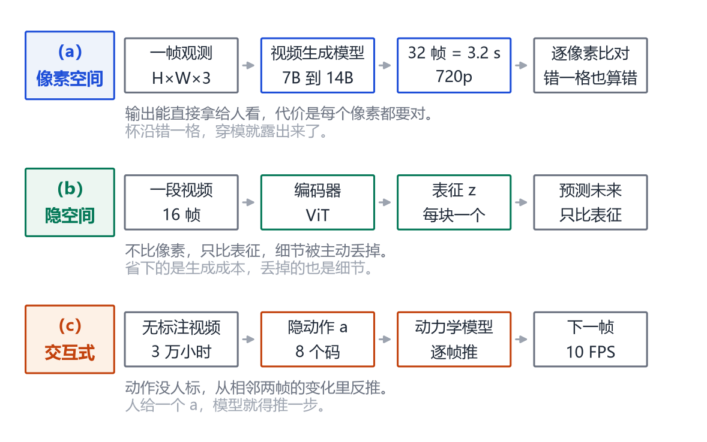
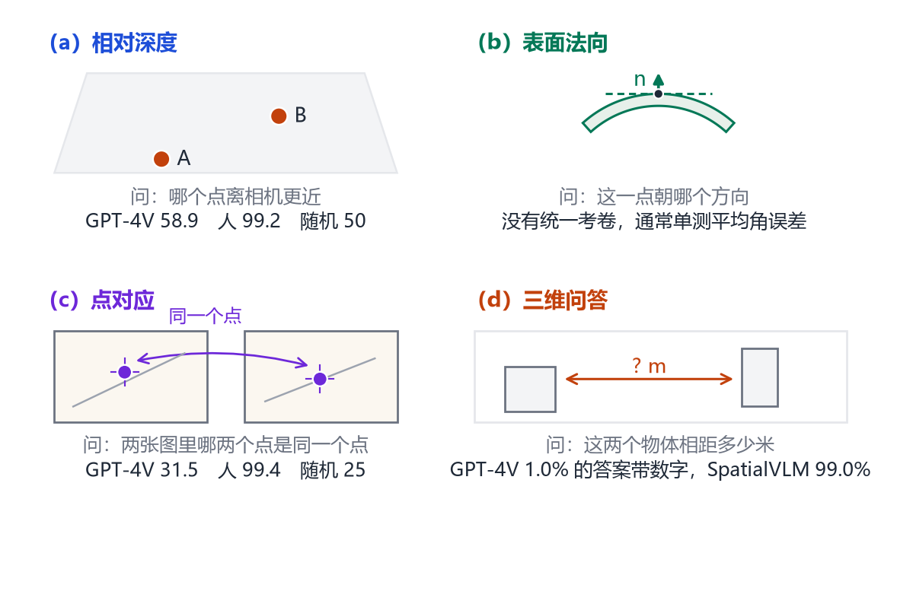
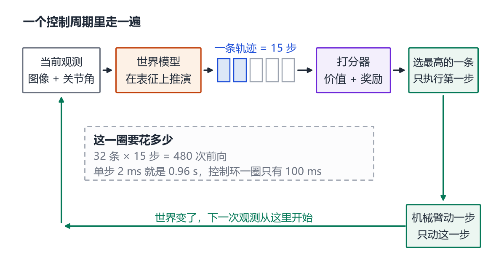

# 第 14 章　世界模型与空间智能

> **本章导读**：人伸手之前会在脑子里过一遍，杯子会不会倒、手会不会撞到桌沿。机器要获得这种能力，就得有一个能预测"我这么做之后世界会变成什么样"的模型。这一章讲三类世界模型各自在预测什么、视频生成卡在哪、隐空间预测省下了什么又丢掉了什么，以及今天的大模型到底懂不懂三维空间。读完你能判断一段"世界模型"演示视频离真能用还差几步。

## 14.1 先在脑子里过一遍

伸手去拿桌沿那只杯子，你不会直接冲过去。手抬到一半时你已经算过一遍，从正面抓会碰到杯柄，从侧面抓要绕过桌沿，手背可能蹭到纸巾盒。这三条候选里只有一条走通，另外两条在你脑子里被否掉了，真实的手一次都没动。

这件事在机器人上有一个很朴素的名字，叫预演。给定当前观测和一个候选动作序列，模型输出"如果这么做，接下来几帧会看到什么"。有了它，机器可以在动手之前把几条路各走一遍，挑一条最像成功的再落到关节上。

预演的用处不止挑动作，它同时解决三个不同的问题。

**规划时预演后果。** 桌面臂要抓杯子，候选路径三五条，每条 1.5 秒。真机上一条一条试，失败一次还要人来复位，前后两三分钟就没了。换成在模型里推演，一条 15 步、单步 2 毫秒，三条加起来不到 0.1 秒。这个差距决定了系统敢不敢多想几步。

**造训练数据。** 真机采一条演示要几十秒到几分钟，还得有人摆场景、有人收尾。世界模型能凭空生成"如果这样动，画面会怎么变"的样本，把一批几百条的机器人数据放大成几万条近似样本。UniSim（2024）就是拿这个思路训练策略，先在模型里练，再零样本搬到真机上做桌面推放。

**学表征。** 预测未来这件事本身就是一种自监督任务。要在不看答案的情况下猜准下一段画面，模型必须自己学会什么东西会动、什么会保持不变、什么挡住了什么。这种从预测里长出来的表征，对下游的检测、分割、动作识别都有用。

三个用处对模型的要求并不一样。规划要的是"准"和"快"，数据生成要的是"像"和"多"，表征学习要的是"稳"，不在乎能不能画出图。这三条要求分出了三条技术路线，图 14-1 把它们摆在了一起。

<figure class="fig">

<figcaption><b>图 14-1</b>　三条路线的流水线对比。(a) 在像素上生成，(b) 在表征上预测，(c) 用隐动作驱动逐帧推演。每行左边是输入，中间是核心部件，右边是产物或判据。产物形态不同，能干的活也不同。</figcaption>
</figure>

三条路线的差别可以从"输出什么"一句话说清。像素路线输出一张能看的图，隐空间路线输出一串没人看得懂的向量，交互式路线输出一张随动作变化的下一帧。下面的三节按这个顺序讲，每节都回答同一个问题，这条路能干什么，代价在哪。

## 14.2 视频生成能当模拟器吗

第一条路最直观，把视频生成模型当模拟器用。给它当前这一帧，再给它一个动作，让它画出接下来 3 秒的画面，机器照着画面里的结果决定要不要动。这条路线的样本量已经很大，Cosmos（2025）从 2000 万小时原始视频里切出约 1 亿段 2 到 60 秒的片段，训了 40 亿到 140 亿参数的扩散模型和自回归模型，专门面向物理智能。

看起来只差一步，实际差在物理。

**物体会消失。** UniSim 的作者自己列过一条限制，模拟器只以最近几帧历史为条件，没有长期记忆，把一个苹果放进抽屉、再关上抽屉、过一会儿打开，苹果可能不见了。人不会犯这种错，因为人知道抽屉里的东西还在。像素模型没有"东西还在"这个概念，它只有"下一帧该长什么样"。

**物体会穿模。** 杯子放在桌上，模型生成的下一次夹取里，夹爪指尖穿进了杯壁，或者杯底陷进桌面两毫米。训练数据里这种画面极少，因为真实世界不允许；可一旦模型在某一步预测偏了，它没有物理约束把它拉回来，只能顺着错的画面继续编。错一次之后画面自洽地错下去，越编越离谱。

**接触力根本不在画面里。** 这一点最容易被忽略。同一个杯子，用 5 牛的力抓和用 15 牛的力抓，静止时的图像一模一样，只有手指陷进杯壁的那一点点形变不同。UniSim 的论文把这条写成"只做视觉模拟"，明说它不适合"动作不改变视觉观测"的场合，抓一个静止的杯子换不同力度就是例子。可是很多任务的成功与否恰恰取决于力，拧瓶盖、插 USB、拉拉链都是。

**长程会崩。** UniSim 做过一组对照，只用窄领域数据训，长程交互模拟有一半是失败的；把互联网图像、自我中心视频、机器人数据混进来之后才明显好转。这也解释了为什么这一类模型都强调数据要杂，杂数据补的是"世界长什么样"的先验。

**速度差一个数量级。** 这一条最硬。Cosmos 的论文里有一张推理表，自回归模型生成 32 帧 640×1024 的视频，40 亿参数的版本在 8 张 H100 上要 9.9 秒，120 亿参数要 45.7 秒。32 帧按 10 fps 算是 3.2 秒的画面，也就是说生成比播放慢 3 倍到 14 倍。只有在把分辨率降到 320×512、再叠上投机解码（先猜几个 token 再校验）之后，40 亿的版本才在 8 张 H100 上跑到每秒 10 帧，刚刚追上实时。

把这个数放到控制链上看就更清楚。机械臂抓杯子，策略 10 Hz 就要每 100 毫秒出一次结果，抓取过程中还要 30 Hz 看一眼。视频模型一次前向要几秒，中间差两个数量级。就算只推一帧，一次去噪也要走二三十步，每步都是全序列注意力，省不下来。

所以视频生成在 2025 年的位置是清楚的。离线用它造数据、做候选策略的粗筛、给人看效果，都成立；把它接进闭环当模拟器，不成立。判断一个演示是不是在骗人，可以看它有没有报"生成一帧要多久"，只报画面不报延迟的，多半是离线渲染出来的。

## 14.3 交互式世界模型

第二条路把"可控"这件事单独拿出来解决。视频模型的问题是它只会顺着画面往下编，人没法插手；要当模拟器，必须能接受一个动作、并且这个动作真的改变后续画面。

难在动作标签。互联网上的视频有几千万小时，全都没有"这一刻按了什么键"的记录。Genie（2024）的做法是从视频里把动作反推出来。它用一个编码器吃相邻两帧，输出一个 0 到 7 的整数，再要求解码器只看第一帧和这个整数就能重建第二帧。为了让这个整数真的承载"动作"，码本只留 8 个码，逼着模型把两帧之间所有的变化压进这 8 个格子。训练完之后，这 8 个整数就成了隐动作，人给它 0 到 7 里的一个，模型就往前推一帧。

数字能说明规模。Genie 用了 3 万小时从 20 万小时公开游戏视频里筛出来的素材，110 亿参数，10 fps，一次处理 16 帧，训练时没有任何动作标注，也没有文字标注。它在 2D 平台游戏上做到了逐帧可控，给一张手绘草图或一张照片就能生成一个能玩的世界。同一套方法用在 RT-1 的无动作机器人视频上，也能学出一组稳定的隐动作。

代价在粒度。8 个离散动作够平台游戏用，因为那种游戏本来就只有左、右、跳几个键。真实机械臂是 7 维连续动作，末端位移要精确到毫米，8 个码连"往左一点"和"往左很多"都分不开。Genie 的意义在于证明"动作可以从无标注视频里学出来"，不在于它的动作空间能直接驱动一台桌面臂。

UniSim 走的是另一条组合。它不假装动作可以无中生有，而是把有动作标签的数据和无标签的数据混在一起用。机器人数据提供动作与画面的对应，互联网图文提供物体与场景的多样性，自我中心视频提供人的动作，导航数据提供大范围移动。低级动作按论文的做法归一化后离散成 4096 个区间，接在语言嵌入后面，统一成"动作加文本进、视频出"的接口。训练数据里 LAION-400M 有 4 亿对图文，Ego4D 有 350 万段，Language Table 的真实数据 44 万条，RT-1 的数据 7 万条。

它的用法值得记下来。生成器按固定长度的历史自回归地往下推，历史滑出窗口就丢掉，这样长序列可以一段一段接。策略在模型里跑，成功了就把这一段轨迹留下来，用 hindsight relabeling 改成"以后见之明"的目标条件样本，再拿去训一个视觉语言策略；强化学习那条线则用一个从数据里学的奖励模型给想象出来的轨迹打分。两条线训完都直接上真机，不做微调。

限制也写在论文里。动作不合理时它会幻觉，给桌面机器人下"洗手"的指令，桌子会变成水槽；历史窗口外的记忆会丢；没见过的机器人本体泛化很差；画面里看不出的力，它也模拟不了。这四条合起来给出一个边界，交互式世界模型能替代"看"，替代不了"碰"。

## 14.4 在隐空间里预测

第三条路干脆不比像素。V-JEPA（2024）的做法是拿一段 16 帧的视频，帧间隔 4，覆盖大约 2 秒，随机遮掉其中一大块时空区域，让模型去猜被遮住的部分"在表征空间里长什么样"。目标不是像素值，而是同一段视频经过另一个编码器得到的特征。用一句话概括，它学的是"接下来会发生什么"，不是"接下来每个像素是什么颜色"。

写成式子只有一行。给定可见部分的表征 $z_{\text{ctx}}$，预测器 $P$ 要输出被遮部分的表征，和真实目标 $z_{\text{tgt}}$ 比距离

$$\mathcal{L}=\left\lVert P\left(z_{\text{ctx}}\right)-\operatorname{sg}\left(z_{\text{tgt}}\right)\right\rVert_2^2$$

其中 $\operatorname{sg}$ 表示这一项不回传梯度，只当常数用，避免模型把两边一起拉成零。整个训练没有重建，没有负样本，没有文本，也没有预训练的图像编码器。

好处很直接。像素里有大量不可预测的东西，树叶的抖动、水面的反光、玻璃杯上的高光，这些东西占掉了重建损失的一大半，模型为了压低损失会把容量花在记住纹理上。表征空间里这些细节本来就被压掉了，预测器只需要抓住"杯子往左移了""手合上了"这类语义变化。结果是训练更省，表征更偏语义。V-JEPA 最大的模型是 ViT-H/16，在 200 万段视频上训完，冻结主干直接线性探测，Kinetics-400 上 81.9%，Something-Something-v2 上 72.2%，ImageNet-1K 上 77.9%。第二个数最能说明问题，那个数据集考的是细粒度动作方向，冻结特征能到 72.2% 说明它抓到了运动本身，而不只是外观。

代价也很清楚。它画不出图，你没法用眼睛检查它预测得对不对，只能在下游任务上看分数。它没有动作输入，标准的 V-JEPA 是"看视频猜未来"，不是"给动作猜未来"，要接策略得另外设计条件注入。它对几何精度不敏感，杯沿差 2 毫米这种事在每个图像块的表征里几乎是同一个点。它也没有接触的概念，力的大小在特征里留不下痕迹。

DreamerV3（2023）把这条路推到了控制上。它学一个循环状态空间模型，把观测压进隐状态，在隐状态里推演未来，用想象出来的轨迹算价值、更新策略，一套固定超参跨 150 多个任务，模型规模从 1200 万到 4 亿参数，在 Minecraft 里从零学会了采钻石。这条线的价值和局限是一体两面，想象很便宜，所以能想很多步；想象里没有真实的接触，所以搬回真机时摩擦、间隙、柔性这些没建模的东西会一起找上门。

三条路线摆在一起看，取舍就清楚了，表 14-1 是它们的对照。

**表 14-1**　三类世界模型的对比。

| 路线 | 代表 | 训练数据 | 输出 | 单次代价 | 适合干什么 |
|---|---|---|---|---|---|
| 像素生成 | Cosmos（2025）、UniSim（2024） | 2000 万小时视频筛出 1 亿段；机器人视频加互联网视频 | 720p 视频帧 | 32 帧 3.2 秒的画面要 9.9 到 45.7 秒（8 卡 H100） | 离线造数据、粗筛策略、给人看效果 |
| 隐空间预测 | V-JEPA（2024）、DreamerV3（2023） | 200 万段视频；交互轨迹 | 图像块表征、隐状态 | 单步毫秒级 | 学表征、在想象里练策略 |
| 交互式 | Genie（2024） | 3 万小时无标注游戏视频 | 受隐动作控制的下一帧 | 110 亿参数，10 fps 生成 | 造可交互环境、从视频里学隐动作 |

## 14.5 大模型懂不懂空间

世界模型要预测空间，大模型自己懂不懂空间就是必须先问清的事。这个问题被问了好几年，答案取决于问的是哪一种空间能力。第 12 章已经用一组总分说明过差距，这里把总分拆成四类，看差距究竟长在哪里，图 14-2 是这四类任务的示意。

<figure class="fig">

<figcaption><b>图 14-2</b>　四类空间任务与它们的问法。(a) 相对深度，(b) 表面法向，(c) 两张图之间的点对应，(d) 带单位的三维问答。前两类只要求一个方向或一个序，后两类要求给出具体的对应关系和数值。</figcaption>
</figure>

**相对深度。** 给两个点，问哪个更近。BLINK（2024）把这类题做成选择题，14 类任务共 3807 道，图 7300 张。单看深度这一项，GPT-4V 拿到 58.87%，人是 99.19%，随机是 50%。比随机高 8.9 个百分点，意思是它有一点线索，但离"看懂"很远。

**表面法向。** 问某一个点朝哪个方向。这一类连像样的考卷都没有，因为答案是一个三维单位向量，选择题和问答题都不好转成语言。工程上的做法是单独接一个回归头，在 NYUv2 这类带深度和法向标注的数据上训，专门模型平均角误差能压到十几度，通用多模态模型基本不输出这个量。

**点对应。** 给两张不同视角的图，问哪两个点是空间里的同一个点。BLINK 的视觉对应题里，GPT-4V 拿 31.54%，随机是 25%，人是 99.42%；语义对应题更差，30.00% 对随机 25%。这两项接近瞎猜，原因是这类任务要的是像素级的几何匹配，靠的是特征描述子和极线约束，而语言模型擅长的是"这张图里有什么"，不是"这两个坐标是不是同一个位置"。

**三维问答。** 问两个物体相距多少米。这是四类里唯一有明确数据路线的一项。SpatialVLM（2024）先用单目深度模型把 1000 万张真实图片反投影成三维，再用检测框和深度算出物体之间的距离、尺寸、朝向，自动生成 20 亿条带公制答案的问答对，拿去微调 PaLI-X 55B。效果可以用两个数看。问距离时，GPT-4V 只有 1.0% 的回答里真的出现了数字，其余都在说"图像缺少参照，无法给出精确距离"；SpatialVLM 是 99.0%。答案落在真值一半到两倍之间的比例，GPT-4V 是 0.0%，SpatialVLM 是 37.2%。

37.2% 这个数要放平了看。它意味着六成情况下误差超过一倍，够用来判断"通道能不能过一台 1 米宽的机器人"，不够用来决定"再往前伸 3 厘米"。论文还画了误差随距离的变化，1 到 10 米这一段最准，更远的地方误差迅速涨，原因是它继承了单目深度模型的偏差，那套深度在远处本来就不准。

四类合起来给出一条实用结论。空间能力不是一个开关，是四把不同的尺。序关系（谁前谁后、谁左谁右）模型勉强能给，方向（法向、朝向）基本不给，对应关系接近瞎猜，带单位的距离要靠专门数据喂出来而且只在中等距离可靠。系统里该有三个模块分工，语义判断交给大模型，几何量交给深度和点云，可行性交给试一次或者价值函数。

## 14.6 把想象接回策略

回到最开始的问题，预演怎么变成动作。这套结构在控制里有个名字，叫模型预测控制，放到今天的世界模型上还是同一套，图 14-3 画的就是这一圈。

<figure class="fig">

<figcaption><b>图 14-3</b>　预演、打分、执行的一圈。世界模型一次展开 32 条候选轨迹，打分器给每条一个分数，只把最高分那条的第一步发给机械臂，然后重新看一眼。</figcaption>
</figure>

从当前观测出发，采 32 条候选动作序列，每条 15 步，交给世界模型各推一遍，得到一个"想象中的未来"。打分器给每条轨迹一个数，可以是学出来的价值函数，也可以是奖励模型的累加。选分数最高的一条，只执行第一步，然后丢掉其余全部想象，用新观测重新来过。

只执行第一步是关键。想象出来的第 15 步和第 1 步的可信度差得远，越往后模型越是在编，所以真正落到关节上的永远是最前面那一小段。这套做法在二十年前的经典控制里就有，那时模型是手写的动力学方程，现在换成了神经网络，循环结构没变。

账要算清楚。32 条乘 15 步是 480 次前向，单步 2 毫秒就是 0.96 秒，而控制环 100 毫秒一圈。差 0.86 秒，这个缺口没法靠优化编译器补上。工程上有四种挤法。

**缩短视野。** 15 步砍到 5 步，480 次变 160 次，0.32 秒，还是慢，但已经能接受。代价是看不到远处的后果，抓放这种短任务够用，多步装配不够。

**换隐空间。** 在每个图像块的表征上推一步比生成一张 720p 的图便宜两个数量级，这是 V-JEPA 和 DreamerV3 那一路在工程上真正的优势。代价是分数也只能在表征上算，判断"抓到了没有"这种需要看细节的事会变模糊。

**并行。** 32 条候选之间没有依赖，可以一次批进去。一张卡上批 32 条，单步从 2 毫秒涨到 8 毫秒，总时间从 0.96 秒降到 0.12 秒，这一条最有效，也是所有实用系统都在做的。

**只在对的地方用。** 不是每一拍都要想。直线接近、夹爪闭合这些动作不需要预演，真正需要选的是"从左边绕还是从右边绕""先抓杯柄还是先抓杯身"这几个岔路口。一秒里想一两次，其余时间跑便宜的策略网络。

误差累积是这条路的固有缺陷。假设模型单步预测的偏差是 2%，推 15 步之后偏差不是 30%，可能更大，因为每一步的偏差会改变下一步的输入，让模型走到训练数据没覆盖过的地方。接触任务最怕这个，因为接触是硬约束，差一毫米就是没碰上。所以实用系统的视野都很短，DreamerV3 那种在想象里练上百万步的做法，靠的是隐空间里误差增长慢，而且练习的目标是学一个鲁棒的策略，不是精确预测某一帧。

把三种用法分开看，位置就清楚了。训练时用想象补数据，收益最大，因为慢一点无所谓；决策时用想象选动作，只在关键岔路口用得起；评估时用想象给候选策略打分，适合粗筛，不适合报成功率。三条都成立的前提是同一个，别把想象当成真值，它只是一个更便宜的近似。

一句话收这一章。世界模型的价值不在于替机器人做梦，而在于把"试错"的成本从几秒一次压到几毫秒一次，让机器在动手之前有得选。它替代不了真实的接触，也替代不了标定好的深度和力传感器，它只是把选择这一步变便宜了。