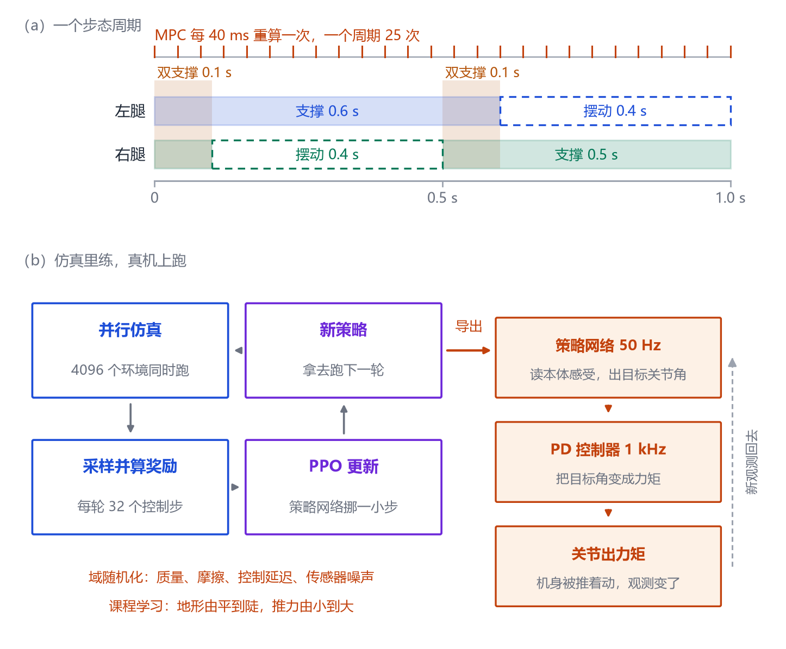

# 第 16 章　腿足与人形机器人

> **本章导读**：轮子只需要一条平整的路，两条腿要的是一整套和重力谈判的本事。这一章从“人站着为什么不会倒”讲起，把 ZMP、支撑多边形、倒立摆这几件老工具摆开，再看学习式控制怎么用几千个并行环境把步态练出来，再落到人形的分层控制与硬件账本。读完这一章，你看到一段人形走路的视频，应该能判断它在什么地面上能走、走多快、背后大概是哪一套控制。

## 16.1 两条腿为什么难

这一节回答一个问题。轮子跑得好好的，为什么非要让它长出两条腿，而且长出来之后为什么这么难开。

设想一台扫地机器人，它的轮子只需要一条平整的地面。地毯边缘稍微高出一厘米，它就可能卡在那里原地打转。人对这件事完全没有概念，抬脚跨过去是下意识动作，甚至不会意识到自己跨了什么。这个差别说明了一件事，轮子把“地面必须平整”当成了前提，而腿把这个前提取消掉了，代价是要一直和重力谈判。

人站着不动的时候，看上去什么都没发生。实际情况是踝关节一直在出小力，把身体重心的投影按在两只脚围出的那块地里。身高 1.7 m 的人，质心大约在 1.0 m 高，脚掌长 26 cm、宽 10 cm。站直时，质心投影只要偏出脚掌后沿或前沿 13 cm，就得靠脚趾或脚跟多顶一下；偏得再多，人就开始倒。13 cm 对 1.0 m 的质心高度，对应 7.4° 的倾角。

这个数字说明了双足的第一层难处，支撑面太小。一台 45 kg 的人形，脚掌尺寸和人差不多，最大恢复力矩是体重乘 13 cm，约 57 Nm。它只能把身体推回来，不能让身体瞬间移回去。力作用一段时间才有位移，中间那段身体还在往前倒。

第二层难处叫欠驱动。一条腿有髋三个、膝一个、踝两个，共六个关节，但脚踩在地上时，脚掌与地面的接触把其中一部分自由度锁死了。踝关节的力矩有上限，膝盖只能往一个方向弯，脚尖那一节在很多人形上还是被动弹簧。整机三十来个自由度里，真正能主动控制的比想象的少。身体绕支撑脚的翻转就是个没装马达的自由度，只能靠质心位置去管。

欠驱动最容易在斜面上露馅。站到一个十度的斜坡上，身体想往低处滑，唯一的办法是把脚掌的着力点往高处挪，让地面反力的作用线穿过质心。这一步在平地上几乎不需要思考，在斜坡上却要求踝关节持续输出一个额外的力矩。踝关节的电机一旦到额定上限，人就只能往前迈一步，用换脚的方式来重置这个平衡。

第三层难处是接触切换。四足站着时，三条腿着地围出一个三角形，质心落在里面就是静稳定，电机断电也不倒。双足做不到。单脚支撑时支撑面只剩一只脚，0.026 m²，另一只脚正在空中往前飞。人走路一个周期 1.0 到 1.2 s，支撑相占 60%，双脚同时着地只有 20% 的时间，分成两段各 0.1 s。换句话说，走路时八成时间，人是一只脚站在地上的。

所以“走路是可控地摔倒”不是修辞。每一步都是主动把身体往前送，让重力把自己拉向将要倒的方向，在倒到位之前把另一只脚放到前面接住。接住那一下，地面反力从 0 跳到体重的 1.1 到 1.2 倍，几十毫秒内完成。人靠小脑把它做成条件反射，机器得显式地算，每 20 ms 一次。

摔倒的代价也能量化。一台 45 kg、1.6 m 高的机器人倒下，质心从 0.9 m 落到 0.2 m，释放 45×9.81×0.7，约 310 J。这 310 J 在几十毫秒里被吸收，关节限位和地面分摊，哪一个先到极限，哪一个先坏。人形演示里最贵的一次失败往往不是摔一下，而是摔倒时手臂撑地，腕关节承受了几倍体重的冲击。

还有一个不那么直观的难点，脚底的信息很少。人的脚底有大量感受器，能感觉到地面软硬、有没有砂砾、是不是在滑动。人形机器人的脚底通常只有几个力传感器和一个 IMU，测得到总反力和姿态，测不到压力的分布。踩到一块松动的砖，人会在 100 ms 内调整，机器人往往要等到身体真的歪了才发现。

于是腿足控制的历史可以分成两条主线。一条是把问题简化成一个质点，用数学把质心轨迹算出来，再让关节去跟，这条路稳、可解释，但只能处理比较规整的地面。另一条是直接在仿真里让策略自己试，几百万次摔倒之后总结出一套反应，这条路适应性强，但难以解释，也很难保证任何一条边界条件。这两条路具体的做法，从下一节开始讲。

## 16.2 ZMP 与支撑多边形

这一节回答一个问题。走路时身体一直在往前倒，凭什么说它没有倒。

先给一个可以量出来的判据。把地面给脚的所有反力加起来，会得到一个合力，这个合力的作用点落在脚掌围出的那块区域里，身体就不会绕边缘翻过去。这个作用点叫零力矩点（Zero Moment Point，ZMP），古称 ZMP 而不是重心投影，因为在有加速度的时候两者并不重合。

ZMP 这个名字来自它的定义。整个机器人受重力和惯性力，这两组力对地面上任意一点的力矩可以算出来，其中有一个点使水平方向的力矩为零，只剩竖直方向的支撑力，这个点就是 ZMP。图 16-1 的左侧把这件事画在侧视图上。

<figure class="fig">

<figcaption><b>图 16-1</b>　侧视看，质心投影越过脚尖，ZMP 仍留在脚底；俯视看，支撑多边形是两脚的凸包，ZMP 轨迹在两只脚之间来回跳。示意。</figcaption>
</figure>

侧视图上要分清两条线。一条是质心的竖直投影，它可能已经跑到脚尖外面去了，这并不一定意味着要倒；另一条是 ZMP，它必须留在脚掌接触地面的那一段里。走路时质心投影经常跑到支撑脚外面，因为身体正在往前扑，但只要 ZMP 还压在脚掌上，地面就能给出足够大的反力矩把身体撑住。

俯视图上要看的是支撑多边形。双脚着地时，两只脚掌的凸包围出一块六边形，ZMP 可以在这块区域里自由移动。单脚支撑时区域缩成一只脚掌，只剩长方形。走路的过程就是 ZMP 在这两个区域之间来回跳，配合重心的移动把身体一路推过去。

稳定裕度是一个更有用的量。它是 ZMP 到支撑多边形最近边的距离。裕度大，说明还有余量，可以抵抗扰动；裕度小，一阵风或者一次小的地面不平就可能出界。人在正常走路时裕度只有几厘米，跑起来接近零，跑步的定义就是有一段时间双脚都不着地，此时支撑多边形不存在，裕度无从谈起。

这套判据的用处在于，它把一个动态问题变成了一个几何约束。只要规划出来的质心轨迹能让 ZMP 一直留在支撑多边形内，机器人就不会摔。规划器于是可以只算质心，不管三十几个关节怎么动。这是经典方法里最省事的一步简化。

用它也能解释很多现象。人抱着一个大箱子走路会变慢，因为箱子让整体质心前移，裕度变小，只能靠缩短步幅来补偿。人上楼梯时要先抬脚，因为要先把 ZMP 挪到支撑脚上，才能让另一只脚离地而不失去平衡。推一个重物时人会往后仰，也是同一个道理，把质心往后拉，抵消推力带来的前倾力矩。

局限也很清楚。ZMP 判据假设脚底和地面之间不会打滑，一旦地面是冰或者砂石，这个前提就没了。它也假设支撑面是刚性的，踩在软垫上，脚掌会陷进去，接触面变成一个不确定的区域。它还只关心翻倒，不关心关节本身的力矩是否超限。所以在真实系统里，ZMP 是一条必须满足的约束，但不是唯一的约束。

ZMP 与质心投影的差别，在加速时最明显。人从静止起步的那一瞬间，身体向前加速，惯性力把它往后拉，ZMP 必须落在质心投影的后方，才不会往前栽。反过来急停时，惯性力往前推，ZMP 跑到质心投影前面。这两个位置差多少，等于加速度除以重力再乘质心高度。加速度 1 m/s²、质心高 1 m 时，差 10 cm，正好是脚掌长度的一半。走路时这个量级的移动每步都要发生一次，所以 ZMP 从来不会停在脚掌中间不动。

支撑多边形还有一个容易忽略的性质，它不一定连成一片。站在两块分开的地砖上，两只脚之间是空的，ZMP 不能落在中间那片空隙里，尽管它在凸包内部。严格地说，ZMP 必须落在实际接触区域的并集里，凸包只是它的上界。工程上为了让计算简单，常常按凸包算，代价是把一些实际不可行的解当成可行，规划出来的轨迹到了执行阶段才发现撑不住。真正的接触区域要靠脚下的压力传感阵列测出来，或者用脚掌几何加上姿态去推。

## 16.3 倒立摆与预测控制

这一节回答一个问题。既然质心轨迹能决定会不会摔，那这条轨迹该怎么算出来。

最省事的模型是把整台机器人压成一个质点，接在一根可以伸缩的腿上，脚底那一点固定在地面。这个模型叫线性倒立摆（Linear Inverted Pendulum Model，LIPM）。它的方程简单得不像话，质心水平位移的二阶导数正比于位移本身，比例系数是重力除以质心高度。

$$\ddot{x} = \omega^2 x, \qquad \omega = \sqrt{g/z_c}$$

这里 $x$ 是质心相对支撑点的水平偏移，单位米；$\ddot{x}$ 是它的加速度；$g$ 是重力加速度，取 9.81；$z_c$ 是质心高度，单位米；$\omega$ 是一个频率，叫倒立摆的自然频率，单位是每秒。代 $z_c=0.8$ m 进去，$\omega$ 约 3.5 rad/s，对应的时间尺度 1/$\omega$ 约 0.29 s。

这个方程说的是，偏移越大，加速度越大，偏移会自己长大。它的解是双曲余弦，$x(t)=x_0\cosh(\omega t)$。图 16-2 的右侧画了三条曲线，初始误差都是 1 cm，质心高度分别取 0.6、0.8、1.0 m，横轴是时间。

<figure class="fig">

<figcaption><b>图 16-2</b>　把整机压成一个质点立在 ZMP 上，就成了倒立摆。右边是 1 cm 初始误差按 cosh 放大的实算曲线，质心越低放大越快。</figcaption>
</figure>

曲线里藏着两件事。第一，误差长得快，1 cm 在 0.3 s 后变成 1.6 cm，0.6 s 后变成 5 cm 以上。这就是为什么人形控制的周期是几十毫秒，等到 0.5 s 再反应就来不及。第二，质心越高越稳，同样 1 cm 的误差，$z_c$ 从 0.6 m 升到 1.0 m，0.6 s 时的放大倍数从 5 倍降到 3.3 倍。这也解释了为什么人扛东西时会自然地压低重心，压低是被迫的，代价是稳定裕度变小。

LIPM 的价值在于它可以解出闭式解，给定起点、终点和步态时间，质心该怎么走可以直接算出来。代价是它把机器人当成一个质点，忽略了腿的质量、忽略了脚的转动惯量，也忽略了手臂的摆动。这些在慢速行走时影响不大，在跑跳时全都不能忽略。

工程上真正用的是模型预测控制（Model Predictive Control，MPC）。它的做法是，每一刻都用模型往前推演未来一到两秒，算出这一段时间里质心该怎么走、脚该落在哪，然后只执行最前面的那一小段，等下一个周期重新算一遍。人形上常见的重算周期是 30 到 50 ms，图 16-3 的左侧画了一个步态周期里 25 次重算。

<figure class="fig">

<figcaption><b>图 16-3</b>　上半是一个步态周期里两条腿的支撑与摆动，顶上那排刻度是 MPC 的重算节拍；下半是训练环与部署链，仿真里跑几百万步，真机上每秒五十次。</figcaption>
</figure>

只执行第一步是有原因的。模型永远不完美，往前推演得越远，误差越大。如果按两秒的规划一路执行到底，中途任何一次扰动都会让整段轨迹作废。滚动地重算，等于每一刻都用最新的观测修正一次，把累积误差压在一个周期之内。

MPC 的三个要素要配合好。一个是模型，可以是 LIPM 这样的解析模型，也可以是从数据里学出来的神经网络。一个是代价函数，通常包含质心跟踪误差、落脚点误差、控制量的变化率，权重的选择直接决定步态是硬还是软。一个是约束，包括 ZMP 必须落在支撑多边形内、关节力矩不超过上限、脚不能穿地。约束一旦不可行，求解器就没有解，这时只能放宽次要约束或者退回上一步的可行解。

这套方法用了几十年，能跑能走能上楼梯，但它的上限也很清楚。所有约束都要人写出来，地面摩擦、地面高度、负载质量这些量都要人先估出来。一旦地面是碎石、是雪、是正在塌的木板，模型里那几条假设全部失效，规划器给出的解可能完全不能用。学习式控制正是在这个缺口上接手的。

## 16.4 在仿真里学走路

这一节回答一个问题。如果人写不清所有规则，能不能让机器自己在几百万次尝试里找出一套规则。

做法是把机器人放进物理仿真里，给它一个奖励，让它自己试。试对了加分，试错了扣分，几百万次之后策略就收敛了。这套流程在强化学习里叫策略优化，在第 9 章已经讲过原理，这里只看腿足上的具体做法。

第一个关键条件是并行。一条腿的行走策略通常要几千万到几亿个仿真步才能练出来。单个环境跑一步要一到两毫秒，一亿步就是一两天。把几千个环境放在同一张显卡上并行推进，同样的墙钟时间里能采到几千倍的数据。Isaac Gym（2021）报告的加速是两到三个数量级，人形机器人在 4096 个并行环境下 4 分钟内就能学会走路，这是单环境完全做不到的速度。

第二个关键条件是奖励怎么写。行走的奖励通常由几项加起来，速度跟踪、姿态保持、足端高度、能耗、关节加速度、足端滑动惩罚。每一项前面的权重都要调。权重给得不对，策略会学到奇怪的行为。速度权重太大，它可能学着用一只脚蹦；能耗权重太大，它可能站着不动；足端滑动惩罚太重，它可能不敢抬脚。

课程学习是让训练能收敛的常用手段。一开始在平地上练，地形随机化的幅度很小；等策略稳定了，再把地形变陡、加上碎石和台阶；最后加外力推搡。这个顺序不能反，一上来就在碎石上练，策略连站都站不住，梯度全是噪声。图 16-3 的右侧把课程学习和域随机化画在训练环的入口。

第三个关键条件是域随机化。仿真里的机器人永远比真机干净，质量是标称的，摩擦是理想的，电机没有延迟，传感器没有噪声。直接把这些参数搬到真机，策略立刻就崩。做法是在训练时把这些参数随机化，质量上下浮动 20%、摩擦系数在 0.4 到 1.0 之间随机、控制延迟在 0 到 40 ms 之间随机、IMU 噪声按实测水平加进去。策略在这么多变化里都能活，到了真机上就有一份余量。

策略是一个神经网络，输入本体感受，包含关节角、关节速度、机身姿态、角速度、上一步动作，输出目标关节角。它在真机上跑 50 Hz，每 20 ms 出一次目标角；这份目标角交给 1 kHz 的 PD 控制器，换算成力矩发给电机。

这个分层不是凑数的。策略网络跑不快，一次前向要几毫秒，20 ms 的周期已经是它的极限；而力矩环必须快，因为电机和减速器有惯性，慢了就会震荡。两层中间用目标角连接，是因为角度比力矩稳定，策略网络偶尔输出一个略微不合理的角度，PD 控制器还能把它压回去；如果直接输出力矩，一次错误的力矩就可能让关节撞到限位。

学习式控制的强项在适应。同一套策略，能走平地、能上楼梯、能被推一下再恢复；换一个地面材质，只要在训练时见过类似的，就不需要重新训练。这类策略在四足上已经比较成熟，人形上也在快速推进。

它的弱项在可解释和可验证。策略是一个黑箱，出问题时很难说清是哪一条规则没满足。它也没有显式的约束，训练时惩罚足端滑动，并不等于保证不打滑。所以在真实产品里，学习式策略往往和经典方法混着用，学习式管步态，经典方法管安全边界，一旦检测到状态超出训练分布，就切回保守的控制器。

## 16.5 人形的分层控制

双足走路只是人形的一半。另一半是站着干活，而干活会破坏走路。

先看耦合有多强。两条手臂共 10 kg，往前伸 0.25 m，整机 45 kg 的质心就前移 5.6 cm。16.1 节算过，站直时质心能偏的余量是 13 cm，一次抬手用掉四成。再弯腰去够地上的箱子，余量就见底。所以“边走边搬”的难处在于两件事抢同一份平衡预算。

工程上的解法是分层。上面是任务层，一两赫兹，决定去哪、抓什么，输出速度指令和手部目标位姿。中间是行走层，50 Hz，负责落脚点、步态相位、质心轨迹。下面是关节层，1 kHz 做 PD 跟踪。三层之间还夹着一个全身控制器，把上肢位姿、下肢步态、质心约束一起塞进一个优化问题，解出三十几个关节的目标角。

约束按优先级排。平衡最高，质心投影和 ZMP 必须留在支撑多边形内；然后是落脚，脚不能穿地、不能超出关节行程；手排第三，够不到就把目标位姿放松几厘米。让位顺序是固定的，手让腿，腿让平衡。这条规则听着保守，其实是人形能干活的底线，一台为了够到杯子而摔倒的机器人，比一台够不到杯子的更没用。

优先级不是抽象的说法，它可以写成优化问题里的分层约束。第一层只优化平衡，解出一组满足 ZMP 约束的关节力矩；第二层在这一组解的零空间里，也就是“不影响平衡的那些方向”里，去优化落脚点；第三层再在剩下的空间里优化手部任务。逐层收缩，每一层都不能破坏上一层已经满足的条件。这套做法在数学上叫零空间投影，在工程上就是一句“低优先级任务只能在不影响高优先级任务的前提下完成”。

遥操作是人形现在最主要的用法，也是数据的主要来源。操作员戴 VR 头显，头显给头部朝向和双手的目标位姿，手柄或摇杆给移动速度，上身直接映射，下身交给行走策略。延迟是这类系统的关键指标，50 到 100 ms 时操作员还觉得跟手，超过 200 ms 就开始过冲，人会不自觉地多推一点，然后来回修。

延迟为什么会引起过冲，可以这样理解。操作员看到画面，做出动作，动作传到机器人，机器人动完，画面再传回来，这一整圈如果有 300 ms，那么操作员在这 300 ms 里是看不到自己动作效果的。人的习惯是按“看到效果再修正”来动作，看不到效果就会继续加大动作量，等效果出现时已经过头了。这和开车时方向盘反应慢会来回摆是同一个道理。

遥操作还有个副产品，示范数据。一个人形操作员一天能采几十到几百条动作片段，带着完整的关节轨迹和视觉，是训练自主策略最贵的原料。采集成本卡在人身上，不在设备上。

分层控制里最难处理的是切换。走路时支撑腿会换，换的那一瞬间全身控制器的约束集从“两只脚”变成“一只脚”，可行解的空间突然缩小。如果这时手正在做一件需要力量的事，比如拧阀门，力矩分配就要跟着变。切换处理不好，表现为换步时手臂突然一顿，或者身体被顶得晃一下。工程上的做法是提前一个步态周期就把手的任务目标往回收一点，给切换留出余量。

还有一层是上身与下身的解耦。人的腰可以独立扭转，肩膀和骨盆朝向不同的方向，走路时上身可以基本保持稳定，让手里的东西不晃。人形的腰部通常只有一到两个自由度，扭转范围有限，所以上身稳定要靠手臂和躯干的联合协调。这就是为什么人形端着水杯走路比空手走路难得多，水杯把“不能晃”这个要求提到了前所未有的高度。

## 16.6 硬件现实

腿足关节和工业臂关节的设计目标几乎相反。工业臂要刚、要准、在固定位置重复一百万次；腿要吸收冲击、能被反推、毫秒级响应。差别落在两个零件上。

准直驱（quasi-direct drive）是腿足的主流方案。大直径外转子无刷电机，配一个减速比只有 6 到 10 的行星齿轮。好处是反驱力矩小，脚踩到石头上，冲击顺着连杆传回电机，控制器从电流里就能“感觉到”地面硬不硬，省掉一套力传感器。坏处是同样大的力矩要更大的电流，铜损高，连续大扭矩下电机很快烫手。

谐波减速器是另一条路，减速比 50 到 160，回差小，同样体积能出更大扭矩。代价是反驱困难，效率通常只有 70% 到 85%，还怕冲击，过载一下柔轮就可能永久变形。所以人形上的分工很清楚，髋和膝要抗冲击、要感知地面，用准直驱；腕、踝、手指要精度、空间又小，用谐波。

力矩要多大，算一遍就知道。站立单腿支撑，地面反力约 450 N，作用线离膝关节 5 cm，膝力矩只有 22 Nm。跑跳落地时反力到体重的 2 到 3 倍，力臂拉到 10 cm，力矩上到 150 到 250 Nm。峰值和均值差一个数量级，这是选型最难受的地方，按峰值选，平时工作在额定的十分之一；按均值选，落地一下就过载。

散热是这条算式背后真正的限制。电机连续输出额定力矩时，铜损产生的热量要靠外壳和空气散掉。人形的关节体积只有拳头大，散热面积有限，连续大扭矩下温度每分钟能涨十几度，到了 80 度以上磁钢开始退磁。所以厂商标的“峰值力矩”只能维持几秒，“连续力矩”往往只有峰值的四分之一到三分之一。

续航是一笔很朴素的账。一台 1.6 m 的人形走动时功耗 400 到 700 W，背 1 到 2 kWh 电池，理论续航 1.5 到 3 小时，实际常常只有一两小时，因为要留余量、要散热。人形视频大多是五到十分钟一段，不是导演剪的，是电池和温度决定的。

成本也得有个量级感。2024 年一款国产小尺寸人形发布价 9.9 万元，把心理价位拉低了一个数量级；同期全尺寸人形普遍在几十万到上百万元。四足便宜得多，消费级一两万元。整机成本里关节占大头，一台人形二三十个关节，光谐波减速器就能吃掉几万元。

**表 16-1**　腿足形态对比。

| 形态 | 支撑方式 | 站着不动稳不稳 | 平地速度 | 越障 | 续航量级 | 整机价格量级 |
|---|---|---|---|---|---|---|
| 双足人形 | 单脚约 0.026 m²，走路八成时间单脚 | 不稳，要持续出力 | 0.4–1.5 m/s | 台阶 15–18 cm，门槛 | 1.5–3 h | 10 万–100 万元 |
| 四足 | 三脚着地即静稳定 | 稳，断电也不倒 | 1.5–3 m/s | 碎石坡强，高台阶要跳 | 2–4 h | 1.5 万–10 万元 |
| 轮足 | 轮子线接触，靠腿抬轮 | 稳，轮子可自锁 | 平地 1–3 m/s，效率最高 | 台阶 15 cm 左右 | 4–8 h | 3 万–30 万元 |

表里的速度区间来自公开的实测与厂商参数，续航和价格只给量级，因为同一档硬件换个电池、换个工况就能差一倍。选型时真正要比的不是这些格子，是任务里有几级台阶、地面有多烂、一天要跑几个小时。

取舍可以说得更直接。双足不可替代的优势是能用人的环境，门、楼梯、台阶、窄道，尺寸全按人定的。四足同样价格下更稳、更快、更能扛，代价是上不了楼、够不到 1.5 m 高的货架。轮足平地效率最高，遇到台阶靠腿。人形不是终点，它是在“人的环境里干人的活”这个前提下把改环境的钱省掉。

## 16.7 现在能做什么，还不能做什么

这一节回答一个问题。看一段人形演示，怎么判断它已经能干活，还是只能演一段。

先说已经稳的。平地行走、上下台阶、被推一下恢复、搬运三到十公斤的箱子、按预设路线巡检，这几件事在 2024 到 2025 年的样机上已经能连续做到，速度 1 到 1.5 m/s，成功率在结构化场景里九成以上。工厂里做搬运和上料的试点已经不少，节拍比人慢，但能连续跑两班。

再说还在攻关的。第一是复杂地形里的可靠性。碎石、泥地、雪地、松软的地毯，这些地面在论文里都有成功案例，但成功率通常只有七八成，而且每次失败的方式都不一样，有的是打滑，有的是脚陷进去，有的是踩塌了东西。这类失败很难通过加数据解决，因为地面的变化空间太大。

第二是手。腿能走之后，人形能干活的瓶颈立刻转到了手上。用夹爪能做的事有限，换成灵巧手之后，抓取的可靠性下降，维护成本上升。第 17 章会详细讲这件事。

第三是长时自主。演示视频通常是三到五分钟，中间有人盯着，出事就接管。真实场景要求连续八小时，中间不需要人。差距不只是电池，还有误差累积、异常处理、任务重规划。一台机器跑一小时出一次小问题，人还能处理；跑八小时出八次，人就变成了机器的保姆。

第四是成本与维护。整机几十万的设备，坏了要返厂，备件要等货，现场工程师要会调。这类隐性成本在演示阶段不显，在批量部署时决定项目能不能算过账。

判断一段演示，有几个具体的看点。看它有没有连续长镜头，剪辑过的视频里每一步都可能是重拍的。看它有没有报失败率，只报成功的那几次是常规操作。看它换不换物体，同一个杯子摆同一个位置做一百次，说明不了泛化。看它有没有人干预，画面外站着一个人随时准备按急停，和真的自主是两件事。看它跑多久，十分钟和八小时是两种系统。

这一章讲的是腿。腿解决的是“能到哪里去”，手解决的是“到了之后能干什么”。两者合起来才是完整的身体，而目前两者的成熟度差得很远，腿已经能走了，手还在摸索。

最后给出一个粗略的成熟度判断法。把任务按三件事打分，地面有多乱、物体有多少种、要连续跑多久。三件事都是最低档的，也就是平整地面、固定几种物体、每次几分钟，现在的人形已经能做得不错。任意一件升到中档，成功率掉到七八成，需要人盯着。两件以上升到中档，基本还在研究阶段。这个打分法不精确，但比看演示视频可靠，因为它问的是场景，不是产品。

再补一句关于数据规模的话。人形步态的强化学习训练通常消耗几亿到十几亿个仿真步，一份检查点在训练日志里的曲线往往是这样：前两千万步在学站住，之后的五千万步在学走稳，最后几千万步在学抵抗扰动。这个分段说明一件事，站、走、抗扰是三件难度递进的事，用人写规则的办法很难跨越，用学习式办法则可以自然地分阶段推进。反过来看，如果一段演示只报了最后的成功率，没报训练规模，那它很可能是在一个非常窄的分布上训练的，换一种地面就要重训。

还有一件事值得分开看，走路和干活是两套能力的组合，而它们现在成熟度差得很远。一段人形视频里，如果镜头主要拍走、跑、跳、被推一下恢复，那它考的是腿；如果镜头里手在真的拧、插、倒、叠，那它考的是手加全身协调。前者在 2025 年已经比较常见，后者仍然稀缺，而且往往集中在少数几个固定任务上。判断一段演示，先看手在做什么，再看腿在什么地面上走，两件事的难度不是一回事。
