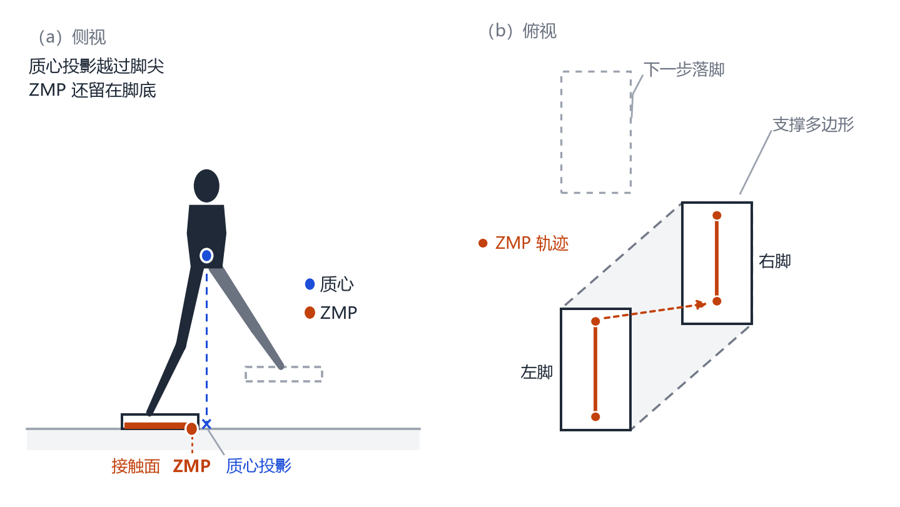
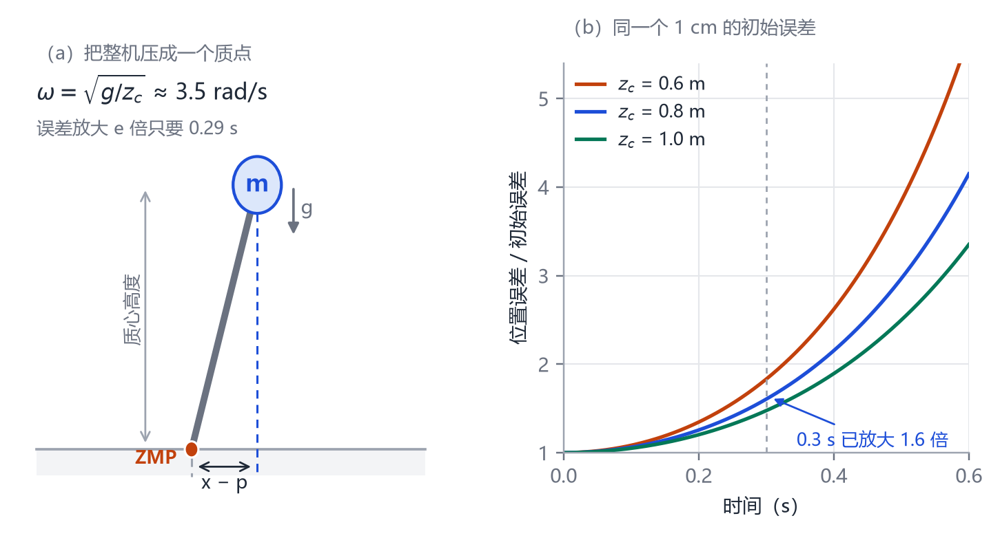

# 第 16 章　腿足与人形机器人

> **本章导读**：轮子只需要一条平整的路，两条腿要的是一整套和重力谈判的本事。这一章从“人站着为什么不会倒”讲起，把 ZMP、支撑多边形、倒立摆这几件老工具摆开，再看学习式控制怎么用几千个并行环境把步态练出来，再落到人形的分层控制与硬件账本。读完这一章，你看到一段人形走路的视频，应该能判断它在什么地面上能走、走多快、背后大概是哪一套控制。

## 16.1 两条腿为什么难

人站着不动的时候，看上去什么都没发生。实际情况是踝关节一直在出小力，把身体重心的投影按在两只脚围出的那块地里。身高 1.7 m 的人，质心大约在 1.0 m 高，脚掌长 26 cm、宽 10 cm。站直时，质心投影只要偏出脚掌后沿或前沿 13 cm，就得靠脚趾或脚跟多顶一下；偏得再多，人就开始倒。13 cm 对 1.0 m 的质心高度，对应 7.4° 的倾角。

这个数字说明了双足的第一层难处，支撑面太小。一台 45 kg 的人形，脚掌尺寸和人差不多，最大恢复力矩是体重乘 13 cm，约 57 Nm。它只能把身体推回来，不能让身体瞬间移回去。力作用一段时间才有位移，中间那段身体还在往前倒。

第二层难处叫欠驱动。一条腿有髋三个、膝一个、踝两个，共六个关节，但脚踩在地上时，脚掌与地面的接触把其中一部分自由度锁死了。踝关节的力矩有上限，膝盖只能往一个方向弯，脚尖那一节在很多人形上还是被动弹簧。整机三十来个自由度里，真正能主动控制的比想象的少。身体绕支撑脚的翻转就是个没装马达的自由度，只能靠质心位置去管。

第三层是接触切换。四足站着时，三条腿着地围出一个三角形，质心落在里面就是静稳定，电机断电也不倒。双足做不到。单脚支撑时支撑面只剩一只脚，0.026 m²，另一只脚正在空中往前飞。人走路一个周期 1.0 到 1.2 s，支撑相占 60%，双脚同时着地只有 20% 的时间，分成两段各 0.1 s。换句话说，走路时八成时间，人是一只脚站在地上的。

所以“走路是可控地摔倒”不是修辞。每一步都是主动把身体往前送，让重力把自己拉向将要倒的方向，在倒到位之前把另一只脚放到前面接住。接住那一下，地面反力从 0 跳到体重的 1.1 到 1.2 倍，几十毫秒内完成。人靠小脑把它做成条件反射，机器得显式地算，每 20 ms 一次。

摔倒的代价也能量化。一台 45 kg、1.6 m 高的机器人倒下，质心从 0.9 m 落到 0.2 m，释放 45×9.81×0.7，约 310 J。这 310 J 在几十毫秒里被外壳、关节限位和地面分掉，哪一处设计不当就是一次返修。人形演示里常有安全绳，“摔倒后自己站起来”至今算加分项，原因都在这里。

## 16.2 ZMP 与支撑多边形

要把“别倒”变成一个能算的约束，得先给地面上的作用点起个名字。脚踩地时，地面会给脚一片分布式的反力，每一点的大小方向都不同。这片力可以等效成一条合力加一个合力矩，合力的作用点就叫零力矩点（zero moment point，ZMP）。定义有点绕，直觉是“所有地面反力真正踩在哪一点上”。走路时它就是压力中心，鞋垫式压力传感器测出来的正是它。

ZMP 有一个硬约束，必须落在支撑多边形里面。支撑多边形是所有着地点在水平面上的凸包，单脚支撑时就是那只脚的轮廓，双脚支撑时是两只脚加上中间那块。为什么必须在里面，因为 ZMP 一旦跑到脚外，身体就得靠那一点的地面反力平衡，可那里没有脚，给不了力，脚会绕脚尖或脚跟翻起来。

图 16-1 把侧视和俯视放在一起。侧视看到的是上一节那个局面，质心投影越过脚尖，ZMP 还留在脚底靠近脚尖的位置，两点的距离不是误差，是驱动身体加速的量。俯视图里，ZMP 在两只脚之间来回跳，每迈一步换一次场地。

<figure class="fig">

<figcaption><b>图 16-1</b>　侧视看，质心投影越过脚尖，ZMP 仍留在脚底；俯视看，支撑多边形是两脚的凸包，ZMP 轨迹在两只脚之间来回跳。示意。</figcaption>
</figure>

支撑面有多小，值得算清楚。一只成人脚掌投影约 0.026 m²，双脚站立约 0.05 m²。一台 1.6 m 高的人形两脚并拢，宽度只有 20 到 30 cm，前后 26 cm。这个尺度决定了它能承受多大推力。有人从侧面推你一把，你的第一反应是把脚分开、把身体压低，本质就是撑大支撑多边形。

ZMP 有几个容易忽略的坑。它只保证不翻脚，不保证不打滑，摩擦系数 0.3 的瓷砖上，切向力一旦超过正压力的 0.3 倍整只脚就滑出去，这时候 ZMP 还在多边形里。它假设脚是刚体，真实脚掌有橡胶垫，压力会往脚尖堆，所以工程上把 ZMP 约束在多边形内缩 2 到 3 cm 的安全区里。它算的是整机质心而不是上身，一个 ZMP 完全合格的姿态，可能上身已经歪到没法干活。

最要紧的一条，ZMP 是结果不是原因。控制器真正能改的是关节力矩，ZMP 只是这些力矩在地面上留下的印记。所以用它做规划，要先假定一串 ZMP，倒推质心怎么动，再反解关节。

## 16.3 倒立摆与预测控制

把整机压成一个质点，腿当成一根没有质量的伸缩杆，脚底的 ZMP 当成支点，得到的模型就是线性倒立摆（linear inverted pendulum model，LIPM）。图 16-2 左边是这个模型，右边是它最要命的一条性质。

<figure class="fig">

<figcaption><b>图 16-2</b>　把整机压成一个质点立在 ZMP 上，就成了倒立摆。右边是 1 cm 初始误差按 cosh 放大的实算曲线，质心越低放大越快。</figcaption>
</figure>

模型只有一行方程，说的是质心的加速度和它偏离支点的距离成正比

$$\ddot{x}=\omega^{2}(x-p),\qquad \omega=\sqrt{g/z_c}$$

$x$ 是质心在水平方向的位置，$p$ 是 ZMP 的位置，$z_c$ 是质心高度，$g$ 是重力加速度。$\omega$ 的量纲是 1/秒，可以理解成“倒得多快”。质心越高，$\omega$ 越小，倒得越慢。

质心高度 0.8 m 时，$\omega$ 约 3.5 rad/s，时间常数是它的倒数，0.29 s。这个数字决定了走路的所有节拍。位置误差每 0.29 s 放大 e 倍，0.3 s 时是 1.6 倍，0.5 s 时接近 3 倍。图 16-2 右边三条曲线就是拿这个式子算的，初始误差都取 1 cm，只是质心高度不同。

误差放大得这么快，意味着两件事。不能“算一次走一路”，规划出来的轨迹跑几百毫秒就和实际分家。也不能靠关掉控制省事，控制器停 0.3 s，1 cm 的偏差变 1.6 cm，停 0.6 s 变 4 cm，再往后就是摔。

再算一笔步长的账。单脚支撑 0.35 s 内，质心要横向移动 0.35 m（对应 0.7 m 的步长），从静止出发需要多大初速。解上面那个方程，得到的初速是 0.79 m/s。这个速度不能随便给，它由上一步落地时身体带着的动量决定。于是相邻两步被绑在一起，步长、步频、质心高度三者必须配套，配错了走三步就开始左右晃，越晃越大。

模型预测控制（model predictive control，MPC）就是在这个背景下成了标准做法。每个控制周期，控制器往前看 1 到 2 s，切成十几到几十个时间片，求解一串 ZMP 和落脚点，使质心轨迹尽量平滑、ZMP 尽量落在支撑多边形中心，同时满足动力学方程和摩擦约束。解出来的一串动作只执行最前面一小段，剩下的丢掉，下一个周期重算。重算周期典型值 30 到 50 ms，图 16-3(a) 顶上那排刻度就是它。

为什么是 30 到 50 ms，两个原因凑在一起。这种规模的二次规划 1 到 5 ms 出解，留十倍余量是为了吸收传感和通信的抖动。另一头，40 ms 里质心只移动 5.6 cm（按 1.4 m/s 算），还在脚掌范围内，来得及纠。周期再长，一次纠偏就超过一只脚，控制权交不出去了。

这条路线跑出过很硬的成绩。本田的 ASIMO 在 2000 年以 1.6 km/h 走起来，2011 年的版本跑到 9 km/h，靠的都是 ZMP 加预测控制。好处是可解释、有约束保证、真机上能稳定跑到 1 至 2 m/s。麻烦在于依赖模型，质量、惯量、关节柔性、接触状态，任何一项标定偏了，模型和现实就对不上；每加一种新动作都要重新调参。

## 16.4 在仿真里学走路

学习式控制换了个问法。不问“质心该沿哪条曲线走”，而问“看到这些传感器读数，关节该出什么角度”，然后用几百万次试错把这个映射拟合出来。

问题写成强化学习的标准形式。观测是十几个本体感受量，关节角、角速度、机身姿态、上一步动作、指令速度，加上可选的深度图。动作是十几到三十个目标关节角。奖励是一串加权项的和，速度跟得紧给正分，机身歪了、脚抬太低、关节抖得厉害都扣分，摔了给一个大负分。

真正让这条路跑通的是并行仿真。Isaac Gym（2021）把物理计算和策略推理放在同一块 GPU 上，一张 A100 同时跑 4096 个环境，环境之间不通信，观测张量直接从物理缓冲区喂进网络。数字很直白，一个 21 自由度的人形模型，4096 个环境并行，4 分钟练到能跑；四足 ANYmal 2 分钟学会跟着速度指令走；带地形的训练 20 分钟内能搬到真机。对照的任务放到 PyBullet 上，16 个 CPU 核要跑 30 小时，差 300 倍。

这个差距改变的不是效率，是工作方式。以前一次实验挂一夜，一天只够试一个奖励函数；现在几分钟一轮，奖励设计从“想清楚再写”变成“写出来看结果”。

奖励设计是这条路上最像手艺的部分。只奖励前进，学出来的是一蹦一蹦往前窜，或者拖着一条腿滑，因为仿真里滑不疼。要它好好走，得把人的步态先验拆成几个数塞进去，步频、抬脚高度、支撑相占比、双脚着地时长。Radosavovic 等人 2023 年更省事，不写参考动作，只用一组步态参数当奖励，再让一个能看见全部状态的教师策略做示范。他们在 Digit 上验证，机器 1.6 m 高、45 kg、30 个自由度，策略是一个只看本体感受的 Transformer。

频率是这套系统里最易忽视的细节。策略跑 50 Hz，每 20 ms 出一次目标关节角；底下的 PD 控制器跑 1 kHz，把目标角变成力矩。写成式子是

$$\tau = K_p\,(q^{*}-q) - K_d\,\dot{q}$$

$q^{*}$ 是策略给的目标角，$q$ 是编码器读到的当前角，$\dot{q}$ 是当前角速度，$K_p$ 和 $K_d$ 是两个增益。这一层有两个用处。它把 50 Hz 的离散指令抹成连续力矩，中间那 19 ms 不至于没人管；它也是一层安全网，力矩可以被限幅，撞到东西时电流不会瞬间飙到烧电机。

两个频率差 20 倍不是随便定的。策略再快也没用，它看到的历史里含着几十毫秒前的信息；PD 再慢就压不住关节高频抖动，齿轮间隙会被反复撞击。

<figure class="fig">

<figcaption><b>图 16-3</b>　上半是一个步态周期里两条腿的支撑与摆动，顶上那排刻度是 MPC 的重算节拍；下半是训练环与部署链，仿真里跑几百万步，真机上每秒五十次。</figcaption>
</figure>

学习式路线在敏捷动作上的优势最明显。Parkour（2023）用一台万元级四足，只用一个“往前走、省能量”的简单奖励，先在允许穿透障碍的“软”物理里预训练，再用真实约束微调，蒸馏成一个只看深度图的策略。它爬过 0.40 m 高的台子（1.53 倍机身高度），跨过 0.60 m 的沟，从 0.2 m 高的横杆下钻过去，成功率分别是 80%、80%、90%。训练是单张 RTX 3090 上 12 小时预训练加 6 小时微调。

机载算力也值得单独说。机器上挂一块 Jetson，深度图只有 48×64，刷新率 10 Hz，策略却要 50 Hz 出动作。做法是异步，图像编码器按自己的节奏更新隐向量，策略每次拿最新的一份。1 m/s 走起来，0.2 s 延迟就是 0.2 m 的位置误差，视觉天生追不上本体感受。

课程学习和域随机化是两条配套的保险。前者把难度排成阶梯，地形从平地到 5° 坡到 10° 坡到台阶，外力从 10 N 推到 100 N。后者把仿真里那些不确定的量打散，质量浮动 10%，摩擦系数取 0.4 到 1.2，电机响应延迟 5 到 20 ms。目的是让策略别把仿真里那套精确参数背下来。

代价也要说清楚。学出来的策略是黑箱，你没法像查 ZMP 那样查它为什么在这一步迈大了。失效也没有明显边界，可能 99 次都正常，第 100 次遇到一块没见过的地毯就突然躺下。所以真机部署通常留着后路，力矩限幅、姿态保护、遥控急停，倾角超过阈值就断电松劲。

## 16.5 人形的分层控制

双足走路只是人形的一半。另一半是站着干活，而干活会破坏走路。

先看耦合有多强。两条手臂共 10 kg，往前伸 0.25 m，整机 45 kg 的质心就前移 5.6 cm。第 16.1 节算过，站直时质心能偏的余量是 13 cm，一次抬手用掉四成。再弯腰去够地上的箱子，余量就见底。所以“边走边搬”的难处在于两件事抢同一份平衡预算。

工程上的解法是分层。上面是任务层，一两赫兹，决定去哪、抓什么，输出速度指令和手部目标位姿。中间是行走层，50 Hz，负责落脚点、步态相位、质心轨迹。下面是关节层，1 kHz 做 PD 跟踪。三层之间还夹着一个全身控制器，把上肢位姿、下肢步态、质心约束一起塞进一个优化问题，解出三十几个关节的目标角。

约束按优先级排。平衡最高，质心投影和 ZMP 必须留在支撑多边形内；然后是落脚，脚不能穿地、不能超出关节行程；手排第三，够不到就把目标位姿放松几厘米。让位顺序是固定的，手让腿，腿让平衡。这条规则听着保守，其实是人形能干活的底线，一台为了够到杯子而摔倒的机器人，比一台够不到杯子的更没用。

遥操作是人形现在最主要的用法，也是数据的主要来源。操作员戴 VR 头显，头显给头部朝向和双手的目标位姿，手柄或摇杆给移动速度，上身直接映射，下身交给行走策略。延迟是这类系统的关键指标，50 到 100 ms 时操作员还觉得跟手，超过 200 ms 就开始过冲，人会不自觉地多推一点，然后来回修。

遥操作还有个副产品，示范数据。一个人形操作员一天能采几十到几百条动作片段，带着完整的关节轨迹和视觉，是训练自主策略最贵的原料。采集成本卡在人身上，不在设备上。

## 16.6 硬件现实

腿足关节和工业臂关节的设计目标几乎相反。工业臂要刚、要准、在固定位置重复一百万次；腿要吸收冲击、能被反推、毫秒级响应。差别落在两个零件上。

准直驱（quasi-direct drive）是腿足的主流方案。大直径外转子无刷电机，配一个减速比只有 6 到 10 的行星齿轮。好处是反驱力矩小，脚踩到石头上，冲击顺着连杆传回电机，控制器从电流里就能“感觉到”地面硬不硬，省掉一套力传感器。坏处是同样大的力矩要更大的电流，铜损高，连续大扭矩下电机很快烫手。

谐波减速器是另一条路，减速比 50 到 160，回差小，同样体积能出更大扭矩。代价是反驱困难，效率通常只有 70% 到 85%，还怕冲击，过载一下柔轮就可能永久变形。所以人形上的分工很清楚，髋和膝要抗冲击、要感知地面，用准直驱；腕、踝、手指要精度、空间又小，用谐波。

力矩要多大，算一遍就知道。站立单腿支撑，地面反力约 450 N，作用线离膝关节 5 cm，膝力矩只有 22 Nm。跑跳落地时反力到体重的 2 到 3 倍，力臂拉到 10 cm，力矩上到 150 到 250 Nm。峰值和均值差一个数量级，这是选型最难受的地方，按峰值选，平时工作在额定的十分之一；按均值选，落地一下就过载。

续航是一笔很朴素的账。一台 1.6 m 的人形走动时功耗 400 到 700 W，背 1 到 2 kWh 电池，理论续航 1.5 到 3 小时，实际常常只有一两小时，因为要留余量、要散热。人形视频大多是五到十分钟一段，不是导演剪的，是电池和温度决定的。

成本也得有个量级感。2024 年一款国产小尺寸人形发布价 9.9 万元，把心理价位拉低了一个数量级；同期全尺寸人形普遍在几十万到上百万元。四足便宜得多，消费级一两万元。整机成本里关节占大头，一台人形二三十个关节，光谐波减速器就能吃掉几万元。

**表 16-1**　腿足形态对比。

| 形态 | 支撑方式 | 站着不动稳不稳 | 平地速度 | 越障 | 续航量级 | 整机价格量级 |
|---|---|---|---|---|---|---|
| 双足人形 | 单脚约 0.026 m²，走路八成时间单脚 | 不稳，要持续出力 | 0.4–1.5 m/s | 台阶 15–18 cm，门槛 | 1.5–3 h | 10 万–100 万元 |
| 四足 | 三脚着地即静稳定 | 稳，断电也不倒 | 1.5–3 m/s | 碎石坡强，高台阶要跳 | 2–4 h | 1.5 万–10 万元 |
| 轮足 | 轮子线接触，靠腿抬轮 | 稳，轮子可自锁 | 平地 1–3 m/s，效率最高 | 台阶 15 cm 左右 | 4–8 h | 3 万–30 万元 |

表里的速度区间来自公开的实测与厂商参数，续航和价格只给量级，因为同一档硬件换个电池、换个工况就能差一倍。选型时真正要比的不是这些格子，是任务里有几级台阶、地面有多烂、一天要跑几个小时。

取舍可以说得更直接。双足不可替代的优势是能用人的环境，门、楼梯、台阶、窄道，尺寸全按人定的。四足同样价格下更稳、更快、更能扛，代价是上不了楼、够不到 1.5 m 高的货架。轮足平地效率最高，遇到台阶靠腿。人形不是终点，它是在“人的环境里干人的活”这个前提下把改环境的钱省掉。

## 16.7 现在能做什么，还不能做什么

把演示视频和产品说明书放在一起看，能稳定做到的大概是这些。

在平整或缓坡上走，1 至 1.5 m/s，连续走十几分钟不摔。上下 15 到 18 cm 的标准台阶，能连续上十几级，得慢一点。搬 10 kg 左右的箱子，从地面提到腰高，重复十几次。在工厂仓库做巡检、取放、上下料，节拍比人慢，但不用休息。表演性动作已经很成熟，跳舞、打拳、被推一下稳住，展会上天天演。

做不到的事情同样清楚，每一条都有人在攻。

续航和散热是第一道墙。一两小时就要换电池，连续大扭矩工况下关节要降额。这不是电池技术的瓶颈，是功率密度的瓶颈，同样的重量要出更大扭矩，热量必然更多。

开放环境是第二道。地毯的卷边、3 cm 的门槛、反光地砖、玻璃门、突然横穿的宠物，这些对人不需要思考，对腿足是四类不同的失败。视觉能看见地毯，看不出它有多软；能看见门槛，判断不了脚会不会卡住。这类失败往往在迈出去那一步才暴露。

第三道是被推倒之后的恢复。少数系统能自己爬起来，多数不能。不是算法不够聪明，是姿态空间太大，每一种倒地姿势都要有对应的起身策略。

第四道是手。腿足解决“到得了”，手解决“干得成”。拧螺丝、插排线这类活对多指手和触觉的要求比走路高得多，现在的人形离人还有明显距离。

还有一件是整个行业的软肋，评测。没有人形版的统一基准，各家演示的场地、任务、次数都不一样，80% 和 95% 放在一起没有可比性。同一台机器在实验室走一百次不摔，换到写字楼大厅可能第一次就出问题。没有共同的尺子，判断不了进步是真的还是拍的。

回到开头那句话。腿足把“移动”从一条平整的路变成了一连串没法预演的接触，收益是能进人的环境，代价是每一秒都在和重力谈判。ZMP 和倒立摆是这场谈判的旧词典，学习式控制是新词典，前者说边界在哪，后者说边界里哪条路好走。
