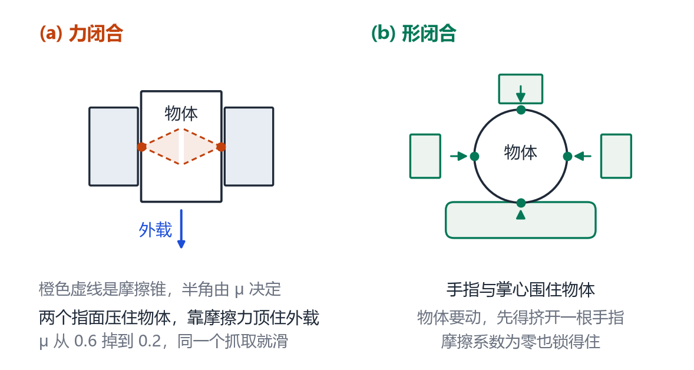
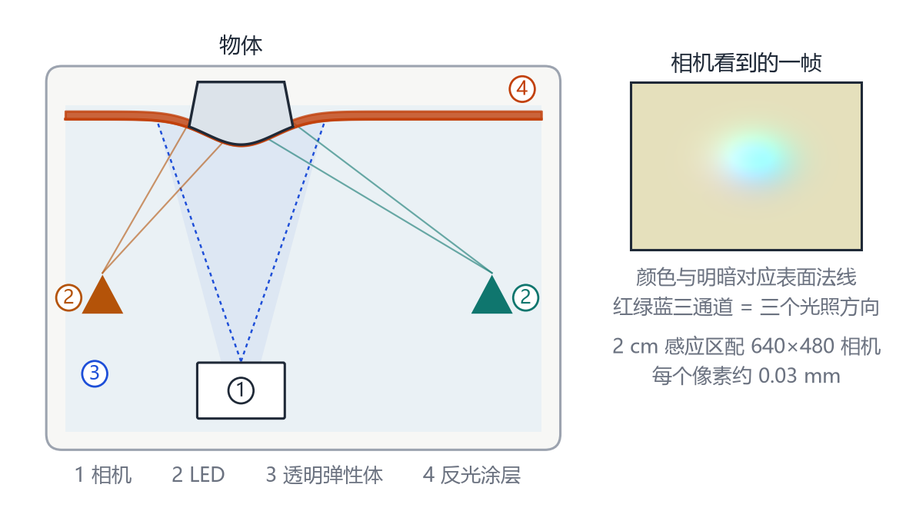
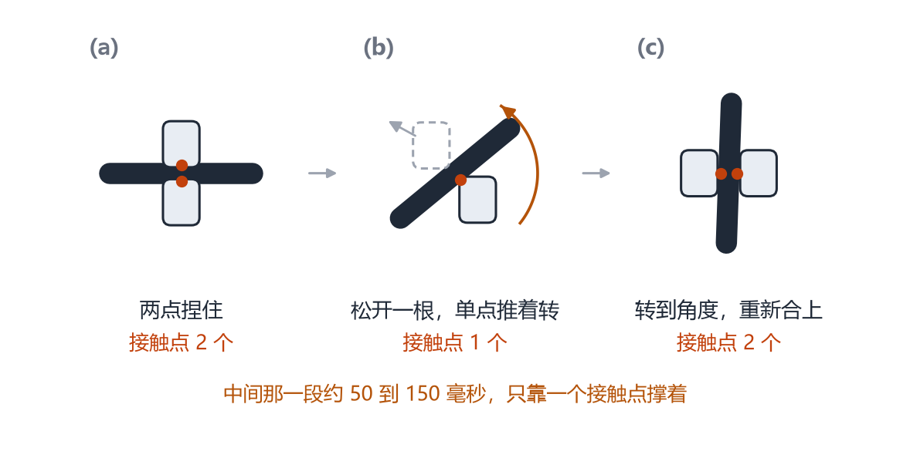

# 第 17 章　灵巧手与触觉

> **本章导读**：拧瓶盖、系鞋带、从口袋里摸出钥匙，这些动作对手不值一提，对机器却是硬骨头。这一章讲手为什么难造，自由度、尺寸、力量、传感密度这四件事怎么互相打架；讲抓和握各自靠什么物理依据站住；讲触觉的三条路线各能看到什么；讲物体在手里翻转为什么比抓住难一个量级；也讲一套两万美元的双臂系统能做到什么程度。读完你会知道，演示里那只手到底摸到了什么。

## 17.1 手为什么难造

人手上分布着一万七千个机械感受器，指尖最密，每平方厘米一百四十个上下。指尖的两点辨别阈是 2 毫米，拿两根针尖同时轻戳指腹，间距小于 2 毫米时你只感觉到一个点。手要做的判断大多建立在这个尺度上，线有没有穿进针眼，螺丝有没有对正。

再看自由度。人手不算腕有 21 个，每根手指 4 个（根部两个管屈伸与侧摆，中段一个，末段一个），拇指 5 个。力量的来源有点反直觉，掌内只有二十来块小肌肉，出力的多数长在前臂上，靠长腱越过腕关节把手指挥到指尖。这套结构把重量留在前臂，手指很轻，惯量小，动作才快。

常见的开源灵巧手多是 16 个自由度，四指各 4 个，拇指另算。ShadowHand 标称 26 个自由度，二十个电机全装在前臂，靠腱绳拉手指。这个布局不是审美选择，是被体积逼出来的。人的食指尖宽约 1.6 厘米，一节指骨长约 3 厘米，要塞进这个空间的电机直径不能超过 1 厘米，而它得输出足以捏起一只装满水的玻璃杯的力。电机转矩密度在这个尺寸上掉得厉害，直径缩小一半，转矩和散热面积都掉到四分之一。小体积、大力量、连续工作，这三个要求只能同时满足两个。

力量的差距可以直接对比。成年人的捏力在 50 到 100 牛，握力能到 300 牛以上，同样指头尺寸的机械手，指尖力常常只有 10 到 30 牛。抓一只 1.5 升的矿泉水瓶，人用手掌一圈就拎起来了，机械手得靠整个手掌去兜，或者夹住瓶颈硬顶。

传感密度差得更远。一块 1 平方厘米的商用触觉点阵，能有 16 个测点就算密了，柔性电路板上走线还要占掉一半面积。人的感受器还分四类，慢适应的两种测持续压力，快适应的两种测振动，帕西尼小体对 200 到 300 赫兹最敏感，正好是物体开始滑动时皮肤发出的那阵细密抖动。点阵只有一种响应，测得到压力，测不到这层频率结构。

还有两条是工程账。腱绳会蠕变，用几个月就松，得定期张紧；线缆在指根反复弯折，几百万次之后断在护套里，故障点藏在手指内部。一台 6 轴工业臂两万美元能买到，一只 26 自由度的灵巧手报价常常和一台工业臂相当。ALOHA（2023）对比过，当时另一套能干活的双臂系统要 40 万美元起。

于是今天绝大多数机器人装的是两指平行夹爪。它只有 1 个自由度，指面大，力量足，坏了好修，缺点是抓取点必须由视觉算得很准，一接触就全靠开环。这一章剩下的部分，讲的就是在这个约束下怎么把"抓得住"和"摸得着"往前推一点。

这四件事在工程上互相打架，而且打架的方式很具体。要包围角度大，手指就得多、得长，掌内空间被占掉；要指尖力量大，电机和减速器就得大，同样占空间；要关节活动范围大，连杆与腱的走线就复杂，可靠性下降；要接触面积大，指面得做软，软了之后力传递的效率变低、定位精度变差。任何一只手都是在四条边上各退一步之后的结果。

体积的限制还能推得更细。人的食指尖宽 1.6 cm、指节长 3 cm，一节指头里要装电机、减速器、编码器和走线，可用截面不到 3 平方厘米。这个截面里能给出的连续力矩大约 0.2 到 0.5 Nm，折算到指尖，在 3 cm 的力臂上只有 7 到 17 N。人捏东西时指尖能出 50 N 以上，差的三倍不是工艺问题，是物理限制。想补上这三倍，只能把电机搬到前臂用腱拉，代价就是前面说的蠕变与磨损。

还有一个常被误解的点，自由度不等于灵巧。一只 16 自由度的手机械上能做出的动作，可能远少于一只 6 自由度但设计巧妙的夹爪加腕的组合，因为灵巧来自“能在物体表面换接触点”，而换接触点靠的是手指的独立性、指面的摩擦和感知的配合。有些产品把自由度数当卖点，装上一看，四根手指只能同步屈伸，那 16 个自由度其实只用得上一两个。

所以选型时要问三个更实际的问题。这只手能不能单独控制每根手指的弯曲？指面有没有传感，还是只有一个总压力读数？换接触点的动作要不要重抓一次？三个答案都偏“能”的，才谈得上手内操作；否则它只是一只形状像手的夹爪。

## 17.2 抓住与夹住

日常动作里的"抓"其实是两类事。捏一枚硬币，拇指指腹和食指指腹对捏，两个接触点，力不到 5 牛，精度要求到毫米。拎一只 5 升的水壶，四指当钩子、掌根当支点，接触面摊开，力要到 50 牛以上。解剖学把前者叫精细抓取，后者叫力量抓取，用的是不同的肌肉和关节角度。机器人上对应两种手，一种要自由度，一种要力量。

比起分类，更有用的问题是抓稳的物理依据是什么，图 17-1 摆出两个不同的答案。

<figure class="fig">

<figcaption><b>图 17-1</b>　两种握法的物理依据。(a) 两点夹持靠摩擦锥顶住外载，摩擦系数决定能扛多少；(b) 手指围住物体，任何方向的移动都被几何挡住。示意。</figcaption>
</figure>

**力闭合**靠接触力。两个指面压住物体，每个接触点能出的合力落在一个以法线为轴、半角为 arctan μ 的锥里，μ 是摩擦系数，外载要能被两个锥里的力平衡，能就稳，不能就滑。第 5 章算过这笔账，350 克的杯子竖直加速时每个接触点需要约 3.4 牛正压力，夹爪给 10 牛绰绰有余。它的命门在摩擦系数，μ 从 0.6 掉到 0.2，同一个抓取就从稳变成不稳，而 μ 取决于指面橡胶有没有磨光、杯壁有没有沾油。这是夹爪在真实桌面上时好时坏的主要原因。

**形闭合**靠几何。手指围住物体，物体想往任何方向动，都得先挤开一根手指或者让手指变形，理想情况下摩擦系数为零也锁得住。最典型的例子是手指穿过杯柄再合拢，杯子被几何关系卡住，跟摩擦关系不大。球放在掌心、四指围上去也是形闭合，只是球太光滑时手指会打滑，表现又回到力闭合那条路上。

两种握法在自由度上的差别可以数出来。两个刚性平面指面夹住物体，约束掉 5 个自由度，绕两接触点连线的转动是自由的，这就是夹住一支笔的中段、笔还能在指间转的原因。要锁死这剩下的一个转动，要么加第三个接触点，要么让指面贴合成形，让接触法线在各个方向上都有分布。

这也是平行夹爪的天花板。两个指面永远平行，接触只能发生在一条线上，能做的只有两点力闭合。抓 7 厘米的杯子，两侧各剩 5 毫米余量；抓一只 12 厘米的汤碗，8 厘米的开度合不上，只能夹碗沿，一夹就翻，碗的重心在夹持线外三十多毫米。

多指手的价值主要在这里，而不在"更像人手"。三根手指就能对凸物体做出形闭合，第四第五根是为了握住之后还能换手，松开一根、其余几根重新分配接触点，把物体挪到更合适的位置，这个动作叫重抓，是手内操作的前置技能。另一条省事的路线是欠驱动，一根手指只配一个电机，指节之间用连杆或腱耦合，抓上去之后手指被动贴合形状，用 1 个自由度换到了形闭合的一部分好处，代价是接触力分布不可控，遇到软物体就捏出印子。

选哪种握法取决于任务，而任务的要求没法从物体形状推出来。DexGraspNet（2022）在仿真里给 5355 个物体合成了 132 万个抓取，用可微的力闭合估计器批量筛稳定性，每个物体留两百多个候选。它筛的是"抓得住"，"抓了能不能用"是另一个问题。

力闭合与形闭合的差别，落到具体动作上很直观。夹一块嫩豆腐，只能用两指轻轻对顶，靠摩擦托住，任何一点侧向的力都会把它挤碎；握一个鸡蛋，五指围住，即使掌心完全不出力，鸡蛋也掉不下去，因为它要想跑出来，得先把自己“穿过”手指构成的那个笼子。

这两种握法对感知的要求完全不同。力闭合需要知道摩擦系数、需要知道法向力够不够，所以触觉必须准；形闭合只需要知道接触点在哪、包围有没有漏洞，对力的精度要求低得多。这就是为什么很多工业夹爪宁愿用“包住”的方式，而不追求精确控制夹持力。

摩擦系数的影响可以被算出来。平行夹爪夹一个圆柱，两侧法向力各为 $N$，能提供的最大静摩擦是 $2\mu N$，要托住重力 $mg$，需要 $2\mu N \ge mg$。一个 500 g 的杯子，$mg$ 约 4.9 N；$\mu$ 取 0.6 时需要 $N \ge 4.1$ N；$\mu$ 掉到 0.2，同样的杯子需要 $N \ge 12.3$ N，力要涨三倍。玻璃杯沾了水，$\mu$ 就是 0.1 到 0.2 这个量级，所以湿杯子的抓取难度不是心理作用。

## 17.3 触觉的三条路线

视觉在接触那一刻就失效了，指尖挡住物体，相机看到的是手背，力传感器和电流估计又只给一个总数，不告诉你力落在指尖哪里、接触面往哪个方向滑。

滑动比想象中快。物体从静止到脱手，接触面积在几十毫秒里缩小，指尖相对物体的位移只有 0.5 到 2 毫米。一台 30 fps 的相机一帧 33 毫秒，等你从图像里看出不对，物体已经在往下掉了。这个时间尺度决定了触觉必须自己做高频判断。

**视触觉**是分辨率最高的一条路。做法是把一块透明弹性体做成指尖，底面涂一层反光涂层，里面藏一台小相机和几颗不同颜色的 LED，如图 17-2。

<figure class="fig">

<figcaption><b>图 17-2</b>　视触觉传感器的剖面。两侧的彩色 LED 斜照反光涂层，物体压下去涂层形变，相机从背面拍到的是形变后的彩色法线图，右侧是它输出的图像。示意。</figcaption>
</figure>

原理借的是光度立体。几盏颜色不同的灯从不同方向照在涂层上，一点朝哪偏，反射进相机的颜色就跟着变，拍到的不是灰度图，而是颜色编码了法线的彩色图。物体压上来，涂层凹下去一块，法线跟着偏，图像上出现一块颜色与明暗都变化的斑，斑的形状就是接触面的三维形貌。分辨率由相机决定，2 厘米见方的感应区用 640×480 的相机，每个像素对应 0.03 毫米，高度分辨率到几十微米，皮肤纹路、织物经纬都能看清。

它测的是几何，不是力。要知道法向力多大，得先标定弹性体刚度，或者用有限元把形变反算成应力。切向力靠追踪涂层上的纹理点移动了多少，位移场一算，滑动和扭转都出来了。代价是厚度，相机需要一段光路，传感器通常 2 到 4 厘米厚，装在指尖上会明显改变手指的外形和惯量，帧率也被相机卡在 30 到 60 fps。

**压阻与电容阵列**把敏感单元直接排在柔性电路板上。压阻材料受力后电阻下降，扫一遍行列就得到一张压力图；电容方案测极板间距变化，灵敏度更高，还能在没接触时感知靠近。空间分辨率受走线和单元尺寸限制，常见 1 到 4 毫米一个点，指尖大小的一块面积上是 4×4 到 16×16 个点，响应能到几百赫兹。

它们的麻烦在稳定性。压阻材料有迟滞，加压和卸压走两条不同的曲线，差 5% 到 10%；还有蠕变，一直压着读数会慢慢漂；温度变十度，零点跟着变。电容方案怕湿度和寄生电容，手一出汗读数就乱。这些要每个单元单独标定并定期重标。

**事件式触觉**借的是事件相机的思路。每个单元只在信号变化超过阈值时吐出一个事件，带时间戳、位置和变化方向，数据量比逐帧采样小两三个数量级，时间分辨率到微秒。它的强项是滑动，物体开始滑的那一瞬间，接触点上一阵高频微振动，事件流会突然变密。缺点是只给变化不给绝对值，压着不动时什么都不输出。

**表 17-1**　触觉方案对比，价格与性能取公开产品的量级。

| 路线 | 空间分辨率 | 时间响应 | 主要输出 | 成本量级 | 主要麻烦 |
|---|---|---|---|---|---|
| 视触觉 | 每像素 0.03 毫米，可看清纹理 | 30–60 fps | 接触面形貌与切向位移场 | 千元到万元 | 厚度 2–4 厘米，弹性体磨损 |
| 压阻阵列 | 1–4 毫米一个点 | 数百赫兹 | 法向压力图 | 数百到数千元 | 迟滞、蠕变、温漂 |
| 电容阵列 | 1–2 毫米一个点 | 数百赫兹到千赫兹 | 法向压力，可做接近感知 | 数百到数千元 | 湿度与寄生电容干扰 |
| 事件式 | 取决于前端单元 | 微秒级事件延迟 | 接触变化的事件流 | 取决于实现 | 无绝对力，需与别的传感器配合 |

几条路线能解决的问题有重叠。滑动检测是共同目标，视触觉看位移场最准，事件式反应最快，阵列看切向力突变。软硬判断靠按压时的力与位移关系，按下去 1 毫米要多少力，软的东西斜率低，视触觉直接看凹陷深度最省事。插入对齐最考验触觉，USB 插头和插座之间只有零点几毫米间隙，视觉被手挡住，只能靠接触时那一点横向力判断往哪边挪，关键是要分辨力的方向，而不是只知道碰到了。

三条路线在选择上的经验可以概括成一句话，看任务更需要“分辨”还是更需要“覆盖”。需要分辨的场合，比如判断螺丝有没有对正、布料有几层，用视触觉，因为它给出的空间分辨率最高；需要覆盖的场合，比如整只手抓握时想知道压力分布，用阵列，因为它可以铺满整个指面和掌心；需要抓瞬间事件的场合，比如检测打滑，用事件式或者高频采样，因为它能在毫秒级给出信号。

成本也要算。一台视触觉传感器通常要几百到几千元，需要对相机做标定、要对弹性体做更换，长期使用的耗材成本不低；压阻阵列便宜，几十到几百元，但一致性差、容易漂；事件式触觉还在实验室阶段，价格与可获得性都不稳定。这也是为什么多数商用灵巧手只装压力阵列，把视触觉留给研究平台。

## 17.4 手内操作

物体拿在手里之后，还能在手里改变姿态，这件事叫手内操作。转笔、把鸡蛋翻个面、单手拧开瓶盖都属于这一类。它和抓取的区别在于接触点会切换，抓取是找一组保持住，手内操作是主动放弃一组再建新的。

以转笔为例，一周可以拆成三个阶段，图 17-3 把它们按接触点数标出来。

<figure class="fig">

<figcaption><b>图 17-3</b>　手内旋转的三个阶段。两点捏住、松开一根手指靠单点推着转、转到目标角度再合上，中间那段接触点数掉到 1，是掉落窗口。示意。</figcaption>
</figure>

第一阶段是捏住，拇指和食指两个接触点，靠力闭合稳住。第二阶段松开一根手指，另一根沿着物体表面推一下，物体带着一点角速度转过一个角度，这一小段时间里它只被一个点撑着，平衡靠摩擦和惯性维持。第三阶段在目标角度上重新合上手指，接触点回到两个。

中间那一段是全部风险所在。持续时间通常 50 到 150 毫秒，物体只受一个接触点的力，位置误差被放大，一点扰动就掉出去。人做这个动作靠指尖那层快适应感受器，物体一滑，几十毫秒内手指就自动加力，这套反射在脊髓层面就完成了，不经过大脑。机器要做同样的事，触觉采样率、策略推理速度、手指力控带宽三样都得跟上。

学习这条路现在主要靠仿真加蒸馏。先在仿真里训一个教师，教师能看到全部状态，物体的真实位姿、速度、每个接触点的力，用强化学习把转笔练出来；再训一个学生，学生只能看到真机上有的东西，关节角、电机电流、触觉读数，让它模仿教师在同样观测下的动作。

仿真到真机的差距靠域随机化补。训练时把摩擦系数在 0.3 到 1.5 之间随机，物体质量、尺寸、重心位置随机，传感器加噪声，控制指令加几十毫秒的延迟，相机外参也抖一点。策略见过足够多的"世界可能是这样"，就不容易死在某一个参数上。OpenAI 的 Dactyl（2018）用这套办法让一只 20 个关节的 Shadow Hand 在真机上转方块，绝大部分训练花在仿真里。天花板也很清楚，仿真里的接触求解器对刚性碰撞处理得不好，法向力会在几毫秒里反复跳变，真实的黏滑、预位移、微观变形库仑摩擦描述不了，触觉信号的仿真几乎是空白。练出来的手内操作多数只能对付简单几何体，换成一只软袋子、一根绳子，全部重来。

工程上更常见的做法是绕开它。要改变物体姿态，先把物体放到桌面上，松开手，从另一个角度重新抓一次，这叫桌上重抓。代价是时间，一次重抓要 2 到 4 秒；好处是可靠，失败率低得多，而且不需要触觉。今天的产线和服务机器人几乎都选这条路，只有在空间不够时才不得不用手内操作。

手内操作还有一个隐性的难处，手指会互相挡。三根手指围住一个方块，要把方块转 30 度，至少有一根手指得先离开再落到新的位置；离开的那一段，方块只靠剩下两根手指夹着，可用的摩擦力矩减半。这就是为什么手内旋转看起来慢，实际是“捏住、松一根、推一下、再接住”的循环，每个循环几十到一百多毫秒，一个完整翻转要好几轮。

真实系统的失败方式也集中在这些过渡段。推的力稍大，方块滑过头，剩下的两根手指来不及合上；推的力稍小，方块没转到位，接住时指面压在了棱上，一用力就翻出去。这类失败在仿真里很难复现，因为接触瞬间的摩擦模型与真实差距很大，所以手内操作的数据几乎都来自真机。

## 17.5 双臂与工具

两只手配合能做的事，一只手做不到。拧开一个真空瓶盖需要一手固定瓶身、一手施力扭转，两个力矩在瓶身上抵消，瓶身才不会跟着转。撕调料包、把插头插进排插、把一个袖子翻过来，都是同一个结构，一手提供约束，一手提供动作。这个约束是力学上必需的，单臂系统只能用夹具或者桌面代替另一只手。

ALOHA（2023）是一个把这件事做便宜的例子。两条 ViperX 6 自由度机械臂加两个平行夹爪，一共 14 个可动自由度，整机 1.8 万美元，加四台相机两万美元以内。遥操作很直接，人握住前面两条 leader 臂，leader 被扳动时把关节角实时发给后面的 follower，人在几秒内就能学会。采样率 50 赫兹，四台相机 640×480、30 fps，一条示教 8 到 14 秒。

它的算法叫 ACT，把一段时间内的动作一次预测出来，编码器吃四路图像，解码器一次吐出若干个时刻的关节目标。每个任务只要 50 条示教，大约十分钟的演示数据，六个精细任务的成功率在 80% 到 90%，包括打开半透明调料盒的盖子、把电池卡进电池槽这类要求毫米级对齐的动作。

这里有一个设计选择值得说。ALOHA 有能力装灵巧手，却选了平行夹爪，理由是价格和维护。两条 6 自由度臂加上夹爪，能用视觉和力反馈解决的问题它都能做，而一旦换上高自由度手，成本翻几倍，可靠性反而下降，因为手指会坏、腱会松、触觉会漂。用两只笨手代替一只巧手，在今天的成本结构下是更划算的方案。

RDT-1B（2024）走的是另一条路，把双臂操作做成基础模型。它把不同机器人的动作映射到一套统一的表示里，保留每个维度的物理含义，这样在一个机器人上学的动作可以迁到另一个机器人上。预训练用了 46 个数据集、100 万条轨迹，模型做到 12 亿参数，再用自己采的 6000 多条双臂数据微调，新技能只要 1 到 5 条示教就能学会，还能零样本迁移到没见过的物体和场景。

工具使用是另一条扩展手的能力的路。给夹爪握上一把螺丝刀，等效于给手接了一段更长的连杆和一个更尖的末端。运动学变了，TCP 从夹爪中心挪到刀尖，偏移十几厘米，原来的标定全部作废。力的尺度也变了，杠杆放大之后，刀尖上 20 牛的力可能在手腕上产生几倍力矩，超出手腕力传感器量程，读数被削顶。所以用工具时握的位置要由任务定，握在柄的重心附近、刀刃朝向正确，这和前面说的"抓了能不能用"是同一件事。

双臂还有一件单臂没有的麻烦，两臂之间的相对标定。两台机械臂各自的绝对精度可能有 1 mm，但双手要协同，需要知道左手的指尖相对右手在什么位置，这个相对误差是两个绝对误差叠加的结果，还受底座安装误差影响。拧瓶盖时两手在同一个物体上施力，相对误差超过 3 mm 就会把瓶身挤偏。所以双臂系统出厂前要用一块共同的标定板做手手标定，运行一段时间还要重标，因为温漂和机械松动都会让这个相对关系跑掉。

工具带来的另一个变化是允许的误差变小。夹爪直接抓杯子，位置偏 3 mm 还能夹住；换成用螺丝刀去捅一个孔，刀尖的横向容差只有 1 mm，因为刀尖细、杠杆长，手腕一个 0.5 度的角度误差在 15 cm 的刀身上放大成 1.3 mm。所以用工具的场合，标定精度要再提高一档，而且必须在带工具的状态下标定，不能沿用空夹爪的参数。

工具还会改变力的闭环。空手时力传感器读到的是物体给的反力，方向大致穿过夹爪；握上工具后，反力先经过刀身传到握持点，中间有杠杆放大和方向偏转。控制器如果还按原来的映射去解释读数，就会把 20 N 的刀尖力误判成 8 N，然后继续加力，直到刀尖顶坏东西。正确的做法是显式地把工具的长度、重心、质量加进模型，算一次力矩平衡。

## 17.6 评测

抓取和操作怎么算成功，这件事比看起来难。YCB 是一套常用的标准物体集，77 个物体，包括食品罐、木块、工具、餐具、玩具、球，每个都有三维模型和材质参数。它的好处是让不同实验室至少在抓同一批东西，坏处是它只规定了物体，没规定任务。有人测"离桌 10 厘米"，有人测"放进盒子"，有人测"保持 5 秒"，三种测法的数字没法直接比，而论文常常只写一个成功率，不写判据。

判据的模糊在长程任务上更明显。把杯子放进盘子里，倒着放算不算成功，扣在盘沿上算不算，杯柄朝外算不算。人看一眼就知道"这不像样"，写成可执行的判据却要一条一条定。有研究做过对比，同一批试验，判据从"物体离开桌面"收紧到"物体在目标位置保持直立 3 秒"，成功率能掉 15 到 25 个百分点。所以看到两个系统报同样的数字，先问判据，再问试验次数。

触觉相关的任务评测更难。滑动检测的精度怎么测，需要知道滑动什么时候开始，而这件事人眼看不出来，只能靠高速相机做基准，标注成本很高。插入类任务的成功是二值的，插进去就是进去了，但过程质量没有标准，用了多大力、偏了多少毫米、插了几次才进，通常不报。而这几项恰恰决定系统能不能长时间用，每次都顶到底，塑料件很快就裂。

看论文时有几条建议。抓取类的工作先看物体集和判据，再看试验次数与置信区间，20 次试验报 90% 这种组合的区间宽到 30 个百分点。灵巧手的工作要分清它报的是抓取成功率还是任务成功率，很多漂亮数字来自"抓住并举起来"，而真实任务要求的是"抓住之后还能用"。触觉的工作要看传感器在多少种物体、多少种材质上测过，只在几个固定物体上测出的分辨率，换一种材质可能完全不成立。

还有一个容易忽略的维度，硬件寿命。一只灵巧手在实验室能转一万次方块，装上产线一天要转几千次，一个月之后腱绳间隙、指面磨损、触觉弹性体老化都会改变系统行为。论文里的成功率是第一天测的，产品要的是第三百天还在的水平。

判据可以写得更可执行。把“放进盘子”拆成四条，物体与盘底接触、物体质心在盘沿内、松手后三秒内位移小于 2 cm、没有其他物体被碰倒。这四条都能用传感器判，也都能被别人复现。论文里如果只写“成功率 85%”，读者至少要追问三件事，判据是什么、试了多少次、换过几个物体。

寿命这件事有更细的量化方式。腱驱手的腱绳在 10 万次屈伸后长度变化 1 到 3 mm，靠张紧机构吸收；指面弹性体在 5 万次接触后硬度上升 10% 到 20%，触觉读数整体偏移；力传感器的零点在温度变化 10 度时漂 1% 到 2% 满量程。这三项叠加，一只手的有效精度在三个月内会掉一半。所以产品化的手要设计自校准流程，每天开机先用标准块校一次。

还有一个常被忽略的评测维度，人的接受度。同一套系统，如果动作慢但可预测，操作员愿意在旁边工作；如果动作快但会突然改变方向，即使成功率更高，也没人愿意靠近。这类指标没法用成功率表达，需要用“操作员在多少米外才觉得安全”“需要几次提醒才放心”这样的问题去测。产品落地时，这一项往往比成功率更早成为瓶颈。
