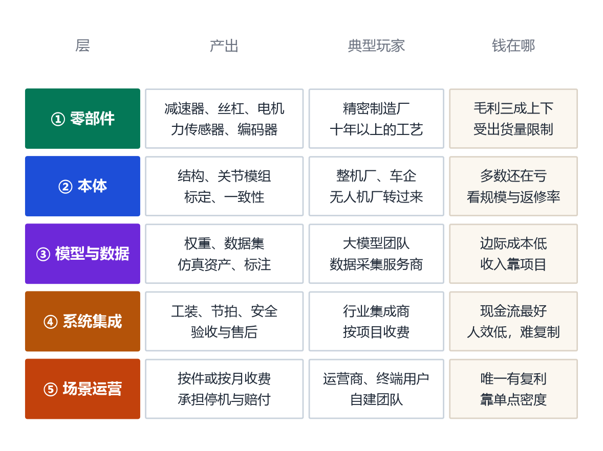
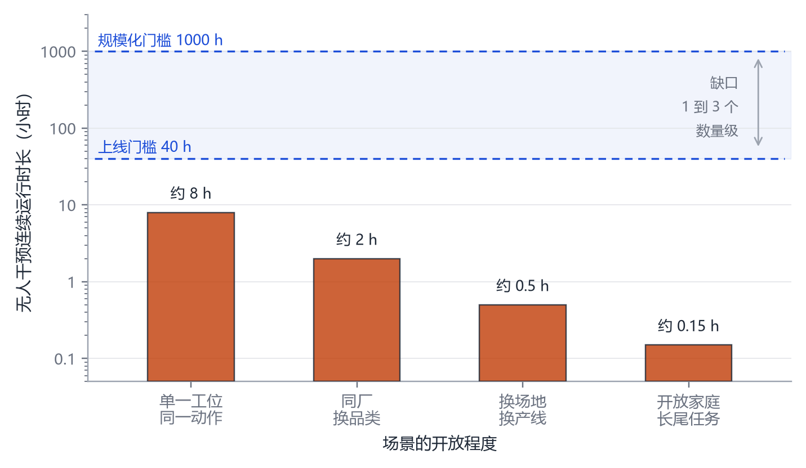
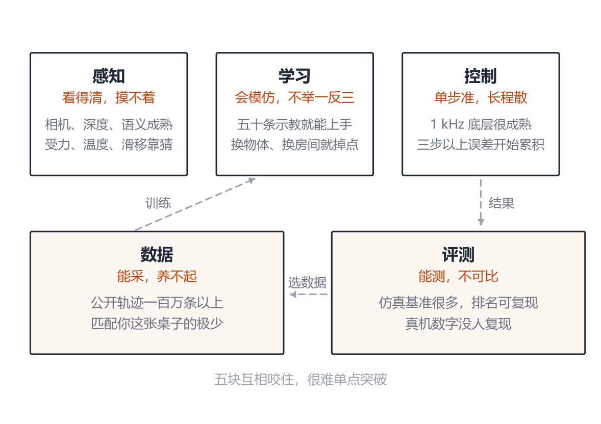

# 第 18 章　产业地图与未解的问题

> **本章导读**：前面十七章把一条链路拆开，一段一段讲清楚。这一章把镜头拉远，看这条链路怎么变成一门生意。从零件到场景运营的五层链条上，钱在哪一层、门槛在哪一层；机器人为什么先去了工厂而不是客厅；一台设备几年能回本；哪些热闹是泡沫、哪些进展是真的。结尾给五个问题，用来判断一段演示、一份订单、一家公司的说法站不站得住。

## 18.1 五层链条，钱在哪一层

这一节回答一个问题。一台机器人从零件走到一个能干活的工位，中间要经过几道手，每一道手靠什么活下来。

一台能干活的机器人，从零件到"这个工位今天干了 800 件"，中间隔着五层，如图 18-1。

最下面是零部件。谐波减速器把电机的高速小扭矩变成关节需要的低速大扭矩。无框力矩电机直接嵌进关节，六维力传感器装在腕部，编码器负责知道关节转到了哪。这一层卖的是标准件，同一个减速器卖给十家本体厂，谁下单都接。客户是本体厂和集成商，钱按件结，账期一般三个月，量大的客户能压掉两三成价格。

往上一层是本体。把零件装成一台能动的机器，管结构、散热、走线、出厂标定、整机一致性。同一套零件，装得好和装得差，精度和寿命能差一倍，功夫在装配工艺和标定台上。客户是系统集成商，少数大终端厂会直接买。卖给集成商省事，代价是让出中间一段利润。

第三层是模型与数据。权重、数据集、仿真资产、标注与采集服务都在这一层。它不生产硬件，产出的是"换个场景还能不能用"这件事，形态最像软件。客户分三种，本体厂买权重，集成商买定制，终端厂买场景适配。钱主要按项目收，一套适配二十万到两百万元。

第四层是系统集成。把本体装进客户的产线，做工装夹具、算节拍、做安全评估、过验收、负责上线后前三个月的爬坡。客户买的不是一台机器人，是"这个工位以后不用人"这个承诺。钱按项目走，预付三成、验收付六成、质保期满付一成，账期六到十二个月，毛利在两成到三成。

最上面是场景运营。不卖设备，按件或按月收钱，同时把停机和赔付接过来。客户是产线老板和物流园区，一件货几分钱到三毛钱，或者一台设备一个月八千到一万五。这门的钱不在单价，在密度。

五层的赚钱方式完全不同。零部件走量，公开财报里做减速器和伺服的那几家，毛利率能到三四成，但天花板被本体出货量锁死。本体这一层普遍不赚钱，物料成本占售价六到七成，剩下的要摊研发、模具、售后和返修。模型与数据这一层边际成本最低，可眼下的收入主要来自项目和定制，按调用次数收费的生意还没出现。系统集成的现金流最好，客户先付预付款，验收后结清，但它是项目制，一个工程师一年只能交付三到五个工位。场景运营看着最重，却是唯一能享受复利的层，同一套系统在同一个客户的多条线上复制，第一个工位要半年，第二十个可能只要两周。

拆一台六轴协作臂的物料清单，能看清钱去哪了。三个谐波减速器每个一两千元，六个无框电机加驱动器一两万元，编码器和力传感器几千到几万元，结构件与控制柜一两万元。合起来三到六万元，出厂价八到十五万元，差价就是研发摊销和毛利。本体厂想降价，只能等零件降价或者等自己的出货量上来。

<figure class="fig">

<figcaption><b>图 18-1</b>　产业链的五层，从下往上依次是零部件、本体、模型与数据、系统集成、场景运营。每层标出产出、典型玩家类型和钱在哪，越往上越靠近客户，也越难复制。</figcaption>
</figure>

门槛各在各的位置。零部件是工艺与一致性，同一批一万个减速器，回差分布要窄，寿命要能算出来。一家厂能把回差压到 1 弧分以内，良率还稳在九五成，这件事花了十年。本体是返修率，一千台里有多少台要返修，直接决定售后成本能不能扛。返修率 2% 和 5% 之间差三个点，摊到一台两万元的机器上就是六百元，正好是这台机器的全部毛利。有家厂把年出货从 500 台推到 5000 台，零件降价 15%，返修率同时涨到 5%，降价省下的钱正好被这一项吃光。模型与数据是有没有闭环场景，没有场景就没有失败样本。集成是客户的节拍、验收标准、停机窗口，这些写在合同里、不在论文里。运营是资金与密度，一个城市只有三台设备，运维人员跑一趟的成本就吃掉利润。

有一条判断能省很多口舌。看这一层卖的是可复制的东西，还是不可复制的时间。零件和权重可复制，集成和运维不可复制。可复制的层靠规模，不可复制的层靠密度，把两种生意放在一张报表里比增速，一定得出错误结论。

## 18.2 为什么先去工厂

这一节回答一个问题。一家机器人公司手里只有一笔钱，先做哪个场景，答案不在技术里，在四个能不能里。

场景选择看着像技术判断，其实是四个能不能。环境能不能改，失败谁来兜，动作重不重复，节拍卡不卡人。四问答完，顺序基本就定了。

环境能不能改，是第一道分水岭。工厂里你是产线的一部分，可以装围栏、改工装、调光照、把来料框固定在一个位置。车间地面是环氧地坪，两米之内高低差压在 3 毫米以内，轮式底盘走过去只漂几个毫米；家里地板高低差 1 厘米，门口还有 2 厘米的门槛，同样的底盘漂到几厘米。车间照度 500 到 1000 lux，色温固定；家里白天靠窗逆光，晚上只开一盏暖光灯，同一个杯子在相机里的亮度能差二十倍。家里什么都不能动，桌子高 75 cm，地毯会绊轮子，猫会在机械臂工作时跳上桌。同样一套算法，在有改造权的场地里成功率能高一截，那一截不是算法给的，是环境给的。

失败谁来兜，决定容忍度。工厂有班组长，抓空了按一下复位，损失是几十秒，复位不需要工程师到场。家里抓空了可能摔的是药瓶，烫的是孩子。这条差别把安全要求推到另一个量级，力上限、速度上限、人机距离都得重做。

动作重不重复，决定数据好不好采、收益好不好算。一个上下料工位一天重复八百次同一个动作，一年二十几万次，采两百条就能覆盖主要变体，投资回报也能按月算清。家庭一天用五次，五次里有四次不一样，采不到数据，也算不出省了什么。

节拍卡不卡人，决定愿不愿意付溢价。工厂的节拍是硬的，人跟不上线就停，一条线停一小时损失几千到几万元，所以为稳定性付钱很痛快。家庭没有节拍，慢一点无所谓，但偶尔失败一次不可接受，这两件事在工程上矛盾，快靠放宽，稳靠收紧。

四问过一遍，几个场景的位置就清楚了。

仓储分拣是除汽车焊装之外最成熟的场景。单品编号几十万种，一个料箱里混着不同形状的物体，节拍要求每小时几百到上千件，抓取成功率要 99.5% 以上，因为一次掉件可能卡住整条输送线。人工分拣一小时四百到六百件，机器人在规则件上更快，换成软包装、透明袋、反光金属件就掉点。所以部署多是混编，机器吃规则件，人吃长尾，人数降下来，但降不到零。

巡检是算账最容易的场景。任务是走到点位、拍一张照、读一个表，动作简单，慢一点没关系，一台人在后台能看五到十台。约束不在操作，在定位和续航，一次巡检两三公里，四足机器人跑一个半小时到两小时就要换电。它不需要灵巧，只需要不出错，本质是感知加移动的生意。

手术机器人走另一条路，它压根不追求自主。达芬奇那一类系统做的是主从遥操作，医生在控制台上动手，机器把动作缩小、滤掉手抖，精度到亚毫米。约束是认证和责任，三类证要三到五年，临床数据要几百例，出了事责任在医生和医院。它的商业模式也不一样，装机往往不赚钱，钱在一次性的器械和耗材上。

农业把最难的几件事凑在了一起。果实是软的，捏一下就是一级品降成二级品；光照从正午到傍晚变化剧烈；植株形态每一株都不一样；季节性强，一年只用两三个月，一台机器一年的有效工作时间不到 1500 小时。回收期要在两个采收季内算平，单机价格就被死死压住。所以农业机器人多是辅助平台，人坐在上面摘，机器负责走和搬。

先工厂后家庭不是因为家庭市场小，而是四问在家庭里全是否。环境不能改，失败代价高，动作重复度低，付费上限还低，一台十万的家电卖不动。家庭要成立，得等两件事之一发生，硬件价格掉到两三万，或者系统可靠到一年不用人管。

一个搬迁的案例能说明地面这件事有多重。同一个轮式机器人在车间里定位误差 5 毫米，成功率 98%。搬到隔壁仓库，地面换成起砂的水泥地，定位误差涨到 3 厘米，成功率掉到 70%。

## 18.3 一台设备几年回本

这一节回答一个问题。老板掏出三十几万买一台机器，几年能把钱省回来。答这个问只需要四个字母，可每个字母背后都要填一串数。

价格先说量级，都是公开报价，不是选型依据，具体项目差一倍很正常。六轴工业臂本体八到二十五万元，协作臂十五到三十万元。一台真能干的工位还要加夹爪、视觉、安全、工装和集成，通常是本体价格的两到三倍，落地三十到八十万元。低配人形这两年的公开报价压到四到十万元量级，但这个价不含末端执行器、备用电池、备件和集成，真上工位，投入往往翻一倍。报价单上还要看清含不含控制柜、线束和保修，三样都不含的价，加上去往往多出两成。

回收期只有一个公式，把它写下来是为了逼自己把每一项填满，而不是为了算得多准。

$$T = \frac{C}{S - M}$$

T 是回收期，单位年；C 是一次性投入，单位元；S 是每年省下的人工成本，单位元；M 是每年运维成本，单位元，含折旧、保养、备件、电费和看护人工。

省下的钱先补上运维，剩下的才是净节省，用一次性投入除以它，就得到几年回本。分母是负数时，机器越用越亏。

算一个两班制的上下料工位。投入 35 万元，臂、夹爪、视觉、围栏、工装、集成调试全算进去。人工这边，两班两个人，一个人一年的综合成本按 12 万元算，含工资、社保和管理摊销，一年省 24 万元。12 万元折成月是 1 万元，其中到手六七千，其余是社保和管理费用。

运维这边的 11 万元要逐项填。五年折旧 7 万元，就是 35 除以 5；保养备件 1.5 万元；电费 0.5 万元，整机加控制柜按 3 kW 算，一年跑 2000 小时，电价按 0.7 元一度是 4200 元；夜班留一个人看六台设备，摊到这一台 2 万元。四项相加正好 11 万元。

代进公式，35 除以 13，约 2.7 年。这个数落在行业常见的两到三年里，也意味着设备在折旧期内回本。

上机器之前还得核节拍。工位一小时要出 60 件，节拍就是 60 秒，人做一件 55 秒，机器做 45 秒就在节拍内；机器做 70 秒，整条线要等它，S 就得打折。报价前必须先量三件事，来料位置公差、单件循环时间、换型频次。

换成单班单人，同样的机器。省下的人工变成 12 万元，运维里少了夜班看护，约 9 万元，35 除以 3，约 11.7 年。回收期从两年半变成十一年。这就是为什么同一款机器人在有些厂里必须上，在另一些厂里再看看。决定回本的不是机器人价格，是班次和替代人数。

四个数每个都能动，动完结论完全不同。人工涨到一个人 15 万元，两班省 30 万元，35 除以 19 约 1.8 年。反过来人工只有 8 万元，两班省 16 万元，35 除以 5 是 7 年，多数厂会放弃。投入从 35 万元涨到 50 万元，50 除以 13 约 3.8 年。涨到 80 万元就是 6.2 年，超过多数工厂的耐心。节拍只到人的八成，一台顶不了两个人，S 折成 19.2 万元，35 除以 8.2 约 4.3 年。班次加到三班，省 36 万元，运维按 12 万元算，35 除以 24 约 1.5 年。设备不休息，多出来那一班几乎全是净节省。

人形要另算，因为它比的不是顶几个人，而是每个有效工时多少钱。按公开演示的节拍估，人形做同样的抓放，一个循环大约是人的三倍，效率算三分之一。续航两小时要换电，可用率按 60% 算。一年 2400 个机时，单台一年产出的有效工作量约 480 个人时当量。要顶一个 2000 人时的岗位需要四台，投入 40 万元。折旧 8 万元，关节模组和电池按 15% 换修算 6 万元，一年 14 万元，比 12 万元人工还贵。这个算法还没算调度、安全和场地改造。

所以人形在按件计酬的场合目前不成立，它成立的条件在另一头。环境不用改造、任务经常换、停线改造的成本高于设备本身，这时候买的不是效率，是柔性。柔性没有公认的定价方法，这是这一层最难谈的地方。

隐性成本容易被漏掉。集成调试通常要三到六个月，这期间产线在改、人在等；上线后前三个月要频繁调参；换一个产品型号可能要重新编程。行业里的经验是，隐性成本和设备价大体相当，做预算时按 1.5 到 2 倍留。按这条经验，报价 35 万元的工位要按 50 到 70 万元批预算。

回收期之后还有一件事要算，折旧期和寿命对不对得上。工业臂的机械寿命在几万小时，五年折旧期内用不满；人形的关节模组和电池是消耗件，两三年换一轮，按五年折旧就是把成本摊薄了，账面好看，现金难看。

## 18.4 数据与算力的两道坎

这一节回答一个问题。模型要变强就得吃数据和算力，这两样在机器人这里都不够用，到底差多少。

数据这道坎不是少，是不匹配。语言模型的训练语料在万亿 token 量级，公开的机器人轨迹在百万条量级。Open X-Embodiment（2023）把 60 个数据集、22 种本体汇成 100 万条以上，一条按 100 帧算是一亿帧，两个数字差四个数量级。

把量级摊开看得更清楚。大模型的语料按 15 万亿 token 算，一个 token 大约半个词；机器人这边 100 万条轨迹，一条 100 帧就是 1 亿帧，一帧是一张图。一条抓取动作 3 秒、每秒 30 帧，约 90 帧，1 亿帧除以 90，得到一百一十万条动作，其中带末端位姿和夹爪状态的只有一部分。差距不在十倍，在四个数量级。

更要紧的是这一亿帧摊到你那张桌子上，可能一条都不算数。公开数据里的相机型号、安装高度、光照条件、物体款式，和你车间里的都不一样。模型见过一万只塑料杯，没见过你这条线上那种带标签的金属罐。

数据缩放（2024）把这件事量化了。32 个环境、每个环境一个独特物体、每个环境 50 条示教，训出来的策略在全新环境和全新物体上零样本成功率 90%。一共 1600 条示教，比很多公司采的还少。两个结论对产业的含义比技术含义更大。多样性比数量重要，钱该花在买场景上，不该花在买条数上；每个环境 50 条之后曲线就平了，采集服务按场景数定价比按小时定价更合理。

于是这一层长出两种生意。一种是数据工厂，雇人戴动捕手套在标准工位上重复动作，按条或者按小时卖，便宜、干净、分布窄。另一种是场景合作，直接进客户的产线采，数据双方共有，贵、脏，但有关键的失败样本。真正稀缺的是后者，因为失败只在你自己的场景里出现，买不到。

数据工厂的账可以算一遍。一个采集员一天出 150 条，一条卖 3 到 10 元，扣掉场地、设备和人工，毛利并不高。它的风险在于分布窄，同一张桌子、同一盏灯、同一个物体，模型在这张桌子上做到 95%，搬到客户车间掉到 40%。纯卖条数的生意因此很难长大。

算力这道坎不在训练，在端侧。一个 70 亿参数的视觉-语言-动作模型，一次前向在单张消费级显卡上是几十到一百毫秒。底层控制环要跑 1 kHz，两者差两个数量级，系统只能分层，慢的想、快的做，中间用动作块衔接。1 kHz 的意思是每 1 毫秒出一次关节指令，一次 50 毫秒的推理跨过 50 个控制周期，这 50 个周期里机器人只能靠上一段动作往前推。

端侧的约束还有显存和功耗。70 亿参数按 8 位整数存，权重占 7 GB，加上激活值和图像缓存，一块 16 GB 的嵌入式板卡刚够。一台人形整机 2 到 4 kW，算力模块占 200 到 500 W，直接吃续航。工作站上跑得动的模型，装到机器上要砍分辨率、砍帧率，从 640 像素砍到 320，从 30 帧砍到 10 帧，砍完掉多少点只能重测。

放到云端也解不了。一次请求往返加上排队是 50 到 100 毫秒，还带抖动，网络一断机器人就停在原地，工厂不接受这种依赖。两条路都不轻松，一条要更多场景，一条要更省的算力，而且互相拉扯，模型越大越通用，端侧越跑不动。

## 18.5 泡沫与真实进展

这一节回答一个问题。看到一段视频、一份订单公告，怎么判断它是真的还是演的。

判断一段演示可不可信，看四件事，都不需要专业知识。

1. 连续跑了多久。30 秒的片段和连续 8 小时是两件事，看有没有原始时间戳、有没有剪接、画面里的人有没有伸手干预。八小时的录像没人愿意看完，但它的存在本身就是证据。
2. 成功率的分母。20 次试验报 90% 和 100 次报 90% 不是一回事，前者的真实水平可能只有 68%。算法很简单，20 次里成功 18 次，按统计换算，95% 的置信区间大约是 68% 到 99%，宽到没有决策价值；100 次里成功 90 次，区间收窄到 82% 到 95%，才算能看。物体位置固定、光照固定，测出来的数字只对那张桌子成立。
3. 订单是意向还是验收。框架协议、战略合作、意向订单都不算数，验收单和回款才算。差别可以很大，签了 1000 台的框架协议，第一年实际交付 50 台，第二年 200 台，剩下的悄悄取消。复购率是最难作假的一个指标，第一年买的客户第二年还买，说明这东西真的有用。
4. 一台设备配几个人。演示里一个人在后台盯三台，和三个人盯一台，是两个行业。

还有几个信号值得警惕。演示场地是自己的实验室，地面平、光照稳、来料摆好，客户现场三样都不成立。演示里的物体是同一款，颜色鲜、边缘清楚，机位只有一个正面。

进展也是真的，只是落在不同的层。工业侧，全球工业机器人年装机在 50 万台量级，中国占一半以上，这一层成熟了二十年，增长平缓。仓储侧，亚马逊部署的仓储机器人超过 75 万台（2024 年公开数字），绝大多数是搬货架，不是拣选。通用操作侧，RT-1（2022）用 13 万条演示训出能执行 700 多种指令的模型，RT-2（2023）把动作离散成文本 token，没见过的物体也能抓，Open X-Embodiment（2023）第一次让跨本体训练出现正收益。人形侧，2024 到 2025 年从能走进步到能搬料箱，仍在小批量试点，没有规模化验收。

把两边放在一起，差距在一个指标上最清楚，连续无人干预的时长。工业机器人的平均无故障时间在几万小时，一条产线一周不干预是常态；人形公开演示里，连续工作 8 小时就值得发一条新闻。几万小时和 8 小时差三到四个数量级。图 18-2 把这两件事画成两条门槛线，中间那道沟就是这一轮热潮真正要填的东西。

<figure class="fig">

<figcaption><b>图 18-2</b>　研究演示与产品要求之间的可靠性差距。横轴是场景的开放程度，纵轴是无人干预的连续运行时长，两条虚线是上线与规模化的门槛。柱高为量级估计，示意。</figcaption>
</figure>

对泡沫的判断可以更细。造假是少数，多数是口径问题，把最好的一次当平均水平，把有人兜底说成无人值守，把单点试点说成规模部署。这些话在技术上不算撒谎，在商业上会误导，而投资决策恰恰靠这些数字做。

一个典型的演示长这样。机器人在台上叠衣服，30 分钟里操作员伸手扶了 6 次，剪成 90 秒的视频，播放量过百万。技术是真的，产品不是，中间差的就是那 6 次。

## 18.6 五个还没解决的问题

有些问题不是工程没做好，是原理上还没答案。下面五个短期都不会有干净解法，表 18-1 把它们排成一列，图 18-3 摆成一张地图。

泛化最直观。同一个场景成功率九成，换一个房间掉到三成，论文里叫分布偏移，现场叫这机器认生。根因是训练分布和任务分布不一致，而任务分布的长尾没有边界。现在卡在哪里，卡在没人能事先说清新场景会带来哪些差异，也没有便宜的办法把差异补进数据里。

长程与记忆更难。五个动作串起来，每步九成五，整条剩七成七；十个动作，剩六成。误差累积只是表面，底下是记忆问题，什么该记、记多久、以什么形式记，没有共识。加长上下文解决不了，该记的不是对话，是我三分钟前把螺丝放在了哪。现在卡在哪里，卡在记忆没有公认的结构，存少了忘事，存多了拖慢推理。

物理直觉是第三个坑。模型会说轻拿轻放，但它不知道 300 g 和 500 g 的杯子让腕部力矩差多少，也不知道这块塑料的摩擦系数是 0.2 还是 0.6。视频预测出来的物理在接触那一刻失效，因为接触力不在像素里。现在卡在哪里，卡在数据里几乎没有力，一片触觉传感器几千元，装在指尖上还容易坏。

安全与责任是非技术问题。现在的安全靠围栏、限速、急停，人机共处限于低速低力。真出了事，责任在本体厂、集成商、模型提供方和用户之间划不清，标准也滞后于形态，双足、多指手都还没有成熟的安全条款。现在卡在哪里，卡在没有判过这样的案子，也没有第三方能出认证。

评测听起来最软，实际最硬。没有公认的统一考卷，仿真基准很多，真机数字没人复现，成功率的分母和失败的定义各家不同。这一条不解决，前面四条就没法量化进展。现在卡在哪里，卡在复现要花钱，还没人愿意买单。

**表 18-1**　开放问题清单。

| 问题 | 现状 | 难点 | 可能方向 |
|---|---|---|---|
| 泛化 | 训练分布内九成以上，换场景掉到三成 | 任务分布的长尾没有边界，事先不知道会来什么 | 更多场景、跨本体数据、上线后在线适应 |
| 长程与记忆 | 五步任务常断，十步以上很少见 | 误差逐步累积，记忆该留什么没有共识 | 分层策略、显式场景记忆、失败回滚 |
| 物理直觉 | 会描述轻拿轻放，估不出质量与摩擦 | 视觉里没有接触力，接触瞬间模型失效 | 力与触觉闭环、可微物理、交互式预演 |
| 安全与责任 | 靠围栏、限速、急停，共处限于低速 | 责任在四方之间划不清，标准滞后于形态 | 力限与速度标准、失败可解释、保险机制 |
| 评测 | 仿真基准多，真机数字不可比 | 初始条件与失败定义不统一 | 标准化试验协议、第三方复现、公开原始数据 |

<figure class="fig">

<figcaption><b>图 18-3</b>　开放问题地图。感知、学习、控制三块各自卡在哪，数据与评测托在底下，虚线是它们之间的耦合关系。区域大小不代表难度，示意。</figcaption>
</figure>

五块互相咬住。感知不给力，学习就学不到接触那一刻的因果；评测不统一，学习就不知道往哪改；数据不够，控制端的自适应就没有依据。所以这一行不太可能出现单点突破，更可能是几块一起松。

## 18.7 拿五个问题去问

这一节回答一个问题。手边只有一页宣传材料和一次见面的机会，怎么在半小时里判断这个项目靠不靠谱。

任何一个机器人项目，宣传材料都能用五个问题过一遍。

一问这段演示连续跑了多久，中间有没有人干预。过关的回答带原始时间戳，说清干预了几次、每次为什么。还要问干预是谁做的，是现场操作工还是随行工程师，工程师在场和不在场，成功率差很多。不过关的回答是一段 30 秒的精彩镜头，配一句现场更流畅。

二问成功率的分母是多少，初始条件怎么随机。过关的回答给试验次数、物体位置和光照的随机范围，还给失败分类，比如夹空多少次、滑脱多少次、碰撞多少次。不过关的回答只给一个百分比。

三问订单是意向还是验收，交付了几台，复购几台。过关的回答只有两个数字，验收台数和复购率。不过关的回答是框架协议的总金额，那个数字签的时候就不指望全兑现。

四问场地是谁的，改造费用谁出。过关的回答会承认改过围栏和光照，而不是宣称零改造。能改环境不是缺点，藏起来才是。改造费用常占项目总价的两成到三成，谁出这笔钱，直接决定报价能不能对上。

五问一台机器顶几个人、几个班，回收期几年。过关的回答会把运维、备件、看护人工都算进去，回收期落在两到三年，而不是只说设备价格便宜。这一问最能分出懂行和不懂行，因为答案必须是一串数，不是一个形容词。

表 18-2 把两种回答摆在一起。问的时候一次只问一个，把对方的原话记下来，等他给数字。给了数字就能核对，给不出数字就是没做过。顺序上倒着问更省时间，回收期和看护人数最难答，先问它，对方的反应最快暴露底细；演示时长和分母最好答，放到后面缓和气氛。

**表 18-2**　五个问题与两种回答。

| 问题 | 不过关的回答 | 过关的回答 |
|---|---|---|
| 演示连续跑了多久 | 一段三十秒的精彩镜头，没有时间戳 | 完整录像，注明干预几次、每次为什么 |
| 成功率的分母多大 | 只说百分比，不说试验次数 | 试验次数、位置与光照的随机范围、失败分类 |
| 订单走到哪一步 | 框架协议、战略合作、意向订单 | 验收台数、回款金额、复购率 |
| 场地是谁的，改了什么 | 宣称零改造 | 承认改过围栏、光照、工装，说清费用 |
| 一台顶几个人、几年回本 | 只说设备便宜 | 班次、看护人数、运维备件全算进去，两到三年回本 |

五问过完，多数宣传会露出真面目。这不一定是坏事，经得起这五问的项目，路线大概是对的，剩下的只是时间；经不起的，往往也不是骗子，只是把能做到和能交付当成了同一件事。

产业链五层，每层的钱都不好赚。零件靠工艺，本体靠规模，模型靠场景，集成靠人，运营靠密度。真正稳的判断不在任何一层内部，而在那几个能被核对的问题上。

