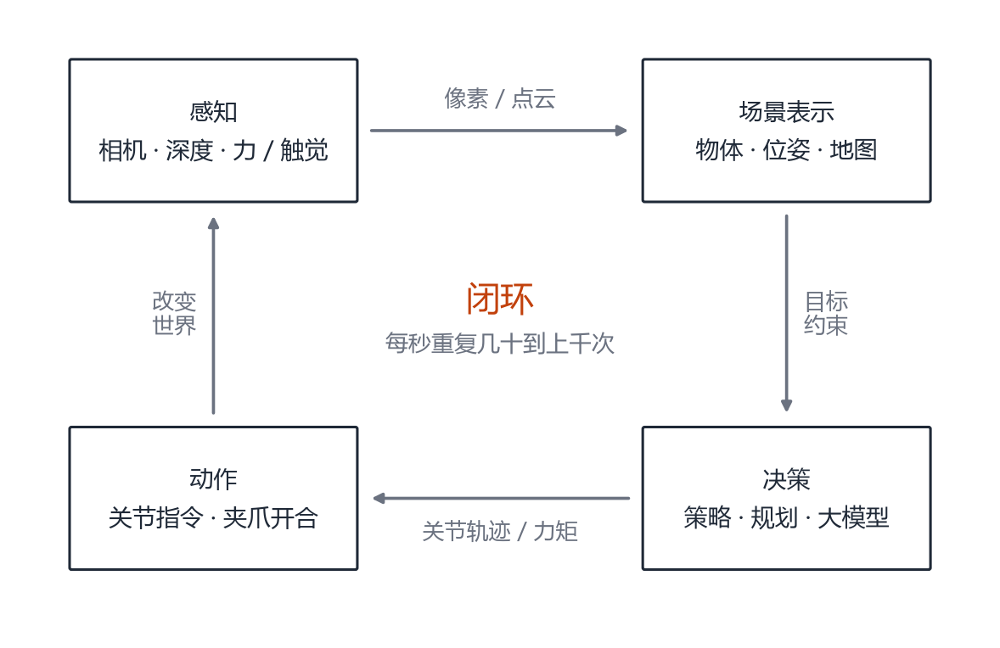
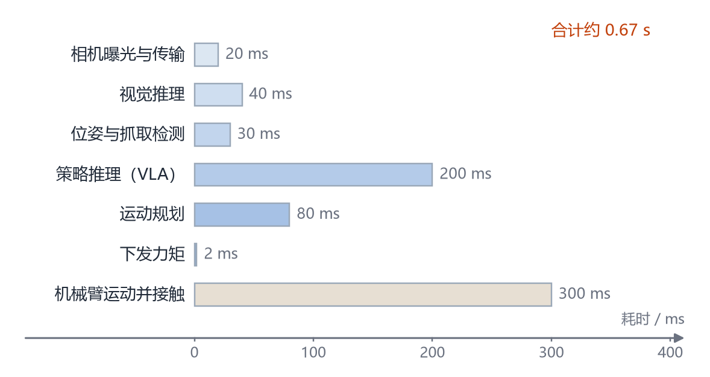

# 第 1 章　从一个动作说起

> **本章导读**：语言模型能写诗、能讲笑话、能通过司法考试，却拧不开一瓶矿泉水。这一章从这个反差出发，说清"身体"对智能意味着什么，具身智能和相邻领域的分界线在哪里，以及把一只苹果从桌上放进盘子里，究竟要经过多少个环节。读完这一章，你会知道后面二十章各自在补哪一块。

## 1.1 会写诗的手，拧不开瓶盖

这一节回答一个问题，一台能把论文写完的机器，为什么拧不开一瓶矿泉水。

2023 年之后，几乎所有人都见过这样的演示。一个模型读完一份 PDF，总结要点，写出可运行的代码，还能用自然语言解释它为什么这么写。

这种能力集中在同一个地方，就是符号。文字、代码、表格、公式，都是已经被人类整理成符号的东西。模型在这上面练了几万亿个例子，输出在符号世界里几乎无所不能。

同一时期，如果你想买一台能把矿泉水瓶盖拧开的机器人，会发现选择少得可怜，价格却不便宜。更麻烦的是，它拧开的成功率往往取决于瓶子摆得正不正、盖子紧不紧、桌面滑不滑。换一个品牌的瓶子，成功率可能从九成掉到五成。

掉下来的那四成发生在很具体的地方。瓶身是圆柱，表面光滑，夹爪一用力它就转，转起来盖子就跟着转，扭矩全被瓶身吃掉了。瓶盖的齿只有 1 毫米高，夹爪的对中误差超过 1 毫米就咬不住齿。桌面稍微有点水，瓶子被压下去时会平移几毫米，抓取位姿当场失效。这些细节没有一条出现在任何语料里。

这个反差在机器人领域有个名字，叫莫拉维克悖论（Moravec's paradox）。它在 1980 年代就被提出来，意思是让计算机做成人觉得困难的事相对容易，比如下棋、证明定理、诊断疾病；让计算机做小孩都会的事却极难，比如看、走、抓、听。

这个观察有它的来历。1970 年代，汉斯·莫拉维克在斯坦福人工智能实验室做一台叫斯坦福车的小车。那台车装了相机和轮子，任务是穿过一间堆满椅子的房间。它每走一米就要停下来算几十秒，穿过一条二十米的走廊要花掉好几个小时。同一时期，能解微积分、能下国际象棋的程序已经在大学里跑起来了。

1980 年代正是符号派的巅峰。专家系统在医院和工厂里上线，专门做推理的计算机卖得很贵，很多人相信会下棋的机器很快就会有常识。莫拉维克看到的顺序正好反过来。他在 1988 年的《Mind Children》里写下这个判断，1990 年代平克在《How the Mind Works》里把它称作莫拉维克悖论，这个词才流传开来。

当时的解释是进化。看、走、抓、听这几件事，经过了几亿年的打磨，已经变成不需要意识参与的底层能力。眼睛这套系统在地球上迭代了数亿年，而逻辑推理和算术只有几千年，写在纸上还不到五百年。底层能力被压进了神经回路，快、稳、不占注意力，代价是说不清，也就教不会。

一个五岁小孩接住抛来的球，从看到球到手掌合上大约 0.3 到 0.5 秒。这半秒里，他要估计球的速度和落点，判断自己该往哪边挪半步，伸手，张开手掌，在球接触掌心的瞬间收拢。整个过程里他不需要算抛物线，也说不清自己是怎么做的。同一件事写成程序，要先标定相机、估深度、拟合弹道、解逆运动学，每一步都有误差。

到了大模型时代，这个悖论换了一副面孔，但依然成立。语言模型之所以强，是因为它的训练数据是人类的文字，文字已经把世界的复杂性压缩过一遍。一张桌子在文字里就是"桌子"，不需要知道它有多重、边缘是否锋利、能不能推动。一张八十厘米高的餐桌在语料里只以一个名词出现。没有任何一处写着它有十二公斤，也没有写桌沿的倒角是两毫米，湿布擦过之后摩擦系数会掉一半。

机器人面对的恰恰是被压缩掉的那部分。桌子的高度决定了机械臂要用哪个姿态去够，桌面的摩擦系数决定了推的时候用多大力，桌沿的圆角决定了碰撞检测该用哪个模型。这些量都得在运行时测出来，测不准就直接体现在动作上。想让机械臂末端落到 5 毫米以内抓住一个直径 8 厘米的苹果，这个精度要求比绝大多数文字任务都苛刻。

数据量上的差距更直白。语言模型的训练语料以万亿词元计，而目前最大的真机操作数据集只有十万量级的工作轨迹。两边差了七个数量级。这不是因为做机器人的人不努力，而是因为收集一条真机轨迹要占用一台设备几秒钟，还要一个人在旁边摆好物体。

所以具身智能要解决的问题，不是"再训一个更大的模型"，而是"让模型的输出落到物理世界里还能成立"。这两件事之间的距离，比想象中远。一个从没摸过瓶子的模型，看到装了水的瓶子会按空瓶的力度去抓。结果要么瓶子从手里滑出去，要么塑料瓶被捏扁，水洒在桌上。它的输入里没有"重量"这个通道，输出里也就没有对应的分寸。

要补上这段距离，得先弄清楚"身体"到底给智能添了什么。这是下一节的内容。

## 1.2 智能为什么需要一个身体

这一节回答一个问题，为什么说到智能就绕不开身体，身体究竟提供了什么别的东西给不了的条件。

"具身"这个词在中文里有点别扭，英文 embodiment 更直白一些，意思是"拥有一个身体"。但身体在这里不只是硬件，它有三层含义，一层比一层深。

### 身体是物理载体

**第一层，身体提供了物理载体。** 有质量、有体积、有关节限位、有电机功率上限。一台常见的六轴协作臂，臂展一米三，额定负载五公斤，自重二十五公斤，重复定位精度 0.03 毫米，每个关节的转动范围大约正负 170 度。

这些数字一条一条地限定了这台机器能做什么。负载五公斤，意味着十公斤的箱子它搬不动，算法再聪明也搬不动。关节最大速度每秒 180 度，意味着从朝前转到朝侧面九十度至少要半秒，这段时间里世界还在变。

这些约束看起来是负担，实际上是让"智能"有意义的前提。一个不受任何约束的存在，不需要做选择，也就不需要智能。人伸手够一个杯子，够不到就要站起来，站起来够不到就要搬凳子，这一串决策全是被身高和臂长逼出来的。

约束还会以失败的方式提醒你它的存在。让机械臂去抬一个八公斤的箱子，关节电流会在半秒内超过额定值，驱动器进入保护，机械臂停在半空，任务中断。这种失败在纯软件里没有对应物。

### 身体带来闭环

**第二层，身体带来了感知与行动的闭环。** 相机不是"看一眼世界"，而是"在某个位置、某个时刻、用某个视角看一眼世界"，看到的东西取决于身体刚才做了什么。伸手去拿杯子，手会挡住视线；转动头部，视野会变；走近一步，原本模糊的物体变大变清楚。

这种"动作改变观测、观测修正动作"的循环，是纯文本模型永远遇不到的。机器人不一样，它的一帧图像是上一帧动作的结果，下一帧动作又要建立在这一帧图像上。

闭环还带来一个时间上的硬约束。普通相机每秒 30 帧，一帧间隔 33 毫秒。底层控制环跑在 1 千赫兹，一次 1 毫秒。两次视觉更新之间，控制器要自己跑三十三次，这一段时间得靠预测撑住。

这里有个典型的坏法。相机装在手腕上，视野跟着手走。可一旦手伸到目标正上方，手本身就把目标挡住了，视觉伺服在最后五厘米失去输入。系统要么停在半空，要么靠记忆盲抓，盲抓的落点误差通常在 1 厘米以上。

### 身体决定智能的形状

**第三层，身体决定了智能的形状。** 一只蝙蝠用回声定位理解空间，它发出 20 到 100 千赫兹的超声波，靠回波的延迟判断距离。一条蛇用颊窝感知红外，能分辨千分之几摄氏度的温差，于是在完全黑暗里也能锁定一只老鼠。人类用手指的触觉判断布料，指尖每平方厘米有上百个机械感受器，两点相距 2 毫米还能分开。

它们对世界的"理解"并不相同，因为身体不同，可获取的信息不同，能采取的行动也不同。这也是为什么人形机器人在家庭场景里有天然优势。门把手离地一米，台阶高 18 厘米，椅子坐高 45 厘米，灶台高 85 厘米，这些尺寸都是按人的身体定下来的。一台按这个尺寸造出来的机器，进到房子里不需要改造环境。

<figure class="fig">

<figcaption><b>图 1-1</b>　感知、表示、决策、动作构成的闭环。动作改变世界，世界的变化又被下一次感知捕捉，闭环每秒重复几十到上千次。</figcaption>
</figure>

与身体相关的一个老问题是符号接地（symbol grounding）。模型在语料里学到"杯子"这个词与一堆上下文共现，但它没有拿过杯子，不知道装满水的杯子和空杯子在手腕上的差别，不知道陶瓷杯掉在瓷砖上会碎、塑料杯不会。词与物之间那根线，是靠身体系上的。

这个差别可以量化。一只一点五升的水壶装满水大约两公斤，握在离手腕三十厘米的地方，手腕要出的力矩约六牛·米。空壶只有零点四公斤，同样的姿势只要一点二牛·米。文字里"水壶"始终是同一个词，模型感受不到这五倍的差距。

身体的形式还会改变问题本身。固定在工作台上的机械臂，世界坐标系可以认为永远不动，标定一次能用几个月，标定残差通常在 0.2 毫米以内。装在移动底盘上的机械臂，每走一步基座都在动，底盘定位误差 2 到 5 厘米，而抓取只允许 5 毫米的偏差，整整差一个数量级，所以它必须一边走一边用视觉修正自己的位置。

人形机器人更难。它的支撑面在两条腿之间来回切换，重心必须落在两只脚围成的多边形里才不会摔，平衡本身就是一项持续的任务。走路时躯干每秒晃动几厘米，手上的动作还要与这种晃动解耦，否则末端轨迹会跟着一起抖。同一句"把杯子拿起来"，在三种身体上对应三套完全不同的技术栈，这也是本书按身体形态分章的原因之一。

这三层含义合起来，指向一个比"感知 + 决策 + 执行"更准确的说法。智能是在与环境的持续交互中涌现出来的，而不是先想清楚再动手。图 1-1 画的就是这个循环。它的四个环节在软件系统里都能找到对应物，差别在于这里的每一环都有物理代价。感知要等曝光，决策要等推理，动作要等电机响应，而世界在你等待的时候还在变化。

闭环带来一个纯软件没有的问题，就是**误差会累积**。语言模型生成长文本，某一句话写得不好，后面的内容还可以纠正过来。机器人抓杯子，手的位置偏了 2 毫米，下一步的视觉观测就建立在这 2 毫米的偏差上，再下一步可能偏 5 毫米。

偏差的增长可以算。开环执行十步，每步引入 1 毫米的独立偏差，最坏情况累积到 1 厘米，已经超过苹果的抓取容差。换成闭环，每步用视觉把当前偏差修正掉八成，十步之后剩下的偏差约 0.1 毫米。这就是为什么后面会反复出现"闭环校正""反馈控制""在线适应"这些词，它们都是为了把雪球按住。

还有一个相关概念值得在这里说清楚，就是**可供性**（affordance）。这个词由心理学家吉布森在 1979 年提出，指的是环境相对于某个行动者"能提供什么"。同一个杯子，对成年人来说是可以握住把手提起来的物体，对婴儿来说只是一个可以用手掌拍打的圆柱。

可供性不是物体的固有属性，而是物体形状与行动者能力之间的关系。门把手直径 2 厘米，成年人的手可以圈住，两岁小孩的手圈不住，同一个把手对两者的可供性完全不同。机器人做抓取检测，做的就是把可供性估出来。它输出的不只是一个位置，还有一组姿态和一个开度。

到这里，身体这条线讲完了。接下来要回答的是另一个方向的问题，这个东西的边界到底在哪里，它和旁边的几个领域怎么区分。

## 1.3 边界在哪里

这一节回答一个问题，具身智能这个词现在被用得很宽，宽到哪个范围还算它，宽到哪个范围就不算了。

边界不清楚会带来实际的麻烦。工程师说不清一套方法该归到哪一类，读者看到两篇文章讲完全不同的东西。四条边界逐条划，每条说明它和具身智能共享什么、差在哪里。

**与传统机器人学的关系。** 传统机器人学有一套非常成熟的方法，建模、标定、规划、控制。工业焊接机器人可以在固定工位上重复同一个动作十年，误差不超过零点几毫米，靠的就是这套方法。

这套方法能成立，前提是环境被提前整理过。工件由夹具定位，每次到位误差不超过 1 毫米；焊缝位置由 CAD 给出，精度到 0.1 毫米。条件满足时，一条产线连续跑三个月不需要人干预。

条件一破，代价就上来了。把焊接换成"从随机堆叠的料筐里取零件"，零件互相遮挡，姿态任意，表面还有油污反光。传统做法要给每一种摆放建一次模型，模型数量随零件数指数增长，工程上直接做不下去。这类任务叫无序抓取，是传统方法最典型的失效现场。

具身智能不是要推翻传统方法。它要在"环境不固定、任务不固定、物体不固定"的场合补上传统方法缺的那一块。这一块包括三个问题，"这是什么物体""该从哪里抓""失败了怎么办"。这些问题传统方法默认在设计阶段就已经确定，没有对应的模块。

**与强化学习的关系。** 强化学习是让智能体在试错中学习决策的一类方法，它既可以用于机器人，也可以用于玩游戏、做推荐。机器人只是强化学习的一个应用场景，而且是其中样本成本最高的那种。

成本高在哪里，可以算一笔账。真机上训练一个抓取策略通常需要几万次尝试才能收敛。一次尝试包括移动、抓取、判断成败、把物体摆回原位，平均 15 秒。三万次就是 125 小时，接近五台设备连轴转一个星期。

同样的训练放到仿真里，一小时能跑上百万步，差距是四到五个数量级。所以书里讲强化学习时，会花不少篇幅讲仿真和 sim2real。sim2real 指的是把仿真里学到的策略搬到真机上还能用，这是让这条路在工程上可行的关键。

仿真也有它自己的坏法。一个在仿真里练到 95% 成功率的抓取策略，搬到真机上常常掉到 60%。原因往往很土，仿真里的摩擦系数设成 0.5，真机的塑料桌面是 0.3，夹爪一夹物体就打滑。这类差距叫现实鸿沟，缩小它要靠随机化物理参数、给传感器加噪声、把渲染做得更像真实照片。

**与 LLM Agent 的关系。** 一个在电脑上工作的 Agent，能读文件、发请求、点按钮，它的动作空间是离散的、可撤销的、几乎零成本的。机器人 Agent 的动作空间是连续的、不可撤销的、有物理代价的。

三个差别可以逐个说。离散对连续，前者从有限的按钮里挑一个，后者是七个关节各给一个实数。可撤销对不可撤销，点错按钮可以撤回，抓错杯子可能打碎。零成本对有代价，一次 API 调用一秒钟，重试一百次也没人心疼；机械臂挥一次手要耗电、要磨损。

频率上的差别同样明显。电脑上的 Agent 一次决策花一秒完全够用，用户等得起。机器人的底层控制环跑在 1 千赫兹，上层想清楚要 1 秒，下层在这 1 秒里已经执行了一千次，中间必须有人把上层的意图翻译成连续轨迹。

这个差别决定了机器人系统必须在动作前做更多检查，在动作中保持更高频率的反馈，在动作后做更多确认。动作前查碰撞、查可达性、查力矩是否超限；动作中盯电流和触觉，一有异常立刻停；动作后看一眼结果，确认和预期一致。这三道关卡在纯软件的 Agent 里通常一道都不需要。

**与自动驾驶的关系。** 自动驾驶是具身智能里最成熟的一条分支，它同样要处理感知、预测、规划、控制。区别在于它的动作空间被极大简化了，只有转向、加速、制动几个量，而且环境被结构化，有车道线、有交通规则、有其他车辆大致遵守的行为模式。

数据上的优势更明显。一家自动驾驶公司积累的行驶数据以百万段计，每段几分钟。机械臂没有这种规模的数据，因为每采一段都要人摆一次物体。

难度上的差别来自结构化程度。道路是为人设计的，宽度、曲率、标志位置都有规范，感知系统认出车道线和障碍物，剩下的交给规则。桌面没有任何规范，苹果可能横着、竖着、被咬过一口。

精度要求也不一样。自动驾驶的横向控制误差 10 厘米通常还能接受，因为车道宽三米半。机械臂的抓取误差 10 厘米基本必然失败，因为苹果直径只有 8 厘米。同一条"感知要准"的要求，在两个场景里差了一个数量级。

### 一个工作定义

这四条边界画完，可以给一个工作定义。**具身智能研究的是这样一类系统，它通过身体与物理世界交互，在交互中获取信息、做出决策、完成任务，并且能从交互中变得更好。**

定义里有三个动词，交互、决策、学习，它们对应本书的三个技术主干。交互对应身体与感知，决策对应规划与控制，学习对应数据与模型。三个动词缺一个，系统就会卡住。

定义里还有一个隐含条件，就是"变得更好"必须发生在真实交互之后。一个模型在离线数据上微调，部署上去不再更新，只满足前半个条件。真正的具身系统会把运行中遇到的失败收集起来，下一轮训练用上。

边界划完，抽象的话也说得差不多了。接下来把一个具体任务拆开，看每一步要花多少时间，会在哪里坏。

## 1.4 一只苹果要走多少步

抽象讨论容易飘，具体化一下。任务很简单，桌上有一个苹果，一个盘子，把苹果放进盘子。

拆开看，这件事至少包含下面这些环节。每个环节给出常见耗时和常见的坏法，数字取典型量级，具体设备会差几倍。

**看到。** 相机曝光，图像传回来。工业相机加传输大约 10 到 30 毫秒，普通 USB 摄像头可能到 60 毫秒。这一步决定了后面所有计算的时间基准。常见坏法是曝光过度，苹果表面反光成一片白，边缘信息全丢。

**认出。** 图像里哪个区域是苹果，哪个是盘子，哪个是桌面。检测与分割模型在 GPU 上大概 20 到 50 毫秒。遮挡是这里的主要敌人，苹果被盘子挡掉三分之一，检测框会缩到可见部分，后面定位就会偏。

**定位。** 知道像素位置还不够，需要知道苹果在机器人坐标系里的三维位置和姿态。如果只有 RGB 图像，得靠单目深度估计或者已知物体尺寸反推；如果有深度相机，直接反投影成点云。这一步通常 10 到 50 毫秒，但精度决定了后面抓不抓得准。

深度的坏法很集中。苹果表面光滑，镜面反射会让深度相机在一块区域读不到值，点云上出现一个洞。洞通常几厘米宽，正好盖住苹果中心，位姿估计会往一边偏 1 到 2 厘米，而抓取只允许 5 毫米。

**决定抓哪。** 苹果是圆的，从正上方抓还是从侧面抓，夹爪张开多大，接近方向会不会撞到盘子。这一步是抓取检测或者策略网络的任务，20 到 200 毫秒不等。果梗朝上时，正上方抓会夹到梗，夹爪合不拢，物体在指间打转。

**规划路径。** 从当前位姿移动到抓取位姿，中间不能碰到桌上的其他东西。采样规划器在简单场景里几十毫秒，复杂场景可能要几百毫秒甚至失败重试。规划失败的表现很统一，机械臂停在原地，界面上报一个"无可行路径"。

**闭环抓取。** 机械臂运动到目标位姿，这一段物理运动通常 0.3 到 1 秒，比所有计算加起来都长。接近物体时切换到力控或者视觉伺服，靠触觉和电流反馈判断有没有夹住。夹住之后要往上提 1 厘米试探，这套动作叫提离检测。

**搬运与放下。** 抬起、移动、在盘子上方松开。松开的时机和高度也有讲究，太高会弹跳，太低会碰盘。苹果的弹性好，从 5 厘米高处落下会弹起 2 厘米，可能滚出盘子，稳妥的做法是降到离盘面 1 厘米再松。

**检查。** 再看一眼，苹果确实在盘子里。这一步经常被忽略，但它是系统能自我纠错的前提。检查也会假阳性，苹果一半悬在盘沿，检测框仍落在盘子范围内，系统判成功，下次挪桌子它就掉了。

<figure class="fig">

<figcaption><b>图 1-2</b>　一次抓放任务的耗时分解。数值是各类系统常见的量级，用来说明"算得快不如动得快"，并非某台具体设备的实测数据。</figcaption>
</figure>

图 1-2 把这些环节按耗时画了出来。有两点值得注意。第一，物理运动占了总时间的一半左右，这说明在很多场景里，优化模型推理的收益有限，机构速度和路径质量才是瓶颈。第二，策略推理如果用的是几十亿参数的视觉-语言-动作模型，单次就要 100 到 300 毫秒，比整个感知链路还长，这就是后面要讲"动作块"和"异步推理"的原因。

八个环节加起来，一次抓放大约 1.5 到 3 秒。真正的差距在成功率上，而且不在单步，在连乘。

**表 1-1**　一次抓放任务的单步耗时、成功率和失败表现。成功率取中等难度桌面场景下的常见量级，随物体、光照与设备变化很大。

| 环节 | 典型耗时 | 单步成功率 | 失败时的样子 |
|---|---|---|---|
| 看到 | 10 到 60 毫秒 | 99% | 过曝、运动模糊、目标出画 |
| 认出 | 20 到 50 毫秒 | 97% | 漏检被遮挡的苹果、把盘子当桌面 |
| 定位 | 10 到 50 毫秒 | 95% | 反光处深度缺失，位置偏 1 到 2 厘米 |
| 决定抓哪 | 20 到 200 毫秒 | 95% | 夹到果梗、夹爪与盘子干涉 |
| 规划路径 | 几十到几百毫秒 | 98% | 无可行路径，原地停车 |
| 闭环抓取 | 0.3 到 1 秒 | 97% | 夹滑、夹偏、撞到桌面 |
| 搬运放下 | 0.5 到 1.5 秒 | 98% | 松开过早弹跳、过晚碰盘 |
| 检查 | 30 到 100 毫秒 | 99% | 误判成功，苹果其实悬在盘沿 |

这张表还有一层隐含信息，每个环节都有失败概率。检测可能漏掉被遮挡的苹果，位姿估计可能因为反光偏几厘米，规划可能找不到可行路径，抓取可能夹滑。

单步成功率看起来都不低，最低的也有 95%。但八步是串联的，任何一步失败，整个任务就失败。假设每步成功率 95%，八步串起来就只剩 66%。

用表里的数字算一遍更接近实际。0.99 乘 0.97 得 0.96，再乘 0.95 得 0.912，再乘 0.95 得 0.867，接着乘 0.98 得 0.849，乘 0.97 得 0.824，乘 0.98 得 0.807，乘 0.99 得 0.80。八步之后，任务成功率只有 80%。

这个式子说的是，总成功率等于各环节成功率的连乘，环节越多掉得越快。它有一个反直觉的推论。想把总成功率从 80% 提到 90%，不必把每一步都做好，把最差的那一步从 95% 提到 99%，总成功率就能到 83% 左右。

工程上把这个叫串联可靠性问题，它解释了为什么实验室里能跑的系统，搬到真实场景后成功率会掉得那么厉害。实验室的桌面干净、光照稳定、物体固定三个，真实场景的桌面有杂物、窗户在背后、物体每次都不一样。每个环节掉两三个点，乘起来就是腰斩。

失败也不是等价的，按代价可以分三类。第一类只损失时间，比如抓空了，退回去重抓，多花两秒。第二类损失物体，比如把杯子碰倒摔碎，任务直接终止，还可能弄脏现场。第三类伤到人，比如机械臂在人身旁快速挥动，或者夹爪夹到手指。

三类失败的应对方式完全不同。第一类靠重试逻辑，加一个计数器，失败三次就报错求助。第二类靠动作前的风险评估与柔性控制，抓杯子时限制夹持力，碰撞时立刻卸力。第三类靠硬件限力、速度监控与安全区域，这些必须在设计阶段就定下来，不能等出事再补。

还有一件容易被忽略的事，任务的成功判据往往比想象中模糊。"把苹果放进盘子"算成功，那么苹果滚到盘子边缘一半悬空算不算，苹果放进去但把盘子碰歪了算不算。实验室里通常由人肉眼判断，规模化评测时必须把判据写成可执行的检查，否则不同人给出的成功率根本不可比。第 20 章会专门讨论这个问题。

## 1.5 五个层次与本书的地图

把上面这些环节按抽象程度摞起来，会得到一个五层的结构，如图 1-3。

<figure class="fig">

<figcaption><b>图 1-3</b>　具身智能的能力栈。越往上越抽象、越接近任务语义，越往下越接近物理约束，每层右侧标出本书对应的章节。</figcaption>
</figure>

最底下是**身体层**，包括机构、关节、传感器、执行器。这一层决定了系统的能力上限，一台负载 3 公斤的机械臂永远搬不动 10 公斤的箱子，无论算法多好。第 2 章讲这一层的数学描述，第 16 到 18 章讲怎么让它听话。

往上是**感知层**，把传感器数据变成对世界的描述，说明物体在哪、是什么、场景的几何结构如何。第 4 到 7 章讲这一层，从相机几何一直讲到场景图。这一层的输出通常是一张物体列表，每一项带一个六维位姿和一个置信度。

再往上是**学习层**，解决"怎么从数据里得到策略"的问题。强化学习靠试错，模仿学习靠示范，规划则靠搜索与优化。第 8 到 11 章讲这一层。这一层吃的是感知层的输出加上任务指令，吐出的是一个从观测到动作的函数。

再往上是**基础模型层**，把大规模预训练的视觉语言模型接到动作输出上，形成视觉-语言-动作模型，或者用世界模型预测行动的后果。第 12 到 15 章讲这一层，也是这几年变化最快的部分。

最上面是**应用层**，把上面四层组装成一个能连续运行、能被人使用、能在出错时恢复的系统。第 19 到 21 章讲这一层，包括系统集成、评测和仍未解决的问题。

层与层之间有接口，接口定得清不清楚，直接决定这套系统好不好排错。一个能用的接口至少要写清四件事。数据长什么样，是像素、点云还是物体列表。坐标在哪个系里，相机系、基座系还是世界系。单位是米还是毫米，弧度还是度。失败了怎么报，是抛异常、返回空值还是给一个置信度。

这四件事只要有一件含糊，故障就会以奇怪的方式出现。相机和图传之间差了 50 毫秒的时间戳，机械臂以每秒 0.5 米移动，这 50 毫秒就是 2.5 厘米的位置差，抓取必然夹空，而日志上每个模块都显示正常。相机系到基座系的标定旋转错了 1 度，在 0.8 米的工作距离上就是 14 毫米的偏移，看起来像"模型不准"。

这个分层有一个容易误解的地方，它不是流水线，不是上层处理完交给下层。真实系统里，上层给出目标，下层以高频率闭环执行，执行结果再反馈给上层。分层描述的是抽象级别，不是执行顺序。

另一个常见误解是把层数当成能力等级。层数高的模块并不比层数低的"更聪明"，它们解决的问题不同。一个 70 亿参数的视觉-语言-动作模型可能认得出"把可乐罐放进回收箱"，却未必知道这台机械臂的第六轴往哪边转是正方向；而一段二十行的逆解代码永远不知道可乐罐是什么，却能把末端精确地送到毫米级的位置。好的系统把这两类知识放在它们各自擅长的地方，接口定得干净，出错时能追到是哪一层出的问题。

此外，越往下的层对实时性要求越高。应用层几秒钟做一次决定，感知层几十毫秒，控制层一毫秒，这个数量级的差异贯穿全书。频率差一千倍，意味着上层的一次犹豫，下层要执行上千次才能等到新指令。

## 1.6 怎么读这本书

三种读法，按你的目的选。

如果你时间充裕，从第 2 章顺序读到第 21 章。前三章建立问题意识和身体的概念，第二篇讲感知，第三篇讲学习与规划，第四篇讲大模型怎么进入身体，第五篇讲控制与硬件，第六篇讲工程与评测。这条路径的每一章都依赖前面几章的概念，顺序读最省力。

如果你想尽快搞懂视觉-语言-动作模型，先读第 1 章和第 3 章建立背景，然后直接跳到第 13 章。读的时候如果对"动作头为什么用扩散模型"没感觉，回第 9 章补模仿学习；如果对"为什么大家都在讲数据"没概念，回第 14 章。这条路会跳过不少细节，但能最快形成判断力。

如果你想动手做一个抓取系统，路线是第 2 章（位姿与自由度）、第 4 章（相机几何）、第 5 章（位姿估计与抓取）、第 11 章（运动规划）、第 16 章（力控）。这五章读完，你至少知道每个模块的输入输出是什么，以及它会在哪里出错。

开始读之前，先提醒三个常见的走偏方式。第一种是只看模型结构不看失败率，读论文时盯着网络图，跳过实验部分的失败分析，结果自己复现时才发现九成的坑都在数据与工程里。第二种是只学算法不学系统，把策略当成一个函数，忽略了它上面还有任务分解、下面还有控制器，中间还有一层层的延迟与坐标变换。第三种是跳过几何直接做端到端，觉得既然模型能直接从像素输出动作，位姿、标定、运动学都可以不学，等到真机上手抖、抓偏、撞桌子时，才发现没有这些概念连问题出在哪都说不清。

不管走哪条路，有一件事建议尽早建立，就是对数量级的敏感。1 毫米、1 厘米、10 厘米分别意味着什么，1 毫秒、10 毫秒、100 毫秒分别能做完什么，1 公斤、10 公斤的负载对应什么级别的机构。具身智能里的很多判断，靠的不是公式推得多漂亮，而是对"这个数字合不合理"的直觉。

几个常用的参照物可以先记住。1 毫米大约是十张打印纸叠起来的厚度，抓取要的 5 毫米就是它的五倍。1 毫秒里，一个每秒转 180 度的关节只转 0.18 度，而人眨眼一次要 300 毫秒，够控制环跑三百次。5 公斤的负载比一箱十二瓶的矿泉水略轻，十公斤大约等于两桶五升的食用油。

一串数字可以先算给自己看。单步成功率从 90% 提到 99%，看起来只差九个点，放到八步串联里，总成功率却从 43% 涨到 92%。同样的改进，说成九个点和说成翻一倍多，听感完全不同。

这些参照物在后面的章节里会反复用到。看到"定位误差 3 厘米"时，你要立刻想到那是一个苹果的直径；看到"推理延迟 200 毫秒"时，你要立刻想到机械臂在这段时间里会走过十几厘米。有了这个直觉，判断一篇论文的演示能不能落地，往往只看几个数字。

还有一个问题是每章开头都值得问的。这一章解决的是看不准、想不清，还是动不稳。看不准的问题多在传感器与几何，想不清的问题多在表示与搜索，动不稳的问题多在控制与机构。带着这个问题读，遇到新名词时更容易判断它该放在哪一层。同样的道理，看到一个指标时先问它是单步的还是整条的，单步 99% 听起来很好，八步之后只剩九成出头。
