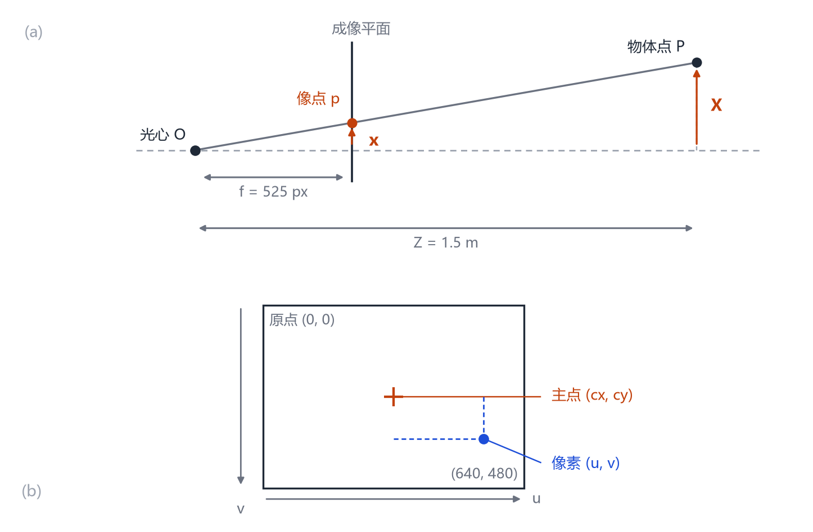
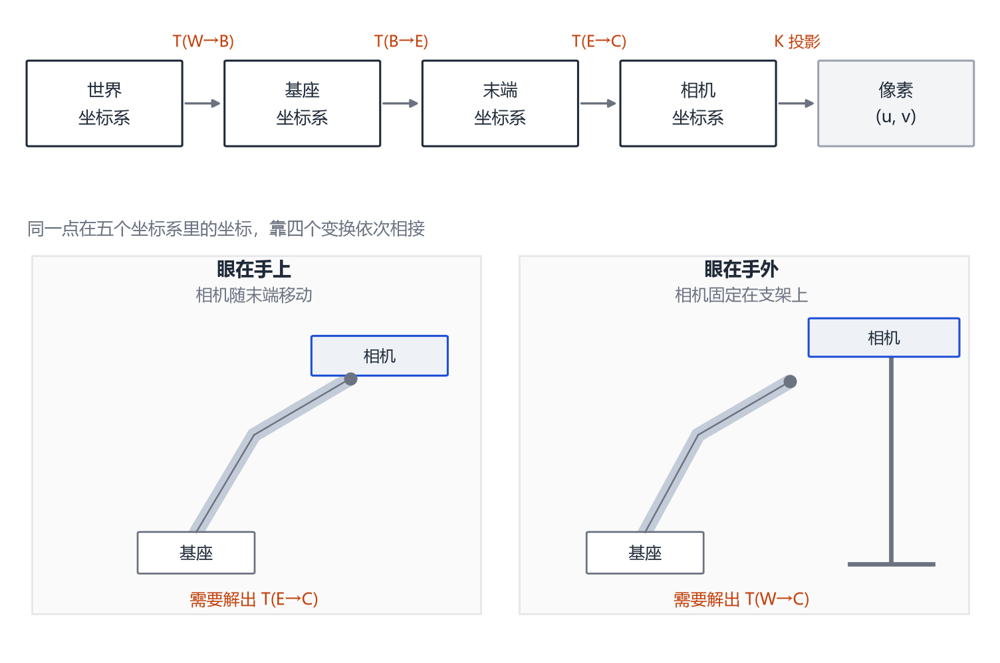
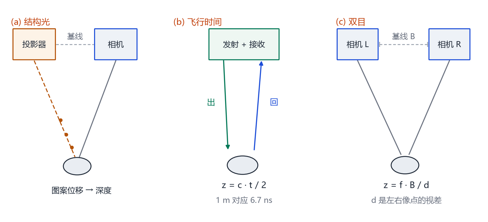
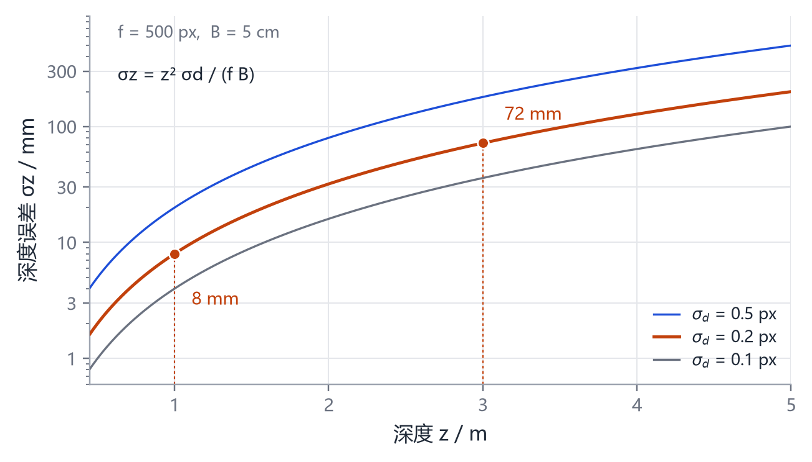

# 第 4 章　从像素到三维点

> **本章导读**：相机交给你的是一张 640×480 的整数数组，机械臂要的是以米为单位的三维坐标。这一章补上这段换算。四个内参如何把一个像素固定成一条射线，外参如何把这条射线搬进世界坐标系，深度值从哪里来、误差随距离怎样增长，以及一堆三维点如何组织成能用的表示。读完你能对着一个深度读数判断，它在这个距离上到底值不值这个精度。

## 4.1 一个像素是一条射线

一张 640×480 的彩色图，本质是 307200 个三元组。检测模型告诉你苹果的中心在 (412, 268)，这个坐标唯一的物理含义是"第 268 行、第 412 列那个感光单元接收到的光强比较像苹果"。它对距离一无所知。把苹果从 1 米处挪到 2 米处，只要视角选得巧，像素坐标可以几乎不变。

所以像素坐标不是位置，是方向，图像上每个点对应空间中的一条射线，射线上每一点都投影到同一个像素。要把这条射线变成确定的点，还得知道沿射线走了多远，那是 4.3 节的事。

最原始的成像模型是一个暗箱，盒子上扎一个小孔，光线穿过小孔在背面成像。因为光走直线，物体上每个点只有一条光线能穿过小孔，所以像面上的每个位置唯一对应一个方向。这种"一个点一条光线"的性质就是针孔模型（pinhole model）的全部内容。真实的小孔成像上下颠倒，数学上习惯把像平面搬到小孔前面，得到正立的虚拟像平面，公式完全不变。图 4-1(a) 画的就是这个搬过来的版本。

设物体上一点到光轴的距离为 $X$，到小孔的距离（深度）为 $Z$，像平面上对应点到光轴的距离为 $x$，焦距为 $f$。两三角形相似，于是

$$ \frac{x}{f} = \frac{X}{Z}, \qquad x = f\frac{X}{Z} $$

$x$ 和 $f$ 的单位是毫米，$X$ 和 $Z$ 也是毫米，量纲一致。这一步只说了"像有多高"，还没说到像素。

代一组数字走一遍。一个直径 20 厘米的苹果放在 2 米外，焦距取 1.575 毫米，像面上它的直径是 $200 \times 1.575 / 2000 \approx 0.1575$ 毫米。感光单元宽 3 微米，所以这 0.1575 毫米落在 $0.1575/0.003 = 52.5$ 个像素上。一个苹果在 640 宽的图里只占 52 个像素。

感光元件把像平面切成一个个方格，每个方格有物理尺寸，常见值是 2 到 4 微米。同时，像素坐标的原点在图像左上角，不在光轴穿过像平面的那个点。把这两件事处理掉，得到工程上在用的式子

$$ u = f_x\frac{X}{Z} + c_x, \qquad v = f_y\frac{Y}{Z} + c_y $$

这里 $u$ 是列号（向右增大），$v$ 是行号（向下增大），$f_x = f / w_p$，$w_p$ 是单个感光单元的宽度，所以 $f_x$ 的单位是像素。$c_x$ 与 $c_y$ 叫主点（principal point），是光轴与像平面的交点落在第几列第几行。四个量 $f_x, f_y, c_x, c_y$ 合起来叫内参（intrinsic parameters），写成矩阵就是常说的 $K$。

把四个数排进矩阵，写法是

$$ K = \begin{bmatrix} f_x & 0 & c_x \\ 0 & f_y & c_y \\ 0 & 0 & 1 \end{bmatrix} $$

前两行负责把米换算成像素并搬动原点，第三行只是把二维坐标补成齐次形式。

$f_x$ 与 $f_y$ 经常被写成同一个数，理由是多数相机的感光单元是正方形，两个方向的密度一样。工业相机为了凑某个分辨率，会把相邻两个像素合成一个读出，这时水平方向的有效像素尺寸变成两倍，两个 $f$ 就差一倍。标定表里把它俩当成相等，画面会被算成轻微拉伸。

取一组具体数字。一台 640×480 的相机，$f_x = f_y = 525$ 像素，$c_x = 320$，$c_y = 240$。如果感光单元宽 3 微米，那么物理焦距是 $525 \times 0.003 = 1.575$ 毫米，配上这么小的传感器，属于广角镜头。对角线视场角可以算出来，水平方向是 $2\arctan(320/525) \approx 62.7^\circ$，垂直方向约 $49^\circ$。

$c_x = 320$ 恰好是宽度的一半，这只在理想装配下成立。实际相机的主点会偏几个到几十像素，因为镜头组和传感器不可能对得那么准。假设真实主点在 340 而标定表里写的是 320，那么每个像素算出来的横向位置都会系统偏 20 个像素；在 1.5 米处一个像素约 2.9 毫米，20 个像素就是 58 毫米，抓取时手会稳定地偏出瓶子半个身位。

回到那个最有用的换算。由上式反解，$X = (u - c_x)Z / f_x$。取 $Z = 1.5$ 米、$f_x = 525$，一个像素对应的横向长度（单位米）是

$$ \frac{Z}{f_x} = \frac{1.5}{525} \approx 0.00286 $$

也就是说，在这台相机 1.5 米处的画面里，检测框中心错一个像素，空间里就错 2.9 毫米。距离翻倍到 3 米，同一个像素变成 5.7 毫米。这个 $Z/f_x$ 是后面所有精度讨论的标尺。

把 $u, v$ 归一化一下，会得到另一个常用的量。定义 $x_n = (u - c_x)/f_x$，$y_n = (v - c_y)/f_y$，那么 $x_n = X/Z$，$y_n = Y/Z$。这两个数只和方向有关，和深度无关，叫归一化坐标。它的好处是换了分辨率、换了裁切范围，同一个方向的归一化坐标基本不变。

拿开头那个苹果算一遍。$u = 412$、$v = 268$、$f_x = f_y = 525$、$c_x = 320$、$c_y = 240$，代入得 $x_n = 92/525 \approx 0.175$、$y_n = 28/525 \approx 0.053$。这两个数可以当方向读，它们在水平方向上偏出光轴 $\arctan(0.175) \approx 9.9^\circ$，在竖直方向上偏下 $\arctan(0.053) \approx 3.0^\circ$。整条射线就由这两个角定下来，走多远才决定点在哪。

归一化坐标的稳定性有个前提，内参必须跟着分辨率一起改。把 1280×960 的图缩到 640×480，却忘了把 $f_x$ 和 $c_x$ 除以 2，算出来的坐标会整体大一倍，所有点云被推到两倍远的地方。

<figure class="fig">

<figcaption><b>图 4-1</b>　针孔模型的侧视几何与像素平面的坐标约定。相似三角形给出像高与深度的反比关系，主点偏移决定像素原点。</figcaption>
</figure>

真实镜头不是无限薄的小孔，光线在镜片边缘折射得比中心厉害，于是像点会沿着从图像中心向外的方向被推开或拉回。这叫径向畸变（radial distortion），写成

$$ x_d = x(1 + k_1 r^2 + k_2 r^4 + k_3 r^6) $$

$r$ 是归一化半径，$k_1$ 为负时画面向外鼓，叫桶形畸变，广角镜头常见；$k_1$ 为正时画面向内收，叫枕形畸变。还有一个来源是镜头与传感器不平行，像平面被轻微倾斜，产生切向畸变（tangential distortion），由两个系数 $p_1, p_2$ 描述。直观的检验办法是拍一面贴满直线的墙，看直线在画面边缘有没有弯成弧。一支 60 度视场的镜头，角落里弯十几到几十个像素很常见。

代一组数看看弯多少。取 $k_1 = -0.28$、$k_2 = 0.07$，画面角上归一化半径 $r = 0.8$，括号里的因子是 $1 - 0.28 \times 0.64 + 0.07 \times 0.41 \approx 0.849$。原来是 0.8 的位置被拉到 0.679，差 0.12 个归一化单位，乘 525 就是 63 个像素。角上的点被拉近中心 63 个像素，直线在画面中部就显得向外鼓出来，这就是广角镜头的桶形畸变。

去畸变是把这个式子反解。这个六次方程没有简洁的解析解，工程上迭代三五次就够，先用 $x \approx x_d$ 当初始值，代进右边算出一个 $x_d'$，按差值修正 $x$，重复到差值小于 0.01 个像素。

不做这一步的后果很具体。用一个有桶形畸变的相机直接反投影，一面直墙会算成一个碗，1 米处墙面边缘朝相机方向翘起几厘米。抓放在桌角的东西时，这个翘起正好落在误差最大的位置。

这些系数和 $K$ 一起，通过标定得到。做法是拿一块方格尺寸已知的棋盘格，从十几个不同角度拍它，让算法同时优化内参、畸变系数和每张图的位姿，使重投影误差最小。合格的标准大致是平均重投影误差 0.1 到 0.5 个像素。小于 0.1 通常说明标定板的图案不够平或者优化过拟合了，大于 1 个像素基本可以重来。

## 4.2 相机站在哪里

内参解决了方向，还差两样东西，相机在世界里的位姿，以及沿射线的距离。距离留到下一节，这里说位姿。

相机坐标系通常取光心为原点，$Z$ 轴沿光轴指向被拍摄的一侧，$X$ 轴向右，$Y$ 轴向下，这样和像素坐标的 $(u, v)$ 方向一致，写代码时少一次翻符号。物体在世界坐标系里的坐标记作 $p_w$，在相机坐标系里记作 $p_c$，两者差一个旋转加一个平移

$$ p_c = R\,p_w + t $$

$R$ 是 3×3 的旋转矩阵，$t$ 是三维平移。工程上更愿意把这两件事打包成一个 4×4 的齐次变换矩阵，右下角补 1，这样"先转再移"就变成一次矩阵乘法，多个坐标系串联时直接连乘。第 2 章用这套写法描述机械臂，相机用的是同一套。

从世界坐标到一个像素，中间要过四道变换，图 4-2 把它们排成一条链。世界到基座是安装位置，一旦机器人固定就不变了。基座到末端是正运动学，由六个关节角算出来，随手臂运动而变。末端到相机是相机装在法兰盘上的相对位姿，焊死之后也不变。末端那一步是投影，用内参 $K$ 把相机坐标压成像素。链条上任何一环错了，投到图上的位置都会偏，而偏差的来源完全不同，这是排查定位问题时必须分清的地方。

<figure class="fig">

<figcaption><b>图 4-2</b>　从世界坐标到像素坐标的四道变换，以及相机装在手臂末端与装在独立支架上这两种安装方式。</figcaption>
</figure>

链条里最麻烦的一环是末端到相机。相机光心藏在镜头组内部，法兰盘上也没有刻线，你没法用卡尺量出这个相对位姿。而它又必须很准，因为相机给出的所有测量都要经过它才能落到机械臂坐标系里。解决这个问题的过程叫手眼标定（hand-eye calibration）。

思路并不复杂，关键是找一种"同一个东西被两套坐标同时描述"的局面。拿一块方格尺寸已知的标定板固定在桌上，让机械臂带着相机从十几个不同位姿去看它。每个位姿下，标定板在相机坐标系里的位姿可以由图像算出来，末端在基座坐标系里的位姿可以由关节角算出来。同一个板子、同一个相机，两种描述必须自洽，这组自洽条件就足以解出那个未知的固定变换。数学上它常被写成 $AX = XB$ 的形式，$X$ 是要求的相机到末端的位姿。

$A$ 是末端在两次停位之间的相对位姿。机械臂走到位姿 1 和位姿 2，关节角都已知，正运动学给出两个 4×4 矩阵，把它们相除得到 $A = T_1^{-1}T_2$。它只和关节角有关，和相机无关。

$B$ 是标定板在相机坐标系里的相对位姿，由两张图各自解出的板位姿相除得到，$B = C_1^{-1}C_2$。它只和图像有关。

$X$ 就是相机在末端坐标系里的固定位姿，一个 4×4 矩阵，六个自由度。

$AX = XB$ 的意思是，先在末端坐标系里走一步 $A$，再用 $X$ 翻译到相机坐标系；或者先在相机坐标系里走一步 $B$，再用 $X$ 翻译回末端。两条路径描述的是同一次物理运动，所以必须相等。

求解要拆开。旋转部分满足 $R_A R_X = R_X R_B$，它是关于 $R_X$ 的线性方程，一对位姿给三个约束。平移部分满足 $(R_A - I)t_X = R_X t_B - t_A$，在 $R_X$ 已知之后它是关于 $t_X$ 的线性方程，又给三个约束。

约束的数量账很好算。采 12 个位姿，两两组合有 $12 \times 11/2 = 66$ 对，共 396 个约束，未知数只有 6 个，属于严重超定，用最小二乘求一个折中解。位姿的分布比数量更重要，如果 12 个位姿都绕同一个轴转，平移方程里沿着轴的分量被消掉，$t_X$ 就解不出来。合格的采集要让相机在三个方向上都翻转过 30 度以上。

失败的样子很好认。标定过程中板子被碰了一下，哪怕只挪了 2 毫米，$B$ 里就混进了不属于运动的偏移，解出的 $X$ 会带着系统性偏差。检验办法是留出几组位姿不参与求解，用它们算重投影误差，误差突然变大就说明采集中途出了问题。

相机装在手臂末端，叫眼在手上（eye-in-hand）。好处是视野跟着手走，靠近目标时物体在画面里更大、更清楚，精细操作基本都用这种装法。代价是手一动视野就动，正在跟踪的物体可能突然出画；移动过程中相机也在抖，图像模糊。

相机固定在水管或者铝型材架子上，叫眼在手外（eye-to-hand）。此时要求的是相机在世界（或基座）坐标系里的位姿，相机不在运动链里，标定一次管很久。视野稳定，适合盯着整个工作台、跟踪多个物体。代价是遮挡，机械臂伸过去的时候会挡住自己要看的地方，而且距离一远，同样的像素误差换算成毫米就变大。

常见的残差是 1 到 2 毫米的位置误差、0.3 到 0.5 度的角度误差。0.5 度听起来很小，但在 1 米外，$\tan(0.5^\circ) \times 1000 \approx 8.7$ 毫米，已经超过很多抓取任务的容差。所以机械臂被撞过、镜头换过、或者环境温度变化很大之后，重投影误差会明显变大，得重新标一次。位置误差和角度误差的来源不同，前者主要来自关节角读数和连杆长度标定，后者主要来自 $X$ 的旋转没解准。

## 4.3 深度从哪里来

有了方向和位姿，还差一个数，沿射线走多远。图像本身不包含它，三维压成二维时深度被丢掉了。想拿回来只有两条路，要么主动往场景里打光并测量回应，要么用统计规律从图像里猜。

结构光（structured light）走的是第一条路。投影器把一幅已知图案打到物体表面，相机在旁边看这幅图案变形了多少。图案可以是一条条正弦条纹，也可以是红外散斑，后者是早期 Kinect 的做法。变形量对应着表面在哪个深度上，几何上仍然是一次三角测量，投影器和相机之间的连线叫基线，通常几厘米。这种做法在 1 米处能到几毫米的精度，代价是怕强光、怕镜面、怕透明物体，具体的失效表现见表 4-1。有效距离一般在 0.3 到 4 米。

飞行时间（Time of Flight，ToF）是另一种主动方式。相机发出一束调制过的光，测它从发射到返回的时间。光速是 $3 \times 10^8$ 米每秒，往返 2 米用 6.7 纳秒。要分辨 1 毫米的深度差，时间测量精度得达到 6.7 皮秒，直接计时做不到，工程上改成测连续调制光的相位差，再用多个调制频率解开周期性带来的模糊。ToF 的每个像素独立测距，不依赖物体表面有没有纹理，这一点比结构光强。它的麻烦在角落，光会在两面墙之间来回反弹几次才回来，读出的深度比实际更远，这类错误叫多路径干扰。

双目（stereo）是被动方式里最接近人眼的一种。左右两个相机水平分开一段距离，同一个物体在左右图里的横坐标不同，这个差值叫视差（disparity）。距离越近视差越大，两者成反比，三种方式的几何关系见图 4-3。

<figure class="fig">

<figcaption><b>图 4-3</b>　三种主动或半主动测深方式的几何。结构光看图案位移，ToF 看往返时间，双目看左右视差，三者本质上都是三角测量或它的变体。</figcaption>
</figure>

$$ d = \frac{f B}{z}, \qquad z = \frac{f B}{d} $$

$B$ 是基线，$f$ 是像素焦距。取 $f = 500$、$B = 0.05$ 米，1 米处的视差是 25 个像素，3 米处只剩 8.3 个像素，5 米处 5 个像素。视差越小，一个像素的测量误差对深度的影响越大。

$$ \sigma_z = \frac{z^2}{f B}\,\sigma_d $$

$z$ 是物体到相机的距离，单位米。$f$ 是像素焦距，单位像素。$B$ 是左右两个光心之间的距离，叫基线，单位米。$\sigma_d$ 是视差匹配的误差，单位像素。$\sigma_z$ 是算出来的深度误差，单位米。

推导只有一步。对 $z = fB/d$ 求导得 $\mathrm{d}z/\mathrm{d}d = -fB/d^2$，再把 $d = fB/z$ 代进去，得到 $fB/d^2 = z^2/(fB)$。取绝对值就是误差的放大倍数。

误差随距离的平方增长。仍然取 $f = 500$、$B = 0.05$ 米，设视差匹配能做到 0.2 个像素的精度，那么 1 米处的深度误差是 $1^2 \times 0.2 / 25 = 8$ 毫米，3 米处变成 $9 \times 0.2 / 25 = 72$ 毫米，5 米处是 200 毫米。图 4-4 把这条曲线按三种视差精度画了出来，纵轴取了对数，因为误差跨了两个数量级。

换成相对误差更好记，1 米处是 0.8%，3 米处是 2.4%，5 米处是 4%。

<figure class="fig">

<figcaption><b>图 4-4</b>　双目深度误差随距离的变化，按误差公式计算，参数取焦距 500 像素、基线 5 厘米，曲线来自公式而非某台设备的实测。</figcaption>
</figure>

想做 5 米量级的测距，基线 5 厘米远远不够，工业界会用 30 厘米甚至更长的基线，或者干脆换成激光雷达。反过来，在 0.5 米的工作距离上，5 厘米基线配上 0.2 像素的匹配精度，误差只有 2 毫米，足够抓住一个杯子。基线的长度和测量范围是直接绑定的，没有一种配置能同时覆盖桌面和走廊。

双目还有一类失败不明显但很致命。白墙、纯色桌面、无纹理的纸箱，左右图里找不到可匹配的点，视差算不出来，深度图上是一片空洞。重复纹理会骗过匹配算法，同样图案的瓷砖把左边第 3 块对到右边第 4 块上，视差算错 1 个周期，深度跳到错误的值，两者的共同点是可匹配的信息不够用。

单目深度估计绕开了硬件。既然人能用一只眼睛大致判断远近，神经网络也能从单张图里回归出深度。Depth Anything（2024）是这条路线上的代表性工作，它用 150 万张有标注图像训练出一个初步模型，再用这个模型给 6200 万张无标注图像自动打标签，把训练数据的覆盖面撑起来。它输出的是相对深度，也就是只知道谁比谁近，不知道具体几米；如果要米制结果，得在 NYUv2 或 KITTI 这类带真实深度的数据集上再微调一次。

单目方法的优点是任何一张 RGB 图都能用，网络视频、手机照片、网上抓的图片都可以。缺点是尺度的可靠性，同一个物体在不同场景里被预测出的绝对深度可能差 20%，遇到训练分布外的场景（极暗、极亮、显微、水下）会明显退化。它对细结构的处理也不好，桌沿、线缆、细杆的深度边界往往糊成一片。

**表 4-1**　四种深度获取方式对比。误差列为公开资料中的典型量级，随距离、材质与环境变化很大。

| 方式 | 原理 | 1 米处误差量级 | 有效距离 | 主要失效场景 |
|---|---|---|---|---|
| 结构光 | 投射已知图案，三角测量图案位移 | 2-10 mm | 0.3-4 m | 强日光、镜面、透明物体 |
| ToF | 调制光往返，测相位差 | 10-30 mm | 0.3-5 m | 多路径、反光、阳光直射 |
| 双目 | 左右视差，$z = fB/d$ | 5-20 mm，随 $z^2$ 恶化 | 0.3-10 m | 白墙、重复纹理、弱光 |
| 单目估计 | 网络从单图回归深度 | 相对深度，米制误差 5%-10% | 不限 | 尺度漂移、细结构、域外场景 |

选型的判断标准通常是任务容差而不是精度数字。抓一个直径 6 厘米的瓶子，横向容差有 1 厘米，1 米处 1 厘米的深度误差可以接受。做插孔，间隙可能只有 0.5 毫米，那就必须把相机放到 30 厘米以内，或者换成带力反馈的接触式对齐。同一个深度相机，在桌面上够用，在 3 米外就差得离谱，这不是相机坏了，是几何决定的。

## 4.4 点云和它的毛病

有了深度图，把每个像素按 4.1 节的式子反算回去，就得到一堆三维点

$$ X = \frac{(u - c_x)Z}{f_x}, \quad Y = \frac{(v - c_y)Z}{f_y}, \quad Z = Z(u, v) $$

一张 640×480 的深度图反投影出 307200 个点，这就是一帧点云。如果彩色图和深度图已经对齐，每个点还能带上 RGB 值，这样的数据叫 RGB-D。

公式逐个符号读。$u, v$ 是像素的行列号，整数。$Z(u,v)$ 是这个像素上测到的深度，单位米，来自深度相机或者双目匹配。四个内参的含义见 4.1 节。算出来的 $X, Y, Z$ 就是点在相机坐标系里的坐标。

代一组数。像素 (412, 268) 的深度是 1.5 米，内参还是 525 和 (320, 240)，于是 $X = (412-320)\times 1.5/525 = 138/525 \approx 0.263$ 米，$Y = (268-240)\times 1.5/525 = 42/525 \approx 0.080$ 米。$Y$ 轴向下，所以正的 0.08 表示这个点在光轴下方 8 厘米。整个点的坐标是 (0.263, 0.080, 1.500)。

每点三个单精度浮点数占 12 字节，一帧就是 $307200 \times 12 \approx 3.7$ 兆字节，而其中大部分点属于台面和背景。

点云有两种存法。有序点云保留原来的图像网格，每个点都能按行列索引，好处是找邻居只要常数时间，做滤波和法向估计很快，坏处是深度缺失的地方要留空位。无序点云只存 $N \times 3$ 的坐标列表，灵活但丢了邻接关系，得靠 KD 树之类的东西重建。

原始点云通常太重。一个房间的扫描动辄几十万到几百万点，而抓取规划只关心物体表面。最常见的一步是体素下采样，把空间切成边长 5 毫米的小立方体，每个立方体里所有点用它们的重心代替。几十万点通常能压到几万，形状基本保住，后续的邻域搜索快一个数量级。

边长这个参数要按任务选，不是越小越好。5 毫米的格子能保住 1 厘米以上的凸起，抓一个直径 6 厘米的瓶子够用。做 0.5 毫米间隙的插孔时，5 毫米的格子会把孔口抹圆，得降到 1 到 2 毫米。代价是点数按边长的三次方反比增长，边长从 5 毫米降到 2 毫米，同一块表面上的点数变成 $(5/2)^3 \approx 16$ 倍，从 3 万点涨到 48 万点。

实现上不是真去开一个三维数组。房间那么大的空间按 5 毫米切，格子数在 $1000 \times 800 \times 600$ 这个量级，开数组要几十吉字节。常用做法是把整数格坐标拼成一个 64 位整数当键，塞进哈希表，同一个键的点累加坐标再取平均。

失败场景是薄结构被吃掉。一张 2 毫米厚的纸、一根 3 毫米的线缆，它们的点很可能落在同一个体素里，重心一平均就退化成一个点。抓细长物体时，要么换更小的体素，要么改成按法向保留极值的做法。

法向估计是另一个必做步骤。点云本身没有"面"的概念，要知道哪里是平面、哪里是曲面，得给每个点估一个法向。做法是取最近的 20 到 30 个邻居，做一次主成分分析，最小特征值对应的方向就是法向。

把这句话写成式子。取点 $p$ 的 $k$ 个邻居，先算它们的重心 $\bar p$，再算 3×3 的协方差矩阵 $C = \frac{1}{k}\sum_{i=1}^{k}(p_i - \bar p)(p_i - \bar p)^{\mathsf T}$。$p_i$ 是第 $i$ 个邻居的坐标。对 $C$ 做特征分解，得到三个特征值 $\lambda_0 \le \lambda_1 \le \lambda_2$。点云在某个方向上铺得越开，对应的特征值越大，最小的那个方向就是法向。

代一组数。5 毫米体素下采样的一个平面上，邻居取 25 个，落在一块 2 厘米见方的区域，特征值大约是 (0.02, 4.0, 4.0) 平方毫米。比值 $\lambda_0/(\lambda_0+\lambda_1+\lambda_2) \approx 0.003$，很平。同一个点如果落在桌沿，特征值变成 (0.3, 4.0, 4.1)，比值升到 0.036，说明这里有折角。三个特征值都差不多大时，这块点是一团各向同性的噪声，估出的法向没有意义。

结果里还有一层麻烦，法向有两个方向，$n$ 和 $-n$ 都满足最薄。必须人为定一个朝外的规则，最常用的做法是让法向朝相机，也就是保证 $n \cdot (p_{\text{cam}} - p) \gt 0$。规则翻错时，抓取位姿会算出朝里的姿态，夹爪直接撞上去。

这个估计对噪声很敏感，所以前面通常还要做一次离群点剔除，把"到最近 $k$ 个邻居的平均距离超过全局均值加两倍标准差"的点扔掉。参数就是两个，$k$ 取 20，倍数取 2 到 3。若全局均值是 8 毫米、标准差是 1.5 毫米，阈值就是 11 毫米，通常剔掉 1% 到 3% 的点。收紧到一倍标准差会剔掉一成半，风险是把薄片边缘当成噪声；放宽到三倍标准差只剩千分之三，但飞点也留下了。

这类点大多来自深度图边缘的混合像素。一个感光单元同时盖住了前景的桌沿和背景的墙，深度相机在这个位置给出两者之间的一个数，点就出现在半空中，连成一片像纱帘一样的薄层。这些点如果进了配准或者抓取规划，机械臂会在空中某个位置莫名其妙地停住。

30 万点的 KD 树建树约 0.3 秒，查询 25 个邻居加特征分解约 2 秒，这是单线程的数字。要实时就只能先降到 3 万点，或者把法向预计算好写进缓存。

点云不能像图像那样直接喂给卷积网络。卷积核假设输入是排在同一张网格上的，邻居关系固定，而点云是一个集合，点的顺序可以任意打乱，同一个场景可能有 30 万个点也可能有 25 万个，密度还不均匀。PointNet（2017）给出的解法是用共享的多层感知机把每个点单独编码，再用一个对称的池化操作（逐维取最大值）把集合压成一个向量，对称性保证了输入顺序不影响输出。另一条路是体素化，把点云栅格化成三维数组再做 3D 卷积，代价是内存随分辨率三次方增长，一个 512³ 的体素网格就有 1.3 亿个格子。

还有一个常被忽略的问题是彩色图与深度图的配准。深度相机通常有两套镜头，一个拍彩色一个测深度，光心不重合，基线几厘米。厂商提供的对齐功能是用两套内参和外参把深度图重投影到彩色视角，如果对齐参数不准，颜色会整体偏移几个像素，在近处看着没问题，在物体边缘就会把背景的颜色贴到前景上。做精细的位姿估计时，这类误差会直接变成特征点的错误关联。

## 4.5 一边走一边建图

单个视角的点云只覆盖眼前一小块。机器人要完成任务，得知道"我刚才在哪儿""那个柜子在房间的哪个位置"，这就需要在移动过程中不断估计自己的位姿并把观测拼起来。这套技术叫同时定位与建图（Simultaneous Localization and Mapping，SLAM）。

SLAM 的结构通常分三块。前端管这一瞬间相机动了多少，后端管这些局部答案放在一起是否矛盾，回环管误差攒到认不出自己在哪时怎么办。

前端负责从相邻两帧图像里估计相对运动，它假设画面里的东西大部分没动，靠同一批特征点在两帧里的位移反推相机怎么动。特征点的做法是提取角点（ORB 是最常用的一种），在帧间做匹配，然后用几何约束解出位姿。直接法跳过特征提取，直接比较像素亮度，在纹理弱的场景里更稳，但对光照变化敏感。学习式的做法用神经网络预测光流，DROID-SLAM（2021）就是这一类。

前端的预算很紧。相机 30 帧每秒，每帧只有 33 毫秒，从 640×480 的灰度图里提 1000 个 ORB 特征点要 8 到 15 毫秒，剩下的必须留给后端和别的任务。

前端最典型的失败是跟丢。相机快速转 180 度，两帧之间重叠区域不到 20%，能匹配上的特征点少于 30 个，位姿就解不出来。系统必须能做重定位，拿当前帧去和地图里的旧帧做匹配，否则整条轨迹断掉，后面全白算。

后端负责把前端积累的相对运动放到一张全局图里优化。每两帧之间都有一个相对位姿的估计，每个估计都有误差，把所有位姿和地图点放在一起最小化重投影误差，叫光束法平差（Bundle Adjustment）。它要做的是把矛盾摊平，前端给的 1000 个相对位姿首尾相连回到起点时，累积误差让终点对不上起点。

全量优化太贵，工程上都用关键帧，只保留那些视角变化足够大的帧。常用的判据是平均视差超过 20 个像素，或者跟踪到的内点少于 100 个。局部平差一次只拿 10 个关键帧和几千个地图点，耗时 50 到 100 毫秒，放在另一个线程里慢慢做。

后端的失败是规模失控。关键帧攒到几千个之后，一次全量平差的矩阵能到几百兆，跑一次要几十分钟，实时性彻底丢掉。办法是边缘化，把旧帧的信息压成一个先验项塞回优化里，代价是丢掉一部分可重建的信息。

回环检测解决的是累积漂移。前端每帧都有一点误差，走得越远偏得越多，如果相机转回起点，画面和最初的帧高度相似，系统就能认出"我来过这里"，在图上加一条约束把整条轨迹拉回去。没有回环，长走廊里跑十分钟，地图就会弯成香蕉。

漂移的比例可以估。单目系统的经验值是行程的 1% 左右，走 20 米偏 20 厘米。双目和 RGB-D 好一些，在 0.5% 到 1% 之间。一次成功的回环加上图优化，能把 20 厘米的偏差拉回到 3 到 5 厘米。

回环最危险的失败是误检。办公楼里每层走廊长得一样，特征匹配可能对到另一层的帧上，约束一加，整张地图被拧成麻花，而且很难看出来出了错。防护办法是要求匹配的内点数超过阈值，再用里程计估计的相对位置做一致性检查，两边对不上就不加这条约束。

ORB-SLAM2（2017）支持单目、双目和 RGB-D 三种输入，在普通 CPU 上实时运行，跟踪、局部建图、回环三个线程各管一段，是过去几年机器人上最常见的基线系统。DROID-SLAM（2021）走的是稠密学习路线，需要 GPU，在 TUM-RGBD 数据集上的轨迹误差比 ORB-SLAM3 低 83%（只在两者都不失败的序列上统计），在 ETH-3D 的 32 个序列里成功跟踪 30 个，而此前最好的方法只成功 19 个。

尺度是这里最容易被忽略的坑。单目 SLAM 从图像里只能恢复出"相对"的几何，整个地图可以放大两倍而所有投影关系依然成立，所以它的轨迹没有米制单位，跑出来的 1.0 可能是 1 米也可能是 3 米。双目靠基线、RGB-D 靠深度读数，都能把尺度钉死，抓取需要的正是真实的米。

尺度的误差也要用数字看。双目把基线 $B$ 当作尺子，基线标错 1%，量出的 10 米距离就错 10 厘米。RGB-D 把深度读数当尺子，1 米处 5 毫米的深度误差就是 0.5% 的尺度误差，走到 10 米外变成 5 厘米。这些数字比轨迹的形状更关键，因为抓取用的是绝对位置，不是相对轨迹。

## 4.6 重建的三代做法

把多视角的观测拼成一个完整的三维模型，这条线上有过三次明显的技术更替，每一代解决的问题不同。

第一代是运动恢复结构（Structure from Motion，SfM）。给一组从不同角度拍的图片，先匹配特征点，再用三角测量算出这些点的三维位置，同时优化每张图的相机位姿。COLMAP 是这套流程里最常用的开源实现，输入几十到几百张图，输出稀疏点云和相机轨迹。它做得很准，但是离线的，采完数据才能开始算。稀疏点云不够用，要得到稠密表面还得再跑一遍多视图立体匹配（MVS）。

把时间拆开算。100 张 1200 万像素的照片，8 核 CPU，特征提取和匹配要 3 到 8 分钟，增量式重建再要 5 到 20 分钟，输出的稀疏点云是 5 万到 20 万个点。要稠密表面，就用同一批图在 GPU 上跑 20 分钟到 2 小时，输出几百万点。半天时间是很正常的预算。

它最常见的失败是注册不上。白墙、重复纹理的地毯、大面积反光地板，这三种场景里特征匹配会错成一团，一部分图被拒绝注册，重建断成几块，后面得手工指定初始对。单目 SfM 还有尺度不确定的问题，整个模型可以任意缩放，必须在场景里放一个尺寸已知的标记才能得到米。

第二代是神经辐射场（Neural Radiance Field，NeRF，2020）。它不存点也不存面，而是用一个多层感知机记住"空间中任意一点在某个观察方向上看是什么颜色、有多不透"。渲染时沿每条光线采样上百个点，把这些点的颜色按不透明度积分起来，得到这个像素的颜色。因为整个渲染过程可微，可以用输入照片的像素误差直接反传去训练网络。效果惊人，反射、透明、细密的枝叶都能重建。代价是训练慢，原论文在单张 V100 上跑 10 万到 30 万次迭代，耗时一到两天，渲染一帧要几秒。

第三代是三维高斯泼溅（3D Gaussian Splatting，3DGS，2023）。它把场景表示成一堆带方向的三维高斯椭球，每个椭球有位置、尺度、朝向、颜色和不透明度，渲染时把它们投影到图像平面并按深度排序混合。因为表示是显式的，渲染可以写成高效的光栅化，1080p 分辨率下能做到每秒 30 帧以上，训练时间也从一两天压到几十分钟。质量与 NeRF 相当，速度快了两个数量级，这也是它迅速成为主流的原因。

三代方法都能产出好看的新视角渲染，但机器人要的是另外三件事，实时（建图不能停几十秒）、增量（新来的帧要能马上并进去，而不是重跑全量）、尺度正确（模型里的 1 米必须真是 1 米）。NeRF 和 3DGS 主要面向离线重建，增量更新和尺度约束都在研究中；SfM 天生离线。所以真正在机器人上跑的稠密几何，仍然是截断符号距离场、占据栅格这一类老办法，它们不好看，但每一步都能增量更新，查询一个点的占据状态只要常数时间。

三代方法的成本差别见表 4-2。

**表 4-2**　三代重建方法的成本对比。训练时长为中等场景（100 到 300 张图）的量级，渲染速度按 1080p 估计，显存按单卡训练峰值估计。

| 方法 | 表示形式 | 训练时长 | 渲染速度 | 训练显存 | 能否增量 |
|---|---|---|---|---|---|
| SfM 加 MVS | 点云与网格 | 0.5-2 小时 | 无新视角渲染 | 8-16 GB | 否 |
| NeRF | 多层感知机 | 1-2 天 | 1-5 秒一帧 | 10-20 GB | 否 |
| 3DGS | 三维高斯椭球 | 30-60 分钟 | 30-100 帧每秒 | 10-20 GB | 部分支持 |

3DGS 的显存几乎全花在参数上，一个高斯存位置、尺度、旋转四元数、不透明度和颜色，加上三阶球谐系数，合计约 60 个浮点数，也就是 240 字节。300 万个高斯就是 720 兆字节，加上优化时的梯度和两个动量项，实际占用是它的四倍左右。NeRF 正好相反，网络本身只有几兆参数，显存堆在每次迭代的光线批量上。

失败的样子也不同。NeRF 在无纹理的白墙、天空上几乎拿不到梯度，深度靠别的视角猜，结果是雾状的一团，看不出面在哪。3DGS 在大场景上会爆显存，一个仓库扫下来高斯数量能到几千万；镜面和透明面片上，高斯会堆成多层薄片，换视角看出现拉丝；只拍了几个视角时，没被观测到的方向上会长出羽毛状的伪影。

还有一个更根本的落差。上面所有方法输出的都是几何，而机器人接下来要回答的问题是"这是什么物体""该抓哪里""能不能放进去"。几何告诉你这里有一块 12 厘米高的凸起，语义告诉你是杯子，可供性告诉你把手在右侧。从点云到物体，是第 5 章要做的事。
