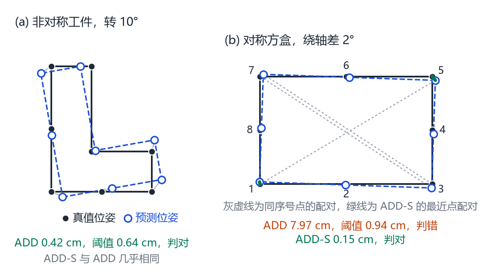
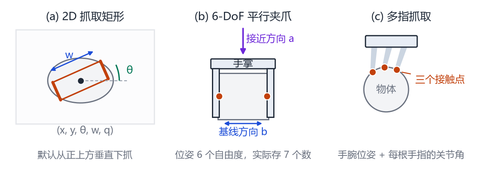
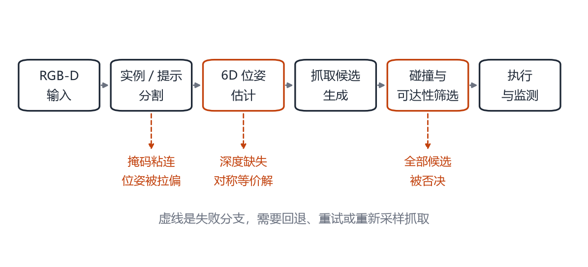

# 第 5 章　物体的位置与抓取

> **本章导读**：上一章把像素还原成了三维点，点云里却还是一堆没有归属的坐标。这一章补上"这堆点属于哪个物体、它朝哪个方向、该从哪一面下手"这三步。位姿是核心，六个数字，但在对称物体上会退化成一族解。抓取则是在位姿之上再加一层力学判断。读完这一章，你能判断一段抓取演示卡在分割、位姿还是夹持上。

## 5.1 先把物体切出来

这一节回答一个问题。一张彩色图里明明看得见桌上有个杯子。后面算位姿的模块却不能直接用，非得先拿到一块只属于这个杯子的像素。

位姿估计的输入不该是整张图。桌上放着一个杯子和一个盘子，如果把两者的三维点混在一起做拟合，得到的"物体"会有杯子加盘子那么大，算出来的姿态毫无意义。流水线的第一道工序是把属于同一个物体的像素挑出来，这一步叫分割。

实例分割（instance segmentation）要的是每个物体各一张掩码（mask）。掩码是一张和原图同尺寸的二值图，1 表示这个像素属于该物体。它和语义分割的差别在"个体"这一层，语义分割把画面里所有杯子标成同一类，实例分割要把三个杯子分成三份。Mask R-CNN 是这一路的代表，它在检测框的基础上给每个候选区域补一个逐像素的分支，同时输出类别、框和掩码。一张 640×480 的图在 GPU 上几十毫秒，输出足够让后面的位姿拟合有干净的输入。

掩码的代价要先算清楚。一张 640×480 的图有 30.7 万个像素，桌上一个直径 8 厘米的杯子在 0.5 米处只占大约 8000 个，不到全图的 3%。错标 200 个背景像素，反投影之后就是 200 个悬在空中的点。位姿拟合会把这些点当成物体的一部分，算出来的中心位置于是偏出几毫米。

2023 年之后，这一环的用法变了。SAM（Segment Anything Model，2023）把分割做成"给定提示，返回掩码"，提示可以是前景点、一个框、一张粗糙掩码，甚至是文本。它在 1100 万张图上标了 10 亿个掩码，零样本迁移到没见过的图像分布上也能用。机器人系统里最常见的搭配是检测器先给一个粗框，SAM 在框内给出边缘清晰的掩码。这么做的理由很实际，框的边缘永远是矩形，既会切进物体也会带进背景，而这些错误像素反投影成三维点之后，会把位姿往错误方向拽。

SAM 2（2024）把同一套能力延伸到视频。它给模型加了流式记忆，处理当前帧时会记住前几帧里这个物体的特征，于是物体被机械臂挡住三帧再露出来，还能认出是同一个。论文给出的数字是图像分割比 SAM 快 6 倍，视频分割达到同样精度所需的交互次数少 3 倍。对机器人来说，视频版的意义比图像版更大，因为抓取是一个持续几秒的过程，中途被手挡住是常态。

还有一条线是开放词汇分割。传统分割模型的类别在训练时就定死了，遇到训练集里没有的"那个带把手的玻璃壶"就没有输出。开放词汇的做法是把 CLIP 一类的图文对齐模型接进来，用文本嵌入去筛选掩码，说"红色的马克杯"也能分出来。它的短板在空间精度，文本相似度衡量的是"像不像"，不是"边界在哪"，边缘往往要糊掉几个像素。

掩码要到三维才有用。给定像素坐标 (u, v) 和该处深度 d，内参为 f_x、f_y、c_x、c_y，相机坐标系下的点由反投影得到

$$X = \frac{(u - c_x)\,d}{f_x},\qquad Y = \frac{(v - c_y)\,d}{f_y},\qquad Z = d$$

逐项读这个式子。它算的是一条从相机光心穿过像素的射线，在深度 d 处落在哪个位置。u 是像素的列号，从左往右数，图的最左边一列记为 0。v 是行号，从上往下数。d 是这个像素的深度，单位是米，由深度相机直接给出。f_x 和 f_y 是焦距换算成像素单位之后的值，可以理解为"距离 1 米处，一个像素对应多宽"，普通 RGB-D 相机上大约 600。c_x 和 c_y 是光轴打在图像上的那一点，理想情况下就是图像正中心，640×480 的图上是 (320, 240)。

代一组数字。像素 (400, 190) 处的深度读数是 0.52 米，相机参数取 f_x = f_y = 600、光心 (320, 240)。列方向差了 400 减 320 等于 80 个像素，代入得到 X 等于 80 乘 0.52 除以 600，也就是 0.069 米。行方向差了 190 减 240 等于负 50 个像素，得到 Y 等于负 0.043 米。Z 就等于深度 0.52 米。这个点在相机前方 52 厘米、偏右 6.9 厘米、偏上 4.3 厘米的地方。

这一步把二维掩码变成一小片视锥形状的点云，它贴在物体朝向相机的那一面上，不是物体的中心。接下来三件事必须做。腐蚀掩码两三个像素，因为边缘处的深度是前景与背景的加权平均，会飞出去几厘米，在点云里拉出一条"拖尾"。统计滤波剔除离群点，对每个点算它到 k 个近邻的平均距离，超过全局均值加两倍标准差就丢掉。遇到一个框里挤着两个物体、掩码粘连成一片的情况，还要做一次欧式聚类，按点与点之间的距离把点云拆成几团，每团对应一个候选物体。体素下采样，一个杯子在 0.5 米处大约占八千个像素，反投影就是八千个点，5 毫米体素下采样之后只剩几百个，拟合位姿够用了。

体素下采样的账可以手算。杯子朝向相机那一面的可见面积大约 150 平方厘米，一个 5 毫米见方的体素占 0.25 平方厘米。两者相除得到 600，正好是"几百个"的量级。这里有一个容易忽略的副作用。体素格子的中心是量化的，物体边缘会被削掉半个体素。直径 8 厘米的杯子变成 7.5 厘米，抓取开度按这个数去设，就会差 5 毫米。

反投影还有一个安静的坏法。玻璃杯让红外直接穿过去，深度相机这部分像素读到的是杯子后面的桌面，比如 0.9 米。掩码看起来完好，点云却分成了两片，前面一片是杯口，后面一片贴在桌面上。拟合时这两片一起参与，算出来的中心落在半空。检测方法很直接，把同一掩码内的深度值画成直方图，出现两个相距超过 5 厘米的峰，就说明掩码里混进了背景。

在 0.5 米处，消费级结构光相机的深度噪声在 2 到 3 毫米，1.5 米处涨到 1 厘米上下。这个数字决定了后面位姿精度的上限，也解释了为什么抓取系统总想把相机放近一点。

## 5.2 六个数字，一族解

位姿（pose）是位置加姿态。位置是物体坐标系原点在相机坐标系里的坐标，三个数 t。姿态是物体坐标系相对相机坐标系的旋转，用 3×3 的旋转矩阵 R 表示，但它只有三个独立参数，九个元素被正交性和行列式为 1 这两个条件约束住。物体上一点 x 在相机坐标系里的位置是

$$p = R\,x + t$$

六个数字，因为一个刚体在三维空间里恰好有六个能独立改变的运动量，少一个就动不了，多一个就重复。这个数会反复出现，机械臂末端、夹爪、相机，凡是"一个坐标系相对另一个坐标系摆在哪、朝哪"的问题，答案都是六个数字。

读一遍 p 等于 R x 加 t。x 是物体自己坐标系里的一个点，单位是米，比如杯子把手根部在杯子坐标系里是 (3, 0, 5) 厘米。R 把这个点的方向转到相机坐标系的朝向上，t 再把它平移到相机坐标系里的正确位置。先转再移，顺序不能换。先移后转会把平移量也一起转走，得到的点飞到别处。

九个元素里只有三个是自由的。R 的三列是三个互相垂直的单位向量，每个向量长度必须为 1，这给出 3 个约束；每两个向量点积必须为 0，这又给出 3 个约束。九减六，剩三个。工程上常用的写法有两种，四元数和欧拉角，前者不直观，后者有奇点。四元数是 4 个数加一个单位长度约束，仍然是 3 个自由度，插值平滑，位姿网络的回归头最常用它。欧拉角是 3 个数，最直观，但第二个角接近正负 90 度时两根轴重合，一个自由度丢掉，这就是万向锁。从正上方俯视桌面的夹爪位姿正好落在这个奇点附近，所以位姿回归几乎不用欧拉角。

对称物体让这个答案变得不唯一。可乐罐是一个圆柱，绕自身轴线转 15° 和转 200°，拍出来的照片、扫出来的点云完全一样，于是沿这一整圈的解都是"对"的。方盒更离散一些，绕某个面的法向转 90°、180°、270°，几何完全重合；三个轴都算进去，一个立方体有 24 个等价的旋转。这不是算法不够准，是问题本身没有唯一答案。位姿的真值其实是一个等价类。

评价指标必须处理这件事。ADD（Average Distance）的算法是把模型上的点分别按真值位姿和预测位姿变换，逐点量距离再平均

$$\text{ADD} = \frac{1}{m}\sum_{i=1}^{m}\left\|(R x_i + t) - (R' x_i + t')\right\|$$

其中 m 是模型采样点的个数，x_i 是模型坐标系下的第 i 个点，R、t 是真值位姿，R'、t' 是预测位姿。判定规则是 ADD 小于模型直径的 10% 就算对，这是 Occluded-LINEMOD 数据集定下的约定。直觉上，ADD 问的是"每个点有没有走到它该去的地方"。

把符号一个一个读过去。R x_i + t 把第 i 个点搬到真值认为的位置，R' x_i + t' 把它搬到预测认为的位置。两条竖线是欧氏距离，量这两个位置之间的直线长度。外面的求和符号把所有点加起来，除以 m 得到平均每个点错了多少米。采样点数取 1000 个就足够描述外形，取到 10 万个也只会算得更慢。

对称物体上这个问法会失效。方盒转了 180°，形状完好地落回原位，但按序号配对时 1 号点对上了 5 号点，距离等于方盒的对角线。ADD-S 换了一个问法，每个点去预测点集里找最近的那个点再量距离

$$\text{ADD-S} = \frac{1}{m}\sum_{i=1}^{m}\min_{j}\left\|(R x_i + t) - (R' x_j + t')\right\|$$

它只问"两个形状有没有重合"，不问"哪个点对应哪个点"。式子里 min 下面是遍历预测点集的序号 j，R' x_j + t' 就是候选伙伴。PoseCNN（2017）在 YCB-Video 上就是用这个指标处理罐头、泡沫砖这类对称物体的，训练时的损失函数也相应改成对最近点计算，而不对固定序号计算。

### 手算一遍两个指标

选一个手算得动的模型，边长 4 厘米的正方形，中心在原点，四个顶点是 (-2, -2)、(2, -2)、(2, 2)、(-2, 2)，坐标单位是厘米。真值位姿原地不动，所以 R 是单位矩阵、t 是零。

第一种情况，预测位姿和真值完全一样。四个点各自对上自己，四个距离都是 0，ADD 是 0 厘米。

第二种情况，预测位姿绕中心轴转了 3 度。每个顶点到中心的距离是 2 乘根号 2，约 2.83 厘米。转 3 度之后点沿一小段圆弧移动，弦长等于 2 乘 2.83 再乘 sin(1.5 度)，算出来 0.148 厘米，大约 1.5 毫米。四个点移动量相同，ADD 就是 0.148 厘米。ADD-S 里每个点最近的伙伴还是它自己，值一样。正方形的直径是 5.66 厘米，10% 的阈值是 0.57 厘米，两个指标都判对。

第三种情况，预测位姿绕中心转了 90 度。正方形转 90 度之后和原来完全重合，用眼睛看是一个像素的差别都没有。ADD 按序号配对，(-2, -2) 对上的是转过去的 (2, -2)，两点相距 4 厘米；另外三个顶点也各差 4 厘米。平均值还是 4 厘米，是阈值 0.57 厘米的 7 倍，判错。ADD-S 让每个点去找最近的伙伴，最近的永远是距离 0 的那个重合点，平均值 0，判对。

同一个位姿，两个指标给出相反的结论，差别只在配对规则上。

图 5-1 用两组平面点集把差别摆出来，数字是脚本按上面两个公式算的。左边是不对称的 L 形工件，直径 6.4 厘米，预测位姿只差 10°，ADD 是 0.42 厘米，阈值 0.64 厘米，判对，ADD-S 的值几乎一样。右边是 8×5 厘米的方盒，直径 9.4 厘米，预测位姿绕对称轴差 2°，形状几乎完美贴合，ADD 却是 7.97 厘米，远超 0.94 厘米的阈值，判错；ADD-S 只有 0.15 厘米，判对。同一个位姿，一个指标判错、一个判对，差别只在配对方式。

阈值跟着物体尺寸走，这在极小物体上会松得离谱。一颗直径 1 厘米的螺丝，10% 阈值是 1 毫米，而夹爪对准它的容差常常只有 0.3 毫米，指标判对，抓取照样滑掉。工程上报指标时会按尺寸分层统计，或者干脆改用毫米为单位的绝对误差。

<figure class="fig">

<figcaption><b>图 5-1</b>　同一种位姿误差在非对称工件与对称方盒上的两种算法结果。方盒绕对称轴转 180° 后点集重合，ADD 被配对方式放大，ADD-S 只看形状是否重合。</figcaption>
</figure>

ADD-S 也不是万能的。它会把"位姿等价但语义不同"的错误掩盖掉。抓一个带把手的杯子，把手朝左和朝右在位姿上只差一个绕轴的旋转，ADD-S 认为两次估计一样好，但任务要求抓把手的时候，抓错一侧就是失败。工程上的处理是给物体标注对称轴，把预测位姿规范化到等价类的代表元，再在代表元上算指标；对只有离散对称的物体，则枚举几个等价旋转取最小误差。

## 5.3 三代位姿估计

这一节回答一个问题。同一只杯子，有的方法几十毫秒就给结果，有的要一秒多，快的那个为什么不能一直用。差别在先验上。先验（prior）就是方法开始计算之前就假定自己已经知道的信息。先验给得越多，要算的未知量越少，速度越快，能覆盖的情况也越窄。三代方法恰好把先验从强到弱排了一遍。

第一代靠模板。LineMod（2012）的思路是把 CAD 模型在一个球面上均匀渲染几百个视角，每个视角提两种特征，彩色图像的梯度方向和表面的法向。在线时把模板在图像上滑动比对，取响应最高的几个视角作为候选，再用 ICP（迭代最近点）把模型点云对齐到观测点云上做精修。这套方法在工业上用了很多年，因为快，几十毫秒，一张 CAD 就够，CPU 也能跑。它依赖两样先验，完整的物体几何，以及与训练时接近的成像条件。它的软肋同样明显。视角是离散采样的，模板之间的空隙只能靠精修去补，粗对齐阶段自带量化误差；遮挡一多，滑窗响应就崩；白塑料盒这类没有纹理的物体，梯度特征几乎是零。

模板的数量可以估一下。在球面上按 15 度一格撒视角，经度方向 24 格、纬度方向 12 格，差不多 500 个视角。每个视角渲染一张 640×480 的模板图，合起来是 1.5 亿个像素的模板库，一张 CAD 模型几分钟就能生成。代价是量化误差。相邻模板相差 15 度，最坏情况下真实视角落在两个模板正中间，粗对齐就差了 7.5 度。一个半径 5 厘米的物体，7.5 度对应表面点位移 5 乘 sin(7.5 度)，约 0.65 厘米。这 6.5 毫米全靠后面的 ICP 收回来。

ICP（迭代最近点）的做法是交替做两件事。先给模型上的每个点找观测点云里最近的一个。再用这批配对解一个最小二乘的刚体变换，然后重新配对，循环十几轮。它只在初值离真值不太远时才能收敛到正确解，经验上门槛在 15 到 20 度。初值差 30 度，ICP 会把桌子边沿和杯口配在一起，得到一个看着平滑、残差很小、其实完全错位的位姿。这种错误从残差上看不出来。

第二代靠投票。PVNet（2018）把问题拆成两步，先找关键点，再解位姿。网络对每个像素回归一个指向物体关键点的单位向量，几百个像素各画一条射线，用 RANSAC 找它们最集中的交点，得到关键点的二维位置，再用 PnP（Perspective-n-Point）从已知的三维关键点和它们的二维投影解出位姿。抗遮挡的原因很直观，被挡住的那部分像素虽然看不见关键点，但它的方向向量延长线仍然指向关键点，投票时照样有效，错得离谱的那部分被 RANSAC 剔掉。论文报告 LINEMOD 上 ADD 达到 86.3%，此前最好的是 79%；遮挡版从 30.4% 提到 40.8%。代价是每个物体要单独训一个网络，需要几万张合成图。它依赖的先验是每个物体那几个关键点的三维坐标，加上一张覆盖了各种视角的合成训练集。

PnP 那一步值得展开。它解决的问题是这样一件事。已知物体上若干关键点在物体坐标系里的三维坐标，也知道它们投到图像上的像素位置，求相机的位姿。三个点就有解析解，叫 P3P。工程上用四个及以上的点配 RANSAC，反复抽一小批点解一个候选位姿。再数有多少个点符合这个候选，符合最多的那个当选。每多一个关键点，就多两条方程，解更稳。

点数少于三个，方程数不够，位姿无解。这就是这条路线最硬的限制，遮挡到只剩两个关键点时，像素投票投得再准也换不回位姿。用数字看投票为什么耐挡。一个关键点周围 20 像素内有 200 个可见像素参与投票。其中 60 个被遮挡或落在背景上，方向基本随机。剩下 140 个仍然指向同一个交点，RANSAC 只要抽到一组不含错点的样本，就能解出接近真值的位姿。所以 PVNet 报的指标是"遮挡下 40.8%"，而不是"遮挡下归零"。

第三代靠基础模型。FoundationPose（2023）的设定是给一个 CAD 模型，或者给十几张绕着物体拍的参考图，测试时不做任何微调就能估位姿。做法是把物体建成一个神经隐式场，可以渲染出任意新视角的图像，再用对比学习把渲染图与观测图对齐，位姿假设由一组采样加上一个精修网络迭代收敛。论文给出的运行时间是单物体约 1.3 秒，其中初始化 4 毫秒、精修 0.88 秒、多解选择 0.42 秒；跟踪模式只做精修，能跑到 32 Hz。它真正的价值不在速度，而在新物体上线成本从"训一个网络"降到"拍一圈照片"。它依赖的先验最少，但也最挑输入。训练阶段见过几十万个不同形状的三维模型，学到的是"任意形状大致长什么样"这种通用先验，测试时把 CAD 或十几张参考图当作运行时输入。这条路线要求深度图基本完整，缺一块就少一片能用于对齐的几何。平面物体是它的已知弱点，一个纯平的托盘绕自身法向转任何角度，轮廓投影都一样，位姿在这个方向上不可观测，网络只能给一个猜测。表 5-1 把这几条路线放在一起比。

**表 5-1**　位姿估计方法的代际对比。

| 方法 | 输入 | 是否需要 CAD | 速度 | 典型失败场景 |
|---|---|---|---|---|
| 模板匹配（LineMod） | RGB 或 RGB-D | 需要，且要有纹理 | 几十毫秒 | 无纹理物体、遮挡多 |
| 直接回归（PoseCNN） | RGB 或 RGB-D | 需要，用于渲染训练数据 | 100 毫秒量级 | 对称物体多解、小物体 |
| 关键点投票（PVNet） | RGB | 需要，用于合成训练图 | 几十毫秒 | 关键点长期不可见、严重截断 |
| 基础模型（FoundationPose） | RGB-D 加 CAD 或参考图 | 可选 | 约 1.3 秒，跟踪 32 Hz | 深度缺失、几何退化 |

三代的差别可以压成一句话，前两代把"物体长什么样"编码进模型参数，第三代把物体本身当成运行时输入。这也解释了为什么现在做抓取系统的人越来越少自己从头训位姿网络，先用通用模型跑通，再针对特定物体补专用模型。

上线成本可以直接按人工小时算。模板法要一份带纹理的 CAD，工业场景里 CAD 通常已有，实际工作量是半天。投票法要给每个物体渲染几万张合成图、训一个网络，一个物体一到两天。基础模型给十几张绕拍的参考图，采集十分钟，不用训练。

## 5.4 抓取怎么表示

抓取是一个位姿加上一个开度。夹爪也是刚体，要放到某个位置、朝某个方向，然后张开到某个宽度再闭合。麻烦在于"哪个位姿算好抓取"没有解析答案，所以表示方式的选择直接决定了学习难度。图 5-2 把三种常见表示画在一起。

最省事的表示是二维抓取矩形，Dex-Net 2.0（2017）用的就是它，五元组 (x, y, θ, w, q)。x、y 是抓取中心在图像里的像素坐标，θ 是夹爪两指连线与图像水平轴的夹角，w 是开度，q 是这个抓取的质量分，取值 0 到 1。它隐含了一个很强的假设，夹爪从正上方垂直下压，于是深度方向的姿态被消掉，只剩平面内的一个旋转。Dex-Net 2.0 用 670 万张合成点云训练了一个质量卷积网络，规划一次 0.8 秒，8 个几何刁钻的已知物体上成功率 93%，40 个新物体上判为可靠的 69 次抓取里只错了 1 次。这套表示在料箱分拣、桌面平铺的场景里至今是好选择，但侧抓、斜抓、从架子上取东西都表达不了。

要表达任意方向就得用 6-DoF 抓取位姿，位置 p 三个数，接近方向 a（夹爪从哪一面过来），基线方向 b（两指连线的方向），加上开度 w。接近方向是一个单位向量，长度固定，只有两个独立参数；基线方向还得跟它垂直，于是只剩下绕接近轴转动的这一个参数。三个参数加上位置的三个，正好 6 个自由度。工程实现里常写成 7 个数，位置 3 个、旋转向量 3 个、开度 1 个。表达力够了，学习变难，因为 6 维连续空间里正样本太稀疏。6-DOF GraspNet（2019）的办法是用变分自编码器先学一个抓取分布，从分布里采样出候选，再用一个评估网络打分和精修，真机上成功率 88%。

<figure class="fig">

<figcaption><b>图 5-2</b>　三种抓取表示的几何含义。(a) 二维矩形只有平面内的旋转，(b) 平行夹爪用接近方向与基线方向定姿态，(c) 多指抓取还要给出每根手指的关节角。</figcaption>
</figure>

第三种表示绕开了这个难题，把抓取绑在接触点上。Contact-GraspNet（2021）把深度图里的每个点都当成候选接触点，网络对每个点预测四件事，这里能不能放一根手指、接近方向、基线方向、开度。接触点本身就长在观测到的物体表面上，位姿的一部分信息已经由点云提供了，需要回归的自由度从 6 降到 4，学习难度大幅下降。它用 1700 万次仿真抓取训练，在杂乱堆叠的场景里成功率超过 90%，论文说失败率比当时最好的方法低一半。这类表示还有个附带好处，输出的接触点可以直接拿去做碰撞检查，因为它就是物体表面上的一个位置。

多指抓取的表示又要复杂一层。DexGraspNet（2022）针对 ShadowHand 这类灵巧手，抓取是手腕的 6 个自由度加上每根手指的关节角，一只手二十几个关节就是三十维。它用可微的力闭合估计器在仿真里批量合成，得到 132 万个抓取，覆盖 5355 个物体、133 个类别，每个物体 200 个以上候选，全部在 Isaac Gym 里验证过稳定性。维度上去了，判据也必须跟着变，平行夹爪那套两点接触的力学分析在这里不够用。

还有一类表示带语言条件。同一个马克杯，要倒水时抓把手，要放进洗碗机时抓杯身，两个抓取在几何上都合理。语言条件抓取的做法是把指令编码后与点云特征一起送进网络，输出的抓取分布被文本约束。它解决的不是"抓得住"，而是"抓得对"。表 5-2 把四种表示并排放，重点看"隐含假设"那一列，每种表示的局限都写在那里。

**表 5-2**　四种抓取表示的对比。

| 表示 | 参数 | 隐含假设 | 代表方法 | 适用场景 |
|---|---|---|---|---|
| 二维抓取矩形 | (x, y, θ, w, q) | 从正上方垂直下抓 | Dex-Net 2.0 | 料箱分拣、平铺桌面 |
| 6-DoF 抓取位姿 | 位置加接近方向、基线方向、开度 | 平行夹爪，两个接触点 | 6-DOF GraspNet | 侧抓、斜抓、货架取物 |
| 接触点 | 表面点加方向、开度 | 接触发生在观测到的表面上 | Contact-GraspNet | 杂乱堆叠、未知物体 |
| 多指抓取 | 手腕位姿加各指关节角 | 多接触点力闭合 | DexGraspNet | 灵巧手、手内操作 |

表 5-2 的重点是假设，表 5-3 的重点是数字。每种表示要让网络回归多少个量，这些量里有多少是真正独立的，以及它们能覆盖多大的姿态范围。一列一列看下来，表达力和学习难度恰好是同一条轴的两端。

**表 5-3**　五种抓取表示的维度与适用面。

| 表示 | 输出维度 | 独立自由度 | 覆盖的姿态 | 主要失效条件 |
|---|---|---|---|---|
| 二维抓取矩形 | 5 个（x、y、θ、w、q） | 3 个 | 垂直于桌面的下抓 | 侧抓、斜抓、物体悬空 |
| 6-DoF 抓取位姿 | 7 个（位置 3、旋转 3、开度 1） | 6 个加开度 | 任意接近方向，两指接触 | 正样本稀疏、碰撞检查贵 |
| 接触点 | 每点 4 个 | 4 个 | 贴合观测表面的任意方向 | 深度缺失、接触面被自遮挡 |
| 多指抓取 | 6 个加 20 至 30 个关节角 | 30 个上下 | 整只手包住物体 | 样本贵、仿真到真机差距大 |
| 语言条件 | 基底参数加 512 维文本 | 与基底相同 | 与基底相同，另加任务约束 | 指令含糊、成对数据稀缺 |

维度直接决定需要多少样本。把每一维粗分成 10 格，4 维空间只有 1 万格，6 维空间有 100 万格，30 维空间的格子数是 10 的 30 次方。想在每一格里都有一个正样本，所需的演示数量差着好几个数量级。接触点表示只回归 4 个数，就在杂乱场景里跑到了 90% 以上。灵巧手抓取至今离不开仿真里百万级合成数据，两者的差别在这里。

## 5.5 能抓，和抓起来不掉

抓取经常被当成一件事，其实要拆成两层。能抓是几何与运动学上的可行性，夹爪张开后能容纳物体的宽度、放得进去不撞桌子、手腕转得过来。抓起来不掉是力学问题，接触处产生的力能不能抵抗重力和扰动。

先看摩擦。两个表面接触时，能传递的力被限制在一个锥里，锥的半角由摩擦系数决定，等于 arctan(μ)。塑料对橡胶的 μ 大约 0.5，对应 26.6°，意思是沿法向压 10 牛顿，最多能带 5 牛顿的切向力。所有"捏多紧"的问题都从这里出发，摩擦系数减半，夹持力就得翻倍。玻璃杯、湿瓶子、有油污的表面之所以是抓取失败的高发区，原因就在这个正切关系里。

反过来算也一样方便。给了摩擦系数就能直接得到摩擦角，φ 等于 arctan μ。摩擦角小 10 度，同样夹持力能带的切向力就少一截，因为切向上限等于法向力乘 tan φ。几个常见组合可以背下来。冰面对橡胶的 μ 约 0.05，摩擦角 2.9 度，等于没有摩擦。湿玻璃对橡胶的 μ 约 0.2，摩擦角 11.3 度，一端起来就滑。干燥玻璃对橡胶的 μ 约 0.6，摩擦角 31 度，可以抓。三维里的摩擦锥是一个圆锥，母线与接触法向的夹角正是这个摩擦角，接触力只要落在锥内就不会滑。

力闭合（force closure）是这套分析的顶点。如果接触点在各自摩擦锥内施加的力能组合出任意方向的合力与任意方向的力矩，物体就被真正锁住了，不管外力从哪来。判据是抓取矩阵满秩并且存在严格的内点解，Ferrari 和 Canny 提出的 ε 指标衡量的是"最小能抗住多大的扰动"，工程上更常用这个数给候选排序。

力闭合这个判据可以拆细一点。每个接触点能施加的力除了三个分量，还会因为作用点偏离质心而产生力矩。三个力加三个力矩合成一个六维向量，叫力旋量。摩擦锥里的每一个力都对应一个力旋量，把所有这些旋量的端点连起来，在六维空间里得到一个凸的形状。力闭合的意思是原点落在这个形状的内部，而且离边界还有一段距离。原点贴在边界上，意味着某个方向的外力一碰就破，所以判据要求严格内部。那段距离就是抗扰动的余额，ε 指标量的正是最坏方向上还能顶住多大力。

平行夹爪为什么只看两个接触点。两个指面闭合时，接触在力学上退化成一个接触点加一个扭矩上限，一面一个，正好两个点。两个点、两个摩擦锥，能抵抗的力空间只是 6 维力空间里的一部分，所以平行夹爪天生挑形状。它抓薄片和圆柱很稳，因为接触面积大、法向好；抓不规则形状容易转，因为可用的接触点太少。

力矩是第二个杀手。两个接触点的连线如果不穿过质心，重力会产生绕这条连线的力矩，物体就在指间翻转。一个 200 克的杯子，质心离连线 3 厘米，力矩是 0.059 牛·米，全靠指面的摩擦扭矩顶着，指面窄、夹持力小，就转掉。这解释了"抓重心附近"这条经验法则，也解释了为什么学出来的抓取模型会自发偏好物体的中部。

把上面那个杯子接着算完。指面是半径 5 毫米的圆垫，夹持力 20 牛顿，摩擦系数 0.5。单指能提供的抗扭上限大约是三分之二乘 μ 乘夹持力乘接触半径，代进去 0.033 牛·米，两根手指合计 0.067 牛·米。翻转力矩是 0.059 牛·米，只剩一成余量，稍一扰动就转。把指垫半径缩到 2 毫米，上限掉到 0.027 牛·米，杯子必翻。这解释了为什么指尖要做得宽而软，不是为了接触面积好看，是为了那点抗扭余量。

可达性与碰撞是第三道筛子。一个力学上无懈可击的抓取，如果手腕要转 170° 才到位，或者手背会扫到桌面，也执行不了。这一步通常用采样加碰撞检测做，一次生成几百个候选，能通过筛选的往往不到两成。

稳定性是第四层，指扰动之后的恢复能力。真实系统很少真去算力闭合，因为摩擦系数、质心位置、接触面积都是未知量，算出来的数不可信。更常见的做法是让网络直接回归成功率，Dex-Net 2.0 那个 0 到 1 的质量分就是这么来的，阈值靠几十次真机试验标定。这是工程妥协，也是为什么"抓取质量"这个词在论文里常常指的是经验成功率而不是力学指标。

## 5.6 五种常见的坏情况

这一节回答一个问题。同一个系统今天抓得稳，换一批货就崩，而且崩的方式还不一样，到底该怎么把这些崩法归到一起看。

透明与反光。结构光和 ToF 相机靠红外工作，玻璃让红外直接穿过去，镜面把红外反射到别的方向，结果是大片像素没有有效深度，剩下的那部分还散落在物体背后几米处。对策有几条，换双目相机，靠纹理匹配而不是反射；用单目深度补全把缺失区域填上；加偏振片压掉镜面反射；或者干脆靠轮廓推出圆柱轴线，下探到底再闭合，用触觉兜底。

堆叠遮挡。两个物体贴在一起时，分割掩码容易粘连成一个，位姿只能用可见部分去拟合，估计出的中心被拉向可见的那一侧，偏差常在几厘米。对策是先推再抓，用一次简单的推动把物体分开，工程上叫 singulation；或者只抓露出来的边角，避开需要精确中心的动作。

细长物体。筷子、螺丝刀、笔。抓中间力臂短但容易绕长轴滚，抓一端力矩大。深度图在细结构上还有边缘飞点的问题，2 毫米宽的筷子在 1 米处只占两三个像素，深度几乎不可信，掩码稍微抖一下，反投影出来的点云就变成一条虚线。

软物体。面包、海绵、装着半袋东西的塑料袋。位姿估计时形状是 A，抓起来变成 B，规划阶段用的碰撞模型立刻失效；接触面积还会随夹持力变化，摩擦锥的假设也不成立。这类物体目前主要靠力控和触觉，纯几何的方法基本无解。

对称物体的等价解。这一条最隐蔽。ADD-S 判对，力学上也抓得住，但"抓把手"这个语义可能落在了镜像的另一侧。指标和任务之间的这道缝，只能靠把任务约束写进抓取表示来补，也就是 5.4 末尾说的语言条件抓取。

把这五种情况放在一起看，会发现它们坏的环节并不相同。透明物体坏在深度，堆叠坏在分割，细长和软物体坏在表示，对称坏在指标。诊断一个抓取系统时，先看它失败在哪一环，比看总体成功率有用得多。图 5-3 把整条管线画出来，虚线标的就是这几个位置。

<figure class="fig">

<figcaption><b>图 5-3</b>　从深度图到执行的抓取管线。任一环失败都可能让后面的候选全部作废，虚线标出三条最常见的失败分支。</figcaption>
</figure>

每一类都有可以实时监控的信号。把信号接上，失败就不再是最后才知道的事。深度这一环看有效率，一张掩码里有效像素占比低于 70% 就判为高风险，透明和反光物体基本都会触发。分割这一环看形状，掩码面积在两帧之间跳变超过一倍，或者外接框的长宽比突然变化，粘连的嫌疑就很大。位姿这一环看重投影残差。把拟合出的模型点云投回图像，与掩码边缘的平均距离超过 5 毫米，说明这个位姿不可信。力学这一环看滑移，夹爪闭合后先抬 2 毫米，用腕部相机比对物体与指尖的相对位置，位移超过 3 毫米就放下重抓。语义这一环只能由任务层校验，抓起来之后确认把手在不在指间。这几路信号连成一份日志，回看一次失败只需要找哪个红灯先亮。

到这里，管线上的每一环都有了明确的输入输出，也都有了明确的失败模式。但这条管线里流通的信息仍然是几何的，边缘、法向、深度、点云。模型不知道手里这个是马克杯还是笔筒，也不知道把手通常朝上。要让特征带上语义，得换一套表征，这是下一章的事。
