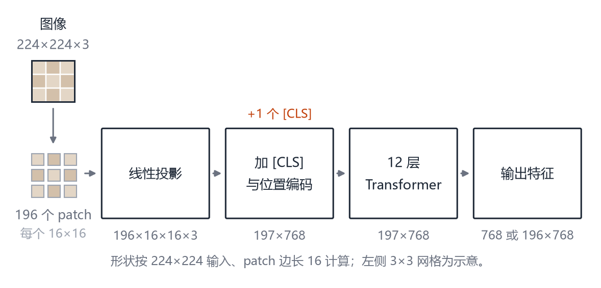
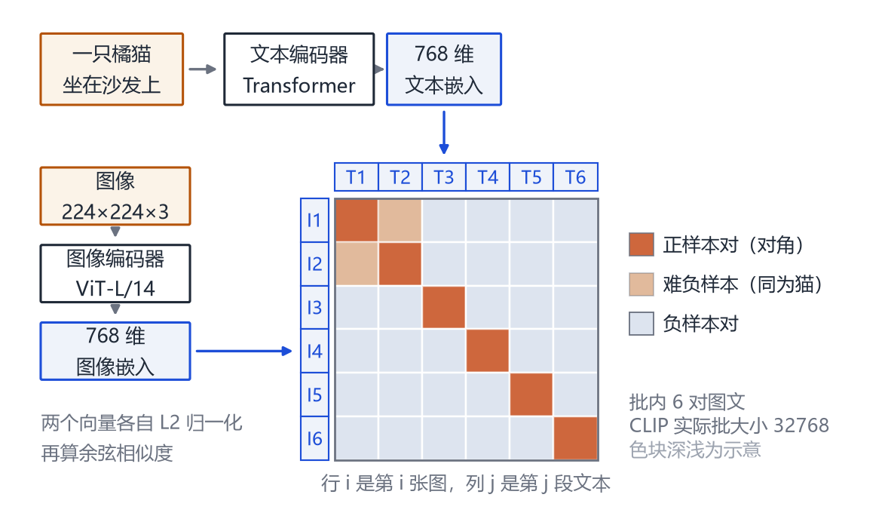
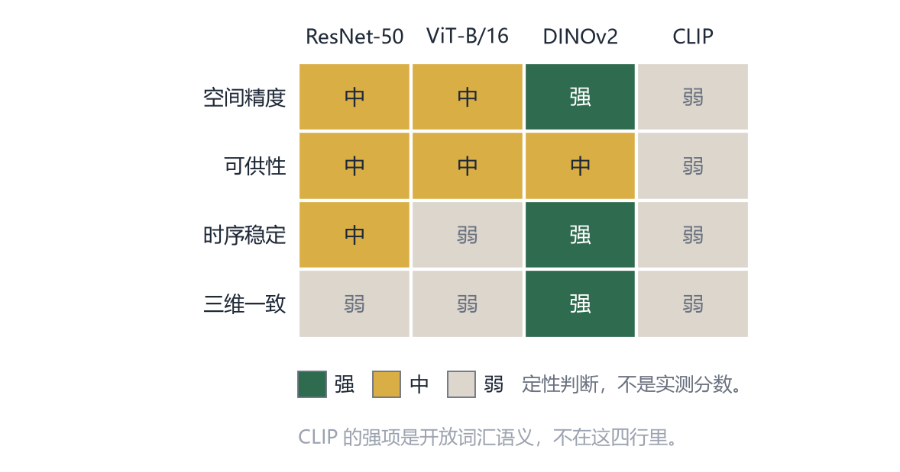

# 第 6 章　视觉特征与语义

> **本章导读**：上一章把像素变成了三维点和位姿，而位姿估计的第一步是先知道画面里那块区域是什么东西。这一章讲图像特征是怎么学出来的，从卷积网络到 ViT，从自监督到图文对齐，然后回答一个更实际的问题，这些在分类和检索上表现很好的特征，直接拿去驱动机器人为什么还不够。读完这一章，你能判断一个视觉骨干适合承担哪一类感知任务，以及它会在哪一步拖垮整条链路。

## 6.1 从卷积到 Transformer

这一节回答一个问题。一张照片在计算机里只是一长串数字，怎么把它变成一小串能说明画面内容的数字。

第 5 章的位姿估计有一个隐含前提，得先知道画面里哪块区域是目标物体。分割模型给出掩码，位姿网络在掩码里拟合几何，两步的底层是同一件事，把像素变成向量，也就是特征（feature）。分类网络的特征决定这是什么，分割网络的特征决定这块像素属于谁，后面的几何计算都建立在这个向量上。

先看数量级。一张 640×480 的彩色图有 640×480×3 共 92.16 万个数字。人看一眼就知道画面里有个杯子，程序手里只有这 92 万个数字，没有一个字提到杯子。特征要做的事是把它们重排成更短的一组，比如 2048 个，长度缩短四百多倍，信息却不能丢。这一组里每个数都不对应某个像素，只对应训练目标逼出来的属性，比如"这里有圆弧边缘"或"这块像把手"。

### 卷积核是一个局部模式探测器

卷积的出发点很朴素。一个 3×3 的小窗口在图像上滑动，每滑到一个位置就做一次加权求和，权重就是这个卷积核的参数。

取一个最普通的竖直边缘核，左列是 -1 -2 -1，中列全是 0，右列是 1 2 1。把它扣在亮度均为 120 的墙面上，正负相消，结果是 0。把它挪到一条左暗右亮的竖边上，左边亮度 40，右边亮度 200，加权和是 200×4 减 40×4 等于 640，除以 4 得 160。同一个核在平坦处输出 0，在边缘处输出 160，它就是一个"这里有没有竖边"的探针。

训练好的卷积核有的对竖边响应强，有的对某种纹理响应强。窗口在整张图上共用同一套权重，于是有了平移等变，杯子往右挪 10 个像素，响应图也往右挪 10 个像素。

### 层数、池化与丢掉的位置

深度是第二个关键。卷积核只能看到 3×3 的邻域，要看到更大的范围只能堆层。ResNet（2015）用残差连接解决了深层网络的训练问题，152 层的网络也能收敛，做法是在每两三层之间加一条恒等通路。

写成公式就是 $y = x + F(x)$。$x$ 是这一块的输入，$F$ 是两三层卷积学的那部分，$y$ 是输出。网络拟合的是残差 $F(x) = y - x$，哪一层不需要做事就把 $F$ 的权重压到 0，通路和梯度都还在，二十层以上训练误差反而上升的退化问题就消失了。ResNet-50 有 2560 万个参数，在 ImageNet 上 top-1 准确率约 76%。

问题出在最后几层。分类只关心这张图属于哪一类，物体在中央还是角落对答案没有影响，所以末端做全局平均池化，把 7×7×2048 的特征图压成一个 2048 维向量，10 万个数字缩到 2048 个。这一步对分类是对的，对机器人是灾难性的，位置信息被平均掉了。同一个杯子放在桌面左上角和右下角，两张图的全局向量余弦相似度能到 0.98 以上，策略只知道该抓杯子，不知道往左伸还是往右伸。

第二个错位是感受野。3×3 卷积堆 10 层，理论感受野只有 21×21 像素，有效感受野更小。这个数可以手算，第 n 层是 2n+1 的边长。要建立"把手在杯身左侧"这种跨 100 像素的关系需要几十层，中间任何一次池化都会让位置精度再降一半。

### ViT 把图像当成一句话

2020 年的 ViT 换了个思路，把图像当成一句话。224×224 的图切成 16×16 的小块，得到 196 个 patch，每个展平成 16×16×3 = 768 维的向量，正好等于 ViT-B 的隐藏维度，所以第一个线性层的权重矩阵是 768×768 的方阵。196 个向量过线性投影变成 196 个 token，再拼上一个可学习的 [CLS] token 变成 197 个，加上位置编码，送进 12 层 Transformer。

[CLS] 不对应任何一块区域，是被训练出来汇总全局信息的位置，最后一层取它的输出当整图向量，每个 patch 的特征则取后面 196 个位置。

关键的差别在第一层。self-attention 让每个 patch 和所有 patch 直接交互，左上角的 patch 在第一层就能看到右下角，卷积要达到同样效果得堆很多层，中间还要经过池化。对机器人来说这不是细节，指令里的"左边"要落到具体区域上。图 6-1 把这条流水线画了出来。

<figure class="fig">

<figcaption><b>图 6-1</b>　ViT 的前向流程。图像被切成 patch 后线性投影成 token 序列，加上 [CLS] 与位置编码送入编码器，最后一层可取出全局向量或每个 patch 的特征。</figcaption>
</figure>

### 位置编码与分辨率

位置编码是一组可学习的一维向量，每个位置一个，共 196 个，每个 768 维。它只编码"这是第几个 token"，不编码"这个 patch 在第几行第几列"，二维结构要靠数据自己学出来。这也带来一个工程问题，换了输入分辨率，patch 网格变了，位置编码就得插值重采样，特征图上的位置和实际像素不再严格线性对应。

漂移的量级可以估。训练用 224，位置编码有 196 个；部署用 448，patch 还是 16，网格变成 784 个，位置编码得把 196 个插值拉到 784 个。插值后相邻两个位置向量的差别被压到原来的四分之一，模型分不清相邻 patch 的先后，两套分辨率下的 patch 对应可能错开一到三格。

### 注意力要算多少次乘法

代价是计算量。attention 的复杂度是 token 数的平方，196 个 token 时注意力矩阵只有 3.8 万项。

$$\mathrm{Attn}(Q,K,V)=\mathrm{softmax}\left(\frac{QK^{\top}}{\sqrt{d_k}}\right)V$$

$Q$、$K$、$V$ 是同一组 token 乘三个不同的权重矩阵得到的查询、键、值，形状都是 197×64，64 是单个头的维度，由 768 除以 12 个头得到。$QK^{\top}$ 是一个 197×197 的矩阵，第 i 行第 j 列表示第 i 个 token 该给第 j 个多少注意力。除以 $\sqrt{d_k}$ 是把数值压回合理范围，否则 64 维内积求和后数值太大，softmax 会退化成只挑一个位置。$\mathrm{softmax}$ 按行归一化，每行加起来等于 1。

算一次的量。$QK^{\top}$ 要做 197×197×64 次乘加，约 248 万次。乘以 $V$ 再算一遍，又是 248 万次。一个头约 500 万次，12 个头约 5950 万次。这只是注意力这一小块，加上三组投影、输出投影和每个 token 都要过的两层前馈网络，ViT-B/16 处理一张 224 的图大约要做 176 亿次乘加。同样分辨率下 ResNet-50 只要 41 亿次。

DINOv2 推理时把分辨率提到 518，patch 边长 14，得到 37×37 共 1369 个 token，注意力矩阵涨到 187 万项，是原来的 49 倍。1369 除以 196 等于 7，7 的平方是 49，所以注意力部分按平方涨，前馈部分只按 token 数线性涨 7 倍。

### 归纳偏置与数据

ViT 还有一条反直觉的结论。在 ImageNet-1k 的 128 万张图上从头训练，它不如同规模的 ResNet，因为卷积自带局部性和平移等变两个先验，而 Transformer 只能从数据里学；换成 JFT-3 亿张图预训练再迁移，ViT 就反超了。结论是归纳偏置弱要用数据补，机器人领域能直接受益也是这个道理，反过来，手上只有几千张场景图时从零训 ViT 几乎一定失败，该做的是微调。

### 机器人为什么偏爱 ViT

机器人策略偏爱 ViT，有四个具体原因。

接口统一。图像 patch 是 token，语言是 token，动作也能切成 token，RT-2（2023）把每个动作维度离散成 256 个 bin，一条 8 维动作被写成 8 个整数，和一句十几个词的指令拼在同一条序列里。

语言指代也要靠注意力，指令里的"那个""靠近盘子的"都得落到具体 patch 上。

预训练权重可以直接用。冻结 CLIP 或 DINOv2 的 ViT，只训后面的策略头，这是视觉-语言-动作模型（VLA）的默认做法。好处是显存省、训练快，代价是骨干的偏见也被一起冻住。

多相机好拼。两路相机的 patch 拼成一个序列，靠相机编号区分位置编码，比两路 CNN 特征图对齐简单得多，两路 224 的图拼起来是 394 个 token。

这些好处都在语义层面。patch 化给空间精度设了一个上限，6.4 节会把它变成一个具体的毫米数。

## 6.2 不用标签也能学

这一节回答一个问题。一张图如果没有人工标注，模型凭什么从它身上学到有用的东西。

ImageNet 的 1000 个类别是人定的。机器人需要区分的东西大多不在这个体系里，比如这个抽屉的把手、这个盖子能不能拧、这个盒子是不是已经被打开过。

给这些概念标注数据的成本很高。一张图几分钱到几毛钱，取中间值 0.15 元，一个场景三千张，三十个场景就是九万张，光标注费一万三千五百元。这还没算返工，抽检标错的比例常在百分之十上下，错的那批要重标。

自监督的思路是把标签从数据本身造出来。同一张图的两个裁剪应该表示同一个物体，被遮住的部分可以从周围补出来，视频里相邻两帧的内容几乎一样。

### 正样本与负样本怎么造

对比学习是最直接的一条。取一张图做两次随机增广，随机裁剪、颜色抖动、水平翻转，得到两个互为正样本的视图，同一个 batch 里其他图的所有视图都是负样本。训练目标是把正样本在嵌入空间里拉近，把负样本推远。

增广强度有讲究，常用配方是把随机裁剪的面积比例设在原图的 0.2 到 1.0 之间，长宽比在 0.75 到 1.33 之间抖，颜色抖动改亮度、对比度、饱和度、色相。裁剪下限决定难度，只剩 20% 面积时两个视图可能只共享一小块纹理，模型必须靠语义判断；下限放到 0.5，两个视图几乎一样，学不到东西。

正负样本的数量关系要摆清楚。batch 里 4096 张图，每张出两个视图，共 8192 个向量。对任意一个向量，正样本 1 个，负样本 8190 个，模型每次做的是一个 8191 选 1 的分类题。

### InfoNCE 的一次具体计算

InfoNCE 是这件事的标准写法，一句话版就是在一个 batch 的 N 个候选里做 softmax 分类，正确答案是那个正样本。

$$\mathcal{L} = -\log \frac{\exp(\mathrm{sim}(z_i,\, t_i)/\tau)}{\sum_{j=1}^{N}\exp(\mathrm{sim}(z_i,\, t_j)/\tau)}$$

式中的 $z_i$ 是第 i 张图的嵌入，$t_j$ 是第 j 段文本或第 j 个视图的嵌入，$\mathrm{sim}$ 是余弦相似度，$\tau$ 是温度，控制分布的尖锐程度，取值在 0.07 量级。分母里的 N 就是候选数，N 越大，任务越难，学到的特征越判别。

代一组数字。设 $\tau = 0.1$，锚点 $z_i$ 和正样本的余弦相似度是 0.6，和三个负样本分别是 0.5、0.4、0.3。四个相似度除以温度得到 6、5、4、3，取指数得到 403.4、148.4、54.6、20.1，加起来 626.5。正样本占的概率是 403.4 除以 626.5，等于 0.644，损失是负对数，约 0.44。

把最难的那个负样本从 0.5 提到 0.6，和正样本打平，指数项变成 403.4 加 403.4 加 54.6 加 20.1 等于 881.5，正样本概率掉到 0.458，损失涨到 0.78。这就是对比学习的工作方式，模型被逼着把相似度拉开差距。

温度还可以再算一遍。两个负样本的相似度是 0.50 和 0.45，只差 0.05。$\tau = 0.1$ 时，两者指数值是 148.4 和 90.0，差 1.65 倍。$\tau = 0.5$ 时是 2.72 和 2.46，差 1.10 倍。温度小，微小的相似度差别被放大，梯度集中在那几个最难分的负样本上。

### 为什么 batch 要大

对比学习对 batch 大小极其敏感。SimCLR 用 4096 到 8192，CLIP 用到 32768。batch 小时负样本太少，模型容易靠颜色这种浅层线索分开正负样本，学不到语义。MoCo 用一个动量编码器维护特征队列，把历史 batch 的负样本存下来，小显存也能有大量负样本。

队列长度设成 65536，当前 batch 只有 256，模型面对的候选仍然是六万多个。队列里的向量是旧的，会随参数更新漂移，动量编码器就是让两边慢慢对齐。

还有一个坑叫表示崩塌。模型把所有图像映射到空间里的同一个点时，正样本之间距离是 0，损失接近 0，特征却完全没有信息，负样本、停梯度、中心化这些技巧都是在阻止这条捷径。崩塌在数字上很好认，所有向量的余弦相似度都是 1，正样本概率接近 1 除以 N，损失停在 log N 附近不再下降，下游准确率同时停在随机猜的水平。

### 掩码重建与 MAE

掩码重建是另一条路，代表工作是 MAE（2022）。随机遮住 75% 的 patch，只把可见的 25% 送进编码器，解码器根据可见部分重建被遮住的像素，损失只在被遮的 patch 上计算。遮得这么狠是因为图像的空间冗余很大。

数字摊开看更直观。224 输入切 16 的 patch，一共 196 块，遮掉 75% 是 147 块，剩下 49 块送进编码器，加一个 [CLS] 共 50 个 token。注意力矩阵只有 50×50 共 2500 项，比完整 197 个 token 的 38809 项少十五倍多。这就是 MAE 训得快的原因。

遮多少有个区间。遮 15% 时邻域像素就能补出答案，模型学到的是插值；遮 75% 时局部线索基本断掉，模型必须理解"杯子上沿应该是弧形"这类结构；遮到 90% 以上，重建退化成猜平均颜色，特征也长进不了。

MAE 的特征微调之后很强，直接拿来做线性探测不如对比学习。像素重建逼模型记住纹理、颜色和边缘，而语义需要的是抽象，所以只想冻结特征接轻量策略头时，MAE 不是好选择。

### DINOv2 把自监督做成产品

DINOv2（2023）把自监督做成了可以直接用的产品。它用自蒸馏，同一个架构有两个副本，student 看局部裁剪，teacher 看全局视图，student 预测 teacher 输出的分布。teacher 的参数不是梯度更新的，而是 student 参数的指数滑动平均，所以不需要负样本也不会崩塌。防崩塌靠两个操作，中心化把每个原型向量的长期均值减掉，避免某一个原型独占所有样本，锐化用低温 softmax，避免输出过于均匀。在此之上再叠加 iBOT 式的掩码 patch 损失，让 patch 级特征也有监督，而不只是整图一个向量。

数据是 LVD-142M，1.42 亿张无标签图像。做法是从公开数据池里检索出与若干精选数据集相似的图再去重，整个过程用 20 个节点、每节点 8 张 V100 跑了不到两天。最大的模型是 ViT-g/14，11 亿参数，1536 维，40 层，训练末段把分辨率提到 518。

DINOv2 常被叫作通用视觉词典。冻结权重，把每个 patch 的特征当成一个词，做语义分割、深度估计、物体对应都不需要训练新网络，只在这个特征空间里做最近邻或者线性分类。论文里把特征做 PCA，前三个主成分直接能分出物体和背景，说明特征保留了空间结构，没有把整张图压成一个语义标签，这一点是 CLIP 做不到的。机器人领域因此更偏爱它，策略需要的是"这块区域像什么"，不是一个整图标签。

## 6.3 把图像和文字放进同一个空间

这一节回答一个问题。怎么让"杯子"这个概念从一句日常话里来，而不是从一张事先定好的标注表里来。

分类的标签体系是封闭的，训练时定好 1000 类，部署时遇到第 1001 类就没办法；机器人面对的世界是开放的，今天要拿杯子，明天要拿一个没见过的玩具，概念从自然语言里来就不用预先定义类别。

CLIP（2021）的做法是训练两个编码器，一个吃图像，一个吃文本，各自输出一个向量，经过线性投影到同一个 d 维空间，再各自做 L2 归一化。ViT-L/14 这一版的嵌入维度是 768。图像塔可以是 ResNet 也可以是 ViT。

两个塔的规模差得很远，图像塔 3.04 亿参数，文本塔只有 6300 万，因为文本塔宽度只有 512，层数 12，最多吃 77 个 token。图像塔把 1024 维的输出投影到 768，文本塔把 512 维投影到 768，两个投影矩阵都可学习，训练完两个空间的朝向就被拉到一起。

### 双塔与相似度矩阵

训练时一个 batch 里有 N 对配对的图文，算一个 N×N 的余弦相似度矩阵。对角线是真正的配对，其余 N²-N 个格子都是负样本。损失是两个方向的交叉熵之和，图像去找对应的文本算一次，文本去找对应的图像再算一次。数据是 4 亿对从互联网收集的图文，batch 32768，温度初始化为 0.07 并且参与训练。图 6-2 画的就是这个矩阵。

<figure class="fig">

<figcaption><b>图 6-2</b>　CLIP 的双塔与批内相似度矩阵。图像与文本各自编码成 768 维向量，对角线是配对的正样本，其余格子是负样本。色块深浅为示意，不对应实测相似度。</figcaption>
</figure>

矩阵的尺寸值得算一下。32768 乘以 32768 等于 10.7 亿个格子，其中只有 32768 个是正样本，占万分之零点三。这些负样本都从同一批图文里凑出来，这种"批内负样本"的密度是 CLIP 能学到细粒度概念的关键。代价是显存，一个这样的矩阵用半精度存也要 2GB 以上。

### 温度系数在调什么

温度负责放大差距。余弦相似度落在 -1 到 1 之间，直接做 softmax 得到的分布非常平，正确配对和错误配对概率差不多，梯度几乎为零；除以一个小于 1 的温度相当于把相似度乘上一个大于 1 的系数，分布才立起来。

CLIP 把这件事写成了一个可学习参数。代码里的 logit scale 初始值取 $\log(1/0.07)$，约 2.66，取指数是 14.3，等价于温度 0.07。训练完这个参数会自己涨到 4.6 附近，指数是 100，相当于温度降到 0.01，比初始值尖锐 7 倍。模型自己发现"再尖锐一点更好"，因为批内负样本太多，不尖锐就分不开。

反过来，温度设到 0.001，指数会溢成无穷大，前向就崩；设成 0.5，分布太软，每个负样本都分到一点梯度，特征判别性就弱。可用的区间靠可学习解决，比人手调稳。

### 零样本分类的四步

训练完之后，文本塔可以当分类器的生成器用。把类别名套进模板 "a photo of a {class}"，文本塔输出一个向量，这个向量就是该类别的分类权重。推理时图像向量和所有类别向量算余弦相似度，取最大。ViT-L/14@336 在 ImageNet 上零样本 top-1 是 76.2%，和全监督训练的 ResNet-50 打平，而它没有用过 ImageNet 的 128 万张标注图。监督信号可以从自然语言里来，这个结论在 2021 年震动了整个视觉领域。

整个过程可以拆成四步。第一步，把 1000 个类别名各填进模板，得到 1000 句话。第二步，它们过文本塔，得到 1000 个 768 维向量，这就是 1000 行分类权重。第三步，待测图过图像塔，得到 1 个 768 维向量。第四步，算 1 行乘 1000 列的内积，做 softmax，取概率最大的那一类。

计算量几乎全在图像塔。分类权重这一步是 1000 乘 768 等于 76.8 万次乘加，图像塔一次前向约 600 亿次，两者差四个数量级，所以零样本推理的开销几乎与类别数无关。

模板写法会实打实影响结果。"a photo of a {class}" 比光写类别名好，因为预训练语料里的图注大多是句子，单词和句子的特征分布不在一个位置。论文报告换成多套模板再平均，在三十多个数据集上能涨几个百分点。这也暴露了一个问题，准确率依赖于人怎么措辞。

### 从分类权重到开放词汇检测

检测和分割也顺着这条路打开了。老式检测器要先定义类别，再设计 anchor，最后做非极大值抑制。DETR（2020）把检测变成集合预测，用一组可学习的 query 去问图像，一次输出固定数量的框，不需要 anchor 也不需要后处理。把 query 换成文本嵌入，检测器就能检任意类别，这就是开放词汇检测。分割的做法类似，先用 SAM 一类模型给出与类别无关的掩码，再把每个掩码区域的特征和文本嵌入比对，贴上标签。

这条链路在机器人里很常用。桌面上一堆没见过的物体，先用类别无关的掩码把每块区域分出来，再把区域特征和"螺丝刀""海绵""夹子"这些词比对，就能在没有训练数据的情况下给新物体命名。命名对不对是后话，至少策略知道这里有五个可操作的东西。

### 对齐不到像素，也不带尺度

CLIP 的短板藏在训练目标里。它对齐的是整张图和整句话，图像塔最后做全局池化，patch 的特征从来没有被文本监督过。所以 CLIP 的相似度是全局语义的相似度，不携带在哪里这个信息。判断图里有猫很准，回答猫的左耳在第几列就不行。要在 CLIP 之上做像素级任务，必须再训一个解码器，MaskCLIP 和 CLIPSeg 都是这么做的。

第二个短板是尺度。图像进网络之前会被 resize 到 224，绝对尺寸信息在归一化那一步就丢了。同一个杯子在 0.3 米和 1 米处拍下来，嵌入几乎一样，余弦相似度常在 0.95 以上。这种不变性在分类里是优点，在抓取里是灾难，因为策略必须知道还有多远、多大。

用像素数看更清楚。8 厘米宽的杯子放在 0.3 米处，按 554 像素的焦距算，在 640 宽的图上占 148 个像素；挪到 1 米处只剩 44 个像素。像素数差三倍多，嵌入的相似度却接近不变，说明尺度这个量在特征里被主动抹掉了。

SpatialVLM（2024）专门为这件事造了带三维标注的空间问答数据。论文里有个例子，问沙发和桌子之间的通道有多宽，GPT-4V 回答看起来不够 1 米宽的机器人通过，而实际测量是 1.56 米。这类错误不是语言能力问题，是视觉特征里没有尺度这个量。

## 6.4 机器人需要什么特征

上一节讲的是模型能认什么，这一节换个问法。三种模型都在图像级任务上评测，指标是整张图判断对了吗；策略却每一帧都要输出一组关节目标，误差会累积到下一步。需求拆开至少有四条，每一条都落到具体数字上。

### 6.4.1 空间精度

先算一个数。640×480 的相机，水平视场 60 度，焦距 $f = 320/\tan(30°) \approx 554$ 像素。0.5 米处，一个像素对应的实际长度是 $0.5/554 \approx 0.9$ 毫米。这是相机的理论分辨率，也是深度图和 RGB 图共同的精度基准。

ViT-L/14 的输入是 224，一个 patch 是 14/224 即十六分之一图宽，对应原图 640/16 = 40 像素。0.5 米处，一个 patch 覆盖 36 毫米。36 毫米和 0.9 毫米差 40 倍。特征图上采样能把它画得更细，但插值不产生信息。

模型在这里不够用的例子很直接。用 patch 特征回归一个抓取点，回归头即使训得很好，输出的位置精度也只能到半个 patch 上下。半个 patch 是 20 个原图像素，在 0.5 米处等于 18 毫米。一个 6 厘米宽的抽屉把手，夹爪张开 6 厘米去夹，中心偏 18 毫米，一侧的指头就已经压到把手外面，接触面积少了一半，抓起来会打滑。

后果很具体。USB-C 插头的对准公差在 0.5 毫米量级，靠 patch 级特征做视觉伺服，误差比公差大两个数量级。所以精细操作里，语义特征只用来选目标，最后的对准靠深度图、力控和视觉伺服。这也是为什么 VLA 的输出通常是末端位姿的增量，而不是像素坐标。

有一类做法能缓解这个矛盾，把高分辨率特征图和低分辨率语义特征拼起来用，前者管对准，后者管认东西。检测网络里的特征金字塔就是这个思路，浅层分辨率高语义弱，深层反过来，横向连接后各取所长。

### 6.4.2 可供性

可供性不是一个语义标签。一个杯子的语义是杯子，它的可供性是把手在内侧，可以从上方用两指夹住，夹持宽度 6 厘米，重心离把手 4 厘米。后面这些量决定抓取能不能成功，而 CLIP 的图文对里几乎不描述这些。互联网上的 caption 写一只猫坐在沙发上，不写沙发的扶手宽 12 厘米、可以支撑 3 公斤。

模型在这里不够用的例子，可以用一个最常见的马克杯。图像塔给出的最近类别是马克杯，相似度 0.31，这个答案完全正确，但对抓取没有帮助。真正要用的三个数，把手内径 3 厘米、可夹持长度 6 厘米、重心轴线偏出把手 4 厘米，在 768 维向量里找不到任何一个维度与它们对应。换一个杯子，这三个数全变，向量却只挪动一点点，相似度还在 0.28 以上。

所以可供性特征要么来自几何，局部法向、曲率、开口宽度、支撑面，这些从深度图直接算比从 RGB 特征猜更可靠；要么来自专门的标注数据，让人在仿真里点这里推一下会动，收集几万个像素、动作、结果的三元组，训一个可供性头。这两类信息都不在 CLIP 的预训练目标里。

还有一层更隐蔽的问题。可供性是相对于夹爪定义的，同一个物体，二指平行夹爪能从上面夹，五指手可能要从侧面扣。换一个末端执行器，可供性的标注就全部作废。这也是为什么跨本体的策略迁移比跨物体难得多。

### 6.4.3 时序稳定

控制频率在 10 到 50 Hz，相邻两帧间隔 20 到 100 毫秒。机械臂以 0.1 米每秒移动，一帧走 2 到 10 毫米。

ViT 的 patch 网格是固定的。物体跨过 patch 边界时，一个 patch 里前景和背景的比例会突变，特征跟着跳一下。0.5 米处 patch 边长 36 毫米，0.1 米每秒时每 0.36 秒跨一次边界，也就是接近 3 Hz 的一次跳变。

模型在这里不够用的例子出现在接触瞬间。夹爪用 10 牛的力夹住一个 0.3 公斤的盒子，接触面摩擦系数 0.4，能提供的最大静摩擦是 4 牛。盒子自重 2.9 牛，余量只有 1.1 牛。特征以 3 Hz 抖动，策略输出的夹持力跟着抖 2 牛，抖到低点的那一帧，余量就变成了负的，盒子滑下去两三毫米。操作员看到的现象是"抓起来又掉了"，日志里的成功率却统计成成功。

后果是策略的输入带 3 Hz 的抖动，输出跟着抖，关节电流出现周期性波动。第 9 章讲的时间集成就是为了压这个抖动，但那属于事后补救。更彻底的做法是让特征本身平滑，对相邻帧做指数滑动平均，或者用带时序的编码器，或者在训练时把相邻帧当正样本做对比学习。

### 6.4.4 三维一致

三维一致这一条最容易被忽略。同一个物体从正面看和从侧面看，特征应该相近，这是视角不变性；但同一个物体的把手和杯身，特征应该不同，这是空间特异性。这两条要求方向相反，模型必须找到一个平衡点。分类任务只关心前一条，所以它训练出来的特征往往过度不变，把把手和杯身也揉到了一起。

多相机系统里这条更关键。头部相机和腕部相机同时看一个杯子，两路图像的 patch 特征如果差很多，融合模块就会以为看到了两个物体，抓取点算出来在两者中间，谁也没抓住。

模型在这里不够用的例子可以量出来。两路相机看同一个把手，因为视角差了 60 度、光照也不同，patch 特征的余弦相似度只有 0.62。同一路相机相邻两帧看同一个把手，相似度是 0.91。融合模块如果只看相似度决定权重，会把 0.62 的这一路当成另一个物体，两个候选抓取点相距 4 厘米，取平均之后落在空中。

DINOv2 在这一条上表现最好，论文里用 patch 特征的最近邻做跨视角对应，能对上物体的同一部位。但它仍然是在单图上学出来的，没有显式的三维监督，视角变化超过 90 度之后对应关系就开始出错。

把上面这些模型的基本参数摆在一起，差别就更清楚了。

**表 6-1**　视觉骨干对比。

| 模型 | 参数量 | 预训练数据 | 输出维度 | 机器人里的典型用法 |
|---|---|---|---|---|
| ResNet-50 | 25.6M | ImageNet-1k，128 万张带标签 | 2048 维全局向量 | 抓取检测、轻量策略的视觉塔 |
| ViT-B/16 | 86M | ImageNet-21k，1400 万张；论文最佳结果用 JFT-3 亿 | 768 维，196 个 token | 策略视觉塔，与语言 token 拼接 |
| ViT-L/14 | 304M | ImageNet-21k，或 CLIP 的 4 亿图文对 | 1024 维，224 输入下 256 个 token | VLA 视觉塔的常见尺寸 |
| DINOv2 ViT-g/14 | 1.1B | LVD-142M，1.42 亿张无标签图 | 1536 维，518 输入下 1369 个 token | 冻结特征做对应、深度、抓取 |
| CLIP ViT-L/14 | 428M | WIT，4 亿图文对 | 768 维（投影后） | 开放词汇检测、语义地图、语言接地 |

表里的参数量按公开配置计算，输出维度按各自默认输入分辨率给出。分类模型只暴露一个全局向量，密集预测模型暴露每个 patch 的向量，两者在机器人里的用法完全不同。拿 ResNet-50 做密集预测要额外接 FPN 或者空洞卷积，拿 ViT 做分类则只要取 [CLS] 那一个 token。

这四条需求没有一条能靠换个更大的模型解决，因为它们指向的是训练目标，不是模型容量。分类目标不奖励像素精度，图文对齐目标不奖励尺度，单图预训练不奖励时序稳定。要解决只能改目标，或者在目标之上加一层专门的模块。

把这四条需求和四个骨干摆在一起，得到图 6-3。

<figure class="fig">

<figcaption><b>图 6-3</b>　四类特征需求与四个骨干的定性对照。深绿表示强、土黄表示中、浅灰表示弱，依据是各模型公开报告的行为，不是统一基准上的实测分数。</figcaption>
</figure>

图 6-3 把上面的判断压缩成一张表格式的图。DINOv2 在空间精度、时序稳定、三维一致三行都是强，只有可供性给中，因为它的训练目标同时约束了整图和 patch；CLIP 四行全弱，但强项是开放词汇语义，这一项不在四行之内。这张图不该被读成排行榜，它想说明的是没有哪个骨干在四条上全部拿到强，实际系统都是两三个模型拼起来的。

把四条需求各自缺什么、坏了长什么样、该补什么模块对上，就是表 6-2。表里的数字都是前面算过的那几个，不是另一套基准。

**表 6-2**　四条特征需求对应的失效与补救。

| 需求 | 模型不够用时的表现 | 量级参照 | 常加的模块 |
|---|---|---|---|
| 空间精度 | 抓取点落在目标边缘外 | patch 覆盖 36 毫米，公差 0.5 毫米 | 高分辨率浅层特征、深度、视觉伺服 |
| 可供性 | 认对了物体却选错夹持方式 | 把手内径 3 厘米这类几何量缺失 | 点云几何、可供性头 |
| 时序稳定 | 夹持力随 patch 边界抖动 | 3 Hz 跳变，余量 1.1 牛 | 特征平滑、时序编码器 |
| 三维一致 | 多相机看成两个物体 | 跨视角相似度 0.62 对 0.91 | 跨视角对比训练、三维监督 |

## 6.5 特征可视化与失败案例

这一节回答一个问题。模型给出的热力图看起来盯着杯子，动作却失败了，问题到底出在哪一环。

调试视觉特征最常用的手段是把注意力权重画成热力图叠在原图上。图上模型盯着杯子，看起来很合理，于是判断特征没问题，问题在策略。这个判断经常是错的。

### 原因一，注意力权重不是因果

注意力权重不等于因果重要性。softmax 把总量归一化到 1，权重高的位置可能只是相对没那么无关，而不是决定了输出。真正该看的是遮挡敏感度，把某个区域涂黑，看输出变化多少。这两张图经常不一致，注意力集中在一小块，遮挡它却没有影响，说明模型其实在用别处的信息。

归一化的后果可以算。197 个 token 平均每个分到百分之零点五，一个权重 0.15 的 patch 是平均值的三十倍，看着很突出。但注意力有 12 层 12 个头，共 144 张这样的图，每张图讲的都是不同的事，把它们平均起来只剩一团模糊的高亮。

### 原因二，显著性压过任务相关性

语义显著性和任务相关性会错位。杯身面积大、纹理多、占了十几个 token，注意力自然集中在杯身；把手细、颜色暗、只有两三个 token。抓杯身会滑，抓把手才稳。模型的看法和任务需要的用法不在同一个位置。这类失败在注意力图上完全看不出来，因为注意力图确实指着杯子，看上去无懈可击。

用遮挡测一遍就能分开。在 224 的图上滑一个 32×32 的黑块，它覆盖大约五个 patch。遮住杯身，末端位置只变 1.2 度；遮住把手那一小块，末端位置跳 4.5 度。在 0.4 米外，1 度对应 7 毫米，4.5 度对应 3 厘米，正好是把夹爪从把手挪到杯身的距离。注意力图给杯身高分，实际起作用的是把手，两张图说的不是一件事。

### 原因三，背景把相似度抬高了

背景也会把相似度抬起来。CLIP 特征在背景相似时会误匹配。两张图里都有白盘子、木桌面、相似的阴影，特征余弦相似度能到 0.95 以上，策略把 A 桌上的碗当成 B 桌上的。换一块纯色桌布，同样的物体相似度掉到 0.7，策略反而正常了。这说明特征里混进了大量场景信息，物体本身的权重不够。

这类失败在热力图上完全看不出来，因为整张图都亮着，模型确实在看所有东西。同一条产线上换一批料盘，颜色从白换成蓝，成功率就掉下来，原因也在这里。

### 时序那一条不在单帧里

可视化只看单帧，还有第四个盲区。相邻帧特征的余弦相似度如果从 0.98 掉到 0.85，热力图上看不出任何区别，但策略的输出会明显抖动。时序问题必须用时序指标看，热力图再漂亮也没用。

### 四项可执行的检查

把这四条落成可执行的检查，大概是这样几件事。

1. 用遮挡敏感度图代替注意力图，滑一个 32×32 的遮挡块，记录策略输出的变化幅度，变化大的区域才是模型真正依赖的区域。
2. 做换背景、换光照的对照实验，同一物体、同一动作、只改背景，看成功率掉多少。掉超过 20 个百分点，说明特征对场景过拟合。
3. 画相邻帧特征的余弦相似度曲线，直接量化抖动，比看图可靠。曲线在 0.9 以下反复震荡，就要考虑加平滑。
4. 对失败帧做最近邻检索，把它在训练集里最像的十帧调出来。如果最像的是另一个物体，问题在特征；如果最像的是同一物体的另一个姿态，问题在策略。

这套检查做下来，多数"特征看起来没问题"的结论会被推翻。可视化和实际作用之间隔着两层，一层是注意力归一化，一层是任务定义，跨过这两层才能把失败归到正确的位置。

特征回答的问题是这块像素像什么。它不回答这块像素在空间的哪个位置，不回答它和旁边的物体是什么关系，也不回答上一次看到它是什么时候。这三个问题需要另一种表示，把特征按空间位置组织起来，跨时间累积，并且允许查询。这正是地图要干的事。
