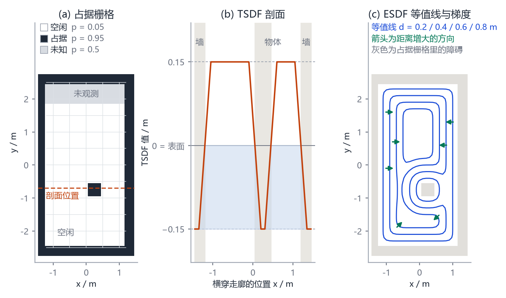
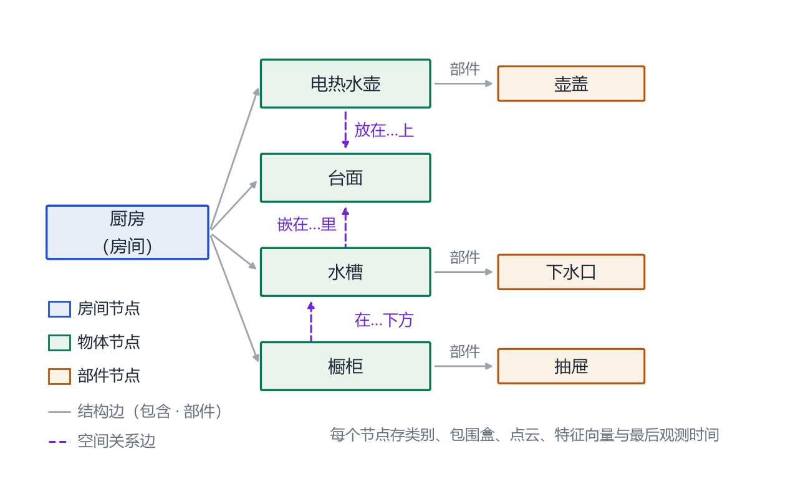
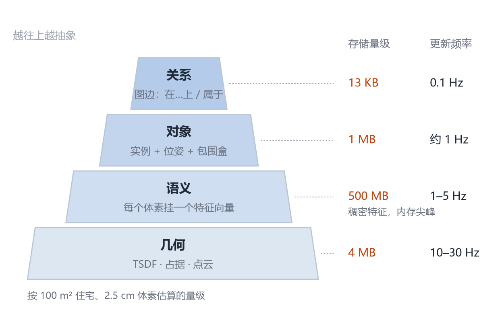

# 第 7 章　地图与场景图

> **本章导读**：机器人早上把药盒从客厅送到卧室，下午还要回到同一个床头柜，中间它转过几十次身，客厅早就离开了视野。相机只记得眼前这一帧，能让它记住"东西在哪、房间怎么连"的只有地图。这一章从一张 5 厘米的方格讲起，走到距离场、物体列表、三维场景图和神经场，最后说清怎么把地图压成两千个词交给大模型，以及怎么让它知道"这块我还没看过"。

## 7.1 为什么需要一张地图

这一节回答一个问题。机器人转身走开三米，相机里就找不到药盒，它凭什么还记得药盒放在哪、下一步往哪走。

早上八点，一台移动机械臂接到一句话，把茶几上的药盒送到卧室床头柜。它的相机水平视野约 60 度，超过 3 米就开始模糊。转身去拿药盒，床头柜离开了画面；穿过走廊进了卧室，茶几也不在视野里。整个任务里没有任何一帧图像同时包含起点和终点。

把"看不见"算成数字。视野 60 度在 3 米处宽 3.46 米，每米只有 185 个像素，宽 8 厘米的药盒只占 15 个，够认出是盒子，不够判断离墙 20 厘米还是 40 厘米。

人做这件事不难，因为脑子里有一张房子的图。这张图不必精确到毫米，只要能回答四件事。东西大概在哪。房间怎么连。哪里能走。床头柜指的是哪一个。

**跨时间的记忆。** 相机是"现在"，地图是"曾经"。一帧 640×480 的 RGB-D 图像大约 30 万个点，只覆盖两三个平方米。一间 100 平方米的房子扫一遍，墙面地面加起来的表面积约 300 平方米，按 2.5 厘米体素算，表面体素接近 50 万个，只相当于一帧半的点数。总量并不比一帧多多少，难的地方在组织方式，这些点必须能按坐标随手取出来，而不是每次从头重算。

**长程任务的中间状态。** 走出去 20 米再回来，视觉里程计的位姿漂移常有几厘米到十几厘米。地图是唯一能把"我去过哪、那里有什么"固定下来的东西，位姿估计算得再准，也需要一个不随帧消失的参照。

**导航与避障。** 走廊净宽 1.2 米，机器人本体 0.6 米，两边各剩 30 厘米。桌腿直径 4 厘米，深度相机在 2 米处能分辨，但只在视野内。没有地图，避障只能在看见的那一刻起作用，转个身就失效。

**语言指代的落地。** "把药盒拿过来"里的药盒在语言中是一个名词短语，在地图里必须是一个带三维位姿的实体，否则规划器无从下手。从"药盒"这两个字到一个可以伸手的坐标，中间那一步就是地图。

### 三类消费者要的东西不一样

同一个世界有三类消费者，要的东西完全不同。规划器要"到最近障碍多远"以及梯度，每秒查几千次。策略网络要固定形状的张量，好拼进神经网络。大模型要能读的文本，最好几百个词。

规划器那边的预算可以估。一条候选轨迹切 30 个路点，一次规划试 1000 条就是 3 万次查询，10 Hz 下每次只给 3 微秒，所以只能查表。大模型的预算是词，五十个物体各三十个词共一千五百个，写成体素文本却是几百万个。

这三类需求拉扯出本章要讲的几种表示，它们不是互相替代的关系，而是在不同层上各管一段。

### 地图也会坏

地图不是建一次就永远对的。上午扫过的茶几，中午被挪到了墙角，地图里那个药盒还停在旧位置，机器人按旧位置伸手，抓到的是空气。这类错误叫幽灵障碍，它不会自己消失，只会越积越多。另一种坏法是过期，放了三天没被看到的椅子，节点还在，时间戳已经旧了。判断新旧的唯一依据是最后一次观测时间，这也是后面每种表示都要存时间戳的原因。

位姿从哪来，第 4 章的 SLAM（Simultaneous Localization and Mapping）已经讲过前端、后端和回环检测。这一章假设位姿已知，或者由 SLAM 模块并行给出，只讨论"世界长什么样"这一半。

## 7.2 占据栅格与距离场

这一节回答一个问题。给一堆带位姿的深度图，怎么变成一张能随手查询的表，而且一秒内要被改写三十次。

最朴素的表示把地面切成方格，每格 5 厘米见方，存一个数，表示这一格有障碍的概率。Moravec 和 Elfes 在 1985 年就是这么做的，四十年过去，扫地机器人底盘里跑的还是这个结构。

### 占据栅格存的是概率

一层 100 平方米的楼面切成 5 厘米见方共 4 万格，占 160 KB，一颗几块钱的芯片就能跑。存的是概率，0.9 表示几乎肯定有东西，0.1 表示几乎肯定是空的，0.5 表示不知道。第三种最容易忽略，而它最常见，机器人没走过的地方每一格都是 0.5。

查询便宜，更新贵。平面坐标除以边长取整就有行列号，一次下标约 100 纳秒。更新则完全不同，一帧 320×240 的深度图有 7.7 万条射线，每条穿 40 格，一秒要写 9000 万次。

概率不能直接相乘更新。看一次是 0.6，看十次就逼近 1，浮点数很快下溢，而且一条错误观测会把格子永久钉死。工程上改用对数几率

$$l_t = l_{t-1} + \log\frac{p(z_t \mid x)}{1 - p(z_t \mid x)}$$

其中 $l = \log\frac{p}{1-p}$ 是对数几率，$z_t$ 是第 $t$ 次观测，$x$ 是这一格的状态。概率相乘变成了对数相加，一次加法就完成更新，还能顺便裁剪。

逐个符号读。$p$ 是这一格有障碍的概率，取值 0 到 1，$p$ 除以 $1-p$ 是有与没有的比值，取对数就压到实数轴上，这就是 $l$。$z_t$ 是第 $t$ 帧观测的判断，可能是命中、穿过或没打到，$x$ 是真实状态。式子说的是新证据以加法累进旧估计，反过来的换算是 $p = 1/(1+e^{-l})$。

裁剪是这套办法能用的关键。传感器模型告诉系统，射线穿过的地方是空的，末端命中的地方是障碍，中间没打到的什么也不说。常用增量是命中和穿过分别取 $+0.85$ 和 $-0.4$，把 $l$ 限制在 $-2$ 到 $3.5$ 之间，等价于概率不低于 0.12、不高于 0.97。玻璃、镜面、走动的人都会让同一格反复翻转，允许改主意比一次定死重要得多。

### 一条门缝算三帧

算一遍更直观。初始 $l=0$，三帧都命中后 $l$ 依次是 0.85、1.70、2.55，其中 $e^{-0.85}$ 约 0.427，$e^{-1.70}$ 约 0.183，$e^{-2.55}$ 约 0.078，概率是 0.70、0.845、0.93。之后两次视线穿过，$l$ 压到 2.15 和 1.75，概率掉回 0.90 和 0.85。这就是玻璃门前的地图会反复变色、而不是干脆变空的原因。

反面证据推得慢是刻意的。把空地误判成障碍只是多走几步，反过来要撞上去。$l$ 减到底停在负 2，对应概率 0.12 而不是 0，反复被穿过的玻璃门停在不太确定的状态。

三维有两条路。体素就是三维的格子。KinectFusion 用 $512^3$ 个 5 毫米体素，覆盖 2.56 米见方，每个体素存一个距离和一个权重共 8 字节，合计 1 GB，正好占满当年一张显卡，代价是机器人走出这个立方体地图就没了。八叉树把空间按八分递归切下去，只在表面附近细分到 5 厘米，一个房间的图通常几 MB。存储跟着表面积走而不跟着体积走，这是它成为移动机器人标配的原因。

### TSDF 换的是问题

截断符号距离场（TSDF，Truncated Signed Distance Field）换了问题。每个体素存的不是"有没有障碍"，而是"到最近表面的带符号距离"。距离在自由空间为正，在物体内部为负，在表面处为零。截断到 $\pm\tau$ 之后写成

$$\mathrm{tsdf}(\mathbf{x}) = \mathrm{clip}\big(d(\mathbf{x}), -\tau, \tau\big)$$

$\tau$ 一般取体素边长的 3 倍，1 厘米体素配 3 厘米截断。图 7-1 中间那一幅画的就是这条曲线，墙和箱子附近各有一段斜坡。

符号这样读。$\mathbf{x}$ 是体素中心的三维坐标，单位米。$d(\mathbf{x})$ 是沿视线量出来的带符号距离，正数在表面外侧，负数进到物体里面。$\mathrm{clip}$ 把超出 $\pm\tau$ 的数压回边界。整个式子只保留表面上下三厘米之内的精确距离。

代一组数字。某个体素中心离墙面 1.2 厘米且在墙外，$d$ 等于 0.012 米，存进去就是 0.012。另一个离墙 5 厘米，超过 3 厘米，存进去是 0.03。第三个体素在墙里面 1 厘米，存进去是负 0.01。查询的典型场景是抓取前的碰撞检查，夹爪经过三十几个体素，只要有一个的绝对值小于半径 2 厘米，就判定会撞。

截断有三个理由。远处的精确距离用不上，抓取和避障只关心表面附近几厘米。截断后每个值有界，多帧加权平均时不会被一次错误观测拉爆。饱和值本身还传达了"远"和"在实体里面"这两个信息，它们都不需要精确数值。

融合是一次加权平均

$$D_t = \frac{W_{t-1}D_{t-1} + w_t d_t}{W_{t-1} + w_t},\qquad W_t = W_{t-1} + w_t$$

权重 $w_t$ 通常与深度测量入射角的余弦成正比，斜着看的面不可信。这是 KinectFusion 的核心循环，一次乘加，GPU 上每帧几毫秒。

式子说的是新的估计等于旧的估计加上一小步修正，幅度由新证据的权重决定。$D_t$ 是融合到第 $t$ 帧的截断距离，$W_{t-1}$ 是此前累积的权重和，$d_t$ 与 $w_t$ 是这一帧的测量值和权重。分母保证权重归一，让 $D_t$ 是加权平均而不是加权求和。

代数字算一遍。某一格被看过四次，$W_{t-1}$ 等于 4，$D_{t-1}$ 等于 0.012 米。新一帧测量 0.010 米，斜着看权重只给 0.8。分子 0.048 加 0.008 等于 0.056，除以 4.8 得 0.0117 米，新估计只从 12 毫米挪到 11.7 毫米。观测越多，单帧越难推动估计。

### ESDF 回答的是另一个问题

欧氏符号距离场（ESDF，Euclidean Signed Distance Field）回答另一个问题。TSDF 只在表面附近的薄壳里有值，规划器要问的是"从这一点出发，到最近障碍有多少米"，定义为

$$d_{\mathrm{esdf}}(\mathbf{x}) = \min_{\mathbf{y}\in\mathcal{O}} \lVert \mathbf{x} - \mathbf{y}\rVert$$

$\mathcal{O}$ 是障碍点集。自由空间里处处有值，梯度模长几乎处处为 1，方向指向远离障碍的一侧，图 7-1 右边的箭头就是它。

符号过一遍。$\mathbf{x}$ 是要查询的点，比如底盘中心。$\mathcal{O}$ 是所有障碍点，$\mathbf{y}$ 遍历其中每一点，$\lVert \mathbf{x} - \mathbf{y}\rVert$ 是两点间的直线长度，$\min$ 取最小。式子说的是把候选点往四周障碍量一遍，留下最近的距离。

代一组数字。走廊净宽 1.2 米，机器人中心在正中，两侧墙各 0.6 米，这一点的值就是 0.6。往左偏 0.2 米，到左墙剩 0.4 米，到右墙剩 0.8 米，取小的那个，值是 0.4。再往前 1 米有一个凸出来的箱子，边缘离中心 0.35 米，那一点的值就是 0.35。三个位置三个数，规划器一看就知道哪里最挤。

这两个性质让避障变得很便宜。判断一个位姿是否安全，原本要把机器人模型和几千个三角形做距离计算，耗时以毫秒计；有 ESDF 之后查一次表，和 0.3 米比一下就行，快到能做每秒上千次的轨迹检查。梯度更直接，把候选轨迹往梯度方向推就是远离障碍。一次查表约 800 纳秒，3 万次查询 24 毫秒，占掉 10 Hz 周期的一小半。

<figure class="fig">

<figcaption><b>图 7-1</b>　同一段走廊的三种表示。左为占据栅格，中为沿虚线的 TSDF 剖面，右为 ESDF 的等值线与梯度。栅格取 10 厘米、截断距离取 0.15 米，墙体与箱子的位置为设定值。</figcaption>
</figure>

代价落在更新上。TSDF 只在新观测的视锥里写，别处不动。ESDF 一旦障碍变了，周围一片都要重算，增量算法能把一次更新压到几十毫秒，但它仍然是建图链路里最贵的一步。常见做法是把 TSDF 放在快线程里跑 30 Hz，ESDF 放在慢线程里跑 1 到 10 Hz，规划器读上一份。

重算范围估一下。一个障碍体素从有变成没有，影响半径等于它原来的距离值，走廊 3 米之内所有格子都可能变，5 厘米分辨率下是 1.4 万格。增量算法只从变化处向外推进一次波前，代价是要记住每个格子的最近障碍是谁，内存比 TSDF 翻一倍。

## 7.3 对象级地图与三维场景图

这一节回答一个问题。地图里有几十万个"有东西"的格子，机器人怎么知道哪一堆属于同一个杯子，这些杯子又怎么和房间相连。

体素回答"这里有没有东西"，不回答"这是什么"。一间房里五十万个表面体素，九成以上属于墙、地板和天花，真正算物体的不到十万。更要命的是，同一个杯子在二十帧里是二十片点云，没有任何标记告诉系统它们是一回事。

### 聚成实例的三步

对象级地图就是把点云聚成实例，流程是分割、反投影、关联三步。类无关分割（SAM，Segment Anything Model）给出掩码，不需要知道类别；掩码内的像素配合深度反投影成一小片点云；这片点云再和已有物体比相似度，决定归入旧节点还是新建节点。

类无关这三个字是前提。传统检测器先说这是一个杯子，再给出杯子的框，词表外的物体直接漏掉；类无关分割只回答这几个像素属于同一块区域，代价是一面纯白的墙也能被切成几十块。反投影有个细节，深度图边缘有一圈飞点，因为边缘像素的深度常是前景与背景的平均值，工程上会把掩码腐蚀两三个像素再反投影。

关联是最麻烦的一步，同一张桌子从左看一个掩码，从右看另一个掩码，两片点云也许只重叠一小条边。

### 相似度怎么算

相似度由两部分加和。几何部分用包围盒的交并比（IoU），或者点到点的最近距离；语义部分用特征向量的余弦。ConceptGraphs 用 2.5 厘米体素对点云下采样，两项加权求和后做贪心匹配，相似度超过阈值就合并，否则新建一个节点。贪心比匈牙利算法快，效果差别很小。

交并比要落地。两包围盒的交集体积除以并集体积，完全重合是 1，不重叠是 0。同一个杯子从两个角度看在 0.6 以上，杯子和旁边的盘子在 0 附近。余弦相似度是两向量各除以长度再点乘，同一物体不同视角通常在 0.8 以上，不同物体多在 0.5 以下。

代一组数字。几何项 IoU 是 0.65，语义项余弦 0.82，各给一半权重，相似度等于 0.5 乘 0.65 加 0.5 乘 0.82 得 0.735，超过阈值 0.7，这一对就合并。换个视角，IoU 掉到 0.35，余弦 0.80，加权是 0.575，低于阈值，于是被当成新节点，地图里多了一张桌子。阈值定得太严会把一个东西分裂成两个，定得太松会把两个东西合成一个，两种错误都不报错，只是下游查出来的结果不对。

### 一个节点存什么

每个物体存六样东西。类别或一句描述、包围盒与位姿、下采样后的点云、一个特征向量、被观测到的次数、第一次和最后一次看到的时间。最后两项经常被忽略，而它们是判断信息新不新的唯一依据。

大小可以估。描述三十个词，点云按五百个点算，特征向量 512 维半精度，合计约 7 KB，五十个物体 350 KB，比体素图小两个数量级。

融合按观测次数走。特征用滑动平均 $f \leftarrow (n f + f')/(n+1)$，点云取并集后重新下采样。$f$ 是当前特征，$n$ 是此前的观测次数，$f'$ 是这一帧的新特征。代数字，$n$ 等于 9，旧值 0.30，新值 0.50，加权后等于 9 乘 0.30 加 0.50 再除以 10，得 0.32，只挪了 0.02；换成 $n$ 等于 1，同样的新特征会把值推到 0.40。被看三十次之后，特征里混了三十个视角的信息，比任何单帧都稳。

### 房间这一层

房间通常靠几何划分。墙和门构成天然隔断，把自由空间做连通域分析，再看两个连通域之间有没有 0.7 到 1 米宽的门洞，就能切出房间。切完给每个房间算中心点，有灶台和水槽的那间大概叫厨房。

连通域分析给每个自由格子标编号，能走到的标成同一个号，走不到的是另一片。两片之间只有一条 0.9 米宽的通道，那就是一扇门。开放式的客厅和餐厅常被判成一间。

### 场景图的节点与边

把物体按空间关系连起来，就得到三维场景图。节点分三层，房间、物体、部件；边就是关系，在…上、在…里、属于、可以通行。完整的层次通常是建筑、楼层、房间、物体、部件五级，Armeni 等人在 2019 年给出这套结构，Hydra 在 2022 年做到实时增量更新。

用一个具体例子走一遍。机器人站在厨房门口，看到灶台、台面、水壶、壶盖。房间这一层有一个节点，叫厨房，位置是房间中心，尺寸 3.2 米乘 2.8 米。厨房往下挂三个物体节点，灶台、台面、水壶。壶盖不算独立物体，它在语义上属于水壶，所以挂在水壶节点下面。

边这么连。台面到厨房是一条在…里，因为台面在厨房的空间范围内。水壶到台面是一条在…上，方向从水壶指向台面，不能反过来。壶盖到水壶是一条属于，因为壶盖是水壶的一部分。灶台到台面是一条相邻，两者贴着，谁也不算在谁里面。厨房和餐厅之间有一道门的话，两个房间节点之间还有一条可以通行，边上记着门洞的宽度和高度。

同一个水壶，从两条边上能读出两件事。它在台面上，去拿它要先走到台面附近。壶盖属于它，拎起水壶时壶盖会跟着走。这两种信息在纯几何的地图里都没有，点云不知道自己被谁压着，也不知道自己带着一个盖子。

<figure class="fig">

<figcaption><b>图 7-2</b>　厨房的三维场景图。房间节点通过结构边连到物体，物体之间是带方向的空间关系，部件挂在所属物体下。关系标签可由语言模型从两个节点的描述中推断。</figcaption>
</figure>

关系标签怎么来。几何能算出一部分，在…上的判据是两个包围盒竖直方向接触、水平投影有重叠、且上面那个重心更高。这一条在书堆上放杯子时准，斜靠墙的梯子上不准。剩下的靠语言模型推断，它常识强、数值弱。

### 层次与维护

层次不是为了好看。查询厨房里能装水的容器，如果只有一张平铺的物体列表，就要跟全场几万个节点比一遍；有了层次，先定位厨房这个子图，只在里面二十几个节点里找。组合爆炸被层次压住了，这是场景图被反复采用的实际原因。

这笔账可以算。一层楼两百个物体，平铺查询每次 512 维点乘约 1 微秒共 200 微秒；按房间先筛再在四十个节点里找，只要 40 微秒。

维护才是对象级表示最值钱的地方。桌上的杯子被拿走，只要改一个节点的位姿，或者删掉它和台面之间的那条边。体素地图做不到这一点，旧观测留在原地形成"幽灵障碍"，规划器会绕着一个已经不存在的东西走。任何打算连续运行几天的系统，最后都会从体素走到对象。删一条边是微秒级；删一片体素要先知道哪些体素属于这个杯子，这本身就要做分割，再逐个清空并触发 ESDF 重算，几十毫秒。

代价是分割会错。一个杯子被切成两半，地图里就有两个杯子，各自带着半份语义；两个挨着的盒子被合成一个，之后无论怎么问都只能拿到一个。ConceptGraphs 在办公室场景里检出 24 到 59 个物体，重复检测 0 到 5 个；节点描述的正确率约 70%，关系边的正确率 91%。两个数字的差距说明，判断"两个东西什么关系"比判断"这是什么东西"容易，因为关系只要比方位。分割错的时候地图看起来完全正常，每条边都有标签，只是结果是错的。

## 7.4 开放词汇地图

这一节回答一个问题。任务里说的是"能装水的容器"，地图里的节点却只标着杯子、碗、水槽几个固定类别，中间这段缺口怎么补。

封闭词表是第一个坎。COCO 的 80 类里没有"能装水的容器"，也没有"可以用来撬开罐子的东西"，而真实任务里的名词几乎总在词表之外。

对比语言-图像预训练（CLIP，Contrastive Language-Image Pretraining）给了一个出口。图像和文本被映到同一个向量空间，一张马克杯的照片和"a mug"这句话的向量挨得很近。于是地图可以不给物体贴类别，而是挂一个 512 维向量；查询时把描述编码成向量，算余弦相似度。词表这件事被绕开了。

### SAM 与 CLIP 怎么拼起来

两者分工不同，一个管边界，一个管含义。SAM 输入一张图和一组提示，输出若干张掩码，回答这一块像素到哪里为止；CLIP 输入一张图和一句话，输出一个 512 维向量，回答这块图和这句话像不像。把两者接起来叫先切后编码。

流程有四步。第一步把当前帧送进 SAM，拿到几十张掩码，每张是一个物体的轮廓。第二步对每张掩码取最小外接矩形，把矩形以外涂成灰色，只留掩码内的像素，拼成一张小图。第三步把小图送进 CLIP 的图像编码器，得到 512 维向量。第四步拿这个向量和地图里已有节点的向量算余弦，超过阈值就合并，否则新建节点。

第二步的涂灰不能省。SAM 给的是不规则形状，直接按外接矩形裁会把旁边的桌布、盘子一起带进来，CLIP 编码的是杯子加半张桌布，向量就跑偏了。涂灰之后编码的是杯子的形状和颜色，从不同角度看更稳定。代价是每张掩码要单独跑一次 CLIP，一张 224×224 的小图约 2 毫秒，一帧三十张就是 60 毫秒，所以这条流水线通常只在关键帧上跑。

### 向量答不对，描述答得对

把流水线放进一间厨房，能得到一张查询表。节点一号是白色陶瓷水壶 v1，节点二号是不锈钢水槽 v2，节点三号是装了半瓶可乐的塑料瓶 v3。查询"能装水的容器"时把这句话编码成向量 q，纯向量的答案往往落在 v3 附近，因为瓶子和水壶都算容器，可乐却该排除，这就答错了。

ConceptGraphs 把这条路走成了一套完整系统，分三步。第一步用 SAM 做类无关分割，得到候选区域，跨视角关联成三维节点。第二步给每个节点挑出贡献点最多的 10 个视角，裁出图像块，让视觉语言模型写一句描述，再让语言模型把十句汇总成一句。第三步用包围盒 IoU 建稠密图，剪成一棵最小生成树，把每对相邻节点的描述和位置交给语言模型，让它判断是"a 在 b 上"还是"b 在 a 里"。

第二步是整套系统的重心。一个物体被看到的视角往往有几十个，全部送去写描述太贵，10 个已经覆盖大部分可见面，按贡献点排序是因为这些视角看得最全。一个节点从几十张图压成一句话，这是整条路能把内存压下来的原因。

这样就能回答"厨房里能装水的容器在哪"。CLIP 对容器这类外观词很好用，对"能装水"这种功能描述很差，因为水壶、水槽、玻璃杯长得完全不像。但每个节点上都挂着一句自然语言描述，把节点列表连同描述交给大模型，它能靠常识给出答案，水槽、水壶、杯子都可以装水，水槽在厨房。词表的边界被换成了语言模型的常识边界，这个替换是开放词汇地图真正的贡献。

否定的查询也能处理。"除了可乐以外能喝的东西"这类问题，CLIP 只看整体相似度，答得很差；换成让语言模型读节点描述逐条排除，反而更准。ConceptGraphs 专门评了描述性、可供性、否定三类查询，第三类几乎全靠语言模型的推理。

### 省下来的内存

省下的内存很可观。给每个表面体素挂 512 维半精度特征，一间房要 500 MB 左右；五十九个节点各挂一个向量，不到 100 KB，差几千倍。稠密特征是内存尖峰，对象级表示把它压回 MB 量级，这个落差在图 7-3 里标得很清楚。

这笔账可以自己算。五十万个体素各挂 512 维半精度，一维 2 字节，相乘是 512 MB，正是图里那个 500 MB；五十九个节点各挂一个 1 KB 的向量，合计 59 KB。差别不在精度而在共享。

局限同样清晰。描述质量决定检索上限，70% 的正确率意味着每三个节点就有一个描述不准，而检索恰恰是在描述上做的。关系只建在最小生成树上，稀疏得回答不了"这两个物体之间有没有东西挡着"。分割一旦出错，节点和边会被同时污染，而且是静默的污染。还有一条更隐蔽的坏法，描述会带上幻觉，视觉语言模型会把墙上的影子写成"一个深色物体"，这些描述在文本上很通顺，在地图里却是凭空多出来的节点。

## 7.5 神经场地图

这一节回答一个问题。前面几种表示都把世界切成小块，神经场是另一条路，它不切块，直接学一个函数，给它坐标就返回那里长什么样。

神经辐射场（NeRF，Neural Radiance Fields）把场景表示成一个函数 $F_\Theta(\mathbf{x}, \theta, \phi) \to (\mathbf{c}, \sigma)$，输入点的位置和观察方向，输出颜色和体密度。训练时沿相机射线采样几十个点，把密度积分成像素颜色，和真实图像比对，反传梯度优化参数。整个过程不需要体素，也不需要网格。

符号读一遍。$\mathbf{x}$ 是三维坐标，单位米。$\theta$ 和 $\phi$ 是观察方向的两个角，一个管左右，一个管上下。$\Theta$ 是网络的全部参数，一个小型多层感知机大约 500 万个。$\mathbf{c}$ 是颜色，红绿蓝各 0 到 1。$\sigma$ 是体密度，非负数，越大表示这一点越不透明。整句话的意思是，把坐标和方向喂进去，它告诉你这一点是什么颜色、有多不透。

渲染一个像素要做体积渲染。沿射线取 $N$ 个采样点，每点颜色按透射率加权求和，权重取决于密度和前面的遮挡。取 $N$ 等于 64，一张 800×800 的图有 64 万个像素，一次要算 4000 万个点，每点过一遍网络，这就是一帧要 30 秒的原因。

代价写在论文里。原始实现要十万到三十万次迭代，单张 V100 上跑 1 到 2 天，渲染一帧 800×800 要 30 秒。这个速度做不了闭环控制，但做离线重建和渲染完全够用。

3D 高斯泼溅（3D Gaussian Splatting，3DGS）换了载体。隐式函数变成一堆显式椭球，每个高斯存位置、缩放、旋转、不透明度加球谐系数，大约 60 个浮点数。一个场景 100 万到 500 万个高斯，训练 6 到 51 分钟，1080p 下渲染 93 到 135 帧每秒。渲染速度从秒级掉到毫秒级，这是它两年内铺开的原因。

显存要算一遍。每个高斯 60 个单精度浮点共 240 字节，100 万个 240 MB，300 万个 720 MB，500 万个 1.2 GB。一张 24 GB 的显卡放得下七八个房间，放不下整层楼。这还没算训练中间量，梯度与优化器状态通常是模型的 2 到 3 倍。

更新代价更硬。新来一批观测，要么整体重训或做增量蒸馏，6 到 51 分钟；要么只对新区域补一批高斯，几分钟。内存也一直在，300 万个高斯乘 60 个浮点约 700 MB。地图需要的更新周期是几十毫秒，两者差了三四个数量级，所以神经场在地图里的用法是分层的，静态背景用神经场，动的东西交给对象层。

语义版本的做法很直接。在辐射场上加一个语义头，或者给每个高斯挂一个特征向量，查询"哪里是杯子"就变成渲染一张语义图再阈值化。挂特征要多 96 MB，300 万个高斯各加 16 维半精度。这类表示特别适合需要"从新视角看一眼"的任务，视觉伺服、把重建场景当仿真背景、用渲染图做数据增广，都是这个路子。

语义头也有它的坏法。同一只杯子在不同视角渲染出来的语义颜色有细微差别，阈值化之后边缘抖动几个像素，于是在两帧里被切成两个，办法是把语义图投回三维做聚类。编辑难是另一条，删掉一只杯子只能重新训练或者手工裁剪高斯。

神经场和对象地图的成本差得很远。重建一个房间的 NeRF 要几百张带位姿的图，训练集几百 MB，训完的模型再占几十到几百 MB；同样的图过一遍分割与编码，场景图只有几十 KB，重建质量与存储成本怎么换，在这里看得最清楚。判断标准很朴素，场景静态、要照片级渲染、要任意视角查询，用神经场；桌面级、物体频繁移动、要 30 Hz 更新，用体素或对象地图。两者也能分工，神经场管背景和外观，对象层管可动的东西。

几种表示放在一起看，各自的定位更清楚。

**表 7-1**　地图表示对比。分辨率与规模按室内移动机器人的常见配置估计。

| 表示 | 每个单元存什么 | 典型分辨率与规模 | 一次查询返回什么 | 主要代价 |
|---|---|---|---|---|
| 2D 占据栅格 | 占据概率的对数几率 | 5 cm，一层楼约 8 万格 | 该格有障碍的概率 | 只有一层，丢失高度与悬空物 |
| 3D 体素 | 占据概率或截断距离 | 1 到 5 cm，房间级数百万格 | 该体素的占据状态或距离 | 内存随体积增长，出界即丢 |
| 八叉树 | 节点占据状态，叶节点细分 | 叶节点 5 cm，房间级几 MB | 同体素，但需遍历树 | 查询慢，指针开销大 |
| TSDF | 带符号距离与融合权重 | 1 到 2 cm，表面薄壳 | 到最近表面的距离 | 只在表面附近有效，更新限于视锥 |
| ESDF | 到最近障碍的欧氏距离 | 2 到 5 cm，自由空间全填 | 距离与梯度，可直接判定安全 | 更新要局部重算，内存翻倍 |
| 对象与场景图 | 位姿、包围盒、特征、时间 | 每场景几十到几百个节点 | 该物体的属性与关系 | 依赖分割，错误会分裂或合并 |
| 语义神经场 | 网络权重或高斯参数 | 百万级高斯，数百 MB | 任意视角的颜色与语义 | 训练分钟级，几乎不能增量编辑 |

## 7.6 把地图交给大模型

这一节回答一个问题。地图建好了，机器人要把"我看到的世界"讲给一个没有身体、读不懂点云的模型听，怎么讲才不丢关键信息，又塞得进上下文。

整份序列化最省事。把场景图写成一段文本或 JSON，每个物体一行，含描述、包围盒中心、尺寸、置信度、最后观测时间。五十个物体、每个三十个词共一千五百个词上下，占 128k 上下文的百分之一多一点，可以整份塞进去。而五十万个体素没法这样交，每体素写十个字符就是近 5 MB 文本，折成词有五百万上下，任何上下文都装不下。

按需检索适合大场景。把地图包成几个函数，find 按描述返回候选节点的编号与位姿，near 按编号返回邻居，path 按房间返回路线。模型只看到问过的那一部分，上下文永远是几十个词。代价是模型得学会问对问题，问错了什么也拿不到。

渲染成图是第三条路。把地图投成一张俯视图，标上房间名和物体框，直接当图像喂给视觉语言模型。一张 512×512 的图信息密度高，模型对空间的直觉也更好，代价是丢了高度和遮挡关系，堆叠的物体会变成一团。

这三条路对应地图的不同层。几何层给不出文本，只能渲染成图；对象层最适合序列化；关系层最省词，也最适合让模型做推理。图 7-3 把四层的存储量与更新频率摆在一起，量级差了三四个数量级，接口怎么选基本被这两个数决定。

<figure class="fig">

<figcaption><b>图 7-3</b>　地图的四层抽象。几何层更新最快、语义层最占内存、对象与关系层最省空间，也最容易被序列化成文本。右侧两列按 100 平方米住宅、2.5 厘米体素估算。</figcaption>
</figure>

序列化要落到字面上。下面这段是厨房场景的实际内容，坐标单位米，原点在厨房门口的地面中心，x 朝里，y 朝左，z 朝上，时间戳以任务开始为零点，单位秒。

房间 kitchen，尺寸 3.2 × 2.8，中心 (1.6, 1.4, 0)，观测 186 次，最后 214 秒，置信 0.95。物体 counter_1，类别 kitchen counter，中心 (2.1, 0.6, 0.85)，尺寸 1.8 × 0.6 × 0.05，在…里之于 kitchen，观测 92 次，最后 214 秒，置信 0.97。物体 kettle_1，类别 electric kettle，中心 (2.35, 0.55, 1.05)，尺寸 0.16 × 0.16 × 0.24，在…上之于 counter_1，观测 31 次，最后 212 秒，置信 0.93。部件 lid_1，属于 kettle_1，中心 (2.35, 0.55, 1.18)，观测 18 次，最后 212 秒，置信 0.81。物体 stove_1，类别 induction stove，中心 (1.2, 0.6, 0.86)，尺寸 0.6 × 0.5 × 0.06，相邻 counter_1，观测 76 次，最后 210 秒，置信 0.94。未知区域一栏，橱柜下方 x 2.6 到 3.1、y 0.2 到 0.8，深度图只有 30% 的有效像素，判定为未观测。

这段话像清单，但每个字段都有用途。尺寸让模型知道台面能放多大的东西，关系让它知道水壶在台面上而不在抽屉里，观测次数告诉它哪个节点该怀疑。

不确定性必须一起交出去。占据概率、TSDF 的权重、观测次数、最后观测时间、位姿协方差，这些数在地图内部本来就有，序列化时最容易被丢掉，丢掉之后模型就会把"三分钟前看到"和"现在还在"当成一回事。

最要紧的一条区分是"空"和"没看过"。占据栅格里概率接近 0 是确认空，等于 0.5 是没有信息，这两种格子在图上看起来都是"没有障碍"，但规划器对它们的态度必须不同。机器人从没扫过橱柜底下和床底下，和它确认过那里是空的，走法完全不一样。上面那段文本里最后一栏就是干这个用的，没有它，模型会以为橱柜底下和走廊一样确定。

地图还需要主动维护。放在角落的椅子三天没被看到，系统要么安排一次重访，要么在序列化时把置信度降下来。没人管的地图会变成一堆过时的断言，错误往往在真正用到它的那一次才暴露。

坐标系和时间戳也得写清楚。"杯子在 (1.2, -0.4, 0.75)"这句话没有意义，除非说明这是基座坐标系、单位米、三分钟前观测。大模型没有身体，对 1.2 米没有直觉，坐标必须自带参照系。

一个实用的做法是不让模型输出坐标。让它说"去厨房，找水槽左边的台面"，由几何层解析成位姿。模型的强项是常识和指代，弱项是数值精度，分工按这个来，出错的地方才好定位。

地图这一层到此为止。它能回答"世界现在长什么样"，回答不了"我推一下会怎样"，而动作恰恰建立在对后果的预测上，这是下一篇要处理的问题。
