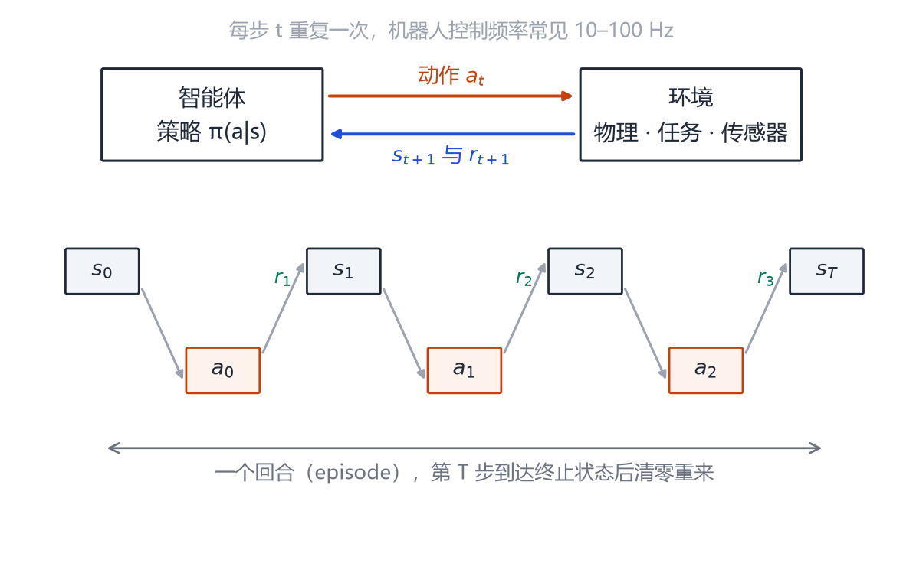
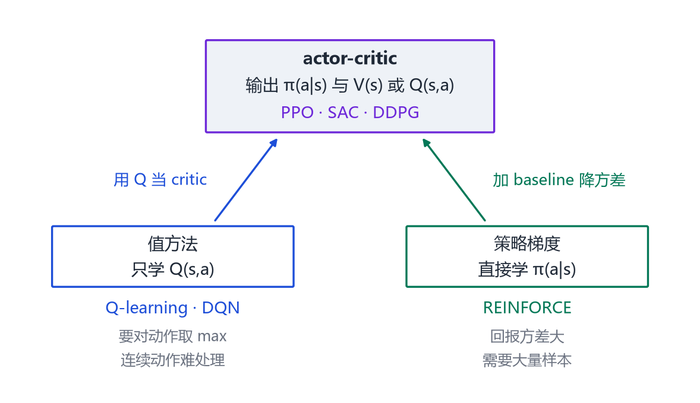
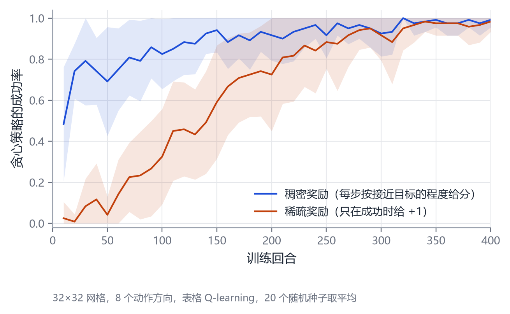

# 第 8 章　在试错中学习

> **本章导读**：强化学习不给标准答案，只给一个分数。这一章从"机器人怎么知道刚才那一手好不好"讲起，把试错学习拆成状态、动作、奖励、回报四件事，再讲值函数与策略梯度这两条技术路线，以及 PPO 和 SAC 这两个工程上真正在用的算法。读完这一章，你能看懂一篇机器人强化学习论文的实验配置，也能判断一个任务该不该用强化学习来做。

## 8.1 一个分数能教会什么

这一节要弄清楚的是，人没法手把手教机器人的那些动作，它能不能自己试出来。

监督学习把输入和标准答案配对，模型学"看到这个就输出那个"。这套办法在机器人身上很快撞墙。你没法给"这一帧画面下六个关节该转到哪个角度"标一个标准答案。同一个任务有无数种正确做法，人也写不出每个时刻的正确动作。抓杯子可以从上往下、从侧面、斜着进，每一种都能成功。

分数有两种给法。只在成功那一刻给 1 分、其余时刻给 0，这叫稀疏奖励（sparse reward）。每一步按距离给个小分数，这叫稠密奖励（dense reward）。前者让机器人多数时刻收不到反馈，后者容易教出投机行为。

分数还可能是延迟的。方块被推出去要滑半秒才停，结算发生在滑动结束之后。机器人得把半秒前的那一手和现在的分数对上号，这件事叫信用分配（credit assignment）。人看一眼录像就知道是哪一下推歪，算法只有一串带时间戳的数字。

能拿到的往往只是一个分数。方块推进目标区就得分，没推进不得分，推到桌子下面扣分。

把它写成数学，需要五个东西，通常叫马尔可夫决策过程（Markov Decision Process，MDP）。

- **状态** $s$，机器人此刻能拿到的全部信息，关节角、末端位姿、方块位置。拼成一个向量大约十维出头。
- **动作** $a$，能发出的指令，六个关节的目标角，或者末端的速度增量。取后一种是三维向量，每维限在正负 2 厘米每秒。
- **转移** $P(s'\mid s,a)$，做完动作之后世界变成什么样。推一下方块，它移动多少取决于摩擦和质量，同样的动作两次结果不会完全一样。摩擦系数 0.3 和 0.5 下，同样推 8 毫米，方块会滑 6 毫米或 3 毫米。
- **奖励** $r$，环境给出的分数，一个标量。没有方向，只有一个数，所以信息极少。
- **折扣** $\gamma$，把未来的分数折算到今天的系数，取值在 0 到 1 之间，常用 0.99。

把五个要素串成一步，样子是这样的。末端停在方块左侧 12 厘米处，六个关节角加末端位姿就是状态 s。策略输出一个动作 a，让末端沿 x 轴走 0.8 厘米。物理引擎按摩擦和质量算出结果，方块往右挪了 0.6 厘米，落后于末端，新状态下末端到方块的距离变成 11.8 厘米。奖励按负距离算是 -0.118，比上一步的 -0.12 略好。这一整段合起来就是一次转移。

状态里装什么，是设计时最容易出错的地方。数学上要求状态满足马尔可夫性（Markov property），意思是知道现在就不必知道历史，未来只取决于现在。真实系统很少天然满足这一条。只给关节角，机器人不知道方块在哪；只给当前一帧，它看不出方块往哪个方向动。缺掉的信息会以噪声的形式回到学习里，表现成同样的状态、同样的动作有时好有时坏。

补的办法是把最近三帧图像叠起来，加上末端速度和上一步的动作，代价是维度变高。也可以把历史交给网络去记，代价是训练更慢，也难以判断网络记住了什么。

状态凑不齐的坏法很直观。视觉模块偶尔把方块认丢一帧，这帧状态看起来和"桌上没方块"一样。智能体按当前画面选动作，实际方块还在原地，同一个状态在两次经历里给出了相反的奖励。值网络被这两条样本来回拉扯，损失降不下去。

第五个要素值得多说两句。γ 取 0.99，意味着 100 步之后的 1 分今天只值 $0.99^{100}\approx 0.37$ 分；取 0.9 时，20 步后的一分只剩 0.12 分。γ 因此决定了看多远。0.99 的有效视野约 100 步，10 Hz 下是 10 秒。想让机器人为 30 秒后的成功牺牲眼前收益，γ 得设到 0.995 以上。而 γ 越接近 1，值函数越容易发散。

一次从开始到结束的尝试叫回合（episode）。抓取任务的回合从回到初始位姿算起，到抓住或超时结束。图 8-1 上半部分是智能体与环境的循环，下半部分把同一个回合摊开成时间轴。

<figure class="fig">

<figcaption><b>图 8-1</b>　智能体与环境每一步交换一次动作、状态和奖励，若干步组成一个回合。回合结束时环境清零，状态回到初始分布。</figcaption>
</figure>

回合长度在机器人上有实际后果。太长，一次失败要等几十秒；太短，任务没做完就被截断，截断处的价值估计会偏。不少实现会把"超时"和"真失败"分开处理。超时那一步不做终止标记，只把回报截断，否则智能体会学到"快到时间就赶紧结束"这种投机行为。

有了这五元组，学习目标就能写清楚。策略 $\pi(a\mid s)$ 是一个从状态到动作分布的映射。按一条策略走完一个回合，得到轨迹 $s_0,a_0,r_1,s_1,\dots$，把沿途的奖励按折扣累加就是回报

$$G_t = r_{t+1} + \gamma r_{t+2} + \gamma^2 r_{t+3} + \cdots$$

$G_t$ 的下标 t 说的是"从第几步开始算"，不是"第几步的值"。$r_{t+1}$ 是做完第 t 步动作之后环境立刻返回的分数，它比状态晚一拍，所以下标是 t+1。后面每一项多乘一个 γ，第 k 步之后的奖励乘 $\gamma^k$。代一组数字，三步的回合奖励依次是 0、0、1，γ 取 0.9，站在第 0 步看回报是 0.81，站在第 1 步看是 0.9。

强化学习要找的，就是让期望回报最大的那条策略。整章剩下的部分都在回答同一个问题。在不知道转移和奖励的具体形式、只能靠采样看结果的情况下，怎么把这个期望往上推。

这个设定比监督学习弱很多，也比监督学习强很多。弱的地方在于每个样本只提供一个标量，信息量极低；强的地方在于不需要人来标注，机器人可以自己跑一整天生成几十万条样本。后面所有的困难，本质上都是这两件事的后果。

## 8.2 值函数与 Q-learning

这一节先回答一个很朴素的问题。既然没法把每条路都试一遍，机器人凭什么判断"现在站在这里还有多大希望"。

先评估再改进，是最自然的思路。给每个状态打一个分，表示"从这里出发、按当前策略走下去、平均能拿多少回报"，这个分就是状态值函数

$$V^\pi(s) = \mathbb{E}_\pi\left[G_t \mid s_t = s\right]$$

逐个符号读一遍。左边 $V^\pi$ 的上标 π 说明这个分是按策略 π 走出来的，换一条策略，同一个状态的分就变了。括号里的 s 是具体状态，比如"末端在方块左侧 12 厘米、方块在桌面中央"。$\mathbb{E}_\pi$ 是期望，对后面所有可能的轨迹取平均。$G_t$ 就是上一节那个折扣求和。竖线后面的条件表示从第 t 步处于状态 s 开始算。

如果还关心"在这个状态下做某个具体动作值多少"，就把动作也放进下标，得到动作价值函数 $Q^\pi(s,a)$。两者的关系很直接，状态值就是各动作 Q 值按策略概率加权求和。一个状态下只有两个动作，向左 0.7 的概率对应 Q 值 8.0，向右 0.3 对应 -2.0，状态值就是 $0.7\times 8.0+0.3\times(-2.0)$，等于 5.0。

值函数之间存在一个递推关系，这是整个领域的支点。从 $s$ 出发的回报，等于这一步拿到的奖励，加上打折后从下一个状态继续的回报

$$Q^\pi(s,a) = \mathbb{E}\left[r_{t+1} + \gamma\, \mathbb{E}_{a'\sim\pi} Q^\pi(s_{t+1},a')\right]$$

这就是贝尔曼方程（Bellman equation），它把无限长的求和压成相邻两步的关系。$r_{t+1}$ 是执行 a 之后立刻拿到的分数，它本身是随机变量，同样的动作在同样的状态下也可能给不同结果。$s_{t+1}$ 由环境的转移概率决定。里面的期望是对下一个动作取平均，从新状态开始还要接着按策略 π 选动作；外面的期望是对环境随机性取平均。

代数字验一遍。某个状态动作对出发后有两个结果，六成概率推成功，得 1 分，新状态的 Q 是 4.0；四成概率推空，得 0 分，新状态的 Q 是 1.0。γ 取 0.9。第一种情况的括号里是 $1+0.9\times 4.0=4.6$，第二种是 $0+0.9\times 1.0=0.9$。加权得到 $0.6\times 4.6+0.4\times 0.9=3.12$，这个数就是 $Q^\pi(s,a)$。它只用了两步信息，就把后面无限长的回报汇总完了。

有了它，就可以用自举（bootstrap）的方式迭代，拿当前的估计去修正当前的估计，不必等到回合结束。自举听起来像拔自己的鞋带那样不靠谱，逻辑上却成立。递推把长远换成了下一步的长远，后者可以用同一个函数在新状态上的值代替。代价是误差会沿链传递。

Q-learning 是这套想法最直接的实现。它不评估某个固定策略，而是直接逼近最优动作价值，更新式是

$$Q(s,a) \leftarrow Q(s,a) + \alpha\left[r + \gamma \max_{a'} Q(s',a') - Q(s,a)\right]$$

式子里 s' 是执行 a 之后到达的新状态，a' 是新状态里可以挑的任一动作。方括号那一项叫时序差分误差（TD error），衡量这一步的结果和原来的预期差多少。为正就把 Q 往上调，为负就往下调。α 是学习率，取 0.1 意味着每次只走完差距的一成。注意式子里没有转移概率，机器人不需要知道方块的质量和摩擦，只要真的推一下。

一个具体算例。γ 为 0.9，α 为 0.1，某个状态动作对的 Q 现在是 2.0。执行后拿到奖励 1，下个状态的最大 Q 是 4.0。目标值 $1+0.9\times 4.0=4.6$，误差 2.6，Q 变成 $2.0+0.1\times 2.6=2.26$。只用了这一次交互。

单步看不出收敛，接着往下算。假设同一次经历重来几遍，奖励一直是 1，下个状态的最大 Q 一直是 4.0，目标就固定成 4.6。第二轮误差 $4.6-2.26=2.34$，Q 变成 $2.26+0.1\times 2.34=2.494$。第三轮误差 $4.6-2.494=2.106$，Q 变成 2.705。第四轮误差 1.895，Q 变成 2.894。每一轮只走完剩下差距的一成，误差按 0.9 的比例缩小，十几轮之后 Q 就贴到 4.6 附近。学习率之所以叫步长，是因为它决定每次迈多远。

TD 误差还能当诊断信号。训练正常时它随时间下降，稳定在小值附近。一直很大且不降，多半是奖励尺度太大或学习率太高。周期性窜高，常见原因是终止标记错了位，最后一步目标值算错。长期接近零而成功率不涨，多半是策略卡在局部解上，该去看 ε 或熵项。把 TD 误差画成曲线，比只看总回报更容易定位问题。

表格法就是给每个状态动作对存一个数。它在小游戏上很好用，在机器人上立刻崩掉。一台 7 自由度机械臂，每个关节角离散成 100 个格子，状态空间是 $100^7=10^{14}$ 个格子。每个格子存一个 4 字节浮点数，需要 400 TB 内存，而这还没算上方块的位置和视觉观测。离散化本身也有害，相邻格子的动作差 0.01 弧度，末端位置就会跳，控制跟着抖。

所以 Q 必须换成参数化函数，输入状态或状态动作对，输出数值。DQN（2013）做的就是这件事，它用卷积网络吃 Atari 原始像素，输出每个动作的 Q 值。直接这么干会失败，原因有两个。

第一个是样本之间的相关性。监督学习假设样本独立同分布，而强化学习采到的连续帧几乎是同一张画面。网络会在最近几百帧上反复过拟合，刚学会的东西转头就忘。DQN 的解法是经验回放（experience replay），把 $(s,a,r,s')$ 存进缓冲区，训练时随机抽小批量。原始论文用的缓冲区是最近 100 万帧。随机抽样把时间上的相关性打散，同一条经验也能被重复利用多次，一举两得。

不加回放会怎样。机械臂连做 200 步"向左推"，这 200 条样本的画面、动作、奖励几乎一样。训一轮，网络会被拉向"这个画面下向左推很值"，其他分支没被更新。等它转去做"向右推"，前面那批更新造成的偏移又要几百步才扭回来。训练曲线因此一段好一段坏，很难判断是真进步还是在抖。

第二个是目标在动。更新式里的目标 $r+\gamma\max_{a'}Q(s',a')$ 含有正在训练的网络，网络一更新目标就变，像在追一个自己也在跑的东西。DQN 后来的版本用目标网络（target network）冻结一份旧参数，隔一段时间才同步一次，常见的设置是每 10000 步同步一次。也有实现用软更新，每一步只把旧参数往新参数挪千分之几。

目标网络的作用用一组数字就看清了。假设目标值应该在 5.0 附近。没有目标网络时，网络把 Q 往 5.0 推，参数一动，$\max Q(s',a')$ 也跟着涨到 5.3，下一次目标就成了 5.3，再下一次 5.6。网络永远差一截，误差不会收敛。目标在 10000 步内固定成 5.0 之后，网络拟合的是一个不动的函数，这是标准的监督学习，能收敛。隔 10000 步跳一次，网络再追新目标一小段。软更新相当于把这个跳跃拆成很多很小的跳跃，曲线更平滑。

这两个技巧是深度强化学习能工作的前提。后面几乎所有算法都保留了某种形式的回放缓冲或目标网络。DQN 论文里还有一组数值可以参考，ε 从 1 线性降到 0.1 用了 100 万帧，总共训练 1000 万帧。也就是说，为了在几个 Atari 游戏上达到人类水平，它看了相当于连续玩几十个小时的画面。

DQN 只在离散动作上成立，因为要对动作取 max。机械臂的关节角是连续的，取值有无穷多个，max 没法枚举。这个限制直接催生了下一节。

## 8.3 直接对策略下手

这一节换个方向问。值函数那一路得把每个状态动作对都估一个数，能不能跳过这层估值，直接改策略本身。

换个思路。既然最终要的是策略，为什么不把策略参数化之后直接优化它。让网络输出一个动作分布的参数，比如高斯分布的均值和标准差。然后调整这些参数，让拿高回报的动作出现得更频繁。

把策略参数化，最常见的形式是高斯策略（Gaussian policy）。网络吃进状态 s，输出均值 μ 和标准差 σ，机器人要动时从这个正态分布里抽一个数当动作。μ 决定它想做哪个动作，σ 决定它愿意偏离多远。σ 从 0.3 开始，动作会在 μ 附近散开，能试到别的做法；学到后面缩到 0.05 上下，动作就变确定了。

这个形式的好处是梯度好算。对数概率对 μ 的导数等于 $(a-\mu)/\sigma^2$。代一组数字，μ 是 0.5，σ 是 0.2，这次采样到 a 等于 0.7。导数就是 0.2 除以 0.04，等于 5。这 5 的意思是，这个动作比均值大了 0.2，想让这类动作多出现，就把 μ 往上推，推力正比于 5。

但这里有个死结，回报本身对参数不可微。奖励来自环境，中间隔着一整个物理世界，梯度传不回来。多推 1 毫米，方块最终停在哪，这个映射里有摩擦、有碰撞、有传感器噪声，写不出解析式。log-derivative 技巧绕过了这一点，把对策略参数的梯度写成可以用采样估计的形式

$$\nabla_\theta J(\theta) = \mathbb{E}_{\tau\sim\pi_\theta}\left[\sum_t \nabla_\theta \log \pi_\theta(a_t\mid s_t)\, G_t\right]$$

逐个符号读。θ 是策略网络的参数，可能是几万个浮点数。J(θ) 是期望回报，也就是要最大化的那个目标。左边那个倒三角是梯度，指向 J 增长最快的方向。$\tau\sim\pi_\theta$ 表示一条轨迹是按当前策略跑出来的。求和号遍历轨迹里的每一步。$\nabla_\theta \log \pi_\theta(a_t\mid s_t)$ 是一个与参数同维的向量，指向"让这个动作在这个状态下更可能出现"的修改方向。$G_t$ 是标量，说这条轨迹值多少分。两者相乘，就是"朝这个方向改这么多"。

推导只用到一个恒等式 $\nabla_\theta \pi = \pi\,\nabla_\theta \log \pi$，由链式法则直接得到，因为 log π 对 θ 求导是 π 分之一个 $\nabla_\theta\pi$，两边乘 π 就回去了。这个改写把"对所有轨迹求期望"换成了"采样平均"，技巧全在这一步。

代一组数字。某个状态下只有两个动作，当前策略给动作甲 0.7 的概率。这一次采样选中了甲，整条轨迹的回报是 10，甲的梯度大小是 5，梯度贡献就是 $5\times 10$，等于 50，方向是提高甲的概率。若下一次同样采样的回报只有 2，贡献就降到 10。差别全在乘的那个回报上。

式子的含义可以这样读。$G_t$ 大，说明这条轨迹整体不错，就把沿途每个动作的对数概率往上推；$G_t$ 小就往下压。梯度不用穿过环境，只用穿过策略网络。这类方法统称策略梯度，最朴素的实现叫 REINFORCE。

但这条式子在实践里方差极大。同一条策略跑两次，一次回报 10，一次回报 3，梯度方向可能完全相反。取十次回报看，依次是 10、3、8、1、12、5、7、2、9、4，平均 6.1，标准差 3.5，最小的 1、最大的 12 差了十二倍。用单个样本估梯度，等于在一个很宽的区间里猜方向。

方差大的后果是样本效率低，要跑很多回合才平均出可靠的方向。误差随样本数的平方根下降，想把估计误差压到十分之一，样本数得涨一百倍。这就是朴素 REINFORCE 在机器人上几乎不可用的原因，采一万条轨迹还不够稳。

方差有三个来源。环境有随机性，动作采样有随机性，还有一处来自评分方式，就是用整条轨迹的总回报去评价每个动作。第三点最关键。一条轨迹几十个动作，成功那一下可能只归功于其中两个，其余几十个本来无关，却被一起推了一把。

降方差的标准手段是减一个 baseline。把 $G_t$ 换成 $G_t - b(s_t)$，只要 $b$ 不依赖动作，梯度的期望就不变，因为 $\mathbb{E}_{a}\left[\nabla_\theta \log \pi(a\mid s)\right]=0$，方差却会小很多。这条等式是理解 baseline 的全部根据，它说的是"减掉一个与动作无关的常数，平均方向不变，每次的幅度变小"。

用数字验这个零等式。某个状态下三个动作的概率是 0.5、0.3、0.2，对应的 $\nabla_\theta\log\pi$ 是 2、-1、-3.5。加权求和得到 $1-0.3-0.7=0$。乘以任何只依赖状态的常数 b，结果还是 0，所以减掉 b 不改变期望。

再看方差怎么变小。要说清一件事，减 baseline 并不改变回报本身的方差，它改变的是梯度估计的方差。

回到上面那三个动作。概率 0.5、0.3、0.2，梯度方向 2、-1、-3.5，这一回拿到的回报分别是 10、8、12。不减 baseline 时，梯度估计的方差是 571。取 b 等于 10 之后降到 10.4，小了五十多倍，而期望仍然是 -0.8，一点没动。

原因在于每次估计都是"梯度方向乘回报"。回报里所有动作共有的那部分被乘进了方向，两者一搅就放大了波动。减掉一个与动作无关的数，恰好抽走这部分共性量。

最常用的 baseline 是状态值函数 $V(s)$。此时 $G_t - V(s_t)$ 有了名字，叫优势（advantage），记作 $A_t$，回答的是"这个动作比这个状态的平均水平好多少"。

好多少这个说法很关键。一个状态本身就很难，回报只有 2，但动作选得不错，那它仍然值得鼓励；另一个状态很容易，回报有 8，但本来能拿 10，那这个动作该被压制。用绝对回报分不出这两种情况，用优势可以。

这就是 actor-critic 的来历。actor 是策略网络，负责出动作；critic 是值网络，提供 baseline。两者一起训练，actor 用 critic 算出的优势更新，critic 用 TD 误差更新。图 8-2 把三条路线的关系画在一起。

<figure class="fig">

<figcaption><b>图 8-2</b>　值方法、策略梯度与 actor-critic 的关系。左边只会评估、右边方差太大，上面那条路用值函数当 critic 补上了策略梯度缺的那一半。</figcaption>
</figure>

这个结构也有代价。两个网络同时训，actor 的梯度依赖 critic 的准确度，critic 又依赖 actor 采到的数据。初期 critic 很不准，actor 跟着学歪，两边互相拖累。调这两个网络的学习速度，是这类算法最花时间的部分。

具体坏成什么样，看个数字例子。真实的状态值是 5.0，critic 刚初始化只估到 2.0。这一回实际拿到回报 6.0，按 $G-V$ 算优势得 4.0，看上去是个非常好的动作。按真值算优势只有 1.0，actor 被推了四倍于应有的力度。这类偏差在几个状态上同向出现，actor 就会朝一个系统性错误的方向走。走远了之后采到的数据更偏，critic 更难学好，两个网络一起偏下去。

## 8.4 两个工程主力

这一节处理的是一个很实际的麻烦。一批数据只能用一次，怎么让它多用几遍而不把策略弄崩。

策略梯度的想法很干净，落地时有个致命问题，步长。策略更新一步，采样分布就变了，旧数据立刻作废，所以这类方法天然是 on-policy 的，采完一批数据只能用一次。用一次就扔，样本效率低得离谱。步长太大又会让策略崩掉，崩了之后很难恢复，因为它已经采不到好轨迹，也就没有好数据纠正自己。崩的样子是均值从 0.5 跳到 1.2，下一批全落在没试过的区域，回报全负，梯度又把它拉回 -0.3。

PPO（Proximal Policy Optimization，2017）解决的就是"一次能走多远"。它用新旧策略的概率比

$$r_t(\theta) = \frac{\pi_\theta(a_t\mid s_t)}{\pi_{\theta_{\text{old}}}(a_t\mid s_t)}$$

衡量这一步改了多少。分子是新策略在状态 s 下选动作 a 的概率，分母是采样当时旧策略给同一个动作的概率。比值等于 1 表示这一点没改，大于 1 表示这动作变得更可能。用比值而不用概率本身，是为了与动作概率的高低无关。有了这个比值，再优化一个截断过的目标

$$L = \mathbb{E}\left[\min\left(r_t \hat{A}_t,\ \text{clip}(r_t,\,1-\epsilon,\,1+\epsilon)\,\hat{A}_t\right)\right]$$

逐项读。$\hat{A}_t$ 是优势估计，帽子表示它是估出来的，正数说明这动作比平均水平好。clip 把输入夹进区间，低于下界取下界，高于上界取上界。ε 通常取 0.2，上界就是 1.2，下界就是 0.8。上界的含义是这个动作的概率最多放大到 1.2 倍，下界的含义是最多压到 0.8 倍。最外层的 min 是整个设计的机关，只在"改得太过分且方向对自己有利"时起作用。

把数字代进去。优势 2.0，比值 1.0 时两项都是 2.0，贡献 2.0；比值 1.3 时，不截断项是 2.6，截断项是 2.4，min 取 2.4；比值 1.5 时两项是 3.0 对 2.4，仍取 2.4。比值超过 1.2 之后目标不再增长，梯度归零，策略不会因为这一条样本被推得更远。优势为负时上下界对调，比值低于 0.8 就封底，也就是拦住"把一个坏动作的概率无限制压低"。

于是同一批数据能反复用几个 epoch 而不弄崩策略，样本效率比朴素策略梯度高一个量级。信赖域方法要解一个带约束的二阶优化问题，PPO 不解约束，只把越界的奖励去掉。

PPO 论文里 MuJoCo 基准的配置可以当作起点。学习率 $3\times10^{-4}$，每轮采 2048 步，训练 10 个 epoch，小批量 64，折扣 0.99，GAE 的 λ 取 0.95。GAE（generalized advantage estimation）是优势估计的折中，λ 管偏差与方差的权衡，0.95 意味着优势混进了约 20 步的回报。写法是把每步的 TD 误差按 $\gamma\lambda$ 的幂累加。λ 取 0 时只看一步，偏差大方差小；取 1 时看到回合结束，偏差小方差大。这三个数（$3\times10^{-4}$、0.99、0.95）在绝大多数机器人任务上都能直接用，改动的收益通常不如改奖励函数大。

SAC（Soft Actor-Critic，2018）走另一条路。它是 off-policy 的，有回放缓冲，数据可以反复用。它的目标函数里多加了一项熵

$$J(\pi) = \mathbb{E}\left[\sum_t r_t + \alpha\,\mathcal{H}\big(\pi(\cdot\mid s_t)\big)\right]$$

熵衡量策略的随机性，这一项让智能体在能完成任务的前提下尽量保持随机。熵高的策略是"同一个地方每次出手都不一样"，熵低的策略是每次都一样。连续动作下熵的单位叫纳特（nat），高斯分布的熵等于标准差的自然对数再加一个常数 1.419。标准差 0.1 时熵是 -0.88，标准差 0.3 时是 0.22，两者差 1.1 纳特。α 取 0.2 时，这点随机性差别换成奖励是每步 0.22 分，一个 50 步的回合累计 11 分，足以把策略往随机那边拉。

听起来反直觉，效果却很好。随机性带来更广的探索，也让策略遇到扰动时有多套应对。α 可以固定，也可以自动调节，让熵维持在一个目标值附近。固定值在任务难度变化大时会失灵，太简单时探索不足，太难时熵项盖过奖励，机器人一直乱动。

SAC 在连续控制上还有两个细节。一是双 Q，同时训两个 Q 网络，取小的那个算目标，抑制 Q 值被高估，这个问题在函数逼近下几乎必然出现。高估的成因是取最大值，网络对每个动作的估计都带噪声，取最大相当于专挑被高估的那些。二是输出用 tanh 压缩的高斯，保证动作落在关节限位之内。论文里的通用配置是学习率 $3\times10^{-4}$，批量 256，折扣 0.99，目标网络软更新系数 τ 取 0.005，两个隐层各 256 个单元，回放缓冲 $10^6$。

表 8-1 把三者放在一起。

**表 8-1**　DQN、PPO、SAC 的对比。

| 维度 | DQN | PPO | SAC |
|---|---|---|---|
| 数据来源 | off-policy，回放缓冲 | on-policy，采完即用 | off-policy，回放缓冲 |
| 动作空间 | 离散 | 连续或离散 | 连续 |
| 数据复用 | 反复抽样 | 每批训 10 个 epoch | 反复抽样 |
| 稳定性 | 依赖目标网络 | 好调，社区默认首选 | 对奖励尺度敏感 |
| 典型场景 | 游戏、组合决策 | 运动控制、操作任务 | 精细操作、真机微调 |

PPO 在机器人领域靠的是可靠，而不是性能。它的超参在几十个任务上表现一致，失败了也容易看出是奖励写错了还是网络太小。SAC 的样本效率更高，但训练曲线常常前几百轮毫无动静，然后突然上去，排查起来更费劲。做工程时先用 PPO 把流程跑通，再考虑换 SAC 省样本，是更常见的顺序。

## 8.5 机器人为什么更难

这一节要回答一个让很多人卡住的问题。同一套算法在仿真里跑得欢，搬到真机上就废，差别究竟在哪。原因可以归成三条，这三条互相约束，想缓解任何一条，另两条往往跟着变差。

**稀疏奖励。** RLBench（2019）的 100 个操作任务，奖励是完成给 +1、其余全 0。这是最诚实的奖励写法，也是最难学的写法。一个 7 自由度机械臂在十几维的连续空间里随机试，碰到"抓住杯子"这个事件的概率近乎为零。类比一下，蒙着眼在房间里找开关，只有按对了灯才亮，其余时间没有任何反馈。人还能靠记忆和推理缩小范围，Q 表里没有这种能力。

一个具体的失败场景。只给成功奖励，机器人在前 50000 步里可能什么都没拿到。回放缓冲区里全是零奖励样本，TD 误差也全是零，网络参数几乎不动。看上去像训练卡住，其实是根本没东西可学。

三种对策都在用。示范引导，先用几十条人的示教把智能体带到任务附近。课程学习，把任务拆成难度递增的序列，从靠近学到抓，再学到搬。奖励塑形，加中间奖励把信号变密，代价是可能改掉任务目标，8.6 节会讲这件事的坑。

**样本效率。** PPO 在 MuJoCo 上一个任务要 100 万步起步，复杂的操作任务到千万步。真机以 10 Hz 跑，100 万步等于 27.8 小时不停机，而且每一步都在磨损减速器和夹爪。按一个减速器两万小时寿命算，一次训练就吃掉 0.14%，十次试错就是 1.4%。Isaac Gym（2021）把物理仿真搬上 GPU，单卡可以同时跑几千到上万个环境，论文里 Ant 任务用 8192 个并行环境最快，端到端训练比 CPU 仿真加 GPU 训练快两到三个数量级。这也是为什么现在的机器人强化学习几乎都在仿真里做，真机只负责收尾。

**真机安全。** 强化学习的探索本质是故意犯错，真机上犯错可能撞坏东西或者伤人。一个没做过动作限幅的策略，遇到相机被遮的瞬间可能输出超范围的关节角，机械臂一秒内扭到极限位置。

工程手段有急停按钮、力矩上限、工作空间盒约束、速度限制，这些都是硬约束，写在控制器里而不是策略里。算法手段有安全过滤器，把输出动作投影到安全集合内；也有仿真预训练加真机残差微调，让真机只探索几个百分点。人形机器人（2023）的做法是在数千个随机化环境里训练，然后零样本部署到真机，训练阶段完全不碰硬件。仿真随机化还能顺带缓解后两条。它对摩擦、质量、相机位置各加一层随机扰动。策略于是学到"在差别很大的环境里都能完成任务"，仿真与真机之间的差距被提平。

图 8-3 用一个网格世界的实测结果说明稀疏奖励与稠密奖励的差距。

<figure class="fig">

<figcaption><b>图 8-3</b>　32×32 网格上表格 Q-learning 的实测曲线，20 个随机种子平均，阴影为一倍标准差。稠密奖励第 20 回合成功率过半，稀疏奖励到第 150 回合才过半。</figcaption>
</figure>

这条曲线值得读细一点。稀疏奖励不是学不会，末期成功率也到了 0.97，只是慢了七倍多。而且这还是一个二维网格，动作只有 8 个方向，状态只有 1024 个。换成 7 自由度机械臂，差距会从倍数变成"能不能学会"。另一件事是阴影的宽度。稀疏奖励在前 150 回合的方差极大，意味着同样的代码换个随机种子，可能这次学会、下次学不会。这类不可复现性在论文里常被隐掉。

顺带说一个容易忽略的点。网格实验里稠密奖励用的是势能塑形，不是随手写的距离项。把每步惩罚直接写成到目标的距离，同一套参数下成功率会一直停在 0.1 附近。原因是每步惩罚累加起来的量级远超成功奖励。值函数被拉到负几十，学习率的步长相对这个量级太小，动作之间那点差别学不出来。奖励的绝对尺度对训练的影响，比大多数人以为的大。

## 8.6 推方块的奖励怎么写

这一节要弄清楚的是，算法都是现成的，真正要自己写的那一行代码往往是奖励函数。写错一行，算法会把错的那一行执行得非常完美。

把上面这些落到一个具体任务上。桌上一个方块，机械臂把它推到桌面上的目标点，误差 2 厘米以内算成功。动作是末端的三维速度增量，控制频率 10 Hz，一个回合最长 10 秒。

最直觉的奖励是"越近越好"

$$r_t = -\|p_{\text{block}} - p_{\text{goal}}\|$$

跑起来会发现一堆坏行为，每个都能从奖励函数里读出原因。

**顶着方块不动。** 不动的话距离不变，扣分是个常数；乱动可能把方块推远，扣得更多。在折扣下保持现状比冒险划算。这不是机器人懒，是奖励在说"别动"。

**手贴在方块上磨蹭。** 如果奖励里还加了末端到方块的距离项，两个距离同时变小就能拿高分，于是机器人学会把手停在方块旁边，一个动作都不做，分数还挺好看。

**把方块推向自己。** 这一条最隐蔽。当目标恰好在机器人这一侧时，"接近目标"和"接近自己"在不少状态里可以同时满足，策略会找到一个既省力又能刷分的姿势，看起来像在推，其实方向是错的。

**沿等距线绕圈。** 距离是个标量，不含方向信息。机器人可以沿着以目标为圆心的弧线来回移动，距离不变，奖励不变，但它在动，视频里看着很努力。

修的办法是把奖励拆成三项，各有各的职责

$$r_t = -\alpha\, d_t + \beta\,\mathbb{1}\left[\text{success}\right] - \eta\,\|a_t\|^2$$

第一项是距离项，提供稠密的学习信号。第二项是成功项，只在成功那一步给大正数。它保证最优策略真的把方块推到目标，而不是停在附近刷分。第三项是动作惩罚，压制抖动和大幅动作，也让顶着不动变得不划算。

权重给个量级。α 取 1.0（距离以米计，取值在 0 到 1 之间），β 取 10 到 100，η 取 0.01 到 0.1。β 太小，智能体学会停在 3 厘米处刷分，成功率上不去；β 太大，距离项被淹没，又退回稀疏奖励，学习曲线变成图 8-3 里那条慢的。η 太大会把探索压死，机器人学会"最小动作"这个安全策略，任务永远做不完。

还有一个更干净的写法，叫基于势能的奖励塑形（potential-based reward shaping）。不加任意形状的距离项，而是加一个势能差

$$r'_t = r_t + \gamma\,\Phi(s_{t+1}) - \Phi(s_t)$$

只要 Φ 只依赖状态、不依赖动作，这个改动就不会改变最优策略，只是把学习信号变密。取 $\Phi(s) = -\|p_{\text{block}}-p_{\text{goal}}\|$，就得到"靠近给正分、远离给负分"，而且理论上保证最优解不变。

代一组数字。方块原来距目标 30 厘米，一步之后到了 24 厘米，Φ 从 -0.30 变成 -0.24。γ 取 0.9，塑形项的贡献是 $0.9\times(-0.24)-(-0.30)$，等于 0.084。这比成功那一刻的 1 分小得多，但每一步都有，信号密度完全不同。反过来，另一次从同样的 30 厘米出发却被推远到 33 厘米，塑形项变成 $0.9\times(-0.33)+0.30$，等于 0.003，几乎为零而不再是大幅惩罚。还有一个细节，因为 γ 小于 1，势能本身会被打折，所以方块一动不动时塑形项也会给一点正分。这不影响最优策略，但会让回报的绝对值偏高一点，看曲线时不要被它骗。这也是势能塑形比直接写距离项的另一个好处，它不会把值函数拉到很深的负区间。

这个性质来自一个关于策略不变性的结论。实践中非常好用，因为可以放心加引导项，不用担心把任务目标改掉。前提条件是 Φ 真的只看状态，而且 Φ 在终止状态上的值要统一，否则还是会被钻空子。

塑形也有陷阱。Φ 里塞进不该用的信息，或者势能形状和任务目标不一致，智能体就会找到漏洞。上面那个"把方块推向自己"的行为，本质就是势能写错了。势能奖励的是方块靠近目标，而机器人用一个让方块靠近自己的方式满足了它，因为目标点恰好在自己这一侧。判断标准很朴素，把学到的策略录下来看，如果人看着觉得它在作弊，那它确实在作弊，奖励写错了。

这就是强化学习在机器人上的处境。算法已经相当成熟，PPO 和 SAC 的开源实现都在，接口也不复杂。真正难的是把一个物理任务翻译成一个不会教出坏行为的奖励函数。这件事目前主要靠人，靠反复看视频、改奖励、再训一遍，一轮常常是几天。

还有一个数字值得记住。一次训练动辄几百万步、几小时到几天，而人学推方块只需要看两次示范。差距不在算法优劣，在信息渠道。试错只用到"结果好不好"这一个比特，示范用的是"每一步该怎么动"这一整条轨迹。下一章走另一条路，把这条轨迹直接用起来。
