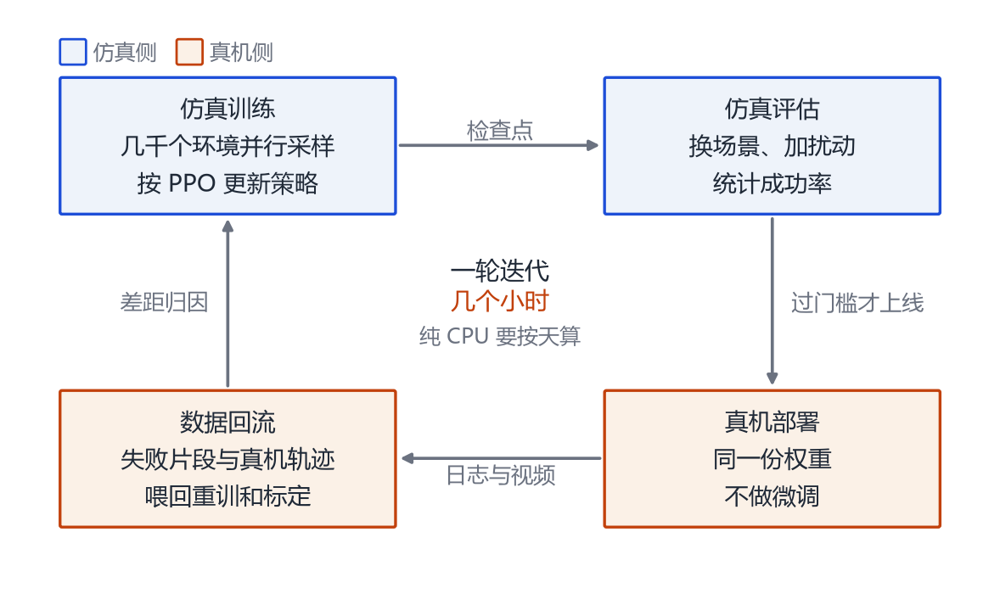
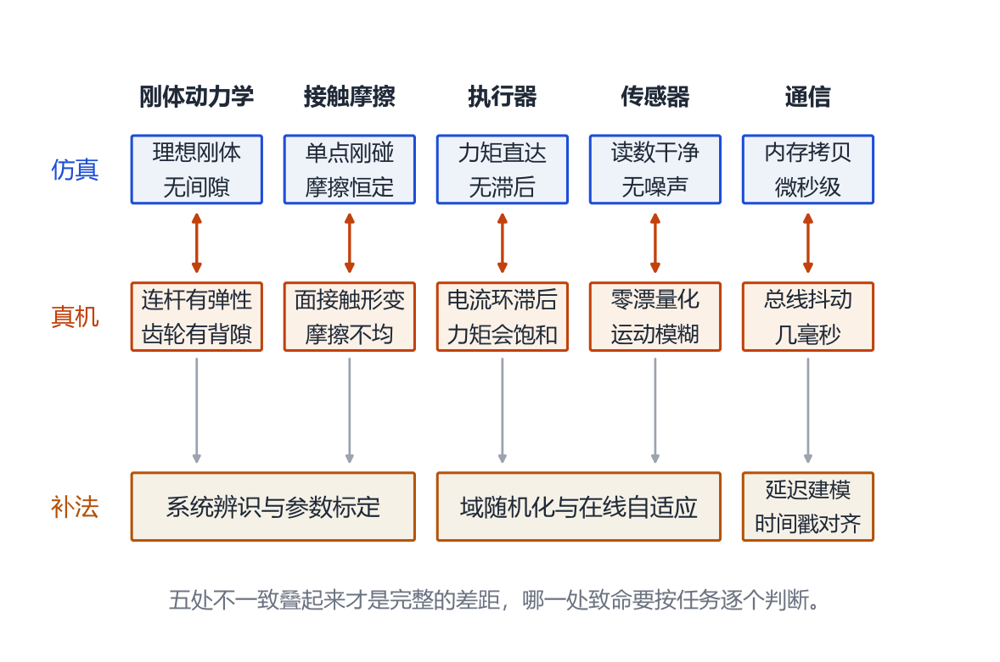
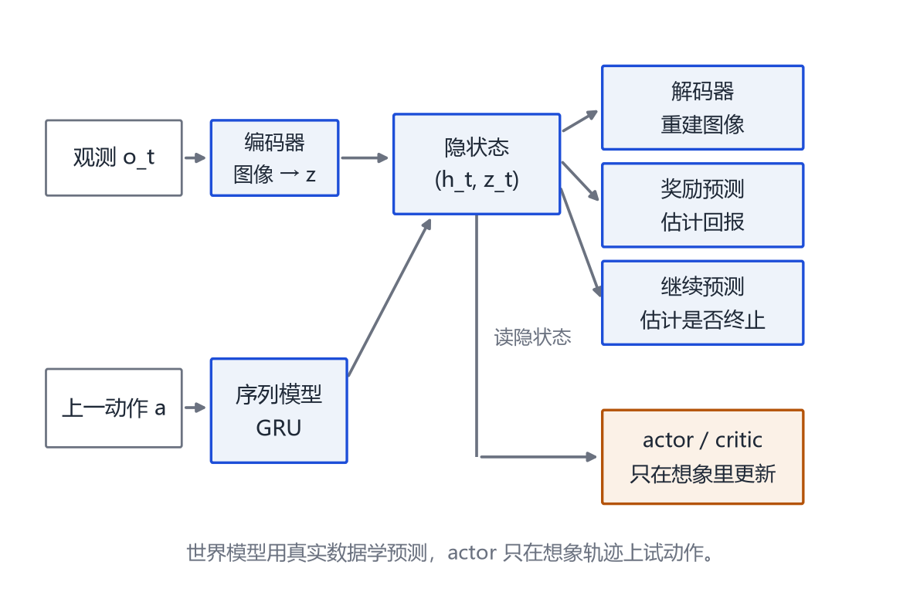

# 第 10 章　在仿真里练习

> **本章导读**：在真机上试错太慢也太贵，一台四足机器人摔一次，轻则换条腿，重则停机两周。这一章讲物理引擎在每个时间步到底解什么方程、为什么接触是它最容易失手的地方，GPU 并行和域随机化怎样把训练时间从几周压到几小时，仿真与真机之间的差距从哪五个地方漏进来，世界模型和视频生成又想用什么方式替代引擎。读完这一章，你能判断一个仿真里跑出来的数字值不值得信。

## 10.1 物理引擎在算什么

上一章讲模仿学习时留了一个问题。示教数据要靠人一条一条采，采一百条要一整天，而策略要泛化到没见过的物体，需要的量级远不止一百条。强化学习绕开了人，它自己在环境里试错，可一旦把试错放到真机上，代价立刻变得难以接受。一台四足机器人摔倒一次，轻则换腿，重则停机两周。速度同样卡人，一次抓放任务 5 秒，两台机器日夜不停地跑，一天也就三万多次尝试，而接触丰富的操作策略往往需要上千万次。

于是所有路线最终都拐进仿真。物理引擎的任务很简单，每个时间步回答一个问题，再过一毫秒，场上所有物体的位置和速度变成什么样。这在数学上是一组二阶微分方程

$$M(q)\ddot{q} + C(q,\dot{q}) + g(q) = \tau + J^{\top} f_c$$

$q$ 是关节角组成的向量，机器人摆成什么姿势由它决定。$M(q)$ 是质量矩阵，描述每个关节被推动时“有多沉”，臂展伸直时惯量大、收起来惯量小，所以它是 $q$ 的函数。$C(q,\dot{q})$ 收进科氏力与离心力，$\dot q$ 是关节速度。$g(q)$ 是重力项，$\tau$ 是电机给出的力矩。$f_c$ 是接触力，$J$ 是雅可比矩阵，作用是把末端受到的一牛顿力换算成各关节上的等效力矩。

左边前三项都是光滑函数，右边第一项是控制输入，这一半工作几十年前就做完了，递归牛顿-欧拉算法能在正比于关节数的计算量里把加速度解出来，二十个自由度的机器人一次求解不到一毫秒。麻烦全在那个 $f_c$ 上。

接触力不是想给多少就给多少。一只杯子放在桌上，桌面对它的支持力必须刚好抵消重力分量，多一点杯子被顶起来，少一点杯子陷进桌面。数学上这写成一组互补条件

$$f_c \ge 0,\quad \phi(q) \ge 0,\quad f_c \cdot \phi(q) = 0$$

$\phi(q)$ 是两个物体之间的间隙，正常状态下是非负的，只有算错时才会变成负数，也就是穿透。三个条件连起来说的是，要么分开且力为零，要么接触且力非负，不存在“贴着却不施力”的中间状态。这个非此即彼的结构，就是接触问题的全部麻烦。

### 两个盒子撞一下

把互补条件放进一个最小的场景，就能看清求解器每一步在算什么。盒子 A 质量 1 千克，以 1 米每秒朝盒子 B 走。盒子 B 质量也是 1 千克，静止不动。两个盒子在同一条水平线上，接触面垂直于运动方向。先不考虑摩擦，也不考虑重力。

求解器真正要算的是一个冲量（impulse），也就是力乘作用时间。碰撞里决定结果的是这个乘积，不是力有多大。力可以很大而时间极短，乘积一样。两块刚体之间的等效质量由两者的质量共同决定，写法和两个弹簧串联时算等效刚度是同一个形状。

$$m_{\text{eff}} = \frac{1}{1/m_A + 1/m_B},\qquad J = (1+e)\,v_{\text{rel}}\,m_{\text{eff}}$$

第一个式子算等效质量，m_A 和 m_B 是两个盒子的质量，单位千克。第二个式子算冲量，e 叫恢复系数（coefficient of restitution），取 0 表示撞完黏在一起，取 1 表示完全弹开，v_rel 是两者接近的相对速度，单位米每秒。

代一组数字。两个质量都是 1 千克，等效质量等于 1 除以括号里的 1 加 1，得 0.5 千克。取 e 等于 0，冲量等于 1 乘 1 乘 0.5，也就是 0.5 牛·秒。这个冲量同时作用在两个盒子上，方向相反。A 的速度从 1 米每秒降到 0.5，B 从 0 升到 0.5。两者的动量加起来是 1 千克·米每秒，和撞之前一样。

能量就没这么守恒了。撞之前只有 A 在动，动能是 0.5 乘 1 乘 1 的平方，等于 0.5 焦耳。撞之后两个各 0.5 米每秒，加起来 0.25 焦耳，少掉的一半变成了热和声音。

恢复系数换成 0.5 再算一遍。冲量变成 0.75 牛·秒，A 的速度降到 0.25 米每秒，B 升到 0.75 米每秒，动量仍然是 1，动能剩下 0.313 焦耳。e 越大，冲量越大，弹得越开，损失的能量越少。

加上摩擦，问题就不再是一个除法。假设接触面的摩擦系数是 0.5，两个盒子之间还有 1 米每秒的相对切向速度。切向上想完全止滑，需要的冲量是等效质量乘相对速度，0.5 牛·秒。摩擦能传的上限是法向冲量乘摩擦系数，0.75 乘 0.5 等于 0.375 牛·秒。上限小于需求，滑就止不住，实际只传过去 0.375。切向的相对速度降到 0.25 米每秒，剩下的要靠后面几步慢慢磨掉。

把一个接触单独抽出来看，它只是一个除法加一个截断。真正贵的是多个接触耦合在一起。五个盒子摞成一摞，最底下那个要承受上面四个的重量，而每个接触的力又受它自己那一对盒子的相对运动影响。求解器用的是 Gauss-Seidel 迭代，一次只更新一个接触，把前一个接触算出的力当成已知，循环扫很多遍。

迭代次数直接决定这摞盒子有多黏。迭代 4 次，力还没传到底层，盒子之间会互相陷进去一点。迭代 50 次，力基本收敛，可一步的时间涨了十倍。这就是堆叠场景在仿真里要么软塌塌、要么慢得跑不动的原因。

麻烦具体有四层。接触集合随时在变，每算一步，哪些点接触、哪些点分离都可能变化，方程组的规模跟着变，上一帧分解好的矩阵下一帧用不上。摩擦是锥约束，切向力被法向力卡住，$|f_t| \le \mu f_n$，问题从线性方程组变成非线性规划。多接触还要一起解，五指手包住杯子时同时二十多个接触点，六十个未知量落在同一个方程组里。再往里一层是刚性带来的麻烦，刚体碰撞要在半毫秒内把 0.5 m/s 降到零，等效加速度上千 m/s²，显式积分要保持稳定，步长必须小到这个尺度的几分之一。

工程上有两类答案，思路正好相反。

一类是把接触变软。MuJoCo 允许一点点穿透，把接触力写成穿透深度的弹簧阻尼函数，力随深度增长，再在互补约束下用凸优化求一组满足条件的解。好处是方程组始终光滑，对步长宽容，坏处是接触带上“海绵感”，刚度与阻尼参数要按场景调。MuJoCo 的默认时间步是 2 毫秒，关节物体在这个步长下相当稳。

另一类是保持刚性但切子步。PhysX 的 TGS 求解器把一个大步切成若干子步，每个子步跑一次 Gauss-Seidel 迭代，靠“少量迭代、多次重复”逼近真实的冲量分布。Isaac Gym 给出的配置很有代表性，Ant 用 1/120 秒的物理步长配 1/60 秒的控制步长，ANYmal 用 1/200 秒配 1/50 秒，Franka 叠方块则两者都是 1/60 秒。物理频率比控制频率高 2 到 4 倍，是这个行业里最常见的比例。

时间步选大了会出什么事，写过仿真的人都见过。物体穿墙，堆叠的盒子自发炸开，关节速度飙到几千弧度每秒然后整条轨迹变成 NaN。这类失败很少是代码写错，多数是方程在这组参数下已经病态。补救手段有减小步长、增加子步、开启连续碰撞检测，代价都是变慢。

### 时间步和稳定

软接触把法向力写成穿透深度的函数，最常用的是弹簧加阻尼。弹簧的刚度 k 单位是牛每米，含义是压进去 1 米需要多大的力。MuJoCo 里一个 1 千克的物体，接触刚度常在 10 的 5 次方到 10 的 6 次方牛每米这个量级。

压进去 1 毫米，刚度取 10 的 6 次方，力就是 1000 牛。作用在 0.1 千克的小零件上，加速度是 10000 米每二次方秒，大约一千个重力加速度。这个数字说明为什么穿透要控制在零点几毫米以内，多压一点，力就大得离谱。

刚度还决定了这个接触自身的振动频率，也就是力在接触面上来回弹的固有节奏。

$$\omega = \sqrt{k/m},\qquad f = \frac{\omega}{2\pi},\qquad \Delta t \lt \frac{2}{\omega}$$

第一个式子算角频率，k 是接触刚度，m 是被推物体的质量，ω 的单位是弧度每秒。第二个式子把它换算成赫兹，除以 2π 相当于把弧度换成一整圈。第三个式子是显式积分的稳定条件，Δt 是步长，小于号后面的 2 除以 ω 就是能容忍的上限。

代数字。k 取 10 的 6 次方，m 取 0.1 千克，ω 等于 3162 弧度每秒。除以 2π 得到 503 赫兹，周期接近 2 毫秒。稳定条件要求步长小于 2 除以 3162，也就是 0.63 毫秒。

MuJoCo 的默认步长是 2 毫秒，比 0.63 毫秒大 3 倍。它能稳定，是因为求解器把力的计算放在未知的新状态上一起解，这叫隐式积分，稳定域比显式宽得多。0.63 毫秒这条线限定的是自己写积分器的人，用显式欧拉往前推，刚度一大就炸。

### 一次具体的穿透

夹爪以 0.5 米每秒往下压，物理步长 1 毫秒，每一步夹爪往下走 0.5 毫米。这个距离很小，大约是一根头发丝的五倍。

问题出在检测的时机上。求解器在一步的末尾检查几何关系，此时两个物体的间隙可能只剩 0.3 毫米。一步走完，夹爪已经进了盒子 0.2 毫米，这一帧才被判成接触，力要到下一帧才算得出来。

下一帧夹爪又下去 0.5 毫米，穿透变成 0.7 毫米。刚度取 10 的 5 次方，法向力是 70 牛，作用在一个 0.2 千克的盒子上，加速度 350 米每二次方秒。这个力足够把盒子推开，可夹爪是位置控制的，它只按轨迹往下走，不管手上有多大的反力，于是穿透继续加深。

穿透超过一毫米，不少求解器会触发一个保护。它把这一对物体当成用户故意插进去的装配，直接不再生成接触约束。夹爪和盒子从此变成两块互相嵌着的刚体，盒子不被推开也不被挤走，跟着夹爪一起动，看上去像被牢牢抓住了。

这个失败最难查，因为画面完全正常。它要到放下物体那一刻才暴露，盒子没有掉，它卡在夹爪里面。或者松手之后被积攒的穿透力弹出来，飞出去半米远。

关于引擎，有一个来自图形学的误解需要先拆掉，画得像不像和算得准不准是两件独立的事。Isaac 系列的渲染走 RTX 光线追踪，物理走 PhysX，两半可以分开用。MuJoCo 的渲染很朴素，但它在关节体上的接触精度口碑很好，DeepMind 的四足行走和手内操作实验大多在它上面跑。表 10-1 把常用的四款放在一起对比。

**表 10-1**　四款常用仿真器的定位对比。

| 仿真器 | 物理精度 | 渲染 | 并行方式 | 许可 |
|---|---|---|---|---|
| MuJoCo | 关节体与接触精度高，软约束凸优化求解，默认步长 2 ms | OpenGL 光栅，写实度低，可外接渲染 | 单进程多环境，MuJoCo 3 起提供 MJX 的 GPU 批量后端 | Apache 2.0 |
| Isaac Lab | 基于 PhysX 5，TGS 子步，接触丰富操作可用，需按场景调参 | RTX 路径追踪，可直接做视觉域随机化 | 单卡数千环境，物理与网络同卡，不经 PCIe 往返 | BSD-3 |
| PyBullet | Bullet 求解器，CPU 串行，小物体与薄壳容易穿透 | 基础 OpenGL，写实度低 | 多进程并行，无 GPU 批量 | zlib |
| SAPIEN | 基于 PhysX，擅长带可动部件的关节物体 | 光追渲染，材质较真实 | SAPIEN 3 起支持 GPU 批量数千环境 | MIT |

## 10.2 几千个环境同时跑起来

一个接触丰富的操作策略，训练时消耗的环境步通常在 $10^8$ 到 $10^9$ 之间。单进程仿真一个环境，物理步 1 到 2 毫秒，一天不吃不喝也就采到千万步量级，凑够十亿步要按月算。把进程开满一台 32 核工作站能压到几天，但样本的相关性还在。

GPU 并行仿真换了一个思路。几千个环境互不依赖，正好可以放进同一批线程里同步推进，同一条指令处理所有环境的数据，每一步的墙钟时间几乎不随环境数增长，吞吐就随环境数线性上升。Isaac Gym（2021）报告的加速是两到三个数量级，并且给了具体曲线。Ant 环境从 256 个环境加到 8192 个，达到 7000 分的时间从 1000 秒降到 100 秒，单张 A100 上最高跑到每秒 70 万环境步。Humanoid 更贵，自由度多、要走起来，256 个环境下要 2.7 小时，4096 个环境下 17 分钟，吞吐约每秒 20 万步。论文里还有一个更贴近操作的例子，用 LSTM 策略做 Franka 叠方块，2.5 小时里跑出连续 37 次成功。

这些数字背后有一个容易被忽略的设计。物理仿真和神经网络在同一张卡上，物理引擎算完的状态就在显存里，直接以 PyTorch tensor 的形式交给策略网络，梯度也算完再写回去，整个过程不经过 PCIe。CPU 仿真的瓶颈往往不在算力而在搬运，一万个环境每步拷几兆数据，带宽立刻成为上限。

### 为什么几千个环境几乎不多花时间

一块 GPU 里有几千个计算核心，它们被编成几十个组，同一时刻整组执行同一条指令，只是各自的数不同。这种执行方式叫单指令多数据。物理引擎里绝大多数运算是同一种算术套在不同环境的数据上，比如八千个机器人同时算同一个关节的加速度，正好对得上这种执行方式。

代价是整齐。同一个组里的所有环境必须走同一条代码路径，谁多算一次，整组都得等它。一个环境已经结束、另一个环境还在算二十个接触点，那么这一步的时间由最慢的那个决定。

用带宽算一遍账最直观。一个 Ant 环境的状态大约 50 KB，包括关节角、速度、接触缓存和地形高度采样。单看一步，这些数据要读一遍写一遍，合计 100 KB。

CPU 上单核能用到的内存带宽通常是每秒几 GB，取 2 GB 算，一秒能搬四万个环境步的数据。账面上限很高，实际跑不到，因为瓶颈不在带宽而在分支。物理求解每步要扫接触到收敛，接触数一变，循环次数就变，CPU 的分支预测一旦猜错就要清空流水线重来。实测下来一个核同时跑两三个环境就已经很满，多开只是让它们互相抢缓存。

GPU 处理分支的方式不同。整批环境被拉到同一个接触数上对齐，少的那部分用空运算补齐，代价是一次空转而不是一次清空流水线。

GPU 的显存带宽在一块 A100 上是每秒 1.5 TB。跑到每秒 70 万环境步时，数据流量是 70 万乘 100 KB，约 70 GB 每秒，只占了带宽的 5%。剩下的余量足够把环境数再翻几倍。

还有一个常数开销绕不过去。每次让 GPU 开始干活都要一次内核启动，耗时 3 到 10 微秒。一个环境单独跑一步，这 5 微秒就是全部成本。八千个环境一起跑一步，这 5 微秒还是那么多，摊到每个环境上不到一纳秒。这就是墙钟时间几乎不随环境数增长的真实原因，固定开销被摊薄了。

### 两个上限

显存是第一个上限。一个环境要装状态、接触缓存、场景网格和渲染缓冲，几百 KB 到一 MB 不等。算 500 KB，八千个环境是 4 GB，一块 40 GB 的卡按这个数能装到八万个。数字看着宽松，真正的占用常被低估，因为训练时还要同时放下策略网络、优化器状态、梯度缓冲和一次前向的中间激活。

以一个人形机器人策略为例，网络三层、每层 512 个单元，参数量约 80 万，加上 Adam 优化器要存的两份动量，一共不到 10 MB。真正占地方的是激活，一批 8192 个样本、每层 512 维，一层激活就是 4 MB，二十层就是 80 MB。这些加起来仍远小于环境本身。

实际项目里撞上限的往往是渲染。视觉策略要给每个环境渲染一张 128×128 的图，一张 3 个通道一字节，就是 48 KB，八千个环境是 400 MB，再加上深度图和光追的中间缓冲，翻几倍。这时显存的账就从“够用”变成“要挑”。

时间跨度是第二个上限，也比显存更容易被忽略。假设一次迭代要采 26 万个样本，八千个环境下每个环境只分到 32 步，按每秒 60 步的控制频率算，就是 0.53 秒的经历。两千个环境下每个环境分到 128 步，也就是 2.1 秒。

差别落在策略能看到什么上。四足走路的一个步态周期大约 0.6 秒，0.53 秒连一个完整周期都不到，策略在每一步里看到的都是“抬腿到一半”这一种相位，学不到两条腿怎么交替。这就是 Humanoid 超过 4096 个环境反而变差的原因，不是样本不够，是每个样本都太短。

两个上限指向同一个结论。环境数不是越大越好，它有一个和任务时间尺度挂钩的甜点区。步态类任务常在两千到八千之间，操作类任务因为单个回合更长，常用的数反而低一些。

上面那条曲线之所以好看，前提是每个环境的计算量差不多。一个环境摞了五个盒子，另一个只摞两个，整批的时间就被前者拖住。Isaac Gym 的应对是给每批限制一个最大接触数，超出的部分留给下一步。

对写代码的人来说，并行仿真带来的最大变化是接口形状。以前 `step` 吃一个动作返回一个观测，现在吃形状为 $(N, a)$ 的张量返回形状为 $(N, o)$ 的观测，环境结束时自动重置并在返回值里带一个 mask。同一个脚本同时跑四千个环境，日志要按环境分组统计，随机种子要按环境分流，批归一化的统计量要在环境之间共享。这些细节不影响算法正确性，却能让同一份代码在两套仿真上差出好几倍。

把这些环节串起来看，整个流程是一个环（图 10-1）。训练产出检查点，评估决定这一版能不能上线，部署在真机上跑出数据，数据回流到训练和标定。工程上优化的重点通常不是把某一段做快，而是缩短环的周长，让一次完整迭代从三周变成一天。

<figure class="fig">

<figcaption><b>图 10-1</b>　仿真训练到真机部署的迭代环。蓝色为仿真侧，橙色为真机侧，箭头标出一轮里各处传递的东西以及量级差异。</figcaption>
</figure>

还有一件反直觉的事。四千个并行环境如果摆的是同一张桌子、同一个杯子、同一束光，那么四千份数据其实高度重复，策略学到的是“这张桌子上的这个杯子”。并行只解决了样本数量，没解决样本多样性。想把多样性也补上，就要动下一节的东西。

## 10.3 域随机化

仿真里那些和真机对不上的参数，理论上可以测出来。系统辨识就是干这个的，拿真机跑几组激励轨迹，拟合每个连杆的质量、质心、摩擦系数、电机常数，让模型响应逼近实测。这套方法在工业机器人上很成熟，代价是每换一台机器、每换一次工具都要重测，机械臂用旧了齿轮磨损，参数还会漂。

域随机化（domain randomization）换了个更省事的思路。既然不知道确切值，那就别猜，让训练时的参数在一个区间里随机取值，把真机看成这个分布里的又一个采样。Tobin 等人在 2017 年用这个办法做了目标定位，训练图像全部来自仿真，纹理是随机贴的、完全不像真实物体，检测器搬到真机上定位误差做到 1.5 厘米，还能挡住干扰物和部分遮挡。他们还试了纹理数量的影响，少于 1000 种随机纹理时性能明显下滑，说明随机化本身的量就决定了泛化。

需要随机化的东西可以分三类。

**视觉。** 光照的方向、强度、色温，桌面与背景的纹理，相机的内外参和安装位姿，场景里的无关杂物，曝光时间带来的运动模糊，传感器的色彩偏移与噪声。视觉策略对纹理和光照的敏感程度远超人的直觉，换一块桌布就能让成功率掉一半。常用的范围是光照强度 0.3 到 3 倍，色温 2500 到 9000 K，相机安装位置 ±3 厘米，朝向 ±5 度。过头的样子也能看见，把亮度随机到 0.02 倍，图里几乎全黑，策略学到的不是认物体，而是凭动作历史瞎猜，一到有光的真机就全乱。

**物理。** 连杆质量与质心，地面的摩擦系数与坡度，关节阻尼和干摩擦，电机的力矩上限与转速上限，PD 控制的增益，末端负载的质量与惯量。这一类的随机化直接改变动力学方程里的系数，效果比视觉随机化更“硬”，也更容易把策略逼到保守的一端。常用的范围是质量与质心取标称值的 0.7 到 1.3 倍，地面摩擦 0.3 到 1.2，关节阻尼 0.5 到 2 倍。摩擦随机到 0.05 到 3 这么宽就过头了，策略会发现靠摩擦支撑不可靠，改成拿身体压着地往前蹭，这套动作在真机上把膝盖磨得发烫。

**传感与延迟。** 观测噪声的幅度与频率特性，编码器的量化误差，IMU 的零偏漂移，相机帧率的抖动与丢帧，控制指令到执行的延迟。跑酷学习那篇工作（2023）把本体感知的延迟随机到 37.5 到 47.5 毫秒，这个区间看着很窄，却是策略能在真机上保持平衡的关键之一。噪声通常按传感器手册标准差的 2 到 3 倍取，延迟在实测值上下 10 毫秒内浮动。延迟一旦随机到 0 到 200 毫秒就过头了，策略学会提前两百毫秒预判，真机延迟只有 40 毫秒时它的动作全部超前，走起来像在抽掳。

随机化到什么程度，是这套方法里最需要经验的地方。区间太窄等于没做，真机一旦落到区间外，策略的表现会断崖式下跌。区间太宽同样有害，把质量随机到 0.1 到 10 倍，策略学到的是一条对所有质量都勉强能用的折中轨迹，动作会变得又慢又保守。判断区间是否合适有三个可操作的办法。一是看真机参数落在区间的哪个分位，理想情况是落在中间偏内而不是贴着边界。二是在区间两端各跑一遍评估，两端都能完成任务才算覆盖住了。三是检查有没有退化解，比如策略学会用高频抖动蹭着走、或者靠卡在接触面上获得支撑，这类行为在真机上通常立刻失效。

随机化的代价是样本效率。参数一变，同一个观测对应的最优动作就变了，策略要花更多样本才能收敛，这也是它必须和 GPU 并行绑在一起用的原因，并行使样本便宜，随机化使样本变稀，两者互相抵消一部分，净收益仍然很大。

## 10.4 差距的五个来源与在线自适应

做完系统辨识、加完随机化，仿真和真机之间仍然有差距。这个差距不是一个数字，而是五个不同性质的东西叠在一起，图 10-2 把它们排成两行对照。

<figure class="fig">

<figcaption><b>图 10-2</b>　sim2real 差距的五个来源与常用对策。上排是仿真里的假设，中排是真机上的实际行为，箭头只表示对照关系，不对应具体数值。</figcaption>
</figure>

**接触模型。** 仿真里两个刚体相碰，接触在一步之内建立，力集中在几个离散点上。真机的橡胶垫会压缩零点几毫米，接触力在 5 到 10 毫秒里逐渐建立，接触面是一个有面积的压力分布。这个差别最典型的症状是“夹住了却打滑”和“插进去一毫米就卡死”，前者因为法向力建立得太快太硬，后者因为真实物体边缘有倒角有毛刺，理想直角根本插不进去。

**摩擦。** 仿真里摩擦系数是一个常数，真机上它随位置、湿度、灰尘和磨损变化。同一块橡胶垫，干燥时和沾了灰之后，摩擦系数能差出一倍以上。

**执行器动力学。** 仿真里给关节一个力矩，力矩立刻生效。真机上力矩要经过电流环（带宽几百赫兹）、减速器（有背隙，谐波减速器通常在几弧分，行星减速器可能到十几弧分）、输出端的轴承摩擦，还要受到绕组温度和电池电压的影响。同一路电流在不同温度下产生的力矩不一样。

**传感噪声。** 编码器有量化误差，十九位编码器一圈五十多万个刻度，折算到关节上是千分之几度，看着很小，做微分求速度时会被放大。IMU 有零偏，几分钟漂出零点几度。深度相机在黑色和反光表面上直接没有读数。

**通信与延迟。** 仿真里观测、策略、动作在同一个进程里，延迟接近零。真机上从相机曝光到图像进内存要 30 到 60 毫秒，从策略输出到力矩生效要经过总线，抖动一两个毫秒甚至更多。延迟本身不致命，致命的是它和执行器滞后叠在一起形成的相位滞后，纠正做晚了就变成振荡，振荡起来只能降增益，降了增益动作就软。

五处差距里，前两处影响接触瞬间的成败，中间两处影响稳态精度，通信那处影响稳定性。它们不独立，处理手段却不同，工程上很少有人追求把仿真调到和真机一样，而是分开对付。

RMA（Rapid Motor Adaptation，2021）是“分开对付”里的一个漂亮例子。它不试图让仿真变准，而是在策略里加一个在线估计器，让机器人自己判断“现在处于什么参数下”。结构上分两块。基础策略 $\pi$ 以 100 Hz 运行，输入当前状态、上一步动作和一个八维的隐变量 $z_t$，输出目标关节位置。自适应模块 $\phi$ 以 10 Hz 运行，输入最近 50 步的状态与动作（大约 0.5 秒的历史），输出对 $z_t$ 的估计。训练分两阶段。第一阶段在仿真里跑，环境参数（质量、质心、摩擦、地形高度、电机强度）是已知的“特权信息”，用一个编码器 $\mu$ 把它们压成 $z_t$ 直接喂给策略，策略因此可以针对不同参数分化出不同行为。第二阶段固定策略，用监督学习训练自适应模块从历史里回归 $z_t$，数据来自当前策略自己的轨迹。

部署到 A1 四足机器人上时不做任何微调。结果是沙地、泥地、草丛、碎石堆上零失败，沿山道下楼梯成功率 70%，翻越水泥堆和卵石堆 80%，而训练时它从没见过会下陷的地面和带植被的障碍。适应时间不到 1 秒，也就是走两三步的功夫，而靠系统辞识的方法要提前采 4 到 8 分钟的数据。这个思路的一般形式是，域随机化处理“参数落在哪个分布”，在线自适应处理“这一台这一时刻具体是多少”，两者一前一后，覆盖了静态差距和时变差距。

## 10.5 世界模型与视频生成

物理引擎是人把方程写进去，世界模型是从数据里把方程学出来。动机很直接。引擎擅长刚体，碰上布料、面团、流水就力不从心；引擎里的视觉来自渲染器，和真实相机的成像差着一段；更根本的是引擎不可微，梯度没法穿过仿真回传到策略。

Dreamer 系列给出了一套被反复验证的结构，图 10-3 是它的骨架。编码器把当前观测压成一个离散的隐状态 $z_t$，序列模型（一个 GRU）吃上一个隐状态、上一个随机状态和上一步动作，递推出新的隐状态 $h_t$。两个量合起来构成“世界在我眼里的样子”。解码器从这组隐状态重建观测，奖励预测头估计这一步的回报，继续预测头估计回合是否会终止，这三个头提供了训练世界模型所需的监督信号。actor 和 critic 不接触真实环境，它们在隐空间里从当前状态往前滚十几步，用预测出的奖励和终止概率算回报，再据此更新策略。

<figure class="fig">

<figcaption><b>图 10-3</b>　Dreamer 的模块结构。编码器把观测压成隐状态，序列模型负责递推，三个预测头提供监督信号，actor-critic 只吃想象出来的轨迹。</figcaption>
</figure>

这样做的收益是样本效率。真实环境的一步要走物理引擎，想象里的一步只做一次 GRU 前向和几个线性层，便宜一到两个数量级，而且梯度可以直接穿过整条链。DreamerV3 用同一套超参数在 150 多个任务上超过了各自专门调过的基线，模型规模从 1200 万到 4 亿参数都能稳定训练，还是第一个不靠人类数据、不靠课程学习就在《我的世界》里挖到钻石的算法。

风险也在同一个地方。世界模型会在自己预测出的状态上训练策略，一旦模型在某个区域不准，策略就可能找到一条在模型里回报很高、现实里根本不存在的路，学名叫模型利用（model exploitation）。症状是训练曲线漂亮得不像话，真机上一塌糊涂。缓解手段是压缩想象的长度、在真实数据上持续校正模型、对不同维度的预测误差分别加权。

视频生成模型给这条路加了一个更激进的版本。Cosmos（2025）把世界基础模型定义为“世界模型的预训练底座”，从两千万小时视频里筛出约一亿个 2 到 60 秒的片段，用扩散模型和自回归两种架构分别训练，再针对具体场景做后训练。UniSim（2023）走的是另一条，把互联网视频和动作标注结合起来，学一个可以对动作作出反应的通用模拟器。

问题同样具体。最明显的一条是物理守恒，生成出来的视频里物体可以凭空出现、相互穿透、碰撞后速度方向违背直觉，因为模型优化的是像素似然而不是动量守恒。动作可控性排第二，给模型一个手向右移 2 厘米的条件，画面可能整体平移，也可能毫无反应，动作与后果的对应关系没有被显式约束。再就是不快，生成一秒视频要几十秒甚至几分钟，比实时慢一到两个数量级，闭环控制等不起。还有评测，没有真值可比，很难证明它预测的物理是对的，只能靠人眼看。最要命的是分布外，恰恰在最需要预测的接触瞬间和遮挡时刻，训练视频里的样本最少，生成得最不准。

一个合理的定位是，视频模型现在适合做数据增广和粗略的策略评估，不适合塞进控制回路当物理引擎用。它像一个见过很多场景的画家，画得出像样的未来，但你不敢让机械臂按这幅画去动。

## 10.6 什么时候仿真会骗你

有一个反直觉的事实值得先说清楚。仿真画面越接近照片，结论不一定越可靠。渲染器可以做出以假乱真的光照，物理求解器却仍可能在接触上错得离谱。

五类场景是公认的高危区。

**软体。** 布料、海绵、面团、装满水的袋子，形变由材料本构决定，仿真里用有限元或者位置动力学近似，杨氏模量、泊松比、阻尼极难测准。表现是仿真里布能顺利铺平，真机上却总是堆成一团。

**透明物体。** 玻璃杯和塑料瓶在深度相机里经常是一片空洞，红外结构光直接穿过去或者被镜面反射带走。渲染上要算折射和多次反射，物理上要处理薄壁接触。仿真里看着正常的抓取，真机上相机根本没看到杯子在哪。

**绳索与线缆。** 一根绳子有几十上百个接触点，还要处理自己和自己接触，拓扑一变求解器就得重建约束。绳索的弯曲刚度很小，一点点数值阻尼就会让它在仿真里显得“硬”，于是策略学到的拉力在真机上完全不够。

**多接触堆叠。** 叠五个盒子，误差在每一层接触上累积，求解器的迭代次数决定了这摞盒子有多“黏”。常见现象是仿真里堆得稳稳的塔，真机一松手就倒，或者反过来，真机稳的东西在仿真里总在抖。

**精细装配。** 轴孔配合的间隙可能只有 0.1 毫米，插进去靠的是几牛的力和几十微米的横向调整。仿真要达到这个精度，接触模型、力传感器模型、装配件的倒角都得对，否则策略学到的是“大力出奇迹”，真机上只会把零件顶飞。

判断一个仿真结论能不能用，可以问三个问题。成败是不是由小于一毫米的间隙或者小于一牛的力决定，如果是，接触精度就是瓶颈。传感器会不会被渲染伪影骗过去，任务越依赖深度和反光，视觉仿真的可信度越要打折。时间尺度是不是接近控制周期，如果策略依赖几十毫秒内的反馈，延迟和抖动改变的是稳定性结论，不只是精度。

回答完这三个问题，通常会发现一个规律。仿真在“动作大、容错宽、接触少”的任务上非常可信，locomotion、推、抓大物体、开门都属于这一类；在“动作小、容错窄、接触多”的任务上，它的结论只能当参考，必须用真机数据校正。

仿真解决的是“在哪里练”，练出来的策略仍然只是一串从观测到动作的映射。要让机器人在一堆障碍和约束里自己找出一条能走通的路，还需要另一套工具，那是下一章的事。
