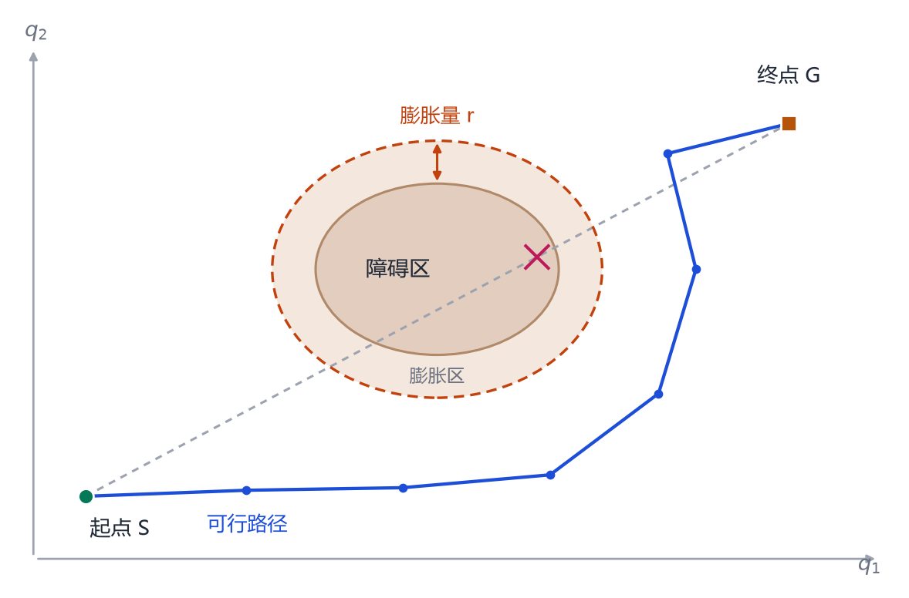
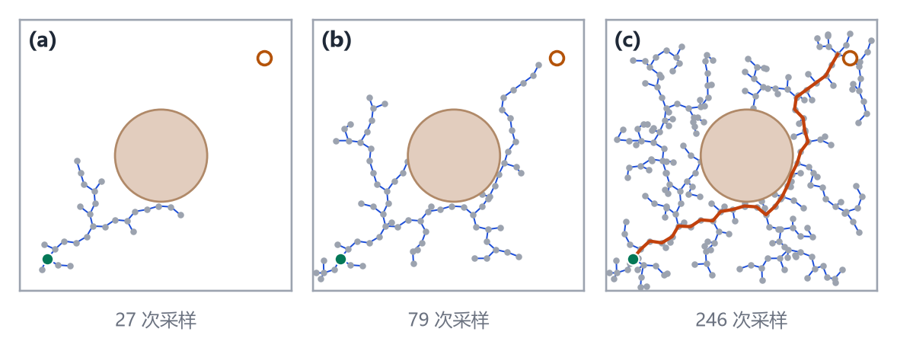
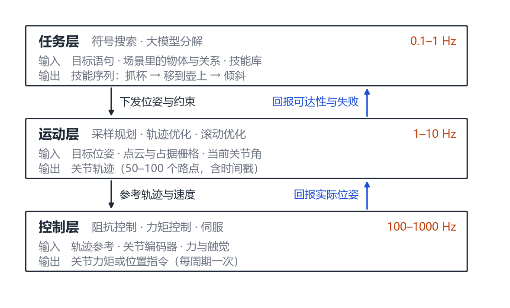

# 第 11 章　规划一条可行的路

> **本章导读**：上一章在仿真里把策略练了出来，练完还得面对一个更朴素的问题，从当前位置到目标位置，中间那几十厘米该怎么走。这一章讲运动规划这条技术线，从构型空间与障碍膨胀开始，经过图搜索、随机采样、轨迹优化、滚动优化，一直讲到任务与运动的联合规划。读完这一章，你能判断一次抓取失败是"找不到路"还是"路走得不稳"，也能看懂规划器为什么有时几十毫秒返回、有时几秒钟还在转。

## 11.1 一个姿态就是一个点

这一节回答一个问题。机械臂要从桌子左边挪到右边抓杯子，这条走法用什么方式描述，才能交给算法算。

机械臂现在停在桌子左边，杯子在右边，中间隔着盘子、水壶和一根立柱。任务本身只有一句话，实现它却需要一条从当前构型到抓取位姿的连续、无碰撞、可执行的路径。这条路径怎么来，是规划要回答的全部问题。

一台七轴协作臂，给七个关节各一个角度，整个机器人的构型就唯一确定了。这七个数排成向量，称为一个构型（configuration）。七就是这个系统的自由度（Degree of Freedom，DoF），意思是它能独立改变的运动的个数。把每个关节角看成一个坐标轴，七个关节撑起一个七维空间，里面每个点对应机器人的一个构型，这个空间叫构型空间，通常记作 $\mathcal{C}$。

七个里有一个是余出来的。手爪摆好一个位姿要六个自由度，三个管位置、三个管朝向，第七个只让手臂有更多选择。人的手臂也是七个，肩三个、肘一个、腕三个，所以手肘能抬高放低，手掌却停在原处。

规划器要输出的是 $\mathcal{C}$ 里的一条曲线。这跟大多数人第一反应的"手的轨迹"不是一回事。末端执行器（手爪）在工作空间里走一条 20 厘米的直线，七个关节角的变化可以全都不是直线，肩转 30 度、肘伸 40 度、腕反向补偿保持夹爪竖直，各自的速度曲线也不同。人用手画直线的时候肘在画弧，机械臂是一回事。

这笔账可以算。小臂长 0.6 米，肘转 20 度约合 0.35 弧度，乘上臂长得到 0.21 米，正好是那 20 厘米。同一段时间里手腕要反着转回接近相同的角度，夹爪才保持竖直。只看手的轨迹，这些差别一个都看不见。

有人会问，那为什么不直接在六维位姿空间里连一条直线，再交给逆运动学求关节角。因为逆解既不唯一也不连续。一个末端位姿最多有八组关节解，相邻两个位姿落进不同解支时，关节角会凭空跳 170 度，机器必须在那一瞬间把自己拧过去。

有了构型这个概念，避障可以写成一句非常干净的话。定义一个函数

$$
\mathrm{collide}(q) = \begin{cases} 1, & \text{机器人在构型 } q \text{ 下与场景相交} \\ 0, & \text{否则} \end{cases}
$$

$q$ 是七维关节向量。取值为 1 的那些 $q$ 组成的集合叫构型空间障碍，其余部分叫自由空间。于是"机械臂别撞到东西"变成"这条曲线不要穿过障碍区"。一个关于三维几何的问题，被翻译成了一个关于高维空间的点集问题。

麻烦全在这个函数怎么算。机器人本体是几万个三角面片，桌面和物体也是。判定一个 $q$ 是否碰撞，要把面片变换到世界坐标再做相交测试，成熟库一次查询在几十微秒到一毫秒之间。可规划器一次要问几万到几十万个构型，按 0.1 毫秒一次算，十万次就是 10 秒。规划快不快，八成取决于碰撞查询省不省。

这里还埋着一个坑。规划器检查的是离散构型，机器人执行的是连续轨迹，两个相邻构型都不碰，中间那一段却可能穿过去。要么把线段细分，每 1 厘米查一次，要么用连续碰撞检测直接算扫掠体的相交。前者简单，后者严谨，代价都是时间。

这个坑有多深可以量。步长取 0.05 弧度，在 0.6 米长的小臂末端就是 3 厘米位移，一根筷子能被整根跨过去，两端都判定安全。要抓住这种细障碍，步长得压到 0.005 弧度，查询次数涨十倍。

## 11.2 障碍为什么会变大

这一节回答一个问题。机器人没有真的变胖，为什么规划器要它绕开的范围比原来宽出一圈。

如果机器人是一个点，障碍就是障碍本身。可机器人有体积，一个构型代表整个身体的位置，只要身上任何一部分碰到东西，这个构型就不可行。把所有不可行构型收起来，得到的障碍比原来的物体大一圈。这就是膨胀。

二维里最好算。半径 $r$ 的圆盘机器人在平面上移动，构型空间里它退化成一个点，障碍要向外扩张 $r$，扩张出来的形状是原障碍与半径 $r$ 圆盘的 Minkowski 和。机器人被缩成点，代价是障碍长大 $r$。做法是把障碍上每个点都换成一个半径 $r$ 的圆盘，再并成一片。

代价是双向的。走廊两侧各长 $r$，一条净宽 $W$ 的通道，中心能走的宽度只剩 $W-2r$。门洞净宽 0.9 米，半径 0.35 米的圆盘机器人穿过去只剩 0.2 米，每边 10 厘米。带底盘的移动机械臂横向尺寸常到这个数。

举个能算的例子。门洞宽 0.9 米，机器人宽 0.5 米、厚 0.4 米，正着穿过去两侧各剩 0.2 米，看着宽裕。斜着过就不一样，一个矩形转过角度 $\theta$ 后占用的横向宽度是 $w|\cos\theta| + d|\sin\theta|$，最坏情况出现在某个中间角度，值等于 $\sqrt{0.5^2+0.4^2}\approx 0.64$ 米。余量从 0.2 米掉到 0.13 米。人的直觉按宽度算，构型空间的算法按最坏朝向算，后者才是安全的那一个。

这个式子说的是，矩形转过一个角度之后横向占的宽度是两个投影相加。$w$ 是宽 0.5 米，$d$ 是厚 0.4 米，$\theta$ 是机身穿门时的偏转角。代 45 度进去，两项分别是 0.354 和 0.283，加起来 0.637，正是那个 0.64。

机械臂的膨胀远没有这么规整。七个关节耦合在一起，连杆之间的相对位置随构型变化，构型空间障碍是一团高维的、带孔洞的不规则曲体，写不出解析式，只能靠上面那个碰撞函数一点一点地问。这一点决定了后面所有方法的形状。既然障碍的形状问不出来，就不要去构造它，直接问点。

高维里有多少个点要问，粗算一遍就有概念。先只算六个必需关节，每个按一圈的行程，每 10 度切一格，每轴 36 格。六轴互相独立，总格数是 36 的 6 次方，约 22 亿格。每格问一次碰撞，按 0.1 毫秒算，扫一遍要 22 万秒，六十多个小时。

22 亿容易被误读成还行。它的分辨率只有 10 度，在 0.6 米的连杆末端就是 10 厘米位移。抓杯子要的对准精度是 5 毫米，差二十倍。每轴从 36 格提到 360 格，总格数乘一百万，变成 $2.2\times10^{15}$，扫一遍从六十小时变成约七千年。分辨率每提一档，代价是六个数量级。

膨胀还有第二个麻烦，保守性。工程上常用球体近似机器人，一串包住连杆的球让碰撞检测变得极快，代价是膨胀过度，把本来能过的缝提前堵死。夹爪张开 8 厘米去抓直径 3 厘米的杯子，两指之间还剩 5 厘米，用一个包住整个夹爪的球去近似，这条缝在构型空间里直接消失，规划器会老老实实报告无解。

<figure class="fig">

<figcaption><b>图 11-1</b>　二维构型空间里的避障示意。灰虚线是两点直连，被障碍挡住；浅色环是障碍按机器人半径 r 外扩出的膨胀区，蓝色折线是绕行的可行路径。</figcaption>
</figure>

图 11-1 里那圈浅色环就是膨胀量。真正要绕的不是中间的障碍，是外圈那条虚线边界，规划器眼里的墙比人看到的更靠外。很多明明有缝却过不去的抱怨，原因都在这里。

图里还有个细节。蓝线绕障碍时贴着膨胀边界走，因为贴边走最短。这条最短在真实世界里意味着离障碍刚好一个半径，任何跟踪误差都变成一次擦碰。实用系统会在膨胀之外再加一层软约束，长度多几个百分点，余量翻倍。

## 11.3 在图上找最短路

这一节回答一个问题。既然障碍的形状画不出来，能不能把空间切成小块，在块与块之间连线，问哪条线最短。

障碍的形状问不出来，那就退一步，把空间切成格子。每个关节按固定步长分格，相邻格之间连边，八邻域的做法是上下左右加四个斜角，直走代价 1，斜走代价 $\sqrt{2}$。二维的 500×500 地图就是 25 万个格点，每个格点最多八条边。

在这个图上找最小代价路径，最直接的办法是 Dijkstra。它维护每个点当前已知的最小代价 $g$，每次从优先队列里取出 $g$ 最小的未处理点，用它的邻居做松弛。因为边权非负，一个点第一次被取出时，它的 $g$ 就已经是最终答案。复杂度是 $O(E\log V)$，25 万格点上跑一遍通常在几十毫秒量级。

松弛这个词要拆开。取出一个点 $u$ 之后，对它每个邻居 $v$ 算候选值 $g(u)+w(u,v)$，$w$ 是这条边的代价，直走 1，斜走 1.414。候选值比 $v$ 原来的 $g$ 小，就把 $g$ 改小并记下它从 $u$ 来。$\log V$ 那一项来自优先队列。

问题是 Dijkstra 像水波一样向四周均匀扩散，明明终点在东北方向，它也要先把西南方向的格子铺满。A* 加了一个启发式 $h$，按 $f = g + h$ 排序，$h$ 是对"从这个点到终点还剩多少代价"的估计。若 $h$ 从不高估真实剩余代价，称它可采纳（admissible），A* 返回的路径一定最优。直觉是，可采纳的估计只会让人更早去看有希望的方向，不会错过真正的最短路线。

可采纳这条要求比看上去严。八邻域地图上，欧氏距离可采纳，斜走一格的真实代价 $\sqrt{2}$ 恰好等于欧氏距离，估计不多不少。曼哈顿距离就不可采纳，从 $(0,0)$ 到 $(1,1)$ 它给出 2，真实代价是 1.414，高估了 41%，于是 A* 可能为了这条"看起来贵"的斜边绕远路，返回次优解。

高估的账可以算。从 $(0,0)$ 走到 $(3,3)$ 全走斜线，真实代价是 $3\times1.414=4.24$。曼哈顿口径给出 $3+3=6$，多算 1.76。剩下的步数每多一步斜走，误差就多 0.586。

先看一个能口算的栅格例。地图 3 乘 3，起点 $(0,0)$，目标 $(2,2)$，中间 $(1,1)$ 是障碍。起点的两个邻居 $(1,0)$ 与 $(0,1)$，$g$ 都是 1，欧氏 $h$ 都是 $\sqrt{5}\approx 2.24$，$f$ 都是 3.24。取 $(1,0)$，它右边的 $(2,1)$ 得到 $g=2.41$、$h=1$、$f=3.41$，$(2,0)$ 是 $g=2$、$h=2$、$f=4$，$(1,1)$ 被挡住跳过。再取 $(0,1)$，它的 $(1,2)$ 也是 $f=3.41$。取 $(2,1)$ 之后到 $(2,2)$，代价 $3.41$，这条路是两条直边加一条斜边。换曼哈顿口径，$(1,0)$ 的 $h$ 变成 3，$f$ 升到 4，排序顺序变了。这张图上它多半仍会走到 3.41，只是中间多展开两三个格子，代价是时间白花。

$h$ 越准，扩展的格子越少。空旷地图上，欧氏 A* 扩展的格点常比 Dijkstra 少一个数量级，$h$ 恒为 0 时它就退化成 Dijkstra。代价函数也可以自己设计，给转弯加惩罚让路径少拐弯，或者用第 7 章的 ESDF 让路径走中间。

启发式也可以故意不满足可采纳。把 $f = g + \varepsilon h$ 里的 $\varepsilon$ 取到 1.5 或 2，扩展的格子再少一半到三分之二，代价是路径最长变成最优的 $\varepsilon$ 倍。这个做法叫加权 A*，在每秒要重规划十次的导航系统里很常见。

分辨率是另一个开关。格子从 5 厘米缩到 2 厘米，格点数按平方涨，500×500 变成 1250×1250，共 156 万格。定得粗则窄缝被抹掉，一条 4 厘米的缝配 5 厘米的格子，缝所在的格子有半个压在障碍上，判定就是占据。

栅格法还有一个执行层面的毛病。八邻域路径只有八个方向，走出来的线是一串 45 度的锯齿。真实系统搜完会接一步捷径处理，尝试把当前点连到更远某点的直线，视线检查通过就替换中间那串折线。路径能短 3% 到 8%，拐弯数从几十个降到三五个。

图搜索的死穴在维度。二维 25 万格还能忍，七维按每轴 0.05 弧度分格就是 $10^{14}$ 的量级，指数一涨，任何常数优化都救不回来。

$10^{14}$ 可以顺着上面的算法推。每轴 0.05 弧度，一圈就是 126 格，七轴是 $126^7$，约 $5\times10^{14}$。单格 0.1 毫秒，扫完要 $5\times10^{10}$ 秒，一千五百年上下。把碰撞检测提速一千倍，仍要一年半。

## 11.4 撒点比划格子便宜

这一节回答一个问题。铺满七维要上百年，能不能换个办法，撒点让它们自己连成一条路。

算一下七维到底多大。七个关节各按一圈的行程，分辨率取 0.1 弧度，每轴 63 格，总数 $63^7 \approx 4\times 10^{12}$。每格做一次碰撞检测，按 0.1 毫秒算，扫一遍要 12 年。这条路直接堵死。

采样式方法换了个思路。它不填满空间，只采有限个点，让这些点把自由空间连起来。连不连得上取决于体积和连通性，不取决于格子总数。这就是它在高维里活下来的原因。维数灾难针对的是用网格覆盖，不是用样本连通。

PRM（Probabilistic Roadmap）是最早的一版。在自由空间里随机撒一两千个点，把距离小于阈值 $r$ 且连线不碰障碍的点对连起来，得到一张路线图。查询时把起点和终点接上去，跑一次 A*。它适合同一场景反复查询，建图一次，之后每次求解都是毫秒级。弱点是窄通道，缝比采样间距窄时点落不进，图在那里断开，规划器说无解，实际有解。

窄通道这个弱点可以量。三个物体之间的缝宽 6 厘米，七维里的自由体积占比可能只有千分之一。撒两千个点，落进这条缝的期望是两个，两个还要连上才成通道。想稳定连通得撒到两万，建图从 0.2 秒涨到 2 秒多。

RRT（Rapidly-exploring Random Tree）更直接。从起点长一棵树，每次随机采一个点，找到树上离它最近的节点，朝那个方向走一小步，不碰障碍就接上新节点。随机点落在哪棵子树外围，那棵子树就长得更快，它的 Voronoi 区域更大，被采中的概率更高，于是树自动朝没探索的空间长，像藤蔓找缝。它具备概率完备性，给定无限时间，只要解存在，找到的概率趋于 1。

节点数随维度涨得温和。二维几十到两三百个，七轴臂几千个，十四维的底盘加双臂要几万个。

概率完备翻成人话。给它足够多的采样，只要那条路真的存在，它最终一定会找到。采样越多，找不到的概率越接近 0，但永远不等于 0。它没承诺多快找到，也没承诺路好走。栅格法要么找到要么证明无解，采样法只能说还没找到。

<figure class="fig">

<figcaption><b>图 11-2</b>　RRT 在同一张地图上的三个阶段，节点数分别为 27、79、246。树先铺满起点附近，再绕过障碍，并由橙色折线连到目标。</figcaption>
</figure>

图 11-2 的三个 panel 是同一次运行的三个快照。27 个节点时树还挤在起点附近，79 个节点时已经摸到障碍上下两侧，246 个节点时有一条分支碰到目标附近，于是回溯出一条路。

RRT 的毛病是路径质量。它找到的第一条路往往歪歪扭扭，同一个场景跑两次结果不同，好坏全看运气。RRT* 用两个改动把质量补上。选父这一步，新节点不只接最近的那个点，而是在半径 $r_n$ 内的所有邻居里挑一个使总代价最小的当父节点；重连这一步，检查经过新节点能不能让已有邻居的代价变小，能就改它的父。树因此会自我修正，代价随样本数单调下降。

渐进最优翻成人话。样本越多它给出的路越短，样本趋于无穷时长度几乎必然等于最短的那条。这是极限上的承诺，有限样本下仍可能长百分之几。

Karaman 与 Frazzoli 在 2011 年把这件事讲清楚了。RRT 概率完备但不渐近最优，代价收敛到一个比最优值差的值；RRT* 渐近最优，样本趋于无穷时代价几乎必然收敛到最优。代价是多一层邻居查询，时间与空间复杂度变成 $O(n\log n)$ 和 $O(n)$，仍与 RRT 同阶，他们的实验里两者运行时间的比值收敛到常数，二维无障碍场景跑到了 100 万次迭代。连接半径取 $r_n=\gamma(\log n/n)^{1/d}$。$r_n$ 是第 $n$ 个样本到来时的邻居半径，$\gamma$ 由空间体积和维度定，$n$ 是已有样本数，$d$ 是维数。$\log n$ 除以 $n$ 随样本变多而变小，开 $d$ 次方后仍在变小。取 $d=7$、$\gamma=0.3$，一千个样本时半径约 0.15 弧度，十万样本时降到 0.08。样本涨一百倍，半径只减一半，这就是七维的代价。

渐近最优不等于实用最优。RRT* 在高维里收敛很慢，常见几千到几万次采样才见到改善，所以常用组合是先用 RRT 拿到一条可行路，再交给下一节的优化去修。采样式规划同一输入两次输出不同，工程上通常固定随机种子。

## 11.5 路径不是轨迹

这一节回答一个问题。规划器给出一串关节角，它为什么不能照着直接走，中间缺什么。

到这一步拿到的还只是一条几何曲线 $q(s)$，参数 $s$ 从 0 走到 1，没有时间。控制器要的是 $q(t)$，每一时刻的关节角，因为电机按时间插值。差别不是记法问题。

折线路径直接执行会出事。一个拐点上方向突变，如果要求在 0.02 秒内把关节速度从 0.5 弧度每秒降到 0，加速度就是 25 弧度每二次方秒，多数协作臂的限值在这个量级以下，轻则跟踪误差大，重则触发保护停机。所以路径必须变成一条满足约束的光滑轨迹。

约束清单大致是这样几条。关节限位，每个关节有硬性范围。速度上限，典型 1 到 3 弧度每秒。加速度上限，决定启停快慢。避障要在连续时间上做，只查路点会漏掉中间的穿透。动力学可行性，轨迹要能用有限的力矩跟住。任务约束最容易被忘，端盘子要保持水平，倒水要保持杯口朝向。

还有一层叫 jerk（加速度的变化率，中文叫加加速度）。它管的是加速度本身变得有多突然，电梯启动那一下顿挫就是 jerk 大。多数协作臂的 jerk 上限在 50 到 500 弧度每三次方秒，越保守动作越柔，耗时越长。

三个约束轮着当瓶颈，用一组数字体会。某关节要转过 1 弧度，先按 0.5 秒试，平均角速度是 2 弧度每秒，峰值取两倍即 4，超过了 3 的上限。把峰值压到 3，加速时间若取 0.1 秒，加速度就是 30，又超过 15 的上限。加速度这一关最紧，加速时间得拉到 0.2 秒，此时加速度正好 15。两端加速各 0.2 秒，按匀速段补足剩下那段，解出总时长约 0.53 秒。jerk 等于 15 除以 0.05 秒，是 300，落在 500 以内。三个约束挨个试过去，定下来的是加速度这一条。

轨迹优化把这件事写成一个带约束的最小化问题。变量是整条轨迹，一条 50 到 100 个路点的七维轨迹就是 350 到 700 个数。目标函数通常是"平滑代价加障碍代价"，平滑代价惩罚加速度或 jerk，障碍代价用第 7 章的 ESDF 查每个路点到最近障碍的距离，越近罚得越重。三个常见方法差别在怎么解这个非线性问题。

平滑代价可以写成离散加速度的平方和，也就是 $\sum \|q_{k+1}-2q_k+q_{k-1}\|^2$。$q_k$ 是第 $k$ 个路点的关节向量，中间那个差分的差分就是加速度。它等于 0 时轨迹是匀速直线，值越大轨迹越抖。惩罚它，优化器就把轨迹往平滑方向拉，代价是可能绕开最短的路线。

CHOMP 把轨迹当成一条有弹性的带子，沿着代价的负梯度整体变形，用的是带协变度量的梯度下降，每一步更新都保持轨迹的几何形状合理，不会越优化越乱。它要求障碍代价可微，靠预计算的符号距离场提供梯度，一次优化通常几十到几百毫秒。

STOMP 不求梯度。它在当前均值轨迹周围撒一批带噪声的轨迹，按代价给每条加权，用加权平均作为新的均值，反复迭代。因为只比较代价大小，不要求可微，所以能塞进"关节力矩超限记一个大惩罚"这种硬性规则。代价是收敛慢一些，需要更多次采样，鲁棒性反而更好。

TrajOpt 走序列凸优化的路子。它在当前解附近把碰撞约束线性化，用符号距离的一阶近似把"距离大于安全裕度"变成线性不等式，加一个信赖域限制每步走多远，每轮解一个凸二次规划，几轮就收敛。它擅长处理显式约束，速度、加速度、姿态都能直接写进去，但对初值敏感，初值差容易卡在局部极小。

局部极小是这类方法的通病。桌子下面放着杯子，从上方直线下降的初值会让优化把轨迹压在桌沿外侧，代价不再下降，算法报告收敛，人看到的是一条撞桌子的路。缓解办法是给多个初值，或者用采样规划给一个能走通的初值，再让优化去修。采样负责找对拓扑，优化负责修好形状，这个组合几乎是标配。

## 11.6 边走边算

这一节回答一个问题。如果执行时有人走过来、杯子被碰偏两厘米，规划好的路还成立吗。

规划一次、执行到底，在静态桌面上勉强能用。一旦有人走近、物体被碰偏、模型和真实有偏差，开环执行就一路错到底。MPC（Model Predictive Control，模型预测控制）的做法是承认自己算不准，于是不停地重算。

它的循环很短。每隔 20 到 100 毫秒，用当前状态为起点往前预测 1 到 2 秒，也就是 10 到 50 步，解一个带约束的最优控制问题，把解出来的第一段动作发下去，下一个周期再从头算。永远只执行第一步，剩下的全部丢掉重来。这个"滚动时域"的结构本身就带反馈，模型错了下一轮能被当前状态纠回来。

滚动时域要读两遍才顺。想象开车只看前方 30 米，每开 5 米重算一次方向。视野长度叫时域，重算间隔叫步长。视野长能提前看到远处的弯，步长短反应快。二十步乘七维状态，一算就是一百四十个变量。

频率和时域要配。频率取 20 Hz，就是每 50 毫秒一次。时域取 1.5 秒，就是往前看 30 步。如果求解一次要 60 毫秒，比周期还长，控制就断续。中间那些时刻只能按上一次的解走，反馈退化了。所以求解时间必须留出三成余量。

代价函数一般写成这样

$$
J = \sum_{k=0}^{N-1}\left( (x_k-x_k^{\text{ref}})^\top Q (x_k-x_k^{\text{ref}}) + u_k^\top R u_k \right) + (x_N-x_N^{\text{ref}})^\top Q_f (x_N-x_N^{\text{ref}})
$$

$x_k$ 是第 $k$ 步的状态，$u_k$ 是控制量，$Q$ 和 $R$ 是两张权重矩阵，前者管"跟踪得准不准"，后者管"动作猛不猛"，$Q_f$ 是终端权重，用来近似"这步之后还会继续靠近目标"。约束包括离散动力学 $x_{k+1}=f(x_k,u_k)$、状态与控制量的上下限，以及每一步与障碍的最小距离。

代一组小数字。状态只取一维，位置误差分别是 0.02、0.05、0.01 米，$Q=100$，控制量是 0.5、0.3 弧度每秒，$R=1$。误差代价是 $100\times(0.0004+0.0025+0.0001)=0.30$，控制代价是 $0.25+0.09=0.34$，总代价 0.64。把 $R$ 提到 10，控制代价变成 3.4，优化器就会放缓动作。

具体到抓杯子，$Q$ 里位置误差权重高、姿态次之，$R$ 压住关节速度突变，否则杯子里的水会晃。最小距离取 2 厘米，比定位误差略大，留出的就是安全边界。

能不能实时，取决于问题怎么解。约束全是线性的、动力学也线性化之后，问题是二次规划，七维状态二十步的规模在现代求解器上 1 到 5 毫秒能解完；把碰撞距离这种非线性约束也算进去，单次 10 到 50 毫秒，对应 20 到 100 Hz 的控制频率。图 11-3 里运动层标的 1 到 10 Hz 是含采样规划的整体频率，单跑 MPC 可以更快。

学习插进来有三个位置。学动力学最常见，真实机器人有摩擦、间隙、连杆柔顺，解析模型总有残差，让网络学这个残差，$f_{\text{真实}} \approx f_{\text{模型}} + f_\theta$，或者直接学一个隐空间动力学。学代价是第二个，VoxPoser 用大模型生成三维价值图，把靠近杯子、避开热水壶变成代价项，MPC 只管在这个代价下降的方向上滚。第三个位置是把学到的策略当先验，策略给初值和终端代价，MPC 负责硬约束。

MPC 的弱点也很清楚。模型误差大时它一直在纠偏，看上去动作很忙，实际进度很慢。硬约束在数值上可能不可行，得软化处理，允许偶尔越界一点点。计算量随状态维度和步数增长，人形机器人全身 30 多个自由度做全身 MPC，到现在还是研究级的工作。

**表 11-1**　规划方法对比。

| 方法 | 完备性 | 最优性 | 典型耗时 | 适用维度 |
|---|---|---|---|---|
| 栅格 A* | 分辨率完备 | 启发式可采纳时最优 | 几十毫秒到数秒 | 2 到 4 维 |
| PRM | 概率完备 | 否 | 建图秒级、查询毫秒级 | 5 到 7 维 |
| RRT | 概率完备 | 否 | 几十到几百毫秒 | 7 到 14 维 |
| RRT* | 概率完备 | 渐近最优 | 约为 RRT 的常数倍 | 7 到 14 维 |
| 轨迹优化 | 不完备，依赖初值 | 局部最优 | 50 到 300 毫秒 | 7 维加连续约束 |
| MPC | 取决于模型精度 | 滚动最优 | 每次 1 到 50 毫秒 | 10 到 50 维状态 |
| TAMP | 符号层看领域，几何层概率完备 | 否 | 1 到 30 秒 | 离散与连续混合 |

这张表最该记住的不是哪行更快，而是完备性与最优性两列的空白。能实时跑的方法几乎没有一个同时给出两者，常见做法是用不同性质的方法互相补位。

"分辨率完备"那一格的意思是，在给定格子大小下它一定给出答案，要么找到路，要么证明不通。格子从 5 厘米缩到 2 厘米，原本不通的窄缝可能就通了，所以这个完备性跟着分辨率走。

## 11.7 符号层与几何层

这一节回答一个问题。如果任务不是从 A 到 B，而是先开柜门再伸进去拿杯子，前面那些只会走一段路的方法还够用吗。

前面所有方法解决的都是"从一个位姿到另一个位姿"。真实任务里还有顺序和状态变化。先拿起杯子才能倒水，拿起杯子的时候手是满的，不能同时开门。这类问题不是几何问题，是离散的、带前置条件的排序问题。

拿柜门那个例子走一遍。人做这件事只有三个动作，拉门，伸手，抓杯子退出来。麻烦在三件事上咬住。顺序不能换，门没开时伸手的路径被门板挡住。拉门和抓杯都要求手空着，得分成两步。退出来时门还开着，手臂的构型受门板限制。

符号层用它自己的语言描述世界。状态是一组谓词，在桌上（杯）、握着（杯）、空（夹爪）。动作带前置条件和后置条件，抓（杯）要求两个谓词同时成立，执行完把它们翻过来。找动作序列于是成了图搜索，节点是谓词集合，边是动作，规模小的时候几十毫秒就能搜完。

初始状态是门关着、杯子在柜内、夹爪空着。第一个能用上的动作只有开门，执行完门变开。第二个能用上的只有抓杯，抓到手目标就达成。整条计划两步，搜索树只有三个节点。

几何层管的是这个动作到底能不能做。抓（杯）听着简单，实际要判断从当前构型有没有无碰撞路径到达抓取位姿，夹爪开度够不够，抓起来杯子会不会滑。这些判断都得落到采样规划和碰撞检测上，一次几毫秒到几百毫秒。

两层必须交替，这是 TAMP（Task and Motion Planning，任务与运动规划）的核心。符号层不知道几何，会心安理得地规划出先抓杯子再挪盘子，可手里握着杯子时够不到盘子。几何层不知道顺序，只能回答单个动作行不行。交替的做法是符号搜索给出候选序列，几何层逐个验证，某一步不可行就把这条否定信息传回去，符号层加上约束重新搜。

两层分开做的原因在变量类型。符号层是离散谓词，几何层是连续路点，塞进同一个问题就是混合整数规划，规模一大解不动。

柜子例子在几何层的失败值得走一遍。符号层给出开门、抓杯两条指令。门把手在右侧 15 厘米处，机器人站正前方，伸手要绕一个斜角，可行，门开到 90 度。接着验证抓杯，柜深 30 厘米，杯口离门板 20 厘米，得把小臂探进去。柜内净高只有 35 厘米，七轴臂探进去时肘部必然抬高，撞到柜顶，采样两千次也没连出路径。

否定信息要传得有内容。只说抓杯不行，符号层会换个顺序再试，而可行顺序只有这一条，于是死循环。现代 TAMP 会传回一个解释，比如柜内净高不足、门要开得更大。符号层据此把开门角度从 90 度改成 120 度，重新验证，这次柜内够用了。这就是交替的真正含义，几何层的失败反过来约束符号层的搜索方向。

这层来回传话让搜索空间变大，一次求解常在 1 到 30 秒，九成时间花在采样上。柜子例子里符号层两次搜索各 0.5 毫秒，验证开门 80 毫秒，两次验证抓杯共 2.7 秒。

大模型进入这一层很自然。符号层需要的正是常识性的顺序知识，先开抽屉再取东西，先扶稳再拧。让模型输出技能序列，或者输出 PDDL 形式的文件，都是常见做法。短板也很明显，模型不知道机器人此刻能不能做到，会调用不存在的技能，同一个请求换个问法给出不同计划。

补法是加一道可行性过滤。把每个技能的可行概率与语言层面的合理性相乘，取乘积最大的往下执行，SayCan 就是这么做的。再加一个失败回传通道，把哪一步失败、为什么失败写成文字塞回上下文让模型重新规划，同时把每个技能的前置条件写进提示词。

<figure class="fig">

<figcaption><b>图 11-3</b>　三层规划栈的输入输出与更新频率。上层慢、下层快，越往下越贴近物理约束，层与层之间靠目标下发和状态回传耦合。</figcaption>
</figure>

图 11-3 画的是这三层的接口。频率差了两个数量级，这个差距决定了接口必须是"稀疏下发、密集回传"的形态，上层不可能每毫秒给一次指令，下层也不可能每次都等上层想清楚。

## 11.8 手碰到东西以后

这一节回答一个问题。插销要插进孔里，间隙只有 0.1 毫米，前面那套"躲开一切接触"的思路还有用吗。

前面整套框架有一个共同假设，世界刚性、已知、不变，接触是失败的标志，规划的目标是躲开接触。有一类任务恰好相反，成功与否取决于接触本身的细节，插销入孔、拧瓶盖、翻书页、把钥匙插进锁孔。这叫接触丰富的操作。

第一个难点是接触模式是离散的。两个物体之间的接触状态由若干组"接触或分离"的组合决定，物体一多就指数增长。每种模式对应一套不同的动力学方程，切换瞬间速度不连续，那一下就是一次碰撞。所以这里没有一条光滑的轨迹可优化，描述它需要混合动力学或者互补约束，数学上比无碰撞规划难一个档次。

指数增长可以数一数。方盒放在桌面上，六个面各有接触或不接触，加上边和角，组合有几十种。两只手指捏住它，再乘上摩擦状态，到几百种。规划器要枚举这些模式，还要判断模式之间能不能切换，一条装配轨迹的搜索空间很容易到上万。

插销入孔能看清模式切换的样子。悬空时没有接触，销尖碰孔沿是一个点接触，进一半是两个点接触，插到底是面接触。四段各自的方程不同，衔接处靠一次碰撞，速度不连续。想用一条光滑曲线描述全程，写不出来。

第二个难点是摩擦不确定。摩擦系数在 0.2 到 0.8 之间浮动，取决于材料、湿度、表面磨损。同样一个玻璃杯，手干和手潮的时候可靠抓握力的余量能差一倍。力必须落在摩擦锥内，锥的形状由摩擦系数决定，系数估不准，力控策略要么捏碎，要么滑落。这类不确定性没法靠提高传感器精度解决，因为它是接触界面本身的属性。

余量差一倍这句可以算。法向力 20 牛，摩擦系数 0.4 时最大静摩擦是 8 牛，0.8 时是 16 牛。杯子重 0.3 千克，三牛的摩擦力就能捏住。两种系数下的安全倍数分别是 2.7 倍和 5.3 倍。可抓握力受杯壁强度限制，法向力提到 40 牛就会压裂玻璃。

第三个难点是状态部分可观测，而且变化快。接触瞬间接触点被手指挡住，视觉基本失效。力与触觉只能给局部信息，采样率有限，感觉不到孔在哪里。装配的配合间隙常在 0.1 毫米量级，而视觉定位的精度在 1 毫米量级，差一个数量级，靠看是看不出来的，只能靠摸。

现有办法分几路。机械上最省事的是让机构自己柔顺，用弹性元件或者阻抗控制吸收误差，插孔时靠倒角把偏差导进去。学习路线上，强化学习在仿真里学接触策略，主要障碍是接触模型不准，第 10 章讲的 sim2real 差距在这里最尖锐。模仿学习走另一条路，示教的力反馈序列里带着往这边偏一点的隐性知识，扩散策略这类多模态模型恰好能表达左偏右偏都行。规划路线上有人把接触采样接进 TAMP，让符号层显式表示接触状态，代价是组合爆炸。

这一层的空缺很明确。几何规划假设世界刚性、已知、静止，接触、摩擦、形变都不在这个假设里；纯学习的策略又缺少长程结构，失败时也说不清为什么。于是系统设计上出现了分工，长程的做什么、按什么顺序、走哪条路交给规划，短程的碰到东西之后怎么办交给学出来的局部策略。这条分界线也是第三篇和第四篇的分界线，接下来的问题是，能不能让一个大模型同时握住这两端。
