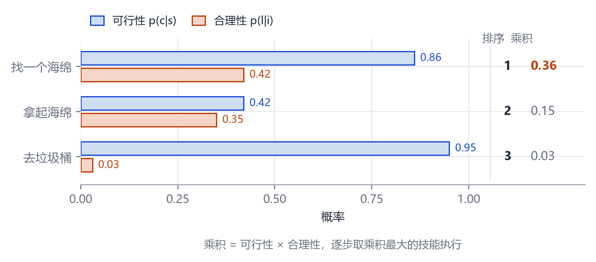
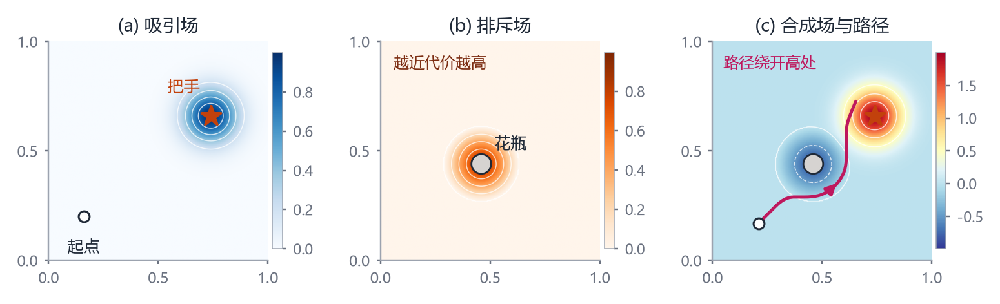
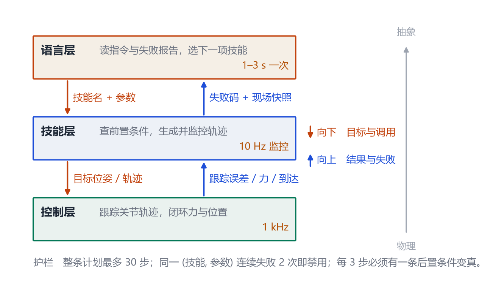

# 第 12 章　语言模型当大脑

> **本章导读**：上一章把长程顺序交给了符号层，可符号层里的规则是人写的，写不全也改不快。这一章换一条路，让语言模型读指令、读失败原因，再决定下一步做什么。读完你能分清哪些决策可以交给它、哪些必须留在毫秒级的回路里，能亲手算一遍 SayCan 的双重打分，也能判断代码策略和三维价值场各自会在什么地方出错。

## 12.1 三秒的思考和一毫秒的反射

"把桌上的杯子拿过来"这句话发给一个语言模型，它回一句"先向右伸 30 厘米，再向下 10 厘米"。听起来对，可它不知道夹爪离桌面只剩 2 厘米，也不知道这 0.4 秒里机械臂会先把杯壁撞翻。模型手上是一句描述，机器人身上是一千个时刻在变的数。

这就是分层的物理理由，跟聪明程度无关，只跟时间尺度有关。

一组数字把差距摆开。控制环 1 kHz，每毫秒算一次力矩；视觉伺服 30 到 60 Hz，每 20 毫秒用掉一帧图像；视觉-语言-动作模型 5 到 10 Hz；语言模型一次调用 0.3 到 3 秒。上下差三个数量级。一次 LLM 调用走完的时间，够控制环跑三千次。

1 kHz 是相邻两次隔 1 毫秒，30 Hz 是隔 33 毫秒，比人眨一次眼的 100 到 400 毫秒还快一截。

这组差距换成距离更直观。末端以每秒 0.3 米伸向杯子，1 毫秒走 0.3 毫米，1 秒走 300 毫米，差不多是整张餐桌的宽度。

夹爪刚碰到杯壁那 20 毫秒，接触力从 0 涨到 20 牛，要判断是滑了还是顶住了，只能靠力传感器加 1 kHz 的回路。把这件事交给一个一秒才回一次话的模型，等于闭着眼睛拧瓶盖，等它想明白，瓶子已经落地。

这段延迟换成位移更直白。夹爪指面以每秒 2 厘米压向杯壁，1 毫秒推进 0.02 毫米，判断晚 100 毫秒，指面就多走 2 毫米。玻璃杯壁厚 2 毫米，这 2 毫米就是碎与不碎的分界。力也有同样的账。抓一只 200 克的杯子要 20 牛的夹持力，力控按 1 kHz 修正，一次只改 0.02 牛；周期拉长到 100 毫秒，同样的增益一次改 2 牛，力就从抓稳跳到压碎，这叫过冲。

反过来，有五件事语言模型做得比手写状态机好。

- 常识检索。洒了可乐要找能吸水的东西，这条知识不在代码里，在语料里。
- 开放词汇。技能是"拿起 X"，X 可以是公司名，可以是"那个长得像鸭子的杯子"，不用为每个物体训分类器。
- 长程顺序。二十步的任务，条件依赖写成文字塞进提示词，比维护一张状态转移表便宜得多。
- 模糊指令的解释。"收拾一下桌子"没有唯一定义，模型能给一个说得过去的拆法。
- 可读的中间产物。计划是一串中文，人能在执行前审一遍，也能中途改主意。

有正面清单就有反面清单。

- 力矩与阻抗。力控的参考值是牛顿，采样在毫秒级，任何延迟都表现为抖动或过冲。
- 毫米级伺服。收尾那几毫米靠图像误差的连续反馈，语言给不出这个量。
- 安全限幅。急停、关节限位、碰撞检测必须在硬件和实时核里，不能依赖一个会幻觉的进程。
- 需要在一百毫秒内做出的选择。

这里可以给一条粗糙但好用的判据。问一句，这个决策错了，多久能发现，多久能挽回。语言模型错了，几秒内看得出来，重来一次多花十秒。力控错了，杯子已经碎了。

判据偶尔会失效。有一类决策看着慢实际很快，比如抽屉该往哪边拉，拉错半秒滑轨就变形。这类决策要按最坏后果分层，不能按平均耗时分层。

于是系统长成三层。语言层每秒想一次下一步做什么，技能层每 100 毫秒查一次做到哪了，控制层每毫秒算一次该出多大力。三层谨慎程度不同。延迟预算这样分，语言层一次 300 毫秒到 3 秒，技能层 100 毫秒，控制层 1 毫秒，二十步的任务里语言层共花 6 秒，技能层 2 秒，控制层可以忽略。第 11 章末尾把符号层和几何层分开，理由相同，划分的位置更低一些。

三层出错的样子不同。语言层出错，计划读起来别扭，比如让人去拿刚放进柜子的东西。技能层出错，是抓空、放歪。控制层出错，是抖、过冲、把杯子压裂。

剩下一个绕不开的问题。语言模型怎么知道机器人此刻能不能做成这件事。

## 12.2 把能不能乘进该不该

如果直接问模型"可乐洒了怎么清理"，它会给出找海绵、拿海绵、擦桌子。这套计划在纸上无可挑剔，落到机器人上第一步就断，因为技能库里没有擦桌子。

SayCan（2022）的出发点是承认这件事。它不指望模型凭空造出新技能，而是把输出限制在技能库的语言描述里。技能库有 551 个技能，覆盖 7 类动作、17 种物体，每个技能配一句描述，比如 find a sponge、open the top drawer、go to the trash can。

限制输出解决了编造，没解决选错。模型会认为"去垃圾桶"很合理，可此刻机器人手上是空的，去那边对任务没有推进。它也可能在夹爪抓着海绵时又选一次"找一个海绵"。

补法很直接。给每个技能配一个数，表示它此刻能成功的概率，再把两个数乘起来。

$$
\text{score}(\pi \mid i, s) = p(c_\pi \mid s, \ell_\pi)\cdot p(\ell_\pi \mid i)
$$

$\pi$ 是候选技能，$i$ 是人的指令，$s$ 是当前状态，$\ell_\pi$ 是这个技能的语言描述。右边第一项叫可行性，问的是"让它做这件事，它做得成吗"，用价值函数实现，取奖励为成功 1 失败 0 时的期望，可以用演示数据训一个判别器，也可以直接统计这个技能最近的执行成功率。第二项叫合理性，问的是"这一步对完成指令有帮助吗"，把 $\ell_\pi$ 当作指令的续写去打分，取语言模型的 token 对数似然。实际实现里对两个对数相加，比连乘稳。

可行性（affordance）说的是环境允许你做什么，杯子锁在柜子里就不可行。合理性（likelihood）说的是这句话接在人话后面顺不顺。

竖线右边是已知条件，左边是结果，整式读作"在指令是 $i$、场面是 $s$ 时选技能 $\pi$ 的得分"。$c_\pi$ 是"执行成功"这个事件，$\ell_\pi$ 单独写出来，是因为它要被当成一句话打分。

对数形式是 $\log \text{score} = \log p(c_\pi \mid s, \ell_\pi) + \log p(\ell_\pi \mid i)$。换的理由是数值，概率都小于 1，几个因子连乘很快小于 $10^{-5}$，一旦要做加权或求幂，误差就显出来。取对数之后每项是负几十的量，相加不溢出，排序也不变。

举个能算的例子。指令是我把可乐洒了，能拿点东西来擦一下吗，三个候选技能摆在一起。

找一个海绵，合理性 0.42，可行性 0.86，乘积 0.36。拿起海绵，合理性 0.35，可行性 0.42，乘积 0.15。去垃圾桶，合理性 0.03，可行性 0.95，乘积 0.03。第一项胜出，机器人去找海绵。

换成对数再算一遍，排序不变。海绵那一项是 $-0.87$ 加 $-0.15$，得 $-1.02$；拿起海绵是 $-1.05$ 加 $-0.87$，得 $-1.92$；去垃圾桶是 $-3.51$ 加 $-0.05$，得 $-3.56$。差距主要在合理性那一列，从 $-0.87$ 到 $-3.51$ 差 2.6，可行性那一列只差 0.8。

<figure class="fig">

<figcaption><b>图 12-1</b>　SayCan 的三条候选技能。浅蓝柱是可行性 p(c|s)，橙柱是合理性 p(l|i)，乘积决定执行顺序。数值为讲解用的示例，场景取自论文的厨房任务。</figcaption>
</figure>

三项里最值得看的是第三项。它的可行性最高，0.95，因为走到垃圾桶几乎不会失败。只按可行性排序，机器人会一路走到桶边站着。乘法把这个错误挡住了，0.03 的合理性把 0.95 压成 0.03。

反过来也成立。假设状态变成夹爪已经抓着海绵，"找一个海绵"的可行性掉到 0.05，乘积 0.02，而"拿起海绵"的可行性升到 0.9，乘积 0.32，排序翻转。乘法在这里起的作用不是加权，是否决。任何一个因子接近零，整项就出局，这比加法严格，加法下 0.05 加 0.42 还是一个像样的候选。

结果数字。101 条指令分 7 类，模拟厨房里规划成功率 84%，执行成功率 74%，整条任务 61%。搬到真厨房，规划 70%，执行 61%。按类型拆，长程任务退得最多，规划 73%，执行 47%。

这组数字给了两条信息。规划和执行差十个点，说明瓶颈在技能能不能做成，不在语言理解，模型再聪明也救不了本体。规划成功只说明顺序对，执行成功才说明真做完了，差值来自抓空、放歪、撞腿。长程那类掉到 47%，说明误差在串联里放大，12.6 节还要算一次。

可行性的来源。原论文的价值函数在真机上跑，每个技能采几百次成败，用 0 与 1 的稀疏奖励训一个判别器，551 个技能就是 551 组采集与训练，工程量远超语言模型那一侧。后来的实现常拿最近十次的成功率当可行性，代价是对状态变化不敏感。

局限有五条。

- 逐步贪心。每一步重规划，不回退，走错了只能在错的状态上继续选。
- 粒度人定。551 个技能是人挑的，粗了表达不了细节，细了选不准。
- 两项不可比。可行性来自经验统计，合理性来自语言模型似然，量纲不同，这个乘积只在排序上有意义，不能读成成功率。
- 否定句。模型对"不要拿那个杯子"处理得差，论文自己也承认，靠思维链提示缓解。
- 成本。每个技能都要一个价值函数，551 个技能就是 551 份数据。

## 12.3 把策略写成程序

SayCan 的输出是一串技能名，本质还是做什么的列表。有一类任务要的是怎么算，比如把三个积木按颜色分进两个盒子。用文本计划会写成"拿红的，放左边"，二十个物体就是四十句。

Code as Policies（2022）换了个输出模态。既然模型写代码比写散文精确，就让策略本身是一段 Python，里面调用感知和控制 API。

一句话形式化。策略是一个程序 $\pi$，输入观测 $o_t$，输出动作 $a_t$，程序里每个原子操作对应一个原语。模型不直接给关节角，它给的是调用原语的代码。

术语要说清。原语（primitive）是机器人身上已经会做的一个小动作，比如移动到某个位姿、闭合夹爪、直线推，由人写好调好。观测（observation）是这一时刻能看到的全部东西，彩色图、深度图、夹爪开度、末端位姿。

```python
blocks = detect("block")
for b in blocks:
    box = "red_box" if b.color == "red" else "blue_box"
    top = get_center(box) + np.array([0.0, 0.0, 0.12])
    goto(grasp_pose(b))
    set_gripper(0.04)
    goto(top)
    set_gripper(0.08)
```

八行代码干了四件文本计划干不了的事。循环让三个积木不用写三遍，条件让颜色到盒子的映射写成一个表达式。算术让"盒子上方 12 厘米"是算出来的，第三方库让几何判断直接调现成函数。

第三方库这条最容易被低估。模型不知道 shapely 的内部实现，但知道 polygon.contains(point) 在问什么。"放到盘子左边 5 厘米"于是写成 get_center("plate") 加 [-0.05, 0, 0]，空间关系变成一次向量加法。

逐行读一遍。第一行调检测器，拿回一个列表，每个元素带类别、包围盒中心、朝向。第四行算落点，取中心加竖直方向 0.12 米。

4 厘米这个开度值得单独说。它比积木宽一点，闭合时先碰到两侧再夹紧，靠指面的柔性兜住尺寸误差。积木换成 4.5 厘米宽，这行代码会撞上去，而且不报错。这样的数必须从尺寸算出来，照抄例子是机器人代码里最常见的隐性错误。

一段更接近真实系统的写法长这样，把感知、判断、执行分开，每步留下痕迹。

```text
def sort_blocks_by_color():
    blocks = detect("block", min_conf=0.6)
    if len(blocks) != 3:
        return fail("expect 3 blocks, got %d" % len(blocks))
    targets = {"red": "red_box", "blue": "blue_box"}
    for b in sorted(blocks, key=lambda x: x.center[0]):
        box = targets.get(b.color)
        if box is None:
            return fail("unknown color " + str(b.color))
        place = get_center(box) + np.array([0.0, 0.0, 0.12])
        if not reachable(place):
            return fail("unreachable " + box)
        ok = pick_and_place(b.pose, place, width=b.width + 0.005)
        if not ok:
            return fail("pick failed at " + b.name)
    return ok_result()
```

多出来的行都不是废话。数量检查挡住漏检，颜色分支挡住未知类别，可达性检查挡住无解，抓取值挡住滑脱。四条路径各回一句不同的话，上层就知道换哪一招。pick_and_place 把抓取和放置包成一个原子操作，模型只决定抓哪个、放哪里。

论文里还有个技巧叫层级代码生成。先让模型写出需要的函数名和签名，再逐个补实现。执行环境解析语法树，把当前作用域里找不到的名字当成新任务再问一次模型。模型补进作用域之后，对新函数体重复同一过程。写数值之前先定接口，HumanEval 的一次通过率于是推到 39.8%。代价是调用次数变多，一个任务要问十几次，耗时从 1 秒涨到十几秒。

风险有三条。幻觉 API 最外露。模型会调用不存在的函数，比如 get_object_mass()、robot.move_arm_to(x, y, z, w)，也常把参数顺序写反。前者抛 AttributeError，能捕获，好改。难的是能跑但语义错的，比如把 approach_pose(obj, 0.1) 的 0.1 当成"距离 10 厘米"，而这个 API 定义的是"沿法向偏移 1 毫米"，位置差两个数量级。

无反馈。程序假设世界按它写的走。detect 返回空列表，blocks[0] 直接崩；抓取滑了，后面的 goto 照样把空气搬到盒子上。代码里没有"确认"这个动作，检查必须显式写进程序，模型不会主动写。

后果可以量化。单步成功率 0.95，连做 10 步是 $0.95^{10}$ 约 0.60。加检查也不会变好，检查只把错误提前暴露。真正有用的是让检查触发重试，把单步成功率抬到 0.99 以上，12.6 节再算。

不可验证。代码是图灵完备的，while not done 能写出死循环，递归能写出栈溢出。沙箱、超时、步数上限都是护栏。还有一类安静的坏法，长跑进程里 detect 的结果会过期，物体被移走了，缓存里还是旧位姿。

三条风险指向一个结论，表达力和可控性成反比。有的系统因此把输出收紧成固定格式的计划，或只许调几行 DSL，牺牲循环和递归换类型检查。几何推理重的值得放开，安全阀门写死。

工程上的补法已经比较有共识。签名和一句说明全放进提示词，只开放白名单里的函数，观测从像素换成结构化的位姿，执行完把结果变成文字回灌。Inner Monologue（2022）把这套反馈做成闭环，成功检测、场景描述、人的纠正都塞回上下文，让模型基于事实重写代码。

## 12.4 从一句话到一张三维的场

代码策略能说"去把手的位姿"，说不出"从左边绕过去，离花瓶保持 8 厘米"。这类约束是几何的、连续的，离散符号装不下。翻译成函数也难，函数要知道场景里物体的位置，而这些位置随时在变。

VoxPoser（2023）的做法是把语言落到一个和观测同尺寸的三维网格上，让约束变成场。

第一步是接地。模型写代码调用视觉模型，CLIP 给语义相似度，检测器给包围盒，SAM 给掩码，于是"把手"落到点云上的一片点，"花瓶"落到另一片。

接地（grounding）的意思是把一个词从语言世界拽到物理世界，让它指向一处具体坐标。"把手"这两个字对语言模型没有位置，接地之后它变成一片点和一个重心。

第二步是铺值。网格上目标部件附近给高值，叫吸引场；易碎品周围给负值，叫排斥场；再按指令加朝向约束、速度约束。合成方式是相加，归一化之后吸引取 2、排斥取 1。

体素（voxel）是三维里的像素。二维图像被切成小方格，每格填一种颜色，三维空间被切成小方块，每块填一个数，这个数表示此处有多想去，正数拉，负数推。

$$
V(x) = w_a V_{\text{att}}(x) - w_r V_{\text{rep}}(x),\qquad w_a = 2,\ w_r = 1
$$

$x$ 是网格里一个体素的中心，$V_{\text{att}}$ 是到目标部件的距离衰减函数，$V_{\text{rep}}$ 是到障碍的距离衰减函数。运动规划器拿到的代价图取 $-V$，也就是往值高的地方走。$w_a$ 与 $w_r$ 让两类约束不同量级，吸引占主导、排斥做修正。

两个衰减函数常用的形式是负指数，$V_{\text{att}} = \exp(-d_{\text{goal}}/\sigma_a)$，$V_{\text{rep}} = \exp(-d_{\text{obs}}/\sigma_r)$。$d_{\text{goal}}$ 是到目标点的距离，$d_{\text{obs}}$ 是到最近障碍表面的距离，单位都是米。$\sigma_a$ 与 $\sigma_r$ 叫核宽，控制衰减快慢，相当于"离多远之后影响基本消失"。

两个式子的意思是越靠近目标值越接近 1，越远越接近 0，中间平滑过渡。平滑关键，因为规划器要算梯度，也就是"往哪边走值涨得最快"；硬边界上梯度无穷大，路径一碰就弹开。

分辨率要单独算。每轴 100 格，总共一百万个体素，若桌面连同上方空间按 1 米见方算，每格边长 1 厘米，精度上限就是这 1 厘米。像"离杯壁 3 毫米"这种约束写不进网格。

代价可以手算。一个浮点数 4 字节，一百万个格子 4 兆字节；吸引、排斥、速度三张各 4 兆，旋转场要 16 兆，五张场超过 30 兆字节。每 200 毫秒重算一次，一秒读写 150 兆字节。

网格调大精度上去、重规划变慢，网格调小速度快、细缝过不去。桌面收拾 1 厘米够用，插销得换一套表示。

代一组数算一遍。目标是把末端送到把手上，取 $\sigma_a$ 为 5 厘米，$\sigma_r$ 为 8 厘米，候选点 $P$ 离把手 6 厘米，离花瓶表面 4 厘米。吸引项是 $\exp(-0.06/0.05)$，约 0.301；排斥项是 $\exp(-0.04/0.08)$，约 0.607。合成得 $2 \times 0.301 - 1 \times 0.607$，约 $-0.005$。这个值几乎为零，排斥抵消了吸引，规划器不走这里。

换一个点 $Q$，离把手 6 厘米，离花瓶 12 厘米。吸引项不变，乘 2 得 0.602；排斥项约 0.223，合成得 0.379，明显为正，规划器愿意走。路径于是从 $P$ 那侧拐到 $Q$ 那侧。

<figure class="fig">

<figcaption><b>图 12-2</b>　价值场的三层叠加。吸引场把末端拉向把手，排斥场把末端推离花瓶，合成场上的路径自己绕出弧线。体素尺寸与衰减核宽为示意值。</figcaption>
</figure>

图 12-2 把这件事拆开看。只看吸引场，最陡的上升方向是一条直线，正好穿过花瓶；只看排斥场，它只说别靠近哪里。合成之后，方向从起点朝花瓶走，靠近时被推开，绕出一个弧，再从侧面接近把手。

那个算例里有个隐患。$P$ 点的值离零只差 0.005，两个距离只要有 1 厘米误差符号就可能翻转，而感知误差正好在 1 厘米量级。场铺得越陡，这种翻转越容易发生。

分辨率不够的时候，这条弧会消失。花瓶与墙之间只有 1.5 厘米的缝，体素边长 1 厘米，缝只占一格半，规划器看到的不是通道，是两三个值为负的格子，它宁可绕远路。

执行环节交给 MPC（Model Predictive Control，模型预测控制）。每 200 毫秒拿最新一帧 RGB-D 重算值场与轨迹，只执行第一个路点。相机 20 Hz，重规划 5 Hz，伺服 1 kHz，三个频率对应三种不确定性。

模型只在第一步出现。它写一段代码，解释器执行一次，得到一组可复用函数，想一次算很多次。

值场还有个好处，失败可以看。抓空了就去读那一刻的场，是吸引场没落到把手上，还是排斥场盖住了目标，端到端策略没有这种可诊断性。

真机结果最有说服力，五类日常任务各 10 次，无扰动下成功 88%，用固定原语拼接的基线 24%；加入人为扰动后 70% 对 0%。仿真里 13 个任务、2766 条指令、每任务 20 次，测的是对未见属性与未见指令的泛化。

88% 与 24% 的差距值得细看。基线也读懂了指令，差别在它把计划落成一串固定原语，参数由模型直接给。

局限有四处。值场是启发式，核宽和权重靠手调。感知错一点值场就歪，分割漏掉半个把手，重心就偏。接触丰富的任务力不在场里，拧瓶盖得另学动力学模型。5 Hz 的重规划对抛接、动态抓取不够快。其中两条能换成数字，直把手漏掉一半，点云重心偏 2 到 3 厘米，场以重心为圆心铺，末端跟着偏，而抓取窗口只有正负 1 厘米，三次里偏两次；5 Hz 意味着两次重规划隔 200 毫秒，这套方法能追人的手，追不了一只被抛起来的球，后者在这段时间里能走 40 厘米。

## 12.5 它们其实看不准空间

上面三套方法有一个共同地基，感知能把物体放到正确的位置上。这个地基在最要紧的地方不稳。

BLINK（2024）把人一眨眼就能做的视觉判断做成 3807 道选择题，共 14 类。人类平均 95.70%，GPT-4V 51.26%，Gemini 45.72%，四选一的随机水平是 38.09%，最好的模型只比瞎猜高 13 个百分点，题目都是人不用想就能答的，比如两点哪个更近、相机往哪转。

论文里有个实验更能说明问题。把每张图先写成密集描述，连题目喂给纯文本模型，不许它看图。它在 MMBench 上比直接看图还高 5.7 个点，在 MMMU 上只低 9.6 个点，在 BLINK 上掉到随机水平。靠文字转述能答的题，看图不是必需的。

四类跟机器人直接相关的题，随机水平都是 50%。

**相对深度。** 一张图里标两个点，问哪个更近。人类 99.19%，GPT-4V 58.87%，Gemini 正好 50.00%。最强的模型只比"永远选后一个"高九个点，另一个等于没看。专用模型 DepthAnything 拿到 97.58%，接近人。

**视觉对应。** 同一场景从两个视角各拍一张，问这张上的点对应那张上的哪个点。人类 98.00%，GPT-4V 50.40%，Gemini 46.40%，后者比瞎猜低。专用模型 DIFT 拿到 96.51%。手眼标定靠的正是它。

**多视角推理。** 给两张同一物体的不同角度照片，判断相机往左转还是往右转。人类 99.42%，GPT-4V 与 Gemini 都是 37.21%，比瞎猜低十二个点。模型不是随机猜错，是系统性选错。专用模型 LoFTR 拿到 90.22%。

**物体定位。** 给一张图、一个物体名、两个几乎重叠的框，选出正确那个。人类 98.25%，GPT-4V 72.03%，是四类里最好的一项。它更接近识别，认出物体就能选对，代价是对细节不敏感。

四类排序很稳定，越靠识别分越高。定位 72，深度 59，对应 50，多视角 37，机器人最需要的正是后三类。

论文标题说得很直接，能看，不能感知。模型能叫出花瓶和把手，坏在把二维像素对应到三维关系这一步。140 个错误样本里，细节读不准占 28.5%，找不到圈出的那个点占 20%，空间关系错占 14.3%，推理错占 12.9%。

三类错误在机器人任务里都致命。

**数不清。** 五个以上密集小物体，准确率接近随机，换个提问顺序答案会变。计数这一类人类 93.75%，GPT-4V 60.83%，Gemini 65.00%，随机 25%。原因不在视觉在输出，模型逐字往外吐，前一个字影响后一个字。抓取里"拿第三个杯子"会失效。

**左右混淆。** 参照系不稳定，按图像中心判断还是按观察者视角判断，模型自己也不一致，换个机位同一句话的答案可能翻转。麻烦在于机器人的"左"至少三个含义，相机坐标的左、本体坐标的左、人的左，人站对面时有两个是反的。工程后果是"把左边那个杯子拿过来"抓错。

**距离估计差。** 没有度量，只有相对判断。相对深度那一类只需比大小，GPT-4V 也只有 58.87%，给米数就更低。抓取要的是往前 8 厘米，不是再近一些。

SpatialVLM（2024）从数据侧补。它用 1000 万张真实图像，借深度和相机位姿把像素反投影成三维点，自动生成 20 亿条空间问答，问这条边多长、两物相距多远、缝隙能不能过。用这批数据微调 PaLM-E（12B）之后，模型开始给带单位的距离，同一个例子里问手指到三个罐子有多远，它答 0.21 米、0.5 米、0.59 米，GPT-4V 给的是 110、262、233 这种没有单位的相对量。

自动管线是关键。很多图自带深度图，或能用双目、结构光、多视图重建算出来。有了深度和内参，每个像素反投影成一个点，两点距离、边长、遮挡都能算，答案自带单位。二十亿条靠人标要一千万小时。

两个结论。定量空间能力可以靠合成数据补上，不必等真实标注堆够。尺度来自几何管线，不来自模型规模，模型再大也不会自己长出一把尺子。代价是自动生成的问句句式单一，遇到没见过的句式容易退回模板答案。

这类短板在评测里容易漏。多选题只比瞎猜高十几个点，换到抓取上，同一个错误表现为抓偏 5 厘米，成功率掉一半。换算能看出差距。抓取窗口是正负 1 厘米，落点误差服从标准差 2 厘米的正态分布，落在窗口内约 38%；误差降到 1 厘米，概率升到 68%。多选上只差几分，成功率上差三十个点。

工程含义很短。别在提示词里写"左边 5 厘米"，这类要求模型答不对，也检不出来，只能靠几何兜底。要么让模型只回答哪个物体，度量交给感知和几何，要么让它输出坐标再用点云校验。空间能力得用带单位、带坐标的判据去测，图文问答的分数代替不了。

## 12.6 接口比模型更要紧

三套方法的共同依赖在这里露出来，它们都把语言模型接到一组技能上，接法就是接口本身。

一个技能在接口上要写清六件事。

**名字与描述。** pick_up("red_block") 是名字，拿起红色积木是描述。名字给代码调用，描述给模型理解，两者必须指同一件事。

**参数。** 结构化，尽量少，能由状态推出来的不要人传。单位写进名字，米和弧度分开，不要靠注释提醒。参数超过四个之后，模型写错顺序的概率明显上升，能合并就合并。

**前置条件。** 可执行的布尔检查，目标在视野内、位姿置信度高于 0.7、夹爪是空的、逆解有解。不过就立刻返回，硬跑失败会改变世界状态，把局面搞得更难收拾。

**后置条件。** 可检验的成功判据。夹爪闭合到 3.2 厘米且电流超过阈值，比一句"完成了"有用得多。

**失败返回。** 错误码分三类，不可行、执行失败、超时。再附一句人能读的原因和一份现场快照，物体还在不在原位、夹爪开度多少。

**副作用声明。** 这个技能动没动物体、动的是哪个，让上层知道哪些事实已经失效，该重新观测。这一项常被省掉，代价是上层一直用过期的事实做判断。

六项可以分成两半，前五项是静态字段，可以当成五列填表；失败返回是动态通道，决定选错之后能不能改对。

最容易写坏的是前置条件。太松等于没写；太紧任务跑不起来，门槛设到 0.95，十次里八次判为不可行。经验值是拦掉一成的调用。

后置条件要能被代码判，不能靠人看。夹爪闭合到 3.2 厘米是可读的数，电流超过 0.8 安也是；反例是"物体被稳定夹住"，无法自动判定，做法是拆成两三个数。

技能库的规模是个两难。技能越多，似然打分越容易被无关项稀释；技能越少，能表达的任务越窄。经验做法是按任务族分层，把一次几百选一拆成两次十几选一。

失败怎么回传是接口的关键。回一句话就够，pick_up(red_block) 失败，原因 grasp_slipped，夹爪闭合到 1.8 厘米，物体仍在地面。模型读到这句会换方向，从侧面再抓一次。回一句 failed，模型只会重试同一件事，重试概率在八成以上；带原因的话，掉到三成以下。三个字段各有分工，原因码给机器，开度给人，位置给状态更新。

回传内容有取舍，写太细上下文被塞满，写太粗模型只能猜。做法是固定三段，做了什么、结果如何、世界变了什么。

这就引到死循环。语言模型在困惑时倾向于重复上一步的输出，失败信息越少，重复得越狠。三道护栏能把它挡住。

全局预算，整条计划最多 30 步，超了交给人。记忆禁用，同一组技能和参数连续失败两次，从候选列表里删掉，模型看不到就不会再选。单调进展，每三步必须有一条后置条件从假变真，否则判定卡住，升级到人。

三条都能写成具体规则。预算用计数器，每执行一个技能加一，加到 30 就停。记忆禁用要连参数一起比，pick_up("red_block") 与 pick_up("blue_block") 算两组。单调进展要维护一张后置条件表，每步更新，三步之后真值个数没增加就升级。这条最容易省略，后果是机器人一直做"把杯子放到桌上"，每次都判定成立，实际原地转。

<figure class="fig">

<figcaption><b>图 12-3</b>　三层之间的接口。向下传技能名、参数与目标位姿，向上传跟踪误差与失败码，频率相差三个数量级，所以接口是稀疏下发、密集回传。</figcaption>
</figure>

图 12-3 画的就是这三层。这个差距决定了接口形状，上层不可能每毫秒下一条指令，下层也不可能每次都等上层想清楚。

护栏的价值可以算。单步成功率 0.95，20 步串联是 $0.95^{20} \approx 0.36$。给每步加一次自动重试，有效单步成功率变成 $1-0.05^2 = 0.9975$，20 步变成 $0.9975^{20} \approx 0.95$。重试本身没有任何智能，它只是把一次失败整条完蛋改成了两次失败才完蛋。接口设计在这一步的收益，比换一个更大的模型直接得多。

式子里两个符号读一遍。$0.95^{20}$ 是二十次都成功的概率，每多一步就再乘一个 0.95。$1-0.05^2$ 是至少成功一次的概率，两次都失败的概率是 0.05 乘 0.05。

表 12-1 把四类做法的接口、长处和失败模式并排放。

**表 12-1**　LLM 规划方法对比。

| 方法 | 接口（模型输出到执行） | 长处 | 典型失败 |
|---|---|---|---|
| SayCan | 从技能描述里选一句 | 不编造技能，可解释，能读当前状态 | 贪心不回溯，粒度靠人定 |
| Code as Policies | 一段调用 API 的 Python | 循环、条件、算术，表达力强 | 幻觉 API，无反馈，可死循环 |
| VoxPoser | 三维值场加 MPC 跟随 | 约束变成几何，抗扰动，可零样本 | 感知误差直接变成场误差，缺力反馈 |
| 纯 VLM 端到端 | 直接出动作或动作块 | 不需要技能库，一条网络到底 | 空间数字不准，长程易漂移 |

四行看下来，一个规律很清楚。接口越结构化，失败越容易定位，表达力越窄；接口越自由，出错时越难查。工程上通常先站窄的那一端，把任务跑通，再逐步放开。

## 12.7 这一层留下的洞

三套方法都在组合已经会的事。SayCan 的技能是人训的，Code as Policies 的 API 是人写的，VoxPoser 的感知是人接的。技能库里没有的能力，语言模型再聪明也变不出来。551 个技能对应 551 段演示和 551 个价值函数，换一台机器人，这套东西要重做一遍。想让机器人学会表外的动作，得先有人在真机上演示几十遍，训一个策略，补一条价值函数，再往表里加一行。

### 空间精度

语言层能说把杯子放到盘子左边，说不出左边几厘米，而抓取窗口只有正负 1 厘米。失败场景很具体。模型给的位置差 3 厘米，夹爪落在杯沿外面。闭合到 1.8 厘米时里面是空的，电流曲线平得看不出咬合，程序却报告成功。主流缓解手段是把度量从模型手里拿走。模型只回答选哪个物体、用哪个技能，坐标交给标定好的感知和几何模块算。也可以让模型给坐标，再用点云校验，2 厘米内查不到点就判为幻觉。

### 长程一致性

每一步都重新读一遍指令、重新打一次分，二十步下来，前五步做过什么已经不在上下文里。失败场景是机器人反复打开同一个抽屉，因为它忘了三十秒前刚打开又关上。它也可能把刚放进盒子的积木又拿出来，理由是盒子里还缺一块。缓解手段是把做过的子目标写成结构化记录塞回上下文，再配一条后置条件检查，让做完了变成一条查得到的事实。记录只留最近几步加一份状态摘要。

### 成本

每个决策点一次调用，一次 0.3 到 3 秒，二十步光思考就花掉 6 到 60 秒，而执行本身只要几十秒。失败场景是任务跑得通，一节电池只够做三次，续航全被推理吃掉，云侧调用还多一层网络往返，断网就停摆。缓解手段有三条。只在状态明显变化时才问模型，把重复出现的决策缓存成一段函数，小模型放在快回路上、卡住才升级。

### 幻觉 API

模型会调用技能库里不存在的函数，也会把毫米写成米，代码照样跑完，只是位置差三个数量级。失败场景是成功率莫名从 80% 掉到 40%，日志里一条报错都没有，人只能从抓取结果倒推原因。缓解手段是白名单加类型检查，米和弧度分成两个类型，再给沙箱加步数与时间上限，让错在解释器里就暴露。

### 无法自我验证

模型不知道自己那一步成没成，它手里只有一段文字描述，没有传感器读数。失败场景是抓取滑了，下一轮它仍然认为杯子在手上，继续往盒子里放空气，直到最后才发现盒子是空的。缓解手段是闭环回灌，把成功检测、场景描述、人的口头纠正都写成文字塞回上下文。再加几条不依赖模型的验收检查，比如抬起 2 厘米后看指尖与物体的相对位移。

剩下两个洞在表示上。技能粒度多粗、值场核宽多大、重规划多快，这些数都是人拍的，任务一换就得重调，调参经验很难写成文档。同一套参数在厨房能到 88%，换到反光的金属件掉一半。更根本的一层在语言和几何之间。语言模型给符号，机器人要米和弧度，中间那层翻译靠人写的薄薄一段代码。551 个技能描述、五张值场、那几个接口字段，都是为了把这段翻译压窄，窄到人可以逐行检查。

这几个洞指向同一个方向。接口是人定的，能力是人喂的，参数是人调的，语言理解那一半做得很轻，物理执行那一半做得很重。要判断一套系统能不能上线，看三个数就够，技能库里有多少技能，每技能采了多少演示，值场参数重调过几次。天花板不在语言模型上。想得对可以靠更大的模型换来，接得上只能靠工程量，靠一份份演示、一条条接口、一次次现场调参。语言那侧从 51 分涨到 80 分，规划成功率可能只从 84% 涨到 88%，关键指标是覆盖率与单步成功率。真正的下一步是把这个翻译层也变成学出来的东西，让视觉语言模型的输出直接是动作，技能不再由人定义。这条路从 RT-1 开始，到 RT-2 把动作变成文本 token，再到后面一批开源模型，第四篇剩下的部分讲的正是它们。
