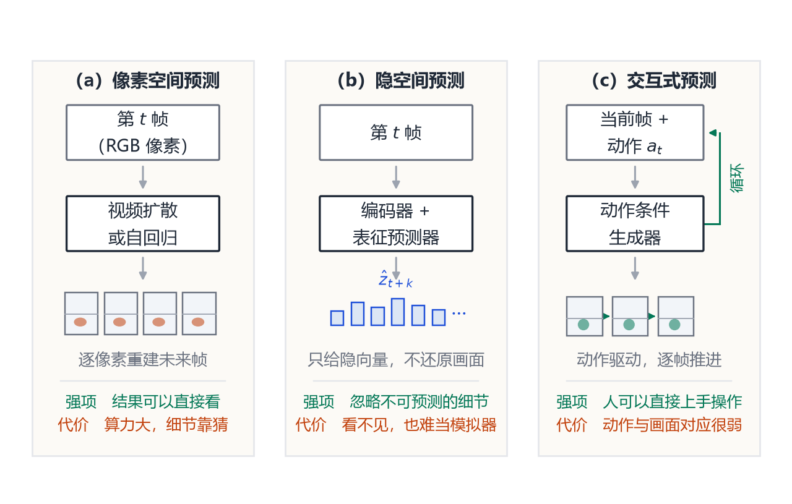
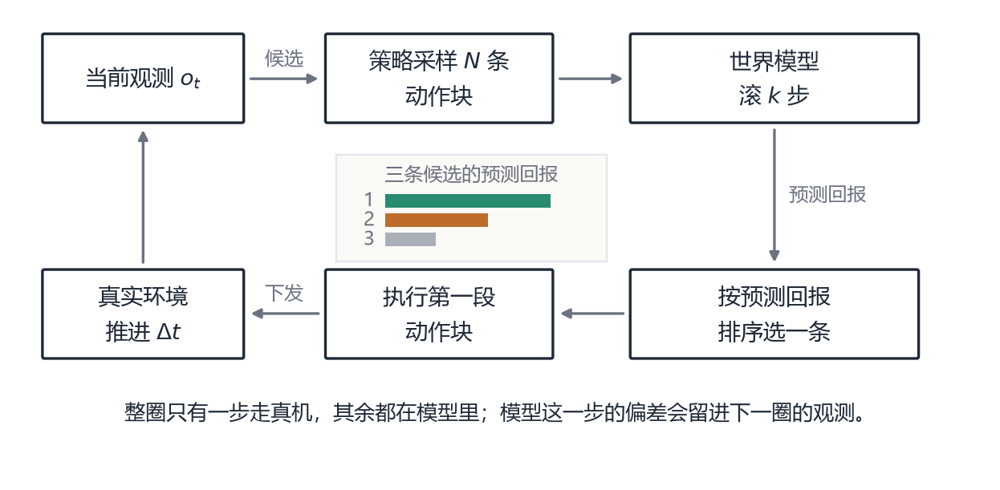
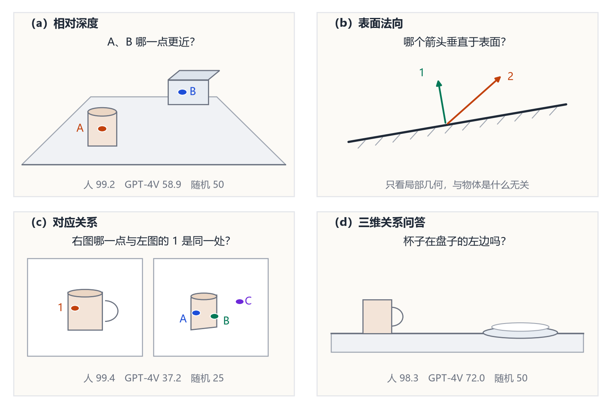

# 第 15 章　世界模型与空间智能

> **本章导读**：上一章把数据说成瓶颈。这一章讲另一种补法，让模型学会预测"我这么做之后世界会变成什么样"，再把这种预测用在规划、造数据和学表征上。同时要说清一件容易被演示视频掩盖的事，能画出像样的未来，不等于懂物理；能认出图里有什么，不等于知道东西在哪。读完这一章，你能判断一段世界模型演示值不值得信，也能看出空间能力评测里哪些分数是真本事。

## 15.1 预测未来的三种用法

这一节回答一个问题。模型学会预测之后，这个能力能拿来做什么。

第 14 章算过一笔账，采一小时演示要一个人、一台设备、一个提前搭好的场景，人不能走开，设备不能停。缓解办法有两条，多采，或者让模型把缺的那部分自己想出来。后一条路的前提是模型会预测，给它当前画面和一个动作，它说出世界接下来会变成什么样。

这件事在人身上是默认配置。把杯子推向桌沿，你不会先试三次再决定用多大力，脑子里的模型已经跑过一遍。机器人缺的正是这个"跑一遍"的能力。

写成式子。世界模型是一个函数 $f_\theta$，输入当前观测 $o_t$ 和动作 $a_t$，输出对下一时刻的预测

$$\hat o_{t+1} = f_\theta(o_t, a_t)$$

这个式子说的是，给模型看一眼现在，再告诉它做一个动作，它回答下一刻世界该长什么样。$\theta$ 是全部可训练参数，$o_t$ 是当前观测，可以是一张 224×224 的彩色图。$a_t$ 是这一刻的动作，七维机械臂上是三个位置增量、三个姿态增量和一个夹爪开度。

代一组数。手向右移动 2 厘米，位置增量的第一维从 0 变成 0.02 米。焦距折成像素是 600，手在 0.6 米处，2 厘米的横向位移在图上应该是 600 乘 0.02 除以 0.6，也就是 20 个像素。模型要是只画出手动了 6 个像素、手里的杯子纹丝不动，就说明它没学会手和手里的东西是一起走的。

把预测结果当成输入再喂回去，就能滚出任意长的未来。同一个问题有三种答法，差别在预测发生在哪个空间，图 15-1 把它们摆在一起。

<figure class="fig">

<figcaption><b>图 15-1</b>　三类世界模型的输入、模型与输出。像素空间直接重建画面，隐空间只预测表征，交互式模型把动作作为条件并逐帧闭环，右侧的循环箭头是它与前两者的关键差别。</figcaption>
</figure>

左边这一类在像素上预测，输出是一张张图，人能直接看，代价是每一根草、每一片反光都要对，算力全花在细节上。中间这一类在隐空间预测，输出是一串向量，看不见画面，省下的算力可以换成更长的想象。右边这一类多了动作条件和一个回路，输出不是"最可能的未来"，而是"我这个动作导致的未来"。三种表示对应三种失败方式，15.2 到 15.4 分别展开。

有了 $f_\theta$，能做的事分三类。

**规划时想象后果。** 策略采样出 $N$ 条候选动作序列，每条在模型里滚 $H$ 步，看哪条累计回报最高，只执行最优那条的前一小段。写成式子是

$$a^*_{t:t+H} = \arg\max_{a_{t:t+H}} \sum_{k=1}^{H} \gamma^{k-1}\,\hat r(\hat o_{t+k})$$

$H$ 是想象步数，$\gamma$ 是折扣因子，越远的预测权重越低，$\hat r$ 是模型对那一步回报的估计。这个结构和第 11 章的模型预测控制是一回事，区别在模型是学出来的网络，不是人写的方程。

落到具体任务上，就是三块边长 5 厘米的积木要叠成塔，规划器采 32 条候选各滚 8 步，看哪条的最上面一块落得最正。

成本能算清楚。真机上走一步，机械臂从静止到稳定，0.3 到 1 秒是常态。想象里走一步只是一次前向，小模型十几毫秒，视频扩散模型上百毫秒。取 $N=32$、$H=8$，就是 256 次前向，按 10 毫秒算是 2.5 秒，比真机试一次还慢；按 100 毫秒算是 25 秒。这个链条解释了为什么在线想象至今停在研究阶段，图 15-2 是它的完整结构。

<figure class="fig">

<figcaption><b>图 15-2</b>　世界模型在环的一次决策。策略采样多条动作块，模型逐条滚出未来并按预测回报排序，只有被选中的那一段真正下发，环境推进后再回到观测。图中回报条为示意。</figcaption>
</figure>

图 15-2 里有一格值得单独说。整圈只有"执行"碰到真实世界，其余全在模型内部。坏处是模型的偏差会跟着动作进入下一次观测，下一圈就在已经偏掉的局面上做决策，这类误差没有真值拉住，它自己喂自己。

**生成训练数据。** 世界模型能造出"如果这么做会怎样"的样本，这些样本带动作标签，正好补上第 14 章的缺口。UniSim（2023）用它当模拟器，在里面训练高层视觉语言策略和低层强化学习策略，两者都不碰真机，训完直接上真机，不做微调。Cosmos（2025）把定位说得更直白，世界基础模型是物理世界的数字孪生，用来在安全的地方试错。这条路的边界在生成器的偏好。训练数据里没有透明杯子，它画不出透明杯子的正确影子，策略学到的"抓透明杯"也只是看起来像。

要训一个抓抽屉把手的策略，真机上先采 200 条演示，抽屉只有三种位置。让模型在演示上滚出 5000 条变体，把抽屉挪 10 厘米，把顶灯换成侧光，能用的可能只剩 1500 条，其余在接触瞬间糊掉。

造数据能放大覆盖度，不能创造覆盖度。

**当表征学习的代理任务。** 要预测下一帧，模型得先弄明白画面里什么会变、什么不变、什么被挡住了，这些恰好是有用的表征。第 6 章讲过用图像自监督学特征，加上时间维度后多出一个信号，可预测性本身。能预测的是规律，不能预测的是噪声，模型被迫把两者分开。15.4 会讲这条路走到极致的版本。

这条路的任务可以很轻。要判断夹爪有没有碰到物体，冻结主干接一个线性分类器，500 个标注样本就能到九成以上。它答不出接触点落在物体表面的哪个位置，因为可预测的信息里本就不含毫米级几何。

三类用法对模型的要求不一样。规划要求准且快，造数据要求真且多样，学表征只要求抓住不变的量，同一个模型很难同时满足。

## 15.2 视频预测与物理一致性

这一节回答一个问题。让模型直接画出下一帧，它画得出一张像样的图，画得出物理上说得通的过程吗。

像素空间的世界模型最直观，训练目标就是让生成的下一帧接近真实下一帧。数据是海量视频，损失是重建误差或者扩散模型的去噪误差，架构从早期的循环网络换到今天的时空 Transformer，目标函数几乎没变。

最朴素的问题是误差累积。一步预测差 1 个像素不显眼，把预测结果喂回去再预测，偏差会被放大成结构性的错误。一只手的边缘在第 3 帧糊了 2 个像素，到第 10 帧可能变成两根手指，到第 30 帧整只手消失了。训练时喂的是真实帧，推理时喂的是自己生成的帧，这个落差有个名字叫曝光偏差（exposure bias），第 9 章讲模仿学习时提过同构的问题。

放大可以手算。每一步都把上一步的误差原样带入再添 2 个像素，第 1 步是 2，第 2 步是 4，第 30 帧就是 60 个像素，而一张 256 像素宽的图里一根手指只占 25 个像素。

训练目标就是让生成的下一帧在像素上别离真实太远，写成重建损失是

$$\mathcal{L}_{\text{rec}} = \lVert \hat x_{t+1} - x_{t+1} \rVert_2^2$$

$\hat x_{t+1}$ 是生成的下一帧，$x_{t+1}$ 是真实下一帧，两根竖线表示逐像素求差再平方求和。代一组数。一张 256×256 的图有 65536 个像素，如果平均每像素差 10 个灰度级，均方误差是 100，均方根误差是 10，在 0 到 255 的区间里占 4%。这个数看着小，但一块 30×30 像素的杯底就有 900 个像素在拖后腿，平均完那块轮廓就晃。

比误差累积更本质的是物理。人判断一段视频像不像真的，很大一部分靠几条硬约束，而像素似然对这几条约束一无所知。

**物体不消失。** 一个杯子被手挡住，人知道它还在，手移开时它应该出现在合理的位置。像素模型没有"物体"这个概念，遮挡之后没有任何机制保证它继续存在。手移开时模型可能画出一片桌面，也可能画出一个位置偏了的杯子。要守住这条，模型内部必须有一份关于"那里有个东西"的状态，而纯重建目标从没要求过。

失败的样子可以写具体。一个直径 8 厘米的玻璃杯摆在桌上，一只手从右往左扫过，杯子被完整挡住 6 帧，按 10 FPS 算是 0.6 秒。手移开之后，模型画出的杯口位置偏了 4 厘米，直径缩成 6.5 厘米，杯壁上那道竖向高光也换了位置。再严重一点，杯子整个不见了，桌面只剩一块颜色略深的矩形。机器人照这个画面去抓，夹爪会在空处合拢。

**不穿模。** 两个刚体不能占据同一块空间。这条约束在慢速场景里很少被违反，一旦运动快了、接触多了，模型很容易画出机械臂从桌子里穿过去、两根手指互相重叠的画面。原因很直接，穿模的那一帧在像素上仍然"像一张正常的图"，重建损失不会变大。

穿模有三种形态，都能用数字量出来。第一种是两指互相重叠，两根宽 1.5 厘米的指尖在画面上交叉 0.8 厘米，物理上要求两指中心至少隔 1.5 厘米，实际只隔 0.7 厘米。第二种是手臂穿桌，一根直径 4 厘米的小臂从桌面上方 2 厘米处下落，3 帧之后有 1 厘米没入桌面，被切掉的桌沿会被补成小臂的颜色。第三种最隐蔽，一个 200 克的盒子静止放在桌上，画面里盒子底边与桌面之间浮起 2 个像素，反投影出来的点云里盒子已经悬空 3 毫米。

**重量感。** 同样大的推力，装满水的杯子和空杯子动得不一样；提起重物时手腕会先沉一下再稳住。这些细节要求模型内部有质量、惯性、摩擦这样的隐变量，而视频里这些量从来没有被标注过，只能从运动模式里反推。反推准不准取决于训练数据里同类交互够不够多。

接触后滑行不对，是最容易量出来的一条。一个连水 300 克的杯子放在木桌上，末端以每秒 10 厘米的速度推它，摩擦系数取 0.4。手一撒开，减速度是 0.4 乘 9.8，得每秒平方 3.92 米，杯子在 0.026 秒内停住，只滑 1.3 毫米。模型如果只学到"被推的东西会往前走"，它会让杯子在手离开之后继续滑 3 到 5 厘米，像在水面上漂。推 300 克的杯子和推 150 克的空杯，同样的力，加速度和位移都该差一倍，模型经常把两者画得一样。

三条约束之外还有一个统计学上的困难。接触瞬间在视频里占比很小，一段 10 秒的操作视频里真正接触的可能只有 0.2 秒，按 10 FPS 算只有两帧。模型见过的大量样本是"物体在空中平稳移动"，它最需要预测准的却是"两帧之间的碰撞"。训练分布和需求分布在这里正好错开。

公开演示里的失败案例大多落在这几条上。2024 年 Sora 的一批演示视频被反复指出同一类毛病，玻璃杯被咬掉一块却没有任何缺口，椅子悬在半空没有支撑，人和门框互相穿过。单看每一帧都很像真的，连起来看物理就崩了。模型学到的是"这类场景通常长什么样"，不是"这类场景通常怎么演化"。

要判断一个视频模型懂不懂物理，看演示片段不够，得设计能证伪的测试。一种是干预测试，固定起始帧只改动作条件，看预测是否分叉、方向是否合理。一种是守恒量检查，数一数物体个数在遮挡前后是否一致。一种是长时一致性，生成 10 秒之后还能不能认出开头那只杯子。三类测试都不需要真值视频，只要人的判断或者简单计数，因此可以规模化。

视频模型在"常见场景的常见演化"上很强，在"需要精确接触的罕见瞬间"上最弱，而机器人操作恰好全是后者。这就是它现在只能做数据增广的原因。

## 15.3 交互式世界模型

这一节回答一个问题。怎么让模型听动作的话，而不是按数据里最常见的样子自己往前猜。

视频预测回答的问题是"给定开头，最可能的未来是什么样"。这对看电影够用，对训练机器人不够用。机器人需要的是"如果我把手往左移 2 厘米，画面会变成什么样"，条件里必须有自己的动作。少了这个条件，模型会走向数据里最平均的那条轨迹，你按左键它也往右走。

把两种问题的差别写成概率就清楚了。纯视频预测建模 $p(x_{t+1} \mid x_{\le t})$，交互式模型建模 $p(x_{t+1} \mid x_{\le t}, a_t)$。多出来的 $a_t$ 是全部难点。

难点不在架构，在标签。互联网视频有几亿小时，但没有一条带着"这一帧里操作者按了左键"的标注。机器人视频有动作标签，可是量少、场景窄、本体各不相同。要破局，得从无标注视频里把"动作"这个概念自己挖出来。

Genie（2024）的做法是把这件事拆成三段。第一段是视频 tokenizer，把每帧压成一组离散 token，和语言模型处理词的方式类似。第二段是隐动作模型，只看相邻的两帧 $x_t$ 和 $x_{t+1}$，输出一个离散的动作码，可以理解为"要让画面从上一帧变成这一帧，得做一个什么样的动作"。第三段是动力学模型，输入历史 token 和一个动作码，自回归地预测下一帧的 token。

三段里最关键的设计是信息隔离。隐动作模型能看到 $x_{t+1}$，动力学模型看不到，它只有历史和一个只有 8 个取值的动作码。不这样隔离，动力学模型会直接从历史里抄出下一帧，动作码变成摆设，训出来的环境不可控。这个约束逼着那 8 个码承载画面变化的主要成分。码表定在 8 也有讲究，人用键盘玩，八个方向差不多够；码越少，每个码必须解释的变化就越大。

动作具体怎么进网络，Genie 把它当成一行可以相加的嵌入。8 个码各对应一行 2048 维向量，和视频 token 同宽，每帧进 Transformer 之前把当前码那一行加进去。这样动作和画面从第一层就在同一个空间里交互，不用等到输出层才合并。

规模上，Genie 从 20 万小时公开游戏视频里筛出 3 万小时的平台游戏片段，160×90 分辨率、10 FPS，共 680 万个 16 秒片段，最终模型 110 亿参数。效果是给定一张图或者一张手绘草图，就能逐帧操作一个可玩的 2D 世界。同一个方法用在 RT-1 的无动作机器人视频上，也能学出可交互的环境，说明隐动作不是游戏特有的。

这组数字可以互校。3 万小时按 10 FPS 是 10.8 亿帧，一个 16 秒片段含 160 帧，两者相除得 675 万，和 680 万对得上。

代价也很清楚。160×90 是 14400 个像素，机械臂操作常用的 640×480 是 307200 个，差 21 倍。8 个离散动作对平台游戏够用，对"末端移动 3 毫米、绕 Z 轴转 5 度"这种连续控制远远不够。分辨率低意味着细节全靠猜，而抓取恰恰是细节决定成败的任务。

UniSim（2023）走的是另一条路，不去发明隐动作，而是把已有的各种动作映射到一个统一接口上。语言指令"打开抽屉"、末端执行器的位移 $\Delta x, \Delta y$、相机的移动，都被编码成同一种条件向量，喂给一个以动作为条件的视频扩散模型。模型输入 4 帧历史，输出未来的若干帧，可以自回归地一直滚下去。规模是 56 亿参数，512 块 TPU-v3 训 20 天。

动作怎么注入，UniSim 走的更接近通道拼接那一路。末端位移是三维向量，先过一个小网络升到隐空间维度，再和四帧历史拼在一起当成条件。语言指令编码成一个向量，作为全局条件参与每一层的调制。相机移动单独占一个通道，因为它对应整张图的全局变换，和末端位移的局部效应不是一回事。

训练数据的规模可以从算力反推。512 块 TPU-v3 跑 20 天，总量落在 10 的 22 次方 FLOPs 这个量级。每处理一个 token，前向加反向约是 6 倍参数量，即 3.4 乘 10 的 10 次方 FLOPs。两者相除得到 3 乘 10 的 11 次方个 token，一个 16 帧片段约 4096 个 token，算下来能过几千万条片段。

UniSim 的价值在数据拼盘。图像文本对提供物体和场景，机器人数据提供密集动作，人类视频提供多样运动，导航数据提供大范围位移，单一来源都不够。论文用它做了三件事。一件是给高层视觉语言策略做事后重标注。一件是训低层强化学习策略。一件是训视频描述模型。三者都在纯仿真里训练，然后零样本部署到真机。

采样成本也要算。一段 100 帧的片段在单卡上约 5 秒，造一万条就是 14 小时，换 32 卡并行降到半小时。同样的量在真机上采，是一个人 100 小时的工作量。

动作条件怎么注入网络，工程上有三种常见做法。最简单的是通道拼接，把动作向量铺成一张和噪声同样大小的图，拼在通道维上，代价是动作信号在深层容易被稀释。第二种是 cross-attention，动作作为短序列去查询图像的每个位置，表达力强，代价是慢。第三种是把动作当成额外的 token 塞进序列，实现简单，但位置编码要重新设计。三种做法都撞上同一个问题，动作与像素的耦合太弱。

耦合弱有具体表现。给模型一个"向右移动 2 厘米"的条件，它可能整体平移画面，可能只让相机抖一下，也可能什么都不做。训练数据里同一个动作在不同场景下对应的像素变化差别很大，模型学到的是统计相关，不是因果。要缓解，只能让数据里动作与视觉变化的对应足够干净，这又回到数据质量的问题。

## 15.4 联合嵌入预测

这一节回答一个问题。能不能不看像素，只对比两段画面"意思"上像不像。

像素空间的预测有一个尴尬的地方。视频里有大量细节本质不可预测，树叶下一秒怎么晃、水面反光怎么移、布料的褶皱往哪边走，这些量的真实值接近于噪声。逼模型去预测它们，等于让它把容量花在掷骰子上。而另一些东西高度可预测，杯子还在桌上、手正在靠近、门是关着的。

Yann LeCun 提出的联合嵌入预测架构（JEPA）就是冲着这个矛盾去的。主张很简洁，不要在像素空间预测，在表征空间预测。V-JEPA（2024）是它在视频上的实现。

做法分四步。把视频切成时空 patch，随机遮住其中大部分。遮的方式是一根"管子"沿时间轴贯穿，保证被遮掉的区域在时间上连续，模型没法靠相邻帧抄答案。编码器只看可见的 patch，输出一组表征。预测器要给出被遮住那些位置的预测表征。目标不是像素，而是同一段视频经过一个指数滑动平均更新的编码器后得到的表征，损失用 L1。整个过程没有像素解码器，没有负样本，没有文本，没有预训练的图像编码器。

数字能说明这条路走得通。训练数据是 200 万条视频，每条取 16 帧、跳帧采样 4（大约覆盖 3 秒），分辨率 224。最大的模型 ViT-H/16 在冻结主干、只训一个轻量读出层的条件下，Kinetics-400 上 81.9%，Something-Something-v2 上 72.2%，ImageNet-1K 上 77.9%。后一个数据集是静态图像分类，模型却只在视频上训练过，说明它学到的表征能迁移到单帧任务。SSv2 专门考运动理解，需要分清"把东西推进去"和"把东西拉出来"，这个分数高，说明表征抓的是动作而不是外观。

### 只比特征不比像素

核心在损失函数，目标是让预测器输出的向量尽量贴近目标编码器给出的向量

$$\mathcal{L} = \frac{1}{|M|}\sum_{i \in M} \left\| P_\phi\big(E_\theta(x_{\text{vis}})\big)_i - \text{sg}\big(E_{\bar\theta}(x)_i\big) \right\|_1$$

$M$ 是被遮住的位置集合，$|M|$ 是这些位置的个数。$x_{\text{vis}}$ 是只保留可见 patch 的输入，$x$ 是完整输入。$E_\theta$ 是在线编码器，参数靠梯度更新。$P_\phi$ 是预测器，它拿到可见 patch 的表征，要推断出被遮位置该是什么向量。$E_{\bar\theta}$ 是目标编码器，参数不靠梯度学，而是把在线参数做指数滑动平均。$\text{sg}$ 是停梯度算子，这一项当常数看，不往回传梯度。下标 1 表示取绝对值再求和，也就是 L1 距离，不是平方。

代一组数字。一个 224×224 的视频按 16×16 切成 14 行 14 列共 196 个 patch，乘 16 帧是 3136 个时空 token。遮掉 90%，就有 2822 个位置进入 $M$，剩 314 个可见。每个位置的表征 1024 维。假设某一维上预测值 0.42、目标 0.30，绝对差 0.12；另一维预测 0.81、目标 0.77，差 0.04。1024 维平均下来得到 0.09，这就是一个位置的损失，再对 2822 个位置平均还是这个量级。训练稳定之后它会落到 0.04 上下。

同样的差值放到像素空间会是多少。同一块被遮的 patch 在真实视频里可能是桌面木纹，每像素差 30 个灰度级很正常。特征空间里只要把"这是木纹桌面"这层意思对上就行，30 个灰度级的随机差异在编码之后基本被抹平。

滑动平均的系数取 0.999 时，目标参数每步只移动在线参数的千分之一，跑 10 万步之后它记住的是大约 1000 步之前那个版本。系数调到 0.9，它跟着在线参数一起抖，学习容易塌。

损失值本身不能当质量指标看。0.04 在不同数据集、不同遮比之间不可比，也不意味着"预测对了 96%"。它只能判断训练有没有收敛，好不好用要回到下游分数上。

好处有三条。忽略不可预测的细节，容量花在规律上。不需要解码器，训练和推理都省算力。表征对运动敏感，这对操作比对分类更有用。

代价同样有三条，而且都很实在。第一是不可视化。像素模型可以打开生成的视频看一眼，判断它错在哪；JEPA 只给一串向量，没法看它"想象的未来"，只能通过下游分数间接判断。模型不 work 时你不知道是表征没学好、预测器太弱，还是读出层不对，调试的时候这是硬伤。

第二是信息压缩带来的精度损失。表征为了可预测，必然丢掉不可预测的部分，而毫米级的几何细节很可能就在被丢的那一侧。抓取需要知道杯沿在哪个位置、差 2 毫米会不会夹滑，这类信息在语义表征里基本找不到。所以 JEPA 类模型适合做感知前端，不适合直接输出位姿。

第三是它没有动作条件。V-JEPA 的第一版只预测未来表征，不问"如果做某个动作会怎样"，所以它是特征提取器，不是模拟器。要变成模拟器，得把动作接进去，再训一个从表征回到像素的解码器，那又退回 15.2 的老问题。

表 15-1 把这一章提到的几个系统摆在一起，差别主要在表示和动作条件这两列。

**表 15-1**　世界模型对比。

| 系统 | 表示 | 动作条件 | 可交互 | 典型用途与局限 |
|---|---|---|---|---|
| DreamerV3 | 低维离散隐状态 | 本体动作 | 是，仅限训练内 | 训练策略极省样本；隐状态小，画面细节全丢 |
| Genie | 离散视频 token | 8 值隐动作 | 是，逐帧 | 生成可玩环境；160×90、动作粒度粗 |
| UniSim | 像素（扩散） | 语言、末端位移、相机 | 是，自回归 | 造数据训策略；慢，接触处易失真 |
| Cosmos | 像素（扩散与自回归） | 相机与机器人动作（后训练） | 部分 | 通用底座，可后训练成专用模拟器；物理不保证 |
| V-JEPA | 视频表征 | 无 | 否 | 表征预训练；不可视化，不能当模拟器 |

四个列中，"表示"和"动作条件"是原因，后面两列是后果。选了像素表示就必然"慢"且"接触处失真"，因为每帧都要把几万个像素逐个定下来。选了无动作条件的表征就无法交互。

## 15.5 空间智能的评测与短板

前面几节讲的是预测，这一节讲理解，两者在机器人身上是同一件事的两面。要预测手往左移之后画面怎么变，模型得先知道手在哪、杯子在哪、两者之间隔多远。

空间能力值得单独拎出来，因为视觉语言模型在这上面的表现和它在识别任务上的表现差得很远。识别任务考"这是什么"，答案落在几千个词的语义空间里；空间任务考"这个点在哪、那个面朝哪"，答案落在连续的几何量上。前者可以从语言共现里学到，后者不行。

图 15-3 是四类最常见的空间任务。

<figure class="fig">

<figcaption><b>图 15-3</b>　空间能力的四类评测任务，深度、法向、对应关系与三维问答。深度与对应两项下方标出 BLINK 测试集准确率，随机为随机作答的期望值。</figcaption>
</figure>

深度估计分相对和度量两种。相对深度只问"这两个点哪个更近"，人眼一秒就能判断；度量深度要给米数，需要尺度参照。表面法向是每个像素处表面朝哪个方向，用三维单位向量表示，它决定了光怎么反射，也决定了夹爪从哪个方向接近才不打滑。对应关系要求在两张视角不同的图里找到同一个物理位置，这是三维重建、抓取迁移、视觉伺服共同的基础。三维问答把几何关系写成语言，考的是模型能不能把方位词落到图像上。

四类任务难在不同地方。相对深度考排序，只要比出谁更近就行。度量深度考标尺，深度差要报成厘米数。表面法向考朝向，半球面上每个像素的法向都不同，而"面向上"和"面向右"在颜色上可能完全一样。对应关系考同一个东西在两图里的位置，视角差 30 度，同一个杯沿的像素坐标就差上百个像素。

BLINK（2024）是这批评测里做得最干净的一个。它把 14 个经典视觉任务改写成选择题，共 3807 道，图像上还画了标记点作为视觉提示。总体差距第 12 章已经说过，人类 95.70%，最强的 GPT-4o 59.03%，随机作答 38.09%。这里要看的是分项。

分项之前先算每题的分量。3807 道题分给 14 个子任务，平均每个 272 道，每答对一道就抬高 0.37 个百分点。

分项看更有意思。相对深度这一项，人类 99.19%，GPT-4V 58.87%，随机是 50%，等于几乎没学会。视觉对应，人类 99.42%，GPT-4V 37.21%，随机 25%，比瞎猜好一点。语义对应更差，30.00%，随机 25%。但空间关系问答这一项，GPT-4V 拿到 72.03%，随机 50%，明显超过瞎猜。同一批模型在同一批图上，有的任务接近人，有的任务接近瞎猜，说明能力是分项的，不存在"整体落后"这种笼统说法。对机器人来说这四项的重要性也不一样，对应关系和深度直接决定抓得准不准，三维问答更多影响语言指令能不能落到空间上。

换成"比瞎猜高多少"读数。相对深度高出 8.87 个点，折成题目是 24 道。视觉对应高出 12.21 个点，33 道。语义对应只高出 5 个点，13 道，基本在噪声里。空间关系问答高出 22 个点，60 道。这一项最好看，但它考的是左右这类二元关系，一半信息就能定。

论文还给了一个解释性实验，把图像换成密集的文字描述，再喂给纯文本的 GPT-4 去答题。在很多任务上，这个"盲答"的分数不比直接看图低。含义很直接，这些题里有相当一部分靠语言先验就能答对，模型并没有真的在"看"图。所谓看得见但看不懂，指的就是这个，图像 token 进去了，几何信息在中途被压掉了。

为什么会压掉。视觉编码器是为语义任务训的，它把 16×16 的 patch 压成一个向量，压的过程中"这是一只猫"被保留，"猫的左耳在这个像素"被丢弃。语言模型那边再过几层注意力，位置信息进一步稀释。输出端于是知道图里有杯子，不知道杯沿在图像坐标的哪一行。

数据补得上就不会压掉，SpatialVLM（2024）走的就是这条路。它把几何真值和语言监督分开办，几何从三维重建里拿，语言用一个语言模型生成。流水线分四步。先用单目深度模型给每张图估深度，再用分割模型把主要物体分出来。然后把像素按内参和深度反投影成点云，物体中心、朝向、尺寸都能算出来。接着把这张三维场景交给语言模型，让它按模板把"杯子在盘子左侧 12 厘米"这类事实改写成问答。再把问答配回原图，得到训练样本。

规模上，论文用了约 200 万张图像，每张生成约 1000 条问答，合起来是 20 亿条。成本从人工变成了算力。人工量一张图里两点相距多少厘米要几十秒，流水线合计几秒。风险也很具体，误差会从头传到尾。深度在透明杯子上偏 10 厘米，反投影就把杯子放进桌子里，"杯子在桌面下方"于是成了一条错标签，而且没有真值可核。

专用模型在同样的问题上表现完全不同。Depth Anything（2024）用 6200 万张无标注图像做自训练，在 KITTI 上的绝对相对误差是 0.080，此前的 MiDaS v3.1 是 0.127。单目深度已经能用在工程里，但它是相对深度，尺度要另外估计，透明物体、镜面和纯色墙面仍然是它的死穴。

这个误差换成毫米才看得懂。KITTI 里的物体大多在 10 到 50 米，误差 0.080 意味着 10 米远的点可能报成 9.2 或 10.8 米，差 80 厘米。换到一臂之内，0.5 米远的杯沿报成 0.46 到 0.54 米，差 4 厘米，比夹爪指宽还大。

对机器人系统的含义是分工。视觉语言模型决定做什么，几何模块回答在哪。指望一个通用多模态模型直接吐出可执行的位姿，等于让它同时做语义和测量两件事，而它在后一件事上接近瞎猜。第 4、5 章讲的相机几何、位姿估计在这里没有被取代，只是被推到了更后面。

## 15.6 把世界模型接回策略

回到最初的问题，怎么让预测能力变成动作。目前有两条接法。

一条接在动作侧。策略先出若干候选动作块，世界模型给每条滚一段未来，用一个回报模型或者价值网络打分，选分最高的一条执行。这就是图 15-2 那个循环，也是"想象 rollout"这个词的由来。另一条接在观测侧。世界模型先生成一张"目标达成之后应该长这样"的图，再让视觉语言动作模型以这张图为条件去执行，把长程任务拆成一串图像目标。前者要模型会评估，后者只要模型会画。

### 算一笔想象 rollout 的账

按真实参数算一遍，才看得出两条路各卡在哪。取一台双臂机器人，控制频率 20 Hz，每 50 毫秒发一次动作。一次抓放任务 4 秒，合 80 个控制步。

先算动作侧。每次决策采 $N=16$ 条候选，每条滚 $H=5$ 步，前向次数是 80。小隐状态模型一次 8 毫秒，一轮 0.64 秒；视频扩散模型一次 120 毫秒，一轮 9.6 秒。控制周期只有 50 毫秒，两者都比它大一到两个数量级。

补救的办法是降低重规划频率。每 5 个控制步规划一次，4 秒里是 16 轮，小模型共 10.2 秒，视频扩散模型共 154 秒。小模型这一档比任务慢两倍半，但它可以只规划一次然后执行一段，把规划藏到执行背后并行做，这叫异步规划。视频扩散模型连这一步也省不掉，只能提前离线跑。

再算观测侧。一张 256×256 的目标图，扩散模型去噪 50 步，单卡上约 6 秒。一个任务拆成 4 个阶段就是 4 张图，合 24 秒。但这张图不必每轮重画，任务开始时画一次缓存下来，成本就是一次性的 24 秒。观测侧更容易落地，原因就在这里。

还有一项成本很少被算，显存。56 亿参数的视频扩散模型，半精度下光权重就是 11 GB，要 40 GB 的单卡才能一次并行 16 条候选。这意味着小机器人上跑在线想象，模型得先缩到几亿参数。

两条路都撞在同一堵墙上，速度。前面算过，$N=32$、$H=8$ 是 256 次前向，视频扩散模型单次上百毫秒，一轮决策要几十秒，而操作任务的控制频率是 10 到 50 Hz。压缩想象规模能换速度，$N=4$、$H=3$ 是 12 次前向，勉强进秒级，但这么短的想象看不出动作的好坏差别。

第二堵墙是动作条件弱。15.3 讲过，模型学到的是动作与画面的统计相关。策略很快会发现这一点，它会去找那些"看起来回报很高"的动作，而不是真正好的动作。这和第 10 章讲的模型利用是同一个病，只是病灶从隐状态换成了像素。症状是离线评估漂亮，真机一塌糊涂。

第三堵墙是没有真值。视频预测可以拿真实视频比像素，世界模型的"回报预测准不准"却没有可比的对象，因为你没法知道另一个动作在真实世界里会怎样。现在通行的做法是在真机上跑一批策略，看模型的排序和真机结果的相关性，样本量往往只有几十条，结论很不稳。

现实的分工因此变得清楚。世界模型今天主要用在数据侧，造训练样本、做策略的粗筛、在仿真里预演危险动作；控制侧仍然是反应式的策略加低层闭环，预测只作为先验，不作为决策依据。UniSim 那样的系统之所以能零样本上真机，靠的是把生成的数据拿去训策略，而不是让策略在线查询模拟器。

这一层缺的东西也就清楚了。模型能预测，但不够准、不够快、也不够可控；模型能看图，但看出的几何不够细。要把预测变成关节上的力矩，还得回到毫秒级的控制回路，那是下一篇的内容。
