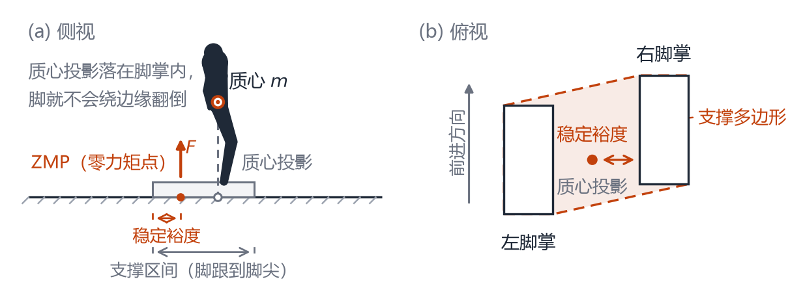
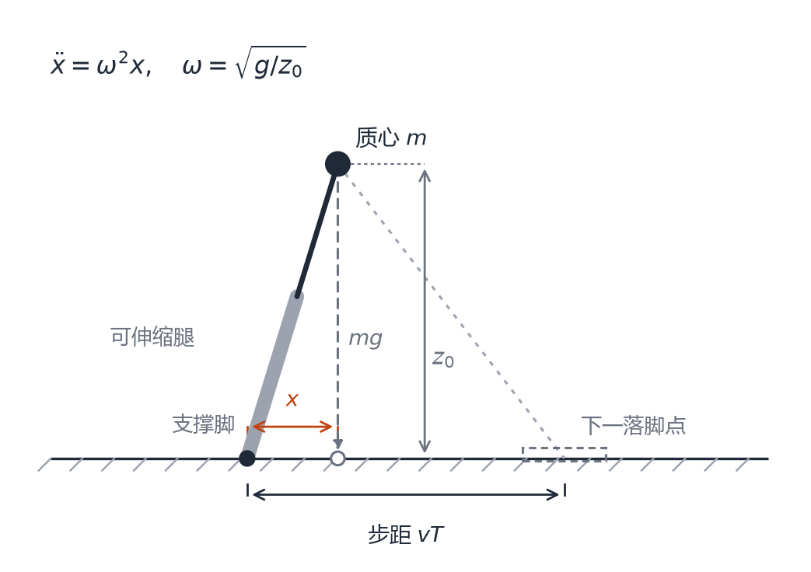
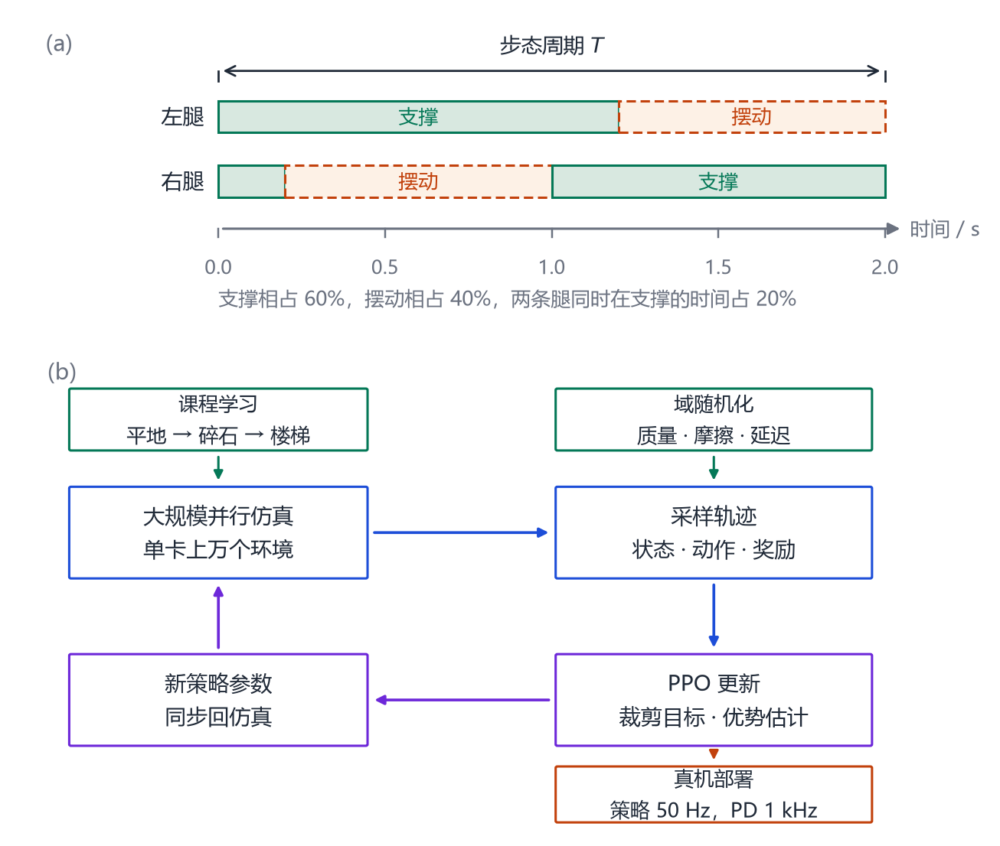

# 第 17 章　腿足与人形机器人

> **本章导读**：上一章把单个关节的力矩环调通了，这一章面对整台机器。两条腿撑着几十公斤的机身，靠一只脚掌大的接触面走、跑、上楼，难度远超轮子。下面从双足行走的本质困难讲起，经过 ZMP 与线性倒立摆两块基石，再到并行仿真里练出来的运动策略，接着落到全身控制、遥操作与电机电池这些硬件现实，末尾给出一个现状的校准。读完这一章，你能分辨人形演示里哪些动作真难，哪些只是剪辑帮了忙。

## 17.1 走路是一直在倒下，只是每次都被接住

这一节回答一个问题。一台人形机器人站着不动时看着挺稳，为什么一抬脚就成了随时会摔的东西。

### 站住其实是有条件的

把一台 45 公斤的人形放在平地，松手，它站着不动。这个稳是有前提的，质心必须落在两只脚掌围成的区域里，双脚并拢时只有 20 厘米宽、25 厘米长。人站着时脚踝不停小幅调整，压力中心漂移几毫米；机器人靠踝关节扭矩加惯性测量单元（Inertial Measurement Unit，IMU），100 Hz 的平衡环就够。

两只脚掌围出的区域换成面积是 500 平方厘米，约一张 A4 纸的八成。45 公斤压在上面，平均压强是 441 牛除以 0.05 平方米，即 8.8 千帕。

抬脚那一刻条件就变了，支撑区域从两只脚缩成一只，横向余量从 10 厘米掉到 5 厘米。腿一抬，身体还必须往前倾，否则重心不会前移。真实行走的姿势是质心始终在支撑脚前方几十厘米，机身以每秒几度前倾，靠下一步落脚接住。走路不是保持平衡，是有控制地失衡。这句话不是比喻，压强、扭矩、时间预算都能算。

那 5 厘米余量还能换成加速度上限。质心高 0.9 米时，让压力中心横移 5 厘米所需加速度是 $a=gb/z_0$。$b$ 是横移距离，$z_0$ 是质心高度。代入 9.8、0.05、0.9，得 0.54 米每二次方秒。人走路时躯干横向加速度在 0.3 到 0.5 米每二次方秒之间，已经贴着这条线。

### 把身体当成一根会倒的杆

把身体看成一个高 $z_0$ 的倒立摆，绕接触点转动，小角度下方程写作

$$
\ddot{\theta} = \frac{g}{z_0}\theta
$$

$g$ 是重力加速度，$z_0$ 是质心高度，$\theta$ 是机身偏离竖直的角度。解的一半是 $e^{\omega t}$，一半是 $e^{-\omega t}$，其中 $\omega=\sqrt{g/z_0}$。取 $z_0=0.9$ 米，$\omega \approx 3.3$ 每秒，衰减项在零点几秒内消失，剩下的是指数发散项。偏离 1 厘米，1 秒后变成 27 厘米（$e^{3.3}\approx 27$），2 秒后是 7 米。人形每秒必须落一次脚来重置这个指数，走路的节奏就是这么被定出来的。

发散快慢还能换个时间尺度。偏离量每过 $1/\omega$ 秒乘 2.72 倍，这个 $1/\omega$ 叫放大时间常数，质心高 0.9 米时等于 0.30 秒。偏差从 0.5 厘米养到 5 厘米要乘 10 倍，花掉 $\ln 10 / \omega$，约 0.7 秒。人走路单脚支撑约 0.6 秒，正好卡在这个预算之内。

这还只是刚体绕定点的转动，真实行走有两层麻烦叠在上面。

### 欠驱动，执行器永远比自由度少

第一层是欠驱动。一条腿通常有 6 个关节，髋 3 个、膝 1 个、踝 2 个，两条腿 12 个，加上腰、颈、双臂，整机 20 到 40 个自由度。地面接触不是能任意施力的关节，只能推不能拉，法向力非负，切向力受摩擦锥限制。机器人在空中时那 6 个浮动基座自由度没有执行器直接控制，落地后只能靠接触力间接影响。控制输入永远少于自由度数，这类系统叫欠驱动系统。后果很具体，脚掌完全贴地时你没法让踝关节产生任意大的扭矩，扭矩上限由脚掌尺寸和压力中心位置共同决定。脚掌长 25 厘米，踝轴在脚跟前方 5 厘米，压力中心最多移到脚尖，即踝轴前方 20 厘米。441 牛全部压在那一点，踝关节能给出的力矩是 441 乘 0.20，约 88 牛·米。想要更大，压力中心就得移到脚尖之外，而那里没有地面。

一个失败场景。机器人被人从侧面推一下，控制器下令踝关节顶回去，力矩很快到 88 牛·米。再往上压力中心就出了脚尖，脚绕脚尖翻，机身反被自己的顶劲推得更歪。正确做法是放弃硬顶，跨一步换支撑点，这一步得在 0.3 秒内定下。

### 每一次落地都是一次带速度的碰撞

第二层是接触切换。走路是支撑相与摆动相以 1 到 2 赫兹交替，每次触地都是一次碰撞。走路时垂直地面反力的峰值约为体重的 1.2 倍，跑起来到 2.5 到 3 倍，跳跃落地更高。冲击通过脚、踝、膝传到机身，减速器与连杆按峰值设计。触地时刻还是状态估计最糟糕的时刻，IMU 会看到大尖峰，编码器因结构弹性抖一下。策略把这个尖峰当成真实速度就会做错反应。

冲击量级也能估。走路时垂直地面反力峰值约 530 牛，跑步到 1300 牛上下。落地只有 60 到 100 毫秒，1 kHz 的电流环在这段时间里只采到 60 到 100 个点，峰值往往落在两三个点上。

### 换成四条腿就简单了

四足为什么容易得多，对比就看出来了。四条腿慢走时可以三条腿着地，支撑多边形是三角形，质心投影落在里面，这叫静态稳定，不需要任何动态平衡技巧就能站住。双足做不到，因为只有两个接触点，走起来只剩一个。所以四足在 2010 年代就进了工地与变电站，双足 2020 年代才敢在户外无人看护地走。

## 17.2 ZMP 与支撑多边形

这一节回答一个问题。双足机器人迈一步，凭什么说它不会翻。

走路时脚与地面的接触时有时无，位置每次不同，要判断翻不翻，得把接触力合成压成一点。1970 年代，Vukobratović 提出零力矩点（Zero Moment Point，ZMP），给双足行走找到了第一个能工程化的判据。

### 一个点怎么代表全部接触力

力矩（moment）指一个力绕某根轴推着物体转的效果，大小等于力乘以力臂。用扳手拧螺丝，手推的那一下是力，手到螺丝的距离是力臂，相乘就是力矩。地面上的压力是一片分散的力，各绕某个点产生转动效果，加起来总能被一个点上的合力替代。

地面上所有接触力的合力作用在某个点上，如果这个点使得合力关于它的水平力矩为零，这个点就是 ZMP。判断翻不翻倒只要一句话，ZMP 落在支撑多边形内，脚不会绕边缘翻转；落到外面，等效合力得由别的接触点提供，而那个点不存在，机器人就倒。

支撑多边形是所有接触点的凸包。双脚着地时是六边形，单脚着地就是一只长 25 厘米、宽 10 厘米的脚掌，横向只有正负 5 厘米余地。稳定裕度定义为 ZMP 到多边形边界的最短距离，走路时多在 2 到 3 厘米量级，只有指甲盖那么宽。

六边形的作用是横向支援。双脚并排站着，机身往一侧歪，另一只脚的边缘还托着。一抬脚这份支援就消失，支撑区域退化成一只瘦长脚掌，长边 25 厘米，短边 10 厘米。走路时真正危险的方向因此是横向，人走路时躯干左右摆几厘米，就是要把 ZMP 往支撑脚那侧推。

ZMP 可以从质心运动算出来，因为它把脚会不会翻这个问题换成了质心的加速度该取多少。忽略角动量时，矢状面内的关系是

$$
x_{\mathrm{zmp}} = x_{\mathrm{com}} - \frac{z_{\mathrm{com}}}{g}\ddot{x}_{\mathrm{com}}
$$

$x_{\mathrm{com}}$ 是质心的水平位置，$z_{\mathrm{com}}$ 是质心高度，$\ddot{x}_{\mathrm{com}}$ 是水平加速度。身体向前加速，ZMP 就往后退；身体向后加速，ZMP 就往前移。人起步时先把压力中心压到脚跟，身体向前倒，机器人做同一件事就是把踝扭矩反向给一下。

代一组数字看余量有多薄。质心高 0.9 米，此刻位于脚掌中心后方 5 厘米，加速度为零，代进式子 ZMP 也在负 5 厘米，脚掌中心前后各 12.5 厘米，站得很稳。机身以 0.5 米每二次方秒向前加速时，减号后面那一项是 0.9 乘 0.5 除以 9.8，等于 0.046 米，ZMP 变成负 0.096 米，已经靠近脚跟。加速度加到 1.5 米每二次方秒，那一项变成 0.138 米，ZMP 跑到负 0.19 米，超了脚跟，脚就绕后沿翻起来。

<figure class="fig">

<figcaption><b>图 17-1</b>　ZMP 与支撑多边形。侧视是质心投影、ZMP 与脚掌支撑区间的关系，俯视是双支撑时两只脚掌凸包成的六边形与稳定裕度（比例示意）。</figcaption>
</figure>

图 17-1 画了两个视图。侧视里 ZMP 落在脚掌内，与质心投影隔了一段距离，这段距离乘以体重就是地面需要额外提供的力矩。俯视里支撑多边形是两只脚掌的凸包，质心投影到最近边的距离就是稳定裕度。真实行走时 ZMP 在两只脚之间来回移动，轨迹是一个横向的之字形，躯干左右摆几厘米正是为了让 ZMP 别越出那只 10 厘米宽的脚掌。

ZMP 好用，边界也很清楚。它只保证不翻倒，不保证不打滑，摩擦不够时脚会整体滑出去，判据对此一无所知。它隐含脚掌整个贴地，对点足机器人支撑多边形退化成一个点，横向裕度为零。它还假设地面平整且刚性，踩在碎石或地毯上，实际接触点与模型能差好几厘米。它也不管姿态好不好看、能耗高不高，得靠别的机制。

另一个失效场景。机器人踩在厚地毯上，地毯被脚掌压出一个凹坑，压力实际分布在整个凹坑的斜面上。按平面接触的模型换算，接触点比真实位置高两厘米、偏一厘米，控制器以为还剩 2 厘米裕度，真实只剩 0.5 厘米。下次落脚压在接缝上，脚在落地瞬间侧滑一厘米，判据算出来一切正常，机身却已经开始歪。

## 17.3 线性倒立摆与滚动优化

这一节回答一个问题。上一节那根一偏就放大的杆，能不能写成控制器能优化的方程。

2000 年前后，Kajita 把上一节那个倒立摆方程简化了一次，得到的模型叫线性倒立摆（Linear Inverted Pendulum Model，LIPM），此后二十年它成了人形步态生成的主力工具。

三条假设。整机质量全部集中在质心，腿没有质量。腿可瞬间伸缩，质心高度恒为 $z_0$。脚与地面点接触，踝关节不提供扭矩。第三条把 ZMP 等同于接触点，方程立刻变干净

$$
\ddot{x} = \omega^2 (x - p), \qquad \omega = \sqrt{\frac{g}{z_0}}
$$

$x$ 是质心的水平位置，$p$ 是落脚点，$\omega$ 是倒立摆的固有频率。这个方程对 $x$ 是线性的，落点 $p$ 是输入，既能解析求解，也能塞进优化器。

读一遍这个式子。质心正好在落脚点正上方时，$x$ 等于 $p$，右边为零，质心不加速，停在原地。质心一偏离，右边与偏离同号，偏离越推越大。$\omega$ 的单位是每秒，作用是把长度换算成时间。质心高 0.9 米时，$\omega$ 等于 9.8 除以 0.9 再开根，约 3.30 每秒。蹲下去把质心降到 0.6 米，$\omega$ 变 4.04，快了 22%。

### 写成状态方程，两个特征值一正一负

把二阶方程拆成两个一阶方程。状态取质心位置与速度，记为 $\mathbf{s} = [x,\ \dot{x}]^{\mathsf T}$，输入落脚点 $p$

$$
\dot{\mathbf{s}} = \begin{bmatrix} 0 & 1 \\ \omega^2 & 0 \end{bmatrix}\mathbf{s} + \begin{bmatrix} 0 \\ -\omega^2 \end{bmatrix}p
$$

矩阵第一行说位置的变率等于速度，这一行没有动力学，只是个定义。第二行说速度的变率等于 $\omega^2$ 乘位置偏离。特征值解出来是正负 $\omega$，正的那个就是发散项。稳定系统的特征值都为负，这里硬生生有一个正的，意思是不管控制器多努力，偏离都会自己长大。

解还能写成闭式。初位置 $x_0$、初速度 $v_0$、落脚点固定为 $p$，过 $t$ 秒后

$$
x(t) = p + (x_0 - p)\cosh(\omega t) + \frac{v_0}{\omega}\sinh(\omega t)
$$

$\cosh$ 与 $\sinh$ 是双曲余弦与双曲正弦，时间短时近似为 1 与 $\omega t$，时间一长都变成 $e^{\omega t}/2$。过一会儿初值就不重要了，重要的是那个指数。代入 $\omega$ 等于 3.30，从 1 厘米长到 5 厘米要乘 5，用掉 $\ln 5 / 3.30$，约 0.49 秒。单脚支撑常在 0.4 到 0.6 秒，1 厘米的偏差不处理，落地前就长到脚掌外面。

### 捕获点把平衡换成了往哪踩

线性带来一个好用的量，捕获点 $\xi = x + \dot{x}/\omega$。它的含义是，把脚放到 $\xi$ 上，质心恰好能在那里停住，速度归零。反过来说，$\xi$ 就是必须踩到的位置。以 1.2 米每秒行走，$\xi$ 在质心前方 $1.2/3.3 \approx 0.36$ 米，正好是人的半步长度。人腿的长度和步频不是随便长的，被 $\sqrt{g/z_0}$ 定住了。换一台腿长 0.9 米、步速 1.5 米每秒的机器人，捕获点在 0.45 米外，已接近腿长极限，只能把步频提到 2 步每秒以上。

捕获点还是个即时的安全检查。算出 $\xi$ 后看它落在支撑多边形里还是外，落在里面不动脚也能恢复，落在外面就必须跨出一步，落点不能超出腿长。人从旁边推一把，控制器第一件事不是硬顶，是算捕获点在哪。

### 滚动优化，每 30 毫秒重算一次

有了捕获点，步态生成可以写成一个滚动优化问题。每 30 到 50 毫秒算一次，每次向前看 0.5 到 1 秒。决策变量是这段时间里质心的加速度序列，以及未来两三步的落脚点。约束有三条，ZMP 必须落在支撑多边形内，落脚点必须在腿的工作空间内，切向力不能越出摩擦锥。代价函数让 ZMP 跟住参考轨迹、落脚点跟住期望速度。因为动力学是线性的，这是一个二次规划（Quadratic Programming，QP），变量几十个，求解器几毫秒就能返回。模型预测控制（Model Predictive Control，MPC）这名字指的就是算一小段、执行一小段、再重算。

一个失败场景。机器人走在光滑瓷砖上，摩擦系数从 0.8 降到 0.3，切向力上限只剩 0.3 倍体重。摩擦锥如果还按 0.8 写，优化会把 ZMP 往边缘推以换取加速能力，踝关节拼命拧，脚底却已经滑了。表现不是立刻摔倒，是落脚位置偏几厘米，下一帧的捕获点出了支撑区，控制器就要更大的一步，步子越大越滑。

变量与约束的账能算清。按 0.1 秒一格切 1 秒是 10 个加速度变量，落点看两步共四个坐标，ZMP 约束每格两条不等式共 20 条。这么小的问题只占机载算力几个百分点。

MPC 的好处是同时调两件事。只调质心、落点不动，遇到持续外力会越走越偏；只调落点、质心不动，动作一顿一顿。两者一起优化，扰动被分摊到这一步迈大一点和身体让一点，走起来才像人。步频 1.5 到 2 步每秒，步长 0.5 到 0.8 米，双支撑 0.1 到 0.2 秒，凑起来正好是 1 到 1.5 米每秒的行走速度。

<figure class="fig">

<figcaption><b>图 17-2</b>　线性倒立摆模型。全部质量集中在质心，腿是一条可伸缩的无质量连杆，接触点不提供踝扭矩，两个落点之间的水平距离就是步距。</figcaption>
</figure>

图 17-2 是这套模型的全部家当，一个质点、一条能伸缩的腿、一个点接触。东西少到这个程度还能指导真机走路，靠的是它对质心运动描述得足够准，而质心运动恰好是决定翻不翻倒的主因。

这套方法在 MIT 的 Cheetah 系列、IHMC 的 Atlas 控制器、本田的 ASIMO 上都跑出过好结果，局限也在同一处。LIPM 假设腿没有质量，可一条人腿占整机质量的三分之一以上，快速摆动时腿的惯性相当可观；它假设脚不产生扭矩，真实脚掌的踝扭矩恰恰是平衡的主要手段之一，丢掉它等于把最有效的执行器扔了；它忽略上身与摆臂的角动量，而人走路时摆臂正是用来抵消腿部角动量的。工程上的补法是加踝扭矩项、加角动量项、把腿的质量折进质心，模型越补越复杂，标定越来越难。换双鞋、换种地面、背上一台笔记本，模型就不准了，而 MPC 对模型误差没有学习能力。

## 17.4 在并行仿真里练出来的策略

这一节回答一个问题。不去算质心怎么动，让机器人自己在仿真里练，为什么能走。

强化学习换了个思路，不去精确建模，直接让策略在仿真里试，试到能走为止。策略是从观测到动作的函数，喂它一串本体感觉读数，它吐一串关节目标。这条路 2020 年之后才可行，原因不是算法有突破，是仿真变快了。

NVIDIA 的 Isaac Gym（2021）把物理仿真搬上 GPU，一个进程里并行上万个环境。论文给出的数字是，单张 A100 上 Humanoid 任务每秒跑二十万步，Ant 任务七十万步，比 CPU 上的传统仿真快两三个数量级。原来跑一天的数据量现在只要几分钟，PPO 这类算法本就吃样本，样本便宜就立刻好用。

2023 年 Berkeley 的团队给 Digit 做了纯学习的行走控制器。策略是因果 Transformer，输入 16 步本体感觉历史（关节角、速度、IMU 读数、上一步动作），输出下一步的关节目标，参数量 140 万。训练在 4 张 A100 上并行几千个随机化环境，部署时策略跑 50 Hz，下层 PD 环跑 1 kHz。整机 1.6 米、45 公斤，在广场、人行道、草地、跑道连走一周没摔。策略不用外部感知，机器人看不见地面，靠本体感觉推断脚下踩着什么。

<figure class="fig">

<figcaption><b>图 17-3</b>　(a) 支撑相与摆动相在两条腿上的时序，一个周期走两步；(b) 训练环路，课程学习与域随机化从旁注入，策略最终以 50 Hz 部署到真机。</figcaption>
</figure>

图 17-3 把两件事并排放。上半部是步态相位的时间轴，支撑相与摆动相以约 1 秒的周期交替，左右腿错开半个周期，同时踩地只占 20%，那几段双支撑就是质心换脚的窗口。下半部是训练环路，仿真、采样、更新、同步四步反复转，课程学习与域随机化从旁注入，练出来的策略以 50 Hz 下发到真机，由 1 kHz 的关节环兜底。

### 50 Hz 的策略与 1 kHz 的 PD

策略每 20 毫秒算一次，输出十几个关节的目标角度。中间那 20 毫秒发生了什么，策略不知道也不管，负责的是下层 PD 环。PD 是比例加微分（Proportional-Derivative），每 1 毫秒读一次实际角度与角速度，算出与目标的差距，按两个系数乘上去变成力矩指令。第 $j$ 个关节的力矩是

$$
\tau_j = k_p\,(q_j^{*} - q_j) - k_d\,\dot{q}_j
$$

$q_j^{*}$ 是策略给的目标角度，$q_j$ 是编码器读到的实际角度，单位都是弧度。$\dot{q}_j$ 是实际角速度。$k_p$ 是位置增益，单位牛·米每弧度，决定差一度用多大力往回拉。$k_d$ 是速度增益，单位牛·米秒每弧度，决定动得越快越多地刹车。

代一组数字。膝关节的 $k_p$ 取 200 牛·米每弧度，$k_d$ 取 5。策略要求膝关节到 0.5 弧度，实际只到 0.4 弧度，同时同时以 1 弧度每秒屈曲。位置项贡献 200 乘 0.1 等于 20 牛·米，速度项贡献负 5 牛·米，净输出 15 牛·米。1 毫秒后重算，实际角度追上目标，两项同时变小。

地面在 1 毫秒内给脚掌一个冲击，PD 环下一周期就出力，策略要等 20 毫秒后的下一帧。高频小扰动由 PD 环吞掉，策略只管低频大动作。

$k_p$ 调得太小，机器人软塌塌，一落地膝盖往下沉。调得太大，脚掌刚碰地就输出接近峰值的力矩，机身弹起来。$k_d$ 相当于阻尼，够大压得住抖动，太大落地变硬，冲击全传到减速器。

### 奖励函数在给策略塑造性格

奖励函数是核心工程，十几个数加权求和，每一项都在塑造策略的性格。

$$
r = w_1 r_{\mathrm{vel}} + w_2 r_{\mathrm{pose}} + w_3 r_{\mathrm{energy}} + w_4 r_{\mathrm{slip}} + w_5 r_{\mathrm{smooth}} + \cdots
$$

速度跟踪项让实际速度贴近指令，形式是 $r_{\mathrm{vel}}=\exp(-\|v-v^*\|^2/\sigma)$，误差超过 $\sigma$ 后奖励迅速饱和。$v$ 是当前速度，$v^*$ 是指令速度，单位都是米每秒，$\sigma$ 是尺度参数。取 $\sigma$ 为 0.25、指令 1 米每秒，实走 1 米每秒时奖励 1。只走 0.5 米每秒，指数里是负 1，奖励约 0.37。停在原地，奖励只有 0.018。

姿态项约束躯干 roll 与 pitch 接近零、机身高度接近 0.9 米，少了这项，策略会学出蹲着挪的姿势，速度达标但难看。能耗项惩罚关节功率，常取 $\sum_j |\tau_j \dot{q}_j|$ 或它的平方，平方更狠地压制瞬时大功率。足端滑动惩罚在支撑相检测足端速度，非零就扣分，这一项决定机器人踩在冰面上会不会劈叉。平滑项惩罚相邻两步动作的差，保护减速器。此外还有足端离地高度、步态周期相位、关节限位越界等小项。

权重怎么定没有公式，一个能走的策略通常有 8 到 15 项奖励，靠反复试，比训练本身还慢。姿态项重了走得僵，能耗项重了走得慢，滑动项重了不敢迈步。

### 课程学习与域随机化

课程学习解决一上来太难学不会的问题。地形从平地开始，成功率上来之后加小台阶，再加碎石、斜坡、楼梯，升难度看最近若干回合的平均回报。Digit 的训练地形包含最多 8.7% 的坡度，部署后能上更陡的坡，因为策略学到的是怎么应对倾斜，不是那个具体坡度。与课程配套的是域随机化，机身质量、质心位置、关节摩擦、电机强度、噪声、控制延迟都随机。这套组合是仿真到真实（sim2real）能成的关键。

### 两条技术路线与局限

带感知与不带感知是两条路线。Digit 是盲走，延迟小、算力省，缺点是遇到台阶只能踢到才知道。另一条加深度相机。2023 年的跑酷工作给一台小型四足装了 48×64 的深度图，刷新率 10 Hz，策略 50 Hz 异步取最新视觉特征。靠这套配置，它爬上 0.4 米高的障碍（1.53 倍身高）、跃过同样宽的缺口、从 0.4 米高的横杆下钻过。视觉的代价是延迟，同一篇论文算过，1 米每秒行走时 0.2 秒延迟对应 0.2 米位置偏差，超过半个脚掌。所以视觉只用来选往哪走、迈多大，不管这一毫秒抬多高。

学习式方法的局限要说清。策略是黑箱，出了问题难找原因，对训练分布之外的地形也没有保证。Digit 的策略没在台阶上训练过，第一次遇到台阶靠的是踢到之后把脚抽出来这种涌现行为，能救回来但不好看。它没有显式的平衡判据，没法像 ZMP 那样算出还剩多少裕度。可解释性与安全性是这条路线最薄弱的地方。

## 17.5 人形全身控制的分层

这一节回答一个问题。腿会走了，手还要干活，为什么手臂一伸出去平衡就乱。

腿能走了，手还要干活。人形机器人的难点在这里翻倍，因为手臂一动，质心与角动量就变，腿的平衡策略必须把这件事算进去。

### 分层，各有各的时间尺度

工程上的做法是分层。最底下是行走策略，50 到 100 Hz，输出两条腿的关节目标，同时接受躯干速度与姿态指令。中间是操作层，10 到 30 Hz，输出手臂末端位姿或上肢关节目标，指令可能来自遥操作，也可能来自视觉-语言-动作模型。最上面是任务层，几秒一次，决定先开门还是先搬箱子。层间接口是速度、位姿这类低维量，不是原始动作。

分层的麻烦在于耦合。搬一个 10 公斤的箱子，手臂前伸 0.5 米，质心前移大约 $10\times 0.5/45 \approx 0.11$ 米，远超那 2 到 3 厘米的稳定裕度。三种补偿方式各有取舍。把上身关节状态塞进行走策略的观测，让策略自己学会补偿，实现简单，但策略对负载敏感，没见过的重量就会失灵。用腰部和手臂配重，手臂前伸时腰部后仰，这是人的做法，代价是工作空间被压缩。用全身控制（Whole-Body Control，WBC）的 QP 分层，把平衡写成硬约束、手部任务写成软目标，理论最干净。实际需要精确动力学模型与高频求解，1 kHz 下算一个几十约束的 QP，对机载算力是不小的负担。

那个 0.11 米还能反过来算成一条负载上限。要让总质心偏移压在 2 厘米以内，允许的质量乘距离是 45 乘 0.02，等于 0.9 公斤·米。前伸 0.5 米时手上东西不能超过 1.8 公斤，前伸 0.8 米降到 1.1 公斤。人形演示搬箱子多是贴身抱，道理在此。

### 三层优先级与零空间投影

WBC 的思路是分优先级。手要抓到哪里是必须完成的任务，平衡是不能破的底线，冲突时先保底线。第一层是硬约束，含动力学方程、关节限位、力矩上限、足底不滑不翻，违反了机器人就会坏或会倒。第二层是平衡，把质心与角动量框在允许范围内，写成带容差的软约束。第三层才是双手末端位姿、躯干姿态这些任务，按重要程度往下排。

零空间投影（null-space projection）是分层求解的工具，意思是在不影响上面已完成任务的前提下，只动当前剩下的自由度。双手抱着箱子不许动但躯干可以转，把手抬高做不到了，把身体再往前探一点还做得到，零空间就是这部分还能动的方向。公式写成 $\dot{q} = \dot{q}_1 + (I - J_1^{+} J_1)\dot{q}_2$。$\dot{q}_1$ 是第一层任务要的关节速度，$J_1^{+}$ 是 $J_1$ 的伪逆，负责把末端速度需求换算回关节速度。括号那一整块是投影矩阵，乘在第二层任务的速度上，只留下不干扰第一层的部分。

代一组数字。下半身与腰部共 12 个关节，第一层用掉 6 个自由度，零空间剩 6 维。第二层任务要 4 个维度，放得进去。再加上双手各 6 个自由度，需求叠到 16 维，超出剩下的 6 维，冲突真的出现，只能丢掉优先级最低的那项。减掉重力补偿与平衡占去的部分，真正能自由支配的常常只剩十几个维度。

### 遥操作与这个形态的理由

遥操作（teleoperation）是目前人形机器人干活的主要方式。设备有动捕服、VR 头显加手柄、外骨骼主从臂几种，映射通常是手臂一比一跟随、手指用数据手套、腿部动作转成速度指令，因为操作员站着不动。延迟在 50 到 100 毫秒内操作员几乎无感，超过 200 毫秒就会推过头再回拉。遥操作还有一层价值，它是采集演示数据的主要手段，第 14 章的数据金字塔里，真机那层大半这么来。

这个形态值不值得，看环境是不是为人设计的。门把手 90 到 100 厘米，台阶 15 到 18 厘米，楼梯踏步 28 到 30 厘米，桌面 75 厘米，扶手 90 厘米，货架最高层 1.8 米。这些数字不是随便定的，是建筑规范沉淀下来的。门把手定在 95 厘米，是因为成年人手自然下垂再抬前臂时掌心落在那个高度。台阶定在 15 到 18 厘米，是因为这个高度抬腿最省力。轮式底盘上不了 18 厘米的台阶，履带能上但转弯半径大、室内会刮地板，四足能上却没手。人形是唯一一个现有环境零改造就能用的形态，这个优势很难用别的方式替代。代价是能效，双足行走的运输成本（每公斤体重移动一米消耗的能量）比轮式高 5 到 10 倍，在电池时代就是续航差距。

## 17.6 电机、减速器与那块电池

这一节回答一个问题。人形为什么只能干一两小时，关节为什么动不动就烫手。

### 准直驱与谐波各管一段

人形能做什么，一半取决于关节。主流方案是准直驱（quasi-direct-drive）电机，也叫本体感知执行器，用大直径多极对的无框电机配 6 到 10 的减速比，靠电流估计或输出端力矩传感器测力。低减速比的好处是反驱性好，人推一下机器人，电机能感觉到，还能顺势让开；带宽也高，做阻抗控制不像高减速比那样软。代价是电机要做得大才出得起扭矩，膝关节模组常在 1 到 2 公斤。

谐波减速器走另一条路。减速比 30 到 160，同体积下扭矩大得多，回差小，精度高，工业机械臂用了几十年。问题是效率只有七成到八成半，反驱差，冲击时柔轮容易坏。人形上常见混合搭配，髋、膝这类承受冲击的大关节用准直驱，腕、手、颈这类要精度不要力气的关节用小谐波。

分工的根据是各自的强项。准直驱胜在力矩透明，关节能感觉到外力，触地判断与碰撞柔顺都靠它。谐波胜在同重量下的扭矩密度与精度。膝关节落地要吃 100 牛·米以上的冲击，要抗冲击与透明，选准直驱；腕关节只要 5 到 10 牛·米，却要重复定位到 0.1 度，选小谐波。

### 峰值、均值与散热

扭矩需求可以粗算。45 公斤整机单腿支撑，质心在膝关节前方 5 厘米，静态膝关节力矩是 $45\times 9.8\times 0.05 \approx 22$ 牛·米。走路峰值是静态的三到五倍，60 到 110 牛·米，跳跃落地再翻一倍。主流人形的髋、膝关节峰值扭矩标称在 100 到 200 牛·米，这不是厂商堆参数，是算出来的下限。

标称 150 牛·米是峰值，只能维持几秒，持续扭矩往往只有峰值的三分之一，即 50 牛·米上下。这三分之一不是电机做不到，是散热划出来的线，电流一大铜损按平方涨，绕组温度很快到限值。连续爬 15 度长坡，膝关节持续输出 40 牛·米以上，十分钟后绕组接近 80 摄氏度，控制器降额，机器人越走越慢。

散热是更隐蔽的约束。整机功率 300 到 500 瓦里有六七成变成关节的热，机器人没有风扇，只能靠外壳对流散热。取外壳 1.5 平方米、换热系数 7 瓦每平方米每开尔文，散 300 瓦需外壳比环境高 300 除以 10.5，约 29 摄氏度。室温 25 度时外壳 54 度，户外 35 度时 64 度，离绕组限值只剩十几度。

续航由此被定住。一块 1 千瓦时的电池按 500 瓦平均功耗算撑两小时，公开整机标称续航多在 1 到 2 小时，与估算吻合。想延长只有三条路，提高电池能量密度（受化学体系限制，每年进步几个百分点）、减重（减一公斤省不了多少）、提高效率（能耗项就是干这个的）。

成本是另一道坎。2024 年之后国产小型人形出现十万元级型号，门槛低了一个数量级，研究级或进口整机仍在几十万美元。拆开看，二十多个关节模组按每个 1500 到 3000 元算就是几万元，谐波减速器单个 2000 到 8000 元，六维力传感器一到三万元一只，激光雷达几千元，再加结构件与电池。可靠性是隐性成本，摔一次可能损失一台，Digit 的论文提到户外一周测试没用安全吊架。

**表 17-1**　腿足机器人形态对比。

| 形态 | 自由度（典型） | 速度量级 | 续航量级 | 典型场景 |
|---|---|---|---|---|
| 双足人形 | 20 到 40 | 行走 0.5 到 1.5 米每秒，跑动 3 到 6 | 1 到 2 小时 | 家庭与工厂人机共场、上下楼梯、使用人的工具 |
| 四足 | 12，每腿 3 个 | 1 到 3 米每秒，快跑 4 到 5 | 2 到 4 小时 | 电力与管廊巡检、户外复杂地形、科研平台 |
| 轮足 | 6 到 16 | 巡航 3 到 6 米每秒 | 4 到 8 小时 | 平坦仓储、园区配送、室内巡检 |

三类形态不只是轮子换腿。双足自由度最多、控制最难、能效最差，换来的是对为人设计环境的完全适配。四足在稳定性与通过性之间平衡得好，最先落地。轮足在平地上效率最高，遇到台阶退回轮式，可以看成带越障能力的轮式平台。表里数字是公开整机参数的典型区间，不同型号差别很大。

## 17.7 现在能做什么，还不能做什么

这一节回答一个问题。这台机器能干什么，哪些干不了。

已经做到的包括，平地与缓坡上的稳定行走，速度 1 米每秒量级，被推一把能恢复；上下标准楼梯，有的要扶手；搬 5 到 15 公斤的箱子走几十米；跑步、跳跃、后空翻这类动作，靠大功率关节与离线优化出的轨迹；遥操作完成精细任务，比如插插头、拧阀门；用视觉-语言-动作模型做短程任务，GR00T N1（2025）这类人形基础模型已经能接受语言指令抓放物体。

还做不到的包括，连续八小时工作，续航两小时是硬约束，换电得有人；非结构化的家庭环境，地上有一只袜子、一道门槛、一只猫，现有策略都会犯难；精细的手内操作，拧瓶盖、系鞋带这类事，第 18 章会讲为什么难；跌倒后自主起身，部分型号可以，多数还得人扶；成本与可靠性达到工业标准，工业机械臂的平均无故障时间以万小时计，人形现在差得远。

搬箱子这项值得展开。10 公斤的箱子抱在胸前，质心前移约 11 厘米，行走策略得把上身重量算进平衡。走 30 米按 0.6 米一步算要落 50 次脚，任何一次打滑都会把箱子甩出去。

家庭场景能看清缺口。人形进客厅先要绕开拖鞋，这要看见低于脚踝的东西，盲走策略对此一无所知。接着推开半掩的门，门把手的反作用力把机身往回推，几十牛的横向力足以让 ZMP 越出 5 厘米余量。再把透明杯放桌上，深度相机读不到杯壁，只能靠试。三件事单独看都有论文做出来过，串成十分钟的流程就散架。

再说一件已经能做的事。拧阀门要求把手转到 90 度左右，力矩在 2 到 5 牛·米，抓握力要稳定在这个量级上一两秒，机身还不能因反力矩后仰。现有机型在遥操作下能完成，自主模式下成功率明显下降，因为策略要同时管找把手、控握力、抵消反力矩三件事。类似的还有插插头，插头与插座间隙只有一两毫米，手要边找边微调，力控一过冲就把插座推走。

一个校准关于能效。人走 1.4 米每秒，代谢功率约 3 到 4 瓦每公斤，一天走八小时不吃力，这个数字背后是肌肉把化学能转成机械能的效率约四分之一，其余全变成热，人靠出汗散掉。现有人形行走的电气功率折算下来在 10 瓦每公斤以上，是人的三倍到十倍，而这只是移动，不含干活。搬箱子上楼这类复合动作，整机功率会到 800 瓦以上，45 公斤机身每公斤分到 18 瓦。这个差距不是算法能补的，它压在电机、减速器、步态三处效率上。

一个校准关于成本。一台十万元级国产小型人形按两年折旧、每天工作四小时算，每小时设备成本约 34 元。产线上工人一小时按 40 元算，人形要替代他得做到七八成效率，而遥操作下人机比常是 1 比 1。

一个校准关于演示。一次成功的后空翻要拍几十次，剪出一分钟，观众看到的是成功率的分子。判断真实水平，要看无剪辑连拍能撑多久，摔倒后能不能自己爬起来。

腿解决了移动，手还没有解决接触。下一章要处理的是更细的一层，二十多个自由度的手指怎么在一平方厘米的接触面上感知滑移、控制力度，把抓住变成用好。
