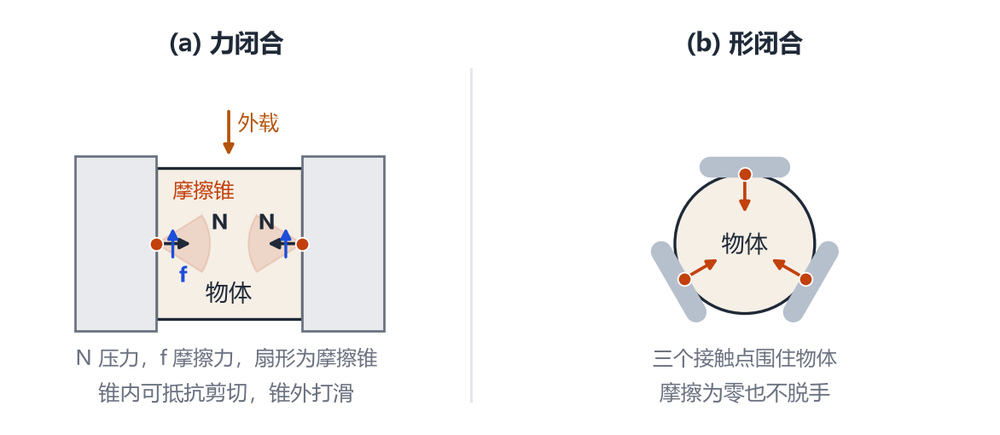
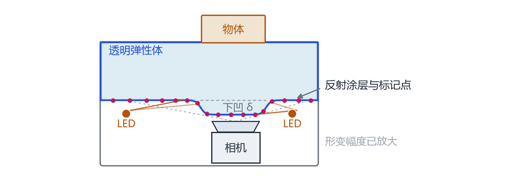
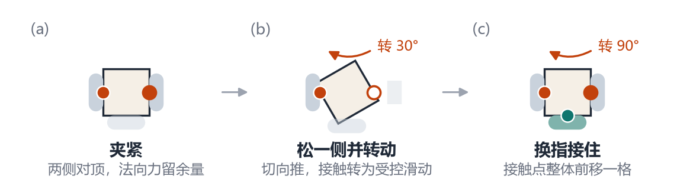

# 第 18 章　灵巧操作与触觉

> **本章导读**：腿把人送到物体面前，手才决定事情能不能做成。这一章从一只手的机构讲起，说清多指手为什么难造、抓取在力学上凭什么稳定、触觉传感器到底测到了什么，再讲到手内操作与双臂协调这些比抓取更难一层的问题。读完这一章，你能判断一台灵巧手的能力边界在哪里，也能看懂论文里那些"成功率 90%"的手内操作结果值多少。

上一章讲腿怎么在接触不断切换的情况下保持平衡。手面对同一类困难，只是尺度小两个数量级，接触点从脚底一块变成指尖的几平方毫米，切换频率从每秒两步变成每秒十几次。腿的任务是把自己稳住，手的任务是把别人（物体）稳住，还要在稳住的同时改变它。

## 18.1 手为什么难造

拧开一瓶没开封的矿泉水，人平均用一秒半。手掌先包住瓶身，拇指和食指捏住瓶盖，手腕转一个角度，听到塑料环断裂的声音就算成功。整个过程不需要思考，但拆成机构与信号，每一层都在逼近硬件的极限。

人手有 27 块骨头，除腕部以外常被简化成 20 到 24 个自由度。驱动这些关节的肌肉不在手掌里，而在前臂，通过腱绕过腕管连到指尖，手掌因此可以做得又薄又轻。整只手大约 400 克，不到体重的百分之一，却能输出 300 到 500 牛的握力，指尖的捏力也有 50 到 100 牛。

机械手沿着两条路径演化。一条是把自由度压到最低，二指平行夹爪只有 1 个自由度，工厂里绝大多数抓放靠它完成。另一条尽量接近人手，Allegro 手 16 个自由度，LEAP 手也是 16 个，零件用 3D 打印、舵机驱动，整只成本约 2000 美元；ShadowHand 有 24 个关节、20 个可驱动自由度，指节布满传感器，价格是 LEAP 的几十倍。

自由度只是表面，真正决定手感的是驱动方式。

直驱把电机直接放在指节里，一个关节一个电机。响应快，每个关节可以独立控制，缺点是手指做不细，惯量大，撞一下先坏的是电机。腱驱把电机挪到手掌后部或前臂，用钢丝或高强度聚乙烯绳拉手指，原理和自行车刹车线一样。手指可以做得又细又轻，代价是摩擦与迟滞，绳子用久了会伸长，走线绕过关节时拉力还随姿态变化。ShadowHand 和多数人形手走这条路。

连杆驱动用刚性杆件在指节之间传力，推和拉都能做，刚性好，能承受较大的侧向力。缺点是机构外露，关节只能按固定比例耦合，手指的厚度降不下来。欠驱动则是另一个思路，驱动器数量少于关节数，靠弹簧、差动轮系或柔性铰链让手指自动贴合物体。Robotiq 的三指手只有一个电机，靠连杆和弹簧实现包络抓取，便宜、耐撞、不需要标定。代价是每个关节的力不能独立指定，近端关节先顶到限位，远端只能给出很小的力，遇到硬物时形同虚设。

回到"为什么像人手很难"，三个约束在互相打架。

尺寸。成年人食指大约 7 厘米长，直径不到 2 厘米。这个空间里要放电机、减速器、编码器和触觉。LEAP 用现成舵机，手指比成年人粗一圈，外观上就能看出来。

力量。指尖 2 厘米的力臂要产生 1 到 2 牛米的力矩，小电机必须配减速器。减速器带来背隙，背隙让位置控制精度掉一个量级，还让手变得既撞不动也回不来。直接驱动能避开背隙，但电机扭矩不够，只能靠更大的电流和更粗的线圈，尺寸又回去了。

传感密度。整只手大约有 1.7 万个机械感受器，指尖的两点辨别阈约 2 毫米，意思是两根针尖相距 2 毫米压下去，人能分出是两点。一只机械手的触觉点常常只有几百个，间距 3 到 5 毫米，而且多数只测法向力，剪切力测不到。

### 把三个约束折成数字

先看空间。食指 7 厘米长、直径 2 厘米，按圆柱估体积是 3.14 乘 1 厘米的平方再乘 7 厘米，约 22 立方厘米。四指加拇指约 110 立方厘米，手掌按 8.5 乘 9 乘 2.5 厘米算是 190 立方厘米，整只手 300 立方厘米上下。人手 400 克，按密度 1.1 克每立方厘米反推是 360 立方厘米，两个估法对得上。

小舵机的扭矩密度大约每立方厘米 23 毫牛米。一根手指塞得下 15 立方厘米的驱动器，扣掉壳体与走线，输出约 0.35 牛米，作用在 2 厘米的力臂上只有 17 牛捏力。人手是 50 到 100 牛，差三到六倍。差距不来自工艺，而是体积乘扭矩密度这个上限。

握力把这笔账拉得更开。手掌住 8 厘米粗的水壶，四指各出 100 牛，握点离掌心 4 厘米，每个掌指关节要扛 4 牛米。按 23 毫牛米每立方厘米倒推，需要 174 立方厘米，是一根手指体积的八倍。所以人把肌肉放在前臂，前臂 300 多立方厘米装得下，手掌只留腱和滑轮。机械手想在指尖出大力，要么手指变粗，要么照抄腱驱，把电机挪回前臂。

传感这一项也能量化。指尖每平方厘米约 240 个机械感受器，相邻间距是 240 的平方根分之一，约 0.65 毫米，比两点辨别阈的 2 毫米还细。大脑把邻近几个感受器的信号合起来判断，分辨率反而被拉粗到 2 毫米。机械手的触觉点间距常在 3 到 5 毫米，能分辨的最小凸起也跟着粗。

三个约束乘在一起，就是这一章的背景。要细、要有力、要密、还要便宜到能批量安装，目前没有一套方案同时满足。这也解释了为什么灵巧手在论文里很热闹，在产线上却少见。

## 18.2 抓住和夹住的区别

人拿东西的方式，Napier 在 1956 年给过一个至今仍在用的分类。力量抓取（power grasp）用整个手掌与物体大面积接触，力从手掌传到物体，握锤子、提水壶都是这一类。精细抓取（precision grasp）只用指尖对捏，物体被夹在指腹之间，捏针、捏硬币、翻书页属于这一类。前者稳定、力量大、精度低，后者灵活、力量小、能随时调整。两者的力学结构不同，前者靠包络，后者靠对顶。

工程上对应的两个概念是形闭合与力闭合。

形闭合（form closure）只靠几何约束，不依赖摩擦。把方块放进一个刚好匹配的凹槽，或者用三块平板从三个方向扣住，物体被几何锁死，摩擦系数为零也拿不出来。三维刚体要做到无摩擦形闭合，对光滑边界至少需要 7 个接触点；在平面内，三个接触点就够了，因为它们能同时约束两个平移和一个转动。

力闭合（force closure）靠摩擦。两指对顶夹住一块肥皂，捏得足够紧就能提起来，但肥皂沾了水，摩擦系数从 1 掉到 0.2，就滑了。

摩擦能提供多少力，由摩擦锥给出。接触点施加的力必须落在以法向为轴的一个锥体内

$$\mathcal{K}=\{\,f:\ \|f_t\|\le \mu f_n,\ f_n\ge 0\,\}$$

其中 $f_n$ 是沿接触面法向的压力，$f_t$ 是切向力，$\mu$ 是摩擦系数。锥的半角是 $\arctan\mu$，$\mu=1$ 时是 45 度，$\mu=0.2$ 时只有 11 度。硅胶指垫对 ABS 塑料的摩擦系数大约 0.8 到 1.2，干燥橡胶对玻璃接近 1.0，钢对钢只有 0.15 到 0.2，沾了油的表面能降到 0.05。厨房夹爪抓玻璃杯很稳、抓涂了油的瓷盘会打滑，原因就在这里。同一套规划换个材质就失效，问题不在算法而在锥角。

### 两指夹住要多大劲

两指对顶夹一个物体，能不能提起来有一个能直接算的条件。单侧法向力记作 $N$，两侧一共两个接触面，每个面能提供的最大摩擦力是 $\mu N$，合起来要顶住重力

$$2\mu N \ge mg$$

$N$ 是单侧法向力，单位牛。$\mu$ 是摩擦系数，没有单位。$m$ 是物体质量，单位千克。$g$ 取 9.8 米每二次方秒。左边是两侧摩擦力的上限，右边是物体的重量。这个式子说的是，摩擦总量不够，夹得再正也会滑。

代一组数字。一块肥皂 100 克，重量是 0.1 乘 9.8 等于 0.98 牛。干燥时 $\mu$ 取 1.0，需要的单侧法向力是 0.98 除以 2，等于 0.49 牛，两指轻轻一捏就够。沾水后 $\mu$ 掉到 0.2，需要 0.98 除以 0.4，等于 2.45 牛，力气涨五倍。若还想留一倍安全余量，就取 4.9 牛，接近指尖捏力的十分之一。

生活里的夹持工具都在解这个不等式。晾衣夹的弹簧只有几牛，靠橡胶垫把 $\mu$ 抬到 1 以上。筷子夹花生米有两个接触面，$\mu$ 不到 0.4，力道要稳。镊子夹邮票的接触点小、$\mu$ 也小，稍一晃就飞。书立反过来，两侧挡板顶住书，靠的是形闭合，不算摩擦。

同一条式子解释了常见失败。玻璃杯干燥时 $\mu$ 接近 1，杯壁有水或手上沾油，$\mu$ 掉到 0.2，原来 5 牛的夹持力就不够了。

多指抓取的分析工具是抓取矩阵。把所有接触点的力拼成一个向量 $\lambda$，物体受到的 6 维力旋量记作 $w$，两者由一个矩阵联系起来

$$w = G\,\lambda$$

$w$ 是三个方向的力加三个方向的力矩。$G$ 的每一列表示某个接触点的单位力对物体产生的效果。接触点离质心越远，力矩那几行越大，同样大小的力撬动能力越强。矩阵的零空间对应一种特殊情形，$G\lambda=0$ 但 $\lambda\neq 0$，也就是所有接触力互相抵消，物体不动而手在较劲。这组力叫内力，它不改变物体运动，却能提高抗滑余量。内力太少会脱手，太多会把鸡蛋捏碎，力控的任务就是把它调到合适的位置。

力闭合的判据可以用这个矩阵写出来，$G$ 行满秩，并且摩擦锥内部存在一个 $\lambda$ 使得 $G\lambda=0$。行满秩意味着接触点合起来能产生任意方向的力和力矩，第二个条件意味着抓取有余量，不是勉强贴在锥的边界上。两个软指接触有 8 个力分量，矩阵是 6 乘 8，秩最多 6，数学上够用。但实际能抵抗的方向很不均匀，绕两接触点连线的扭矩主要靠接触面的摩擦扭矩，接触面积一小就不够。三个以上接触点把扭矩分摊开，抓取明显稳得多。图 18-1 把这两种情况画在一起。

<figure class="fig">

<figcaption><b>图 18-1</b>　力闭合与形闭合的对比。两指对顶靠摩擦锥内的压力抵抗外载，锥外即滑动；三个接触点从几何上封住平面内的三个自由度。</figcaption>
</figure>

真实的抓取规划很少解这个判据。摩擦系数不知道，质心位置不知道，接触面积随夹持力变化，软物体还会形变。Dex-Net 的做法是用几百万个合成抓取训练一个网络，直接回归成功率，阈值靠真机试验标定。这是工程妥协，也解释了为什么论文里的"抓取质量"常常等于经验成功率。第 5 章从检测的角度讲过一遍，这里补的是力学那一半。

## 18.3 让手有感觉

视觉告诉你物体在哪，触觉告诉你接触发生了什么，两者的时间尺度差几十倍。相机 30 帧，一帧 33 毫秒，机械手在这段时间里能移动 3 毫米，足够把一个对好的轴孔顶歪。触觉的采样可以做到 1 毫秒以下，而接触事件的持续时间常常只有几毫秒。

指尖的触觉有四条技术路线，原理差别很大。

GelSight 是 MIT 团队做的指尖传感器，2017 年的论文把它带进抓取研究。做法是把一块透明硅胶贴在指尖，硅胶朝内的一面喷一层反射涂层，涂层上印着密集的小点。四周的红绿蓝 LED 从侧面打光，硅胶后面装一个相机，镜头对着涂层。没有接触时涂层是平面，反射均匀；物体压上来，硅胶形变，涂层跟着凹陷，凹陷处的表面法向偏转，反射进相机的光就变强或变弱。三个方向的光强不同，一张照片就能解出每个像素的法向，再积分成深度图，这套数学叫光度立体。图 18-2 画的是它的剖面。

常见的指尖传感器能看清几十微米高的凸起，比人手的 2 毫米细两个量级。代价是厚度，一个完整的视触觉模块通常 2 到 4 厘米厚，装在指尖上手指立刻粗一圈。硅胶是耗材，划伤、老化、沾油都会让图像失真，在产线上很致命。

<figure class="fig">

<figcaption><b>图 18-2</b>　视触觉传感器的剖面。物体压凹弹性体，反射涂层随形变倾斜，相机从背面拍到亮度变化，再反解出接触面的三维形状。</figcaption>
</figure>

压阻阵列走的是另一条路。压阻材料的电阻随压力下降，做成行列电极，逐行扫描就得到一张压力图。工艺简单，可以做成 0.5 毫米厚的柔性薄膜，覆盖整个手掌，成本几十到几百美元。缺点是迟滞和漂移，同一个力在加载和卸载时读数不一样，差 5% 到 10%，长时间受压还会蠕变。它主要测法向力，剪切力要靠特殊结构才能测到。

电容阵列测的是极板间距变化，灵敏度比压阻高，做得好可以分辨几毫牛的力，通过梳齿结构还能测剪切。代价是走线多、易受寄生电容干扰，靠近电机和电源线就有噪声，需要屏蔽和差分读出。

事件式触觉借的是事件相机的思路。每个像素独立判断亮度变化，超过阈值就输出一个事件，带上坐标、时间戳和极性，没有变化就不输出。时间分辨率到微秒，数据量比帧式少一两个数量级，特别适合捕捉滑动瞬间的高频振动。它的盲点很直接，物体静止时没有事件，你无法知道"现在还捏着"，必须配一个帧式传感器做底。

### 每条路线的边界

能测什么、测不到什么、多少钱，这三件事决定选型。视触觉能测法向分布、切向位移和接触形状，滑动时标记点的位移直接看得见。它测不到温度和绝对力，力要从硅胶形变换算，刚度按 20 牛每毫米估，形变读数差 0.1 毫米，力就差 2 牛，相对误差一两成。成本几百到几千美元，还没算换硅胶的钱。

压阻阵列能测大面积的法向分布与接触面积，铺满手掌也不贵。它测不到剪切，0.1 牛以下的轻触读不出来，长时间受压还会慢慢漂。单价几十到几百美元。

电容阵列能测轻触与剪切，灵敏度能做到毫牛。它测不到大力量，量程常在十几牛就饱和，靠近电机和电源线就有噪声，需要屏蔽和差分读出。成本数百美元。

事件式能测滑动的振动和微秒级的时间戳。它测不到静力量值，物体不动就没有输出，必须再配一个帧式传感器做底。成本数千美元。

这些传感器能解决的事，具体有四件。

滑动检测。物体真正滑走之前有一个阶段叫初始滑动，接触面边缘先局部滑动，中心还粘着，持续时间几十毫秒。人能在这个窗口里察觉，靠的是指尖感受器对 50 到 500 赫兹振动的敏感，反应时间大约 10 到 20 毫秒。机械手用视触觉看标记点的位移，用事件传感器看振动，都能在这个窗口里把抓取力补上去。这是"刚好不掉"的控制，比一直用大力气省电，也不会把软物体捏坏。

软硬判断。按压 2 毫米，看法向力涨得多快。香蕉的斜率是几十牛每米，黄瓜几百，金属几千。这个信息视觉给不了。

插入对齐。轴孔装配的间隙常在 0.1 到 0.5 毫米，孔口被轴挡住，相机看不到。可行的做法是让机器人带着柔性往下压，感觉到侧向力就沿反方向微调，走一个螺旋搜索，几秒内滑进孔里。人插钥匙用的就是这个策略，闭着眼睛也能插进去。

抓取确认。夹爪闭合到位但手里没东西，电流和触觉图都会异常。这一条最简单，也最容易被漏掉。

**表 18-1**　触觉方案对比。分辨率与频率为常见实现的量级，成本指单个传感单元。

| 方案 | 原理 | 分辨率与频率 | 成本 | 典型失效 |
|---|---|---|---|---|
| 视触觉 | 相机拍弹性体形变，光度立体反解深度 | 0.05 到 0.1 mm，30 到 60 Hz | 数百至数千美元 | 硅胶磨损、模块厚、光路被污染 |
| 压阻阵列 | 受力处电阻下降，行列扫描 | 2 到 5 mm，100 Hz 到 1 kHz | 几十至几百美元 | 迟滞与蠕变、主要测法向 |
| 电容阵列 | 极板间距变化，可做剪切结构 | 1 到 4 mm，100 Hz 量级 | 数百美元 | 寄生电容干扰、走线多 |
| 事件式 | 像素异步输出亮度变化 | 亚毫米，微秒级时间分辨率 | 数千美元 | 静态接触无输出，需与帧式融合 |

## 18.4 手内操作

手内操作指物体相对手掌运动而手臂基本不动。转笔、把骰子翻面、拧瓶盖、把钥匙挪到能开门的位置，都属于这一类。它和抓取的区别在于接触点在变。抓取是一次性建立一个稳定的接触集合，手内操作是不断拆掉一部分接触再建新的，后者在力学上要难一个层次。

按接触的变化方式，可以分成几种。指步态是手指交替松开、移动、重新接触，像走路换脚。指尖转是物体绕某个接触点转动，接触点不动而物体在滚。受控滑动靠重力或惯性让物体滑到指间的位置。重抓是彻底松开再抓，最简单也最慢。

为什么难，有四层原因。

### 接触是离散的

粘、滑、离是三种不同的动力学，切换是瞬时的，方程跟着换。一次转笔要经历十几次切换，用控制的语言说这是一个混杂系统，没有光滑的模型能覆盖全程。粘与滑的判别要在几毫秒内做完，靠的是接触边缘的微振动。切换那一瞬间少一个接触点，物体受约束的方向从 6 个掉到 5 个，绕某个轴短暂自由，姿态会自己转一点。这段时间常在 10 到 30 毫秒，控制必须在这个窗口里把下一个接触点补上。

### 手是欠驱动的

一只 16 自由度的机械手有 16 个电机，要控制的接触力却有几十个分量，未知数多于方程，只能靠优化分配。自由度再多也不够，因为接触力是连续的，电机是有限的，这个不等式永远成立。

### 手心那一面看不到

物体在手里的位姿只能靠触觉和关节角推算，误差会累积。掌侧的相机也拍不到指尖对着物体的那一面，三个指尖传感器合起来覆盖不到 10 平方厘米，而一个 3 厘米见方的方块有 54 平方厘米的表面。

姿态误差按步累积，单步 2 度，三步之后 6 度。转 90 度之后一个 5 度的姿态估计误差就足以让下一次接触点偏 5 毫米，而指尖的接触区只有 1 厘米宽。把关节角、触觉图和接触几何一起送进滤波器，误差能从 5 度压到 1.5 度，代价是几十毫秒的滞后。

### 时间窗口

转笔一圈 0.5 到 1 秒，接触事件在毫秒级，控制频率要 100 赫兹以上，策略必须在本地跑，不能调云端。按一秒转一圈算，转 90 度只要 0.25 秒，平均角速度 360 度每秒。100 赫兹下一个控制周期对应 3.6 度，够用。初始滑动的窗口只有 20 毫秒，同一个频率下只剩两个控制周期。延迟预算很紧，传感 1 毫秒、决策 5 毫秒、执行 10 毫秒，加起来 16 毫秒，窗口基本被占满。

把一次旋转拆成阶段，会看得更清楚。以方块绕竖直轴转 90 度为例，三个阶段循环三次。

夹紧阶段，拇指和食指对顶，法向力取到摩擦锥内部，留出余量。这一阶段的目标是力，不是位置，因为物体表面可能有几毫米的误差。

松一侧并转动阶段，把食指的法向力降到接近滑动阈值，拇指保持，再用拇指的切向力推物体绕接触点转。接触从粘滞变成受控滑动，转过的角度由切向位移和接触几何共同决定。这一阶段的目标是滑移速度，太快会失控，太慢会卡住。

换指接住阶段，中指在物体新的侧面接触，恢复法向力，食指松开回到初始位置。一次指步态完成，物体转了大约 30 度，重复三次到 90 度。这三段的关系见图 18-3。

<figure class="fig">

<figcaption><b>图 18-3</b>　手内旋转的三个阶段。夹紧建立接触，松开一侧并施加切向力让物体受控滑动，换指接住后接触点整体前移一格。</figcaption>
</figure>

三个阶段的目标函数不一样，混在一起学，网络很难收敛。按阶段给奖励，或者用有限状态机切换，成功率高得多。手内操作的论文里常有相位变量，就是一个 0 到 1 的进度指示。

强化学习是目前处理这类任务的主力方法。仿真里并行几千个环境，MuJoCo 或 Isaac Gym，算法用 PPO 或 SAC，奖励由三部分组成，跟踪目标角速度、保持物体在掌心、动作平滑与能耗。掉落的回合提前终止，否则策略会学会摔了再捡这种捷径。

教师-学生的结构几乎成了标准做法。教师在仿真里能用特权信息，物体的真实位姿、速度、接触力，这些真机上测不到。教师先学出一个能转的策略，再标注大量状态，让学生只凭触觉图、关节角、电机电流去模仿。学生看到的输入和真机一致，蒸馏完直接部署。这套思路在四足机器人上叫 RMA（Rapid Motor Adaptation），在手内操作上换了名字但机制相同，本质是把仿真里知道而真机不知道的信息，转成从可观测信号里推断的能力。

域随机化决定成败。摩擦系数在 0.5 到 1.5 之间随机，质量上下浮动三成，传感器加噪声，控制延迟 0 到 20 毫秒，连硅胶硬度也随机。范围太窄，真机换个物体就崩；太宽，策略学不会精确动作。这个范围只能靠真机试验反复调。

量级上，一个方块重定向的策略通常要 1 亿到 10 亿步仿真交互，几千个并行环境下是几小时到几天。真机上同样的学习要几个月，还不安全。OpenAI 在 2018 年用 24 自由度的 ShadowHand 做方块重定向，靠大规模仿真加域随机化搬到真机，当时只能处理一个方块。之后 Dextreme 把学生换成四个深度相机的输入，2024 年后的工作把触觉图作为额外通道。

即便如此，转笔这类依赖精确摩擦与动态平衡的技能仍然脆弱。换一支笔，重心变了，长度变了，策略大概率失效。这是数据问题，不是算法问题。

## 18.5 两只手与工具

两只手做一件事，约束比单手多一层。单手抓杯子，杯子只受一只手约束；双手端锅，两只手和锅构成一个闭链，任何一只手的位置误差都会变成锅的内应力。

闭链带来两个后果。一是相对位姿必须保持，两手之间的距离和角度由物体决定，控制时不能各自跟踪自己的目标，要跟踪一个共同的物体位姿。二是力分配不唯一，同样的物体运动可以由无数种两手力的组合实现，多出来的自由度叫内力。内力太大会把物体夹变形，太小会在加速时脱手，需要显式指定。

### 两只手的误差会撞在一起

两台臂各自标定到正负 0.5 毫米，相对位姿的误差最坏是 1.4 毫米。两个腕部的角度各差 0.2 度，在 30 厘米外又添 1 毫米。两笔按最坏叠加算是 2.4 毫米。两只手都闭死夹住一个刚性物体时，这些误差没有地方可去，只能变成物体里的内力。夹爪与物体的接触刚度按每米十万牛估，2.4 毫米的偏差就是 240 牛。敲开一个鸡蛋只要 30 牛上下，这个力足够把蛋壳按碎好几次。

对策不是把标定做得更准，而是让一只手软下来。跟随的那只手把刚度降到每米一千牛，同样的 2.4 毫米只产生 2.4 牛。代价是跟随手的定位精度也掉到毫米级，抓取点要选在物体刚性最好的位置。

内力的量级可以算。双手端一锅 3 公斤的汤，重心在两手连线中点，两臂各出 14.7 牛。整锅以 1 米每二次方秒水平加速时要多出 3 牛，两手合计出 32.4 牛。分配不均时一端 17.7、另一端 14.7，锅就歪，汤就洒。工程上把夹持力设成各 20 牛，超过外载的部分是余量，也是内力的预算。

工程上有两种做法。主从式让一只手当主手定轨迹，另一只手用阻抗控制跟随，保持相对位姿。集中式把两条臂的关节放进一个优化问题一起解，约束是物体位姿和接触力。前者可以用两台独立控制器拼起来，后者精度高但要改底层。ALOHA 用两台 6 自由度机械臂加两个夹爪，一共 14 个自由度，整机不到两万美元。RDT 这类双臂基础模型把参数量做到 12 亿，用 46 个数据集、上百万条 episode 训练。

### 杠杆把误差和力一起放大

工具把问题又推远一步。螺丝刀把力臂从 2 厘米延到 10 厘米，手部力矩在螺丝上放大五倍，尖端的位置误差也放大五倍。腕部 1 度的角度误差，在 10 厘米力臂上就是 1.7 毫米，在 30 厘米的杆上变成 5.2 毫米，比视觉定位的误差还大。钳子把力放大十倍、行程缩小十倍，剪断铁丝要 500 牛的尖端力，手柄上只要 50 牛，手柄走 20 毫米尖端只走 2 毫米，剪一下要等半秒。锤子的重心在头那端，握点离重心 30 厘米，挥动时惯性力矩是空手的十几倍，手腕必须补偿。

拧瓶盖把杠杆和摩擦放在一起。没开封的瓶盖需要 1 到 2 牛米的扭矩。指尖捏力 30 牛，摩擦系数按 1 算，单侧在半径 1.5 厘米的盖上只有 0.45 牛米，两侧加起来 0.9 还不够。人用整个手掌包住瓶盖，力臂变成 3 厘米，再用另一只手固定瓶身，扭矩就够了。单手拧不开不是力气不够，是力臂和摩擦都不够。

工具使用不等于抓住一个物体。它改变了运动学（工具尖端才是末端）、动力学（惯量和重心变了）、力的量级（杠杆比）。让视觉-语言-动作模型直接输出关节角度，很难学到这些物理量；把工具尖端作为控制点、把工具的长度和重量作为输入，效果会好很多。

## 18.6 怎么算成功

YCB 物体集是抓取评测的事实标准。2015 年发布，77 个物体，分食物罐头、厨房用具、工具、形状块、任务物件五类。挑选标准是日常、有纹理、尺寸在 5 到 20 厘米。它的价值在于可复现，全世界用同一批物体，成功率才有比较的意义。位姿估计常用的 YCB-Video 是它的子集，21 个物体、92 段视频、13.3 万帧。

手内操作的基准少得多。常用的是一组几何体，方块、圆柱、球、笔，指标是连续旋转角度、掉落次数、每分钟转数。物体少是因为手内操作对形状极敏感，多一个凹槽就要重训，做不出通用物体集。

成功判据的模糊性在这个领域特别明显。抓起来算成功，还是保持 5 秒算成功；方块放进盒子算成功，还是必须摆正算成功；途中碰到旁边的杯子没碰倒，算不算失败。这些差别在论文里常常一句话带过，在不同实验室之间就成了不可比的数字。

### 判据松一寸，数字差一截

抓取的成功判据至少有三种写法。夹爪闭合后物体离开桌面算成功；抬高 10 厘米并保持 5 秒算成功；保持期间还不许碰倒旁边的东西才算成功。三种写法在同一批试验上能差 10 到 20 个百分点，最松的那一种把"夹住了但一抬就掉"也算进去。

装配的判据更细。轴孔间隙 0.5 毫米时插进去就算成功，间隙 0.05 毫米时还不许有划痕。同一台设备在两个判据下的成功率能差一半，论文里往往只写"插入成功"。

一个例子能看清差距。拿一块 5 厘米见方的积木，夹住抬离桌面 3 毫米，最松的判据就此算成功。同样的抓取抬到 10 厘米时夹持面打滑掉下来，中等判据算失败。即便没掉，物体在空中又转了 20 度，最严的那一种还是失败。同一次抓取在三种判据下结果不同。

### 判据模糊的后果

后果分三个层面。读论文的人无法比较，只能记住作者自报的数字。做选型的人被误导，按 90% 验收，实测只有 60%，差的 30% 全在判据上。复现的人最吃亏，同一套代码换个实验室，只因为把"保持 5 秒"改成"保持 2 秒"，结果就变样。

YCB 内部其实分了难度。77 个物体按抓取难度分成四级，从大而规整的盒子到小而滑的螺丝刀，最好成绩常常只报容易的那几级。报告写"YCB 成功率 95%"时没说用的是哪几个，这个数字的信息量很低。

手内操作的指标也有同样的毛病。连续旋转角度按累计算还是按最终停住的那个算，结果差很多。累计 360 度可能中途掉过三次又捡回来。掉落次数按次算还是按回合算，也影响结论。

可操作的做法是把判据写进报告的第一段，而不是脚注。物体清单、初始位姿的分布、成功的定义、试验次数，这四样齐了，数字才有比较的意义。

统计上的问题更实际。20 次试验成功 16 次，报 80%，按 Wilson 区间算，95% 置信区间是 58% 到 92%，两个方法一个 80% 一个 70% 根本分不开。所需的样本量可以估。区间半宽按 $\Delta$ 取，成功率的估计按 $p$ 取，样本量约等于 $16p(1-p)/\Delta^2$。$p$ 取 0.75、$\Delta$ 取 0.05 时，算出来是 16 乘 0.1875 除以 0.0025，即 1200 次；$\Delta$ 放宽到 0.1，降到 300 次。要分辨 10 个百分点的差异，每组需要几百次试验。

300 次乘每次 10 秒，是 50 分钟纯试验时间，加上复位、换物体、清场，一天测不了几组。灵巧操作的论文大多只写"20 次试验"，读者得自己打折。

物体集本身也有选择偏差。YCB 的物体纹理丰富、几何规整，对视觉算法友好。真实厨房里的保鲜膜、半袋薯片、透明玻璃杯都不在集合里，在这些物体上成功率会掉一大截，报告里却看不出来。

## 18.7 还差什么

硬件仍然是天花板。腱驱的绳子几万次循环后会伸长，硅胶指尖几百次接触后会磨平，触觉阵列的走线在反复弯折后断裂。一台灵巧手在实验室能用一年，在产线上三个月就要维护。维护成本不进论文，却决定它能不能出厂。

### 寿命可以算

腱绳的账最容易算。钢丝或聚乙烯绳在滑轮上反复弯折，几万次之后会永久伸长百分之零点五。走线长 10 厘米时，这 0.5% 就是 0.5 毫米，指尖位置整体偏掉半毫米，抓取规划按旧长度算就会夹偏。

硅胶指尖的账按接触次数算。一块 3 毫米厚的硅胶垫，几千次带压接触之后表面磨平 0.1 毫米，力的换算系数跟着偏一成。压阻与电容阵列的走线在弯折处疲劳，两万次后开始断线，表现是某几行读数恒为零，接触图上出现一条永不消失的条纹。

把这些数放进产线节奏。一天 2000 次抓取，三个月 18 万次。腱绳 5 万次一换，等于 25 天换一遍，20 根腱分摊下来每天要动一根。硅胶指尖 5000 次一换，一根指头两天半就要换一个。同一只手在实验室用一年，在产线上三个月进入维护循环，差别不在质量，在工作量。

**表 18-2**　灵巧手易损件与寿命量级。数字为常见实现的量级，随材料与工况变化。

| 部件 | 失效形态 | 寿命量级 | 换一次的影响 |
|---|---|---|---|
| 腱绳 | 永久伸长、断丝 | 5 万次循环 | 指尖位置偏 0.5 毫米，需要重标定 |
| 硅胶指垫 | 表面磨平、划伤 | 5000 次接触 | 力换算偏一成，视触觉图像失真 |
| 触觉阵列走线 | 弯折处断线 | 2 万次弯折 | 整行读数归零，接触图出现条纹 |
| 减速器 | 背隙增大、齿面磨损 | 100 万转 | 位置精度掉一个量级，回差变大 |
| 电机 | 电刷磨损、线圈过热 | 2000 小时 | 力矩下降，堵转时先烧 |

触觉的覆盖与分辨率是一对矛盾。视触觉分辨率高，只能覆盖指尖几个平方厘米；阵列能盖住整个手掌，每个点却很粗。人手的做法是分层，指尖密、手掌疏，机械手还没有对应的成熟布线方案。

算法上，接触丰富的长程任务缺少数据。抓取有百万级的合成数据集，DexGraspNet 就有 132 万个抓取、5355 个物体，手内操作只有零散的任务级数据，跨物体泛化很差。

评测上，缺一个像 ImageNet 那样的统一基准。手内操作尤其如此，物体、初始位姿、成功判据三样都没有共识，横向比较几乎不可能。

合成数据在接触力学上的可信度也可以量。同一组抓取分别在 MuJoCo 与真机上测，成功率差 10 到 20 个百分点是常态，原因是接触模型的参数没有标定。软体、绳索、多接触堆叠这三类差得更多，仿真器给的接触力本来就偏乐观，策略学会的挤压力度到了真机会把物体压扁。

还有一条是人的数据。戴数据手套采到的关节角与真机手对不上，20 个自由度映射到 16 个要丢掉 4 个维度，丢哪 4 个都会改变动作的味道。视频里只有手的位置和大致姿态，指节怎么配合看不出来。

三条线里评测最容易推进，把判据、物体清单、试验次数写成模板，成本几乎为零，收益是让所有数字可比。

一台灵巧手连续跑八小时，腱绳要重新张紧，硅胶要换一轮，触觉标定要重做，真正干活的时间不到七成。论文里的成功率是在标定完、物体摆好的那几分钟里测的。

硬件、算法、评测三条线的推进速度不一样，谁也不等谁。把视线拉远，当这些零件被装成一台要连续跑几小时的系统时，问题会换一副样子，时延、失败恢复、算力预算这些工程账要重新算一遍。
