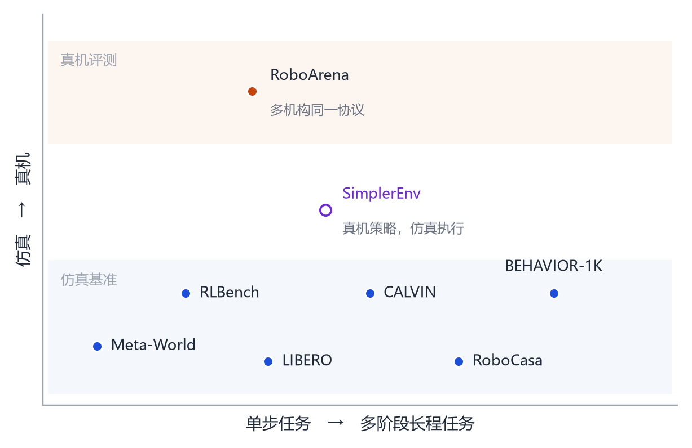
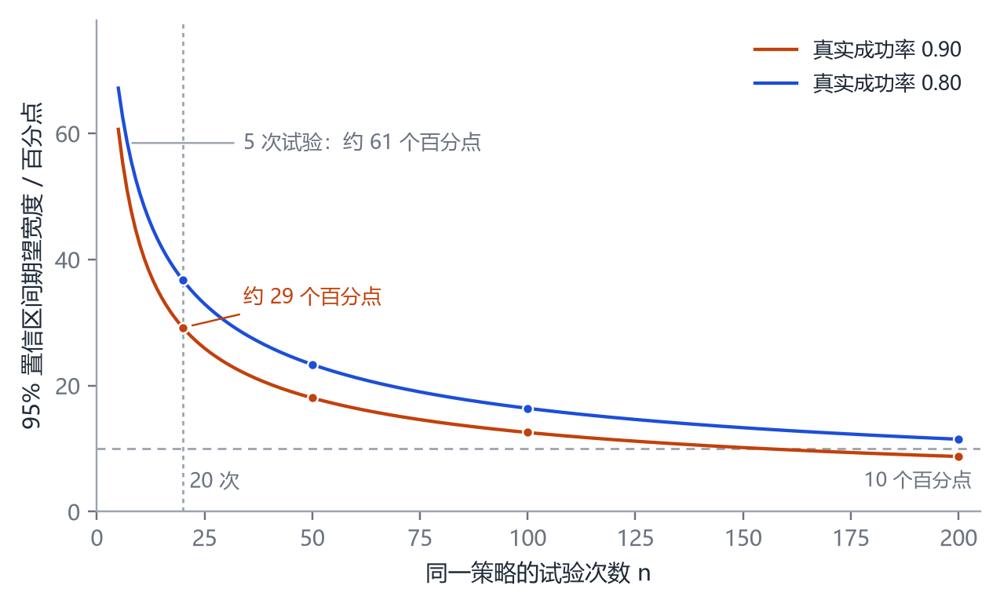
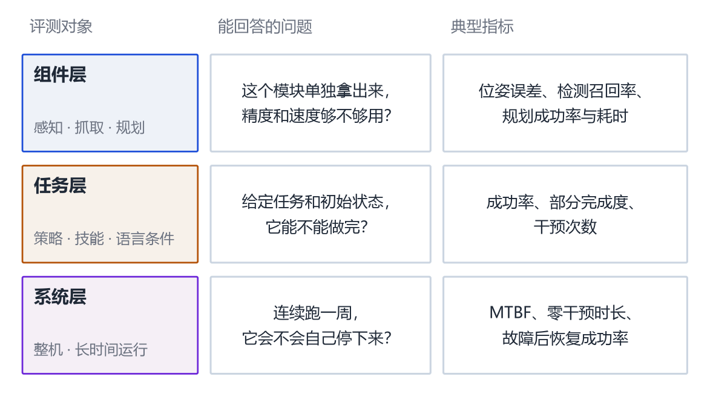

# 第 20 章　怎么知道它行不行

> **本章导读**：一个策略在实验室的桌子上抓了十次苹果，九次成功，这算不算"能用"？这一章讲机器人评测为什么难，仿真基准各自在测什么，真机评测怎么组织，成功率之外还有哪些指标，以及一个 90% 的成功率究竟能推出什么结论。读完这一章，你能判断一篇论文里的数字可信到什么程度，也知道自己要搭一套评测时该先定下哪几件事。

## 20.1 一次评测就是一次物理实验

这一节回答一个问题，为什么同一个策略换个实验室跑，报出来的数字就不一样。

语言模型的评测接近查表。固定一份测试集，输入相同，输出可以复算，换一台机器跑，结果一样。机器人没有这个便利。把同一个策略放回同一张桌子，跑两次，结果可能不同，因为初始位姿要重新摆，物体表面有灰，夹爪闭合的位置差两毫米。评测在这里不是查表，是做实验，而实验要花时间、占设备、还得有人在场复位。

这就是"在我实验室能跑"不能当结论的原因。它缺了三样东西：分母（跑了多少次）、判据（什么算成功）、分布（初始状态怎么采样）。三样里任何一样没写清，数字就没法比。一个没有分母的百分数，和一句"效果还不错"的信息量差不多。

具体难在四处。

**硬件不同。** 同一条策略换一台臂就变样。Franka 有 7 个自由度、关节力矩传感、1 kHz 的控制接口；WidowX 是 6 个自由度、位置控制、常用 5 到 10 Hz 下发指令。夹爪行程从 5 厘米到 10 厘米不等，相机装在腕部还是头部，差别更大。RT-1（2022）的动作是 3 Hz 的末端增量，ALOHA（2023）的双臂系统跑在 50 Hz，两者对"一次动作"的定义都不一样，成功率自然不可直接比较。

硬件上的差别可以量化。抓取同一个纸盒，Franka 的腕部相机离物体 20 厘米，成功率能到 82%；同样的代码放到 WidowX 上，相机装在肩部、离物体一米多，成功率掉到 41%。掉下去的一半来自视角，一半来自夹爪开口。视角这一项最容易被忽略。640×480 的图像在 20 厘米处一个像素对应 0.4 毫米，到一米处就是 2 毫米，同一网络的空间精度差了五倍。

控制频率改变的是策略的可行性。3 Hz 意味着每 330 毫秒才更新一次目标，移动 10 厘米要七八次更新，中途物体被人碰歪，只能等下一次。50 Hz 每 20 毫秒就能修正一次，容错空间大得多。把在 50 Hz 上训好的策略直接搬到 5 Hz 的接口上，动作会一顿一顿，插孔这种需要连续微调的任务几乎必然失败。

**场景不同。** 桌面颜色、窗户侧光、地板反光都会改变像素分布。一个在白色桌面上训练的策略，换到木纹桌面上成功率可能掉一半，因为它学到的是"在浅色背景上找红色物体"。

光照的破坏力常被低估。晴天下午四点，西晒的阳光斜射进来，金属盘子边缘会拉出一道高光，位置随太阳移动，半小时里挪两三厘米。策略把这道高光当成了物体的边界，抓点就偏了。桌布换一块，像素均值可能差 30 个灰度级，在颜色空间里那是一大段距离。

**随机性大。** 来源有两个，环境的（初始位姿、摩擦、光照）和策略的（扩散采样、温度、动作块边界）。两者混在一起，同一个配置跑两次的差异可以到十几个百分点。

分开测一次就清楚了。同一个扩散策略，初始位姿固定、只换随机种子，10 次里成功 8 次，那两成的失败全来自采样噪声。反过来把种子固定、只随机化初始位姿，10 次里的成功率能在 60% 到 100% 之间跳。两种噪声必须分开测，否则不知道该往哪一边加样本。

**复现成本高。** 算一笔账。20 个任务，每个跑 10 次，每次从复位到判定 90 秒，纯运行 5 小时；算上换物体、扶正、清场，实际 7 到 8 小时，两个人一天只跑得了一轮。要比较 5 个策略、每个 3 个种子，就是两周。这就是真机论文里的试验次数常常只有 10 到 20 次的原因，也是 20.5 节要算置信区间的原因。

这 90 秒里，真正在跑策略的时间不到一半。复位要重新摆物体、擦掉上一轮留下的碎屑、把被抓歪的盒子扶正、确认相机没被碰偏，平均花 30 到 40 秒。物体多的时候还要对着清单点数，少一个整轮就作废。设备也是瓶颈，一张实验台、一台臂、两盏灯，一天只供一组人用。

四件事叠起来，会造出一个尴尬局面。论文 A 报 90%，是在 10 个固定初始位姿上、允许重试 3 次、人扶着物体；论文 B 报 70%，是 50 个随机位姿、一次机会、零干预。90 大于 70，但 B 的系统更接近能用。数字本身不带这些信息，得靠协议带。

### 三种目的，三种预算

评测的目的也不止一个，目的不同，预算差得很远。诊断型评测想知道"哪里坏了"，跑十几次就够，因为你要的是失败录像；比较型评测想知道 A 和 B 谁更好，需要几十到上百次，因为要压住噪声；验收型评测要回答"能不能交付"，需要的不是平均值而是一个下限，比如"零干预成功率的下 95% 置信界高于 85%"。同一批数据可以支撑诊断，撑不起验收。很多论文的问题恰恰在于用诊断规模的实验，下验收规模的结论。

用错规模会出真事。某团队用 12 次试验的 92% 去承诺产线可用，交付后连续三天统计零干预成功率只有 61%。回头看那 12 次，成功 11 次，区间的下界本来就在 60% 附近。承诺的时候没有人算过这一笔，损失只能自己承担。

工业上的验收还会加一项长时间连续测试，比如连续 72 小时不关机，记录每一次异常和恢复耗时。这种测试不产生漂亮的百分数，却能暴露内存泄漏、标定漂移、线缆磨损这些短测看不出来的问题。72 小时里如果出现 3 次需要重启的卡死，平均 24 小时一次，按每天 8 小时折算就是三天一次，这样的系统进不了产线。

评测的第一步不是挑基准，而是承认这是实验。实验要有分母、判据、分布和预算，还要有别人能照着做的记录。把实验做得便宜又可复现，最直接的工具是仿真。

## 20.2 把任务关进盒子里的仿真基准

这一节回答一个问题，为什么要在仿真里定标准，每个基准的分数又各能说明什么。

要让数字可比，最直接的办法是固定一切。仿真的价值正在这里。同一份代码、同一个随机种子，跑出来的轨迹逐帧一致。一台带 GPU 的机器能并行开几十上百个环境，跑坏了重启就行，不用换零件。

代价是仿真到真实（sim2real）的差距。摩擦系数、接触刚度、相机噪声、光照，没有一样能完全对上。仿真基准测的因此不是"这台机器人能不能干活"，而是"算法在一个受控世界里能学到什么"。

下面这些基准，大致按任务从短到长、场景从简到繁排开，正好能看到问题是怎么一步步变难的。

**Meta-World（2019）** 有 50 个桌面操作任务，开抽屉、按按钮、推方块、把锤子挂上钉子。它服务的是多任务与元学习研究，50 个任务共用同一个场景和同一台仿真 Sawyer 臂，只有物体与目标是变量，指标就是成功率。局限也很清楚，单个任务几秒钟结束，场景几乎没有变化，在它上面刷到 95% 说明不了泛化。它适合回答"一个网络能不能同时装下 50 件小事"。

**RLBench（2019）** 把任务数翻到 100 个，且全部手工设计，从够取、开门，到"打开烤箱把托盘放进去"这样的多阶段任务。它用运动规划器在预设路点上自动生成演示，理论上可以无限供给数据，这让少样本学习有了可测的对象。观测也给得全，肩部双目相机的 RGB、深度、分割掩码，加上腕部单目。

**LIBERO（2023）** 换了个问题。它问的不是"能不能学会一个任务"，而是"连续学 10 个任务之后，前面学的还记得吗"。130 个任务分成四套，空间关系、物体、目标各 10 个，剩下 100 个拆成 90 个短程任务和 10 个长程任务。指标除了成功率，还有前向迁移（新任务学得多快）、后向迁移（旧任务忘掉多少）、学习曲线下面积。三个数一起看，才能区分"学得快但忘得也快"和"学得慢但稳"。

**CALVIN（2022）** 把语言条件和长程绑在一起。34 个原子任务、4 个环境、约 24 小时遥操作数据、389 条人工写的指令。评测方式是给出一串 5 条指令，看策略能连续完成几条，满分 5。这个指标比成功率苛刻，错一步整条链就断了。论文里的基线在同一环境下做单个任务能到 53.9%，连着做 5 个只有 0.08%。两个数字摆在一起，就是长程任务的真实难度。

**RoboCasa（2024）** 把场景从一张桌子扩到一整套厨房。120 个厨房场景、2500 多个三维物体、100 个任务，其中 25 个是原子技能（开门、转旋钮、按按钮、插入），75 个是组合任务，任务描述由大模型协助生成。它还提供 10 万条机器生成的轨迹。论文里用人类演示训练的策略整体成功率 28.8%，把生成数据加进去到 47.6%。这个数字提醒一件事，在接近真实的场景里，50% 已经是很强的结果。

**BEHAVIOR-1K（2024）** 是目前最重的一个。1000 项家务活动来自对普通人的问卷（"你希望机器人替你做什么"），铺在 50 个场景里，9000 多个物体、1900 多个类别。它的仿真器要支持刚体、柔体、流体、火焰与蒸汽，因为"洗毛巾""倒汤"这类活动绕不开这些。指标除了成功率还有效率，包括移动距离、耗时、过程中把场景弄乱的程度。基线结果很能说明问题，端到端的视觉运动强化学习在三个活动上成功率是 0.0。

**SimplerEnv（2024）** 走另一条路。它不定义新任务，而是把真机评测搬进仿真，复刻两套真实装置（Google Robot，以及 WidowX 配 BridgeData V2 的桌面），把在真机上训练的 RT-1、RT-1-X、RT-2-X、Octo 直接放进仿真跑，总共约 1500 个 episode。结论不是"绝对成功率对得上"，而是"排序对得上"。在视觉匹配设置下，真机与仿真的排序违例指标 MMRV 为 0.027，Pearson 相关系数 0.959。MMRV 是两两比较里顺序颠倒的比例，越小越说明仿真能替真机筛策略。它还暴露了一个细节，Octo-Base 在未调纹理的机械臂上成功率 0%，换成匹配纹理后 29.3%。三十个百分点，只因为机械臂的颜色。

<figure class="fig">

<figcaption><b>图 20-1</b>　八个基准在"任务长度"与"仿真到真机"两个方向上的位置。越往右任务越长，越往上越接近真实硬件，RoboArena 是唯一完全在真机上做的。</figcaption>
</figure>

**表 20-1**　主流基准对比。

| 基准 | 场景 | 任务数 | 真机 | 主要指标 |
|---|---|---|---|---|
| Meta-World | 仿真桌面 | 50 | 否 | 成功率 |
| RLBench | 仿真桌面 | 100 | 否 | 成功率、阶段完成 |
| LIBERO | 仿真桌面 | 130 | 否 | 成功率、遗忘与迁移 |
| CALVIN | 仿真桌面 | 34 个原子任务 | 否 | 连续完成指令数 |
| RoboCasa | 仿真厨房 | 100 | 否 | 成功率 |
| BEHAVIOR-1K | 仿真家居 | 1000 | 否 | 成功率、效率 |
| SimplerEnv | 复刻真机装置 | 8 类任务 | 否 | 与真机的排序相关性 |
| RoboArena | 多机构真机 | 公开任务池 | 是 | 两两对比排名 |

### 挑基准先问三个问题

第一个问题是你想证明能力还是泛化。想让别人相信"这个网络能学会一百件不同的事"，LIBERO 和 Meta-World 就够，它们把变量控制得很干净。想说"换个厨房也能用"，就得去 RoboCasa 或 BEHAVIOR-1K，那里有 120 个厨房和 2500 个物体，失败率高得让人不舒服，但那个失败率更接近现实。

第二个问题是任务长度是否匹配你的场景。单个抓取只要两秒，用 Meta-World 测没有损失；装配一个抽屉滑轨要两分钟，里面有十几个阶段，这时候用短任务的平均成功率会严重高估，必须换成 CALVIN 那种连续指令的指标，或者看阶段完成度。长度不匹配的评测，等于用一百米成绩预测马拉松。

第三个问题是有没有真机对照。SimplerEnv 存在的意义就是给已有真机实验的策略补一个仿真对照，看排序对不对。如果一个基准从来没被验证过与真机的相关性，那么它上面的第一名只能算"在这个盒子里最好"。

仿真基准有三个通病。任务太干净，桌上只有任务需要的几件东西，真实桌面永远堆着别的东西；判据太二元，抓起来就算成功，不管姿态对不对、之后会不会掉；缺人，没有人在旁边走动、递东西、突然说话。RoboCasa 和 BEHAVIOR-1K 在前两点上做了不少补救，第三点至今没解决。

另一处两难在初始状态。固定初始位姿让结果可复现，却把评测变成了背诵；随机采样更接近真实，方差却大到需要更多试验。折中的做法是分层采样，把位置、朝向、遮挡各分成几档，每档固定若干实例，报告分档结果。这样既压住了方差，又能看出策略从哪一档开始崩。

还有一个现象值得警惕。基准用久了会饱和，Meta-World 上 90% 以上的数字已经很难区分方法优劣，社区于是不断造新基准，新基准又要两三年才被认可。这个循环让跨基准比较变得几乎不可能，也是 RoboArena 这类真机分布式评测出现的动因。

仿真基准的共同弱点是判据与场景都由别人定，你无法验证它和你的场景有多像。SimplerEnv 的相关系数只能说明"在这批策略、这批任务上排序一致"，换一批策略，相关性可能掉。这不是否定仿真，而是说仿真的结论是相对的。它能告诉你 A 比 B 好，不能告诉你 A 能不能在你的仓库里干活。

## 20.3 真机评测与竞赛

这一节回答一个问题，仿真说不了话的那些地方，真机评测该怎么组织才不算白跑。

仿真解决不了两件事，绝对值和新本体。刚做出来的夹爪没有对应的仿真模型，参数都没标定过，只能上真机。

真机评测的组织方式大致有三种。

单实验室自建最灵活，也最不可比。同一篇论文里前后两版模型能比，跨论文就没法比。

统一硬件加标准场景的竞赛解决了可比性。这类评测规定机器人型号、桌面高度、物体清单、初始位姿的采样范围、允许几次重试。Google Robot 的评测协议就是一套这样的东西，四类任务（抓可乐罐、移动到指定位置、开关抽屉、开顶层抽屉放苹果），每类换若干初始条件反复跑，报告各类的平均成功率。机器人竞赛里也有类似做法，RoboCup@Home 用统一的家庭场景，亚马逊的分拣挑战用统一的货架与料箱。

竞赛的规则书通常比论文的方法部分更细。场地每天重排一次，防止队伍通宵记住物体位置；每队有两次运行机会，取较好的一次；超时未完成按已完成部分计分；需要人扶的场景规定扶一次扣多少分。这些条款看着琐碎，实际决定了排名。同一台机器人在"两次取最好"和"一次定胜负"两种规则下，名次可能差三名。

分布式评测是这几年出现的新形态。RoboArena（2025）把评测拆到多个机构，每家有一台同型号机器人，策略提交上去之后在各站点按同一份协议跑，再把两两对比的结果汇总成全局排名（Bradley-Terry 模型）。好处是场地和人力被摊开，单个站点只跑几十次；坏处是协议一致性全靠人守，各站点的地面平整度、光照、物体磨损都会变成排名里的噪声。

Bradley-Terry 模型做的事很朴素。它假设每个策略有一个隐藏的强度值，两个策略对局时，强的一方赢的概率等于自己的强度除以两者之和。200 场对局里 A 赢了 124 场，胜率 0.62，反推出强度比约 1.63，换成棋类常用的 Elo 刻度就是 85 分左右的差距。这个做法的好处是只依赖两两胜负，不依赖各站点的绝对难度，因为难度的差异被同一站点内的对局抵消了。

数据层面有类似的努力。Open X-Embodiment（2023）把 21 家机构的 22 种本体、60 个数据集、100 多万条轨迹汇到一起，证明跨机构共享数据可行。它也顺带暴露了现实，平均下来每种本体只有几万条轨迹，离"一个模型适应所有机器人"还差得远。

如果自己要组织一次真机评测，协议里至少要写清六件事。任务清单与每个任务的文字描述；初始状态的采样方式与样本量；成功判据，最好写成可以自动检查的条件；允许的重试次数，以及重试算不算失败；允许的干预类型；记录哪些数据（视频、关节轨迹、失败分类）。六项缺一项，数字就无法被别人复用。

每一条都有具体的写法。成功判据不要写"抓取成功"，要写"物体离开桌面 5 厘米以上并保持 2 秒，且未与夹爪以外的物体接触"，这样别人能照着判。干预类型要列清单，扶正物体算一类，口头提示算一类，手动拖回初始位置算另一类，三类分开计数，因为它们的成本差十倍。样本量要写总数，不要只写每个任务的次数，十个任务各跑两次写成"20 个任务"是最常见的笔误。

还有一条经验。评测前先拿一个已知很弱的基线跑一遍，比如随机策略，或者只做开环执行的脚本。如果它在某些任务上也能拿到 40%，说明判据太松、初始状态太容易，这套评测区分不出好坏。

真机评测真正的价值不在那个百分数，而在失败模式。抓空了、撞到桌沿、夹住了但滑脱、语义理解错（把"放到左边"理解成"放到左手边"），这四类失败对应的修法完全不同。一张有 12 个条目的失败分类表，比一个孤零零的 78% 有用得多。所以在真机评测里，录像比数字重要，分类比平均重要。

## 20.4 成功率之外的指标

这一节回答一个问题，为什么很多评测报告写着 90%，用起来却处处别扭。

成功率最常用，也最容易被滥用。它的定义里藏着三个待定项，判据（物体进盘子算成功，还是要摆正）、时间上限（30 秒还是 2 分钟）、重试（允许几次）。三项不写清，"90%"和"60%"可能说的是同一件事。

长程任务用成功率太浪费。一个 10 步的家务，全做完才算成功，成功率会低到接近 0，什么也区分不出来。这时用部分完成度，即完成了几个子目标、占总进度的多少。BEHAVIOR-1K 的做法更细，除了成功还记录移动距离、耗时、以及把场景弄乱的程度，因为一个"成功"但把厨房翻得一团糟的策略，在真实家庭里没人要。

部分完成度要定好子目标的边界，否则会变成自说自话。一个"把碗放进洗碗机"的任务，可以切成够到碗、抓起、移到洗碗机口、放进架子四段，每段占 25%。也可以只切两段，各占 50%。切得越粗，分数越容易好看，因为"抓起来"这一半几乎总能拿到。稳妥的写法是把切分方式和每段权重一起报出来，让别人能换算。

干预次数是工业界最看重的指标。它问的是每多少次试验需要人介入一次，介入包括扶正物体、按急停、口头纠正、手动接管。一个系统成功率 85%，但每 3 次就要人扶一把，实际可用性远不如成功率 70%、每 30 次才需要人管一次的系统。干预率可以直接换算成人力和成本，所以它比成功率更接近账本。

算一笔账就能看出差距。一条产线每天跑 400 个循环，人工时薪按 60 元算。每 3 次一次干预，每天 133 次，每次 20 秒，合计 44 分钟，一年的人工成本约 1.6 万元，还要加上停机损失。每 30 次一次干预，一年降到 1600 元左右。这还没算干预带来的节拍抖动，人一介入，后面排队的工件全要等。

完成时间要和人比。RoboCasa 用人类遥操作的时间作参照。假设一个任务人类 40 秒做完，机器人 3 分钟做完，即使成功率一样，实用性也差一个量级。时间还决定了系统能不能在别人的耐心耗尽之前结束。

人比机器快的地方在手上。人抓一个杯子平均 1.2 秒，机器人从识别到闭合常要 6 到 8 秒，多出来的时间大半花在等相机曝光和推理。把推理从 3 Hz 提到 15 Hz，抓取时间能压到 3 秒，还是人的两倍多。所以"接近人类水平"这句话，在完成时间这项上要打三到五折。

平均无故障时间（MTBF，Mean Time Between Failures）衡量的是系统层。一台机器连续运行 500 小时，中途坏了 3 次，MTBF 约 167 小时；如果它每天工作 2 小时，平均 83 天出一次故障。工业机械臂的标称 MTBF 常在几万小时量级，差两个数量级。这个差距不是算法能补的，它来自轴承、线缆、散热，以及软件的长期稳定性。

算法团队常把 MTBF 当成硬件指标而不去管，这条线其实有一半落在软件上。策略卡在某个异常状态不复位、日志写满磁盘、推理进程的内存每小时涨 2 MB，这三件事在 3 天的短测里都不出现。跑满两周，它们才会一起露头。把每次异常和恢复耗时记进日志，比换更贵的轴承更划算。

这些指标会互相拉扯。把节拍调快，完成时间下降，碰撞率上升；把夹爪力调大，抓取成功率上升，物体损坏率上升。单个指标好看没有意义，评测报告最好给出三到四个数，让读者看到取舍。工业界常用的做法是画一条曲线，横轴是节拍（每小时完成多少件），纵轴是成功率，曲线上的每一点对应一组参数。

这条曲线通常有拐点。某抓取系统每小时 120 件时成功率 96%，提到 200 件时掉到 88%，再提到 260 件时掉到 71%。拐点出现在 200 件附近，说明这个速度之后，策略来不及等物体稳定就闭合，抓空的比例开始上升。采购方看到这三个点，就能自己判断该买多大的产能。

还有几个指标在特定场合不可替代。样本效率（学会一个任务需要多少条演示）、推理频率（策略每秒能出多少次动作，3 Hz 和 30 Hz 的手感完全不同）、泛化的三档测试（新物体、新背景、新本体，难度依次上升）。

**表 20-2**　五类指标各回答什么，报告里最容易漏掉哪一项。

| 指标 | 回答的问题 | 常见写法 | 最容易漏的 |
|---|---|---|---|
| 成功率 | 任务做完没有 | k/n 加区间 | 判据、时限、重试 |
| 部分完成度 | 做到第几步 | 子目标加权 | 切分与权重 |
| 干预次数 | 多少次需要人 | 每 N 次一次 | 干预算不算失败 |
| 完成时间 | 比人慢多少 | 中位数加范围 | 是否含复位 |
| MTBF | 连续跑多久坏 | 总时长除故障数 | 分母用几 |

## 20.5 二十次试验能说明什么

这一节回答一个问题，跑 20 次成功 18 次，能不能说这个系统有九成把握。

前面反复出现"20 次试验"，现在把它算清楚。

把每次试验看成一次伯努利试验，成功概率 $p$ 未知，跑 $n$ 次成功 $k$ 次。点估计是 $\hat{p} = k/n$，标准误是

$$\mathrm{SE} = \sqrt{\frac{\hat{p}(1-\hat{p})}{n}}$$

这个式子在估一件事，如果真实概率就是 $\hat{p}$，再跑一批同样次数的试验，成功率会在它附近波动多大。$\hat{p}$ 是观测到的成功率，$n$ 是试验次数，两者都是无量纲的计数之比；开根号之后 $\mathrm{SE}$ 也是无量纲的比例，可以直接和成功率相减。

$n$ 为 20、$k$ 为 18 时，$\hat{p} = 0.9$，SE 约 0.067。用正态近似给 95% 区间，得到 0.77 到 1.03，上界超过 1，说明样本太少，近似失效。

失效的原因可以直说。正态近似默认分布是左右对称的钟形，可成功率被 1 卡住，0.9 距离上界只有 0.1，距离下界有 0.9，形状早就歪了。样本越少、成功率越靠近两端，这个近似越不可信。

改用二项分布的精确区间（Clopper-Pearson），95% 区间是 0.683 到 0.988，宽 30 个百分点。翻译成日常说法，20 次里成功 18 次，真实能力可能只有 68%，也可能高到 99%。如果产品要求 90%，这个实验什么都没证明。

<figure class="fig">

<figcaption><b>图 20-2</b>　95% 置信区间宽度随试验次数的收缩。曲线按 Clopper-Pearson 精确区间对成功次数做二项加权，宽度按 $1/\sqrt{n}$ 下降，翻四倍试验次数才能把宽度减半。</figcaption>
</figure>

还有一种更常用的算法叫 Wilson 区间，它不假设对称，也不用查表。写成公式是

$$\tilde{p} = \frac{\hat{p} + \frac{z^2}{2n}}{1 + \frac{z^2}{n}},\qquad \text{半宽} = \frac{z}{1+\frac{z^2}{n}}\sqrt{\frac{\hat{p}(1-\hat{p})}{n} + \frac{z^2}{4n^2}}$$

这个式子做的是把中心往 0.5 挪一点，再按样本量缩放宽度。$\tilde{p}$ 是修正后的中心，$z$ 是置信水平对应的系数，95% 时取 1.96，$z^2$ 就是 3.84。$n$ 越小，$\frac{z^2}{2n}$ 这一项越大，中心被拉得越多。

代 18/20 进去。$\frac{z^2}{2n}$ 等于 3.84 除以 40，得 0.096；$1+\frac{z^2}{n}$ 等于 1.192。中心是 (0.9 加 0.096) 除以 1.192，得 0.836，比 0.9 低了一截。根号里是 0.0045 加 3.84 除以 1600，即 0.0045 加 0.0024，等于 0.0069，开根号得 0.083。半宽是 1.96 除以 1.192 再乘 0.083，得 0.137。区间就是 0.699 到 0.972，宽 27 个百分点。

Wilson 比 Clopper-Pearson 窄 3 个百分点，工程上够用。两个数指向同一件事，20 次试验的区间宽 27 到 30 个百分点，说什么都太早。

图 20-2 把宽度随 $n$ 的变化画了出来。宽度按 $1/\sqrt{n}$ 收缩，试验次数翻四倍，宽度减半。5 次试验时区间宽约 61 个百分点，等于没测；20 次的期望宽度约 29 个百分点；100 次降到 13 个百分点左右；要压到 10 个百分点以内，需要 150 次以上。

把 50 次和 200 次也算一遍，就能看清采样成本。50 次里成功 45 次，$\hat{p}$ 还是 0.9，SE 等于 0.9 乘 0.1 除以 50 再开根号，得 0.042，比 20 次时的 0.067 小了三分之一。Wilson 区间是 0.786 到 0.957，宽 17 个百分点；Clopper-Pearson 给 0.782 到 0.967，宽 18.5 个百分点。

200 次里成功 180 次，SE 降到 0.021。Wilson 区间 0.851 到 0.934，宽 8.4 个百分点；Clopper-Pearson 给 0.850 到 0.938，宽 8.8 个百分点。这时候区间的下界 0.85 才第一次高过 0.8，才谈得上"大概率满足八成要求"。

三个规模的成本和区间宽度摆在一起。按 20.1 节那笔账，每次连复位 90 秒，20 次半小时，200 次 5 小时。区间从 27 个百分点压到 8 个百分点，代价是从半小时变成一天。真机论文停在 20 次附近，原因是做不起。

二项分布本身能回答另一个问题，观测到的 18/20 与某个假设差多少。真实概率如果是 0.9，恰好成功 18 次的概率是 0.285，成功 18 次及以上的概率是 0.677，20 次全成的概率是 0.122。也就是说，一个真有九成本事的系统，五次里有一次会全成，也有近三成的时候只成 18 次。看到 18/20 就说"不到 90%"，是把正常波动当成了退步。

反过来，如果真实概率只有 0.7，20 次里成功 18 次及以上的概率只有 3.5%。所以 18/20 这个结果确实能推翻"只有七成"的说法，但它推翻不了"只有八成五"，也证明不了"有九成五"。20 次试验的分辨率就这么粗，它能排除远处的假设，对近处的假设无能为力。

两个策略的差异要多大才算真差异。同样是 $n=20$，一个 90%、一个 70%，差值的标准误是

$$\mathrm{SE}_{\Delta} = \sqrt{\frac{p_1(1-p_1)}{n_1} + \frac{p_2(1-p_2)}{n_2}}$$

这个式子说的是，两组各自有波动，波动会叠加，所以差值的误差比单组大。$p_1$ 与 $p_2$ 是两组的真实成功率，$n_1$ 与 $n_2$ 是各自的试验次数。两组试验互相独立时才能直接相加，共用同一批初始状态时不能这样算，那种情况要做配对比较。

代入得 0.122，差值 0.2 对应 $z$ 约 1.63，双侧 $p$ 约 0.10，在 0.05 水平上不显著。也就是说，20 次试验下，20 个百分点的差距还可能是噪声。

换成 50 次，同样的 90% 与 70%，$\mathrm{SE}_{\Delta}$ 降到 0.0775，$z$ 升到 2.58，$p$ 约 0.01，显著了。换成 200 次，$\mathrm{SE}_{\Delta}$ 是 0.039，$z$ 到 5.2，$p$ 小到可以忽略。所以"20 个百分点算不算真差异"没有固定答案，它取决于每组跑了多少次。

差距缩小，要求就陡增。两组都是 90% 与 80%，差 10 个百分点。20 次时 $z$ 只有 0.89，$p$ 约 0.37，完全不显著；50 次时 $z$ 是 1.41，$p$ 约 0.16，还是不显著；100 次时 $z$ 到 2.0，$p$ 约 0.046，刚过线；200 次时 $z$ 是 2.83，$p$ 约 0.005，稳了。要让 90% 附近的 10 个百分点差异在 80% 功效下被检出，每组需要约 140 次试验；5 个百分点的差异需要约 565 次。

对照真实论文的规模。OpenVLA（2024）在 LIBERO 上报的是 3 个随机种子、每个套件 500 次试验，标准差在 ±0.6 到 ±1.3 个百分点之间，平均成功率 76.5%。这个精度才撑得起"比 Octo 高 1.4 个点"这种结论。多数真机论文是 10 到 20 次试验，报一个没有区间的百分数，读者无法判断它是 68 还是 95。

还有一件事会悄悄破坏区间。跑到显著就停，或者"再跑 5 次看看"，都会让固定样本量算出的区间失效，因为停止规则本身依赖数据。要这么做就得用序贯检验的方法，或者预先定好 $n$ 并全部跑完。多数论文没有交代试验次数是怎么定的，这本身就是一条该被追问的信息。

几个降低方差的做法值得知道。同一批初始状态跑两个策略，做配对比较，比各自独立采样灵敏得多，因为初始位姿带来的方差被抵消了。多种子取平均，报均值和标准差，而不是最好的一次。策略自身的随机性要单独报，固定种子跑同一批初始状态，可以分离环境噪声和采样噪声。此外，把每个任务的原始计数（$k/n$）放出来，比只给平均值有用。

## 20.6 常见陷阱

这一节回答一个问题，为什么有些论文的数字看着漂亮，照着重跑就对不上。

陷阱几乎都出在同一件事上，测的层和宣称的层不是同一层。图 20-3 把评测分成三层，每层回答的问题不同。

<figure class="fig">

<figcaption><b>图 20-3</b>　评测的三层。组件层定位原因，任务层回答能力，系统层回答可用性。把低层的结论当成高层的结论，是最常见的夸大方式。</figcaption>
</figure>

组件层问"这个模块单独用够不够准"，任务层问"给定任务能不能做完"，系统层问"连续跑一周会不会自己停"。三个问题都有价值，但把组件层的结论说成系统层的，就是夸大。

夸大的路径通常很朴素。在 200 张固定图片上测抓取点预测，误差 4 毫米，写进摘要变成"抓取精度 4 毫米"。读者会以为整机抓取有 4 毫米精度，而实际上从相机标定到夹爪闭合，整条链路的误差常在 15 毫米以上。组件层的 4 毫米是真的，整机的 4 毫米是被借来的。

**训练测试同源。** 在训练时用过的同一张桌子上测，或者测试物体就在训练集里。CALVIN 把这件事显式化了，同环境训练同环境测试与跨环境测试是两个数字，差距很大。检查方法很简单，按场景和物体切分测试集，把"见过的"和"没见过的"分两栏报。

同源的破坏力可以量化。同一个策略在训练见过的 10 个物体上成功率 87%。换成 10 个同类但没见过的物体，掉到 52%。再换成 10 个形状差得远的物体，比如把方盒换成细长瓶，只剩 23%。三个数字从同一个网络、同一台机器、同一批初始位姿出来，唯一变的是物体。只报第一个，等于把记忆当成了能力。

**只报最好的一次。** 跑 5 个种子挑最高的那个写进论文，等于把分布的上尾当成了均值。这与 20.5 节的统计直接冲突，正确做法是报全部种子，或均值加减标准差。

**换物体不换背景。** 只更换测试物体，背景、光照、桌面不变，模型可能靠背景捷径过关。SimplerEnv 的机械臂纹理实验说明，外观单独一项就能带来 30 个百分点的变化。稳妥的做法是因子化消融，物体、背景、光照、相机位姿各变一档，看成功率怎么掉。

消融要一次只变一档，否则归因不清。变物体同时变光照，成功率掉 40 个点，你不知道这 40 个点里几个来自形状、几个来自阴影。四档各变一次，得到四个落差，才谈得上"最怕什么"。经验上光照的落差常常最大，因为阴影会改变物体边界的位置，而边界正是抓点估计依赖的东西。

**干预不计数。** 人扶着物体、帮忙复位、口头提示，都是干预。不计数等于把人的劳动算进了算法。协议里应该写清允许哪些干预，并且同时报"零干预成功率"和"允许干预成功率"两个数。

两个数常常差得很远。某系统允许干预时 92%，零干预时 61%。差的 31 个百分点里，大半来自"物体被碰歪之后人扶回来"，这个动作在真实场景里没人替它做。

**输入不一致。** 测试时给了策略训练时没有的输入，比如额外加一路深度图，或者换成分辨率更高的相机。成功率会好看，但那是信息变多的结果，不是方法变好。反过来也有，测试时关掉了训练时依赖的本体感受信号，掉点同样说明不了泛化。

这类问题在对比实验里最隐蔽。两个方法一个用 RGB 加深度，一个只用 RGB，报出来的成功率差 9 个点，结论写成"我们的架构更强"。把深度也喂给基线，差距常常只剩 2 个点。做对比之前对齐输入，比调参重要。

还有两个更隐蔽的。一个是判据漂移，比较两个系统时用了不同的成功判据，比如一个要求物体完全在盘内，另一个只要碰到盘子。另一个是任务数与试验数混淆，10 个任务各跑 2 次共 20 次试验，被写成"20 个任务"，读者会以为覆盖面是前者的两倍。

判据漂移有时不是故意的。两个系统在不同的实验室跑，各自的判据都合理。一个写"物体静止在盘内 2 秒"，另一个写"物体进入盘区"。两种写法只差一句，成功率能差 10 个百分点。跨机构比较时，判据要逐字对齐，最好写成可自动检查的代码，附在评测脚本里。

绕一圈回到起点。评测的核心不是找一个更大的榜，而是把分母、判据、分布、预算四件事写清楚，再用统计说明这个数字能推到多远。仿真给了规模与可复现，真机给了绝对值与失败模式，两者之间还缺一座桥，能让仿真里的结论可靠地预测真机上的结论，并且对新本体也成立。这个缺口至今没有填上。
